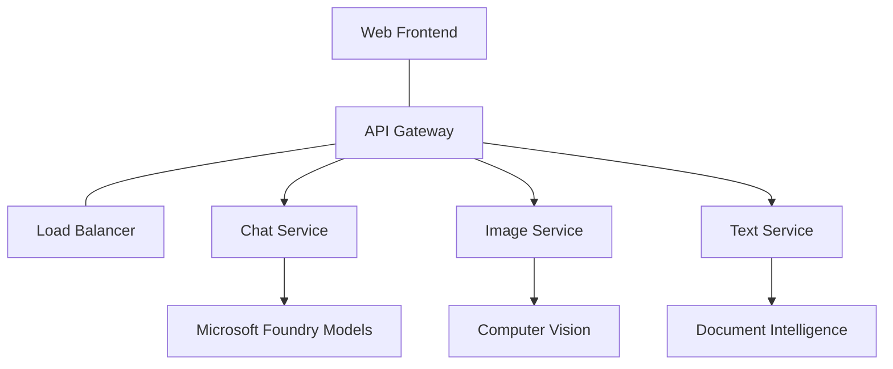

# Mazoezi Bora ya Mizigo ya AI kwa Uzalishaji kwa AZD

**Uelekezaji wa Sura:**
- **📚 Nyumbani kwa Kozi**: [AZD Kwa Kompyuta Wa Kuanza](../../README.md)
- **📖 Sura ya Sasa**: Sura 8 - Miundo ya Uzalishaji & Biashara
- **⬅️ Sura Iliyoisha**: [Sura 7: Utatuzi wa Matatizo](../chapter-07-troubleshooting/debugging.md)
- **⬅️ Pia Inahusiana**: [Maabara ya Semina ya AI](../chapter-02-ai-development/ai-workshop-lab.md)
- **🎯 Kozi Imemalizika**: [AZD Kwa Kompyuta Wa Kuanza](../../README.md)

## Muhtasari

Mwongozo huu unaelezea muundo wa AI wa uzalishaji ukitumia Azure Developer CLI (AZD). Ni rejeleo la muundo, si programu inayoweza kuwekwa au vyeti vya uzalishaji.

**Mipaka ya Mfano:** Isipokuwa imeelezwa wazi kuwa kamili, vipande vya Bicep vinadhani vigezo na rasilimali zinazorejelewa kutoka kwenye kiolezo kilichomo. Vinapoacha picha/mipango ya mwenyeji, vitambulisho, udelezaji wa nafasi, DNS, matokeo, na ushirikiano mwingine unaohitajika. Njia za huduma ya YAML na vijaribu/vipengele vya hook ni faili za mfano za kuunda katika **programu yako mwenyewe**; haya yanatolewa na kozi hii siyo. Tumia mfano wa AZD unaofanya kazi kama msingi, kukuza miundombinu kamili, na kuijaribu katika mazingira yaliyojitenga kabla ya uzalishaji.

## Changamoto Muhimu Zilizoshughulikiwa

Masuala ya kawaida ya uzalishaji ni pamoja na kuanzishwa kwa huduma nyingi, usimamizi wa kitambulisho na siri, upanuzi, udhibiti wa gharama, na ufuatiliaji. Hakuna ushahidi wa uenezi unaodaiwa hapa.

## Miundo ya Usanifu kwa AI ya Uzalishaji

### Muundo 1: Miundombinu ya AI ya Microservices

**Wakati wa kutumia**: Programu tata za AI zenye uwezo mwingi



**Utekelezaji wa AZD**:

```yaml
# azure.yaml
name: enterprise-ai-platform
services:
  web:
    project: ./web
    host: staticwebapp
  api-gateway:
    project: ./api-gateway
    host: containerapp
  chat-service:
    project: ./services/chat
    host: containerapp
  vision-service:
    project: ./services/vision
    host: containerapp
  text-service:
    project: ./services/text
    host: containerapp
```

### Muundo 2: Usindikaji wa AI unaotegemea Matukio

**Wakati wa kutumia**: Usindikaji wa kundi, uchambuzi wa nyaraka, michakato isiyo ya wakati halisi

```bicep
// Event Hub for AI processing pipeline
resource eventHub 'Microsoft.EventHub/namespaces@2024-01-01' = {
  name: eventHubNamespaceName
  location: location
  sku: {
    name: 'Standard'
    tier: 'Standard'
    capacity: 1
  }
}

// Service Bus for reliable message processing
resource serviceBus 'Microsoft.ServiceBus/namespaces@2024-01-01' = {
  name: serviceBusNamespaceName
  location: location
  sku: {
    name: 'Premium'
    tier: 'Premium'
    capacity: 1
  }
}

// Function App for processing
resource functionApp 'Microsoft.Web/sites@2023-01-01' = {
  name: functionAppName
  location: location
  kind: 'functionapp,linux'
  properties: {
    siteConfig: {
      appSettings: [
        {
          name: 'FUNCTIONS_EXTENSION_VERSION'
          value: '~4'
        }
        {
          name: 'AZURE_OPENAI_ENDPOINT'
          value: '@Microsoft.KeyVault(VaultName=${keyVault.name};SecretName=openai-endpoint)'
        }
      ]
    }
  }
}
```

Hii huunda vipande vya nafasi ya majina, si vituo, safu, usajili, au utekelezaji wa Function. Function inayoweza kutekelezwa pia inahitaji mpango wa mwenyeji, usanidi wa runtime/hifadhi, kitambulisho kilichounganishwa, RBAC, na upatikanaji wa mtandao. Marejeleo ya Key Vault yanahitaji ruhusa ya kusoma siri; URL ya mwisho yenyewe si cheti.

## Kufikiria Kuhusu Afya ya Wakala wa AI

Wakati programu ya wavuti ya jadi inapovunjika, dalili ni za kawaida: ukurasa hauendi, API inarudisha kosa, au kuanzishwa kunashindwa. Programu zilizotumia AI zinaweza kuvunjika kwa njia zile zile—lakini pia zinaweza kufanya makosa kwa njia ambazo haziwasilishi ujumbe wa kosa wazi.

Sehemu hii inakusaidia kujenga mfano wa akili wa kufuatilia mizigo ya AI ili ujue wapi kutazama wakati mambo hayako sawa.

### Jinsi Afya ya Wakala Inavyotofautiana na Afya ya Programu za Kawaida

Programu za jadi pia zinaweza kuwa na makosa ya usahihi kidogo. Wakala wa AI huongeza ubora wa majibu usiotabirika kwa wasiwasi wa kawaida wa upatikanaji na usahihi. Fikiria afya ya wakala kwa tabaka mbili:

| Tabaka | Kitu cha Kuangalia | Mahali pa Kutazama |
|-------|--------------|---------------|
| **Afya ya miundombinu** | Je huduma inaendelea kufanya kazi? Je rasilimali zimeandaliwa? Je vituo vya mwisho vinapatikana? | `azd monitor`, afya ya rasilimali kwenye Azure Portal, kumbukumbu za kontena/programu |
| **Afya ya tabia** | Je wakala anajibu kwa usahihi? Je majibu yanatolewa kwa wakati? Je mfano unaitwa kwa usahihi? | Ufuatiliaji wa Application Insights, vipimo vya ucheleweshaji wa mizungumzo ya mfano, kumbukumbu za ubora wa majibu |

Afya ya miundombinu ni iliyojulikana—ni sawa kwa programu yoyote ya azd. Afya ya tabia ni tabaka jipya ambalo mizigo ya AI inaleta.

### Wapi Kuangalia Wakati Programu za AI Hazifanyi Kulingana na Mawazo

Ikiwa programu yako ya AI haina kutoa matokeo unayotegemea, hapa kuna orodha ya dhana:

1. **Anza na mambo ya msingi.** Je programu inafanya kazi? Inapatiwa huduma zake? Angalia `azd monitor` na afya ya rasilimali kama unavyofanya kwa programu yoyote.
2. **Kagua muunganisho wa mfano.** Je programu yako inaweza kuita mfano wa AI kwa mafanikio? Kuitwa kwa mfano kwa kushindwa au kuchelewa ni sababu ya kawaida ya matatizo ya programu za AI na itaonekana kwenye kumbukumbu za programu yako.
3. **Chunguza matokeo na msingi kwa usalama.** Majibu mabaya yanaweza kutokana na utafutaji, maelekezo, vizingiti vya mfano, au utekelezaji wa zana. Tumia data za uchunguzi zilizounganishwa na udhibiti wa upatikanaji; usiwezesha kurekodi bila kuchuja kwa maombi/majibu katika uzalishaji.
4. **Pitisha ucheleweshaji wa majibu.** Kuitwa kwa mfano wa AI ni polepole kuliko API za kawaida. Ikiwa programu yako inahisi kuvunjika kasi, angalia kama muda wa majibu ya mfano umeongezeka—hii inaweza kuashiria kubanwa, mipaka ya uwezo, au msongamano wa kiwango cha eneo.
5. **Tazama ishara za gharama.** Mlipuko usiotegemewa wa matumizi ya tokeni au API unaweza kuashiria mzunguko, amri iliyopotea, au majaribio mengi.

Huna haja ya kuyaelewa kabisa zana za ufuatiliaji mara moja. Suala kuu ni kuwa programu za AI zina tabaka la ziada la tabia la kufuatilia, na ufuatiliaji ulioko ndani ya azd (`azd monitor`) unakupa msingi wa kuanza kuchunguza tabaka zote mbili.

---

## Mazoezi Bora ya Usalama

### 1. Mfano wa Usalama wa Hakuna Kuamini (Zero-Trust)

**Mkakati wa Utekelezaji**:
- Hakuna mawasiliano ya huduma kwa huduma bila uthibitisho
- Kuitwa zote za API zinatumia vitambulisho vinavyodhibitiwa
- Kutengwa kwa mtandao na vituo vya kibinafsi
- Udhibiti wa upatikanaji wa angalau ruhusa inayohitajika

```bicep
// Managed Identity for each service
resource chatServiceIdentity 'Microsoft.ManagedIdentity/userAssignedIdentities@2023-01-31' = {
  name: 'chat-service-identity'
  location: location
}

// Role assignments with minimal permissions
resource openAIUserRole 'Microsoft.Authorization/roleAssignments@2022-04-01' = {
  scope: openAIAccount
  name: guid(openAIAccount.id, chatServiceIdentity.id, '5e0bd9bd-7b93-4f28-af87-19fc36ad61bd')
  properties: {
    roleDefinitionId: subscriptionResourceId('Microsoft.Authorization/roleDefinitions', '5e0bd9bd-7b93-4f28-af87-19fc36ad61bd')
    principalId: chatServiceIdentity.properties.principalId
    principalType: 'ServicePrincipal'
  }
}
```

### 2. Usimamizi Salama wa Siri

**Mfano wa Ushirikiano wa Key Vault**:

```bicep
// Key Vault with proper access policies
resource keyVault 'Microsoft.KeyVault/vaults@2023-02-01' = {
  name: keyVaultName
  location: location
  properties: {
    tenantId: tenant().tenantId
    sku: {
      family: 'A'
      name: 'standard' // Premium is needed for HSM-backed keys, not ordinary secrets
    }
    enableRbacAuthorization: true  // Use RBAC instead of access policies
    enablePurgeProtection: true    // Prevent accidental deletion
    enableSoftDelete: true
    softDeleteRetentionInDays: 90
  }
}

// Optional legacy key-auth alternative; omit when using Entra ID.
resource openAIKeySecret 'Microsoft.KeyVault/vaults/secrets@2023-02-01' = {
  parent: keyVault
  name: 'openai-api-key'
  properties: {
    value: openAIAccount.listKeys().key1
    attributes: {
      enabled: true
    }
  }
}
```

Toa kitambulisho cha runtime `Key Vault Secrets User` katika upeo unaofaa na ukibandike kwenye mwenyeji; `enableRbacAuthorization` pekee haipatikani na upatikanaji. Tumia upatikanaji wa kitambulisho ulioendeshwa na OpenAI na `disableLocalAuth: true`. Siri ya mfuniko ni ya hiari na ina maana tu kwa akaunti iliyowezeshwa kwa makusudi, na mhusika wa utayarishaji pia anahitaji ruhusa ya kuandika siri.

### 3. Usalama wa Mtandao

**Usanidi wa Vituo vya Kibinafsi**:

```bicep
// Virtual Network for AI services
resource virtualNetwork 'Microsoft.Network/virtualNetworks@2023-04-01' = {
  name: vnetName
  location: location
  properties: {
    addressSpace: {
      addressPrefixes: ['10.0.0.0/16']
    }
    subnets: [
      {
        name: 'ai-services-subnet'
        properties: {
          addressPrefix: '10.0.1.0/24'
          privateEndpointNetworkPolicies: 'Disabled'
        }
      }
      {
        name: 'app-services-subnet'
        properties: {
          addressPrefix: '10.0.2.0/24'
          delegations: [
            {
              name: 'Microsoft.Web/serverFarms'
              properties: {
                serviceName: 'Microsoft.Web/serverFarms'
              }
            }
          ]
        }
      }
    ]
  }
}

// Private endpoints for all AI services
resource openAIPrivateEndpoint 'Microsoft.Network/privateEndpoints@2023-04-01' = {
  name: '${openAIAccountName}-pe'
  location: location
  properties: {
    subnet: {
      id: virtualNetwork.properties.subnets[0].id
    }
    privateLinkServiceConnections: [
      {
        name: 'openai-connection'
        properties: {
          privateLinkServiceId: openAIAccount.id
          groupIds: ['account']
        }
      }
    ]
  }
}
```

Vituo vya kibinafsi pia vinahitaji makundi ya kikoa cha DNS ya kibinafsi/viungo vya VNet na ushirikiano wa VNet wa programu. Haviwezi kuzuilia upatikanaji wa umma moja kwa moja: zima upatikanaji wa mtandao wa umma wa akaunti ya AI baada ya kuthibitisha muunganisho wa kibinafsi na upatikanaji wa utekelezaji.

## Utendaji na Upanuzi

### 1. Mikakati ya Kujisafisha Kiotomati (Auto-Scaling)

**Kujisafisha Kiotomati kwa Programu za Kontena**:

```bicep
resource containerApp 'Microsoft.App/containerApps@2023-05-01' = {
  name: containerAppName
  location: location
  properties: {
    configuration: {
      ingress: {
        external: true
        targetPort: 8000
        transport: 'http'
      }
    }
    template: {
      scale: {
        minReplicas: 2  // Always have 2 instances minimum
        maxReplicas: 50 // Scale up to 50 for high load
        rules: [
          {
            name: 'http-scaling'
            http: {
              metadata: {
                concurrentRequests: '20'  // Scale when >20 concurrent requests
              }
            }
          }
          {
            name: 'cpu-scaling'
            custom: {
              type: 'cpu'
              metadata: {
                type: 'Utilization'
                value: '70'  // Scale when CPU >70%
              }
            }
          }
        ]
      }
    }
  }
}
```

### 2. Mikakati ya Kuhifadhi Vichache (Caching)

**Cache ya Redis kwa Majibu ya AI**:

```bicep
// Legacy Azure Cache for Redis example (not recommended for new deployments)
resource redisCache 'Microsoft.Cache/redis@2023-04-01' = {
  name: redisCacheName
  location: location
  properties: {
    sku: {
      name: 'Premium'
      family: 'P'
      capacity: 1
    }
    enableNonSslPort: false
    minimumTlsVersion: '1.2'
    redisConfiguration: {
      'maxmemory-policy': 'allkeys-lru'
    }
    // Sharding distributes data; replication/failover provides availability.
    shardCount: 2
  }
}

// Cache configuration in application
var cacheConnectionString = '${redisCache.properties.hostName}:6380,password=${redisCache.listKeys().primaryKey},ssl=True,abortConnect=False'
```

Azure Cache kwa Redis Basic/Standard/Premium iko kwenye [njia ya kustaafu](https://learn.microsoft.com/azure/azure-cache-for-redis/retirement-faq). Tumia Azure Managed Redis kwa miundo mipya na usanidi wake wa SKU, kitambulisho, na TLS, badala ya kunakili rasilimali hii ya zamani katika mfumo mpya wa uzalishaji. Mstari wa kiungo ni mahali pa kujaza zisizofanya kazi, si cheti. Gawanya funguo za cache kwa idhini, mfano/maelekezo, na toleo la utafutaji, pamoja na kumalizika; cache ya kuulizia tu inayo shirikiwa inaweza kufichua data za mtumiaji mwingine.

### 3. Usawazishaji Mzigo na Usimamizi wa Trafiki

**Gateway ya Programu na WAF**:

```bicep
// Application Gateway with Web Application Firewall
resource applicationGateway 'Microsoft.Network/applicationGateways@2023-04-01' = {
  name: appGatewayName
  location: location
  properties: {
    sku: {
      name: 'WAF_v2'
      tier: 'WAF_v2'
      capacity: 2
    }
    webApplicationFirewallConfiguration: {
      enabled: true
      firewallMode: 'Prevention'
      ruleSetType: 'OWASP'
      ruleSetVersion: '3.2'
    }
    // Backend pools for AI services
    backendAddressPools: [
      {
        name: 'ai-services-pool'
        properties: {
          backendAddresses: [
            {
              fqdn: '${containerApp.properties.configuration.ingress.fqdn}'
            }
          ]
        }
      }
    ]
  }
}
```

Hii ni rasilimali ya gateway ya sehemu tu: utekelezaji halisi pia unahitaji usanidi wa subnet/IP ya gateway, IP za mbele na bandari, wasikilizaji/cheti cha TLS, mipangilio ya HTTP ya nyuma/mipimo, sheria za routing na vipaumbele, na sera ya WAF iliyopitiwa. TLS hostname/SNI na uthibitisho lazima viendane na backend ya Container App.

## 💰 Uboreshaji wa Gharama

### 1. Ukubwa wa Rasilimali Kulingana na Mahitaji

**Usanidi Maalum kwa Mazingira**:

Majina haya ni **ingizo za kiolezo cha kawaida za mfano**, si mipangilio ya moja kwa moja ya AZD. Tafsiri kila moja katika `infra/main.parameters.json`/Bicep na usanidi wa mwenyeji kwanza. Kwa mfano, mfano wa RAG hutumia `AZURE_SEARCH_SERVICE_SKU` na `AZURE_OPENAI_CHATGPT_DEPLOYMENT_CAPACITY`, si majina ya kawaida hapo chini. Toa kumbukumbu za Container Apps na kitengo kinachoungwa mkono kama `1Gi` katika rasilimali halisi. Tumia mabadiliko ya miundombinu na `azd up` au `azd provision`; `azd deploy` pekee haisasishi mabadiliko ya Bicep.

```bash
# Development environment
azd env new development
azd env set AZURE_OPENAI_SKU "S0"
azd env set AZURE_OPENAI_CAPACITY 10
azd env set AZURE_SEARCH_SKU "basic"
azd env set CONTAINER_CPU 0.5
azd env set CONTAINER_MEMORY 1.0

# Production environment  
azd env new production
azd env set AZURE_OPENAI_SKU "S0"
azd env set AZURE_OPENAI_CAPACITY 100
azd env set AZURE_SEARCH_SKU "standard"
azd env set CONTAINER_CPU 2.0
azd env set CONTAINER_MEMORY 4.0
```

### 2. Ufuatiliaji wa Gharama na Bajeti

```bicep
// Supply the first day of the current UTC month, e.g. 2026-11-01T00:00:00Z.
param budgetStartDate string

// Cost management and budgets
resource budget 'Microsoft.Consumption/budgets@2024-08-01' = {
  name: 'ai-workload-budget'
  properties: {
    timePeriod: {
      startDate: budgetStartDate
    }
    timeGrain: 'Monthly'
    amount: 2000  // In the billing currency, not necessarily USD
    category: 'Cost'
    notifications: {
      warning: {
        enabled: true
        operator: 'GreaterThan'
        threshold: 80
        contactEmails: [
          'finance@company.com'
          'engineering@company.com'
        ]
        contactRoles: [
          'Owner'
          'Contributor'
        ]
      }
      critical: {
        enabled: true
        operator: 'GreaterThan'
        threshold: 95
        contactEmails: [
          'cto@company.com'
        ]
      }
    }
  }
}
```

Badilisha wapokeaji wa mfano na angalia upeo/uruhusa. Onyo za bajeti hutumia data iliyocheleweshwa ya bili na hazianzishi kikomo cha matumizi.

### 3. Uboreshaji wa Matumizi ya Tokeni

**Usimamizi wa Gharama wa OpenAI**:

Hii ni njia ya haraka inayotegemea herufi kwa muhtasari wa UI, **sio** kimsingi ya kikomo cha tokeni cha mfano. Msimbo wa uzalishaji lazima utumie tokenizer inayofaa kwa mfano ulioanzishwa na izingatie maagizo ya mfumo, muundo wa zana, historia, na bajeti ya toleo. Kataa ujumbe mkubwa wa mtumiaji badala ya kuufupisha kimya.

```typescript
// Application-level token optimization
class TokenOptimizer {
  private readonly maxTokens = 4000;
  private readonly reserveTokens = 500;
  
  optimizePrompt(userInput: string, context: string): string {
    const availableTokens = this.maxTokens - this.reserveTokens;
    if (this.estimateTokens(userInput) + 8 >= availableTokens) {
      throw new Error("User input exceeds the illustrative prompt budget");
    }
    const estimatedTokens = this.estimateTokens(userInput + context) + 8;
    
    if (estimatedTokens > availableTokens) {
      // Truncate context, not user input
      context = this.truncateContext(context, Math.max(0, availableTokens - this.estimateTokens(userInput) - 8));
    }
    
    return `${context}\n\nUser: ${userInput}`;
  }
  
  private estimateTokens(text: string): number {
    // Rough estimation: 1 token ≈ 4 characters
    return Math.ceil(text.length / 4);
  }

  private truncateContext(text: string, estimatedBudget: number): string {
    return text.slice(0, Math.max(0, estimatedBudget) * 4);
  }
}
```

## Ufuatiliaji na Uwezekano wa Kuangalia

### 1. Application Insights Kamili

```bicep
// Application Insights with advanced features
resource applicationInsights 'Microsoft.Insights/components@2020-02-02' = {
  name: applicationInsightsName
  location: location
  kind: 'web'
  properties: {
    Application_Type: 'web'
    WorkspaceResourceId: logAnalyticsWorkspace.id
    SamplingPercentage: 100  // Ingestion setting; review cost and SDK sampling separately
    DisableIpMasking: false  // Retain IP masking
  }
}

// Custom metrics for AI operations
resource aiMetricAlerts 'Microsoft.Insights/metricAlerts@2018-03-01' = {
  name: 'ai-high-error-rate'
  location: 'global'
  properties: {
    description: 'Alert when failed request count exceeds 10 in five minutes'
    severity: 2
    enabled: true
    scopes: [
      applicationInsights.id
    ]
    evaluationFrequency: 'PT1M'
    windowSize: 'PT5M'
    criteria: {
      'odata.type': 'Microsoft.Azure.Monitor.SingleResourceMultipleMetricCriteria'
      allOf: [
        {
          name: 'high-error-rate'
          metricName: 'requests/failed'
          operator: 'GreaterThan'
          threshold: 10
          timeAggregation: 'Count'
        }
      ]
    }
  }
}
```

### 2. Ufuatiliaji Maalum kwa AI

**Mbunifu wa Dashibodi za Maendeleo ya AI**:

```json
{
  "dashboard": {
    "name": "AI Application Monitoring",
    "tiles": [
      {
        "name": "OpenAI Request Volume",
        "query": "dependencies | where target contains 'openai' | summarize count() by bin(timestamp, 5m)"
      },
      {
        "name": "AI Response Latency",
        "query": "dependencies | where target contains 'openai' | summarize avg(duration) by bin(timestamp, 5m)"
      },
      {
        "name": "Token Usage",
        "query": "customMetrics | where name == 'openai_tokens_used' | summarize sum(value) by bin(timestamp, 1h)"
      },
      {
        "name": "Cost per Hour",
        "query": "customMetrics | where name == 'openai_cost' | summarize sum(value) by bin(timestamp, 1h)"
      }
    ]
  }
}
```

JSON hii ni mchoro uliotengenezwa na programu, si muundo wa dashibodi wa Azure portal unaoingiliana. Maswali ya tokeni/gharama yanahitaji programu yako kutoa vipimo maalum hivyo; havitengeneziwa na AZD. Badilisha chujio za tegemezi kwa jina halisi la mwisho/kipindi cha mfano wako.

### 3. Ukaguzi wa Afya na Ufuatiliaji wa Upatikanaji

```bicep
// Application Insights availability tests
resource availabilityTest 'Microsoft.Insights/webtests@2022-06-15' = {
  name: 'ai-app-availability-test'
  location: location
  tags: {
    'hidden-link:${applicationInsights.id}': 'Resource'
  }
  properties: {
    SyntheticMonitorId: 'ai-app-availability-test'
    Name: 'AI Application Availability Test'
    Description: 'Tests AI application endpoints'
    Enabled: true
    Frequency: 300  // 5 minutes
    Timeout: 120    // 2 minutes
    Kind: 'standard'
    Locations: [
      {
        Id: 'us-east-2-azr'
      }
      {
        Id: 'us-west-2-azr'
      }
    ]
    Request: {
      RequestUrl: 'https://${webApp.properties.defaultHostName}/health'
      HttpVerb: 'GET'
      FollowRedirects: true
      ParseDependentRequests: false
    }
    ValidationRules: {
      ExpectedHttpStatusCode: 200
      SSLCheck: true
      SSLCertRemainingLifetimeCheck: 7
    }
  }
}
```

## Urejeshaji wa Majanga na Upatikanaji wa Juu

Jaribio lililotangulia linadhani kuwa App Service `webApp` na rasilimali ya Application Insights ipo. Majaribio ya upatikanaji wa kawaida yanatozwa na yanahitaji kiungo kinachopatikana; programu za kibinafsi pekee zinahitaji muundo wa ufuatiliaji wa kibinafsi unaofaa. Jaribio la ping ya URL limetolewa; tumia [majaribio ya kawaida ya upatikanaji](https://learn.microsoft.com/azure/azure-monitor/app/availability).

### 1. Utekelezaji wa Maeneo Mengi

```yaml
# azure.yaml - Multi-region configuration
name: ai-app-multiregion
services:
  api-primary:
    project: ./api
    host: containerapp
    env:
      AZURE_REGION: eastus
  api-secondary:
    project: ./api
    host: containerapp
    env:
      AZURE_REGION: westus2
```

```bicep
// Separate App Service topology, not the Container Apps declarations above
resource trafficManager 'Microsoft.Network/trafficManagerProfiles@2022-04-01' = {
  name: trafficManagerProfileName
  location: 'global'
  properties: {
    profileStatus: 'Enabled'
    trafficRoutingMethod: 'Priority'
    dnsConfig: {
      relativeName: trafficManagerProfileName
      ttl: 30
    }
    monitorConfig: {
      protocol: 'HTTPS'
      port: 443
      path: '/health'
      intervalInSeconds: 30
      toleratedNumberOfFailures: 3
      timeoutInSeconds: 10
    }
    endpoints: [
      {
        name: 'primary-endpoint'
        type: 'Microsoft.Network/trafficManagerProfiles/azureEndpoints'
        properties: {
          targetResourceId: primaryAppService.id
          endpointStatus: 'Enabled'
          priority: 1
        }
      }
      {
        name: 'secondary-endpoint'
        type: 'Microsoft.Network/trafficManagerProfiles/azureEndpoints'
        properties: {
          targetResourceId: secondaryAppService.id
          endpointStatus: 'Enabled'
          priority: 2
        }
      }
    ]
  }
}
```

Vigezo vya mazingira haviamui maeneo ya rasilimali. IaC lazima iandae wenyeji wa kikanda tofauti na kubandika kila huduma na lebo za `resourceName` au `azd-service-name`. Mfano wa Traffic Manager ni **muundo tofauti wa App Service** (`primaryAppService`/`secondaryAppService`), si routing kwa tamko za Container Apps. Container Apps inahitaji kiungo cha nje/mlango wa mbele uliosanidiwa ipasavyo, TLS/routing ya kikoa maalum, na vipimo vya afya.

### 2. Nakala Hifadhi na Urejeshaji wa Data

```bicep
// Backup configuration for critical data
resource backupVault 'Microsoft.DataProtection/backupVaults@2023-05-01' = {
  name: backupVaultName
  location: location
  identity: {
    type: 'SystemAssigned'
  }
  properties: {
    storageSettings: [
      {
        datastoreType: 'VaultStore'
        type: 'LocallyRedundant'
      }
    ]
  }
}

```

Hazina pekee haifanyi nakala rudufu ya chochote. Sanidi **sera maalum ya mzigo wa kazi iliyoungwa mkono na mfano wa nakala rudufu**, ruhusa za chanzo, uhifadhi, na majaribio ya urejesho ukitumia [meza za msaada za Azure Backup](https://learn.microsoft.com/azure/backup/backup-support-matrix). Hakuna sera ya jumla ya Azure Backup kwa usambazaji wa mifano ya Azure OpenAI iliyoandaliwa. Hifadhi ufafanuzi wa miundombinu/upangaji wa mfano katika udhibiti wa chanzo; lindanisha nyaraka zilizoingizwa, data ya programu, na vipande vya kuimarisha mafunzo kwa kutumia huduma za nakala rudufu/kupakia zinazoungwa mkono na kila huduma ya mizizi. Eleza na jaribu RPO/RTO waziwazi.

## Mchanganyiko wa DevOps na CI/CD

### 1. Mtiririko wa Kazi wa GitHub Actions

```yaml
# .github/workflows/deploy-ai-app.yml
name: Deploy AI Application

on:
  push:
    branches: [main]
  pull_request:
    branches: [main]

jobs:
  test:
    runs-on: ubuntu-latest
    steps:
      - uses: actions/checkout@v4
      
      - name: Setup Python
        uses: actions/setup-python@v4
        with:
          python-version: '3.11'
          
      - name: Install dependencies
        run: |
          pip install -r requirements.txt
          pip install pytest
          
      - name: Run tests
        run: pytest tests/
        
      - name: AI Safety Tests
        run: |
          python scripts/test_ai_safety.py
          python scripts/validate_prompts.py

```

Hii ni **sehemu ya majaribio tu** ya mtiririko wa kazi na inadhani umetoa `requirements.txt`, `tests/`, na hati mbili za usalama. Ongeza kazi za upatikanaji/hudumiaji za OIDC zilizothibitishwa kutoka [Usanidi wa Mtiririko wa CI/CD](#cicd-pipeline-configuration), ukiambatanisha `needs: test`, kusukuma kwa kuaminika/kuchochea kwa mkono, na mazingira ya GitHub yaliyolindwa. Usisambaze msimbo wa maombi usioaminika wenye taarifa za wingu. Mcheza mpya hana mazingira ya AZD iliyochaguliwa hapa huko; toa maingizo ya mazingira/ada/muhali na tumia `azd auth login`, si tu `azure/login`.

### 2. Uthibitishaji wa Miundombinu

```bash
# scripts/validate_infrastructure.sh
#!/bin/bash
set -euo pipefail

echo "Validating AI infrastructure deployment..."

# Requires Azure CLI login and the resource group selected explicitly.
: "${AZURE_RESOURCE_GROUP:?Set AZURE_RESOURCE_GROUP}"
: "${AZURE_OPENAI_NAME:?Set AZURE_OPENAI_NAME}"
: "${AZURE_OPENAI_CHAT_DEPLOYMENT:?Set the actual deployment name}"

# A successful empty list is not proof that resources exist.
types=("Microsoft.CognitiveServices/accounts" "Microsoft.Search/searchServices"
       "Microsoft.Storage/storageAccounts" "Microsoft.KeyVault/vaults")
for resource_type in "${types[@]}"; do
    count=$(az resource list --resource-group "$AZURE_RESOURCE_GROUP" \
        --resource-type "$resource_type" --query "length(@)" -o tsv)
    if [[ "$count" -lt 1 ]]; then
        echo "ERROR: No $resource_type found in $AZURE_RESOURCE_GROUP"
        exit 1
    fi
done

# Validate OpenAI model deployments
echo "Validating OpenAI model deployments..."
state=$(az cognitiveservices account deployment show \
  --name "$AZURE_OPENAI_NAME" --resource-group "$AZURE_RESOURCE_GROUP" \
  --deployment-name "$AZURE_OPENAI_CHAT_DEPLOYMENT" \
  --query "properties.provisioningState" -o tsv)
if [[ "$state" != "Succeeded" ]]; then
    echo "ERROR: Required model deployment is not provisioned successfully"
    exit 1
fi

echo "Infrastructure validation completed successfully!"
```

Kinatarajiwa: exit sifuri na ujumbe wa kumaliza tu wakati aina zote zinazotarajiwa zipo na usambazaji wa mfano uliotajwa umetengwa. Hii inakagua hali ya orodha/usambazaji, **sio** afya ya rasilimali, usanifu halisi, RBAC, uwezo wa mtandao, au tabia ya mfano. Badilisha aina zinazotarajiwa kulingana na usanifu wako, kisha fanya jaribio la utayari la maombi lililo thibitishwa kando.

## Orodha ya Ukamilifu wa Uzalishaji

### Usalama ✅
- [ ] Huduma zote zitumie utambulisho ulioendeshwa
- [ ] Siri zihakikishiwe katika Hazina ya Funguo
- [ ] Mifumo ya mwisho wa binafsi imesanidiwa
- [ ] Vikundi vya usalama wa mtandao vilitekelezwa
- [ ] RBAC kwa haki chache zaidi
- [ ] WAF imewezeshwa kwenye miisho ya umma

### Utendaji ✅
- [ ] Kujipanga mara moja kusanidiwa
- [ ] Kuhifadhi katika cache kutekelezwa
- [ ] Usawazishaji mzigo umewekwa
- [ ] CDN kwa maudhui yasiyobadilika
- [ ] Kuhifadhi uhusiano wa hifadhidata kwa vikundi
- [ ] Uboreshaji wa matumizi ya tokeni

### Ufuatiliaji ✅
- [ ] Application Insights imesanidiwa
- [ ] Vipimo maalum vimefafanuliwa
- [ ] Sheria za tahadhari zimewekwa
- [ ] Dashibodi imetengenezwa
- [ ] Uhakiki wa afya umefanywa
- [ ] Sera za uhifadhi wa kumbukumbu za magogo

### Uaminifu ✅
- [ ] Usambazaji wa mikoa mingi
- [ ] Mpango wa nakala rudufu na urejesho
- [ ] Vizimio vya mzunguko vilitekelezwa
- [ ] Sera za jaribio zilisanidiwa
- [ ] Upunguzaji wa polepole
- [ ] Njia za uhakiki wa afya

### Usimamizi wa Gharama ✅
- [ ] Tahadhari za bajeti zimesanidiwa
- [ ] Uhakiki wa ukubwa sahihi wa rasilimali
- [ ] Punguzo la gharama la majaribio/maendeleo
- [ ] Ununuzi wa mifano iliyohifadhiwa
- [ ] Dashibodi ya ufuatiliaji wa gharama
- [ ] Ukaguzi wa mara kwa mara wa gharama

### Uzingatiaji ✅
- [ ] Mahitaji ya makazi ya data yamekamilika
- [ ] Ufuatiliaji wa ukaguzi umewezeshwa
- [ ] Sera za uzingatiaji zimewekwa
- [ ] Misingi ya usalama imetekelezwa
- [ ] Tathmini za usalama za kawaida
- [ ] Mpango wa majibu ya matukio

## Vipimo vya Utendaji

### Malengo ya Uzalishaji Yanayoeleweka

Hizi ni mifano ya SLO za kujadiliana na kupima mzigo, si vipimo vilivyopimwa au dhamana. Muda wa majibu hutegemea mfano/urefu wa matokeo; matumizi ya tokeni ya kila mwezi hutegemea trafiki na bei, si tu idadi ya tokeni.

| Kipimo | Lengo | Ufuatiliaji |
|--------|--------|------------|
| **Muda wa Majibu** | < 2 sekunde | Application Insights |
| **Upatikanaji** | 99.9% | Ufuatiliaji wa uptime |
| **Kiwango cha Makosa** | < 0.1% | Magogo ya maombi |
| **Matumizi ya Mfano** | < $500/kwa mwezi (mfano wa bajeti) | Usimamizi wa gharama |
| **Watumiaji Wanaosheheni Wakati Mmoja** | 1000+ | Mtihani wa mzigo |
| **Muda wa Kupona** | < 1 saa | Majaribio ya kupona dharura |

### Upimaji Mzigo

Ifuatayo ni mchoro wa kiolesura kwa ajili ya skripti ya mtihani wa mzigo **unaopaswa kutekeleza**; hazina hii haipangi `scripts/load_test.py`. Fafanua mzigo wa maombi, uthibitishaji, mizigo ya mfano, dai la ucheleweshaji/kosa la asilimia, na kizuizi cha matumizi katika chombo chako cha mtihani wa mzigo kabla ya kuendesha:

```bash
# Load testing script for AI applications
python scripts/load_test.py \
  --endpoint https://your-ai-app.azurewebsites.net \
  --concurrent-users 100 \
  --duration 300 \
  --ramp-up 60
```

## 🤝 Mbinu Bora za Jamii

Kulingana na maoni ya jumuiya ya Microsoft Foundry Discord:

### Mapendekezo Kuu kutoka Jamii:

1. **Anza Kidogo, Panua Kidogo Kidogo**: Anza na SKUs rahisi na panua kulingana na matumizi halisi
2. **Tazama Kila Kitu**: Tengeneza ufuatiliaji kamili tangu siku ya kwanza
3. **Automatiki Usalama**: Tumia miundombinu kama msimbo kwa usalama thabiti
4. **Jaribu kwa Kina**: Jumuisha majaribio maalum ya AI katika mchakato wako
5. **Panga Gharama**: Fuata matumizi ya tokeni na wape arifa za bajeti mapema

### Makosa Yanayojirudia Kuepukwa:

- ❌ Kutumia funguo za API zilizobadilishwa moja kwa moja katika msimbo
- ❌ Kutoweka ufuatiliaji sahihi
- ❌ Kupuuzia uboreshaji wa gharama
- ❌ Kutofanya majaribio ya hali za kushindwa
- ❌ Kuweka bila ukaguzi wa afya

## Amri na Viendelezi vya AZD AI CLI

AZD inajumuisha seti inayokua ya amri maalum za AI na viendelezi vinavyorahisisha mchakato wa AI wa uzalishaji. Vifaa hivi huunganisha maendeleo ya ndani na usambazaji wa uzalishaji wa mizigo ya AI.

> **Mapitio ya toleo (2026-11-04):** Mwongozo wa CLI ulio hapa chini ulipimwa dhidi ya matoleo yaliyochapishwa ya `azd` **1.37.2**, `azure.ai.agents` **1.0.0-beta.23**, na `azure.ai.evaluations` **1.0.0-beta.2**. Wakala beta.23 inahitaji `azd >= 1.37.0`; tathmini beta.2 inahitaji `azd >= 1.33.0`. Tumia angalau 1.37.0 kwa mchakato uliojumlishwa. Hii ni ukaguzi wa nyaraka/makala, si uthibitishaji wa usambazaji wa Azure unaoendelea.

### Viendelezi vya AZD kwa AI

AZD hutumia mfumo wa viendelezi kuongeza uwezo maalum wa AI. Sakinisha na simamia viendelezi kwa:

```bash
# List all available extensions (including AI)
azd extension list

# Inspect installed extension details
azd version
azd extension show azure.ai.agents

# Install the Foundry agents extension
azd extension install azure.ai.agents

# Install the separate Foundry evaluations extension
azd extension install azure.ai.evaluations

# Install the fine-tuning extension
azd extension install azure.ai.finetune

# Install the custom models extension
azd extension install azure.ai.models

# Upgrade all installed extensions
azd extension upgrade --all
```

**Viendelezi vya AI vinavyopatikana:**

| Kiendelezi | Kusudi | Hali |
|-----------|---------|--------|
| `azure.ai.agents` | Usimamizi wa Huduma ya Wakala wa Foundry | Maonyesho |
| `azure.ai.evaluations` | Hifadhidata za tathmini, wataathiri, makundi ya tathmini, na utekelezaji | Maonyesho |
| `azure.ai.skills` | Ujuzi wa wakala unaoweza kutumika tena | Maonyesho |
| `azure.ai.connections` | Mifumo ya uunganisho ya Foundry (vyanzo vya data, zana) | Maonyesho |
| `azure.ai.finetune` | Urekebishaji wa mfano wa Foundry | Maonyesho |
| `azure.ai.models` | Mifano ya kawaida ya Foundry | Maonyesho |
| `azure.coding-agent` | Mpangilio wa wakala wa uandishi wa nambari | Inapatikana |

> Endesha `azd extension list --installed` na `azd extension show azure.ai.evaluations` kuchunguza matoleo yaliyowekwa. Boresha CLI msingi kwanza kwa kutumia [maelekezo ya usakinishaji/uvugishaji](https://learn.microsoft.com/azure/developer/azure-developer-cli/install-azd) (kwa usakinishaji wa winget Windows: `winget upgrade Microsoft.Azd`), kisha endesha `azd extension upgrade --all`. Hakuna amri msingi `azd upgrade`. Pitia mabadiliko makubwa kabla ya kuboresha otomatiki ya uzalishaji; usidhani kuwa uboreshaji wa kiendelezi utaweka amri au muundo wa zamani.

### Mabadiliko na Marekebisho ya Toleo la Hivi Karibuni

| Toleo | Mabadiliko kwa kozi hii |
|---------|------------------------------|
| `azd 1.37.0` | Inaongeza API thabiti za onyesho la usambazaji na kurekebisha mabadiliko ya kiendelezi yanayobadilisha mipangilio isiyohusiana ya `azure.yaml`. |
| `azd 1.37.1` | Inarekebisha usambazaji wa Ctrl+C katika viendelezi na kutofautisha kughairi/muda wa kuchelewa na kushindwa kwa jumla. |
| `azd 1.37.2` | Inaboresha uthibitishaji wa utoaji: onyo muhimu zinasetwa chaguo-msingi kuwa **Hapana**, kushindwa bila uthibitisho katika utekelezaji usio na ufuatiliaji, na kughairi huhamia haki za baada ya utoaji. Pia inarekebisha thamani zisizotambuliwa za mazingira katika orodha za kuzuia Deployment Stacks wakati kipengele hicho cha alfa kikiwa kimewashwa. |
| Wakala `beta.22` | Huhamisha tathmini kwenda `azd ai eval`, hubadilisha uboreshaji kwenda API ya GA v1, inahitaji umoja wa `toolboxes`, na hutenganisha vibali vya managed-harness, sauti, na uteuzi wa onyesho wa muda mrefu. Inarekebisha uchaguzi wa mfano wa mazingira na uthibitisho wa sanduku la zana. |
| Wakala `beta.23` | Hutoa `init --harness`; inarekebisha mazao ya jibu la A2A 0.3, njia/modules zisizo halali za wakala wa maelekezo katika tabaka za miundombinu, uchunguzi wa muda wa uanzishaji, na onyo la uhifadhi wa RBAC wa msanidi programu. |
| Tathmini `beta.2` | Inahitaji usanidi wa tathmini wa camelCase, inaongeza uandishi wa mazungumzo takatifu/miongoni mwa mfano na vyanzo wazi vya faili za mitaa, na inarekebisha utambuzi wa kitambulisho/tafauti za seti za data, hesabu za lango la ubora, na uchunguzi wa utekelezaji ulioshindikana. |

Muda wa kuanzishwa wakala haujathibitisha kushindwa kwa usambazaji: angalia toleo lililojaribiwa na hali yake kabla ya kujaribu tena. Onyo za RBAC za msanidi programu zinaweza kubaki hata kama utoaji unafanikiwa; tatua upatikanaji uliokosekana kabla ya kuitumia kama msanidi huyo.

Vyanzo: [Matoleo ya AZD](https://github.com/Azure/azure-dev/releases), [toleo la wakala beta.23](https://github.com/Azure/azure-dev/releases/tag/azd-ext-azure-ai-agents_1.0.0-beta.23), [uhamisho wa wakala beta.22](https://github.com/Azure/azure-dev/releases/tag/azd-ext-azure-ai-agents_1.0.0-beta.22), na [toleo la tathmini beta.2](https://github.com/Azure/azure-dev/releases/tag/azd-ext-azure-ai-evaluations_1.0.0-beta.2).

**Ni viendelezi vipya gani vya `skills` na `connections`?**

Viendelezi viwili vya onyesho vilitokea sambamba na zana za wakala na inafaa kuelewa hata kama mmwanzo:

- **`azure.ai.skills`** — **Ujuzi** ni uwezo unaoweza kutumika tena (chombo kilichopakiwa au tabia) unaweza kuambatanishwa kwa wakala mmoja au zaidi badala ya kuutekeleza tena kila wakati. Fikiria kama kipande cha kujenga kinachoshirikiwa: fafanua ujuzi wa "kutafuta kwenye nyaraka" au "kutafuta agizo" mara moja, kisha utumie tena kwa watoa huduma mbalimbali. Hii huweka mifumo ya mawakala wengi (Sura ya 5) kuwa thabiti na kuepuka kunakili na kubandika.
- **`azure.ai.connections`** — **Muunganisho** ni kiungo kinachosimamiwa kutoka kwenye mradi wako wa Foundry kuelekea rasilimali ya nje ambayo mawakala wako wanahitaji—chanzo cha data (kama Azure AI Search), kiungo cha zana, au huduma nyingine. Muunganisho huweka mahali pa *wapi* na *jinsi gani* mawakala wanapata data, kwa hiyo nyaraka za kuingia na vituo vinaishi katika mahali pa kusimamiwa badala ya kuenea katika nambari.

Huhitaji haya kuwezesha mawakala wako wa kwanza—bakia na `azure.ai.agents` wakati wa kujifunza. Tumia `skills` unapoona unarudia zana ile ile kwa mawakala, na `connections` wakati mawakala kadhaa wanashiriki chanzo cha data kilekile.

### Kuanzisha Miradi ya Wakala kwa kutumia `azd ai agent init`

Amri ya `azd ai agent init` huunda mradi wa wakala wa Microsoft Foundry. Tumia kiolezo cha mradi cha sasa cha `azure.yaml`, si hati ya wakala wa urithi isiyoeleweka:

```bash
# Initialize a new agent project from a local project template
azd ai agent init --template ./templates/support-agent/azure.yaml

# Initialize and target a specific Foundry project
azd ai agent init --template ./templates/support-agent/azure.yaml --project-id <foundry-project-id>

# Adopt the template into a different directory
azd ai agent init --template ./templates/support-agent/azure.yaml --src ./agents/my-agent
```

**Bendera kuu:**

| Bendera | Maelezo |
|------|-------------|
| `-t, --template` | Njia au URI ya GitHub inayoungwa mkono kwa hati ya mradi wa `azure.yaml` |
| `-p, --project-id` | Kitambulisho cha Mradi wa Microsoft Foundry uliopo kwa mazingira yako ya azd |
| `-s, --src` | Saraka ya chanzo kwa mawakala waliotengenezwa, au saraka lengwa wakati wa kukubali mradi |
| `--kind` | Anzisha wakala wa `hosted`, `prompt`, au awali wa `prompt-voice` |
| `--harness` | Mfumo wa utekelezaji wa hiari kwa `--kind prompt`; inahitaji kujiandikisha katika awali yake |
| `-e, --environment` | Mazingira ya azd ya kutumia |

`--manifest`/`-m` ni jina la kale lililopitwa na wakati kwa `--template`/`-t`; kubadilisha jina la bendera hakubadilishi hati ya urithi kuwa hati ya mradi wa sasa. `--host containerapp` si bendera ya sasa ya kuanzisha wakala. Kwa programu ya kawaida ya Container Apps, tumia `azd init --template` na kiolezo kinachotangaza `host: containerapp`.

Kwa mradi uliopo wenye huduma moja tu ya `azure.ai.project`, `azd ai agent add support-agent --file ./agents/support-agent.yaml` huongeza au kusasisha ufafanuzi wa wakala wa moja kwa moja bila kusambaza au kuweka huduma. Amri za wakati wa kukimbia hukataa urithi wa awali wa `agent.yaml`/AgentManifest na ufafanuzi wa huduma zilizojificha za `config:`; hamisha hizi kwenda huduma ya sasa ya `azure.ai.agent`. Wakati init inachapisha hatua inayofuata ya `cd`, itekeleze kabla ya `azd up`: init haiwezi kubadilisha saraka yako ya shell.

**Kidokezo cha uzalishaji**: Tumia `--project-id` kuungana moja kwa moja na mradi wa Foundry uliopo, ukihifadhi msimbo wako wa wakala na rasilimali za wingu vikihusishwa tangu mwanzo.

#### Vipengele vya Awali Vishawiriwa

Mfumo uliosimamiwa, sauti, na mwito mrefu huzima kiotomatiki kwa kawaida. Weka tu swichi kwa kipengele unachohitaji katika **mazingira ya mchakato wa shell/CI**, si kwa kutumia `azd env set`:

| Kipengele | Kigezo cha mazingira ya mchakato |
|---------|------------------------------|
| Mfumo uliosimamiwa (`init --kind prompt --harness ...`) | `AZD_ALPHA_ENABLE_AGENTS_MANAGED_HARNESS=true` |
| Sauti (`init --kind prompt-voice`) | `AZD_ALPHA_ENABLE_AGENTS_VOICE=true` |
| Mwito mrefu | `AZD_ALPHA_ENABLE_AGENTS_LONG_RUNNING=true` |

Kwa mfano, tumia `export AZD_ALPHA_ENABLE_AGENTS_MANAGED_HARNESS=true` katika Bash au `$env:AZD_ALPHA_ENABLE_AGENTS_MANAGED_HARNESS = "true"` katika PowerShell kabla ya kuendesha amri husika. Swichi moja haufanyi kazi zingine. Angalia [agizo la mawakala waliotolewa](https://github.com/Azure/azure-dev/blob/azd-ext-azure-ai-agents_1.0.0-beta.23/cli/azd/extensions/azure.ai.agents/README.md) kwa swichi zote za awali na vikwazo.

### Kusimamia Mzunguko wa Maisha wa Wakala

Tumia `azure.ai.agents` kujaribu, kuchunguza, kuboresha, na kustaafu mawakala, na ugani wa tofauti wa `azure.ai.evaluations` kupima ubora:

```bash
# Invoke a deployed agent and view server response timing
# (total latency and time to first byte)
azd ai agent invoke

# Show the live endpoint configuration before changing it
azd ai agent endpoint show

# Download the deployed source of a code-based hosted agent
# (with SHA-256 verification)
azd ai agent code download

# Delete a hosted agent and all of its versions
# (--force terminates active sessions)
azd ai agent delete --force
```

**Mzunguko wa maisha kwa haraka:**

| Hatua | Amri | Matumizi ya uzalishaji |
|-------|---------|----------------|
| Jaribu | `azd ai agent invoke` | Thibitisha majibu na pima ucheleweshaji kabla ya kutolewa |
| Chunguza | `azd ai agent endpoint show` | Angalia uthibitishaji/upangaji wa kituo; zingatia mabadiliko yanayovunjika mapema |
| Pima | `azd ai eval init`, `generate`, `run start` | Fafanua, sambaza, na tekeleza tathmini zinazoweza kurudiwa |
| Boresha | `azd ai agent optimize --eval <evaluation-name> --optimize-model <optimizer-deployment>` | Tumia upya tathmini inayolingana kuboresha wakala |
| Rejesha | `azd ai agent code download` | Rudisha chanzo kilichowekwa moja kwa moja kwa ukaguzi/kurudisha nyuma |
| Staafu | `azd ai agent delete --force` | Ponya wakala na matoleo yake kwa usafi |

> Hizi ni amri za awali na zinaweza kubadilika kati ya matoleo ya ugani. Endesha `azd ai agent --help` kuona amri ndogo zilizopo katika toleo ulilo nalo.

`endpoint show` inasaidia mawakala wa mwenyeji, wa haraka, na wa sauti, lakini masasisho ya vituo ni kwa mwenyeji pekee; mawakala wa mtiririko haliungi mkono. Kupakua msimbo na mfano wa kustaafu wakala wa mwenyeji hapo juu si operesheni za jumla kwa kila aina ya wakala.

#### Uhamishaji wa Tathmini na Ukaguzi wa Ubora

Kuanzia na mawakala **1.0.0-beta.22 (2026-10-23)**, amri za zamani za `azd ai agent eval` hutoa mwongozo wa uhamishaji badala ya mtiririko wa tathmini wa awali. Usinakili mifano ya zamani ya `eval generate --dataset ...`: tathmini sasa inaishi chini ya **`azd ai eval`**.

Katika mradi wa wakala uliyoanzishwa, thibitisha kutumia `azd auth login`, thibitisha mazingira/mradi wa Foundry ulioteuliwa, na weka `azure.ai.evaluations`. Usambazaji wa mfano wa jaji unahitajika kwa alama za mfano; uzalishaji na kuiga mazungumzo vinaweza kuhitaji uteuzi tofauti wa mfano na kusababisha malipo ya ziada.

```bash
# Scaffold evals/ and wire an azure.ai.eval service into azure.yaml
azd ai eval init

# Optionally synthesize a rubric and dataset from the agent
azd ai eval generate

# Review generated files, then register datasets, evaluators, and eval groups
azd up

# Start an evaluation and wait for its results
azd ai eval run start --wait

# Inspect runs and available test-case output
azd ai eval run list
azd ai eval run show <run-id>
azd ai eval run output list <run-id>
```

Fuata uteuzi wa mwingiliano na hatua zinazochapishwa badala ya kudhani mali zilizotengenezwa tayari zimesajiliwa. Usanidi wa tathmini kawaida huwa katika `evals/azure.eval.yaml`, ukirejelewa na huduma ya `azure.ai.eval` katika `azure.yaml`. Funguo ni **camelCase** (`evaluationLevel`, `maxSamples`, `initializationParameters`, `dataMapping`); funguo za zamani za usanidi wa snake_case zinakataliwa. Njia ndani ya usanidi uliorejelewa hutatuliwa kulingana na faili hiyo, si mzizi wa hazina.

Kwa tathmini za mazungumzo, chagua **static** ili kupata alama kwa maandishi yaliyokamilika bila kuita wakala, au **simulation** ili kuunda mazungumzo kutoka mbegu za hali. Simulation inahitaji lengo la wakala, mfano wa kigingasiaji, na uteuzi tofauti wa mfano wa jaji. Kwa amri zisizo za mwasiliano, toa pembejeo zilizoorodheshwa na `azd ai eval init --help` na `azd ai eval generate --help`; usidhani mfano wa kizazi pia ni jaji au mgingiliaji.

Kwa CI, sanidi sera ya ubora wazi kwa kutumia `azd ai eval run start --help` (`--fail-on`) na chukulia kutoka wa mwenyeji usiyo sifuri kama kushindwa. Mzunguko uliokamilika si moja kwa moja ni kupita ubora. Angalia safu zilizoshindwa/kuwa na makosa na uchunguzi wa matatizo; idadi zilizokosekana au zenye tofauti si ushahidi wa mafanikio. Maktaba zilizojisajili bado zina utambulisho/wahudumu wa huduma zao; `--max-samples` haiwezi kutenganisha maktaba iliyojisajiliwa. Chapisha maktaba ndogo kwa makusudi, au tumia chanzo cha faili cha eneo linaloungwa mkono.

```bash
# Example CI policy: at least 90% of all test cases must pass
azd ai eval run start --wait --fail-on "pass-rate=0.9"
```

Kiwango cha kupita hutumia kesi zilizopita kugawanywa na jumla ya kesi za mtihani; zilizoshindwa, zilizo na makosa, zilizoachwa, na zisizo za kupita zinalihesabu dhidi yake. Usichanganye lango na `--no-wait`, ambayo hurudi kabla ya hukumu kupatikana.

#### Uhamishaji wa Usanidi wa Uboreshaji

Uboreshaji sasa unatumia API ya GA v1. Ili kutumia upya tathmini inayolingana ya **kizingiti cha zamu, yenye maktaba ya data** kutoka kwenye mtiririko mpya:

```bash
# Replace placeholders with the evaluation name and optimizer model deployment
azd ai agent optimize --eval-config ./evals/azure.eval.yaml --eval <evaluation-name> --optimize-model <optimizer-deployment>
```

`--eval` huchagua tathmini; `--eval-config` huchagua faili lake la usanidi (ikiwa ni pamoja na ufafanuzi unaotegemea faili). Badala yake, `--config` huchukua **ombi la API la uboreshaji la kujitegemea** kwa YAML au JSON. Usipitishie wakala wa zamani `eval.yaml` au mpya `azure.eval.yaml` kwa `--config`, na usichanganye `--config` na `--eval`/`--eval-config`. Tathmini za mazungumzo, zinazotegemea mkondo, au za majaribio hayawezi kubadilishana na njia fupi ya uboreshaji inayotegemea seti ya data; tumia muundo wa ombi la uboreshaji unaounga mkono kwa hali hizo. Pitia wagombea kabla ya kuwatumia au kuwatumia.

Angalia [marejeleo ya tathmini kwa toleo lililotathminiwa](https://github.com/Azure/azure-dev/blob/azd-ext-azure-ai-evaluations_1.0.0-beta.2/cli/azd/extensions/azure.ai.evaluations/README.md) na [chanzo cha amri ya uboreshaji kwa toleo lililotathminiwa](https://github.com/Azure/azure-dev/blob/azd-ext-azure-ai-agents_1.0.0-beta.23/cli/azd/extensions/azure.ai.agents/internal/cmd/optimize.go) kwa chaguzi kamili.

#### Mwonekano wa Utekelezaji wa Wakala aliye Pangiliwa Kusoma Pekee

Kwa mazingira yanayohusiana na Foundry yenye huduma moja ya `azure.ai.agent` ya pamoja ya `kind: hosted`, linganisha usanidi unaounga mkono kabla ya kuutekeleza:

```bash
azd deploy <service-name> --preview --no-prompt
```

Mwonekano huu hauletei wakala. Haina tofauti kamili ya miundombinu/usalama: mawakala wa ujumbe/sauti/mtiririko wa kazi, mpangilio wa zamani wa usanidi, na baadhi ya mipangilio iliyo hifadhiwa ni nje ya wigo wake. Matokeo ya `unknown` si idhini ya utekelezaji. Hakuna amri ya pekee ya `azd ai agent deploy` au wakala `--dry-run`; tumia mtiririko wa msingi wa utekelezaji.

### Protokali ya Muktadha wa Mfano (MCP) na `azd mcp`

AZD ina msaada wa seva ya MCP uliojengwa ndani (Alpha), ikiwezesha mawakala na zana za AI kuingiliana na rasilimali zako za Azure kupitia itifaki iliyo sanifu:

```bash
# Start the MCP server for your project
azd mcp start

# Review current Copilot consent rules for tool execution
azd copilot consent list
```

Seva ya MCP inaonyesha muktadha wa mradi wako wa azd—mazingira, huduma, na rasilimali za Azure—kwa zana za maendeleo zilizo na nguvu za AI. Hii inaruhusu:

- **Utekelezaji unaosaidiwa na AI**: Ruhusu mawakala wa uandishi wa msimbo kuulizia hali ya mradi wako na kuanzisha utekelezaji
- **Ugunduzi wa Rasilimali**: Zana za AI zinaweza kugundua rasilimali gani za Azure mradi wako unazitumia
- **Usimamizi wa Mazingira**: Mawakala wanaweza kubadilisha kati ya mazingira ya maendeleo/kupima/uzalishaji

### Uundaji wa Miundombinu na `azd infra generate`

Kwa mizigo ya AI ya uzalishaji, unaweza kuunda na kubinafsisha Miundombinu kama Msimbo badala ya kutegemea utoaji wa moja kwa moja:

```bash
# Generate supported infrastructure for this project type
azd infra generate
```

Msaada unategemea mradi/mwenyeji na watoa huduma waliowekwa; hii si amri ya kugeuza nyuma kwa rasilimali yoyote ile ya Azure au ahadi ya kuunda Bicep na Terraform zote mbili. Endesha `azd infra generate --help` na kagua muundo uliotengenezwa. Mahali panapoungwa mkono, kuandika IaC kwenye diski kunakuwezesha:
- Kupitia na kukagua miundombinu kabla ya utekelezaji
- Kuongeza sera za usalama za kawaida (kanuni za mtandao, vituo binafsi)
- Kujumuisha na michakato ya ukaguzi wa IaC iliyopo
- Kudhibiti mabadiliko ya miundombinu tofauti na msimbo wa programu

### Vitufe vya Mzunguko wa Maisha ya Uzalishaji

Vitufe vya AZD hukuruhusu kuingiza mantiki za kawaida kila hatua ya mzunguko wa maisha ya utekelezaji—muhimu kwa mitiririko ya kazi ya AI ya uzalishaji:

```yaml
# azure.yaml - Production hooks example
name: ai-production-app
hooks:
  preprovision:
    shell: sh
    run: scripts/validate-quotas.sh    # Check AI model quota before provisioning
  postprovision:
    shell: sh
    run: scripts/verify-networking.sh  # Verify IaC-provisioned private connectivity
  predeploy:
    shell: sh
    run: scripts/run-ai-safety-tests.sh  # Run prompt safety checks
  postdeploy:
    shell: sh
    run: scripts/smoke-test.sh           # Verify agent responses post-deploy
services:
  agent-api:
    project: ./src/agent
    host: containerapp
    hooks:
      predeploy:
        shell: sh
        run: scripts/validate-model-access.sh  # Per-service hook
```

```bash
# Run a specific hook manually during development
azd hooks run predeploy
```

**Vitufe vya uzalishaji vinavyopendekezwa kwa mizigo ya AI:**

| Kidhibiti | Matumizi |
|------|----------|
| `preprovision` | Thibitisha makadirio ya usajili kwa uwezo wa mfano wa AI |
| `postprovision` | Hakikisha muunganisho wa kibinafsi na matokeo ya rasilimali yanayohitajika |
| `predeploy` | Endesha majaribio ya usalama wa AI, thibitisha templates za maelekezo |
| `postdeploy` | Jaribio la harufu la majibu ya wakala, thibitisha muunganisho wa mfano |

### Usanidi wa Mlolongo wa CI/CD

Tumia `azd pipeline config` kuunganisha mradi wako na GitHub Actions au Azure Pipelines kwa uthibitishaji wa Azure salama:

```bash
# Configure CI/CD pipeline (interactive)
azd pipeline config

# Configure with a specific provider
azd pipeline config --provider github
```

Amri hii:
- Huunda au kusanidi utambulisho wa mlolongo; pitia wigo/ruhusa za kazi zinazozalishwa badala ya kudhani udhaifu mdogo
- Husanidi vyeti vya ushirikiano (hakuna siri zilizohifadhiwa)
- Huzalisha au kusasisha faili la maelezo ya mlolongo wako
- Huweka vigezo vinavyohitajika vya mazingira katika mfumo wako wa CI/CD

#### Hatua kwa hatua: mlolongo wako wa kwanza wa GitHub Actions

Hapa kuna mwongozo kamili kutoka mradi wa azd unaofanya kazi hadi utekelezaji wa moja kwa moja kila wakati wa kusukuma.

**1. Hakikisha mradi wako uko GitHub**

```bash
git init
git add .
git commit -m "Initial azd project"
gh repo create my-ai-app --private --source=. --push
```

**2. Endesha usanidi wa mlolongo**

```bash
azd pipeline config --provider github
```

azd itafanya, kwa mwingiliano:
- Itauliza usajili wa Azure na mazingira ya kuzingatia
- Itaunda Entra **usajili wa programu + mhusika wa huduma** kwa mlolongo
- Itapanga **vyeti vya ushirikiano wa mzigo wa kazi (OIDC)**—hivyo GitHub inathibitisha kwa Azure kwa tokeni za muda mfupi na **hakuna siri zinaohifadhiwa**
- Itasukuma **vigezo** vinavyohitajika kwenye hifadhidata yako ya GitHub (`AZURE_CLIENT_ID`, `AZURE_TENANT_ID`, `AZURE_SUBSCRIPTION_ID`, `AZURE_ENV_NAME`, `AZURE_LOCATION`)

**3. Elewa mtiririko ulioanzishwa**

Kwa kiolezo kinachoungwa mkono, sanidi/pitia `.github/workflows/azure-dev.yml`. Sehemu kuu zinaonekana hivi (kiolezo lazima kitoe zana na vigezo vya mazingira vya programu):

```yaml
# .github/workflows/azure-dev.yml
on:
  push:
    branches: [ main ]
  workflow_dispatch:        # lets you run it manually too

permissions:
  id-token: write           # required for OIDC federated login
  contents: read

jobs:
  build:
    runs-on: ubuntu-latest
    env:
      AZURE_CLIENT_ID: ${{ vars.AZURE_CLIENT_ID }}
      AZURE_TENANT_ID: ${{ vars.AZURE_TENANT_ID }}
      AZURE_SUBSCRIPTION_ID: ${{ vars.AZURE_SUBSCRIPTION_ID }}
      AZURE_ENV_NAME: ${{ vars.AZURE_ENV_NAME }}
      AZURE_LOCATION: ${{ vars.AZURE_LOCATION }}
    steps:
      - uses: actions/checkout@v4
      - name: Install azd
        uses: Azure/setup-azd@v2
      - name: Log in with OIDC
        run: azd auth login --client-id "$AZURE_CLIENT_ID" --federated-credential-provider "github" --tenant-id "$AZURE_TENANT_ID"
      - name: Provision infrastructure
        run: azd provision --no-prompt
      - name: Deploy application
        run: azd deploy --no-prompt
```

**4. Thibitisha kinafanya kazi**

```bash
# Push a change to trigger the pipeline
git commit -am "Trigger pipeline" --allow-empty
git push
```

Fungua kichupo cha **Actions** kwenye hifadhidata yako ya GitHub uangalie mtiririko ukifanywa kwa moja kwa moja na `azd provision` na `azd deploy`.

> **Kwa nini vyeti vya ushirikiano ni muhimu:** milolongo ya zamani ilihifadhi siri ya mteja kwenye GitHub. Vyeti vya ushirikiano vya OIDC hutoa siri hiyo kabisa—GitHub huomba tokeni za muda mfupi wakati wa kuendesha, ambayo ni salama zaidi na hakuna cha kuzungusha au kuvuja. Hii ndio chaguo la default linalowekwa na `azd pipeline config`.

> **Siri vs. vigezo:** vitambulisho visivyo na hatari (`AZURE_CLIENT_ID`, nk) huwekwa kwenye **vigezo** vya hifadhidata. Ikiwa programu yako kweli inahitaji siri wakati wa kujenga, ongeza kama **siri** ya GitHub na iite na `${{ secrets.NAME }}`—lakini upende Key Vault + utambulisho ulioendeshwa wakati wa kuendesha (ona [Sura ya 3](../chapter-03-configuration/authsecurity.md)).

**Mtiririko wa uzalishaji na usanidi wa mlolongo:**

```bash
# 1. Set up production environment
azd env new production
azd env set AZURE_OPENAI_CAPACITY 100

# 2. Configure the pipeline
azd pipeline config --provider github

# 3. Review the generated trigger, provisioning/deployment steps, and approvals
```

#### Hatua kwa hatua: Azure DevOps Pipelines

Unapendelea Azure DevOps badala ya GitHub Actions? azd ina msaada wa asili kwa mtoa huduma `azdo`. Mtiririko ni karibu sawa—azd huzalisha faili la mlolongo, huunda muunganisho wa huduma, na huunganisha uthibitishaji.

**1. Hakikisha una mradi wa Azure DevOps**

Unahitaji shirika na mradi kwenye `https://dev.azure.com/<your-org>`. Tengeneza Tokeni ya Ufikiaji wa Kibinafsi (PAT) yenye wigo wa **Jenga (Soma & fanya)**, **Msimbo (Soma & andika)**, na **Muunganisho wa Huduma (Soma, chunguza & simamia)**—azd itakuuliza kwa hilo.

**2. Panga mlolongo**

```bash
azd pipeline config --provider azdo
```

azd itafanya:
- Itauliza shirika na mradi wako wa Azure DevOps
- Itaunda (au itumie tena) **muunganisho wa huduma** kwa Azure kwa kutumia mhusika wa huduma
- Itapanga **ushirikiano wa utambulisho wa mzigo wa kazi (OIDC)** ili hakuna siri ya mteja ihifadhiwe
- Itapanga maelezo ya mlolongo (kawaida `.azdo/pipelines/azure-dev.yml`) kutoka kwenye kiolezo cha mlolongo wa mradi

**3. Pitia mlolongo uliotengenezwa**

Tumia mlolongo uliotengenezwa wa mradi, pamoja na **muunganisho wa huduma wa Azure na hatua za uthibitishaji za AZD**. Mwongozo rasmi wa usanidi wa [Azure Pipelines](https://learn.microsoft.com/azure/developer/azure-developer-cli/pipeline-azure-pipelines) unaonyesha kipande cha usakinishaji hapa chini; hili ni **usakinishaji tu**, sio mtiririko wa utekelezaji unaoweza kuendeshwa kwa uthibitishaji:

```yaml
# .azdo/pipelines/azure-dev.yml (installer fragment only)
trigger:
  - main

pool:
  vmImage: ubuntu-latest

steps:
  - task: setup-azd@0
    displayName: Install azd
```

Sakinisha kiendelezi cha AZD Azure DevOps ikiwa kazi hiyo haipo katika shirika lako. Usinakili hatua za comando za kwa shina `azd provision`/`azd deploy` bila uthibitishaji: kuwa na muunganisho wa huduma usanidi si kuingia moja kwa moja katika kila mchakato wa AZD. Fuata hatua za kuingia za OIDC za kiolezo kilichotengenezwa na muktadha wa kazi ulioruhusiwa, na toa mazingira/usajili/eneo ulilochagua.

**4. Vigezo vinatoka wapi**

azd huhifadhi maadili ya mazingira (`AZURE_ENV_NAME`, `AZURE_LOCATION`, `AZURE_SUBSCRIPTION_ID`) kama **kikundi cha vigezo** katika Azure DevOps ili mlolongo usome. Unaweza kuyaangalia na kuyarekebisha chini ya **Pipelines → Library**.

> **Faida sawa ya OIDC kama GitHub:** mtoa huduma wa `azdo` pia huanzisha ushirikiano wa utambulisho wa mzigo wa kazi kwa default, hivyo hakuna siri ya mteja ihifadhiwe katika muunganisho wa huduma—Azure DevOps hubadilishana tokeni ya muda mfupi wakati wa kuendesha. Pitisha `--auth-type client-credentials` tu ikiwa shirika lako haliwezi kutumia OIDC bado.

**5. Iendeshe**

```bash
git commit -am "Add Azure DevOps pipeline" --allow-empty
git push
```

Fungua **Pipelines** katika Azure DevOps ili uangalie `azd provision` na `azd deploy` zikienda.

### Kuongeza Vipengele na `azd add`

Ongeza huduma za Azure hatua kwa hatua kwenye mradi uliopo:

```bash
# Add a new service component interactively
azd add
```

Hii ni muhimu hasa kwa kupanua programu za AI za uzalishaji—kwa mfano, kuongeza huduma ya utafutaji wa vekta, mwisho mpya wa wakala, au kipengele cha ufuatiliaji kwenye utekelezaji uliopo.

## Rasilimali Zaidi

- **Muktadha Bora wa Azure**: [Mwongozo wa mizigo ya AI](https://learn.microsoft.com/azure/well-architected/ai/)
- **Nyaraka za Microsoft Foundry**: [Nyaraka rasmi](https://learn.microsoft.com/azure/ai-studio/)
- **Violezo vya Jamii**: [Mifano ya Azure](https://github.com/Azure-Samples)
- **Jamii ya Discord**: [#Azure channel](https://discord.gg/microsoft-azure)
- **Ujuzi wa Wakala kwa Azure**: [microsoft/github-copilot-for-azure kwenye skills.sh](https://skills.sh/microsoft/github-copilot-for-azure) - Ujuzi unaoweza kutumika tena wa wakala kwa AI wa Azure, Foundry, utekelezaji, uboreshaji wa gharama, na uchambuzi. Sakinisha kwenye mhariri wako:
  ```bash
  npx skills add microsoft/github-copilot-for-azure
  ```

---

**Uelekezaji wa Sura:**
- **📚 Nyumbani kwa Kozi**: [AZD Kwa Waanziaji](../../README.md)
- **📖 Sura ya Sasa**: Sura 8 - Mifumo ya Uzalishaji & Biashara
- **⬅️ Sura Iliyopita**: [Sura 7: Utatuzi wa Matatizo](../chapter-07-troubleshooting/debugging.md)
- **⬅️ Pamoja Inahusiana**: [Maabara ya Warsha ya AI](../chapter-02-ai-development/ai-workshop-lab.md)
- **🎯 Kozi Imekamilika**: [AZD Kwa Waanziaji](../../README.md)

**Kumbuka**: Mizigo ya kazi ya AI ya uzalishaji inahitaji upangaji wa makini, ufuatiliaji, na uboreshaji wa kuendelea. Anza na mifumo hii na itendee mahitaji yako maalum.

---

<!-- CO-OP TRANSLATOR DISCLAIMER START -->
**Kionyozo**:
Hati hii imetafsiriwa kwa kutumia huduma ya tafsiri ya AI [Co-op Translator](https://github.com/Azure/co-op-translator). Ingawa tunajitahidi kupata usahihi, tafadhali fahamu kwamba tafsiri za kiotomatiki zinaweza kuwa na makosa au upungufu wa usahihi. Hati ya asili katika lugha yake halisi inapaswa kuchukuliwa kama chanzo cha mamlaka. Kwa taarifa muhimu, tafsiri ya kitaalamu inayofanywa na binadamu inapendekezwa. Hatutojibu kwa kuelewa vibaya au tafsiri potofu zinazotokea kutokana na matumizi ya tafsiri hii.
<!-- CO-OP TRANSLATOR DISCLAIMER END -->