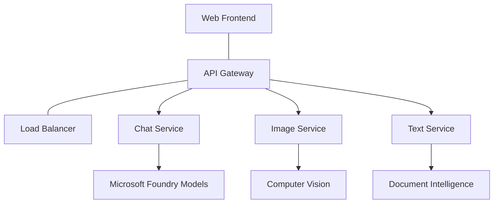

# Mbinu Bora za Kazi za AI za Uzalishaji kwa AZD

**Uvinjari wa Sura:**
- **📚 Nyumbani kwa Kozi**: [AZD Kwa Waanzilishi](../../README.md)
- **📖 Sura ya Sasa**: Sura 8 - Mifumo ya Uzalishaji & Biashara
- **⬅️ Sura ya Awali**: [Sura 7: Utatuzi wa Matatizo](../chapter-07-troubleshooting/debugging.md)
- **⬅️ Pia Kuhusiana**: [Warsha ya AI](../chapter-02-ai-development/ai-workshop-lab.md)
- **🎯 Kozi Imeisha**: [AZD Kwa Waanzilishi](../../README.md)

## Muhtasari

Mwongozo huu unaelezea mifumo ya muundo ya AI wa uzalishaji kwa kutumia Azure Developer CLI (AZD). Ni rejeleo la muundo, si programu inayoweza kuendeshwa au cheti cha uzalishaji.

**Mipaka ya mfano:** Isiposema wazi kuwa ni kamili, vipande vya Bicep vinakisia vigezo na rasilimali zilizotajwa kutoka kwenye templeti inayojumuisha. Havijumuishi picha/mpango wa mwenyeji, utambulisho, uteuzi wa nafasi, DNS, matokeo, na maingiliano mengine yanayohitajika. Njia za huduma za YAML na viandishi vya majaribio/michoro ni faili za mfano za kuunda katika **programu yako mwenyewe**; hizi hazitolewi na kozi hii. Tumia mfano unaofanya kazi wa AZD kama msingi, kutengeneza miundombinu kamili, na kuijaribu katika mazingira yaliyotengwa kabla ya uzalishaji.

## Changamoto Muhimu Zinazoshughulikiwa

Masuala ya kawaida ya uzalishaji ni pamoja na utekelezaji wa huduma nyingi, usimamizi wa utambulisho na siri, upanuzi, udhibiti wa gharama, na ufuatiliaji. Hakuna idadi halisi ya uvumilivu inayodaiwa hapa.

## Mifumo ya Muundo kwa AI ya Uzalishaji

### Mfano 1: Miundombinu ya Microservices AI

**Wakati wa kutumia**: Programu ngumu za AI zilizo na uwezo mwingi



**Utekelezaji wa AZD**:

```yaml
# azure.yaml
name: enterprise-ai-platform
services:
  web:
    project: ./web
    host: staticwebapp
  api-gateway:
    project: ./api-gateway
    host: containerapp
  chat-service:
    project: ./services/chat
    host: containerapp
  vision-service:
    project: ./services/vision
    host: containerapp
  text-service:
    project: ./services/text
    host: containerapp
```

### Mfano 2: Usindikaji wa AI unaotokana na Matukio

**Wakati wa kutumia**: Usindikaji wa kundi, uchambuzi wa hati, michoro isiyo ya moja kwa moja

```bicep
// Event Hub for AI processing pipeline
resource eventHub 'Microsoft.EventHub/namespaces@2024-01-01' = {
  name: eventHubNamespaceName
  location: location
  sku: {
    name: 'Standard'
    tier: 'Standard'
    capacity: 1
  }
}

// Service Bus for reliable message processing
resource serviceBus 'Microsoft.ServiceBus/namespaces@2024-01-01' = {
  name: serviceBusNamespaceName
  location: location
  sku: {
    name: 'Premium'
    tier: 'Premium'
    capacity: 1
  }
}

// Function App for processing
resource functionApp 'Microsoft.Web/sites@2023-01-01' = {
  name: functionAppName
  location: location
  kind: 'functionapp,linux'
  properties: {
    siteConfig: {
      appSettings: [
        {
          name: 'FUNCTIONS_EXTENSION_VERSION'
          value: '~4'
        }
        {
          name: 'AZURE_OPENAI_ENDPOINT'
          value: '@Microsoft.KeyVault(VaultName=${keyVault.name};SecretName=openai-endpoint)'
        }
      ]
    }
  }
}
```

Hii huunda vipande vya nafasi ya majina, si vituo vikuu, foleni, usajili, au kichocheo cha Function. Function inayoendeshwa pia inahitaji mpango wa mwenyeji, usanidi wa runtime/hifadhi, utambulisho uliounganishwa, RBAC, na upatikanaji wa mtandao. Marejeleo ya Key Vault yanahitaji ruhusa ya kusoma siri; kiungo cha URL yenyewe si sifa za kuingia.

## Kufikiria Kuhusu Afya ya Wakala wa AI

Wakati programu ya wavuti ya kawaida inavunjika, dalili ni za kawaida: ukurasa hausomwi, API inarudisha kosa, au utekelezaji hushindikana. Programu zinazoendeshwa na AI zinaweza kuvunjika kwa njia hizo zote hizo—lakini pia zinaweza kuonyesha tabia isiyoeleweka ambayo haisababishi ujumbe wa kosa unaoonekana.

Sehemu hii inakusaidia kujenga mfano wa akili wa kufuatilia mizigo ya kazi ya AI ili ujue pa kuangalia wakati mambo hayaendi sawa.

### Jinsi Afya ya Wakala Inavyotofautiana na Afya ya Programu ya Kawaida

Programu za kawaida pia zinaweza kuwa na kasoro zisizoonekana kwa usahihi. Wakala wa AI huongeza ubora wa majibu usioweza kutabirika kwenye wasiwasi wa upatikanaji na usahihi wa kawaida. Fikiria afya ya wakala katika tabaka mbili:

| Tabaka | Kitu cha Kuangalia | Mahali pa Kuangalia |
|-------|-------------------|---------------------|
| **Afya ya miundombinu** | Je, huduma inaendelea kufanya kazi? Je, rasilimali zimewekwa? Je, vituo vinaweza kufikiwa? | `azd monitor`, afya ya rasilimali kwenye Azure Portal, rekodi za kontena/programu |
| **Afya ya tabia** | Je, wakala anajibu kwa usahihi? Majibu yanatolewa kwa wakati? Je, mfano unaitwa ipasavyo? | Mfuatiliaji wa Application Insights, vipimo vya ucheleweshaji wa mwito wa mfano, rekodi za ubora wa majibu |

Afya ya miundombinu ni ya kawaida—ni sawa kwa programu yoyote ya azd. Afya ya tabia ndiyo tabaka mpya ambalo mizigo ya kazi ya AI inaleta.

### Mahali pa Kuangalia Wakati Programu za AI Hazifanyi Kulingana na Matarajio

Ikiwa programu yako ya AI haizalishi matokeo unayotarajia, hapa kuna orodha ya dhana:

1. **Anza na mambo ya msingi.** Je, programu inaendelea kufanya kazi? Inaweza kufikia utegemezi wake? Angalia `azd monitor` na afya ya rasilimali kama unavyofanya kwa programu yoyote.
2. **Angalia uunganisho wa mfano.** Je, programu yako inaita mfano wa AI kwa mafanikio? Miito iliyoshindwa au iliyocheleweshwa ndiyo chanzo kikubwa cha matatizo ya programu za AI na itaonekana katika kumbukumbu za programu yako.
3. **Kagua ingizo na maelekezo kwa usalama.** Majibu yasiyo sahihi yanaweza kusababishwa na upokeaji, maelekezo, mipaka ya mfano, au utekelezaji wa chombo. Tumia data za uchunguzi zilizo na ruhusa, zilizofichwa; usiwezesha rekodi ya usaidizi wa kiotomatiki wa maombi/majibu katika uzalishaji.
4. **Pitia ucheleweshaji wa majibu.** Miito ya mfano wa AI huwa polepole kuliko miito ya kawaida ya API. Ikiwa programu yako inaonekana polepole, angalia kama muda wa majibu ya mfano umeongezeka—hii inaweza kuashiria kunyanyua, mipaka ya uwezo, au msongamano wa kiwango cha kanda.
5. **Angalia ishara za gharama.** Miongezeko isiyotarajiwa ya matumizi ya tokeni au miito ya API inaweza kuashiria mzunguko, maelekezo yasiyopangwa, au jaribio nyingi sana.

Huna haja ya kuwa mtaalamu wa zana za ufuatiliaji mara moja. Jambo kuu ni kwamba programu za AI zina tabaka la ziada la tabia la kufuatilia, na ufuatiliaji uliopo wa azd (`azd monitor`) unakupa msingi wa kuanzisha uchunguzi wa tabaka zote mbili.

---

## Mazoezi Bora ya Usalama

### 1. Mfano wa Usalama wa Zero-Trust

**Mikakati ya Utekelezaji**:
- Hakuna mawasiliano ya huduma kwa huduma bila uthibitisho
- Miito yote ya API inatumia utambulisho uliosimamiwa
- Kutenganisha mtandao kwa vituo vya binafsi
- Udhibiti wa upatikanaji wa halali mdogo

```bicep
// Managed Identity for each service
resource chatServiceIdentity 'Microsoft.ManagedIdentity/userAssignedIdentities@2023-01-31' = {
  name: 'chat-service-identity'
  location: location
}

// Role assignments with minimal permissions
resource openAIUserRole 'Microsoft.Authorization/roleAssignments@2022-04-01' = {
  scope: openAIAccount
  name: guid(openAIAccount.id, chatServiceIdentity.id, '5e0bd9bd-7b93-4f28-af87-19fc36ad61bd')
  properties: {
    roleDefinitionId: subscriptionResourceId('Microsoft.Authorization/roleDefinitions', '5e0bd9bd-7b93-4f28-af87-19fc36ad61bd')
    principalId: chatServiceIdentity.properties.principalId
    principalType: 'ServicePrincipal'
  }
}
```

### 2. Usimamizi Salama wa Siri

**Mfumo wa Uunganisho wa Key Vault**:

```bicep
// Key Vault with proper access policies
resource keyVault 'Microsoft.KeyVault/vaults@2023-02-01' = {
  name: keyVaultName
  location: location
  properties: {
    tenantId: tenant().tenantId
    sku: {
      family: 'A'
      name: 'standard' // Premium is needed for HSM-backed keys, not ordinary secrets
    }
    enableRbacAuthorization: true  // Use RBAC instead of access policies
    enablePurgeProtection: true    // Prevent accidental deletion
    enableSoftDelete: true
    softDeleteRetentionInDays: 90
  }
}

// Optional legacy key-auth alternative; omit when using Entra ID.
resource openAIKeySecret 'Microsoft.KeyVault/vaults/secrets@2023-02-01' = {
  parent: keyVault
  name: 'openai-api-key'
  properties: {
    value: openAIAccount.listKeys().key1
    attributes: {
      enabled: true
    }
  }
}
```

Tenga utambulisho wa wakati wa kuendesha `Key Vault Secrets User` katika wigo unaofaa na uweke kwenye mwenyeji; `enableRbacAuthorization` peke yake hatoipa ruhusa yoyote. Tumia uthibitishaji wa utambulisho ulioendeshwa na OpenAI kwa kutumia `disableLocalAuth: true`. Siri ya kitufe hiwezi kusema kitu isipokuwa kwa akaunti iliyofungwa kwa makusudi kutumia kitufe, na mhusika wa ugawaji ana ruhusa ya kuandika siri.

### 3. Usalama wa Mtandao

**Usanidi wa Vituo vya Binafsi**:

```bicep
// Virtual Network for AI services
resource virtualNetwork 'Microsoft.Network/virtualNetworks@2023-04-01' = {
  name: vnetName
  location: location
  properties: {
    addressSpace: {
      addressPrefixes: ['10.0.0.0/16']
    }
    subnets: [
      {
        name: 'ai-services-subnet'
        properties: {
          addressPrefix: '10.0.1.0/24'
          privateEndpointNetworkPolicies: 'Disabled'
        }
      }
      {
        name: 'app-services-subnet'
        properties: {
          addressPrefix: '10.0.2.0/24'
          delegations: [
            {
              name: 'Microsoft.Web/serverFarms'
              properties: {
                serviceName: 'Microsoft.Web/serverFarms'
              }
            }
          ]
        }
      }
    ]
  }
}

// Private endpoints for all AI services
resource openAIPrivateEndpoint 'Microsoft.Network/privateEndpoints@2023-04-01' = {
  name: '${openAIAccountName}-pe'
  location: location
  properties: {
    subnet: {
      id: virtualNetwork.properties.subnets[0].id
    }
    privateLinkServiceConnections: [
      {
        name: 'openai-connection'
        properties: {
          privateLinkServiceId: openAIAccount.id
          groupIds: ['account']
        }
      }
    ]
  }
}
```

Vituo vya binafsi pia vinahitaji vikundi vya eneo la DNS binafsi/vilango vya VNet na uunganisho wa VNet wa programu. Havizuizi upatikanaji wa umma kiotomatiki: zima kwa wazi upatikanaji wa mtandao wa umma wa akaunti ya AI baada ya kuthibitisha uhusiano wa binafsi na upatikanaji wa utekelezaji.

## Utendaji na Upanuzi

### 1. Mikakati ya Kujiendesha Kwenye Upanuzi

**Kujiendesha Upanuzi kwa Programu za Kontena**:

```bicep
resource containerApp 'Microsoft.App/containerApps@2023-05-01' = {
  name: containerAppName
  location: location
  properties: {
    configuration: {
      ingress: {
        external: true
        targetPort: 8000
        transport: 'http'
      }
    }
    template: {
      scale: {
        minReplicas: 2  // Always have 2 instances minimum
        maxReplicas: 50 // Scale up to 50 for high load
        rules: [
          {
            name: 'http-scaling'
            http: {
              metadata: {
                concurrentRequests: '20'  // Scale when >20 concurrent requests
              }
            }
          }
          {
            name: 'cpu-scaling'
            custom: {
              type: 'cpu'
              metadata: {
                type: 'Utilization'
                value: '70'  // Scale when CPU >70%
              }
            }
          }
        ]
      }
    }
  }
}
```

### 2. Mikakati ya Kuhifadhi Kati

**Kihifadhi Cache cha Redis kwa Majibu ya AI**:

```bicep
// Legacy Azure Cache for Redis example (not recommended for new deployments)
resource redisCache 'Microsoft.Cache/redis@2023-04-01' = {
  name: redisCacheName
  location: location
  properties: {
    sku: {
      name: 'Premium'
      family: 'P'
      capacity: 1
    }
    enableNonSslPort: false
    minimumTlsVersion: '1.2'
    redisConfiguration: {
      'maxmemory-policy': 'allkeys-lru'
    }
    // Sharding distributes data; replication/failover provides availability.
    shardCount: 2
  }
}

// Cache configuration in application
var cacheConnectionString = '${redisCache.properties.hostName}:6380,password=${redisCache.listKeys().primaryKey},ssl=True,abortConnect=False'
```

Azure Cache kwa Redis Basic/Standard/Premium iko kwenye [njia ya kustaafu](https://learn.microsoft.com/azure/azure-cache-for-redis/retirement-faq). Tumia Azure Managed Redis kwa miundo mipya na usanidi wake wa SKU, utambulisho, na TLS iliyoandikwa, badala ya kunakili rasilimali hii ya zamani ndani ya mfumo mpya wa uzalishaji. Mstari wa mfuatiliaji wa muunganisho ni kielelezo kisichofanya kazi, si sifa za kuingia. Gawanya funguo za cache kwa idhini, mfano/maelekezo, na toleo la upokezaji, pamoja na muda wa kumalizika; cache ya kuagiza tu iliyoshirikiwa inaweza kufichua data za mtumiaji mwingine.

### 3. Usawazishaji wa Mzigo na Usimamizi wa Trafiki

**Gateway ya Programu na WAF**:

```bicep
// Application Gateway with Web Application Firewall
resource applicationGateway 'Microsoft.Network/applicationGateways@2023-04-01' = {
  name: appGatewayName
  location: location
  properties: {
    sku: {
      name: 'WAF_v2'
      tier: 'WAF_v2'
      capacity: 2
    }
    webApplicationFirewallConfiguration: {
      enabled: true
      firewallMode: 'Prevention'
      ruleSetType: 'OWASP'
      ruleSetVersion: '3.2'
    }
    // Backend pools for AI services
    backendAddressPools: [
      {
        name: 'ai-services-pool'
        properties: {
          backendAddresses: [
            {
              fqdn: '${containerApp.properties.configuration.ingress.fqdn}'
            }
          ]
        }
      }
    ]
  }
}
```

Hii ni rasilimali ya gateway ya sehemu: utekelezaji halisi unahitaji pia usanidi wa subnet/IP wa gateway, IP na bandari za mbele, wasikilizaji/cheti cha TLS, mipangilio/majaribio ya HTTP ya nyuma, sheria za usafirishaji na vipaumbele, na sera ya WAF iliyopitiwa. Jina la mwenyeji la TLS/SNI na uthibitishaji lazima lifanane na backend ya Container App.

## 💰 Ufanisi wa Gharama

### 1. Ukuaji Bora wa Rasilimali

**Marekebisho Maalum kwa Mazingira**:

Majina haya ni **mifano ya kuingiza templeti maalum**, si mipangilio ya kiotomatiki ya AZD. Utafsiri kila moja hadi `infra/main.parameters.json`/Bicep na usanidi wa mwenyeji kwanza. Kwa mfano, mfano wa RAG hutumia `AZURE_SEARCH_SERVICE_SKU` na `AZURE_OPENAI_CHATGPT_DEPLOYMENT_CAPACITY`, sio majina ya jumla hapa chini. Toa kumbukumbu kwa Container Apps kwa kipimo kinachoungwa mkono kama `1Gi` kwenye rasilimali halisi. Tekeleza mabadiliko ya miundombinu kwa kutumia `azd up` au `azd provision`; `azd deploy` peke yake haisababishi mabadiliko ya Bicep.

```bash
# Development environment
azd env new development
azd env set AZURE_OPENAI_SKU "S0"
azd env set AZURE_OPENAI_CAPACITY 10
azd env set AZURE_SEARCH_SKU "basic"
azd env set CONTAINER_CPU 0.5
azd env set CONTAINER_MEMORY 1.0

# Production environment  
azd env new production
azd env set AZURE_OPENAI_SKU "S0"
azd env set AZURE_OPENAI_CAPACITY 100
azd env set AZURE_SEARCH_SKU "standard"
azd env set CONTAINER_CPU 2.0
azd env set CONTAINER_MEMORY 4.0
```

### 2. Ufuatiliaji wa Gharama na Bajeti

```bicep
// Supply the first day of the current UTC month, e.g. 2026-11-01T00:00:00Z.
param budgetStartDate string

// Cost management and budgets
resource budget 'Microsoft.Consumption/budgets@2024-08-01' = {
  name: 'ai-workload-budget'
  properties: {
    timePeriod: {
      startDate: budgetStartDate
    }
    timeGrain: 'Monthly'
    amount: 2000  // In the billing currency, not necessarily USD
    category: 'Cost'
    notifications: {
      warning: {
        enabled: true
        operator: 'GreaterThan'
        threshold: 80
        contactEmails: [
          'finance@company.com'
          'engineering@company.com'
        ]
        contactRoles: [
          'Owner'
          'Contributor'
        ]
      }
      critical: {
        enabled: true
        operator: 'GreaterThan'
        threshold: 95
        contactEmails: [
          'cto@company.com'
        ]
      }
    }
  }
}
```

Badilisha wapokeaji wa mfano na hakiki wigo/ruhusa. Tahadhari za bajeti hutumia data ya bili iliyorudiwa na haziwezi kuzuia matumizi.

### 3. Ufanisi wa Matumizi ya Tokeni

**Usimamizi wa Gharama wa OpenAI**:

Hii ni njia ya heuristiki ya herufi kwa onyesho la UI, **sio** kisheria ukaguzi wa kiwango cha tokeni cha mfano. Msimbo wa uzalishaji lazima utumie tokenizer inayofaa kwa mfano uliowekwa na kuzingatia maagizo ya mfumo, miundo ya zana, historia, na bajeti ya pato. Kataa ujumbe wa mtumiaji uliojaa kuliko ukubwa badala ya kukata kimya kimya.

```typescript
// Application-level token optimization
class TokenOptimizer {
  private readonly maxTokens = 4000;
  private readonly reserveTokens = 500;
  
  optimizePrompt(userInput: string, context: string): string {
    const availableTokens = this.maxTokens - this.reserveTokens;
    if (this.estimateTokens(userInput) + 8 >= availableTokens) {
      throw new Error("User input exceeds the illustrative prompt budget");
    }
    const estimatedTokens = this.estimateTokens(userInput + context) + 8;
    
    if (estimatedTokens > availableTokens) {
      // Truncate context, not user input
      context = this.truncateContext(context, Math.max(0, availableTokens - this.estimateTokens(userInput) - 8));
    }
    
    return `${context}\n\nUser: ${userInput}`;
  }
  
  private estimateTokens(text: string): number {
    // Rough estimation: 1 token ≈ 4 characters
    return Math.ceil(text.length / 4);
  }

  private truncateContext(text: string, estimatedBudget: number): string {
    return text.slice(0, Math.max(0, estimatedBudget) * 4);
  }
}
```

## Ufuatiliaji na Uwezo wa Kuona

### 1. Application Insights Kamili

```bicep
// Application Insights with advanced features
resource applicationInsights 'Microsoft.Insights/components@2020-02-02' = {
  name: applicationInsightsName
  location: location
  kind: 'web'
  properties: {
    Application_Type: 'web'
    WorkspaceResourceId: logAnalyticsWorkspace.id
    SamplingPercentage: 100  // Ingestion setting; review cost and SDK sampling separately
    DisableIpMasking: false  // Retain IP masking
  }
}

// Custom metrics for AI operations
resource aiMetricAlerts 'Microsoft.Insights/metricAlerts@2018-03-01' = {
  name: 'ai-high-error-rate'
  location: 'global'
  properties: {
    description: 'Alert when failed request count exceeds 10 in five minutes'
    severity: 2
    enabled: true
    scopes: [
      applicationInsights.id
    ]
    evaluationFrequency: 'PT1M'
    windowSize: 'PT5M'
    criteria: {
      'odata.type': 'Microsoft.Azure.Monitor.SingleResourceMultipleMetricCriteria'
      allOf: [
        {
          name: 'high-error-rate'
          metricName: 'requests/failed'
          operator: 'GreaterThan'
          threshold: 10
          timeAggregation: 'Count'
        }
      ]
    }
  }
}
```

### 2. Ufuatiliaji Maalum wa AI

**Dashibodi Maalum za Vipimo vya AI**:

```json
{
  "dashboard": {
    "name": "AI Application Monitoring",
    "tiles": [
      {
        "name": "OpenAI Request Volume",
        "query": "dependencies | where target contains 'openai' | summarize count() by bin(timestamp, 5m)"
      },
      {
        "name": "AI Response Latency",
        "query": "dependencies | where target contains 'openai' | summarize avg(duration) by bin(timestamp, 5m)"
      },
      {
        "name": "Token Usage",
        "query": "customMetrics | where name == 'openai_tokens_used' | summarize sum(value) by bin(timestamp, 1h)"
      },
      {
        "name": "Cost per Hour",
        "query": "customMetrics | where name == 'openai_cost' | summarize sum(value) by bin(timestamp, 1h)"
      }
    ]
  }
}
```

JSON hii ni mchoro wa kufafanua programu, si muundo wa dashibodi wa Azure portal unaoweza kuagizwa. Maswali ya tokeni/gharama yanahitaji programu yako kutoa vipimo hivyo maalum; havundwi na AZD. Rekebisha vichujio vya utegemezi kwa majina halisi ya mwisho wa mfano/kipindi.

### 3. Ukaguzi wa Afya na Ufuatiliaji wa Muda wa Kazi

```bicep
// Application Insights availability tests
resource availabilityTest 'Microsoft.Insights/webtests@2022-06-15' = {
  name: 'ai-app-availability-test'
  location: location
  tags: {
    'hidden-link:${applicationInsights.id}': 'Resource'
  }
  properties: {
    SyntheticMonitorId: 'ai-app-availability-test'
    Name: 'AI Application Availability Test'
    Description: 'Tests AI application endpoints'
    Enabled: true
    Frequency: 300  // 5 minutes
    Timeout: 120    // 2 minutes
    Kind: 'standard'
    Locations: [
      {
        Id: 'us-east-2-azr'
      }
      {
        Id: 'us-west-2-azr'
      }
    ]
    Request: {
      RequestUrl: 'https://${webApp.properties.defaultHostName}/health'
      HttpVerb: 'GET'
      FollowRedirects: true
      ParseDependentRequests: false
    }
    ValidationRules: {
      ExpectedHttpStatusCode: 200
      SSLCheck: true
      SSLCertRemainingLifetimeCheck: 7
    }
  }
}
```

## Urejeshaji wa Maafa na Upatikanaji wa Juu

Jaribio lililotangulia linadhani huduma ya App Service `webApp` na rasilimali ya Application Insights zipo. Vipimo vya kawaida vya upatikanaji vinahesabiwa na vinahitaji kiunganisho kinachoweza kufikiwa; programu za binafsi pekee zinahitaji muundo unaofaa wa ufuatiliaji wa binafsi. Vipimo vya ping ya URL vimeachwa; tumia [vipimo vya kawaida vya upatikanaji](https://learn.microsoft.com/azure/azure-monitor/app/availability).

### 1. Utekelezaji wa Mabara Mengi

```yaml
# azure.yaml - Multi-region configuration
name: ai-app-multiregion
services:
  api-primary:
    project: ./api
    host: containerapp
    env:
      AZURE_REGION: eastus
  api-secondary:
    project: ./api
    host: containerapp
    env:
      AZURE_REGION: westus2
```

```bicep
// Separate App Service topology, not the Container Apps declarations above
resource trafficManager 'Microsoft.Network/trafficManagerProfiles@2022-04-01' = {
  name: trafficManagerProfileName
  location: 'global'
  properties: {
    profileStatus: 'Enabled'
    trafficRoutingMethod: 'Priority'
    dnsConfig: {
      relativeName: trafficManagerProfileName
      ttl: 30
    }
    monitorConfig: {
      protocol: 'HTTPS'
      port: 443
      path: '/health'
      intervalInSeconds: 30
      toleratedNumberOfFailures: 3
      timeoutInSeconds: 10
    }
    endpoints: [
      {
        name: 'primary-endpoint'
        type: 'Microsoft.Network/trafficManagerProfiles/azureEndpoints'
        properties: {
          targetResourceId: primaryAppService.id
          endpointStatus: 'Enabled'
          priority: 1
        }
      }
      {
        name: 'secondary-endpoint'
        type: 'Microsoft.Network/trafficManagerProfiles/azureEndpoints'
        properties: {
          targetResourceId: secondaryAppService.id
          endpointStatus: 'Enabled'
          priority: 2
        }
      }
    ]
  }
}
```

Vigezo vya mazingira haviendi kuchagua maeneo ya rasilimali. IaC lazima iweke wenyeji wa mikoa tofauti na kufunga kila huduma na lebo za `resourceName` au `azd-service-name`. Mfano wa Msimamizi wa Trafiki ni **muundo tofauti wa App Service** (`primaryAppService`/`secondaryAppService`), si ajili ya kupitisha taarifa kwa taarifa ya Container Apps. Container Apps inahitaji kiunganisho cha nje/mlangoni wa mbele uliowekwa ipasavyo, usambazaji wa TLS/jina maandishi ya kawaida, na vikaguzi vya afya.

### 2. Nakala ya Data na Urejeshaji

```bicep
// Backup configuration for critical data
resource backupVault 'Microsoft.DataProtection/backupVaults@2023-05-01' = {
  name: backupVaultName
  location: location
  identity: {
    type: 'SystemAssigned'
  }
  properties: {
    storageSettings: [
      {
        datastoreType: 'VaultStore'
        type: 'LocallyRedundant'
      }
    ]
  }
}

```

Hifadhi pekee haifanyi nakala ya chochote. Sanidi **sera ya kijumuishi inayoungwa mkono kwa mzigo wa kazi na mfano wa nakala**, ruhusa za chanzo, uhifadhi, na majaribio ya urejeshaji kwa kutumia [matriisi za msaada wa Azure Backup](https://learn.microsoft.com/azure/backup/backup-support-matrix). Hakuna sera ya jumla ya Azure Backup kwa utekelezaji wa modeli ya Azure OpenAI iliyoshikiliwa. Hifadhi maelezo ya miundombinu/muundo katika udhibiti wa chanzo; linda hati zilizopakiwa, data za programu, na vitu vya mazuri ya ufunto kwa kutumia huduma zinazounga mkono za nakala/kuuza nje. Tambulisha na jaribu RPO/RTO wazi.

## DevOps na Uunganisho wa CI/CD

### 1. Mtiririko wa Kazi wa GitHub Actions

```yaml
# .github/workflows/deploy-ai-app.yml
name: Deploy AI Application

on:
  push:
    branches: [main]
  pull_request:
    branches: [main]

jobs:
  test:
    runs-on: ubuntu-latest
    steps:
      - uses: actions/checkout@v4
      
      - name: Setup Python
        uses: actions/setup-python@v4
        with:
          python-version: '3.11'
          
      - name: Install dependencies
        run: |
          pip install -r requirements.txt
          pip install pytest
          
      - name: Run tests
        run: pytest tests/
        
      - name: AI Safety Tests
        run: |
          python scripts/test_ai_safety.py
          python scripts/validate_prompts.py

```

Hii ni sehemu ya **majaribio tu** ya mtiririko wa kazi na inadhani umeunda `requirements.txt`, `tests/`, na skiripti mbili za usalama. Ongeza kazi za utoaji/utumiaji wa OIDC zilizothibitishwa kutoka [Mipangilio ya Mlolongo wa CI/CD](#cicd-pipeline-configuration), na `needs: test`, kitendo cha kuaminika cha kushinikiza/kuanzisha kwa mkono, na mazingira yaliyolindwa ya GitHub. Usitoe msimbo usioaminika wa ombi la kuvuta na sifa za wingu. Mtembeleaji mpya hana mazingira yanayochaguliwa ya AZD ya eneo; toa ingizo la mazingira/usanidi/eneo na tumia `azd auth login`, si tu `azure/login`.

### 2. Uthibitishaji wa Miundombinu

```bash
# scripts/validate_infrastructure.sh
#!/bin/bash
set -euo pipefail

echo "Validating AI infrastructure deployment..."

# Requires Azure CLI login and the resource group selected explicitly.
: "${AZURE_RESOURCE_GROUP:?Set AZURE_RESOURCE_GROUP}"
: "${AZURE_OPENAI_NAME:?Set AZURE_OPENAI_NAME}"
: "${AZURE_OPENAI_CHAT_DEPLOYMENT:?Set the actual deployment name}"

# A successful empty list is not proof that resources exist.
types=("Microsoft.CognitiveServices/accounts" "Microsoft.Search/searchServices"
       "Microsoft.Storage/storageAccounts" "Microsoft.KeyVault/vaults")
for resource_type in "${types[@]}"; do
    count=$(az resource list --resource-group "$AZURE_RESOURCE_GROUP" \
        --resource-type "$resource_type" --query "length(@)" -o tsv)
    if [[ "$count" -lt 1 ]]; then
        echo "ERROR: No $resource_type found in $AZURE_RESOURCE_GROUP"
        exit 1
    fi
done

# Validate OpenAI model deployments
echo "Validating OpenAI model deployments..."
state=$(az cognitiveservices account deployment show \
  --name "$AZURE_OPENAI_NAME" --resource-group "$AZURE_RESOURCE_GROUP" \
  --deployment-name "$AZURE_OPENAI_CHAT_DEPLOYMENT" \
  --query "properties.provisioningState" -o tsv)
if [[ "$state" != "Succeeded" ]]; then
    echo "ERROR: Required model deployment is not provisioned successfully"
    exit 1
fi

echo "Infrastructure validation completed successfully!"
```

Inatarajiwa: kutoka sifuri na ujumbe wa kukamilika tu wakati aina zote zinazotarajiwa zipo na utekelezaji wa mfano uliopewa jina umewekwa. Hii inakagua hali ya hesabu/utekelezaji, **siyo** afya ya rasilimali, muundo halisi, RBAC, upatikanaji wa mtandao, au tabia ya mfano. Rekebisha aina zinazotarajiwa kwa muundo wako, kisha fanya jaribio tofauti la utayari wa programu yenye uthibitisho.

## Orodha ya Uwezo wa Uzalishaji

### Usalama ✅
- [ ] Huduma zote zinatumia utambulisho uliosimamiwa
- [ ] Siri zimehifadhiwa kwenye Key Vault
- [ ] Vituo vya binafsi vimewekwa
- [ ] Vikundi vya usalama wa mtandao vimetekelezwa
- [ ] RBAC kwa upatikanaji mdogo
- [ ] WAF imewezeshwa kwenye vituo vya umma

### Utendaji ✅
- [ ] Kujiendesha kwa upanuzi kumewekwa
- [ ] Kuhifadhi kati kumewekwa
- [ ] Usawazishaji wa mzigo umewekwa
- [ ] CDN kwa maudhui yasiyobadilika
- [ ] Kuunganisha mabwawa ya data
- [ ] Ufanisi wa matumizi ya tokeni

### Ufuatiliaji ✅
- [ ] Application Insights imewekwa
- [ ] Vipimo maalum vimefafanuliwa
- [ ] Sheria za tahadhari zimewekwa
- [ ] Dashibodi imetengenezwa
- [ ] Ukaguzi wa afya umewekwa
- [ ] Sera za kuhifadhi kumbukumbu

### Uhakika ✅
- [ ] Utekelezaji wa mabara mengi
- [ ] Mpango wa nakala na urejeshaji
- [ ] Vipimaji vya mzunguko vimewekwa
- [ ] Sera za jaribio zimepangwa
- [ ] Kupungua kwa hila
- [ ] Vituo vya ukaguzi wa afya

### Usimamizi wa Gharama ✅
- [ ] Tahadhari za bajeti zimewekwa
- [ ] Ukuaji sahihi wa rasilimali
- [ ] Punguzo la maendeleo/majaribio
- [ ] Vifaa vilivyohifadhiwa vilinunuliwa
- [ ] Dashibodi ya ufuatiliaji wa gharama
- [ ] Ukaguzi wa mara kwa mara wa gharama

### Uzingatiaji ✅
- [ ] Mahitaji ya makazi ya data yamekamilika
- [ ] Kumbukumbu ya ukaguzi imewezeshwa
- [ ] Sera za uzingatiaji zlimewekwa
- [ ] Misingi ya usalama imetekelezwa
- [ ] Tathmini za usalama za mara kwa mara
- [ ] Mpango wa majibu ya tukio

## Viwango vya Utendaji

### Malengo ya Uzalishaji ya Kielelezo

Hizi ni SLO za mfano za kujadiliana na kupima mzigo, si viwango vilivyochaguliwa au dhamana. Ucheleweshaji wa majibu hutegemea urefu wa mfano/pato; matumizi ya tokeni kwa mwezi hutegemea trafiki na bei, si idadi ya tokeni pekee.

| Kipimo | Lengo | Ufuatiliaji |
|--------|--------|------------|
| **Muda wa Majibu** | < sekunde 2 | Application Insights |
| **Upatikanaji** | 99.9% | Ufuatiliaji wa muda wa kazi |
| **Kiwango cha Makosa** | < 0.1% | Rekodi za programu |
| **Matumizi ya Mfano** | < $500/kwa mwezi (mfano wa bajeti) | Usimamizi wa gharama |
| **Watumiaji Wengi Wanaofanya Kazi kwa Wakati Mmoja** | 1000+ | Jaribio la mzigo |
| **Muda wa Kupona** | < 1 saa | Majaribio ya urejeshaji wa dharura |

### Jaribio la Mzigo

Ifuatayo ni mchoro wa kiolesura wa script ya jaribio la mzigo **lazima utekeleze**; hifadhi hii haijumuishi `scripts/load_test.py`. Tafsiri maombi ya maombi, uthibitishaji, mizigo ya mfano, madai ya ucheleweshaji/kosa kwa sehemu ya asilimia, na kikomo cha matumizi katika chombo chako cha jaribio la mzigo kabla ya kuendesha:

```bash
# Load testing script for AI applications
python scripts/load_test.py \
  --endpoint https://your-ai-app.azurewebsites.net \
  --concurrent-users 100 \
  --duration 300 \
  --ramp-up 60
```

## 🤝 Mbinu Bora za Jamii

Kulingana na maoni ya jamii ya Microsoft Foundry Discord:

### Mapendekezo Mwandamizi kutoka Jamii:

1. **Anza Kidogo, Panua Polepole**: Anza na SKUs za msingi na panua kulingana na matumizi halisi
2. **Simamia Kila Kitu**: Weka ufuatiliaji kamili tangu siku ya kwanza
3. **Fanyia Usalama Kazi Moja kwa Moja**: Tumia miundombinu kama msimbo kwa usalama thabiti
4. **Jaribu Kwa Kina**: Jumuisha majaribio maalum ya AI katika mchakato wako
5. **Panga Gharama**: Simamia matumizi ya tokeni na weka onyo la bajeti mapema

### Makosa ya Kawaida Kuepukwa:

- ❌ Kuweka funguo za API moja kwa moja ndani ya msimbo
- ❌ Kutoweka ufuatiliaji mzuri
- ❌ Kupuuza uboreshaji wa gharama
- ❌ Kutajaribu hali za kushindwa
- ❌ Kuweka bila ukaguzi wa afya

## Amri za AZD AI CLI na Viendelezi

AZD inajumuisha seti inayoongezeka ya amri na viendelezi maalum vya AI vinavyoandaa kuelekeza kazi za AI za uzalishaji. Vifaa hivi huchukua pengo kati ya maendeleo ya hapo nyumbani na usambazaji kwa uzalishaji kwa mizigo ya AI.

> **Sasisho la Foundry GA (2026-11-09):** kifurushi cha `microsoft.foundry` kilifikia **1.0 / upatikanaji wa jumla** tarehe [Novemba 5, 2026](https://devblogs.microsoft.com/azure-sdk/microsoft-foundry-azure-developer-cli-ga/). Tumia **`azd >= 1.37.0`** kwa mchakato huu. Tathmini ya mapema ya `azd 1.37.2`, agents beta.23, na evaluations beta.2 ipo hapa chini kama historia ya uhamishaji, si toleo la sasa la kifurushi. Hii ni kupitia ya nyaraka/mchanzo, sio uthibitisho wa mapambazuko ya moja kwa moja au dai kwamba kila kiendelezi cha hiari, API, au kipengele cha maonyesho ni GA.

### Viendelezi vya AZD kwa AI

AZD hutumia mfumo wa viendelezi kuongeza uwezo maalum wa AI. Sakinisha na simamia viendelezi kwa:

```bash
# List all available extensions (including AI)
azd extension list

# Inspect installed versions
azd version
azd ext list --installed

# Install the GA Foundry bundle
azd ext install microsoft.foundry

# Install the separate Foundry evaluations extension
azd extension install azure.ai.evaluations

# Install the fine-tuning extension
azd extension install azure.ai.finetune

# Install the custom models extension
azd extension install azure.ai.models

# Upgrade the Foundry bundle
azd ext upgrade microsoft.foundry
```

**Viendelezi vya AI vinavyopatikana:**

| Kiendelezi | Kusudi | Hali |
|-----------|---------|--------|
| `microsoft.foundry` | Kifurushi cha meta kinachoingiza viendelezi saba vya msingi hapa chini; hakina kundi la amri la mwenyewe | Kifurushi cha GA 1.0 |
| `azure.ai.agents` | `azd ai agent`: usanidi wa maajenti, utekelezaji wa ndani, na operesheni | Imekuwa pamoja; inatambulika kuwa toleo huru |
| `azure.ai.connections` | `azd ai connection`: muunganisho wa mradi | Imekuwa pamoja; inatambulika kuwa toleo huru |
| `azure.ai.inspector` | `azd ai inspector`: UI ya Mpelelezi wa Maajenti ya ndani | Imekuwa pamoja; inatambulika kuwa toleo huru |
| `azure.ai.projects` | `azd ai project`: rasilimali za mradi na usambazaji wa modeli | Imekuwa pamoja; inatambulika kuwa toleo huru |
| `azure.ai.routines` | `azd ai routine`: ratiba na vichocheo | Imekuwa pamoja; inatambulika kuwa toleo huru |
| `azure.ai.skills` | `azd ai skill`: miongozo ya tabia inayoweza kutumika tena | Imekuwa pamoja; inatambulika kuwa toleo huru |
| `azure.ai.toolboxes` | `azd ai toolbox`: makusanyo ya zana zilizo na matoleo | Imekuwa pamoja; inatambulika kuwa toleo huru |
| `azure.ai.evaluations` | Hifadhidata za tathmini, wataathiri, makundi ya tathmini, na mifano | Usakinishaji/toleo la pekee |
| `azure.ai.dataset` | Usajili wa hifadhidata na kuingiza matoleo | Usakinishaji/toleo la pekee |
| `azure.ai.finetune` | Marekebisho ya mfano ya Foundry | Usakinishaji/toleo la pekee |
| `azure.ai.models` | Moduli maalum za Foundry | Usakinishaji/toleo la pekee |

Kusakinisha `azure.ai.agents` peke yake bado kunasaidiwa na kunasakinisha utegemezi wake; kifurushi ni mafunzo ya chaguo-msingi kwa mchakato wa GA. GA ya kifurushi si dhamana ya hali ya kutolewa kwa vipengele vyake vya hiari. Angalia [ufungaji na uhakiki wa viendelezi](https://learn.microsoft.com/azure/foundry/agents/how-to/install-cli-foundry-extensions) na kagua msaada wa amri uliosakinishwa kabla ya kuvitumia.

> Boresha CLI kuu kwanza kwa `azd update` au [njia sahihi ya usakinishaji/upanuzi](https://learn.microsoft.com/azure/developer/azure-developer-cli/install-azd), kisha endesha `azd ext upgrade microsoft.foundry`. Sasisha tathmini zilizotengwa kama inavyohitajika kwa `azd ext upgrade azure.ai.evaluations`. Hakuna amri kuu ya `azd upgrade`. Rekodi na kagua viendelezi vinavyojulikana kama toleo huru katika uendeshaji wa uzalishaji; unaboreshaji haubadili usanidi wa zamani kiotomatiki.

### Mabadiliko na Marekebisho ya Toleo la Hivi Karibuni

| Toleo | Mabadiliko kwa kozi hii |
|---------|------------------------------|
| `microsoft.foundry` 1.0 GA (2026-11-05) | Kifurushi cha viendelezi saba, hifadhi mipangilio ya maajenti/masambazaji katika `azure.yaml`, jaribu ndani na Mpelelezi wa Maajenti, na pakia msimbo kwa ujenzi wa mbali wa Foundry. Sakinisha tathmini peke yake na soma viendelezi vilivyohitajika tena kwenye waendesha CI. |
| `azd 1.37.0` | Ongeza APIs imara za onyesho la usambazaji na kurekebisha uhariri wa viendelezi unaobadilisha mipangilio isiyo husika ya `azure.yaml`. |
| `azd 1.37.1` | Rekebisha usambazaji wa Ctrl+C katika viendelezi na kutofautisha kufuta/muda wa kusubiri kutoka kwa makosa ya kawaida. |
| `azd 1.37.2` | Boresha uthibitishaji wa utoaji: onyo kuu ni default kuwa **Hapana**, kosa bila uthibitisho katika kuendesha bila mshiriki, na kufuta huacha mikataba baada ya utoaji. Pia rekebisha thamani za mazingira zisizotambulika katika orodha za kukataa ya Stack za Usambazaji wakati kipengele hicho cha alpha kikiwawezekana. |
| Maajenti `beta.22` | Hamisha tathmini kwa `azd ai eval`, badilisha uboreshaji kwa API ya GA v1, inahitaji mno `toolboxes`, na toa utawala wa harness, sauti, na chaguo la onyesho la muda mrefu. Rekebisha uteuzi wa mfano kulingana na mazingira na uthibitishaji wa sanduku la zana. |
| Maajenti `beta.23` | Onyesha `init --harness`; rekebisha utoaji wa jibu la A2A 0.3, njia/moduli za maajenti zisizo halali katika safu za miundombinu, uchambuzi wa muda wa kuamilisha, na onyo la RBAC la waendelezaji waliodumishwa. |
| Tathmini `beta.2` | Inahitaji usanidi wa tathmini wa camelCase, ongeza uandishi wa mazungumzo ya kubahatisha/simulizi na vyanzo halisi vya faili la ndani, na rekebisha utambuzi na usimamizi wa utambulisho/ matoleo ya hifadhidata, hesabu za lango la ubora, na uchambuzi wa mifano iliyokufa. |

Muda wa kusubiri kuamilisha maajenti hauoneshi KUSHINDWA kwa usambazaji: chunguza toleo lililojaribu na hali yake kabla ya kujaribu tena. Onyo za RBAC za waendelezaji zinaweza kubaki hata kama utoaji umefanikiwa; suluhisha upatikanaji uliokosekana kabla ya kuitisha kama mhandisi huyo.

Mistari ya beta hapo juu inaelezea marekebisho ya awali na mipaka ya uhamishaji, si sharti la kufungia miradi mipya kwa matoleo hayo.

Vyanzo: [Tangazo la Foundry GA](https://devblogs.microsoft.com/azure-sdk/microsoft-foundry-azure-developer-cli-ga/), [matoleo ya AZD](https://github.com/Azure/azure-dev/releases), [toleo la wagombea beta.23](https://github.com/Azure/azure-dev/releases/tag/azd-ext-azure-ai-agents_1.0.0-beta.23), [uhamishaji wa wagombea beta.22](https://github.com/Azure/azure-dev/releases/tag/azd-ext-azure-ai-agents_1.0.0-beta.22), na [toleo la tathmini beta.2](https://github.com/Azure/azure-dev/releases/tag/azd-ext-azure-ai-evaluations_1.0.0-beta.2).

**Nini ni viendelezi vya kifurushi vya `skills` na `connections`?**

Hivi ni vimewekwa pamoja na kifurushi cha msingi lakini hutumika kwa madhumuni tofauti:

- **`azure.ai.skills`** — Uwezo wa **ufundi** wa kuandaa miongozo ya tabia inayoweza kutumika tena kwa maajenti. Shiriki maelekezo yaliyopitiwa kati ya maajenti badala ya kuyaiga. Uwezo haujumuishi utekelezaji wa zana wala hutoa ufikiaji wa data kwa moja kwa moja; tumia masanduku ya zana na msimbo wa programu kwa utekelezaji wa zana.
- **`azure.ai.connections`** — **Muunganisho** ni kiungo kinachosimamiwa kutoka mradi wako wa Foundry hadi rasilimali ya nje ambayo maajenti wako wanahitaji—chanzo cha data (kama Azure AI Search), anwani ya zana, au huduma nyingine. Muunganisho unaleta katikati *mahali* na *jinsi* maajenti wanavyopata data, hivyo vibali na vituo huishi mahali pengine panaposimamiwa badala ya kugawanyika ndani ya msimbo.

Huhitaji kusanidi uwezo wote wa kifurushi kupachika maajenti wako wa kwanza. Tumia ufundi wakati maajenti yanashiriki miongozo ya tabia na muunganisho wakati wanashiriki rasilimali za nje.

### Kuanzisha Miradi ya Maajenti kwa `azd ai agent init`

Amri ya `azd ai agent init` huandaa mradi wa maajenti wa Microsoft Foundry. Kwa mfano wa utekelezaji wa msimbo wanaoweza kuendeshwa na Python 3.13+ na uv wa sasa, fuata [maelekezo ya mgeni wa GA](../chapter-02-ai-development/microsoft-foundry-integration.md#hosted-agent-walkthrough-ga). Amri zilizofuata zinaonyesha badala yake kukubali **templeti yako mwenyewe** ya mradi wa sasa wa `azure.yaml`; templeti ya jina la ndani haijatolewa na kozi hii:

```bash
# Initialize a new agent project from a local project template
azd ai agent init --template ./templates/support-agent/azure.yaml

# Initialize and target a specific Foundry project
azd ai agent init --template ./templates/support-agent/azure.yaml --project-id <foundry-project-id>

# Adopt the template into a different directory
azd ai agent init --template ./templates/support-agent/azure.yaml --src ./agents/my-agent
```

**Bendera Muhimu:**

| Bendera | Maelezo |
|------|-------------|
| `-t, --template` | Njia au URI ya GitHub inayoungwa mkono kwa hati ya mradi wa `azure.yaml` |
| `-p, --project-id` | Kitambulisho cha Mradi wa Microsoft Foundry kilicho tayari kwa mazingira yako ya azd |
| `-s, --src` | Saraka ya chanzo kwa maajenti waliotengenezwa, au saraka lengwa unapotumia mradi |
| `--deploy-mode code` | Pakia chanzo kwa ujenzi wa mbali wa Foundry badala ya kujenga chombo cha ndani |
| `--model-deployment` | Tumia tena usambazaji wa mfano uliopo wakati wa kuanzisha |
| `--kind` | Anzisha maajenti wa `hosted`, `prompt`, au preview `prompt-voice` |
| `--harness` | Nguvu za utekelezaji za hiari kwa `--kind prompt`; zinahitaji chaguo-lengo la preview |
| `-e, --environment` | Mazingira ya azd ya kutumia |

`--manifest`/`-m` ni jina la zamani lililotoweka kwa `--template`/`-t`; kubadilisha jina la bendera haiwezi kubadilisha manifesto ya zamani kuwa hati ya mradi wa sasa. `--host containerapp` si bendera ya kuanzisha maajenti wa sasa. Kwa programu ya kawaida ya Container Apps, tumia `azd init --template` na templeti inayosema `host: containerapp`.

Kwa mradi uliopo wenye huduma moja tu ya `azure.ai.project`, `azd ai agent add support-agent --file ./agents/support-agent.yaml` huongeza au kusasisha ufafanuzi wa wakala wa moja kwa moja bila kuandaa au kupeleka. Amri za wakati wa utekelezaji hupinga ufafanuzi wa urithi wa kimfumo wa zamani wa `agent.yaml`/AgentManifest na huduma zilizofichwa za huduma za `config:`; hamia huduma ya sasa ya `azure.ai.agent`. Wakati init inachapisha hatua inayofuata ya `cd`, itekeleze kabla ya `azd up`: init haibadilishi saraka ya shell yako.

**Kidokezo cha uzalishaji**: Tumia `--project-id` kuungana moja kwa moja na mradi uliopo wa Foundry, ukiweka nambari yako ya wakala na rasilimali za wingu zikiwa zimeunganishwa tangu mwanzo.

#### Vipengele vya Orodha ya Mapema Isiyobidiwa

Harness iliyosimamiwa, sauti, na kuitwa kwa muda mrefu vimezimwa kwa uhuru kwa msingi. Weka tu swichi ya kipengele unachohitaji katika **mazingira ya mchakato wa shell/CI**, si kwa kutumia `azd env set`:

| Kipengele | Variable ya mazingira ya mchakato |
|---------|------------------------------|
| Harness iliyosimamiwa (`init --kind prompt --harness ...`) | `AZD_ALPHA_ENABLE_AGENTS_MANAGED_HARNESS=true` |
| Sauti (`init --kind prompt-voice`) | `AZD_ALPHA_ENABLE_AGENTS_VOICE=true` |
| Kuitwa kwa muda mrefu | `AZD_ALPHA_ENABLE_AGENTS_LONG_RUNNING=true` |

Kwa mfano, tumia `export AZD_ALPHA_ENABLE_AGENTS_MANAGED_HARNESS=true` katika Bash au `$env:AZD_ALPHA_ENABLE_AGENTS_MANAGED_HARNESS = "true"` katika PowerShell kabla ya kuendesha amri husika. Swichi moja haishi hii mingine. Angalia [README ya wakala waliotolewa](https://github.com/Azure/azure-dev/blob/azd-ext-azure-ai-agents_1.0.0-beta.23/cli/azd/extensions/azure.ai.agents/README.md) kwa swichi zote za orodha ya mapema na mipaka.

### Kusimamia Mzunguko wa Maisha wa Wakala

Kiongezi cha `azure.ai.agents` cha kifurushi kinasaidia upimaji wa ndani na operesheni za wakala walioteuliwa. Sakinisha `azure.ai.evaluations` kando ili kupima ubora:

```bash
# Start the local agent and Agent Inspector (leave running)
azd ai agent run

# From a second terminal in the project directory
azd ai agent invoke --local "Explain how this agent is deployed."

# Invoke a deployed agent and view server response timing
# (total latency and time to first byte)
azd ai agent invoke

# Show the live endpoint configuration before changing it
azd ai agent endpoint show

# Download the deployed source of a code-based hosted agent
# (with SHA-256 verification)
azd ai agent code download

# Delete a hosted agent and all of its versions
# (--force terminates active sessions)
azd ai agent delete --force
```

**Mzunguko wa maisha kwa muhtasari:**

| Hatua | Amri | Matumizi ya uzalishaji |
|-------|---------|----------------|
| Mtihani wa ndani | `azd ai agent run`, kisha `azd ai agent invoke --local "Test prompt"` | Angalia maombi na majibu kabla ya utekelezaji; simu za mfano wa Azure bado huleta gharama |
| Peleka | `azd deploy` | Katika hali ya nambari, jenga chanzo kilichopakuliwa mbali katika Foundry |
| Jaribu | `azd ai agent invoke` | Thibitisha majibu na pima ucheleweshaji kabla ya kutolewa |
| Tambua tatizo | `azd ai agent doctor`, `azd ai agent monitor --follow` | Angalia usanidi/idhinishaji na tambua kumbukumbu za wakala |
| Chunguza | `azd ai agent endpoint show` | Kagua uthibitishaji/usanidi wa sehemu ya mwisho; gundua mabadiliko ya kuvunja mapema |
| Pima | `azd ai eval init`, `generate`, `run start` | Tafsiri, peleka, na fanya tathmini zinazojirudia |
| Boreshaji | `azd ai agent optimize --eval <evaluation-name> --optimize-model <optimizer-deployment>` | Tumia tathmini inayofaa tena kuboresha wakala |
| Rejesha | `azd ai agent code download` | Rudisha chanzo halisi kilichoteuliwa kwa ukaguzi/rudisha nyuma |
| Acha | `azd ai agent delete --force` | Ondoa wakala na matoleo yake kwa usafi |

> Endesha `azd ai agent --help` kuchunguza amri katika toleo lako lililosakinishwa. Kifurushi ni GA; vipengele vya orodha ya mapema vilivyo na ukomo wa pekee bado ni kwa hiari. Kabla ya kusafisha, tofautisha kufuta wakala na kufuta mradi: `azd down` huharibu kundi la rasilimali la mradi ambao umeundwa hivi karibuni, lakini huacha rasilimali za miradi iliyotumika zikikaa. Fuata [miongozo ya usafishaji](../chapter-02-ai-development/microsoft-foundry-integration.md#7-clean-up-deliberately).

`endpoint show` inaunga mkono wakala wa mwenyeji, wa haraka, na wa sauti, lakini masasisho ya sehemu ya mwisho ni kwa mwenyeji tu; wakala wa mchakato hayatumiki. Kupakua nambari na mfano wa kuondoa wakala wa mwenyeji ulioelezwa hapo juu si operesheni za kawaida kwa kila aina ya wakala.

#### Uhamisho wa Tathmini na Ukaguzi wa Ubora

Kuanzia na wakala **1.0.0-beta.22 (2026-10-23)**, amri za urithi wa zamani za `azd ai agent eval` hutoa miongozo ya uhamisho badala ya mchakato wa tathmini wa awali. Usikopi mifano ya zamani ya `eval generate --dataset ...`: tathmini sasa iko chini ya **`azd ai eval`**.

Katika mradi wa wakala uliowekwa, jisajili kwa `azd auth login`, thibitisha mazingira/kurasa ya Foundry iliyochaguliwa, na sakinisha `azure.ai.evaluations`. Utekelezaji wa mfano wa hakimu unahitajika kwa upangaji alama wa mfano; uzalishaji na uigaji wa mazungumzo vinaweza kuhitaji uchaguzi wao wenyewe wa mfano na kusababisha ada za ziada.

```bash
# Generate a draft rubric and dataset from the deployed agent
azd ai eval generate

# After reviewing the assets, configure a named evaluation
azd ai eval init --name quality

# Review generated files, then register datasets, evaluators, and eval groups
azd up

# Start an evaluation and wait for its results
azd ai eval run start --eval quality --wait

# Inspect runs and available test-case output
azd ai eval run list
azd ai eval run show <run-id>
azd ai eval run output list <run-id>
```

Kwa mfano wa tangazo la GA, chagua **Dataset na mtathmini** na **Turn** wakati wa uzalishaji, kisha chagua mali zilizopitiwa na mfano wa hakimu wakati wa kuanzisha. Fuata hatua zilizochapishwa badala ya kudhani mali zilizozalishwa tayari zimesajiliwa. Unaweza pia kuanzisha dhidi ya dataset/rubric iliyopitiwa iliyopo bila kuzalisha data mpya. Mipangilio ya tathmini kawaida iko ndani ya `evals/azure.eval.yaml`, inayorejelewa na huduma `azure.ai.eval` katika `azure.yaml`. Mikato ni **camelCase** (`evaluationLevel`, `maxSamples`, `initializationParameters`, `dataMapping`); mikato ya zamani ya snake_case inakataliwa. Njia ndani ya muundo uliorejelewa hutegemea faili hilo, si mzizi wa hifadhi.

Kwa tathmini za mazungumzo, chagua **static** kwa upangaji alama wa maandishi yaliyokamilika bila kuanzisha wakala, au **simulation** kuzalisha mazungumzo kutoka mbegu za senario. Uigaji unahitaji lengo la wakala, mfano wa simulator, na uchaguzi tofauti wa mfano wa hakimu. Kwa amri zisizo na uangalizi, toa ingizo zilizoorodheshwa na `azd ai eval init --help` na `azd ai eval generate --help`; usidhani mfano wa uzalishaji pia ni hakimu au simulator.

Kwa CI, panga sera wazi ya ubora kwa kutumia `azd ai eval run start --help` (`--fail-on`) na chukulia kutoka kwa mwenyeji isiyokuwa sifuri kama kushindwa. Kutekelezwa kamili si moja kwa moja ni kupitisha ubora. Pitia mistari iliyoshindwa/ina makosa na uchunguzi; uhaba au idadi zisizolingana za matokeo si ushahidi wa mafanikio. Dataset zilizojisajili zinahifadhi utambulisho/ toleo la huduma; `--max-samples` haiwezi kugawanya dataset iliyosajiliwa. Chapisha dataset ndogo kwa makusudi, au tumia chanzo cha faili cha hapa nyumbani kilichoungwa mkono.

```bash
# Example CI policy: at least 90% of all test cases must pass
azd ai eval run start --eval quality --wait --no-prompt --fail-on "pass-rate=0.9"
```

Mlango wa kiwango cha kupita hutumia kesi zilizopita kugawanyika na kesi zote; zilizoshindwa, zilizo na makosa, zilizipita, na mistari mingine isiyopita huchangia upande wa kushindwa. Usichanganye mlango na `--no-wait`, ambayo hurejea kabla ya hukumu kupatikana.

#### Uhamiaji wa Mipangilio ya Uboreshaji

Uboreshaji sasa hutumia API ya GA v1. Ili kutumia tena tathmini inayolingana ya **ngazi ya zamu, inayotegemea dataset** kutoka kwa mtiririko mpya:

```bash
# Replace placeholders with the evaluation name and optimizer model deployment
azd ai agent optimize --eval-config ./evals/azure.eval.yaml --eval <evaluation-name> --optimize-model <optimizer-deployment>
```

`--eval` huchagua tathmini; `--eval-config` huchagua faili lake la mipangilio (ikiwa ni pamoja na maelezo yanayotegemea faili). `--config` badala yake hupokea **ombi la API ya uboreshaji peke yake** kwenye YAML au JSON. Usipitishe wakala wa zamani `eval.yaml` au mpya `azure.eval.yaml` kwa `--config`, na usichanganye `--config` na `--eval`/`--eval-config`. Tathmini za mazungumzo, zinazotegemea rufaa, au uigaji hazibadiliki na njia fupi ya uboreshaji inayotegemea dataset; tumia muundo wa ombi la uboreshaji unaoungwa mkono kwa senario hizo. Pitia wagombea kabla ya kuyatumia au kuyatekeleza.

Angalia [marejeleo ya tathmini kwa toleo lililopitiwa](https://github.com/Azure/azure-dev/blob/azd-ext-azure-ai-evaluations_1.0.0-beta.2/cli/azd/extensions/azure.ai.evaluations/README.md) na [chanzo cha amri ya uboreshaji kwa toleo lililopitiwa](https://github.com/Azure/azure-dev/blob/azd-ext-azure-ai-agents_1.0.0-beta.23/cli/azd/extensions/azure.ai.agents/internal/cmd/optimize.go) kwa chaguzi sahihi.

#### Onyesho la Kueneza Wakala wa Hosted wa Kusoma Tu

Kwa mazingira ya Foundry yaliyopo yenye huduma ya muungano wa `azure.ai.agent` ya `kind: hosted`, linganisha muundo unaoungwa mkono kabla ya kueneza:

```bash
azd deploy <service-name> --preview --no-prompt
```

Onyesho hili halienezi wakala. Siyo tofauti kamili ya miundombinu/usalama: mawakala wa haraka/sauti/mtiririko, mipangilio ya zamani, na baadhi ya mipangilio ya mwenyeji iko nje ya upeo wake. Matokeo ya `unknown` si idhini ya kueneza. Hakuna amri ya peke ya `azd ai agent deploy` au wakala `--dry-run`; tumia mtiririko kuu wa uenezi.

### Itifaki ya Muktadha wa Mfano (MCP) na `azd mcp`

AZD inajumuisha msaada wa seva wa MCP uliojengewa ndani (Alpha), ikiruhusu mawakala na zana za AI kuingiliana na rasilimali zako za Azure kupitia itifaki iliyosanifiwa:

```bash
# Start the MCP server for your project
azd mcp start

# Review current Copilot consent rules for tool execution
azd copilot consent list
```

Seva ya MCP inaonyesha muktadha wa mradi wako wa azd—mazingira, huduma, na rasilimali za Azure—kwa zana za maendeleo zilizoendeshwa na AI. Hii inaruhusu:

- **Uenezi wa kusaidia AI**: Acha mawakala wa kuandika kuuliza hali ya mradi wako na kuchochea uenezi
- **Ugunduzi wa rasilimali**: Zana za AI zinaweza kugundua rasilimali za Azure mradi wako unazitumia
- **Usimamizi wa mazingira**: Wakala wanaweza kubadili kati ya mazingira ya dev/staging/uzalishaji

### Uzalishaji wa Miundombinu na `azd infra generate`

Kwa mizigo ya AI ya uzalishaji, unaweza kuzalisha na kubinafsisha Miundombinu kama Kanuni badala ya kutegemea upatikanaji wa moja kwa moja:

```bash
# Generate supported infrastructure for this project type
azd infra generate
```

Msaada hutegemea mradi/mwenyeji na watoa huduma waliowekwa; hili si amri ya uhandisi wa nyuma kwa rasilimali za Azure bila mpangilio wala ahadi ya kuzalisha Bicep na Terraform. Endesha `azd infra generate --help` na kagua muundo uliozalishwa. Ambapo inasaidiwa, kuandika IaC kwa diski hukuruhusu:
- Kagua na kufanyia ukaguzi miundombinu kabla ya kueneza
- Ongeza sera za usalama za kibinafsi (kanuni za mtandao, bandari binafsi)
- Unganisha na michakato iliyopo ya ukaguzi wa IaC
- Simamia mabadiliko ya miundombinu tofauti na msimbo wa programu

### Mitego ya Mzunguko wa Uzalishaji

Vitufe vya AZD hukuruhusu kuingiza mantiki maalum katika kila hatua ya mzunguko wa uenezaji—muhimu kwa mitiririko ya AI ya uzalishaji:

```yaml
# azure.yaml - Production hooks example
name: ai-production-app
hooks:
  preprovision:
    shell: sh
    run: scripts/validate-quotas.sh    # Check AI model quota before provisioning
  postprovision:
    shell: sh
    run: scripts/verify-networking.sh  # Verify IaC-provisioned private connectivity
  predeploy:
    shell: sh
    run: scripts/run-ai-safety-tests.sh  # Run prompt safety checks
  postdeploy:
    shell: sh
    run: scripts/smoke-test.sh           # Verify agent responses post-deploy
services:
  agent-api:
    project: ./src/agent
    host: containerapp
    hooks:
      predeploy:
        shell: sh
        run: scripts/validate-model-access.sh  # Per-service hook
```

```bash
# Run a specific hook manually during development
azd hooks run predeploy
```

**Mitego ya uzalishaji yanayopendekezwa kwa mizigo ya AI:**

| Kitufe | Matumizi |
|------|----------|
| `preprovision` | Thibitisha makadirio ya usajili kwa uwezo wa mfano wa AI |
| `postprovision` | Hakikisha muunganisho wa kibinafsi na matokeo yanayotakiwa ya rasilimali |
| `predeploy` | Endesha majaribio ya usalama ya AI, thibitisha templeti za maelekezo |
| `postdeploy` | Jaribu haraka majibu ya wakala, hakikisha muunganisho wa mfano |

### Mipangilio ya Mipipeline ya CI/CD

Kwanza thibitisha mradi ndani ya eneo lako na kukamilisha `azd up` kwa mafanikio. Kisha tumia `azd pipeline config` kuunganisha na GitHub Actions au Azure Pipelines kwa uthibitishaji salama wa Azure:

```bash
# Configure CI/CD pipeline (interactive)
azd pipeline config

# Configure with a specific provider
azd pipeline config --provider github
```

Amri hii:
- Inaunda au kupanga utambulisho wa pipeline; pitia wigo/ruhusa za mchakato wake badala ya kudhani udhaifu mdogo zaidi
- Inapanga vyeti vya muungano (hakuna siri zinazo hifadhiwa)
- Inazalisha au kusasisha faili la maelezo ya pipeline yako
- Inaweka metirikali za mazingira zinazohitajika katika mfumo wako wa CI/CD

#### Hatua kwa hatua: pipeline yako ya kwanza ya GitHub Actions

Hapa ni mwongozo kamili kutoka mradi unaoendesha azd hadi uenezaji wa moja kwa moja kwa kila push.

**1. Hakikisha mradi wako uko GitHub**

```bash
git init
git add .
git commit -m "Initial azd project"
gh repo create my-ai-app --private --source=. --push
```

**2. Endesha usanidi wa pipeline**

```bash
azd pipeline config --provider github
```

azd itafanya kwa mwingiliano:
- Ultrasema ni usajili gani wa Azure na mazingira ya kulenga
- Tengeneza Entra **usajili wa app + huduma ya mkuu** kwa pipeline
- Weka **vyeti vya muungano (OIDC)**—hivyo GitHub inathibitisha kwa Azure na tokeni za muda mfupi na **hakuna siri hifadhiwa**
- Sogeza **kinyume cha maadili** kinachohitajika kwenye repo yako ya GitHub (`AZURE_CLIENT_ID`, `AZURE_TENANT_ID`, `AZURE_SUBSCRIPTION_ID`, `AZURE_ENV_NAME`, `AZURE_LOCATION`)

**3. Elewa mtiririko uliozalishwa**

Kwa templeti inayoungwa mkono, panga/pitia `.github/workflows/azure-dev.yml`. Mfano wa Foundry ufuatao unahifadhi ukaguzi, kuingia kwa OIDC, na mipangilio ya mazingira ya lengo na sakinisha kifurushi cha GA pamoja na tathmini kwenye mchezaji. Ongeza zana za programu yako na mahitaji ya muuzaji wa miundombinu; kwa Terraform, hifadhi usanidi uliozalishwa wake, jimbo la mbali, na hatua za uthibitishaji. Chagua na weka toleo lililopitiwa la AZD lenye angalau 1.37.0; kifungu hiki kinatumia kikomo cha chini cha tangazo.

```yaml
# .github/workflows/azure-dev.yml
on:
  push:
    branches: [ main ]
  workflow_dispatch:        # lets you run it manually too

permissions:
  id-token: write           # required for OIDC federated login
  contents: read

concurrency:
  group: foundry-production-deployment
  cancel-in-progress: false

jobs:
  build:
    runs-on: ubuntu-latest
    env:
      AZURE_CLIENT_ID: ${{ vars.AZURE_CLIENT_ID }}
      AZURE_TENANT_ID: ${{ vars.AZURE_TENANT_ID }}
      AZURE_SUBSCRIPTION_ID: ${{ vars.AZURE_SUBSCRIPTION_ID }}
      AZURE_ENV_NAME: ${{ vars.AZURE_ENV_NAME }}
      AZURE_LOCATION: ${{ vars.AZURE_LOCATION }}
    steps:
      - uses: actions/checkout@v4
      - name: Install azd
        uses: Azure/setup-azd@v2
        with:
          version: 1.37.0
      - name: Install Foundry extensions
        run: azd ext install microsoft.foundry azure.ai.evaluations
      - name: Log in with OIDC
        run: azd auth login --client-id "$AZURE_CLIENT_ID" --federated-credential-provider "github" --tenant-id "$AZURE_TENANT_ID"
      - name: Provision infrastructure
        run: azd provision --no-prompt
      - name: Deploy application
        run: azd deploy --no-prompt
      - name: Evaluate deployed agent
        run: azd ai eval run start --eval quality --wait --no-prompt --fail-on "pass-rate=0.9"
```

Hatua ya tathmini inahitaji `evals/azure.eval.yaml` iliyojitolea, rejea huduma yake katika `azure.yaml`, mali zisizo za siri za mtihani zilizopitiwa, na upatikanaji wa pipeline kwa datasets zilizorejelewa, watathmini, na utekelezaji wa mfano. Panga tathmini ya `quality` kabla ya kuwezesha hatua hii; toa hata hatua na usakinishaji wa tathmini kama mradi wako hauitumi. Kukamilika kwa mzunguko pekee si mlango wa ubora: mfano huu unahitaji angalau 90% ya kesi zote kupita.

Tumia mazingira tofauti ya AZD na idhini zinazofaa kwa kila hatua. Kundi la msongamano linaunganisha mtiririko huu pekee, si zana nyingine au hifadhi zinazoboresha wakala huyo. Thibitisha ruhusa zinazotakiwa za rasilimali na Foundry kwa utambulisho wa pipeline na hifadhi taarifa zozote za runtime katika siri, si usanidi uliowekwa. Angalia [mwongozo kamili wa Foundry CI/CD](https://learn.microsoft.com/azure/foundry/agents/how-to/set-up-ci-cd-cli) kwa mahitaji ya mtoa huduma maalum.

**4. Thibitisha inafanya kazi**

```bash
# Push a change to trigger the pipeline
git commit -am "Trigger pipeline" --allow-empty
git push
```

Fungua kichupo cha **Actions** katika repo yako ya GitHub na kutazama mtiririko unavyotendeka kwa moja kwa moja kwa `azd provision` na `azd deploy`.

> **Kwa nini vyeti vya muungano ni muhimu:** pipeline za zamani zilihifadhi siri ya mteja ndani ya GitHub. Vyeti vya muungano vya OIDC vinaondoa siri hiyo kabisa—GitHub huita tokeni ya muda mfupi wakati wa runtime, ambayo ni salama zaidi na haina haja ya kuzungushwa au kuvuja. Hii ndio mpangilio wa kawaida wa `azd pipeline config`.

> **Siri dhidi ya vigezo:** kitambulisho kisicho na umuhimu wa usiri (`AZURE_CLIENT_ID`, n.k.) huingia katika **vigezo** vya repo. Ikiwa programu yako inahitaji kwa kweli siri wakati wa kujenga, iongeze kama **siri** ya GitHub na uitaje kwa `${{ secrets.NAME }}`—lakini pendelea Key Vault + utambulisho ulioendeshwa wakati wa kuendesha (angalia [Sura ya 3](../chapter-03-configuration/authsecurity.md)).

**Mtindo wa uzalishaji na usanidi wa pipeline:**

```bash
# 1. Set up production environment
azd env new production
azd env set AZURE_OPENAI_CAPACITY 100

# 2. Configure the pipeline
azd pipeline config --provider github

# 3. Review the generated trigger, provisioning/deployment steps, and approvals
```

#### Hatua kwa hatua: Mipipa ya Azure DevOps

Unapendelea Azure DevOps kuliko Vitendo vya GitHub? azd inaunga mkono asili kupitia muuzaji wa `azdo`. Mfuriko ni karibu sawa—azd hutengeneza faili ya pipeline, huunda muunganisho wa huduma, na huunganisha uthibitishaji.

**1. Hakikisha una mradi wa Azure DevOps**

Unahitaji shirika na mradi katika `https://dev.azure.com/<your-org>`. Tengeneza Tokeni ya Ufikiaji wa Kibinafsi (PAT) iliyo na muktadha za **Build (Soma & tekeleza)**, **Code (Soma & andika)**, na **Service Connections (Soma, uliza & simamia)**—azd itakuuliza hilo.

**2. Sanidi pipeline**

```bash
azd pipeline config --provider azdo
```

azd itafanya:
- Itaombea shirika lako la Azure DevOps na mradi
- Unda (au tumia tena) **muunganisho wa huduma** kwa Azure kwa kutumia kichukua huduma
- Sanidi **unga wa utambulisho wa mzigo wa kazi (OIDC)** ili hakuna siri ya mteja kuhifadhiwa
- Sanidi ufafanuzi wa pipeline (kawaida `.azdo/pipelines/azure-dev.yml`) kutoka kwenye kiolezo cha pipeline cha mradi

**3. Kagua pipeline iliyotengenezwa**

Tumia pipeline iliyotengenezwa ya mradi, ikiwa ni pamoja na **muunganisho wa huduma wa Azure na hatua za uthibitishaji za AZD**. Mwongozo rasmi wa [usanidi wa Azure Pipelines](https://learn.microsoft.com/azure/developer/azure-developer-cli/pipeline-azure-pipelines) unaonyesha kipande cha msanidi huyu chini; hii ni **usakinishaji tu**, si mtiririko wa utekelezaji aliyeidhinishwa unaoweza kuendeshwa:

```yaml
# .azdo/pipelines/azure-dev.yml (installer fragment only)
trigger:
  - main

pool:
  vmImage: ubuntu-latest

steps:
  - task: setup-azd@0
    displayName: Install azd
```

Sakinisha kiendelezi cha AZD Azure DevOps ikiwa kazi hiyo haipatikani katika shirika lako. Kwa kazi za Foundry, hakikisha AZD 1.37.0+ na sakinisha `microsoft.foundry` kwenye mkurugenzi wa kazi, pamoja na `azure.ai.evaluations` wakati tathmini zinahitajika. Usikike hatua za ganda za `azd provision`/`azd deploy` bila uthibitishaji: kuwa na muunganisho wa huduma uliosanidiwa si kuingia kila mchakato moja kwa moja kwenye AZD. Fuata uthibitishaji wa kuingia wa OIDC wa kiolezo kilichotengenezwa na mwanga wa kazi ulioratibiwa, na toa mazingira/madai/eneo ulilo chagua.

**4. Vigezo vinatoka wapi**

azd huhifadhi thamani za mazingira (`AZURE_ENV_NAME`, `AZURE_LOCATION`, `AZURE_SUBSCRIPTION_ID`) kama **kikundi cha vigezo** katika Azure DevOps ili pipeline iweze kuvisoma. Unaweza kuvitazama na kuhariri chini ya **Pipelines → Library**.

> **Faida sawa ya OIDC kama GitHub:** muuzaji wa `azdo` pia husanidi unga wa utambulisho wa mzigo wa kazi kwa chaguo-msingi, hivyo hakuna siri ya mteja kuhifadhiwa kwenye muunganisho wa huduma—Azure DevOps hubadilishana tokeni ya muda mfupi wakati wa kuendesha. Pita `--auth-type client-credentials` ikiwa shirika lako halijatumia OIDC bado.

**5. Endesha**

```bash
git commit -am "Add Azure DevOps pipeline" --allow-empty
git push
```

Fungua **Pipelines** katika Azure DevOps kutazama `azd provision` na `azd deploy` ikifanya kazi.

### Kuongeza Vipengele kwa `azd add`

Ongeza huduma za Azure taratibu kwenye mradi uliopo:

```bash
# Add a new service component interactively
azd add
```

Hii ni muhimu hasa kwa kupanua programu za uzalishaji za AI—for example, kuongeza huduma ya utafutaji wa vekta, kiunganishi kipya cha wakala, au sehemu ya ukaguzi kwenye utekelezaji uliopo.

## Rasilimali Zaidi

- **Mpango Bora wa Azure Well-Architected Framework**: [Mwongozo wa mzigo wa kazi wa AI](https://learn.microsoft.com/azure/well-architected/ai/)
- **Nyaraka za Microsoft Foundry**: [Nyaraka rasmi](https://learn.microsoft.com/azure/ai-studio/)
- **Miundo ya Jumuiya**: [Mifano ya Azure](https://github.com/Azure-Samples)
- **Jumuiya ya Discord**: [Kituo cha #Azure](https://discord.gg/microsoft-azure)
- **Ujuzi wa Wakala kwa Azure**: [microsoft/github-copilot-for-azure on skills.sh](https://skills.sh/microsoft/github-copilot-for-azure) - Ujuzi wa wakala unaoweza kutumika tena kwa Azure AI, Foundry, utekelezaji, uboreshaji wa gharama, na uchunguzi. Sakinisha katika mhariri wako:
  ```bash
  npx skills add microsoft/github-copilot-for-azure
  ```

---

**Uelekezaji wa Sura:**
- **📚 Nyumbani kwa Kozi**: [AZD kwa Waanzilishi](../../README.md)
- **📖 Sura ya Sasa**: Sura ya 8 - Mifumo ya Uzalishaji & Biashara
- **⬅️ Sura Iliyojaa**: [Sura 7: Kutatua Matatizo](../chapter-07-troubleshooting/debugging.md)
- **⬅️ Pia Inahusiana**: [Maabara ya Warsha ya AI](../chapter-02-ai-development/ai-workshop-lab.md)
- **🎯 Kozi Imeisha**: [AZD Kwa Waanzilishi](../../README.md)

**Kumbuka**: Mizigo ya AI ya uzalishaji inahitaji mipango makini, ufuatiliaji, na uboreshaji endelevu. Anza na mifumo hii na ibadilishe kulingana na mahitaji yako maalum.

---

<!-- CO-OP TRANSLATOR DISCLAIMER START -->
**Kionyozo**:
Hati hii imetafsiriwa kwa kutumia huduma ya tafsiri ya AI [Co-op Translator](https://github.com/Azure/co-op-translator). Ingawa tunajitahidi kupata usahihi, tafadhali fahamu kwamba tafsiri za kiotomatiki zinaweza kuwa na makosa au upungufu wa usahihi. Hati ya asili katika lugha yake halisi inapaswa kuchukuliwa kama chanzo cha mamlaka. Kwa taarifa muhimu, tafsiri ya kitaalamu inayofanywa na binadamu inapendekezwa. Hatutojibu kwa kuelewa vibaya au tafsiri potofu zinazotokea kutokana na matumizi ya tafsiri hii.
<!-- CO-OP TRANSLATOR DISCLAIMER END -->