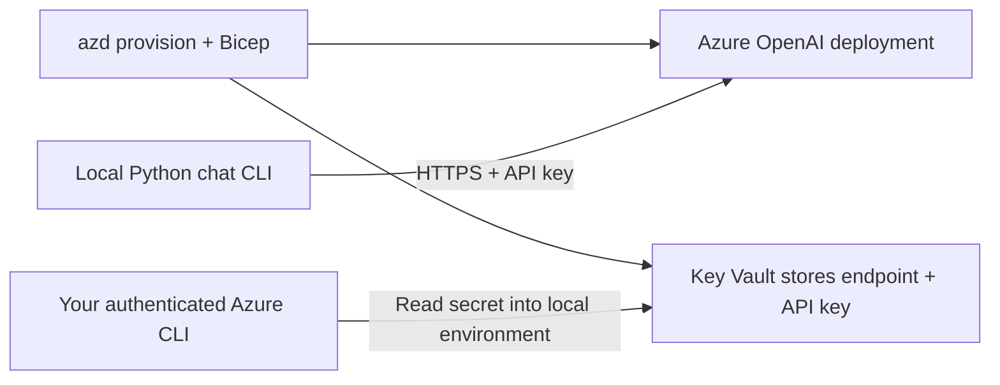

# Azure OpenAI Chat — CLI ya Ndani na Miundombinu ya AZD

**Kiwango:** Kati · **Muda:** Dakika 35–60 pamoja na usanidi

Sampuli hii inapangia **rasilimali ya Azure OpenAI na Key Vault**, kisha inaendesha
CLI ya mazungumzo ya Python inayoshirikiana **kwenye mashine yako**. Haikakai tovuti ya wavuti
au Container App. Mfano wa default ni `gpt-4.1`, toleo `2025-04-14`, yenye
uwezo wa uwekezaji `GlobalStandard` 20. Angalia upatikanaji wa sasa na kikao katika
eneo ulilolichagua kabla ya kupanga; tarehe za mzunguko wa maisha wa mfano zinaweza kubadilika.

## Malengo ya kujifunza

- Kuandaa miundombinu ya mfano kwa Bicep na azd.
- Kupata ufunguo wa API kutoka Key Vault bila kuiweka kwenye matokeo ya uwekezaji.
- Kutuma maombi ya Kukamilisha Mazungumzo na kuhifadhi historia ya mazungumzo.
- Kuelewa hesabu za tokeni na vikwazo vya makadirio ya gharama.



Hakuna ushirikiano wa utambulisho wa kusimamiwa wakati wa kukimbia, usababisha
makosa kwa maeneo mengi, kipunguza kasi maalum, hali ya mtiririko, au kompyuta iliyoandaliwa katika sampuli hii. SDK ya OpenAI
hufanya jaribio hadi mara mbili kwa makosa yanayoweza jaribio tena; CLI inaripoti makosa yaliyobaki.

## Masharti ya awali

- Toleo thabiti la sasa la [azd](https://learn.microsoft.com/azure/developer/azure-developer-cli/install-azd)
  (toleo lililotangazwa wakati wa mapitio: 1.37.2).
- [Azure CLI](https://learn.microsoft.com/cli/azure/install-azure-cli).
- Python **3.10+** (3.11 inapendekezwa) na mazingira ya mtandao.
- Usajili wa Azure wenye idhini ya kuunda Huduma za Kihisia na Key Vault
  rasilimali, kuweka mifano, na kusoma siri za hazina.
- Upatikanaji wa kikanda na `GlobalStandard` kiwango kwa `gpt-4.1`. Mahitaji ya upatikanaji
  hutegemea usajili na kipengele; hakuna muda uliodhamiriwa wa kuthibitishwa.

```bash
azd version
az version
python --version
azd auth login
az login
```

Hizi ni vikao tofauti vya uthibitishaji. Chagua usajili uleule katika zana zote mbili kabla ya kuendesha amri hapa chini.


## Anza Haraka (Bash)

Endesha kutoka mzizi wa hifadhidata:

```bash
cd examples/azure-openai-chat
azd env new myopenai
azd provision
```

Chagua mkoa unaounga mkono. Utoaji huunda kundi la rasilimali, akaunti ya OpenAI,
usambazaji wa modeli, Key Vault, na siri za `openai-endpoint`/`openai-api-key`.
Hakuna **huduma za kupeleka** kwenye `azure.yaml`.

Pakia matokeo yasiyo ya siri na chukua siri kwenye shell yako ya sasa:

```bash
export AZURE_OPENAI_ENDPOINT="$(azd env get-value AZURE_OPENAI_ENDPOINT)"
export AZURE_OPENAI_MODEL="$(azd env get-value AZURE_OPENAI_MODEL)"
KV_NAME="$(azd env get-value AZURE_KEY_VAULT_NAME)"
export AZURE_OPENAI_API_KEY="$(az keyvault secret show \
  --vault-name "$KV_NAME" --name openai-api-key --query value --output tsv)"

python -m venv .venv
source .venv/bin/activate
python -m pip install -r src/requirements.txt
python src/chat.py
```

Katika PowerShell, washawishi na `.\.venv\Scripts\Activate.ps1` na wape vigezo vya mazingira
kwa `$env:AZURE_OPENAI_ENDPOINT = azd env get-value AZURE_OPENAI_ENDPOINT`
(na kwa mfano vilevile). Pata funguo ya API kwa kutumia
`$env:AZURE_OPENAI_API_KEY = az keyvault secret show --vault-name $KV_NAME --name openai-api-key --query value -o tsv`.
Weka `$KV_NAME = azd env get-value AZURE_KEY_VAULT_NAME` kwanza.

Usichapishe, kutie, au kubandika funguo ya API katika ripoti za matatizo. CLI husoma mchakato
mabadiliko ya mazingira; **haitoi** siri za Key Vault wala haipakii faili za `.env`.
`config.py` inathibitisha kituo, kikomo cha token, na joto wakati wa kuanzisha.

Matokeo yaliyotarajiwa (maudhui na matumizi hubadilika):

```text
Azure OpenAI Chat Application
Model: gpt-4.1
...
You: Say hello in one sentence.
Assistant: Hello! How can I help you today?
[Tokens: ... | Cost: $...]
```

Amri: `stats` inaonyesha jumla, `clear` inafuta historia ya mazungumzo, na
`quit`/`exit` huta sesseni. Hakuna amri za `--stream`, `--show-tokens`, `tokens`,
au `cost`.

## Thibitisha usambazaji

Baada ya kupakia vigezo vya shell hapo juu:

```bash
curl --fail-with-body \
  "${AZURE_OPENAI_ENDPOINT%/}/openai/deployments/${AZURE_OPENAI_MODEL}/chat/completions?api-version=2024-10-21" \
  -H "Content-Type: application/json" \
  -H "api-key: $AZURE_OPENAI_API_KEY" \
  -d '{"messages":[{"role":"user","content":"Say hello!"}],"max_tokens":50}'

az keyvault secret list --vault-name "$KV_NAME" --query "[].name" -o table
```

Mafanikio: API inarudisha HTTP 200 na `choices[0].message.content` na `usage`;
hazina inaorodhesha `openai-api-key` na `openai-endpoint`. Utekelezaji wa ARM uliopata mafanikio
pekee hautathibiti utambuzi.

## Faili na usanidi

```text
azure.yaml                         # Infrastructure-only AZD project
infra/main.bicep                   # Subscription deployment
infra/main.parameters.json         # Environment, location, principal ID
infra/resources/openai.bicep       # Account + model
infra/resources/keyvault.bicep     # Vault + deploying user's secret access policy
infra/resources/secrets.bicep      # Writes secrets, no key output
src/chat.py                        # Interactive CLI
src/config.py                      # Environment validation
src/requirements.txt               # Python packages
```

Kubadilisha mfano/ toleo/ uwezo uliotolewa, hariri chaguo-msingi huko
`infra/main.bicep` na endesha `azd provision`. Kuweka `AZURE_OPENAI_MODEL` kwenye
shell yako kunachagua tu **jina la utekelezaji lililopo**; haiwezi kupeleka mfano mwingine.

| Kigezo cha wakati wa utekelezaji | Chaguo-msingi / chanzo |
|---|---|
| `AZURE_OPENAI_ENDPOINT` | Inahitajika; matokeo yasiyo ya siri ya azd |
| `AZURE_OPENAI_API_KEY` | Inahitajika; pata kutoka Key Vault |
| `AZURE_OPENAI_MODEL` | `gpt-4.1`; Jina la usambazaji wa Azure |
| `AZURE_OPENAI_MAX_TOKENS` | 800 (kibali cha uthibitisho 1–4096) |
| `AZURE_OPENAI_TEMPERATURE` | 0.7 (kibali 0–2) |
| `AZURE_OPENAI_INPUT_PRICE_PER_1K` | 0.002 USD; kiwango cha mfano cha pembejeo isiyohifadhiwa |
| `AZURE_OPENAI_OUTPUT_PRICE_PER_1K` | 0.008 USD; kiwango cha mfano cha pato |

## Gharama na vikwazo vya usalama

Onyesho la gharama ni **makisio**, si bili ya Azure. Linazidisha matumizi ya tokeni ya API
kwa viwango vilivyowekwa na halihesabu punguzo la pembejeo zilizohifadhiwa,
tofauti za kikanda/SKU, kodi, mabadiliko ya bei, au simu zilizoshindikana/kujaribu tena.
Badilisha **viwango vyote viwili** unapotumia mfano mwingine au SKU na hakiki
[bei ya Azure OpenAI](https://azure.microsoft.com/pricing/details/cognitive-services/openai-service/) ya sasa.

Kwa mfano, maombi 100 yanayotumia 500 pembejeo zisizo na hifadhi na tokeni 200 za pato kila
moja kwa viwango vya chaguo-msingi ni gharama ya `100 × (500/1000 × .002 + 200/1000 × .008) = $0.26`.
Operesheni/uhifadhi wa Key Vault huleta malipo tofauti. Hakuna malipo thabiti ya $50/kwa mwezi
kwa CLI hii ya eneo hili na hakuna kompyuta iliyojiendesha mwenyewe kwenye mfano.

Ghala linatumia sera ya ufikiaji kwa mtendaji anayewekza; si mfano wa programu ya
RBAC au kitambulisho kinachosimamiwa. Vituo vya umma na uthibitishaji wa funguo za API
vinatumiwa kwa kufundisha. Punguza ruhusa na ongeza udhibiti unaofaa wa kitambulisho/mtandao
kabla ya kuibadilisha kwa uzalishaji.

## Mazoezi ya vitendo

### 1. Thibitisha muktadha na uurejeshe

**Anza:** kuendesha CLI. **Lengo:** kuangalia historia.
Sema "Kumbuka neno cedar," kisha uliza "Neno gani niliokuomba ukumbuke?"
Endesha `stats`; mabadiliko mawili yaliyofanikiwa yanapaswa kuhesabiwa kama jumbe mbili zilizobadilishana.
Endesha `clear` na `stats`; jumbe zilizobadilishana zinapaswa kuwa sifuri (jumla ya tokeni zinabaki).
Maneno halisi ya mfano si jambo linalotabirika.

### 2. Badilisha kikomo cha jibu

**Anza:** toka kwenye CLI, ukihifadhi shell ile ile.
Endesha `export AZURE_OPENAI_MAX_TOKENS=100`, anzisha upya `python src/chat.py`, na uliza
Maelezo mafupi ya azd. Angalia kuwa bendera inaonyesha 100.
Rudisha na `unset AZURE_OPENAI_MAX_TOKENS`. Kikwazo kidogo cha majibu hakipunguzi
tokeni za historia zilizotumwa tayari.

### Masuala ya kawaida

- **Mazingira ya mabadiliko hayapo:** utekelezaji haulizi thamani za shell;
  rudia hatua za kuuza. Terminal mpya inazihitaji tena.
- **403 kusoma Key Vault:** hakiki usajili/ingia katika Azure CLI na mhusika
  katika sera ya upatikanaji wa hazina. Mabadiliko ya sera yanaweza kuchukua muda kusambaa.
- **404 upelelezi:** angalia jina la utekelezaji, sehemu ya mwisho, na hali ya utekelezaji.
- **429 upelelezi:** subiri mipaka ya kiwango irejee upya; hakiki ukubwa wa mfano wa kikanda.
  CLI inafuta zamu zilizoshindikana kutoka kwenye historia hivyo kujaribu tena hakufanyi rudufu.
- **Urefu wa muktadha:** sampuli haisafi mazungumzo marefu; tumia `clear`.
- **Mfano haupatikani/umeachwa:** angalia upatikanaji wa mfano wa sasa na sasisha
  mfano/toleo/SKU pamoja; toleo la API na toleo la mfano ni mipangilio tofauti.

## Usafishaji na hatua zinazofuata

```bash
azd down
unset AZURE_OPENAI_API_KEY
```

Uhifadhi laini wa kufuta Key Vault ni siku saba; kufuta kabisa kunahitaji ruhusa tofauti.
Hakuna msururu wa majaribio uliodhaminiwa; usifanye amri isiyoipo ya `pytest tests/`.
Ongeza majaribio ya API yaliyodhibitiwa kabla ya kuongeza msimbo.

[Mifano ya kontena](../../../../examples/container-app) · [Mpango wa usanifu wa rejareja](../retail-scenario.md) ·
[Nyumbani kwa kozi](../../README.md) · [Ripoti tatizo](https://github.com/microsoft/AZD-for-beginners/issues)

---

<!-- CO-OP TRANSLATOR DISCLAIMER START -->
**Kionyozo**:
Hati hii imetafsiriwa kwa kutumia huduma ya tafsiri ya AI [Co-op Translator](https://github.com/Azure/co-op-translator). Ingawa tunajitahidi kupata usahihi, tafadhali fahamu kwamba tafsiri za kiotomatiki zinaweza kuwa na makosa au upungufu wa usahihi. Hati ya asili katika lugha yake halisi inapaswa kuchukuliwa kama chanzo cha mamlaka. Kwa taarifa muhimu, tafsiri ya kitaalamu inayofanywa na binadamu inapendekezwa. Hatutojibu kwa kuelewa vibaya au tafsiri potofu zinazotokea kutokana na matumizi ya tafsiri hii.
<!-- CO-OP TRANSLATOR DISCLAIMER END -->