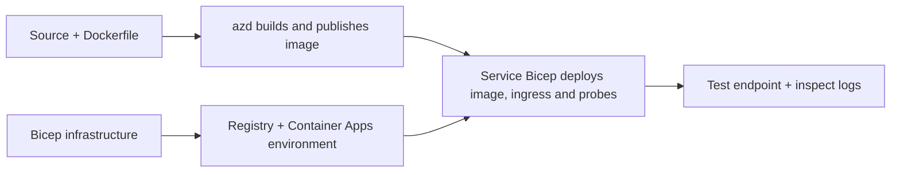

# Mifano ya Utekelezaji wa Programu za Kontena kwa AZD

Hii saraka ina sampuli mbili za kujifunza zenye msimbo wa chanzo, Dockerfiles,
usanifu wa miundombinu wa Bicep, na `azure.yaml`. Hakuna kati yao iliyotengenezwa kwa nguvu za uzalishaji.

## Chagua mfano

| Sampuli | Nini kimetekelezwa | Masharti ya awali |
|---|---|---|
| [Simple Flask API](../../../../examples/container-app/simple-flask-api) | API moja ya Python CRUD, vitu vya kumbukumbu ya muda, vipimo vya afya, upanuzi wa HTTP | Ujuzi wa msingi wa CLI na HTTP |
| [Two-service microservices](../../../../examples/container-app/microservices) | Lango la Node.js, huduma ya bidhaa ya Python ya kusoma tu ya ndani, upimaji na upanuzi | Maliza kwanza sampuli ya huduma moja |

Ruhusu dakika 30–60 ikijumuisha usanidi na uhakikisho. Muda wa upatikanaji wa Azure hubadilika.

## Masharti ya awali

- [Azure Developer CLI](https://learn.microsoft.com/azure/developer/azure-developer-cli/install-azd)
- [Azure CLI](https://learn.microsoft.com/cli/azure/install-azure-cli) kwa amri za uhakikisho
- Docker ikiwa na daemon yake ikiendesha kwa ajili ya kujenga picha hizi za kontena
- Usajili wa Azure wenye ruhusa za kuunda rasilimali na msongamano wa kikanda unaotosha
- Bash kwa mifano ya shell, au amri sawa za PowerShell

```bash
azd version
az version
docker info
azd auth login
az login
```

Zana hizo mbili zina vikao tofauti vya kuingia. Tumia azd thabiti ya sasa; toleo lililosambazwa kwa sasa wakati wa uhakiki ni 1.37.2. Madai ya toleo la chini la zamani si dhamana ya upatanifu.


```bash
cd examples/container-app/simple-flask-api
azd env new flask-demo
azd up
API_URL=$(azd env get-value API_ENDPOINT)
curl --fail-with-body "${API_URL}/health"
```

Inatarajiwa: HTTP 200 na `"status": "healthy"`. Fuata mfano wa README kuunda,
kusoma, kusasisha, na kufuta kipengee, na kuchunguza kumbukumbu.



Ugawaji wa awali hutumia picha ya hello-world ya umma kwenye bandari 80. Maelezo maalum ya huduma
Faili za parameter za Bicep huruhusu `azd deploy` kuibadilisha na picha ya programu iliyojengwa
na bandari sahihi ya programu/majaribu (8000 kwa Flask/produkiti, 8080 kwa lango).
Hifadhi faili hizi zilizo na mipangilio yao ya `azure.yaml` `module`.

## Usanidi: nini kinabadilisha nini

`azure.yaml` huchagua saraka za chanzo, lugha, mwenyeji, na moduli za uenezaji.
CPU/okusanyaji wa kontena, ingizo, majaribu, idadi ya nakala, na sheria za upanuzi huainishwa
katika **Bicep**, sio mali za huduma yoyote za kiholela `resources`, `scale`, au `regions`.

`azd env set SOME_VALUE ...` huhifadhi thamani kwa ndani. Hubadilisha rasilimali iliyowekwa tu
wakati parameteri, ramani ya mazingira, au hook hutumia thamani hiyo waziwazi.
Mifano hii haisumbui `MAX_REPLICAS`, `SCALE_TO_ZERO_TIMEOUT`,
`CONTAINER_APP_REPLICA_TYPE`, au mipangilio ya canary iliyobinafsishwa kutoka kwa thamani za mazingira za azd.
Hariri Bicep inayohusika na endesha `azd up` tena ili kuanzisha upya na kuweka.

Usiweke chanzo cha programu chini ya `infra/`. `project` lazima ishike saraka ya chanzo
inayojumuisha Dockerfile na hati ya utegemezi.

## Ufuatiliaji na gharama

- `azd monitor --logs` hufungua mtazamo wa lango; si mtiririko wa kumbukumbu za terminal.
  Tumia `az containerapp logs show --follow` na jina halisi la rasilimali.
- API rahisi huchapisha kumbukumbu za stdout zilizokusanywa kupitia Container Apps/Log Analytics.
  Rasilimali yake ya Application Insights iliyowekwa haitumwi kiotomatiki.
- Mlango wa huduma ndogo hutumia Node.js Application Insights SDK; huduma ya Python
  hupeleka alama za kumbukumbu za programu. Ufuatiliaji kamili wa maombi/mategemeo ya Python
  haujaratibiwa.
- Kupanua hadi sifuri kunaweza kupunguza gharama za hisabati, lakini rejista na usindikaji/uhifadhi
  wa kumbukumbu bado kunaweza kugharimu pesa. Mipangilio ya huduma ndogo hufanya nakala ziendeshe.
  Kadiria eneo lako na matumizi yako katika
  [Azure pricing calculator](https://azure.microsoft.com/pricing/calculator/).

## Mifumo ya juu — utekelezaji haujajumuishwa

Hizi ni mwelekeo wa muundo, sio miradi ya ziada ya hapa au vipande vya nakala-na-kukimbia:

- **Data endelevu na uthibitishaji:** badilisha hifadhi za ndani na ongeza
  uthibitishaji/uruhusu wa Microsoft Entra ID kabla ya uzalishaji.
- **Blue-green/canary:** tumia hali ya marekebisho mengi ya Container Apps, lebo za marekebisho,
  uzito wa trafiki, ukaguzi wa afya, na taratibu za kurudisha hali ya awali.
  Hakuna usanidi wa `deploymentStrategy: canary` azd katika sampuli hizi.
  Angalia [usimamizi wa marekebisho](https://learn.microsoft.com/azure/container-apps/revisions).
- **Mikoa mingi:** tengeneza mazingira na programu tofauti katika Bicep na tumbukiza
  upangaji wa kimataifa wa njia na uthabiti wa data. Orodha ya huduma `regions` siyo kifaa cha azd
  cha uenezi.
- **Wafanyakazi wa foleni:** ongeza chanzo cha mfanyakazi, utegemezi, rasilimali za foleni, utambulisho
  uliosimamiwa wenye majukumu ya usafirishaji wa data, na sheria ya uthibitishaji ya upanuzi. Usinakili
  njia tupu ya `src/worker` na kutegemea mradi unaoweza kuendeshwa.
- **Dapr:** panga vipengele, sanidi kando, weka SDK inayolingana,
  na tekeleza usimamizi wa makosa ya hali/chapisho-anuwai.
- **Siri:** tumia utambulisho uliosimamiwa na ugawa wa majukumu inapowezekana. Kuweka Key Vault pekee
  hakupati maombi ruhusa au kupakia siri.

## Usafishaji

Kutoka kwenye saraka ya sampuli:

```bash
azd down
```

Kagua maonyo ya kufuta na thibitisha kuwa kundi la rasilimali lililojitolea limeondolewa.
Usitumie sampuli hizi kama msingi wa uzalishaji bila muundo na majaribio ya ziada.

[Fyekele za mifano](../README.md) · [Nyumbani mwa kozi](../../README.md) ·
[Nyaraka za Container Apps](https://learn.microsoft.com/azure/container-apps/) ·
[Ripoti tatizo](https://github.com/microsoft/AZD-for-beginners/issues)

---

<!-- CO-OP TRANSLATOR DISCLAIMER START -->
**Kionyozo**:
Hati hii imetafsiriwa kwa kutumia huduma ya tafsiri ya AI [Co-op Translator](https://github.com/Azure/co-op-translator). Ingawa tunajitahidi kupata usahihi, tafadhali fahamu kwamba tafsiri za kiotomatiki zinaweza kuwa na makosa au upungufu wa usahihi. Hati ya asili katika lugha yake halisi inapaswa kuchukuliwa kama chanzo cha mamlaka. Kwa taarifa muhimu, tafsiri ya kitaalamu inayofanywa na binadamu inapendekezwa. Hatutojibu kwa kuelewa vibaya au tafsiri potofu zinazotokea kutokana na matumizi ya tafsiri hii.
<!-- CO-OP TRANSLATOR DISCLAIMER END -->