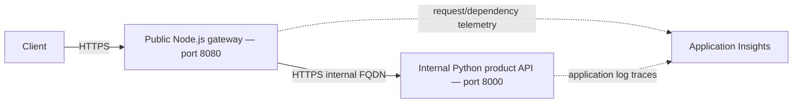

# Microservices ya Huduma Mbili — Azure Container Apps

**Kiwango:** Kati · **Muda:** dakika 45–60 ikiwa ni pamoja na usanidi

Mfano huu wa kujifunza unatekeleza **Nzira ya API ya Node.js** na **Huduma ya Bidhaa ya Python ya kusoma tu**.
Chanzo, Dockerfiles, Bicep, na usanidi wa azd vimejumuishwa.
Sio mfumo uliobebwa kwa ajili ya utengenezaji.

## Utajifunza nini

- Tengeneza huduma mbili kwa kujitegemea.
- Tumia FQDN ya nyuma ya ndani kupitia HTTPS.
- Thibitisha mafanikio, majibu ya si-kujulikana, na huduma isiyopatikana.
- Elewa telemetry na mipaka ya upanuzi huru.



Katalogi ya bidhaa ina bidhaa tano zilizowekwa katika kumbukumbu. Hakuna **wasimamizi wa POST,
PUT, au DELETE**, hifadhidata, Service Bus, huduma ya oda/m Mtumiaji/taarifa,
C#, au msimbo wa Go. Hizo ni mawazo ya maendeleo ya baadaye, si vipengele vilivyojumuishwa.
Lango halithibitishi watumiaji; ingizo la ndani si badala ya
idhini ya programu.

## Masharti ya awali

Kamilisha [API ya Flask moja](../../../../../examples/container-app/simple-flask-api) kwanza.
Sakinisha azd imara ya sasa (toleo lililotolewa wakati wa ukaguzi: 1.37.2), Azure CLI,
na Docker ukiendesha daemon. Unahitaji usajili wa Azure, ruhusa za kuunda rasilimali,
na kikomo cha mkoa cha Maombi ya Kontena.

```bash
azd version
az version
docker info
azd auth login
az login
```

Tumia usajili ule ule katika zana zote mbili za CLI. Amri zilizo hapa chini zinatumia Bash.

## Sambaza na hakikisha

Kutoka kwenye mzizi wa hazina:

```bash
cd examples/container-app/microservices
azd env new microservices-demo
azd up
GATEWAY_URL=$(azd env get-value API_GATEWAY_URL)
RG_NAME=$(azd env get-value AZURE_RESOURCE_GROUP)
GATEWAY_NAME=$(azd env get-value API_GATEWAY_NAME)
PRODUCT_NAME=$(azd env get-value PRODUCT_SERVICE_NAME)

curl --fail-with-body "${GATEWAY_URL}/health"
curl --fail-with-body "${GATEWAY_URL}/api/products"
curl --fail-with-body "${GATEWAY_URL}/api/products/1"
curl -i "${GATEWAY_URL}/api/products/999"
```

**Mafanikio:** afya 200; orodha 200 na bidhaa **tano**; bidhaa 1 ni Kompyuta Mpya
yenye bei 999.99 na hisa 50; bidhaa isiyojulikana hurudisha 404.
Maelezo yamejumuishwa katika majibu; alama za wakati hutofautiana.

Usambazaji wa awali hutumia picha za hello-world za umma kwenye bandari 80 ili isijaribu
kuvuta picha zisizoipo kutoka rejista tupu. Moduli za Bicep maalum za huduma
na faili za vigezo zinazibadilisha na picha zilizojengwa na bandari/probes za programu wakati wa
`azd deploy`. Vigezo vikuu huhifadhi majina ya picha zilizochapishwa kwa usambazaji wa baadaye.

## Huduma na mtandao

| Huduma | Mifumo iliyo wazi | Rasilimali za kawaida |
|---|---|---|
| Gateway | PATA `/`, `/health`, `/api/products`, `/api/products/:id` | 1 vCPU, 2 GiB, nakala 2–20 |
| Product | PATA `/`, `/health`, `/products`, `/products/<id>` | 0.5 vCPU, 1 GiB, nakala 1–10 |

Ingizo la bidhaa lina `external: false` na `allowInsecure: false`. Bicep huchoma
`PRODUCT_SERVICE_URL=https://<actual-internal-fqdn>` kwenye gateway. HTTP angalizika;
HTTPS inalingana na ingizo iliyowekwa. Jina fupi la DNS lazima lilingane na
**jina halisi la Maombi ya Kontena**, si muhimu wa huduma wa mantiki `product-service`.
Usijaribu kuita URL ya ndani moja kwa moja kutoka kwenye kompyuta yako mpakato.

Gateway ina muda wa sekunde tano kwa simu za bidhaa. Vitambulisho vya bidhaa vinavyokosa
hurudisha 404; kushindwa kusafirishwa/kushindwa kwa backend hurudisha 503. Gateway
`/health` inakagua gateway tu, si upatikanaji wa backend.

## Faili na usanidi

```text
azure.yaml
infra/main.bicep
infra/main.parameters.json
infra/abbreviations.json
infra/core/container-apps-environment.bicep
infra/core/monitor.bicep
infra/app/api-gateway.bicep
infra/app/api-gateway.parameters.json
infra/app/product-service.bicep
infra/app/product-service.parameters.json
src/api-gateway/{app.js,package.json,Dockerfile}
src/product-service/{main.py,requirements.txt,Dockerfile}
```

Kupanua, CPU/kumbukumbu, bandari, na probes huwekwa katika `infra/app/*.bicep`. Badilisha
faili hizo kisha tumia `azd up` ili kutekeleza miundombinu na kusambazaje tena. Hakuna
vigezo vya mazingira vya `GATEWAY_MAX_REPLICAS` katika sampuli hii.

Kwa mabadiliko ya msimbo pekee:

```bash
azd deploy product-service
azd deploy api-gateway
```

Picha ya Node inatumia Node 22; picha ya Python inatumia Python 3.11. Zote zinaunganisha
`0.0.0.0`. Ingizo/probes hutumia bandari 8080 (gateway) na 8000 (bidhaa), mtawalia.

## Maendeleo ya ndani na Docker

Endesha kutoka kwenye saraka hii ya mfano. Tumia mtandao uliobuniwa na mtumiaji, **si `localhost`
kutoka kontena moja kufikia nyingine**:

```bash
docker network create azd-microservices-demo
docker build -t local-product ./src/product-service
docker build -t local-gateway ./src/api-gateway
docker run -d --name azd-product --network azd-microservices-demo local-product
docker run -d --name azd-gateway --network azd-microservices-demo \
  -p 8080:8080 -e PRODUCT_SERVICE_URL=http://azd-product:8000 local-gateway
curl --fail-with-body http://localhost:8080/api/products
```

Inatarajiwa: bidhaa tano. HTTP hutumiwa tu kwa mtandao huu wa ndani wa Docker.

```bash
docker stop azd-product azd-gateway
docker rm azd-product azd-gateway
docker network rm azd-microservices-demo
```

## Ufuatiliaji

```bash
az containerapp logs show --name "$GATEWAY_NAME" --resource-group "$RG_NAME" --follow
# In a separate terminal:
az containerapp logs show --name "$PRODUCT_NAME" --resource-group "$RG_NAME" --tail 100
```

`azd monitor --logs` hufungua mtazamo wa lango; haisambazi majarida ya terminal.
SDK ya Node inakusanya maombi/mategemeo ya gateway. `AzureLogHandler` ya Python
hupeperusha **mfuatiliaji wa kumbukumbu**, si maombi ya Flask moja kwa moja, mategemeo ya SQL, wala mfuatiliaji wa ugawaji wa kikamilifu.
OpenCensus ni SDK ya urithi; pendekeza Azure Monitor OpenTelemetry
unapoongeza sampuli hii.

Katika Application Insights Logs, tengeneza maombi na kagua:

```kusto
requests
| where timestamp > ago(1h)
| where name contains "products"
| summarize RequestCount=count(), AvgDuration=avg(duration) by bin(timestamp, 5m)
```

Kwa ujumbe wa programu ya Python:

```kusto
traces
| where timestamp > ago(1h)
| where message contains "products"
| project timestamp, message, severityLevel
```

Ruhusu ucheleweshaji wa ulaji na sampuli; usitarajie idadi halisi ya ombi au
ucheleweshaji uliodhibitiwa. Hakuna onyo au dashibodi maalum zilizowekwa.

## Mazoezi ya vitendo

### Zozi 1: Badilisha katalogi

**Mwanzo:** `src/product-service/main.py`.
**Lengo:** hakikisha usambazaji wa huduma huru.
Badilisha hisa za Kompyuta Mpya kutoka 50 hadi 49 katika orodha ya thabiti ya `products`, endesha
`azd deploy product-service`, kisha omba `${GATEWAY_URL}/api/products/1`.

**Vigezo vya mafanikio / suluhisho:** HTTP 200 na `"stock":49`. Rudisha 50 na sambaza tena.
**Tatizo la kawaida:** kuhariri gateway badala ya huduma inayomiliki katalogi.
Hii hubadilisha data ya chanzo, si hifadhidata ya hesabu ya kudumu.

### Zozi 2: Hakiki usanidi wa nakala

**Mwanzo:** `infra/app/product-service.bicep`.
**Lengo:** tazama mabadiliko ya miundombinu bila kukisia ujazo kiotomatiki.
Badilisha `minReplicas: 1` kuwa `minReplicas: 2`, endesha `azd up`, kisha:

```bash
az containerapp show --name "$PRODUCT_NAME" --resource-group "$RG_NAME" \
  --query properties.template.scale -o json
```

**Vigezo vya mafanikio:** kiwango cha chini kilichosanidiwa ni 2 na kiwango cha juu kinaendelea kuwa 10.
Rejesha chini kuwa 1 na endesha `azd up`.
**Tatizo la kawaida:** `azd deploy` pekee haiwabadili mabadiliko kwenye miundombinu ya pamoja isiyohusiana.
Usitengeneze `maxReplicas` kuwa zero kama kuiga kushindwa.
Hii inathibitisha usanidi, si jaribio la mzigo au idadi ya nakala iliyohakikishwa mara moja.

### Zozi 3: Jaribu kushughulikia huduma isiyopatikana kwa ndani

**Mwanzo:** kontena zote mbili za ndani za Docker hapo juu zinaendesha.
**Lengo:** tofautisha kushindwa kwa backend na bidhaa isiyopo.
Zima kontena ya bidhaa pekee:

```bash
docker stop azd-product
curl -i http://localhost:8080/api/products
docker start azd-product
curl --fail-with-body http://localhost:8080/api/products
```

**Vigezo vya mafanikio:** wakati imezimwa, gateway hurudisha 503 na
`"error":"Product service unavailable"`; baada ya kuanzisha tena, orodha hurudisha 200.
Jaribu tena baada ya kuchelewa kidogo kuanza ikiwa ni lazima.
**Tatizo la kawaida:** kuzima gateway huharibu aina tofauti ya kushindwa (hakuna majibu ya HTTP).

## Gharama na mapengo ya uzalishaji

Nakala za chini za kawaida zinaendesha kompyuta. Rejista na ufuatiliaji pia husababisha
malipo. Hakuna jumla ya $50/thamani iliyothibitishwa: makadirio ya CPU/kumbukumbu ya mkoa,
saa za nakala, maombi, rejista, na kuhifadhi kumbukumbu katika
[kalkuleta ya bei ya Azure](https://azure.microsoft.com/pricing/calculator/).
Futa rasilimali za kujifunza mara moja.

Kazi ya uzalishaji inajumuisha uthibitishaji/uruhusu, vitambulisho vinavyosimamiwa vinavyolengwa,
data ya kudumu, uthibitishaji wa pembejeo/majibu, vifaa vya mtazamo vinavyotumika,
jaribio la mzigo/kushindwa, CI/CD, onyo, na taratibu za kupona. Kuongeza huduma ya agizo,
foleni, au hifadhidata ni kazi tofauti ya utekelezaji, si zoezi lililo kamilika au kipengele kilichopo hapa.


## Kutatua matatizo na usafi

- **Picha haipatikani wakati wa usambazaji wa awali:** kuanzisha inapaswa kutumia picha ya umma;
  hakikisha vigezo vikuu vya picha na ramani za moduli za usambazaji.
- ** bidhaa 503:** angalia majarida ya bidhaa, marekebisho ya picha, na URL ya HTTPS ya ndani iliyochomwa.
- ** Njia isiyotarajiwa 404:** API ya bidhaa ni ya kusoma tu; hakikisha njia, si mshughulikiaji isiyeko wa CRUD.
- ** Hakuna telemetry:** angalia kamba za muunganisho wa runtime bila kuzionyesha na
  ruhusu ucheleweshaji wa ulaji. Jedwali za maombi za Python hazijaandikishwa na mshughulikiaji wake wa kumbukumbu.

Kutoka kwenye saraka hii ya sampuli:

```bash
azd down
```

Kagua maelekezo ya kufuta na uhakikishe kikundi cha rasilimali kilichotengwa kimeondolewa.

[Kabla: API ya Flask](../../../../../examples/container-app/simple-flask-api) · [Ifuatayo: programu ya Hifadhidata](../../../../../examples/database-app) ·
[Maendeleo ya AI](../../../docs/chapter-02-ai-development/README.md) ·
[Nyumbani kwa kozi](../../../README.md) · [Ripoti tatizo](https://github.com/microsoft/AZD-for-beginners/issues)

---

<!-- CO-OP TRANSLATOR DISCLAIMER START -->
**Kionyozo**:
Hati hii imetafsiriwa kwa kutumia huduma ya tafsiri ya AI [Co-op Translator](https://github.com/Azure/co-op-translator). Ingawa tunajitahidi kupata usahihi, tafadhali fahamu kwamba tafsiri za kiotomatiki zinaweza kuwa na makosa au upungufu wa usahihi. Hati ya asili katika lugha yake halisi inapaswa kuchukuliwa kama chanzo cha mamlaka. Kwa taarifa muhimu, tafsiri ya kitaalamu inayofanywa na binadamu inapendekezwa. Hatutojibu kwa kuelewa vibaya au tafsiri potofu zinazotokea kutokana na matumizi ya tafsiri hii.
<!-- CO-OP TRANSLATOR DISCLAIMER END -->