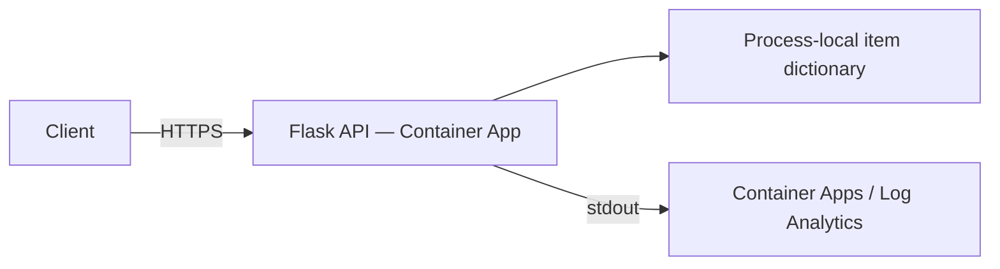

# API Rahisi ya Flask — Azure Container Apps

**Kiwango:** Mwanzo · **Muda:** Dakika 30–45 ikijumuisha usanidi

Weka API ya Python Flask CRUD kwa kutumia Azure Developer CLI (azd). Chanzo, Dockerfile,
Bicep, na parameta za utekelezaji zimo. Hii ni **mfano wa kujifunza**, sio
API inayotumika uzalishaji.

## Utajifunza nini

- Tengeneza na toleo chombo cha kontena kupitia azd.
- Sanidi ingress na vipimo vya uhai/ukasiri.
- Thibitisha majibu ya CRUD na angalia kumbukumbu za programu.
- Elewa kwa nini data iliyoko ndani ya kumbukumbu si ya kutumika kwa programu za kudumu.



**Muhimu:** vitu vihifadhiwa katika mchakato mmoja. Chaguo-msingi ni **mfanyakazi mmoja wa Gunicorn,
nakala 0–1**, kwa makusudi kuzuia data isiyoendana kati ya wafanyakazi/nakala.
Vitu hupotea wakati wa kuanzisha upya, mabadiliko ya toleo, au kupungua kwa nakala hadi sifuri. Kuongeza nakala
kunahitaji hifadhi ya kudumu inayoshirikiwa. API haina uthibitishaji au idhini.

## Mahitaji ya awali

- [azd thabiti ya sasa](https://learn.microsoft.com/azure/developer/azure-developer-cli/install-azd)
  (toleo lililotolewa wakati wa mapitio: 1.37.2).
- [Azure CLI](https://learn.microsoft.com/cli/azure/install-azure-cli) kwa ajili ya uhakiki.
- Docker ikiwa na daemon inayoendesha; inahitajika kwa kujenga picha ya ndani kama kawaida.
- Usajili wa Azure, ruhusa za kuunda rasilimali, na kiwango cha kikanda cha Container Apps.
- Bash kwa amri zilizo hapo chini (au PowerShell sawa).
- Python 3.11 kwa maendeleo ya hiari ya ndani.

```bash
azd version
az version
docker info
azd auth login
az login
```

Zana za CLI zina vikao tofauti vya kuingia. Tumia usajili uleule kwenye zote mbili.

## Anza haraka

Kutoka kwenye mzizi wa hazina:

```bash
cd examples/container-app/simple-flask-api
azd env new flask-demo
azd up
API_URL=$(azd env get-value API_ENDPOINT)
RG_NAME=$(azd env get-value AZURE_RESOURCE_GROUP)
API_NAME=$(azd env get-value API_NAME)
curl --fail-with-body "${API_URL}/health"
```

Kinachotarajiwa: HTTP 200 na JSON yenye `"status":"healthy"`,
`"service":"simple-flask-api"`, na alama ya wakati wa sasa ya UTC.
Utekelezaji na ujenzi wa picha kawaida huchukua dakika chache; nyakati zinatofautiana.

Utekelezaji wa awali hutumia picha ya umma ya hello-world inayosikiliza bandari 80.
`azure.yaml` huchagua `infra/app/api.bicep` na faili yake ya parameta inayoendana kwa
utoaji wa huduma, ambayo hubadilisha picha, ingress, na vipimo hadi bandari 8000.
Usifute parameta hizo za utoaji.

## Thibitisha CRUD

Endesha yafuatayo mfululizo huku nakala ile ile ikiwa hai:

```bash
# Create: HTTP 201; note the returned id (1 for a fresh process).
curl -i -X POST "${API_URL}/api/items" \
  -H "Content-Type: application/json" \
  -d '{"name":"Test Item","description":"My first item"}'

# Read list: HTTP 200, total 1 in a fresh process.
curl --fail-with-body "${API_URL}/api/items"

# Replace 1 if your create response returned another id.
curl --fail-with-body "${API_URL}/api/items/1"
curl -i -X PUT "${API_URL}/api/items/1" \
  -H "Content-Type: application/json" -d '{"name":"Updated Item"}'
curl -i -X DELETE "${API_URL}/api/items/1"
curl -i "${API_URL}/api/items/1"
```

Mafanikio: POST 201, usomaji/PUT 200, DELETE 204 bila mwili, kisha kipengee hakipo 404.
JSON isiyo sahihi/si kitu au jina tupu hurejesha 400.
Ikiwa kipengee kinapotea kati ya maombi, angalia kuanzisha upya au kupungua hadi sifuri;
hii ni kikomo cha makusudi cha kumbukumbu ya ndani, si kuhifadhi daima.

| Mwisho wa Malaa | Mbinu |
|---|---|
| `/` | PATA — taarifa za huduma |
| `/health` | PATA — uhai/ukasiri |
| `/api/items` | PATA, TUMIA POST |
| `/api/items/{id}` | PATA, TUMIA PUT, FUTA |

## Kumbukumbu na usanidi

```bash
az containerapp logs show --name "$API_NAME" --resource-group "$RG_NAME" --follow
```

Kinachotarajiwa: kuanzishwa kwa Gunicorn, kumbukumbu za ufikiaji wa ombi, na ujumbe za programu.
`azd monitor --logs` hufungua mtazamo wa lango; hautoa mfululizo kwa terminal.
Application Insights imeandaliwa lakini **haina vifaa vya msimbo huu wa Flask**;
tumia Container Apps/Log Analytics kwa kumbukumbu za stdout.

Hariri `infra/app/api.bicep` kwa CPU/kumbukumbu, mipaka ya nakala, au sheria za mzigo, kisha
endesha `azd up`. Chaguo-msingi ni 0.5 vCPU, 1 GiB, chini 0 / juu 1 nakala, na
wigo wa HTTP wa maombi 50 sambamba. Kupungua hadi sifuri kunaweza kuongeza ucheleweshaji wa kuanzisha baridi.

Kanuni yoyote ya `azd env set MAX_REPLICAS`, `API_KEY`, `LOG_LEVEL`, au
Thamani za `SCALE_TO_ZERO_TIMEOUT` **haziunganishwi na kiolezo hiki au programu hii**.
kuweka thamani haisababisha moja kwa moja kuwa mabadiliko ya mazingira ya wakati wa utekelezaji.
Picha inaunganisha bandari 8000 waziwazi; sasisha Dockerfile, Bicep ingress, na probes
pamoja ikiwa unabadilisha bandari.

## Faili

```text
azure.yaml
infra/main.bicep
infra/main.parameters.json
infra/app/container-apps.bicep       # Environment, registry, monitoring
infra/app/api.bicep                  # App, ingress, probes, scale settings
infra/app/api.parameters.json        # Image and resource values for azd deploy
src/app.py
src/Dockerfile
src/requirements.txt
```

## Maendeleo ya ndani

Kutoka kwenye saraka hii ya mfano:

```bash
python -m venv .venv
source .venv/bin/activate  # PowerShell: .\.venv\Scripts\Activate.ps1
python -m pip install -r src/requirements.txt
python src/app.py
```

Katika terminali nyingine, jaribu `http://localhost:8000/health` na vitu vya mwisho vya CRUD.
Au tengeneza na endesha picha halisi:

```bash
docker build -t flask-api:local ./src
docker run --rm -p 8000:8000 flask-api:local
```

Kwa mabadiliko ya msimbo tu baada ya upangaji wa kwanza, endesha `azd deploy api`.
Kwa mabadiliko ya Bicep, endesha `azd up` kurekebisha na kupeleka tena.

## Mazoezi ya vitendo

### 1. Thibitisha kukataliwa kwa pembejeo

**Msingi wa kuanzia:** API iliyopangwa, `API_URL` hapo juu.
**Lengo:** thibitisha API inakataza maumbo ya JSON yasiyo sahihi na majina yaliyokosekana.

```bash
curl -i -X POST "${API_URL}/api/items" \
  -H "Content-Type: application/json" -d '[]'
curl -i -X POST "${API_URL}/api/items" \
  -H "Content-Type: application/json" -d '{"name":""}'
```

**Vigezo vya mafanikio / suluhisho:** vyote viarudishe 400 na kosa la JSON, si 500.
**Tatizo la kawaida:** kutojumuisha kichwa cha aina ya maudhui ya JSON.

### 2. Ongeza njia ya toleo la kusoma tu

**Msingi wa kuanzia:** `src/app.py`. **Lengo:** ongeza na upange API tena.
Ongeza hii kabla ya sehemu ya `if __name__ == '__main__':`:

```python
@app.route('/version', methods=['GET'])
def version():
    return jsonify({'version': '1.0.0'})
```

Endesha `azd deploy api`, kisha `curl --fail-with-body "${API_URL}/version"`.
**Vigezo vya mafanikio:** HTTP 200 na `{"version":"1.0.0"}`.
**Tatizo la kawaida:** kuweka njia baada ya mwito wa kufunga wa `app.run()` unapotumia
kujaribu na `python src/app.py`.

### Kagua maarifa

Kwa nini msaidizi mmoja hautoshi kwa data ya kudumu? Kwa sababu hata mchakato mmoja hupoteza
kamusi yake anapoanzisha upya. Toleo la uzalishaji linahitaji uhifadhi wa pamoja wa kudumu,
uthibitishaji, idhini, uhamishaji, majaribio, na ufuatiliaji wa uendeshaji.

## Gharama na kutatua matatizo

Hii si upangaji wa $0 uliodhaminiwa: eneo la Basic na uhifadhi/ingestion ya kumbukumbu
vinaweza kusababisha gharama hata endapo utambuzi wa programu uko sifuri. Tumia
[kalkuleta ya bei](https://azure.microsoft.com/pricing/calculator/) kwa eneo lako.

- **Kushindwa kujenga Docker:** thibitisha `docker info`, upatikanaji wa mtandao, na utegemezi.
- **Programu isiyo na afya:** angalia kumbukumbu za console/mfumo na thibitisha bandari ya picha, ingizo,
  na probes zinaendana. Kielezi haipaswi kupimwa kwenye bandari ya Flask.
- **403/idhini:** thibitisha idhini za usajili na utengenezaji wa rasilimali.
- **Vitu vinaondoka:** hali ya kumbukumbu ya ndani huanzishwa upya baada ya kuanzisha upya/kupungua sifuri; ongeza hifadhidata
  kwa tabia ya kudumu.

## Usafishaji na hatua zinazofuata

```bash
azd down
```

Kagua onyo la kufuta na thibitisha kundi la rasilimali lililojitolea limeondolewa.
Usitumie usafishaji wa kuharibu dhidi ya kundi la rasilimali lenye data zisizohusiana.

[Ifuatayo: Programu ya hifadhidata](../../../../../examples/database-app) · [Huduma ndogo](../../../../../examples/container-app/microservices) ·
[Muhtasari wa kontena](../README.md) · [Nyumbani kwa kozi](../../../README.md) ·
[Ripoti tatizo](https://github.com/microsoft/AZD-for-beginners/issues)

---

<!-- CO-OP TRANSLATOR DISCLAIMER START -->
**Kionyozo**:
Hati hii imetafsiriwa kwa kutumia huduma ya tafsiri ya AI [Co-op Translator](https://github.com/Azure/co-op-translator). Ingawa tunajitahidi kupata usahihi, tafadhali fahamu kwamba tafsiri za kiotomatiki zinaweza kuwa na makosa au upungufu wa usahihi. Hati ya asili katika lugha yake halisi inapaswa kuchukuliwa kama chanzo cha mamlaka. Kwa taarifa muhimu, tafsiri ya kitaalamu inayofanywa na binadamu inapendekezwa. Hatutojibu kwa kuelewa vibaya au tafsiri potofu zinazotokea kutokana na matumizi ya tafsiri hii.
<!-- CO-OP TRANSLATOR DISCLAIMER END -->