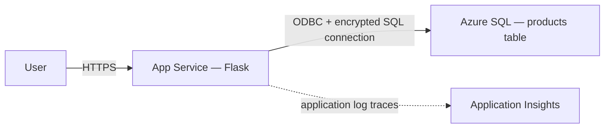

# Flask na Azure SQL kwenye Huduma ya App

**Kiwango:** Kati · **Muda:** Dakika 30–60 ikiwa ni pamoja na mahitaji ya awali

Sampuli hii inaeneza API ya kusoma ya Python Flask kwenye **Huduma ya App ya Linux** na
hifadhidata ya Azure SQL ya Msingi. Chanzo, Bicep, na usanidi wa azd vimejumuishwa. Hii ni
programu ya kujifunza, si usanifu wa hifadhidata tayari kwa uzalishaji.

## Unachojifunza

- Kuweka rasilimali za Huduma ya App, SQL, na ufuatiliaji kwa Bicep.
- Kusanidi muunganisho wa SQL uliosimbwa bila kupeleka nywila.
- Anzisha schema kabla ya kuanza wafanyakazi wa Gunicorn.
- Hakiki data iliyopandwa, majibu ya kutopatikana, na afya ya hifadhidata.



Rasilimali: kundi maalumu la rasilimali, mpango wa Huduma ya App ya Linux B1, Python 3.11 Web
App, seva ya SQL na hifadhidata ya Msingi 2-GB, Application Insights, na Log Analytics.
Tovuti ya Mtandao hutumia **chanzo/uenezaji wa ZIP na usakinishaji wa utegemezi wa Oryx**;
`azd deploy` haitaandika wala kueneza Dockerfile ya hiari.

## Mahitaji ya awali

- Toleo thabiti la sasa la [azd](https://learn.microsoft.com/azure/developer/azure-developer-cli/install-azd)
  (toleo lililotolewa wakati wa mapitio: 1.37.2).
- [Azure CLI](https://learn.microsoft.com/cli/azure/install-azure-cli) kwa ajili ya uthibitisho.
- Usajili wa Azure, ruhusa za kuunda rasilimali zilizoorodheshwa, na kikwazo cha kikanda.
- Python **3.11** kwa maendeleo ya ndani; `pyodbc==5.0.1` zilizojitolea zinaweza kuhitaji
  zana za ujenzi asilia kwenye matoleo mapya ya Python.
- Dereva wa Microsoft ODBC 18 (au 17) kwa SQL Server kwenye mashine za ndani. `pip install
  pyodbc` haifungi dereva wa mfumo. Tazama
  [ufungaji wa ODBC](https://learn.microsoft.com/sql/connect/odbc/download-odbc-driver-for-sql-server).
- Docker tu ikiwa unajaribu kontena hiari ndani ya eneo.

```bash
azd version
az version
azd auth login
az login
```

Tumia usajili ule ule katika zana zote mbili. Amri hapo chini zinatumia Bash.

## Sambaza

Kutoka kwenye mzizi wa hifadhi:

```bash
cd examples/database-app
azd env new sql-demo
azd provision
azd deploy
WEB_URL=$(azd env get-value WEB_APP_URI)
WEB_NAME=$(azd env get-value WEB_APP_NAME)
RG_NAME=$(azd env get-value AZURE_RESOURCE_GROUP)
```

Chagua eneo linaloungwa mkono. `sqlAdminLogin` hutumiwa kama chaguo-msingi kuwa `sqladmin`; la muhimu
`sqlAdminPassword` ni parameter salama. Toa nenosiri imara unapoombwa.
Weka vyeti vya utekelezaji mbali na Git na ripoti za makosa. Mstari wa uunganisho wa sasa
unatarajia nenosiri bila walinzi wa mfuatiliaji wa mnyororo wa muunganisho kama vile
`;`; badilisha uokoaji kabla ya kutumia thamani kama hizo.

Bicep huweka amri ya kuanzisha ambayo inafanya kazi `init_database()` **kabla** ya wafanyakazi wa Gunicorn
kuanza. Hii ni muhimu kwa sababu kuingiza `app:app` hakutekelezi
sehemu ya `if __name__ == '__main__'` ya Python. Katika hifadhidata mpya, uanzishaji
hufanya `products` na huingiza safu tano. Ni mbegu rahisi ya kufundishia, sio
fremu ya uhamaji wa sambamba; tumia uhamaji sahihi kabla ya kueneza matukio.

Programu inachagua Dereva wa Microsoft ODBC 18 uliowekwa, kisha 17, ikiwa mnyororo wa uunganisho
hauitaji dereva haswa. Ikiwa hakuna yoyote, kuanzisha hufeli kwa
kosa la usakinishaji linaloweza kuchukuliwa hatua. Thibitisha upatikanaji wa dereva katika
wakati wa kuendesha App Service uliyochagua badala ya kudhani.

## Thibitisha

```bash
curl --fail-with-body "${WEB_URL}/"
curl --fail-with-body "${WEB_URL}/health"
curl --fail-with-body "${WEB_URL}/products"
curl --fail-with-body "${WEB_URL}/products/1"
curl -i "${WEB_URL}/products/999"
```

Kifurushi kinachotarajiwa:

- `/` hurudisha taarifa za kituo cha mwisho.
- `/health` hurudisha 200 na `{"status":"healthy","database":"connected"}`.
- `/products` hurudisha bidhaa tano zilizopandwa mbegu kwenye hifadhidata mpya.
- `/products/1` hurudisha Kompyuta mpakato yenye bei 1299.99.
- Bidhaa isiyokuwepo hurudisha 404 na `{"error":"Product not found"}`.

API ni ya kusoma tu. Hakuna njia ya POST/PUT/DELETE au UI ya kivinjari.
Kushindwa kuunganishwa na hifadhidata hurudisha 503 kutoka `/health`; si ufanisi.

## Mafaili na usanidi

```text
azure.yaml                         # Python App Service source deployment
infra/main.bicep
infra/main.parameters.json
infra/abbreviations.json
infra/resources/sql-server.bicep
infra/resources/sql-database.bicep
infra/resources/app-service-plan.bicep
infra/resources/web-app.bicep       # Settings + initialization/startup command
infra/resources/app-insights.bicep
src/web/app.py
src/web/requirements.txt
src/web/Dockerfile                 # Optional local container, not the azd target
.env.sample
```

`SQL_CONNECTION_STRING` hupitishwa kama parameter salama ya Bicep kwenye moduli ya Tovuti ya Wavuti
na kuhifadhiwa katika mipangilio ya App Service, sio matokeo ya utekelezaji.
`APPLICATIONINSIGHTS_CONNECTION_STRING` huanzisha usafirishaji wa kumbukumbu.
`SCM_DO_BUILD_DURING_DEPLOYMENT=true` huwasha ufungaji wa utegemezi upande wa seva.
Kuweka thamani yoyote ya `azd env` hakugeuzi moja kwa moja mipangilio ya programu.

Sheria ya ukuta wa moto ya SQL `0.0.0.0` inaruhusu muunganisho kutoka **huduma za Azure,
ikiwa ni pamoja na usajili wa wateja wengine**, kulingana na uthibitishaji wa SQL. Haina
kikomo kwa programu hii au usajili huu. Upatikanaji wa mtandao wa umma wa SQL umewezeshwa.
Tumia mtandao ulio na mipaka na utambulisho wa programu usio wa msimamizi kabla ya uzalishaji.

## Maendeleo ya eneo la ndani

Tumia Python 3.11 na dereva wa Microsoft SQL ODBC uliowekwa:

```bash
python -m venv .venv
source .venv/bin/activate  # PowerShell: .\.venv\Scripts\Activate.ps1
python -m pip install -r src/web/requirements.txt
export SQL_CONNECTION_STRING='Server=tcp:YOUR_SERVER.database.windows.net,1433;Database=YOUR_DATABASE;UID=YOUR_USER;PWD=YOUR_PASSWORD;Encrypt=yes;TrustServerCertificate=no;Connection Timeout=30;'
python src/web/app.py
```

Badilisha vichwa kwa usalama. Faili lililokopwa la `.env` **halipaki moja kwa moja**
na programu hii. Badala yake, toa vigezo katika shell yako ya sasa.
Kwa Azure SQL kutoka kwa kompyuta mpakato, ruhusu kwa muda tu IP yako ya umma:

```bash
SQL_SERVER=$(azd env get-value SQL_SERVER_NAME)
MY_IP=YOUR_PUBLIC_IP
az sql server firewall-rule create -g "$RG_NAME" -s "$SQL_SERVER" \
  -n AllowMyLearningIP --start-ip-address "$MY_IP" --end-ip-address "$MY_IP"
```

Ondoa sheria baada ya majaribio:

```bash
az sql server firewall-rule delete -g "$RG_NAME" -s "$SQL_SERVER" -n AllowMyLearningIP
```

Jaribio la chombo hiari kutoka kwenye saraka hii ya mfano:

```bash
docker build -t sql-flask:local src/web
docker run --rm -p 8000:8000 -e SQL_CONNECTION_STRING sql-flask:local
```

Picha hii huweka Dereva 18 kwa kutumia hazina ya kifurushi ya Debian 12 inayolingana na Bookworm,
huanzisha hifadhidata mara moja, kisha kuanza Gunicorn.

## Ufuatiliaji na utatuzi wa matatizo

Washa/fuatilia kumbukumbu za programu za mfumo wa faili wa App Service wakati wa kutatua matatizo ya kuanzisha:

```bash
az webapp log config --name "$WEB_NAME" --resource-group "$RG_NAME" \
  --application-logging filesystem --level information
az webapp log tail --name "$WEB_NAME" --resource-group "$RG_NAME"
```

Msimbo huu unasafirisha **michoro ya kumbukumbu** ya programu kupitia msindikaji wa zamani wa OpenCensus.
Haufanyi usanidi wa ufuatiliaji wa moja kwa moja wa maombi/dependency ya Flask, Metrics za Moja kwa Moja,
ukaguzi wa SQL, mipangilio ya utambuzi, au arifa. Hizo zinahitaji usanidi tofauti.
Kwa vipimo vipya, tumia Azure Monitor OpenTelemetry.

Katika Application Insights Logs, baada ya kufanya maombi ya API:

```kusto
traces
| where timestamp > ago(1h)
| where message contains "products" or message contains "Health check"
| project timestamp, message, severityLevel
```

Ruhusu ucheleweshaji wa usindikaji. Kazi ya jedwali la maombi au Metrics za Moja kwa Moja si sharti la ukamilifu
kwa kipimo hiki cha kumbukumbu tu.

- **Dereva haipo:** angalia `pyodbc.drivers()` katika wakati wa kuendesha na usakinishe
  dereva wa Microsoft ODBC unaoungwa mkono. Kifurushi cha Python pekee hakitoshi.
- **Kushindwa kuunganishwa:** angalia mipangilio ya SQL, vyeti, ukuta wa moto, na usajili ulioteuliwa.
  Usizimore usimbaji fiche ili kupita kosa.
- **Jedwali la bidhaa halipo:** thibitisha kwamba amri ya kuanzisha ya Bicep ilitekelezwa;
  kuanzisha `gunicorn app:app` pekee hupita uanzishaji.
- **Kushindwa kujenga kifurushi:** tumia Python 3.11 au toa mahitaji ya kujenga asili.
- **Data ya bei sifuri:** sifuri ni bei halali ya desimali; inapaswa kuhifadhiwa kama 0.0,
  si `null`.

## Mazoezi ya Kivitendo

### Mazoezi 1: Thibitisha tabia ya bidhaa isiyokuwepo

**Mwanzo:** API iliyowekwa na `WEB_URL` hapo juu.
**Lengo:** tambua tofauti kati ya safu isiyokuwepo na hifadhidata iliyoharibika.
Omba `/health` na `/products/999` kwa kutumia amri zilizo hapo juu.
**Vigezo vya mafanikio / jibu:** afya 200, bidhaa isiyokuwepo 404 (sio 500 au 503).
**Tatizo la kawaida:** kudhani jibu la hakikupatikana linaonyesha muunganisho wa SQL umeharibika.

### Mazoezi 2: Badilisha thamani iliyopandwa mbegu

**Mwanzo:** Mhariri wa Maswali wa Azure SQL, umeunganishwa na hifadhidata ya mfano.
**Lengo:** onyesha kwamba data ya API huhifadhiwa SQL badala ya kumbukumbu ya njia.

```sql
UPDATE products SET price = 0 WHERE id = 1;
SELECT id, name, price FROM products WHERE id = 1;
```

Omba `${WEB_URL}/products/1`. **Vigezo vya mafanikio:** bei ni `0.0`, sio `null`.
Rejesha thamani:

```sql
UPDATE products SET price = 1299.99 WHERE id = 1;
```

**Tatizo la kawaida:** kuhariri orodha ya mbegu ya Python hakibadilishi safu zilizopo tayari SQL.
Usifanye mazoezi ya schema/data dhidi ya hifadhidata ya uzalishaji.

### Mazoezi 3: Ongeza kituo cha kuhesabu cha kusoma tu

**Mwanzo:** `src/web/app.py`.
**Lengo:** ongeza API kwa kutumia swali la jumla lisilo na parameter.
Ongeza hii kabla ya sehemu ya `if __name__ == '__main__':`:

```python
@app.route('/product-count')
def product_count():
    from contextlib import closing
    with closing(get_db_connection()) as conn, closing(conn.cursor()) as cursor:
        cursor.execute("SELECT COUNT(*) FROM products")
        return jsonify({'count': cursor.fetchone()[0]})
```

Endesha `azd deploy web`, kisha omba `${WEB_URL}/product-count`.
**Vigezo vya mafanikio:** 200 na `{"count":5}` kwenye hifadhidata isiyoguswa ya mbegu.
**Tatizo la kawaida:** kubadili njia lakini kusahau kuitekeleza upya.
Kwa uzalishaji, ongeza usimamizi wa makosa/majaribio; zoezi hili fupi linalenga swali.

## Gharama, mapengo ya uzalishaji, na usafishaji

B1 App Service na hifadhidata Basic hulipishwa mradi zimetolewa. Kusitisha
Tovuti ya Wavuti **hairidhi** malipo ya mpango wa App Service. Kumbukumbu na hifadhi vinaweza kuongeza gharama.
Tumia [kalkuleta ya bei ya Azure](https://azure.microsoft.com/pricing/calculator/)
kwa bei za mkoa wa sasa. Kubadilisha kwenda F1 pia inahitaji kuzima `alwaysOn`;
si mbadala mmoja wa mstari wa moja kwa moja. SQL isiyo na seva si bure moja kwa moja.

Kazi za uzalishaji ni pamoja na utambulisho wa programu wa hasara ndogo (sio msimamizi wa SQL),
uthibitishaji/ Ruhusa, mitandao ya binafsi, uhamaji salama, muangamizi/ukaguzi wa mzunguko wa uunganisho,
upimaji, ukaguzi, arifa, majaribio, na taratibu za urejesho.
Kache ya Redis na jedwali za ziada ni mawazo ya maendeleo, si mazoezi yaliyotekelezwa.

Kutoka kwenye saraka hii ya mfano:

```bash
azd down
```

Kagua tahadhari ya kufuta na thibitisha kwamba kundi la rasilimali lililojitolea limeondolewa.
Usifute makundi yaliyo na data isiyohusiana.

[Mifano ya kontena](../../../../examples/container-app) ·
[Maendeleo ya AI](../../docs/chapter-02-ai-development/README.md) ·
[Nyumbani kwa kozi](../../README.md) · [Ripoti tatizo](https://github.com/microsoft/AZD-for-beginners/issues)

---

<!-- CO-OP TRANSLATOR DISCLAIMER START -->
**Kionyozo**:
Hati hii imetafsiriwa kwa kutumia huduma ya tafsiri ya AI [Co-op Translator](https://github.com/Azure/co-op-translator). Ingawa tunajitahidi kupata usahihi, tafadhali fahamu kwamba tafsiri za kiotomatiki zinaweza kuwa na makosa au upungufu wa usahihi. Hati ya asili katika lugha yake halisi inapaswa kuchukuliwa kama chanzo cha mamlaka. Kwa taarifa muhimu, tafsiri ya kitaalamu inayofanywa na binadamu inapendekezwa. Hatutojibu kwa kuelewa vibaya au tafsiri potofu zinazotokea kutokana na matumizi ya tafsiri hii.
<!-- CO-OP TRANSLATOR DISCLAIMER END -->