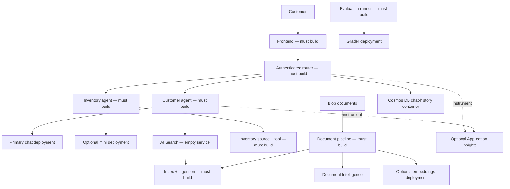

# Usaidizi wa Wateja wa Wakala Wengi — Mchoro wa Usanifu wa Rejareja

**Sura 5: Suluhisho za AI za Wakala Wengi**

- [Nyumbani kwa kozi](../README.md)
- [Sura 5](../docs/chapter-05-multi-agent/README.md)
- [Sharti: Muunganisho wa AI](../docs/chapter-02-ai-development/microsoft-foundry-integration.md)
- [Ifuatayo: Upangaji uwezo](../docs/chapter-06-pre-deployment/capacity-planning.md)
- [Msingi wa miundombinu ya ARM](retail-multiagent-arm-template/README.md)

> **Mwongozo wa usanifu, sio programu inayofanya kazi.** Faili pekee za utekelezaji wa rejareja
> ni `azuredeploy.json`, `azuredeploy.parameters.json`, na `deploy.sh` katika
> `retail-multiagent-arm-template/`. Kontena za router/frontend ni nafasi za kuonyesha hello-world.
> Hakuna wakala wa rejareja, UI, mkondo wa usafirishaji taarifa, mtaalamu wa tathmini,
> skana, au kifurushi cha majaribio cha programu kinachopatikana kwa ndani.

## Muhtasari

**Lengo:** kubuni mfumo wa usaidizi kwa wateja wenye wakala wa mteja na wakala wa hesabu,
tambua kile miundombinu inachotoa, na panga mikataba ya programu inayokosekana
na uhakiki.

**Hadhira:** wasanidi programu waliomaliza
[mfano wa mazungumzo](../../../examples/azure-openai-chat) na [mfano wa kontena ya huduma mbili](../../../examples/container-app/microservices).
Ruhusu saa 2–3 kwa ajili ya kujifunza usanifu. Kujenga programu ni mradi tofauti:
saa 80–120 za maendeleo ni takwimu ya upangaji wa mfano kwa
waendelezaji walio na uzoefu, **si ahadi ya utoaji**; kuimarisha uzalishaji, majaribio,
mapitio ya usalama, na uendeshaji vinahitaji kazi ya ziada.

### Matokeo ya kujifunza

- Eleza upangaji wa njia, kuweka msingi, ruhusa za zana, na umiliki wa mazungumzo.
- Tofautisha vitambulisho vya modeli, majina ya ueneaji, matoleo ya API, na matoleo ya ARM.
- Buni utoaji na urejeshaji wa hati kwa vipimo vinavyofanana vya vector.
- Bainisha mahitaji yanayothibitishwa ya utendaji, tathmini, na kupona kutokana na kushindwa.
- Tenganisha malengo ya usanifu ya hiari na rasilimali ambazo zimewekwa kweli.

## Usanifu wa Suluhisho



Huu ni **usanifu wa programu lengwa**, sio mchoro wa huduma za wakala zinazoendeshwa.
Msingi wa ARM huunda huduma za msingi na kontena mbili tu za nafasi.
Front Door, rejista, utambulisho uliosimamiwa, mgawanyo wa majukumu,
vituo vya binafsi, mfiduo, uqifishaji wa programu, na tahadhari hazijajumuishwa.

### Majukumu na mkataba

| Kipengele | Tabia inayohitajika | Ushahidi kabla ya kuitaja kuwa imekamilika |
|---|---|---|
| Sehemu ya mbele | Thibitisha watumiaji, onyesha mazungumzo, pakia hati kwa usalama | Majaribio ya UI na upakiaji, makosa yanayopatikana |
| Router | Ruhusu maombi, chagua wakala, wito/vikwazo vya zana zinazozuiliwa | Majaribio ya upangaji, ukaguzi wa ruhusa, majukumu ya kushindwa |
| Wakala wa mteja | Tathmini maswali ya sera/produkiti kutoka kwa vyanzo vilivyokubaliwa | Marejeleo sahihi, kujiepusha wakati data haipo |
| Zana ya hesabu za bidhaa | Soma hesabu za mamlaka kwa ruhusa zilizoainishwa | Majaribio ya hesabu ya wazi; hakuna uporeshaji wa upatikanaji |
| Mtiririko wa hati | Toa, gawa vipande, weka kwa njia ya embedding, yafuatilie, sasisha/futa | Vipimo vya iliyoorodheshwa na tabia ya jaribu/ barua ya marejeo |
| Hifadhi ya mazungumzo | Tengeneza watumiaji pekee, shika uhifadhi | Upangaji ruhusa za mtumiaji na vipimo vya TTL |
| Mfanyakazi wa tathmini | Linganisha matokeo na ukweli na rubrik | Uwakilishi kamili, idadi ya kushindwa, ripoti zinazoweza kurudiwa |

Fikiria router kama dawati la mapokezi na zana kama mifumo ya ndani iliyozuiliwa:
kuchagua mtaalamu si ruhusa ya kupata rekodi zote za mteja.
Tekeleza utambulisho na ruhusa katika msimbo wa programu na huduma za data, si hoja.

## Miundombinu dhidi ya Programu

Soma [README ya msingi wa utengenezwaji](retail-multiagent-arm-template/README.md) kabla
ya kuweka huduma. Inataja rasilimali halisi, njia, gharama, na vikwazo.

| Matumizi ya kimantiki | Jina la ueneaji la ARM | Modeli / toleo | Eneo la kawaida |
|---|---|---|---|
| Mazungumzo ya mteja | `gpt-4.1-chat` | `gpt-4.1` / `2025-04-14` | `eastus2` |
| Hesabu za bidhaa | `gpt-4.1-mini-inventory` | `gpt-4.1-mini` / `2025-04-14` | `westus2`, hiari |
| Embeddings | `text-embedding-ada-002` | `text-embedding-ada-002` / `2` | `francecentral`, hiari |
| Tathmini | `gpt-4.1-grader` | `gpt-4.1` / `2025-04-14` | Eneo kuu kwa default |

Angalia upatikanaji wa modeli/toleo/SKU na kikomo katika **kila eneo**. Mazungumzo/mini/grader
hutumia `GlobalStandard`; embeddings hutumia `Standard`. Mepangilio ya kitengo cha uwezo hadi TPM ni
maalum kwa modeli. Usiongeze vitengo vya uwezo tofauti kama dhamana ya kikomo cha ulimwengu.

Hoja ya `model` kwa ombi la Azure OpenAI ni **jina la ueneaji**, si lazima
kitambulisho cha modeli katika katalogi. Toa-toleo la API la plane ya data `2024-10-21`
ni tofauti na toleo la modeli `2025-04-14` na rasilimali ya ARM `apiVersion`.
Haiwezekani kurekebisha modeli isiyopatikana kwa kubadilisha toleo la API tu la plane ya data.

`--no-multi-region` inaruka akaunti za sekondari na embeddings. Akaunti kuu ya mazungumzo na
akaunti huru ya grader hubaki. Akaunti tofauti za modeli hazitoa kurejea kwa kiotomatiki
ya kushindwa; hiyo inahitaji upangaji wa programu, ueneaji unaoendana, ukaguzi wa afya,
mipaka ya jaribu, na ukaguzi wa ukaazi wa data.

## Ramani ya Utekelezaji

### 1. Anza na mwingiliano mmoja uliojibiwa

Kabla ya kuweka mfumo mkubwa, tumia mfano wa mazungumzo ya ndani kuanzisha
muunganisho wa ugunduzi. Eleza swali moja la mteja la mfano, chanzo kilichokubaliwa cha jibu,
marejeleo yanayotarajiwa, na tabia ya kushindwa ikiwa chanzo hicho hakipo.

### 2. Eleza mipaka ya njia na zana

Tengeneza chanzo chako cha router, waraka wa utegemezi, Dockerfile, na majaribio. Mkataba
wa mfano unaweza kuwa `POST /chat` pamoja na `{"message":"...","conversation_id":"..."}`.
**Kipindi hicho ni pendekezo la muundo; hakitekelezwi na kiolezo cha ARM.**

Thibitisha aina/ukomo wa mwili, toa utambulisho wa mtumiaji kutoka kwa uthibitishaji, zilinda
umiliki wa mazungumzo, tumia mipaka ya muda ya ombi, na rudisha misimbo ya makosa yenye maana.
Usitake kushindwa kwa HTTP au majibu tupu kama matokeo ya wakala yaliyo fanikiwa.

### 3. Tekeleza uanzishaji na ulaji

Kiolezo cha ARM hakitengenezi faharasa ya utafutaji. Hii ni **kipande cha kumbukumbu cha
JSON cha kurekebisha katika ufafanuliwa wako wa faharasa**, si faili tayari katika hifadhidata:

```json
{
  "name": "retail-product-index",
  "fields": [
    {"name": "id", "type": "Edm.String", "key": true},
    {"name": "title", "type": "Edm.String", "searchable": true},
    {"name": "content", "type": "Edm.String", "searchable": true},
    {"name": "category", "type": "Edm.String", "filterable": true},
    {
      "name": "content_vector",
      "type": "Collection(Edm.Single)",
      "searchable": true,
      "dimensions": 1536,
      "vectorSearchProfile": "retail-profile"
    }
  ],
  "vectorSearch": {
    "algorithms": [{"name": "retail-hnsw", "kind": "hnsw"}],
    "profiles": [{"name": "retail-profile", "algorithm": "retail-hnsw"}]
  }
}
```

Profaili inaunganisha uwanja wa vector na algoriti yake. Vipimo lazima viendane na
matokeo halisi ya kuingiza vector (1536 kwa ajili ya uanzishaji huu wa `ada-002`). Kwa upokeaji wa Python,
tumia `azure.search.documents.models.VectorizedQuery` badala ya msamiati usio kamilifu
wenye aina ya utafutaji wa vector:

```python
# Reference function only: supply an authenticated async SearchClient and an embedding.
from azure.search.documents.models import VectorizedQuery

async def retrieve(search_client, embedding):
    results = await search_client.search(
        search_text=None,
        vector_queries=[VectorizedQuery(
            vector=embedding,
            k_nearest_neighbors=5,
            fields="content_vector"
        )],
        select=["id", "title", "content"]
    )
    return [document async for document in results]
```

Tengeneza utekelezaji tofauti wa uingizaji ambao:

1. Unaruhusu ufikiaji wa upakuaji na kuthibitisha aina na ukubwa wa maudhui.
2. Husoma blobs binafsi kwa kutumia wito za SDK zilizo na uthibitisho. URL ya blob binafsi yenyewe
   si **ingizo la kusomeka la Document Intelligence**; tuma bytes zilizopakuliwa kwa kutumia
   `AnalyzeDocumentRequest(bytes_source=...)` au tumia SAS yenye upeo unaofaa,
   na yenye muda mfupi baada ya kupitia mahitaji ya ufikiaji.
3. Hutenganisha maandishi, hugitandika vipande ili zivutie mipaka ya embedding, na hutengeneza embeddings.
4. Hutengeneza funguo thabiti na sahihi za hati na hupakia vipande na vector zinazolingana.
5. Hukagua matokeo ya uwekaji alama kwa kila hati, hushughulikia jaribio upya, na husasisha/futa data iliyochakaa.

Usijumlishe funguo/thamani za mtumiaji kwa bahati katika vichujio vya OData. Ruhusu orodha ya viwanja,
thibitisha aina za thamani, na epuka nukuu za mnyororo. Vichujio vya boolean na nambari vinahitaji
vitambulishi vimeandikwa, si mnyororo uliowekwa nukuu.

### 4. Msingi wa wavuti

**Utafutaji wa Bing v7 ulisitishwa tarehe 11 Agosti, 2025.** Zamani `Microsoft.Bing/accounts`
rasilimali na mifano ya `api.bing.microsoft.com/v7.0/search` si njia inayoungwa mkono ya utekelezaji.
Tathmini muunganisho wa msingi ulioungwa mkono kwa sasa katika
Microsoft Foundry na SDK yake, ruhusa, malipo, na mahitaji ya marejeleo;
hakuna kati ya hayo imetekelezwa hapa. Sio mbadala wa moja kwa moja kwa sehemu iliyositishwa.

### 5. Ongeza telemetri na tathmini

Kuunda Application Insights hakumaanishi kufunga chombo cha msimbo. Tumia zana zinazoungwa mkono za Azure Monitor
OpenTelemetry unapotengeneza programu mpya, sambaza muktadha wa ufuatiliaji kati ya huduma,
na epuka kuandika maoni ya wateja, nyaraka, au siri.
Kukata swali hakufanyi liwe la siri.

Pima muda wa ombi, kushindwa kwa uelekezaji/vifaa, umuhimu wa kupata, usahihi wa kurejelea,
matumizi ya tokeni, na kujiepusha. Hifadhi ukweli wa orodha/sera ya msingi
sambamba na kesi za tathmini: mkaguzi hawezi kubaini usahihi wa ukweli
kutokana na swali na jibu peke yake.

Ufungaji wa mkaguzi si mtaalamu wa kuendesha tathmini. Tekeleza rubriki yenye toleo,
uthibitishaji wa muundo/utakaso wa matokeo, ukaguzi wa anuwai za alama,
hesabu za kushindwa kwa usafirishaji, na kesi zilizoangaliwa na watu. Ripoti kesi zisizo kamili/kina kosa kwa tofauti; usiwabadilishe
kuwa alama za mafanikio au usijumuishe kimyakimya kama majibu ya mfano yenye ubora sifuri.

Vivyo hivyo, ukaguzi mdogo wa maneno kuu si uthibitisho wa usalama. Ombi la HTTP lililoshindwa,
mkakati wa mtihani uliofutwa, au jibu tupu lazima lifanye mtihani kuwa **usio na hitimisho au
umefeli**, si kuonyesha alama ya “usalama wa 100%.” Fanya upimaji uthibitishwa kwa zana sahihi
na ukaguzi wa binadamu kabla ya kudai ufanisi wa uzalishaji wowote.

### 6. Tengeneza programu yako

Unda vyanzo vyako vya saraka, manifesti, mitihani, rejista, na ruhusa za kuvuta picha.
Badilisha mahali panapojazwa na picha zilizojengwa na sasisha njia za kuingia/vipimo ili
ziendane na bandari ya kusikiliza ya kila programu. Panga mabadiliko ya mazingira ya wakati wa kuendesha katika Bicep
au ramani wazi inayoungwa mkono ya mazingira ya azd.

Hakuna kamusi ya jumla ya `config` chini ya huduma ya azd inayotengeneza moja kwa moja
mabadiliko ya mazingira ya wakati wa kuendesha. `azd env set` hubadilisha tu rasilimali zinazotumia thamani hizo waziwazi.
Hakuna jaribio la canary, orodha ya mikoa, au kiunganishi cha marekebisho kinachotekelezwa katika muundo huu.


## Mazoezi halisi ya muundo

Haya ni **mazoezi ya usanifu**, si madai ya msimbo wa kuanzisha unaoweza kutendeka.

### Zoeezi 1: Thibitisha mpaka

**Kwanza:** faili tatu katika `retail-multiagent-arm-template/`.
**Lengo:** tofautisha utayarishaji na utendakazi wa programu.
Fungua `azuredeploy.json`, pata picha zote za kontena na thamani za `targetPort`,
kisha orodhesha vipengele vya programu vinavyokosekana kutoka kwenye hifadhidata.

**Vigezo vya mafanikio / jibu:** picha zote ni vibarua wa hello-world kusikiliza
kwenye bandari 80; maajenti, UI ya mazungumzo, watunzaji wa router, index/ingestion, mkaguzi, na skana
hawapo. Ombi la mzizi la mahali pa kushikilia la mafanikio halithibitishi `/chat`.
**Tatizo la kawaida:** kufasiri majina ya rasilimali kama `retail-router` kuwa msimbo unaofanya kazi.

### Zoeezi 2: Fuata usanidi wa vekta

**Kwanza:** index JSON hapo juu.
**Lengo:** kuelewa uhusiano wa uwanja → wasifu → algorithimu.
Tambua ni thamani zipi zinapaswa kubadilika unapotumia mfano wa embedding
wenye vipimo tofauti vya matokeo, kisha angalia kazi ya `retrieve`.

**Vigezo vya mafanikio / jibu:** badilisha uwanja wa `dimensions` hadi urefu halisi wa vekta;
endeleza `vectorSearchProfile` ili iendane na wasifu uliotangazwa na algorithimu yake;
swali la `fields` lazima liti majina ya uwanja wa vekta. Tengeneza upya vekta za nyaraka zilizopo
wakati mfano wa embedding unabadilika.
**Tatizo la kawaida:** kubadilisha jina la mfano tu huku ukibakia na vekta zisizolingana.

### Zoeezi 3: Fafanua mtihani wa kushindwa

**Kwanza:** jedwali la majukumu.
**Lengo:** kuzuia mafanikio ya kipumbavu.
Andika mienendo inayotarajiwa kwa API ya orodha isiyopatikana, index ya utafutaji bila nyaraka zinazolingana,
na ombi la tathmini linalorejesha HTTP 503.

**Vigezo vya mafanikio / jibu:** hakuna thamani za orodha za kugushiwa; kujizuia kwa wazi au
kuongezeka kwa shinikizo wakati muktadha unakosekana; tathmini inaripoti kushindwa kwa usafirishaji badala ya
kupita kwa ubora au usalama. Ongeza mitihani inayoendeshwa wakati unajenga programu.
**Tatizo la kawaida:** kukamata kila kosa na kuendelea na jibu tupu.

## Gharama, utatuzi, na usafishaji

- Miundombinu ina malipo yanayoendelea hata na index za utafutaji tupu na programu za mahali pa kushikilia.
  Tumia bei za maeneo ya sasa; hakuna “ndogo” wala maeneo mengi yanamaanisha bure.
- Gharama za tokeni zinategemea mfano, ingizo lililohifadhiwa/bila kuhifadhiwa, matokeo, na SKU ya uzalishaji.
  Uelekezaji unaweza kuokoa pesa tu ikiwa mzigo uliopimwa na matokeo ya ubora yanathibitisha;
  akiba thabiti ya 60–80% haijahakikishwa.
- Angalia upatikanaji wa mfano na kapasiti kabla ya kuandaa; tambua makosa ya ruhusa,
  jina la uzalishaji, eneo, toleo la mfano, na toleo la API.
- Usifanye kwa kukosa kwa `setup-data.sh`, kazi za CLI za mkaguzi, au amri za `pytest tests/`.
  Utekelezaji wake ni sehemu ya orodha yako ya maendeleo.
- Muundo ni ARM tu: fuata
  [maelekezo ya uhakikishaji na usafishaji](retail-multiagent-arm-template/README.md).
  `azd down` haisimami rasilimali hizo.

## Rasilimali zinazohusiana

- [Mfano wa mazungumzo yanayofanya kazi hapa nyumbani](../../../examples/azure-openai-chat)
- [Mfano wa kontena wa huduma mbili unaofanya kazi](../../../examples/container-app/microservices)
- [Viindex vya utafutaji wa AI Search](https://learn.microsoft.com/azure/search/vector-search-how-to-create-index)
- [Nyaraka za Container Apps](https://learn.microsoft.com/azure/container-apps/)
- [Utatuzi wa matatizo](../docs/chapter-07-troubleshooting/common-issues.md)
- [Ripoti tatizo](https://github.com/microsoft/AZD-for-beginners/issues)

---

<!-- CO-OP TRANSLATOR DISCLAIMER START -->
**Kionyozo**:
Hati hii imetafsiriwa kwa kutumia huduma ya tafsiri ya AI [Co-op Translator](https://github.com/Azure/co-op-translator). Ingawa tunajitahidi kupata usahihi, tafadhali fahamu kwamba tafsiri za kiotomatiki zinaweza kuwa na makosa au upungufu wa usahihi. Hati ya asili katika lugha yake halisi inapaswa kuchukuliwa kama chanzo cha mamlaka. Kwa taarifa muhimu, tafsiri ya kitaalamu inayofanywa na binadamu inapendekezwa. Hatutojibu kwa kuelewa vibaya au tafsiri potofu zinazotokea kutokana na matumizi ya tafsiri hii.
<!-- CO-OP TRANSLATOR DISCLAIMER END -->