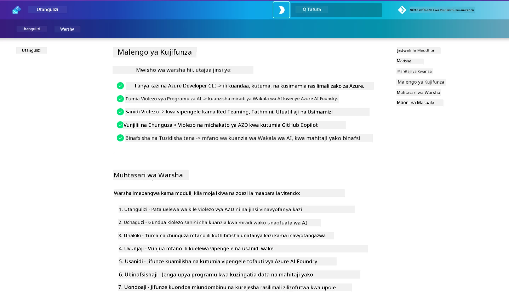

<div align="center">
  <div style="background: linear-gradient(135deg, #0078d4, #106ebe); border-radius: 10px; padding: 20px; margin: 20px 0; box-shadow: 0 4px 15px rgba(0, 120, 212, 0.3); border: 2px solid #005a9e;">
    <h2 style="color: white; margin: 0; font-size: 24px; text-shadow: 1px 1px 2px rgba(0,0,0,0.3);">
      🎯 Warsha ya AZD kwa Waendelezaji wa AI
    </h2>
    <p style="color: white; margin: 10px 0 0 0; font-size: 16px; text-shadow: 1px 1px 2px rgba(0,0,0,0.3);">
      <strong>Warsha ya vitendo ya kujenga programu za AI kwa kutumia Azure Developer CLI.</strong><br>
      Kamilisha moduli 7 ili kumiliki templates za AZD na michakato ya uwasilishaji wa AI.
    </p>
    <div style="margin-top: 15px;">
      <span style="background: rgba(255,255,255,0.2); padding: 5px 10px; border-radius: 15px; color: white; font-size: 14px;">
        📅 Mwongozo wa chanzo umehakikiwa: Novemba 2026
      </span>
    </div>
  </div>
</div>

# Warsha ya AZD kwa Waendelezaji wa AI

Karibu kwenye warsha ya vitendo ya kujifunza Azure Developer CLI (AZD) kwa kuzingatia uwasilishaji wa programu za AI. Warsha hii itakusaidia kupata uelewa wa vitendo wa templates za AZD kupitia hatua 3:

1. **Ugunduzi** - pata template inayofaa kwako.
1. **Uwasilishaji** - weka na hakiki kwamba inafanya kazi
1. **Marekebisho** - badilisha na rudiarifu ili iwe yako!

Katika kipindi cha warsha hii, pia utajifunza zana msingi za maendeleo na michakato, ili kusaidia kuharakisha safari yako ya maendeleo kwa kiwango cha mwisho.

<br/>

## Mwongozo Mfanyikio Katika Kivinjari

Masomo ya warsha yako katika Markdown. Unaweza kuyaviga moja kwa moja kwenye GitHub - au anzisha mtazamo wa kivinjari kama inavyoonyeshwa kwenye picha hapa chini.



Ili kutumia chaguo hili - tengeneza fork ya ghala kwenye wasifu wako, na anzisha GitHub Codespaces. Mara kifaa cha VS Code kikiwa hai, andika amri hii:

Mtazamo huu wa kivinjari unafanyakazi katika GitHub Codespaces, masanduku ya maendeleo, au nakala ya mahali moja yenye Python na MkDocs vimewekwa.

```bash title="" linenums="0"
python -m pip install -r requirements-dev.txt
python -m mkdocs serve --config-file workshop/mkdocs.yml
```

Endesha amri hizi kutoka kwenye **mizizi ya ghala la kozi**, si mfano wa AI ulioanzishwa pekee. Weka mtazamo mbele ili makosa yanaonekana; simamisha kwa Ctrl+C. Ili kuangalia tovuti bila kuhudumia, tumia `python -m mkdocs build --strict --config-file workshop/mkdocs.yml`.

Baada ya sekunde chache, utaona kichupo cha mazungumzo cha pop-up. Chagua chaguo la `Open in browser`. Mwongozo wa mtandao sasa utafunguliwa kwenye kichupo kipya cha kivinjari. Faida baadhi za mtazamo huu:

1. **Utafutaji uliojengwa ndani** - pata maneno au masomo haraka.
1. **Ikoni ya nakala** - leta kipanya juu ya blocks za nambari kuona chaguo hili
1. **Kubadili mandhari** - badilisha kati ya mandhari meusi na meupe
1. **Pata msaada** - bofya ikoni ya Discord chini kushiriki!

<br/>

## Muhtasari wa Warsha

**Muda:** Masaa 3-4  
**Kiwango:** Mwanzo hadi Kati  
**Masharti:** Uzoefu na Azure, dhana za AI, VS Code & zana za mstari wa amri.

Hii ni warsha ya vitendo ambapo unajifunza kwa kufanya. Baada ya kukamilisha mazoezi, tunapendekeza kupitia mtaala wa AZD Kwa Waanzilishi kuendelea na safari yako ya kujifunza kuhusu Usalama na Mikakati ya Uzalishaji.

| Muda| Moduli  | Lengo |
|:---|:---|:---|
| Dakika 15 | [Utangulizi](docs/instructions/0-Introduction.md) | Weka msingi, fahamu malengo |
| Dakika 30 | [Chagua Template ya AI](docs/instructions/1-Select-AI-Template.md) | Chunguza chaguzi na chagua anza | 
| Dakika 30 | [Thibitisha Template ya AI](docs/instructions/2-Validate-AI-Template.md) | Weka suluhisho la kawaida kwenye Azure |
| Dakika 30 | [Fafanua Template ya AI](docs/instructions/3-Deconstruct-AI-Template.md) | Chunguza muundo na usanidi |
| Dakika 30 | [Sakinisha Template ya AI](docs/instructions/4-Configure-AI-Template.md) | Washa na jaribu vipengele vilivyopo |
| Dakika 30 | [Boresha Template ya AI](docs/instructions/5-Customize-AI-Template.md) | Badilisha template kulingana na mahitaji yako |
| Dakika 30 | [Ondoa Miundombinu](docs/instructions/6-Teardown-Infrastructure.md) | Safisha na achilia rasilimali |
| Dakika 15 | [Hitimisho & Hatua Zifuatazo](docs/instructions/7-Wrap-up.md) | Rasilimali za kujifunza, Changamoto ya Warsha |

<br/>

## Utajifunza Nini

Fikiria Template ya AZD kama sanduku la kujifunzia kuchunguza uwezo mbalimbali na zana kwa maendeleo ya mwisho mpaka mwisho kwenye Microsoft Foundry. Mwisho wa warsha hii, unapaswa kuwa na hisia ya moja kwa moja kwa zana na dhana mbalimbali katika muktadha huu.

| Dhana  | Lengo |
|:---|:---|
| **Azure Developer CLI** | Fahamu amri za zana na michakato|
| **AZD Templates**| Fahamu muundo wa mradi na usanidi|
| **Azure AI Agent**| Tayarisha & uwasilishe mradi wa Microsoft Foundry  |
| **Azure AI Search**| Wezesha uhandisi wa muktadha kwa maajenti |
| **Uangalizi**| Chunguza kufuatilia, ufuatiliaji na tathmini |
| **Timuu Nyekundu**| Chunguza majaribio ya upinzani na mbinu za kutatua |

<br/>

## Muundo wa Warsha

Warsha imeundwa kukupeleka katika safari kutoka ugunduzi wa template, hadi uwasilishaji, ufafanuzi, na marekebisho - kwa kutumia template rasmi ya kuanzia [Kuanzia na Maajenti wa AI](https://github.com/Azure-Samples/get-started-with-ai-agents).

### [Moduli 1: Chagua Template ya AI](docs/instructions/1-Select-AI-Template.md) (Dakika 30)

- Templates za AI ni zipi?
- Ninawezaje kupata Templates za AI?
- Ninawezaje kuanza kujenga Maajenti wa AI?
- **Maabara**: Anza haraka katika Codespaces au sanduku la dev

### [Moduli 2: Thibitisha Template ya AI](docs/instructions/2-Validate-AI-Template.md) (Dakika 30)

- Ni muundo gani wa Template ya AI?
- Nini ni Mzunguko wa Maendeleo wa AZD?
- Ninawezaje kupata msaada na Maendeleo ya AZD?
- **Maabara**: Weka & Thibitisha template ya Maajenti wa AI

### [Moduli 3: Fafanua Template ya AI](docs/instructions/3-Deconstruct-AI-Template.md) (Dakika 30)

- Chunguza mazingira yako katika `.azure/` 
- Chunguza usanidi wa rasilimali zako katika `infra/` 
- Chunguza usanidi wa AZD katika `azure.yaml`s
- **Maabara**: Badilisha Mabadiliko ya Mazingira & Rejesha Uwezeshaji

### [Moduli 4: Sakinisha Template ya AI](docs/instructions/4-Configure-AI-Template.md) (Dakika 30)
- Chunguza: Uzalishaji ulioboreshwa wa Kuwasilisha
- Chunguza: Tathmini ya Maajenti & Timuu Nyekundu
- Chunguza: Kufuatilia & Ufuatiliaji
- **Maabara**: Chunguza Maajenti wa AI + Uangalizi

### [Moduli 5: Boresha Template ya AI](docs/instructions/5-Customize-AI-Template.md) (Dakika 30)
- Eleza: PRD na Mahitaji ya Hali
- Sanidi: Mabadiliko ya Mazingira kwa AZD
- Tekeleza: Vidokezo vya Mzunguko wa Maisha kwa kazi za ziada
- **Maabara**: Boresha template kwa hali yangu

### [Moduli 6: Ondoa Miundombinu](docs/instructions/6-Teardown-Infrastructure.md) (Dakika 30)
- Rudia: Templates za AZD ni zipi?
- Rudia: Kwa nini tumia Azure Developer CLI?
- Hatua Zifuatazo: Jaribu template tofauti!
- **Maabara**: Ondoa miundombinu & safisha

<br/>

## Changamoto ya Warsha

Unataka kupenya zaidi? Hapa kuna mapendekezo ya miradi - au shiriki mawazo yako nasi!!

| Mradi | Maelezo |
|:---|:---|
|1. **Fafanua Template Ngumu ya AI** | Tumia michakato na zana tulizoeleza na uone kama unaweza kuweka, kuthibitisha, na kuboresha suluhisho tofauti la AI. _Ulifundaje?_|
|2. **Boresha Kwa Hali Yako**  | Jaribu kuandika PRD (Hati ya Mahitaji ya Bidhaa) kwa hali nyingine. Kisha tumia GitHub Copilot kwenye repo ya template yako katika Agent Model - na umuombe atengeneze mchakato wa marekebisho kwako. _Ulifundaje? Unawezaje kuboresha mapendekezo haya?_|
| | |

## Una maoni?

1. Tuma tatizo kwenye repo hii - ita tag `Workshop` kwa urahisi.
1. Jiunge na Discord ya Microsoft Foundry - ungana na wenzako!


| | | 
|:---|:---|
| **📚 Nyumbani kwa Kozi**| [AZD Kwa Waanzilishi](../README.md)|
| **📖 Nyaraka** | [Anza na templates za AI](https://learn.microsoft.com/en-us/azure/ai-foundry/how-to/develop/ai-template-get-started)|
| **🛠️Templates za AI** | [Templates za Microsoft Foundry](https://ai.azure.com/templates) |
|**🚀 Hatua Zifuatazo** | [Anza Warsha](#workshop-overview) |
| | |

<br/>

---

**Mwongozo:** [Kozi Kuu](../README.md) | [Utangulizi](docs/instructions/0-Introduction.md) | [Moduli 1: Chagua Template](docs/instructions/1-Select-AI-Template.md)

**Uko tayari kuanza kujenga programu za AI kwa AZD?**

[Anza Warsha: Utangulizi →](docs/instructions/0-Introduction.md)

---

<!-- CO-OP TRANSLATOR DISCLAIMER START -->
**Kionyozo**:
Hati hii imetafsiriwa kwa kutumia huduma ya tafsiri ya AI [Co-op Translator](https://github.com/Azure/co-op-translator). Ingawa tunajitahidi kupata usahihi, tafadhali fahamu kwamba tafsiri za kiotomatiki zinaweza kuwa na makosa au upungufu wa usahihi. Hati ya asili katika lugha yake halisi inapaswa kuchukuliwa kama chanzo cha mamlaka. Kwa taarifa muhimu, tafsiri ya kitaalamu inayofanywa na binadamu inapendekezwa. Hatutojibu kwa kuelewa vibaya au tafsiri potofu zinazotokea kutokana na matumizi ya tafsiri hii.
<!-- CO-OP TRANSLATOR DISCLAIMER END -->