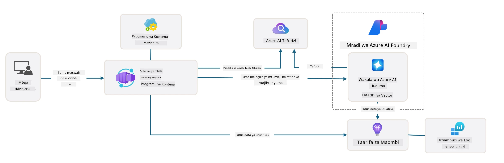

# 3. Vunjua Kiolezo

!!! tip "MWISHONI WA MODULI HII UTAWEZA"

    - [ ] Use GitHub Copilot and optional MCP tools for Azure documentation and read-only exploration
    - [ ] Identify the template's application, infrastructure, configuration, and test entry points
    - [ ] Verify generated explanations against actual repository files
    - [ ] **Lab 3:** Trace one request and one configuration input through the project

---

## 1. Washa GitHub Copilot

Fungua sampuli ya AI iliyozinduliwa katika VS Code na uwezeshe [GitHub Copilot](https://code.visualstudio.com/docs/copilot/chat/chat-agent-mode). Ingia kwa akaunti yenye mpango unaostahili; mipaka ya matumizi hutofautiana. Muulize Copilot aeleze hifadhi kabla ya kuidhinisha mabadiliko.

### Seva za MPC za Hiari

Huduma hizi zinaweza kutoa zana za ziada:

- [Azure MCP Server](https://learn.microsoft.com/azure/developer/azure-mcp-server/overview)
- [Microsoft Learn MCP Server](https://learn.microsoft.com/training/support/mcp)

Katika VS Code, kupitia [miongozo ya usanidi wa MCP](https://code.visualstudio.com/docs/copilot/chat/mcp-servers) na tengeneza `.vscode/mcp.json` ikiwa inahitajika:

```json
{
  "servers": {
    "Azure MCP Server": {
      "type": "stdio",
      "command": "npx",
      "args": ["-y", "@azure/mcp@latest", "server", "start"]
    },
    "microsoft.docs.mcp": {
      "type": "http",
      "url": "https://learn.microsoft.com/api/mcp"
    }
  }
}
```

Amri ya `npx` inahitaji usakinishaji wa Node.js/npm unaoungwa mkono na hupakua msimbo unaoweza kutekelezwa. Pitia kifurushi na weka toleo lililothibitishwa kwa usanidi unaoweza kurudiwa wa timu. Anzisha seva kwa kutumia vidhibiti vya MCP vya VS Code na angalia zana zao zilizopo; majina yanaweza kubadilika kati ya matoleo.

**Uthibitishaji ni tofauti.** Tumia `azd auth login` kwa AZD. Fuata mtiririko wa uthibitishaji uliodokumentishwa wa Azure MCP kwa zana zake; kuingia kwa AZD pekee hakaundi kikao cha MCP. Tumia `az login` kwa tofauti wakati zoezi au hook inapoita Azure CLI.

Jaribu maagizo ya kusoma tu:

1. “Tumia Microsoft Learn MCP kupata nyaraka za usanidi wa Azure Developer CLI.”
2. “Eleza `azure.yaml` ya hifadhi hii; taja faili zinazotekeleza kila hook.”
3. “Kwa kutumia zana za Azure MCP zinazopatikana, oroda rasilimali zangu zilizotumika bila kubadili chochote.”

Kagua mpangilio wa menyu/muamuzi wa kodi uliyochaguliwa na kila wito wa zana uliopendekezwa. Usikubali uundaji wa rasilimali, ufutaji, au mabadiliko ya ruhusa kwa ajili tu ya kuchunguza usanifu.

## 2. Elewa usanifu

Sampuli ina backend ya Python FastAPI na frontend ya React/TypeScript kwenye Azure Container Apps. Backend huwasiliana na wakala katika mradi wa Microsoft Foundry. Urejeshaji na uangalizi hutegemea vipengele vilivyoamilishwa vya kiolezo na usanidi uliofanikiwa; hayaathiriwi ukiwa tu kwa sababu programu ilizinduliwa.



Linganisha mchoro huu na [miongozo ya sasa ya maingizo ya juu](https://github.com/Azure-Samples/get-started-with-ai-agents/blob/main/docs/deployment.md) na rasilimali zako halisi. Kagua usanidi wa uanzishaji wa modeli, zana za wakala, utambulisho ulioendeshwa, ugawaji wa majukumu, na rasilimali za hiari za AI Search/Application Insights.

**Zoezi:** Muulize Copilot kufuatilia ombi la mazungumzo kutoka frontend kupitia API hadi Foundry, ukiwa na rejea za faili na kazi. Fungua rejea hizo na hakiki maelezo. Usihitishe uthibitishaji, upangaji njia, au idhini kutoka kwa mchoro pekee.

## 3. Muundo wa hifadhi

Njia zilizochaguliwa zilikaguliwa dhidi ya sampuli tarehe 4 Novemba, 2026. Toleo lako lililozinduliwa ndilo chanzo cha ukweli:

```text
get-started-with-ai-agents/
  azure.yaml
  docker-compose.yaml
  requirements-dev.txt
  .devcontainer/
  infra/
    main.bicep
    main.parameters.json
    api.bicep
    core/
  src/
    Dockerfile
    pyproject.toml
    requirements.txt
    api/
      main.py
      routes.py
      search_index_manager.py
    frontend/
      package.json
      src/
    files/
  scripts/
    validate_env_vars.sh
    validate_env_vars.ps1
    postdeploy.sh
    postdeploy.ps1
  tests/
    test_evaluation.py
    test_red_teaming.py
  docs/
    deployment.md
    deploy_customization.md
    ai_search.md
    observability.md
    local_development.md
    troubleshooting.md
```

### Miundombinu na usanidi

`infra/main.bicep` huendesha rasilimali; `main.parameters.json` huunganisha pembejeo za kiolezo na thamani za mazingira ya AZD. `azure.yaml` huchagua huduma ya programu na vifungo vya mzunguko wa maisha. Fuata pembejeo kama `USE_AZURE_AI_SEARCH_SERVICE` kupitia faili hizi ili kuona kinachobadilika kwa kweli.

### Programu na utambulisho

Soma pamoja `src/api/` na `src/frontend/`. Tambua mahali wakala anapoanzishwa au kurejeshwa, mahali maelekezo/zana zinapokusudiwa, na utambulisho unaotumiwa na kila mwito wa Azure. Faili za sampuli chini ya `src/files/` ni data za maonyesho, si orodha ya uzalishaji au mfano wa ruhusa.

### Majaribio na uangalizi

Sehemu za sasa za tathmini na timu ya kujaribu ni chini ya `tests/`; rejea za zamani za wao za `evals/` na `airedteaming/` ni za zamani kwa sampuli hii. Soma `docs/observability.md` kwa mahitaji ya awali na gharama kabla ya kuendesha majaribio ya mawingu. Majaribio haya ya Python ni tofauti na nyongeza ya hiari ya `azure.ai.evaluations` AZD.

## 4. Thibitisha matokeo yako

- Tambua njia ya API, mwingiliano wa wakala, na msimbo wa urejeshaji kwa swali moja la sampuli.
- Eleza utambulisho unaofikia Foundry na usanidi unaochagua kiunganishi chake.
- Tafuta maandishi halisi ya kabla ya kuanzisha na baada ya kupeleka na tabia yao ya kushughulikia makosa.
- Orodhesha utegemezi wowote au vipengele hiari ambavyo havipo katika uanzishaji wako.

Endelea kwa [Sanidi Kiolezo](4-Configure-AI-Template.md).

---

<!-- CO-OP TRANSLATOR DISCLAIMER START -->
**Kionyozo**:
Hati hii imetafsiriwa kwa kutumia huduma ya tafsiri ya AI [Co-op Translator](https://github.com/Azure/co-op-translator). Ingawa tunajitahidi kupata usahihi, tafadhali fahamu kwamba tafsiri za kiotomatiki zinaweza kuwa na makosa au upungufu wa usahihi. Hati ya asili katika lugha yake halisi inapaswa kuchukuliwa kama chanzo cha mamlaka. Kwa taarifa muhimu, tafsiri ya kitaalamu inayofanywa na binadamu inapendekezwa. Hatutojibu kwa kuelewa vibaya au tafsiri potofu zinazotokea kutokana na matumizi ya tafsiri hii.
<!-- CO-OP TRANSLATOR DISCLAIMER END -->