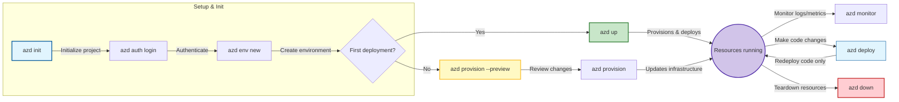
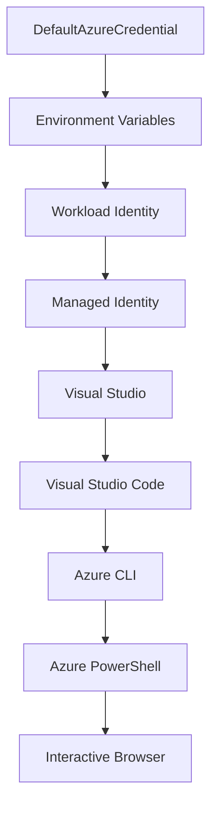

# AZD அடிப்படைகள் - கோர் கருத்துக்கள் மற்றும் அடித்தளங்கள்

**அத்தியாய வழிசெலுத்தல்:**
- **📚 பாடநெறி முகப்பு**: [AZD தொடக்கக்காரர்களுக்கான](../../README.md)
- **📖 தற்போதைய அத்தியாயம்**: அத்தியாயம் 1 - அடித்தளம் & விரைவான துவக்கம்
- **⬅️ முந்தையது**: [பாடநெறி மேற்பார்வை](../../README.md#-chapter-1-foundation--quick-start)
- **➡️ அடுத்தது**: [நிறுவல் மற்றும் அமைப்பு](installation.md)
- **🚀 அடுத்த அத்தியாயம்**: [அத்தியாயம் 2: AI-முதன்மை உருவாக்கம்](../chapter-02-ai-development/microsoft-foundry-integration.md)

## அறிமுகம்

> `azd 1.37.2` உடன் மதிப்பாய்வு செய்யப்பட்டு (நவம்பர் 2026). Bash கட்டளைகள் நீங்கள் மாற்ற வேண்டிய மேற்கோள் இடமாற்றிகளைப் பயன்படுத்துகின்றன. கோப்பு படிவ பணிகள் நிலையான அடைவுத்தொகுதியைத் தொடங்க `.` ஐப் பயன்படுத்துகின்றன; ஒரு அடைவு வாதம் இல்லாமல், கோப்பு படிவு தொடக்கம் ஒரு துணை அடைவை உருவாக்கி உங்கள் ஷெலின் வேலை செய்யும் அடைவுத் தொகுதியை மாற்றாது. மேம்பட்ட குறுக்கு துண்டுகள் முழுமையான திட்டங்கள் அல்ல, விளக்கமாக உள்ளன.

இந்த பாடம் Azure Developer CLI (azd) என்ற சக்திவாய்ந்த கட்டளை வரி கருவியுடன் உங்களை அறிமுகப்படுத்துகிறது, இது உள்ளூர் மேம்பாட்டிலிருந்து Azure பிரசுரிப்பிற்கான உங்கள் பயணத்தை அவ்வளவு வேகப்படுத்துகிறது. நீங்கள் அடிப்படையான கருத்துக்கள், முக்கிய அம்சங்கள் மற்றும் azd எப்படி மேக-நாடு அடித்த பயன்பாட்டின் பிரசுரிப்பை எளிமையாக்குகிறது என்பதை கற்றுக் கொள்வீர்கள்.

## கற்றல் இலக்குகள்

இந்த பாடம் முடிவுக்கு வரும் போது, நீங்கள்:
- Azure Developer CLI என்பது என்ன மற்றும் அதன் முதன்மை நோக்கம் என்ன என்பதை புரிந்து கொள்வீர்கள்
- கோப்புகள், சூழல்கள் மற்றும் சேவைகள் என்ற முக்கிய கருத்துக்களை கற்றுக் கொள்வீர்கள்
- கோப்பு முறை சார்ந்த மேம்பாடு மற்றும் குறியீடு வடிவமைப்பை சமர்ப்பிக்கும் முக்கிய அம்சங்களை அறிந்து கொள்வீர்கள்
- azd திட்ட அமைப்பு மற்றும் பணிப்பயிற்சி பற்றி புரிதல் பெறுவீர்கள்
- உங்கள் மேம்பாட்டு சூழலுக்கான azd ஐ நிறுவவும், கட்டமைக்கவும் தயார் நிலையில் இருப்பீர்கள்

## கற்றல் முடிவுகள்

இந்த பாடத்தை முடித்த பிறகு, நீங்கள் قادرஉள்ளீர்கள்:
- நவீன மேக அபிவிருத்தி வேலைநடவடிக்கைகளில் azd இன் பங்கு விளக்க
- azd திட்ட அமைப்பின் கூறுகளைக் காண்க
- மாதிரிகள், சூழல்கள் மற்றும் சேவைகள் எப்படி ஒன்றிணைக்கின்றன என்பதை விவரிக்க
- azd உடன் கோட்ற் அடிப்படையிலான உள்கட்டமைப்பின் நன்மைகளைப் புரிந்துகொள்ள
- வேறு azd கட்டளைகள் மற்றும் அவற்றின் நோக்கங்களை கண்டறிய

## Azure Developer CLI (azd) என்பதோ என்ன?

Azure Developer CLI (azd) என்பது உள்ளக அபிவிருத்தியிலிருந்து Azure இல் பொறுத்துகொள்ளும் பயணத்தை வேகப்படுத்த வடிவமைக்கப்பட்ட கட்டளை வரிசை கருவி ஆகும். இது Azure இல் மேக நிலையான பயன்பாடுகளை கட்டமைக்க, பொருத்த மற்றும் நிர்வகிக்க உள்ளடக்கத்தை எளிதாக்குகிறது.

### azd உடன் நீங்கள் என்ன பொருத்த முடியும்?

azd பலவிதமான வேலைப் பகுதிகளை ஆதரிக்கிறது — மற்றும் அந்தப் பட்டியல் தொடர்ச்சியாக வளர்ந்து வருகிறது. இன்று, நீங்கள் azd பயன்படுத்தி விநியோகம் செய்யலாம்:

| வேலைப் பகுதி வகை | உதாரணங்கள் | அதே வேலைநடை? |
|---------------|----------|----------------|
| **சம்பிரதாய பயன்பாடுகள்** | வலை செயலிகள், REST APIs, நிலையான தளங்கள் | ✅ `azd up` |
| **சேவைகள் மற்றும் மைக்ரோசேவைகள்** | கன்டெய்னர் செயலிகள், செயலி செயலிகள், பல-சேவை பின்னணி | ✅ `azd up` |
| **AI-ஆல் இயக்கப்படும் பயன்பாடுகள்** | Microsoft Foundry மாதிரிகளுடன் உரையாடல் செயலிகள், AI தேடலுடன் RAG தீர்வுகள் | ✅ `azd up` |
| **அறிவுசார் முகவர்கள்** | Foundry-ஐடு நடாத்தப்பட்ட முகவர்கள், பல-முகவர் ஒருங்கிணைப்புகள் | ✅ `azd up` |

முக்கியக் கருத்து என்னவெனில் **நீங்கள் என்னவென்றும் விநியோகம் செய்யினாலும் azd சுற்றுச்சூழல் அதேபோல் இருக்கும்**. நீங்கள் ஒரு திட்டத்தை துவங்குகிறீர்கள், அடித்தள வசதிகளை ஒதுக்குகிறீர்கள், உங்கள் குறியீட்டை விநியோகிக்கிறீர்கள், உங்கள் செயலியை கண்காணிக்கிறீர்கள், மற்றும் தூய்மையாக்குகிறீர்கள் — அது ஒரு எளிய வலைத்தளம் அல்லது ஒரு நுண்ணறிவு முகவர் என்றாலும்.

இந்த தொடர்ச்சிப்பாடு வடிவமைப்பின் படி உள்ளது. azd AI திறன்களை உங்கள் செயலிக்கு பயன்படுத்தக்கூடிய மற்றொரு வகை சேவையாக கருதுகிறது, அடிப்படையிலான முறையில் வேறுபாடாக அல்ல. Microsoft Foundry மாதிரிகளால் ஆதரவு பெறும் உரையாடல் முனை, azd இடத்திலிருந்து பார்க்கும்போது வேறு சேவையாகவே இருக்கிறது, அதை கட்டமைக்கவும் விநியோகிக்கவும்.

### 🎯 ஏன் AZD பயன்படுத்த வேண்டும்? ஒரு உண்மையான உலக ஒப்பீடு

ஒரு எளிய வலை செயலியை தரவுத்தளத்துடன் விநியோகிப்பதை ஒப்பிடுவோம்:

#### ❌ AZD இல்லாமல்: கைமுறை Azure விநியோகம் (30+ நிமிடங்கள்)

**காட்சி Bash ஒப்பீடு, இயக்கக்கூடிய செயலி துவக்கி அல்ல.** இது உள்ளூர் செயலி குறியீடு, தனித்துவமான வள பெயராக்கங்கள், Azure CLI சான்றிதழ், மற்றும் தேவையான CLI நீட்டிப்புக்கள் உள்ளன எனக் கருதுகிறது. கீழே உள்ள மாதிரி பயிற்சியை ஆதரிக்கப்பட்ட முறையாக பயன்படுத்தவும்.

```bash
# Step 1: Create resource group
az group create --name myapp-rg --location eastus

# Step 2: Create App Service Plan
az appservice plan create --name myapp-plan \
  --resource-group myapp-rg \
  --sku B1 --is-linux

# Step 3: Create Web App
az webapp create --name myapp-web-unique123 \
  --resource-group myapp-rg \
  --plan myapp-plan \
  --runtime "NODE:22-lts"

# Step 4: Create Cosmos DB account (10-15 minutes)
az cosmosdb create --name myapp-cosmos-unique123 \
  --resource-group myapp-rg \
  --kind MongoDB

# Step 5: Create database
az cosmosdb mongodb database create \
  --account-name myapp-cosmos-unique123 \
  --resource-group myapp-rg \
  --name tododb

# Step 6: Create collection
az cosmosdb mongodb collection create \
  --account-name myapp-cosmos-unique123 \
  --resource-group myapp-rg \
  --database-name tododb \
  --name todos

# Step 7: Get connection string
CONN_STR=$(az cosmosdb keys list \
  --name myapp-cosmos-unique123 \
  --resource-group myapp-rg \
  --type connection-strings \
  --query "connectionStrings[0].connectionString" -o tsv)

# Step 8: Configure app settings
az webapp config appsettings set \
  --name myapp-web-unique123 \
  --resource-group myapp-rg \
  --settings MONGODB_URI="$CONN_STR"

# Step 9: Enable logging
az webapp log config --name myapp-web-unique123 \
  --resource-group myapp-rg \
  --application-logging filesystem \
  --detailed-error-messages true

# Step 10: Set up Application Insights
az monitor app-insights component create \
  --app myapp-insights \
  --location eastus \
  --resource-group myapp-rg

# Step 11: Link App Insights to Web App
INSTRUMENTATION_KEY=$(az monitor app-insights component show \
  --app myapp-insights \
  --resource-group myapp-rg \
  --query "instrumentationKey" -o tsv)

az webapp config appsettings set \
  --name myapp-web-unique123 \
  --resource-group myapp-rg \
  --settings APPINSIGHTS_INSTRUMENTATIONKEY="$INSTRUMENTATION_KEY"

# Step 12: Build application locally
npm install
npm run build

# Step 13: Create deployment package
zip -r app.zip . -x "*.git*" "node_modules/*"

# Step 14: Deploy application
az webapp deployment source config-zip \
  --resource-group myapp-rg \
  --name myapp-web-unique123 \
  --src app.zip

# Step 15: Wait and pray it works 🙏
# (No automated validation, manual testing required)
```

**சிக்கல்கள்:**
- ❌  நினைவில் வைத்துக் கொண்டு தொடர் அமைப்பில் 15+ கட்டளைகள்  
- ❌ 30-45 நிமிடங்கள் கையால் வேலை செய்யும் நேரம்
- ❌ எளிதில் தவறுகள் (எழுத்துப்பிழைகள், தவறான அளவுருக்கள்) ஏற்படலாம்
- ❌ அங்கீகாரத் தகவல்கள் தெளிவாக கையாள வேண்டியுள்ளது; பிழை பதிவுகள் மற்றும் ஷெல் டிரேசிங் அவைகளை வெளிப்படுத்தக்கூடும்
- ❌ ஏதாவது தோல்வியடையும்போது தானாக பின்வாங்க முடியாது
- ❌ குழு உறுப்பினர்கள் மீண்டும் செய்வதற்கு கடினம்
- ❌ ஒவ்வொருமுறை வித்தியாசமாக இருக்கும் (மறுபடி செய்ய முடியாதது)

#### ✅ AZD உடன்: தானாக செயல்படுத்தல் (5 கட்டளைகள், 10-15 நிமிடங்கள்)

```bash
# Step 1: Initialize from template
azd init --template todo-nodejs-mongo .

# Step 2: Authenticate
azd auth login

# Step 3: Select the environment created during init
azd env select dev

# Step 4: Preview changes (optional but recommended)
azd provision --preview

# Step 5: Deploy everything
azd up

# ✨ Done! Everything is deployed, configured, and monitored
```

**பலன்கள்:**
- ✅ **5 கட்டளைகள்** مقابل 15+ கையால் நடைமுறை படிகள்
- ✅ **10-15 நிமிடங்கள்** மொத்த நேரம் (பெரும்பாலும் Azure க்காக காத்திருக்கின்றது)
- ✅ **கையும் பிழைகள் குறைவு** - ஒரே மாதிரியாக, வார்ப்புரு சார்ந்த வேலைப்பாடு
- ✅ **பாதுகாப்பான ரகசிய மேலாண்மை** - பல வார்ப்புருக்கள் Azure நிர்வகித்த ரகசிய சேமிப்பகத்தை பயன்படுத்துகின்றன
- ✅ **மறுபடியும் செய்யக்கூடிய பணிகள்** - ஒவ்வொரு முறையும் ஒரே வேலைநிலை
- ✅ **மறுபடியும் செய்யக்கூடிய கட்டமைப்பு வரையறைகள்** - ஒப்பந்தங்கள், பிராந்திய கிடைக்கும் நிலை மற்றும் வார்ப்புரு பதிப்புகளுக்கு உட்பட்டது
- ✅ **குழுவுக்கு தயாராக** - யாரும் ஒரே கட்டளைகளை பயன்படுத்தி செயல்படுத்தலாம்
- ✅ **கட்டமைப்பை கோடாகக் கையாளுதல்** - பதிப்புப்படுத்தப்பட்ட Bicep வார்ப்புருக்கள்
- ✅ **வார்ப்புருவால் வரையறுக்கப்பட்ட கண்காணிப்பு** - வார்ப்புருவில் சேர்க்கப்பட்டால் Application Insights

### நேரம் மற்றும் நம்பகத்தன்மை

மேலே உள்ள நேர கணக்குகள் மதிப்பீடுகள், ஆய்வுக் குறிப்புகள் அல்ல. azd நீங்கள் ஒருங்கிணைக்க வேண்டிய கட்டளைகளை குறைக்கும், ஆனால் செயல்படுத்தல் கால அவகாசம் உறுதி செய்யாது, பிழைகளை அகற்றாது அல்லது தானாக பயன்பாடு/தரவுத்தளம் பின்வாங்கத்தை வழங்காது. செயல்பாட்டு பதிப்புகளை மூலக் கட்டுப்பாட்டில் வைத்திருங்கள் மற்றும் மீட்டமைப்பு செயல்முறைகளை சோதிக்கவும்.

## முக்கிய கருத்துகள்

### வார்ப்புருக்கள்
வார்ப்புருக்கள் azd இன் அடிப்படை. அவை உள்ளடக்கியவை:
- **பயன்பாட்டு குறியீடு** - உங்கள் மூல குறியீடு மற்றும் சார்புகள்
- **கட்டமைப்பு வரையறைகள்** - Bicep அல்லது Terraform இல் வரையறுக்கப்பட்ட Azure வளங்கள்
- **கான்பிகரேஷன் கோப்புகள்** - அமைப்புகள் மற்றும் சூழல் மாறிகள்
- **செயல்படுத்தும் ஸ்கிரிப்ட்கள்** - தானியங்கி செயல்படுத்தும் வேலைப்பாடுகள்

### சூழல்கள்
சூழல்கள் வெவ்வேறு செயல்படுத்தும் இலக்குகளை குறிக்கின்றன:
- **அ развитие** - சோதனை மற்றும் மேம்பாடு
- **ஸ்டேஜிங்** - தயாரிப்பு முன் சூழல்
- **தயாரிப்பு** - நேரடி தயாரிப்பு சூழல்

ஒவ்வொரு சூழற்றும் தன் சொந்த:
- சூழல் பெயர் மற்றும் மதிப்புகள்; வள தனித்துவம் கட்டமைப்பு வார்ப்புருவின் அடிப்படையில் இருக்கும்
- அமைப்பு அமைப்புகள்
- செயல்படுத்தும் நிலை

### சேவைகள்
`azure.yaml` இல் சேவைகள் செயல்படுத்தக்கூடிய பயன்பாட்டுக் கூறுகளை விவரிக்கின்றன:
- **முன்புறம்** - வலை பயன்பாடுகள், SPAs
- **பின்புறம்** - APIs, மைக்ரோசேவைகள்

தரவுத்தளங்கள் மற்றும் சேமிப்பகங்கள் பொதுவாக கட்டமைப்பு வளங்களாக வழங்கப்படுகின்றன, `host: postgres` போன்ற கண்டுபிடிக்கப்பட்ட சேவை ஹோஸ்ட்கள் அல்ல.

## முக்கிய அம்சங்கள்

### 1. வார்ப்புரு சார்ந்த மேம்பாடு
```bash
# Browse available templates
azd template list

# Initialize from a template
azd init --template "<template-name>" .
```

### 2. கட்டமைப்பை கோடாகக் கையாளுதல்
- **Bicep** - Azure இன் குறிப்பிட்ட துறைக்கான மொழி
- **Terraform** - பல மேக வள கருவி
- Bicep ARM வார்ப்புருக்களையாகக் குறியாக்கம் செய்யப்படுகின்றது; மூல ARM JSON தனிக்கூடல் எதுவுமில்லை `infra.provider`.

### 3. ஒருங்கிணைந்த வேலைப்பாடுகள்
```bash
# Complete deployment workflow
azd up            # Provision + Deploy this is hands off for first time setup

# 🧪 NEW: Preview infrastructure changes before deployment (SAFE)
azd provision --preview    # Simulate infrastructure deployment without making changes

azd provision     # Create Azure resources if you update the infrastructure use this
azd deploy        # Deploy application code or redeploy application code once update
azd down          # Clean up resources
```

#### 🛡️ முன்னோக்கி பாதுகாப்பான கட்டமைப்பு திட்டமிடல்
`azd provision --preview` கட்டளை பாதுகாப்பான செயல்படுத்தலுக்கு பிரம்மாண்ட மாற்றம்:
- **முழுமையான முன்னோட்டம்** - என்ன உருவாக்கப்படும், மாற்றப்படும் அல்லது நீக்கப்படும் என்பதை காட்டுகிறது
- **கட்டமைப்பை பொருந்தவில்லை** - வழங்குநர் மாற்றங்களை மதிப்பாய்வு செய்கிறது; முதலில் திட்ட அழுத்தங்கள் பரிசீலனை செய்யவும், ஏனெனில் அவை பக்கவிளைவுகளுடன் கட்டளைகள் இயக்கக்கூடும்
- **குழு ஒருங்கிணைப்பு** - செயல்படுத்துவதற்கு முன் முன்னோட்ட முடிவுகளை பகிரவும்
- **செலவு திட்டமிடல் உள்ளீடு** - பரிந்துரைக்கப்பட்ட SKU களை பரிசீலனை செய்து Azure விலை கணக்கிடி மூலம் விலை கணக்கிடவும்; முன்னோட்டம் விலைகளை கணக்கிடாது

```bash
# Example preview workflow
azd provision --preview           # See what will change
# Review the output, discuss with team
azd provision                     # Apply changes with confidence
```

### 📊 காட்சி: AZD மேம்பாட்டு பணி זרக்கம்



**பணி זרக்கம் விளக்கம்:**
1. **துவக்கம்** - வார்ப்புரு அல்லது புதிய திட்டத்துடன் துவங்கு
2. **அங்கீகாரம்** - Azure உடன் அங்கீகரிக்கவும்
3. **சூழல்** - தனியுரிமையான பிரசார சூழல் உருவாக்கவும்
4. **முன்னோட்டம்** - 🆕 எப்போதும் முதலில் உள்கட்டமைப்பு மாற்றங்களை முன்னோட்டம் செய்க (பாதுகாப்பான நடைமுறை)
5. **விருத்தி செய்தல்** - Azure வளங்களை உருவாக்கவும்/புதுப்பிக்கவும்
6. **வினியோகிக்கவும்** - உங்கள் பயன்பாட்டு குறியீட்டை முன்னேற்றவும்
7. **கண்காணி** - பயன்பாட்டு செயல்திறனை கவனிக்கவும்
8. **மீண்டும் செய்யவும்** - மாற்றங்களைச் செய்து குறியீட்டை மீண்டும் வினியோகிக்கவும்
9. **தூய்மையாக்கவும்** - முடிந்தவுடன் வளங்களை அகற்றவும்

### 4. சூழல் மேலாண்மை
```bash
# Create and manage environments
azd env new "<environment-name>"
azd env select "<environment-name>"
azd env list
```

### 5. நீட்சிகள் மற்றும் AI கட்டளைகள்

azd மைய CLIயைத் தாண்டி திறன்களைச் சேர்க்க ஒரு நீட்டிப்பு அமைப்பை பயன்படுத்துகிறது. இது குறிப்பாக AI பணி வெளுக்குதல்களுக்கு பயனுள்ளது:

```bash
# List available extensions
azd extension list

# Install the GA Foundry bundle (requires azd >= 1.37.0)
azd ext install microsoft.foundry

# Initialize an AI agent project interactively
azd ai agent init

# Test a deployed agent (shows latency and time-to-first-byte)
azd ai agent invoke

# Start the MCP server for AI-assisted development (Alpha)
azd mcp start
```

**எஜென்ட் வாழ்கைச்சுற்று, துவக்கம் முதல் முடிவ வரை.** GA `microsoft.foundry` தொகுப்பில் `azure.ai.agents` மற்றும் ஆறு பிற மைய நீட்சிகள் உள்ளன. மதிப்பீட்டுக்காக `azure.ai.evaluations` தனியாக நிறுவவும். இந்த பணி זרக்கத்திற்கு `azd >= 1.37.0` பயன்படுத்தவும். நீங்கள் முதல் நாளில் இத全部 வேண்டும் இல்லை:

| நிலை | கட்டளை | அது செய்கிறது |
|-------|---------|--------------|
| **அடிக்கணி** | `azd ai agent init --template <path-to-azure.yaml>` | ஒரு தற்போதைய எஜென்ட் திட்ட வார்ப்புருவை ஏற்றுக்கொள்ளவும் |
| **உள்ளூரில் இயக்கவும்** | `azd ai agent run`, பிறகு இன்னொரு டெர்மினலில் `azd ai agent invoke --local "Test prompt"` | எஜென்ட் ஆய்வாளியில் உள்ளூர் செயல்பாட்டை ஆய்வு செய்க; மாதிரி அழைப்புகள் இனி Azure பயன்படுத்துகிறது |
| **வினியோகிக்கவும்** | `azd deploy` | குறியீடு வழிமுறையிலான ஹோஸ்ட் செய்யப்பட்ட எஜென்ட்களுக்கு, தொலைதூர Foundry கட்டுமானத்திற்கான மூலத்தை பதிவேற்றவும் |
| **சோதனை செய்யவும்** | `azd ai agent invoke` | எஜென்டை அழைக்கவும் மற்றும் பதில் நேரம் காணவும் |
| **அளவிடவும்** | `azd ai eval init`, `generate`, `run start` | தனி நீட்சியைப் பயன்படுத்தி கட்டமைக்கவும், வினியோகிக்கவும் மற்றும் மதிப்பீடுகளை இயக்கவும் |
| **மேம்படுத்து** | `azd ai agent optimize --eval <evaluation-name> --optimize-model <optimizer-deployment>` | பொருந்தக்கூடிய மதிப்பீட்டை மீண்டும் பயன்படுத்தி எஜென்டை மேம்படுத்தவும் |
| **ஆய்வு செய்யவும்** | `azd ai agent endpoint show` | நேரடி முடிவு மேலாண்மையைப் பார்வையிடவும் |
| **தூய்மையாக்கவும்** | `azd ai agent delete` | ஒரு ஹோஸ்ட் செய்யப்பட்ட எஜென்டையும் அதன் அனைத்து பதிப்புகளையும் நீக்கவும் |

> தேவையான முன்னோட்டங்கள், வழங்கல், மற்றும் பாதுகாப்பான தூய்மையை உள்ளடக்கும் [GA hosted-agent வழிகாட்டி](../chapter-02-ai-development/microsoft-foundry-integration.md#hosted-agent-walkthrough-ga) உடன் தொடங்குங்கள். விரிவுரைகள் மேலும் [AZD AI CLI Commands](../chapter-08-production/production-ai-practices.md#azd-ai-cli-commands-and-extensions) குறிப்பு கோவையை உள்ளடக்குகின்றன.

## 📁 திட்ட அமைப்பு

ஒரு சாதாரண azd திட்ட அமைப்பு:
```
my-app/
├── .azure/                  # Local environments and selected-environment config
│   ├── config.json
│   └── dev/.env
├── .devcontainer/          # Development container config
├── .github/workflows/      # GitHub Actions
├── .vscode/               # VS Code settings
├── infra/                 # Infrastructure code
│   ├── main.bicep        # Main infrastructure template
│   ├── main.parameters.json
│   └── modules/          # Reusable modules
├── src/                  # Application source code
│   ├── api/             # Backend services
│   └── web/             # Frontend application
├── azure.yaml           # azd project configuration
└── README.md
```

## 🔧 கட்டமைப்பு கோப்புகள்

### azure.yaml
பிரதான திட்ட கட்டமைப்பு கோப்பு:
```yaml
name: my-awesome-app
metadata:
  template: my-template@1.0.0

services:
  web:
    project: ./src/web
    language: js
    host: appservice
  api:
    project: ./src/api
    language: js
    host: appservice

hooks:
  preprovision:
    shell: pwsh
    run: echo "Preparing to provision..."
```

### .azure/config.json
திட்ட-உள்ளூர் இயல்புநிலை சூழலைத் தேர்ந்தெடுப்பு (உதாரணம்; azd மூலம் நிர்வகிக்கப்படுகிறது):
```json
{
  "defaultEnvironment": "dev"
}
```

## 🎪 பொதுவான வேலைப்பாடுகள், நேரடி பயிற்சிகளுடன்

> **💡 கற்றல் குறிப்புரை:** உங்கள் AZD திறன்களை படிப்படியாக கட்டியெடுக்க இந்த பயிற்சிகளை வரிசையாக பின்பற்றவும்.

### 🎯 பயிற்சி 1: உங்கள் முதல் திட்டத்தை துவங்கவும்

**நோக்கம்:** ஒரு AZD திட்டத்தை உருவாக்கி அதன் அமைப்பைப் பின்தொடர்ந்து ஆராய்வது

**படி பகுதிகள்:**
```bash
# Use a proven template
mkdir azd-basics-practice
cd azd-basics-practice
# Choose "dev" for the environment name when prompted
azd init --template todo-nodejs-mongo .

# Explore the generated files
ls -la  # View all files including hidden ones

# Key files created:
# - azure.yaml (main config)
# - infra/ (infrastructure code)
# - src/ (application code)
```

**✅ வெற்றி:** உங்களுக்கு azure.yaml, infra/, மற்றும் src/ அடைவுகள் உள்ளன

---

### 🎯 பயிற்சி 2: Azure-க்கு இயக்கவும்

**நோக்கம்:** முளைவாயாய் (end-to-end) கிடைத்துவைக்கல் நிறைவடையவும்

**படிகள்:**
```bash
# 1. Authenticate
azd auth login

# 2. Select the dev environment created in Exercise 1
azd env select dev
azd env set AZURE_LOCATION eastus

# 3. Preview changes (RECOMMENDED)
azd provision --preview

# 4. Deploy everything
azd up

# 5. Verify deployment
azd show    # View your app URL
```

**எதிர்பார்க்கப்படும் நேரம்:** 10-15 நிமிடங்கள்  
**✅ வெற்றி:** பயன்பாட்டு URL உலாவியில் திறக்கும்

---

### 🎯 பயிற்சி 3: பல சுற்றுப்புறங்கள்

**நோக்கம்:** dev மற்றும் staging க்கு வெளியிடு

**படிகள்:**
```bash
# Already have dev, create staging
azd env new staging
azd env set AZURE_LOCATION westus2
azd up

# Switch between them
azd env list
azd env select dev
```

**✅ வெற்றி:** Azure போர்டலில் இரண்டு தனித்துவமான வளக் குழுக்கள்

**சுத்தம் செருக்கு:** பயிற்சி 3 இரண்டாம் பில்லப்டிஷன் வெளியீட்டை நிகழ்த்துகிறது. முடிந்ததும் இரண்டையும் அழிக்கவும்:

```bash
azd down --environment dev
azd down --environment staging
```

---

### 🛡️ அழிக்கும் சுத்தம் செய்யல்: `azd down --force --purge`

நீங்கள் தெரிவுசெய்த சுற்றுப்புறத்தின் Azure வளங்களை நீக்க விரும்பும் போது:

```bash
azd down --force --purge
```

**இதனால் என்ன ஆகிறது:**
- `--force`: எந்த உறுதிப்படுத்தல் கேள்விகளும் இல்லை
- `--purge`: துணைநிலை மேலோட்டமாக நீக்கப்பட்ட ஆதரவு செய்யப்பட்ட வளங்களையும் (உதாரணமாக Key Vaultகள்) நிரந்தரமாக நீக்குகிறது, இது purge காப்பு அனுமதிக்கும் இடத்தில். உள்ளூர் `.azure/` அடைவை அழிக்காது.

**பயன்பாடு எப்போது:** பயன்படுத்தி முடித்த சுற்றுப்புறத்துடன். ஆதார அங்கீகாரம், ஒதுக்கீடு, அல்லது கட்டமைப்பு பிழைக்கு முதலாம் பதிலாக அழிக்கும் சுத்தம் செய்யலைப் பயன்படுத்த வேண்டாம்.

---

## 🎪 அசல் வேலைநிலை குறிப்பு

### புதிய திட்டம் துவங்குதல்
```bash
# Method 1: Use existing template
azd init --template todo-nodejs-mongo .

# Method 2: Start from scratch
azd init

# Method 3: Use current directory
azd init .
```

### மேம்பாட்டுத் சுழற்சி
```bash
# Set up development environment
azd auth login
azd env new dev
azd env select dev

# Deploy everything
azd up

# Make changes and redeploy
azd deploy

# Clean up when done
azd down --force --purge # Deletes this environment's discovered Azure resources; review before forcing deletion.
```

## `azd down --force --purge` அறிவது
`azd down --force --purge` கட்டளை உங்கள் azd சுற்றுப்புறத்தையும் அதனுடன் தொடர்புடைய அனைத்து வளங்களையும் முழுமையாக அழிக்கும் சக்தியாகும். ஒவ்வொரு கொடிக்கு என்ன செய்கிறது என கீழே காண்க:
```
--force
```
- உறுதிப்படுத்தல் கேள்விகளை தவிர்க்கிறது.
- கையேடு உள்ளீடு சாத்தியமாக இல்லாத தானியங்கி அல்லது ஸ்க்ரிப்டிங்கிற்கு பயன்படும்.
- அனுமதிகள், purge பாதுகாப்பு, அல்லது நீக்கும் தோல்விகளை தவிர்க்காது.

```
--purge
```
கூடுதல் உறுதிப்படுத்தலை இல்லாமல் ஆதரிக்கப்படும் மென்மையான நீக்கப்பட்ட Azure வளங்களை நிலையான முறையில் நீக்குகிறது. பர்ஜ் பாதுகாப்பும் அனுமதிகளும் இன்னும் பொருந்தும். இது **இல்லை** உள்ளூர் சுற்றுச்சூழல்களை அல்லது `.azure/` תיקייתை அகற்றாது.


### இரண்டையும் ஏன் பயன்படுத்துவது?
நீங்கள் தெரிந்துள்ள சுற்றுச்சூழலின் Azure வளங்களை நீக்கி மீட்டெடுக்கக்கூடிய வளங்களை பர்ஜ் செய்யப் போகும் போது இரண்டையும் பயன்படுத்தவும். இது ஒரு அழிக்கக்கூடிய சுத்திகரிப்பு, பொதுவான திருத்தம் அல்லது உள்ளூர் நிலை மீட்டமைப்பு அல்ல.

இது குறிப்பாக Azure போர்டலில் கைமுறை வள நீக்கங்கள் செய்தபின் அல்லது டெம்ப்ளேட்கள், சுற்றுச்சூழல்கள் அல்லது வளக் குழு பெயரிடும் நடைமுறைகளை மாற்றும் போது உதவிகரம்.


### பல சுற்றுச்சூழல்களை நிர்வகித்தல்
```bash
# Create staging environment
azd env new staging
azd env select staging
azd up

# Switch back to dev
azd env select dev

# Compare environments
azd env list
```

## 🔐 அங்கீகாரம் மற்றும் அடையாளம்

배포 அங்கீகாரத்தை (`azd auth login`) பயன்பாட்டு SDK அங்கீகாரம் (`DefaultAzureCredential`) ஆகியவற்றில் வேறுபடுத்தி தெரிந்துகொள்ளவும். அவை தனித்தனியாய் உள்ளது. azd இயல்புநிலைபடி Azure CLI அங்கீகாரம் பயன்படுத்தாது.

### Azure CLI அங்கீகாரம் (`az login`)

azdக்காக `azd auth login` இயக்கவும். பின்வரும் Azure CLI கட்டளைகள் விரும்பෙනவையாக இருக்கக்கூடியவை மற்றும் `az` கட்டளைகளை தனித்தனியாக அங்கீகரிக்கின்றன:

```bash
# Interactive login (opens browser)
az login

# Login with specific tenant
az login --tenant "<tenant-id>"

# Login with service principal
az login --service-principal -u "<app-id>" -p "<password>" --tenant "<tenant-id>"

# Check current login status
az account show

# List available subscriptions
az account list --output table

# Set default subscription
az account set --subscription "<subscription-id>"
```

### அங்கீகார ஓட்டம்
1. **இணையதள உள்நுழைவு**: உங்கள் இயல்புநிலை உலாவியை அங்கீகரிக்க திறக்கிறது
2. **சாதனக் குறியீட்டு ஓட்டு**: உலாவி அணுகலுடன் இல்லாத சூழல்களுக்காக  
3. **சேவை பிரதிநிதி**: தானியங்கி மற்றும் CI/CD பரபரப்புகளுக்காக  
4. **மேலாண்மை அடையாளம்**: Azure-ஆல் ஹோஸ்ட் செய்யப்பட்ட பயன்பாடுகளுக்காக  

### DefaultAzureCredential சங்கிலி  

`DefaultAzureCredential` என்பது குறிப்பிட்ட வரிசையில் பல ஆதாரங்களை தானாக முயற்சித்துப் பயனாளருக்கு எளிய அங்கீகார அனுபவத்தை வழங்கும் ஒரு அங்கீகார வகை:  

#### பயன்பாட்டு SDK அங்கீகார சங்கிலி  

சரியான சங்கிலி Azure Identity SDK மொழி, பதிப்பு, நிறுவப்பட்ட பிளகின்கள் மற்றும் விருப்பங்களின்படி மாறுபடும். இந்த வரைபடம் கருதுகோளாக்கப்பட்டது, நிலையான azd அங்கீகார வரிசை அல்ல; சமீபத்திய SDKகள் Azure Developer CLI அங்கீகாரங்களையும் உள்ளடக்க முடியும்.  

  
#### 1. சூழல் மாறிலிகள்  
```bash
# Set environment variables for service principal
export AZURE_CLIENT_ID="<app-id>"
export AZURE_CLIENT_SECRET="<password>"
export AZURE_TENANT_ID="<tenant-id>"
```
  
#### 2. பணி அடையாளம் (Kubernetes/GitHub நடவடிக்கைகள்)  
தானாக பயன்படும்:  
- Azure Kubernetes சேவை (AKS) பணி அடையாளத்துடன்  
- OIDC கூட்டமைப்புடன் GitHub நடவடிக்கைகள்  
- மற்ற கூட்டமைக்கப்பட்ட அடையாள சூழல்கள்  

#### 3. மேலாண்மை அடையாளம்  
Azure வளங்களுக்கு உதாரணமாக:  
- மெய்நிகர் இயந்திரங்கள்  
- செயலி சேவை  
- Azure செயல்பாடுகள்  
- தொகுதி நிகழ்சிகள்  

```bash
# Inspect a deployed Container App's configured identity (requires az login)
az containerapp show --name "<app-name>" --resource-group "<rg-name>" --query identity
```
  
#### 4. அபிவிருத்தி கருவி ஒருங்கிணைப்பு  
- **Visual Studio**: தானாக உள்நுழைந்த கணக்கை பயன்படுத்தும்  
- **VS Code**: ஆதரவு SDK மற்றும் அதன் ஆதரவு சரவந்திருப்பு/பிளகின் அமைப்புகளின் மீது சார்ந்தது  
- **Azure CLI**: `az login` அங்கீகாரங்களை பயன்படுத்துகிறது (உள்ளூர் மேம்பாட்டிற்கு மிகவும் பொதுவானது)  

### AZD அங்கீகார அமைப்பு  

```bash
# Method 1: Direct azd authentication (recommended)
azd auth login

# Method 2: Direct azd authentication
azd auth login --use-device-code  # For headless environments

# Method 3: Check authentication status
azd auth login --check-status

# Method 4: Logout and re-authenticate
azd auth logout
azd auth login
```
  
### அங்கீகார சிறந்த நடைமுறைகள்  

#### உள்ளூர் மேம்பாட்டிற்கு  
```bash
# 1. Log in to azd
azd auth login

# 2. Select the subscription for this initialized environment
azd env set AZURE_SUBSCRIPTION_ID "<subscription-id>"

# 3. Check azd sign-in details (read the status message)
azd auth login --check-status
```
  
#### CI/CD குழாய்களுக்காக  
```yaml
# Partial GitHub Actions steps: assumes checkout, azd installation,
# required AZURE_* environment values, and pipeline secret configuration.
- name: Deploy with azd
  run: |
    azd auth login --client-id ${{ secrets.AZURE_CLIENT_ID }} \
                    --client-secret ${{ secrets.AZURE_CLIENT_SECRET }} \
                    --tenant-id ${{ secrets.AZURE_TENANT_ID }}
    azd up --no-prompt
```
  
#### உற்பத்தி சூழல்களுக்கு  
- Azure வளங்களில் இயக்கும்போது **மேலாண்மை அடையாளம்** பயன்படுத்தவும்  
- தானியக்கம் பரபரப்புகளுக்கு **சேவை பிரதிநிதி** பயன்படுத்தவும்  
- குறியீடு அல்லது கட்டமைப்பு கோப்புகளில் அங்கீகாரங்களை சேமிக்க வேண்டாம்  
- அத்தனை நுட்பமான கட்டமைப்புகளுக்கு **Azure Key Vault** பயன்படுத்தவும்  

### பொதுவான அங்கீகார பிரச்சனைகள் மற்றும் தீர்வுகள்  

#### பிரச்சனை: "சாப்ட்கிரிப்ஷன் கிடைக்கவில்லை"  
```bash
# Solution: Set default subscription
az account list --output table
az account set --subscription "<subscription-id>"
azd env set AZURE_SUBSCRIPTION_ID "<subscription-id>"
```
  
#### பிரச்சனை: "புரிந்து கொள்ள போதாத அனுமதிகள்"  
```bash
# Solution: Check and assign required roles
az role assignment list --assignee $(az account show --query user.name --output tsv)

# Common required roles:
# - Contributor (for resource management)
# - User Access Administrator (for role assignments)
```
  
#### பிரச்சனை: "டோக்கன் காலாவதி"  
```bash
# Solution: Re-authenticate
az logout
az login
azd auth logout
azd auth login
```
  
### வேறுபட்ட சூழல்களில் அங்கீகாரம்  

#### உள்ளூர் மேம்பாடு  
```bash
# Personal development account
az login
azd auth login
```
  
#### குழு மேம்பாடு  
```bash
# Use specific tenant for organization
az login --tenant contoso.onmicrosoft.com
azd auth login --tenant-id "<tenant-id>"
```
  
#### பன்முக வாடிக்கையாளர்கள் சூழல்கள்  
```bash
# Switch between tenants
az login --tenant tenant1.onmicrosoft.com
azd auth login --tenant-id "<tenant-1-id>"
# Select an environment configured with tenant 1's subscription
azd env select tenant1-dev
# Deploy to tenant 1
azd up

az login --tenant tenant2.onmicrosoft.com  
azd auth login --tenant-id "<tenant-2-id>"
azd env select tenant2-dev
# Deploy to tenant 2
azd up
```
  
### பாதுகாப்பு கருதி  

1. **அங்கீகார் சேமிப்பு**: ஒருபோதும் மூலக் குறியீட்டில் அங்கீகாரங்களை சேமிக்க வேண்டாம்  
2. **வட்டாரக் கட்டுப்பாடு**: சேவை பிரதிநிதிகளுக்கு குறைந்த அரசு நன்மைகள் கொள்கையைப் பின்பற்றவும்  
3. **டோக்கன் பரிவர்த்தனை**: சேவை பிரதிநிதி இரகசியங்களை முறையான முறையில் மாற்றவும்  
4. **ஆடிட் பTrail**: அங்கீகார மற்றும் 배포 நடவடிக்கைகளை கண்காணிக்கவும்  
5. **நெட்வொர்க் பாதுகாப்பு**: வாய்ப்பு கிடைக்கும் போது தனிப்பட்ட முனைகள் பயன்படுத்தவும்  

### அங்கீகார பிரச்சனைகள் தீர்க்கும் வழிகள்  

```bash
# Debug authentication issues
azd auth login --check-status
az account show
az account get-access-token

# Common diagnostic commands
whoami                          # Current user context
az ad signed-in-user show      # Microsoft Entra ID user details
az group list                  # Test resource access
```
  
## கட்டளை கண்டுபிடிப்பு  

### கண்டுபிடிப்பு  
```bash
azd template list              # Browse templates
azd template list --help       # Template discovery options
azd init --help               # Initialization options
```
  
### திட்ட மேலாண்மை  
```bash
azd show                     # Project overview
azd env list                # Available environments and selected default
azd config show            # Configuration settings
```
  
### கண்காணிப்பு  
```bash
azd monitor                  # Open Azure portal monitoring
azd monitor --logs           # View application logs
azd monitor --live           # View live metrics
azd pipeline config          # Set up CI/CD
```
  
## சிறந்த நடைமுறைகள்  

### 1. பொருத்தமான பெயர்களைப் பயன்படுத்தவும்  
```bash
# Good
azd env new production-east
azd init --template todo-nodejs-mongo .

# Avoid
azd env new env1
azd init --template template1 .
```
  
### 2. மாதிரிகள் பயன்படுத்தவும்  
- உள்ளமைந்த மாதிரிகளைத் தொடங்கவும்  
- உங்கள் தேவைக்கு ஏற்ப தனிப்பயனாக்கவும்  
- உங்கள் நிறுவனத்திற்கு மீண்டும் பயன்படுத்தக்கூடிய மாதிரிகளை உருவாக்கவும்  

### 3. சூழல் தனிமைப்படுத்தல்  
- dev/staging/prod க்கான தனித்தனியான சூழல்களைப் பயன்படுத்தவும்  
- உள்ளூரிலிருந்து நேரடியாக உற்பத்தியில் deployment செய்ய வேண்டாம்  
- உற்பத்தி deployment க்காக CI/CD குழாய்களைப் பயன்படுத்தவும்  

### 4. கட்டமைப்பு மேலாண்மை  
- மறைந்த அடையாளம் மற்றும் Key Vault ஐ ரகசியங்களுக்கு பயன்படுத்தவும்; சாதாரண `azd env set` மதிப்புக்கள் உள்ளூர் தெளிவெழுத்துகளாக இருக்கும்  
- கட்டமைப்பை பதிப்பு கட்டுப்பாட்டில் வைக்கவும்  
- சூழலை சார்ந்த அமைப்புகளை ஆவணப்படுத்தவும்  

## கற்றல் முன்னேற்றம்  

### தொடக்க நிலை (வாரம் 1-2)  
1. azd ஐ நிறுவி அங்கீகாரம் செய்யவும்  
2. எளிய மாதிரியை deployment செய்யவும்  
3. திட்ட அமைப்பை புரிந்து கொள்ளவும்  
4. அடிப்படை கட்டளைகளை கற்றுக்கொள்ளவும் (up, down, deploy)  

### நடுநிலை (வாரம் 3-4)  
1. மாதிரிகளை தனிப்பயனாக்கவும்  
2. பல சூழல்களை மேலாண்மை செய்யவும்  
3. கட்டமைப்பு குறியீட்டை புரிந்து கொள்ளவும்  
4. CI/CD குழாய்களை அமைக்கவும்  

### மேம்பட்ட நிலை (வாரம் 5+)  
1. தனிப்பயன் மாதிரிகளை உருவாக்கவும்  
2. மேம்பட்ட கட்டமைப்பு முறைபாடுகள்  
3. பன்முக-பிராந்திய deployment கள்  
4. நிறுவன தர அளவுகோள் கட்டமைப்புகள்  

## அடுத்த படிகள்  

**📖 அத்தியாயம் 1 கற்றல் தொடரவும்:**  
- [நிறுவல் மற்றும் அமைப்பு](installation.md) - azd ஐ நிறுவி அமைக்கவும்  
- [உங்கள் முதற்ப் பணி](first-project.md) - கைமுறை கற்றல் முழுமையாக்கவும்  
- [கட்டமைப்பு கையேடு](../chapter-03-configuration/configuration.md) - மேம்பட்ட கட்டமைப்பு விருப்பங்கள்  

**🎯 அடுத்த அத்தியாயத்துக்குத் தயாரா?**  
- [அத்தியாயம் 2: AI-முதன்மை மேம்பாடு](../chapter-02-ai-development/microsoft-foundry-integration.md) - AI பயன்பாடுகளை உருவாக்கத் தொடங்கவும்  

## கூடுதல் வளங்கள்  

- [Azure Developer CLI கண்ணோட்டம்](https://learn.microsoft.com/en-us/azure/developer/azure-developer-cli/)  
- [மாதிரி அரங்கம்](https://azure.github.io/awesome-azd/)  
- [சமூக மாதிரிகள்](https://github.com/Azure-Samples)  

---

## 🙋 அடிக்கடி கேட்கப்படும் கேள்விகள்  

### பொது கேள்விகள்  

**Q: AZD மற்றும் Azure CLI இன் வேறுபாடு என்ன?**  

பதில்: Azure CLI (`az`) தனிப்பட்ட Azure வளங்களை நிர்வகிக்க பயன்படும். AZD (`azd`) முழு பயன்பாடுகளை நிர்வகிக்க பயன்படும்:  

```bash
# Azure CLI - Low-level resource management
az webapp create --name myapp --resource-group rg
az sql server create --name myserver --resource-group rg
# ...many more commands needed

# AZD - Application-level management
azd up  # Deploys entire app with all resources
```
  
**இந்தப் போல சிந்தியுங்கள்:**  
- `az` = தனிப்பட்ட Lego கற்கள் மீது செயல்படுதல்  
- `azd` = முழு Lego செட்டுகளுடன் பணியாற்றுதல்  

---

**Q: AZD பயன்படுத்த Bicep அல்லது Terraform தெரிந்து கொள்ள வேண்டுமா?**  

பதில்: இல்லை! மாதிரிகளுடன் தொடங்குங்கள்:  
```bash
# Use existing template - no IaC knowledge needed
azd init --template todo-nodejs-mongo .
azd up
```
  
நீங்கள் பின்னர் உட்கட்டமைப்பிற்கு Bicep கற்றுக்கொள்ளலாம். மாதிரிகள் கற்றலுக்கான வேலை செய்யும் உதாரணங்களை வழங்குகின்றன.  

---

**Q: AZD மாதிரிகள் இயக்குவதற்கு எவ்வளவு செலவு ஆகும்?**  

பதில்: செலவு பிராந்தியம், SKU, uptime, தரவுத்தள முறை மற்றும் மாடல் பயன்படுத்தல் ஆகியவற்றின் அடிப்படையில் மாறுபடும். மேம்பாட்டு சூழல் அமைந்திருக்கும் போது கூட மாதந்தோறும் போதுமான கட்டணங்கள் ஏற்படக்கூடும்; பொதுவான $50-150 வரம்பை கருத வேண்டாம்:  

```bash
# Preview resource changes (not prices)
azd provision --preview

# Always cleanup when not using
azd down --force --purge  # Removes all resources
```
  
**நுணுக்கமான குறிப்புகள்:** இலவச நிலைகளை பயன்படுத்துங்கள்:  
- செயலி சேவை: F1 (இலவச) நிலை  
- Azure OpenAI: பொதுவாக மாதாந்திரத் இலவச டோக்கன் அளவினை உறுதிப்படுத்தாது; தற்போதைய மாடல் மற்றும் விலை பரிசீலனை செய்யவும்  
- Cosmos DB: தகுதி பெற்ற provisioned-throughput கணக்குகள் இலவச நிலையைத் தேர்வு செய்யலாம்; சேவையற்ற மாதிரிகள் தானாக தகுதி பெறமாட்டார்கள்  

---

**Q: நான் ஏற்கனவே உள்ள Azure வளங்களோடு AZD பயன்படுத்த முடியுமா?**  

பதில்: ஆம், ஆனால் புதிதாக தொடங்குவது எளிது. AZD முழு வாழ்க்கைச்சட்டத்தை நிர்வகிக்க சிறந்தது. உள்ள வளங்களுக்கு:  

```bash
# Option 1: Import existing resources (advanced)
azd init
# Then modify infra/ to reference existing resources

# Option 2: Start fresh (recommended)
azd init --template "<verified-template-name>" .
azd up  # Creates new environment
```
  
---

**Q: என் திட்டத்தை குழுவினருடன் எவ்வாறு பகிர்வேன்?**  

பதில்: AZD திட்டத்தை Git இல் commit செய்யவும் (ஆனால் .azure கோப்பகம் இல்லை):  

```bash
# Already in .gitignore by default
.azure/        # Contains secrets and environment data
*.env          # Environment variables

# Team members then:
git clone "<your-repo>"
# Change into the cloned repository before running the remaining commands.
azd auth login
azd env new "<their-name>-dev"
azd up
```
  
அனைவர்க்கும் அதே மாதிரியின் அடிப்படையில் ஒரே கட்டமைப்பு கிடைக்கும்.  

---

### பிரச்சனைகளுக்கான கேள்விகள்  

**Q: "azd up" பாதியாக தோல்வியடைந்தது. என்ன செய்ய வேண்டும்?**  

பதில்: பிழையை பாருங்கள், சரி செய்து மீண்டும் முயற்சிக்கவும்:  

```bash
# Capture detailed diagnostics (redact sensitive values before sharing)
azd up --debug

# Common fixes:

# 1. If quota exceeded:
azd env set AZURE_LOCATION "westus2"  # Try different region

# 2. If resource name conflict:
azd down --force --purge  # Clean slate
azd up  # Retry

# 3. If auth expired:
az login
azd auth login
azd up
```
  
**காணப்படும் பொதுவான பிரச்சனை:** தவறான Azure சப்ஸ்கிரிப்ஷன் தேர்வு  
```bash
az account list --output table
az account set --subscription "<correct-subscription>"
azd env set AZURE_SUBSCRIPTION_ID "<correct-subscription-id>"
```
  
---

**Q: மறுபொறுப்பான provisioning இல்லாமல் குறியீட்டு மாற்றங்களை மட்டும் deployment செய்ய எவ்வாறு?**  

பதில்: `azd deploy` பயன்படுத்தவும், `azd up` அல்ல:  

```bash
azd up          # First time: provision + deploy (slow)

# Make code changes...

azd deploy      # Subsequent times: deploy only (fast)
```
  
வேகம் ஒப்பீடு:  
- `azd up`: 10-15 நிமிடங்கள் (கட்டமைப்பை provision செய்கிறது)  
- `azd deploy`: 2-5 நிமிடங்கள் (குறியீடு மட்டுமே)  

---

**Q: கட்டமைப்பு மாதிரிகளை தனிப்பயனாக்க முடியுமா?**  

பதில்: ஆம்! `infra/` உள்ள Bicep கோப்புக்களை திருத்தவும்:  

```bash
# After azd init
cd infra/
code main.bicep  # Edit in VS Code

# Preview changes
azd provision --preview

# Apply changes
azd provision
```
  
**குறிப்பு:** சிறியதிலிருந்து தொடங்கவும் - முதலில் SKU-களை மாற்றவும்:  
```bicep
// infra/main.bicep
sku: {
  name: 'B1'  // Change to 'P1V2' for production
}
```
  
---

**Q: AZD உருவாக்கிய அனைத்தையும் எப்படி அழிப்பது?**  

பதில்: ஓர் கட்டளை அனைத்து வளங்களையும் அகற்றும்:  

```bash
azd down --force --purge

# This deletes:
# - Azure resources/resource groups discovered for the selected environment
# - Supported soft-deleted resources, if purge protection allows
# Local .azure files remain; shared/external resources may remain too.
```
  
**இதை எப்பொழுது இயக்க வேண்டும்:**  
- ஒரு மாதிரி சோதனை முடிந்த பிறகு  
- வேறு திட்டத்திற்கு மாறும் போது  
- புதிதாக தொடங்க விரும்பும்போது  

**செலவு சரிபார்ப்பு:** Azure இல் நீக்கத்தை உறுதிப்படுத்தவும் மற்றும் வைத்துக் கொண்ட/பகிரப்பட்ட வளங்களை சரிபார்க்கவும். முன் ஏற்பட்ட கட்டணங்கள் இன்னும் பொருந்தும்.  

---

**Q: தவறுதலாக Azure போர்டலில் வளங்களை அழித்திருந்தால் என்ன?**  

பதில்: AZD நிலை ஒத்திசைவை இழக்கலாம். சுத்தமான தட்டு அணுகுமுறை:  

```bash
# 1. Delete remaining resources only if that is your intent
azd down --force --purge

# 2. Start fresh
azd up

# Alternative: Let AZD detect and fix
azd provision  # Will create missing resources
```
  
---

### மேம்பட்ட கேள்விகள்  

**Q: AZD ஐ CI/CD குழாய்களில் பயன்படுத்தலாமா?**  

பதில்: ஆம்! GitHub நடவடிக்கைகள் எடுத்துக்காட்டு:  

```yaml
# .github/workflows/deploy.yml
name: Deploy with AZD

on:
  push:
    branches: [main]

jobs:
  deploy:
    runs-on: ubuntu-latest
    steps:
      - uses: actions/checkout@v4
      
      - name: Install azd
        run: curl -fsSL https://aka.ms/install-azd.sh | bash
      
      - name: Azure Login
        run: |
          azd auth login \
            --client-id ${{ secrets.AZURE_CLIENT_ID }} \
            --client-secret ${{ secrets.AZURE_CLIENT_SECRET }} \
            --tenant-id ${{ secrets.AZURE_TENANT_ID }}
      
      - name: Deploy
        env:
          AZURE_ENV_NAME: dev
          AZURE_LOCATION: ${{ vars.AZURE_LOCATION }}
          AZURE_SUBSCRIPTION_ID: ${{ vars.AZURE_SUBSCRIPTION_ID }}
        run: azd up --no-prompt
```
  
---

**Q: இரகசியங்கள் மற்றும் நுணுக்கமான தரவுகளை எப்படி கையாள்வது?**  

பதில்: Key Vault பகிரங்கமாகப் பயன்படுத்தவும். `azd env set` சாதாரண மதிப்புகளை உள்ளூர் சூழல் கோப்பில் எழுதுகிறது; இது தானாக வேல்ட் உருவாக்காது, கடவுச்சொற்களை பணியபுதிப்பதவைக்கုိ அல்லது உங்கள் பயன்பாட்டிற்கு சுருக்கணிக்கை ஊற்றாது.  

```bash
# Interactive: create/select a Key Vault secret and save its reference
azd env set-secret DATABASE_PASSWORD
```
  
உங்களுக்கு பொருத்தமான வேல்ட் அனுமதிகள் தேவை. உங்கள் கட்டமைப்பு/பயன்பாடு இன்னும் அந்த இரகசியத்தை அதன் பயனாளிக்கு இணைக்க வேண்டும் மற்றும் இயக்க நேர அடையாளத்திற்கு அணுகலை வழங்க வேண்டும். தீர்வு செய்யப்பட்ட இரகசிய மதிப்புகளை பதிவுகளில் அச்சிட கூடாது.  

**ஒருபோதும் commit செய்யக்கூடாது:**  
- `.azure/` கோப்பகம் (சூழல் தரவு உள்ளடக்கம்)  
- `.env` கோப்புகள் (உள்ளூர் இரகசியங்கள்)  
- இணைப்புக் கயிறுகள்  

---

**Q: பல பிராந்தியங்களுக்கு deployment செய்யலாமா?**  

பதில்: ஆம், ஒவ்வொரு பிராந்தியத்திற்கும் தனித்தனியாக சூழல் உருவாக்கவும்:  

```bash
# East US environment
azd env new prod-eastus
azd env set AZURE_LOCATION eastus
azd up

# West Europe environment
azd env new prod-westeurope
azd env set AZURE_LOCATION westeurope
azd up

# Each environment is independent
azd env list
```
  
உண்மையான பன்முக-பிராந்திய பயன்பாடுகளுக்கு, பைசெப் மாதிரிகளை தனிப்பயனாக்கி பல பிராந்தியங்களுக்கு ஒரே நேரத்தில் deployment செய்யவும்.  

---

**Q: நான் சிக்கியிருக்கும் பொழுது உதவி எங்கே பெறலாம்?**  

1. **AZD ஆவணங்கள்:** https://learn.microsoft.com/azure/developer/azure-developer-cli/  
2. **GitHub பிரச்சனைகள்:** https://github.com/Azure/azure-dev/issues  
3. **Discord:** [Azure Discord](https://discord.gg/microsoft-azure) - #azure-developer-cli சேனல்  
4. **Stack Overflow:** குறிச்சொல் `azure-developer-cli`  
5. **இந்த பாடநெறி:** [பிரச்சனை தீர்க்கும் கையேடு](../chapter-07-troubleshooting/common-issues.md)  

**Pro tip:** கேள்வி முன், இதை இயக்கவும்:  
```bash
azd show       # Shows current state
azd version    # Shows your version
```
 உங்கள் கேள்வியில் இந்தத் தகவலை சேர்த்து அதிவேக உதவியைப் பெறவும்.  

---

## 🎓 அடுத்தது என்ன?  

நீங்கள் இப்போது AZD அடிப்படைகளைப் புரிந்துகொள்கிறீர்கள். உங்கள் பாதையைத் தேர்ந்தெடுக்கவும்:  

### 🎯 தொடக்கத்திற்காக:  
1. **அடுத்து:** [நிறுவல் மற்றும் அமைப்பு](installation.md) - உங்கள் கணினியில் AZD ஐ நிறுவவும்  
2. **பின்னர்:** [உங்கள் முதற்ப் பணி](first-project.md) - உங்கள் முதல் பயன்பாட்டை deploy செய்யவும்  
3. **பயிற்சி:** இந்த பாடத்தில் உள்ள அனைத்து 3 பயிற்சிகளையும் முடிக்கவும்  

### 🚀 AI அபிவிருத்தியாளர்களுக்கு:  
1. **தாண்டவும்:** [அத்தியாயம் 2: AI-முதன்மை மேம்பாடு](../chapter-02-ai-development/microsoft-foundry-integration.md)  
2. **Deploy செய்யவும்:** காலியான திட்ட கோப்பகத்தில் `azd init --template get-started-with-ai-chat .` மூலம் தொடங்கவும்  
3. **கற்றுக்கொள்ளவும்:** deploy செய்வதோடு கட்டமைக்கவும்  

### 🏗️ அனுபவமிக்க அபிவிருத்தியாளர்களுக்கு:  
1. **நோக்கவும்:** [கட்டமைப்பு கையேடு](../chapter-03-configuration/configuration.md) - மேம்பட்ட அமைப்புகள்  
2. **ஆராயவும்:** [கட்டமைப்பை குறியீடாக](../chapter-04-infrastructure/provisioning.md) - பைசெப் ஆழமான கற்றல்  
3. **கட்டவும்:** உங்கள் ஸ்டாக్ க்கான தனிப்பட்ட மாதிரிகளை உருவாக்கவும்  

---

**அத்தியாய வழிசெலுத்தல்:**  
- **📚 பாடநெறி முகப்பு**: [தொடக்கத்திற்கான AZD](../../README.md)  
- **📖 நடப்பு அத்தியாயம்**: அத்தியாயம் 1 - அடித்தளம் & விரைவு தொடக்கம்  
- **⬅️ முந்தைய**: [பாடநெறி கண்ணோட்டம்](../../README.md#-chapter-1-foundation--quick-start)  
- **➡️ அடுத்து**: [நிறுவல் மற்றும் அமைப்பு](installation.md)  
- **🚀 அடுத்த அத்தியாயம்**: [அத்தியாயம் 2: AI-முதன்மை மேம்பாடு](../chapter-02-ai-development/microsoft-foundry-integration.md)  

---

<!-- CO-OP TRANSLATOR DISCLAIMER START -->
**மறுப்பு**:
இந்த ஆவணம் AI மொழிபெயர்ப்பு சேவை [Co-op Translator](https://github.com/Azure/co-op-translator) பயன்படுத்தி மொழிபெயர்க்கப்பட்டுள்ளது. நாங்கள் துல்லியத்திற்காக முயற்சி செய்துள்ளோம், ஆனால் தானாக செய்யப்படும் மொழிபெயர்ப்புகளில் பிழைகள் அல்லது தவறுகள் இருக்கலாம் என்பதை கவனத்தில் கொள்ளவும். அசல் ஆவணம் அதன் தாய்மொழியில் அதிகாரப்பூர்வ ஆதாரமாக கருதப்பட வேண்டும். முக்கியமான தகவல்களுக்கு, தொழில்நுட்பமான மனித மொழிபெயர்ப்பு பரிந்துரைக்கப்படுகிறது. இந்த மொழிபெயர்ப்பைப் பயன்படுத்துவதால் ஏற்படும் எந்த தவறான புரிதல்கள் அல்லது தவறான விளக்கத்திற்கும் நாங்கள் பொறுப்பில்வில்லை.
<!-- CO-OP TRANSLATOR DISCLAIMER END -->