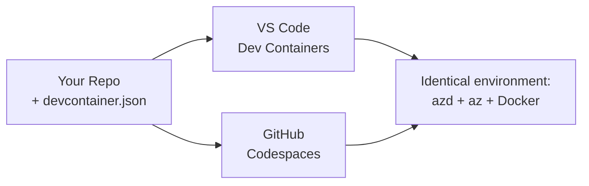

# azd க்கான டெவ் கண்டெய்னர்கள் மற்றும் GitHub Codespaces  

**அதிகார அத்தியாய வழிசெலுத்தல்:**  
- **📚 படிப்பு முகப்பு**: [ஆரம்பக்காரர்களுக்கான AZD](../../README.md)  
- **📖 தற்போதைய அத்தியாயம்**: அத்தியாயம் 1 - அடித்தளம் மற்றும் விரைவு துவக்கம்  
- **⬅️ முந்தையது**: [உங்கள் சொந்த பயன்பாட்டை கொண்டு வாருங்கள்](bring-your-own-app.md)  
- **🚀 அடுத்த அத்தியாயம்**: [அத்தியாயம் 2: AI முதன்மை வளர்ச்சி](../chapter-02-ai-development/README.md)  

> கட்டளை மற்றும் அமைப்பு மதிப்பாய்வு குறிக்கோள்: `azd 1.37.2` (நவம்பர் 2026). கண்டெய்னர் கட்டமைப்புகள் மற்றும் ஆசுர் நிறைவேற்றல்கள் இந்த மதிப்பாய்வின் பகுதியாக செயல்படுத்தப்படவில்லை.  

## அறிமுகம்  

azd, சரியான மொழி ரன்டைம், Docker மற்றும் Azure CLI-ஐ ஒவ்வொரு மெஷினிலும் நிறுவுவது ஒரு பணி – மேலும் "என் மெஷினில் வேலை செய்கிறது" என்ற ஒரு பாடம் மற்றொருவருக்கு தோல்வியடைய காரணமாகும். ஒரு **டெவ் கண்டெய்னர்** உங்கள் முழு கருவி சங்கிலியை ஒரு கோப்பில் விவரிப்பதன் மூலம் இதை தீர்க்கிறது. திட்டத்தை VS Code அல்லது GitHub Codespaces இல் திறக்கும் உடனே, azd முன்பே நிறுவப்பட்ட அதே சூழலை அனைவரும் பெறுவார்கள். இந்த பாடம் அதை எப்படி சேர்க்க வேண்டும் என்பதைக் காண்பிக்கிறது.  

## கற்றல் குறிக்கோள்கள்  

இந்த பாடம் முடிவுக்கு வரும் பொழுது, நீங்கள்:  
- டெவ் கண்டெய்னர் என்றால் என்ன மற்றும் அது azd உடன் எப்படி உதவுகிறது என்று புரிந்துகொள்வீர்கள்  
- ஒரு குறைந்தபட்ச `.devcontainer/devcontainer.json` ஒரு திட்டத்தில் சேர்க்கலாம்  
- Dev Container *அம்சங்கள்* மூலம் azd, Azure CLI மற்றும் Docker ஐ சேர்க்கவும்  
- GitHub Codespaces அல்லது VS Code இல் திட்டத்தைத் திறக்கவும்  

## கற்றல் முடிவுகள்  

இந்த பாடத்தை முடித்த பிறகு, நீங்கள்:  
- azd திட்டத்திற்கு `devcontainer.json` உருவாக்கலாம்  
- கையேடு நிறுவல்களின்றி azd மற்றும் Azure கருவிகள் சேர்க்கலாம்  
- கண்டெய்னர் அல்லது Codespace உள்ளே இருந்து `azd up` இயக்கலாம்  

---  

## டெவ் கண்டெய்னர்란 무엇인가?  

டெவ் கண்டெய்னர் என்பது உங்கள் ரெப்பாசிடரியில் உள்ள `.devcontainer/devcontainer.json` கோப்பால் வரையறுக்கப்பட்ட Docker அடிப்படையிலான வளர்ச்சி சூழல் ஆகும். நீங்கள் திட்டத்தை திறக்கும் பொழுது:  

- **VS Code** (Dev Containers நீட்சியுடன்) கண்டெய்னரை கட்டி அதனுடன் இணைகிறது.  
- **GitHub Codespaces** மேகத்தில் அதே கண்டெய்னரை கட்டி உங்களுக்கு உலாவி அடிப்படையிலான தொகுப்பிப்பாளரை வழங்குகிறது.  

இரண்டும், ஒவ்வொரு பங்களிப்பாளரும் ஒரே கருவிகள் கிடைக்கும் — "நீங்கள் azd நிறுவினீர்களா?" என்பதற்கான பிரச்சனைகள் இல்லை.  


  
---  

## படி 1: devcontainer கோப்பை உருவாக்கவும்  

உங்கள் திட்டத்தின் மூலம் முதலில் `.devcontainer/devcontainer.json` உருவாக்கவும்:  

```json
{
  "name": "azd-project",
  "image": "mcr.microsoft.com/devcontainers/base:bookworm",
  "features": {
    "ghcr.io/devcontainers/features/azure-cli:1": {},
    "ghcr.io/azure/azure-dev/azd:0": { "version": "1.37.2" },
    "ghcr.io/devcontainers/features/docker-in-docker:2": {},
    "ghcr.io/devcontainers/features/node:1": {}
  },
  "customizations": {
    "vscode": {
      "extensions": [
        "ms-azuretools.azure-dev",
        "ms-azuretools.vscode-bicep"
      ]
    }
  },
  "forwardPorts": [3000],
  "postCreateCommand": "azd version"
}
```
  
ஒவ்வொரு பகுதியும் என்ன செய்கிறது:  

| விசை | நோக்கம் |  
|-----|---------|  
| `image` | கண்டெய்னருக்கான அடிப்படை செயல்பாட்டு அமைப்பு |  
| `features` | முன் கட்டப்பட்ட நிறுவிகள் — இங்கே: Azure CLI, **azd**, Docker மற்றும் Node.js |  
| `customizations.vscode.extensions` | azd மற்றும் Bicep VS Code நீட்சிகளை தானாக நிறுவுகிறது |  
| `forwardPorts` | உங்கள் செயலியின் போர்ட்டை உலாவி முன்வரிசையில் வெளிப்படுத்துகிறது |  
| `postCreateCommand` | கண்டெய்னர் கட்டப்பட்ட பிறகு ஒருமுறை இயங்கும் (இங்கே, மனநிலை சரிபார்ப்பு) |  

> அம்ச பதிப்பு (`azd:0`) மற்றும் நிறுவப்பட்ட CLI பதிப்பு வேறுபடுகின்றன. CLI ஐ பூட்டி வைத்துக்கொள்ள, அம்சத்தின் `version` விருப்பத்தை `"1.37.2"` ஆக அமைக்கவும்; CLI பதிப்பை அம்ச குறியீட்டாக பயன்படுத்த வேண்டாம்.  

---  

## படி 2: உங்கள் செயலியின் மொழிக்கு அம்சத்தை பொருத்தவும்  

உங்கள் செயலி பயன்படுத்தும் மொழிக்கேற்றவாறு `node` அம்சத்தை மாற்றவும்:  

```jsonc
// Python project
"ghcr.io/devcontainers/features/python:1": {},

// .NET project
"ghcr.io/devcontainers/features/dotnet:2": {},

// Java project
"ghcr.io/devcontainers/features/java:1": {},

// Go project
"ghcr.io/devcontainers/features/go:1": {}
```
  
உள்ளூர் படிகளை கட்டும்போது `docker-in-docker` வைத்திருக்கவும். கட்டமைக்கப்பட்ட தொலைத்தரவு ACR கட்ட ( `docker.remoteBuild: true` ) மாற்றாக உள்ளது; ஹோஸ்ட் வகை தனியாக உள்ளூர் Docker ஐ எப்பொழுதும் தேவைப்படுத்தாது.  

---  

## படி 3: திறக்கவும்  

**VS Code இல்:**  
1. **Dev Containers** நீட்சியை நிறுவவும்.  
2. திட்ட கோப்புறையை திறக்கவும்.  
3. கேட்கப்படும் போது **Reopen in Container** கிளிக் செய்யவும் (அல்லது *Dev Containers: Reopen in Container* ஓட்டவும்).  

**GitHub Codespaces இல்:**  
1. ரெப்போவை GitHub-க்கு புஷ் செய்யவும்.  
2. **Code → Codespaces → Create codespace on main** கிளிக் செய்யவும்.  
3. கண்டெய்னர் கட்டும்வரை காத்திருக்கவும் — azd டெர்மினலில் தயாராக இருக்கும்.  

---  

## படி 4: கண்டெய்னர் உள்ளே இருந்து டிப்ளாய் செய்யவும்  

கண்டெய்னரில் azd முன்பே நிறுவப்பட்டுள்ளதால், சாதாரண பணிப் பணி நேரடியாக வேலை செய்கிறது:  

```bash
azd auth login --use-device-code   # device code is handy inside Codespaces
azd up
```
  
> **ஏன் `--use-device-code`?** தொலைக்காட்சி கண்டெய்னர் அல்லது Codespace-இல் உள்ளூர் உலாவி இல்லை, எனவே சாதனக் குறியீடு உள்நுழைவு நம்பகமான வழி. உள்நுழைவுக்கு ஒரு குறியீட்டை உலாவியின் தக்கவெட்டில் ஒட்டுவீர்கள்.  

---  

## பொதுவான குறைகள்  

| குறை | தீர்வு |  
|---------|-----|  
| `azd up` படத்தை கட்ட முடியவில்லை | `docker-in-docker` அம்சத்தை சேர்க்கவும் |  
| Codespaces இல் உலாவி உள்நுழைவு தடுமாறுகிறது | `azd auth login --use-device-code` பயன்படுத்தவும் |  
| குழு உறுப்பினர்களுக்கு கருவிகள் வேறுபடுகின்றன | azd அம்சத்தின் `version` விருப்பத்தின் மூலம் CLI ஐ பூட்டி, மொழி ரன்டைம்களையும் பூட்டவும் |  
| உலாவியில் செயலி அடையக்கூடிய இடம் இல்லை | போர்ட்டை `forwardPorts` சேர்க்கவும் |  

---  

## சுருக்கம்  

- ஒரு டெவ் கண்டெய்னர் உங்கள் azd கருவிச் சங்கிலியை அனைவருக்கும் மறுபிரசுரிக்க கூடியதாக ஆக்கும்.  
- Dev Container *அம்சங்கள்* மூலம் azd, Azure CLI மற்றும் Docker சேர்க்கவும்.  
- உங்கள் செயலி மொழிக்கு அம்சத்தை பொருத்தி, கண்டெய்னர் ஹோஸ்ட்களுக்கு `docker-in-docker` வைத்திருக்கவும்.  
- Codespaces இல் இயக்கும்போது சாதனக் குறியீடு உள்நுழைவைக் கையாளவும்.  

---  

## 🔗 வழிசெலுத்தல்  

| திசை | வளம் |  
|-----------|----------|  
| **முந்தையது** | [உங்கள் சொந்த பயன்பாட்டை கொண்டு வாருங்கள்](bring-your-own-app.md) |  
| **அத்தியாய முகப்பு** | [அத்தியாயம் 1: அடித்தளம் மற்றும் விரைவு துவக்கம்](README.md) |  
| **அடுத்த அத்தியாயம்** | [அத்தியாயம் 2: AI முதன்மை வளர்ச்சி](../chapter-02-ai-development/README.md) |  

## 📖 தொடர்புடைய வளங்கள்  

- [நிறுவல் மற்றும் அமைப்பு](installation.md)  
- [கட்டளை குறிப்பு பட்டியல்](../../resources/cheat-sheet.md)  
- [அதிகார Dev Containers வரையறை](https://containers.dev/)  
- [azd Dev Container அம்சம்](https://github.com/Azure/azure-dev/tree/main/ext/devcontainer)  

---

<!-- CO-OP TRANSLATOR DISCLAIMER START -->
**மறுப்பு**:
இந்த ஆவணம் AI மொழிபெயர்ப்பு சேவை [Co-op Translator](https://github.com/Azure/co-op-translator) பயன்படுத்தி மொழிபெயர்க்கப்பட்டுள்ளது. நாங்கள் துல்லியத்திற்காக முயற்சி செய்துள்ளோம், ஆனால் தானாக செய்யப்படும் மொழிபெயர்ப்புகளில் பிழைகள் அல்லது தவறுகள் இருக்கலாம் என்பதை கவனத்தில் கொள்ளவும். அசல் ஆவணம் அதன் தாய்மொழியில் அதிகாரப்பூர்வ ஆதாரமாக கருதப்பட வேண்டும். முக்கியமான தகவல்களுக்கு, தொழில்நுட்பமான மனித மொழிபெயர்ப்பு பரிந்துரைக்கப்படுகிறது. இந்த மொழிபெயர்ப்பைப் பயன்படுத்துவதால் ஏற்படும் எந்த தவறான புரிதல்கள் அல்லது தவறான விளக்கத்திற்கும் நாங்கள் பொறுப்பில்வில்லை.
<!-- CO-OP TRANSLATOR DISCLAIMER END -->