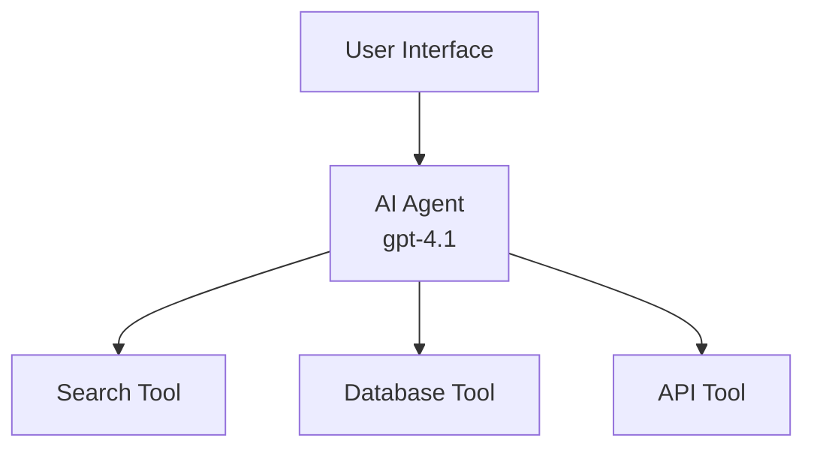
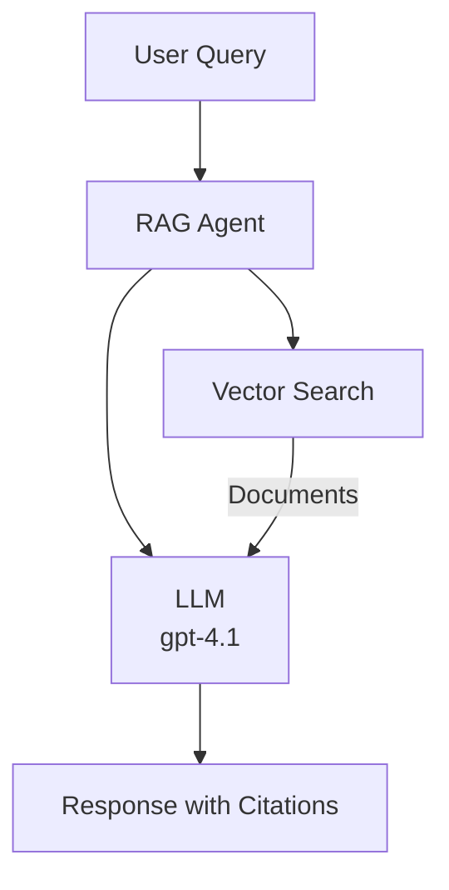
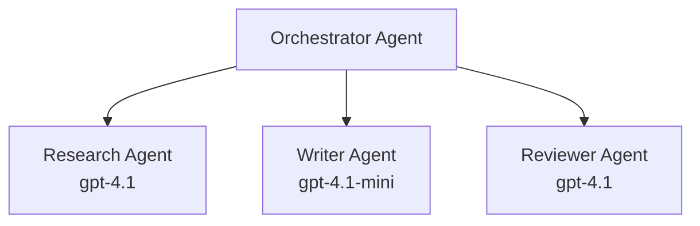

# Azure Developer CLI உடன் AI முகவர்கள்

**நூல் பரிசீலனை:**
- **📚 பாடநெறி முகப்பு**: [AZD தொடக்கக்காரர்களுக்காக](../../README.md)
- **📖 தற்போதைய அத்தியாயம்**: அத்தியாயம் 2 - AI முதலான மேம்பாடு
- **⬅️ முந்தைய**: [Microsoft Foundry ஒருங்கிணைப்பு](microsoft-foundry-integration.md)
- **➡️ அடுத்தது**: [AI மாதிரி நிலைபேறாக்கம்](ai-model-deployment.md)
- **🚀 மேம்பட்டது**: [பல முகவர் தீர்வுகள்](../../examples/retail-scenario.md)

---

## அறிமுகம்

AI முகவர்கள் தங்களின் சூழலை அறிந்து, முடிவுகள் எடுத்து, குறிப்பிட்ட இலக்குகளை அடைவதற்கு நடவடிக்கைகள் எடுக்கக்கூடிய சுயாதீன நிகழ்ச்சித் திட்டங்கள் ஆகும். கேள்விக்குப் பதிலளிப்பதிலிருந்து வெறுமனே செயல்படும் சாத்தியமான சாதாரண சாட்போட்டுகளுக்கு மாறாக, முகவர்கள்:

- **கருவிகளை பயன்படுத்தவும்** - APIகளை அழைக்க, தரவுத்தளங்களை தேட, குறியீட்டை நிறைவேற்றவும்
- **திட்டமிடவும், கருதவும்** - சிக்கலான பணிகளை நிலைகளாக உடைக்கவும்
- **அர்த்தத்தை அறிந்து கற்கவும்** - நினைவாற்றலை பராமரித்து, நடத்தையை பொருந்துமாறு மாற்றவும்
- **கூடமைந்து செயல்படவும்** - மற்ற முகவர்களுடன் பணியாற்றவும் (பல முகவர் அமைப்புகள்)

இந்த வழிகாட்டி உங்களுக்கு Azure Developer CLI (azd) பயன்படுத்தி Azure இல் AI முகவர்களை நிலைபேறாக்குவது எப்படி என்பதை காட்டு.

உரையாடல் அர்த்தத்தைப் பயன்படுத்துவது மாதிரித்திறனுக் கற்றல் அல்ல: நிரந்தர நினைவு, அணுகல் கட்டுப்பாடு மற்றும் கைமுறை நிலைத்திருத்தம் பயன்பாட்டால் நடைமுறைப்படுத்தப்பட வேண்டும் / அமைக்கப்பட வேண்டும்.

> **Foundry GA புதுப்பிப்பு (2026-11-09):** பொதுவாக கிடைக்கும் `microsoft.foundry` 1.0 தொகுப்பை `azd >= 1.37.0` கொண்டு நிறுவவும். மதிப்பீடுகள் தனியாக நிறுவப்படுகின்றன; விருப்ப முன்னோட்ட அம்சங்களும் கீழே உள்ள பாரம்பரிய SDK துண்டும் தொகுப்பு அறிவிப்பால் GAக்கு முன்னோக்கி எடுத்து செல்லப்படவில்லை. இந்த வழிகாட்டி [GA அறிவிப்பு](https://devblogs.microsoft.com/azure-sdk/microsoft-foundry-azure-developer-cli-ga/) மற்றும் ஆவணங்களைப் பொருந்தியது, நேரடி Azure நிலைபேறாக்கம் அல்ல.

## கற்றல் நோக்கங்கள்

இந்த வழிகாட்டியை முடித்தவுடன், நீங்கள்:
- AI முகவர்கள் என்ன மற்றும் சாட்போட்டுகளிலிருந்து அவர்கள் எப்படி வேறுபடுகிறார்கள் என்பதை புரிந்துக்கொள்ளவும்
- AZD மூலம் முன்கூட்டியே கட்டப்பட்ட AI முகவர் வார்ப்புருக்களை நிலைபேறாக்கவும்
- தனிப்பட்ட முகவர்கள் க்காக Foundry முகவர்களை ஒழுங்கமைக்கவும்
- அடிப்படையான முகவர் மாதிரிகளை (கருவி பயன்பாடு, RAG, பல முகவர்) செயல்படுத்தவும்
- நிலைபேறாக்கப்பட்ட முகவர்களை கண்காணிக்கவும் மற்றும் பிழையனுப்பவும்

## கற்றல் முடிவுகள்

முடித்த பிறகு, நீங்கள் செய்ய முடியும்:
- ஒரே கட்டளையுடன் AI முகவர் பயன்பாடுகளை Azure இல் நிலைபேறாக்கவும்
- முகவர் கருவிகள் மற்றும் திறன்களை ஒழுங்கமைக்கவும்
- முகவர்களுடன் பெறல்-வழங்கப்பட்ட உருவாக்கத்தை (RAG) செயல்படுத்தவும்
- சிக்கலான பணித் தொடர்களுக்கு பல முகவர் கலைவழக்கங்களை வடிவமைக்கவும்
- பொதுவான முகவர் நிலைபேறாக்கப் பிரச்சினைகளை தீர்க்கவும்

---

## 🤖 ஒரு AI முகவர் சாட்போட்டிலிருந்து வேறுபடுவதன் காரணம் என்ன?

| அம்சம் | சாட்போட் | AI முகவர் |
|---------|---------|----------|
| **நடத்தை** | கேள்விகளுக்கு பதிலளிக்கும் | சுயாதீனமான நடவடிக்கைகள் எடுக்கும் |
| **கருவிகள்** | பெறல் அல்லது கருவிகளை பயன்படுத்தும் வாய்ப்பு | இலக்காக விளங்கும் சுற்றிலுள்ள கருவிகளைக் பயன்படுத்துகிறது |
| **நினைவகம்** | பயன்பாட்டினால் சார்ந்தது | தெளிவாக செயல்படுத்தப்படின் மட்டும் நிரந்தர நினைவகம் |
| **திட்டமிடுதல்** | ஒரே பதில் | பல நிலை கருதுகோள் |
| **கூடமைதி** | ஒரே அலகு | மற்ற முகவர்களுடன் கூடி வேலை செய்யும் |

### எளிய ஒப்புமை

- **சாட்போட்** = தகவல் மேசையில் கேள்விகளுக்கு பதிலளிக்கும் உதவியாளர்
- **AI முகவர்** = அழைப்புகளை செய்து, நியமனங்களை ஒழுங்கமைத்து, பணி நடத்தும் தனிப்பட்ட உதவியாளர்

---

## 🚀 விரைவான துவக்கம்: உங்கள் முதல் முகவரையும் நிலைபேறாக்குக

ஒரு **புதிய காலி வேலை அடைவு** இல் ஒரு விருப்பத்தைத் தெரிவு செய்யவும். பின்னிலையிலுள்ள `.` அங்கு துவங்கி செயல்படுகிறது; தெளிவான இடம் குறிப்பிடப்படாமல் இருந்தால், தற்போதைய AZD ஒரு மாதிரி பெயர் கொண்ட துணை அடைவைக் உருவாக்கலாம் மற்றும் உங்கள் ஷெல்லின் அடைவைக் மாற்றாது. தனித்த தனித்த மாதிரிகள்/சுற்றுப்புறங்களை தனித்த அடைவுகளிலேயே வைத்திருங்கள்.

கீழ்க்காணும் நேரம்/செலவு வரம்புகள் விளக்கமாக உள்ளன, சரிபார்க்கப்பட்ட மேற்கோள்கள் அல்ல. டெப்பிளாய்மென்ட் செய்வதற்கு முன் ஒவ்வொரு மாதிரியின் தற்போதைய தேவைகள், விலை, மாதிரித் தொகுதி மற்றும் விருப்ப சேவைகளை சரிபார்க்கவும்.

### விருப்பம் 1: ஃபௌன்ட்ரி ஏஜெண்ட்ஸ் டெம்ப்ளேட் (பரிந்துரைக்கப்பட்டது)

```bash
# Initialize the AI agents template
azd init --template get-started-with-ai-agents .

# Deploy to Azure
azd up
```

**என்ன நடக்கிறது:** மாதிரியை, கருவிகளை, ஹோஸ்டிங் மற்றும் கண்காணிப்பு வளங்களை தற்போதைய மாதிரியின் கட்டமைப்பு மற்றும் தேர்ந்தெடுக்கப்பட்ட விருப்பங்கள் குறிக்கின்றன. அதைப் பராமரிப்பதற்கு முன் அதன் README மற்றும் `infra/` ஐப் பரிசீலிக்கவும்; எல்லா முகவர் வார்ப்புருவும் Search அல்லது ஒரு வலை இடைமுகத்தை உள்ளடக்குகிறது என்று கருத வேண்டாம்.

**நேரம்:** ~15-20 நிமிடங்கள்
**செலவு:** ~$100-150/மாதம் (வளர்)

### விருப்பம் 2: Prompty உடன் படைப்பாற்றல் எழுதும் முகவர்கள்

```bash
# Initialize the Prompty-based agent template
azd init --template https://github.com/Azure-Samples/contoso-creative-writer .

# Deploy to Azure
azd up
```

**என்ன வெளியிடப்படுகிறது:** Azure OpenAI, Bing Grounding மற்றும் Azure AI Search பயன்படுத்தி FastAPI/Prompty பல-ஏஜன்ட் எழுத்து உதாரணம். முந்தைய `agent-openai-python-prompty` காப்பகம் இங்கே.redirect ஆகும்; இது குறைந்தபட்ச Azure Functions வானிலை-ஏஜன்ட் மாதிரி அல்ல. ஹோஸ்டிங், மாதிரி கொட்டா மற்றும் Bing Grounding சிறுபிரிவுகளுக்கு அதன் தற்போதைய README ஐ பின்பற்றவும்.

**நேரம்:** ~10-15 நிமிடங்கள்
**செலவு:** ~$50-100/மாதம் (உருவாக்குதல்)

### விருப்பம் 3: RAG செட் ஏஜன்ட்

```bash
# Initialize RAG chat template
azd init --template azure-search-openai-demo .

# Deploy to Azure
azd up
```

**என்ன வெளியிடப்படுகிறது:**
- ✅ Microsoft Foundry மாதிரிகள்
- ✅ மாதிரி தரவுடன் Azure AI Search
- ✅ ஆவணம் செயலாக்க குழாய்
- ✅ மேற்கோள்களுடன் உரையாடல் இடையீடு

**நேரம்:** ~15-25 நிமிடங்கள்
**மூலம்:** ~$80-150/மாதம் (வளரும்)

### விருப்பம் 4: GA Foundry தொகுப்புடன் நடுநிலை முகவர்

அடிப்படை Python முகவர் Framework Responses API மாதிரிக்கான [முழுமையான நடுநிலை-முகவர் நடைமுறை](microsoft-foundry-integration.md#hosted-agent-walkthrough-ga) பயன்படுத்துங்கள். இந்த குறியிட்டு வெளியீட்டு பாதை Python 3.13+, தற்போதைய uv, Foundry அனுமதிகள் மற்றும் பிராந்திய மாதிரி இலவச அடிப்படையைத் தேவைப்படுத்துகிறது. Azure CLI அனுமதிகளைக் பயன்படுத்தும் போது உள்ளூர் SDK அழைப்புகளுக்கு தனித்தனியான அங்கீகாரத்தை வழங்குங்கள்.

```bash
azd auth login
azd ext install microsoft.foundry
```

காலியாக உள்ள அடைவில், மாதிரியை துவங்குங்கள்:

```text
azd ai agent init --template https://github.com/microsoft-foundry/foundry-samples/blob/main/samples/python/hosted-agents/agent-framework/responses/01-basic/azure.yaml --deploy-mode code --src .
```

புதியதாயோ அல்லது ஏற்கனவே இருப்பதாயோ ஒரு திட்டத்தை தேர்ந்தெடுத்து, `azure.yaml` ஐ எல்லித்து, `azd provision` ஐ இயக்குங்கள். முகவர் ஆய்வாளரைத் திறக்க `azd ai agent run` ஐப் பயன்படுத்தி, அடுத்ததொரு இனிய அடைவில் இருந்து `azd ai agent invoke --local "Explain how this agent is hosted."` ஐ இயக்குங்கள். உள்ளூர் சரிபார்ப்புக்குப்பின்பு, வெளியிடப்பட்ட பதில்களை ஒப்பிட `azd deploy` மற்றும் `azd ai agent invoke "Explain how this agent is hosted."` ஐப் பயன்படுத்துங்கள். Foundry பதிவேற்றிய மூலத்தை தொலைவில் கட்டமைக்கிறது; உள்ளூர் கடவை கட்டமைப்பு அவசியமில்லை.

**எப்போது `azd ai agent init` ஐ பயன்படுத்துவது மற்றும் எப்போது `azd init --template` என்பதைப் பற்றி:**

| முறை | சிறந்தது | அது எப்படி வேலை செய்கிறது |
|----------|----------|------|
| `azd init --template` | ஒரு இயங்கும் மாதிரி பயன்பாட்டைத் தொடங்குவதற்கு | நிரல் மற்றும் அடியமைப்பு கொண்ட முழு மாதிரி ரெப்போவை நகலெடுக்கிறது |
| `azd ai agent init --template` | தற்போதைய Foundry முகவர் திட்டத்தை ஏற்க | ஒரு `azure.yaml` திட்ட ஆவணம் மற்றும் அதன் வரையறைகளை பயன்படுத்துகிறது |

> **உதவிக்குறிப்பு:** விருப்பங்கள் 1-3 முழு செயலி வார்ப்புருக்களிலிருந்து துவங்குகின்றன; விருப்பம் 4 GA ஆகிட்-ஏஜென்ட் வேலைப்பாட்டை கற்பிக்கிறது. எந்த ஆரம்பத்துக் கட்டளையும் பழைய ஏஜென்டு விளக்கங்களைக் தானாக மாற்றுவதில்லை. ஒரு நேரடி ஏஜென்ட் வரையறையை ஏற்கனவே உள்ள திட்டத்தில் சேர்க்க, [துவக்கமும் மாற்றும் வழிகாட்டுதலும்](../chapter-08-production/production-ai-practices.md#initializing-agent-projects-with-azd-ai-agent-init) பாருங்கள்.

தனியாக `azure.ai.evaluations` ஐ நிறுவி தேர்வு தரவுகள்/அளவுகோல்கள் உருவாக்கவும், மதிப்பீட்டை கட்டமைக்கவும், மற்றும் `azd ai eval` ஐ பயன்படுத்தி இயக்கவும். ஓர் ஒத்துப்போகும் மதிப்பீட்டை மீண்டும் பயன்படுத்தி சிறப்பிக்கலாம்; ஒன்றை தெளிவாகும் முறையில் பயன்படுத்துவதற்கு முன் претендент்களை பரிசீலிக்கவும். பழைய எடுத்துக்காட்டுகளை மீண்டும் பயன்படுத்துவதற்கு முன் [மதிப்பீட்டு பணிமுறை](../chapter-08-production/production-ai-practices.md#evaluation-migration-and-quality-checks) மற்றும் [சீரமைப்பு இடமாற்றம்](../chapter-08-production/production-ai-practices.md#optimization-configuration-migration) ஐ பின்பற்றவும். சுத்தம் செய்ய, மீண்டும் பயன்படுத்தப்பட்ட Foundry திட்டத்தின் வளங்கள் `azd down`க்குப் பிறகு மீண்டும் நிலை படுத்தப்படுகின்றன; புதியதாக உருவாக்கப்பட்ட திட்டத்தின் வள குழு நீக்கப்படுகிறது. [நடத்தை சுத்தம் செய்தல் வழிகாட்டி](microsoft-foundry-integration.md#7-clean-up-deliberately) ஐ பார்க்கவும்.

---

## 🏗️ முகவர் கட்டமைப்பு வடிவங்கள்

### வடிவம் 1: கருவிகள் கொண்ட ஒரே முகவர்

மிக எளிய முகவர் வடிவம் - பல கருவிகளை பயன்படுத்தக்கூடிய ஒரே முகவர்.



**உத்தமம்:**
- வாடிக்கையாளர் ஆதரவு பாக்கிகள்
- ஆய்வு உதவியாளர்கள்
- தரவு பகுப்பாய்வு முகவர்கள்

**உருவாக்கப்பட்ட பயன்பாட்டு மாதிரி:** `azure-search-openai-demo` பொதுவான சீரற்ற கருவி முகவர் சுற்றை அல்ல, RAG ஐ காண்பிக்கிறது.

### வடிவம் 2: RAG முகவர் (பெறுதல்-மேம்படுத்தப்பட்ட உருவாக்கம்)

பதில்களை உருவாக்குவதற்கு முன்பு தொடர்புடைய ஆவணங்களைப் பெறும் ஒரு முகவர்.



**சிறந்தது:**
- நிறுவன அறிவு ஆதாரங்கள்
- ஆவண கேள்வி & பதில் அமைப்புகள்
- अनुपालन மற்றும் சட்ட ஆராய்ச்சி

**AZD வார்ப்புரு:** `azure-search-openai-demo`

### முறை 3: பன்முக முகவர் அமைப்பு

பல விசேஷப்படுத்தப்பட்ட முகவர்கள் கூட்டு முயற்சியில் சிக்கலான பணிகளை செய்யும்.



**சிறந்தது:**
- சிக்கலான உள்ளடக்க உருவாக்கம்
- பல படி பணியமைப்புகள்
- வெவ்வேறு நிபுணத்துவம் தேவைப்படும் பணிகள்

**மேலும் அறிய:** [பன்முக முகவர் ஒத்துழைப்பு முறைமைகள்](../chapter-06-pre-deployment/coordination-patterns.md)

---

## ⚙️ முகவர் கருவிகள் கட்டமைக்குதல்

முகவர்கள் கருவிகளை பயன்படுத்தும் போது சக்திவாய்ந்தவராகிறார்கள். பொதுவான கருவிகளை எவ்வாறு கட்டமைப்பது என்பத Here's உள்ளது:

### Foundry முகவர்களில் கருவி கட்டமைப்பு

இந்த **பாரம்பரிய ஏஜెంట్ சேவை SDK துணுக்கினை** `azure-ai-projects==1.0.0` மற்றும் `azure-ai-agents==1.1.0` உடன் `azure-identity` நோக்கமாகக் கொண்டுள்ளது. இது சில தற்போதைய Foundry வடிவமைப்புகள் பயன்படுத்தும் புதிய பதிப்பு ஏஜென்ட்/Responses API அல்ல, மறுபடியும் `azure.ai.agents` AZD நீட்சிப்பாகும் (வேறுபட்ட தொகுப்பு). இந்த API தலைமுறைகளை கலப்பது தவிர்க்கவும். `PROJECT_ENDPOINT` ஐ பாரம்பரிய Foundry திட்ட முடுக்கமான இடத்துக்காகவும், `MODEL_DEPLOYMENT_NAME` ஐ ஏற்கனவே ஆதரவு கிடைக்கும் மாதிரி ஒப்படைப்புக்கு அமைக்கவும்; உள்ளூர் முறையில் `az login` உடன் அங்கீகாரம் செய்யவும் மற்றும் தேவையான திட்ட அனுமதிகளை வழங்கவும்.

```python
# agent_config.py
import os
from azure.ai.projects import AIProjectClient
from azure.ai.agents.models import FunctionTool
from azure.identity import DefaultAzureCredential

def search_knowledge_base(query: str) -> str:
    """Search the demonstration knowledge base.

    :param query: Search text.
    :return: Matching demonstration information.
    """
    # Local fixture only, not a production search implementation.
    return "Demo policy: returns are accepted within 30 days."

project_client = AIProjectClient(
    endpoint=os.environ["PROJECT_ENDPOINT"],
    credential=DefaultAzureCredential(),
)
search_tool = FunctionTool(functions={search_knowledge_base})
project_client.agents.enable_auto_function_calls(search_tool)
agent = project_client.agents.create_agent(
    model=os.environ["MODEL_DEPLOYMENT_NAME"],
    name="Support Agent",
    instructions="Use search_knowledge_base for policy questions. Label results as demo data.",
    tools=search_tool.definitions,
)
```

ஒரு செயல்பாடு வடிவமைப்பை பதிவு செய்வதால் சேவையில் Python இயக்கப்படாது. இந்த SDK இல், `enable_auto_function_calls` மற்றும் `agents.runs.create_and_process(...)` இணைந்து பதிவு செய்யப்பட்ட கால்பேக்குகளை உங்கள் கிளையண்ட் செயலியில் இயக்குகின்றன. [இடையிடுகூடிய SDK எடுத்துக்காட்டு](https://github.com/Azure/azure-sdk-for-python/blob/azure-ai-agents_1.1.0/sdk/ai/azure-ai-agents/samples/agents_tools/sample_agents_auto_function_call.py) ஐ காணவும். முடிந்தவுடன் கிளையண்டை மூடவும் மற்றும் டெமோ ஏஜெண்ட்/துறைகளைக் கண்டு தொடங்கவும்.

### சூழல் அமைப்புகள்

கீழ்க்காணும் பெயர்களும் **காட்சிப் தனிப்பயன் வடிவமைப்பு உள்ளீடுகளும்**, கட்டமைக்கப்பட்ட AZD மாற்றி வழிகளும் அல்ல. முதலில் ஒவ்வொன்றும் `infra/main.parameters.json`, போன்ற உள்கட்டமைப்பு மற்றும் பயன்பாடு குறியீட்டின் வழியாக மையப்படுத்தவும். `azd env set` தனக்கே ஒரு ஏஜெண்டின் கருவிகள் அல்லது வழிகாட்டிகள் மாற்றப்படாது.

```bash
# Set up agent-specific environment variables
azd env set AZURE_OPENAI_MODEL "gpt-4.1"
azd env set AGENT_INSTRUCTIONS "You are a helpful assistant..."
azd env set ENABLE_CODE_INTERPRETER "true"
azd env set ENABLE_FILE_SEARCH "true"

# Apply wired infrastructure and application changes
azd up
```

---

## 📊 கண்காணிப்பு ஏஜெண்டுகள்

### பயன்பாட்டு அறிவுக் குறிப்புகளுடன் ஒருங்கிணைவு

நீங்கள் தேர்ந்தெடுத்த வடிவமைப்பு பயன்பாட்டு அறிவுக் குறிப்புகளை ஏற்படுத்தி கருவி பொருத்தலை அமைக்கும் என்பதை காண:

```bash
# Open monitoring dashboard
azd monitor --overview

# Open the Application Insights logs view (not a streaming log tail)
azd monitor --logs

# View live metrics
azd monitor --live
```

### பின்தொடர வேண்டிய முக்கிய அளவுகோல்கள்

| அளவுகோல் | விளக்கம் | இலக்கு |
|--------|-------------|--------|
| பதில் தாமதம் | பதிலை உருவாக்கும் நேரம் | < 5 வினாடிகள் |
| டோக்கன் பயன்பாடு | கோரிக்கைக்கு டோக்கன்கள் | செலவுக்காக கண்காணிக்கவும் |
| கருவி அழைப்பு வெற்றிகரமாக நடந்த அளவு | வெற்றிகரமாக செயல்பட்ட கருவி செயல்பாடுகளின் % | > 95% |
| பிழை வீதம் | தோல்வியடைந்த முகவர் கோரிக்கைகள் | < 1% |
| பயனர் திருப்தி | கருத்து மதிப்பெண்கள் | > 4.0/5.0 |

### முகவர்களுக்கான தனிப்பயன் பதிவு

```python
import os
from azure.monitor.opentelemetry import configure_azure_monitor
from opentelemetry import trace

# Configure Azure Monitor with OpenTelemetry
configure_azure_monitor(
    connection_string=os.environ["APPLICATIONINSIGHTS_CONNECTION_STRING"]
)

tracer = trace.get_tracer(__name__)

def log_agent_interaction(user_query, agent_response, tools_used, latency_ms):
    with tracer.start_as_current_span("agent_interaction") as span:
        span.set_attributes({
            "query_length": len(user_query),  # Do not log raw prompts or personal data
            "response_length": len(agent_response),
            "tools_used": tools_used,
            "latency_ms": latency_ms
        })
```

> **குறிப்பு:** தேவைப்படும் தொகுப்பை நிறுவவும்: `pip install azure-monitor-opentelemetry`. இது OpenTelemetry சார்புகளை கொண்டுவருகிறது; `opentelemetry` என்ற தொகுப்பை நிறுவும் மாற்றுத் பெயர் தேவையில்லை.

---

## 💰 செலவு கருத்துக்கள்

### மாதாந்திர செலவுகளை வடிவமைப்பியல் மூலம் கணக்கிடல்

இவை எடுத்துக்காட்டு திட்டமிடும் வரம்புகள், மேற்கோள்கள் அல்லது செலவுக் கடைகளாக இல்லை. பகுதி, மாதிரி டோக்கன்கள், தேடல்/கணினி SKUகள், கருவி அமர்வுகள், சேமிப்பு, மற்றும் போக்குவரத்து இதற்கும் மேல் இருக்க முடியும். உதாரணத்தின் செலவு வழிகாட்டி மற்றும் Azure விலைப்பட்டியலை `azd up` முன் சரிபார்க்கவும்.

| வடிவமைப்பு | மேம்பாட்டு சூழல் | உற்பத்தி |
|---------|-----------------|------------|
| ஒரே முகவர் | $50-100 | $200-500 |
| RAG முகவர் | $80-150 | $300-800 |
| பன்முகவர் (2-3 முகவர்கள்) | $150-300 | $500-1,500 |
| நிறுவன பன்முகவர் | $300-500 | $1,500-5,000+ |

### செலவு விருத்தி குறிப்பு

1. **எளிய பணிகளுக்கு gpt-4.1-mini பயன்படுத்தவும்** (உங்கள் வார்ப்புரு இந்த உள்ளீட்டை பயன்படுத்தினால் மட்டுமே)
   ```bash
   azd env set AZURE_OPENAI_MODEL "gpt-4.1-mini"
   ```

2. **சுத்தமான மற்றும் மறு கேள்விகளுக்கான வரம்பு நிலையாக்கத்தை நடைமுறைப்படுத்தவும்.** வாடிக்கையாளர்/பயனர் அங்கீகாரம், மாதிரி நிறுவல், அறிவுறுத்தல்கள் மற்றும் பெற்று மதிப்பின் பதிப்பை பதிவேட்டுச் சாவியில் சேர்க்கவும்; காலாவதியாக்கவும். தனிப்பட்ட உரையாடல் பதில்களை செயல்முறை பரப்பு கேள்வி மட்டுமே கொண்ட பதிவேட்டுடன் பகிர வேண்டாம். SDK முகவர் பொருள் பொதுவான `agent.run()` முறையைக் கொண்டிராதது.

3. **ஒவ்வொரு இயக்கத்திற்கும் டோக்கன் வரம்புகளை அமைக்கவும்**
   ```python
   # Set max_completion_tokens when running the agent, not during creation
   run = project_client.agents.runs.create_and_process(
       thread_id=thread.id,
       agent_id=agent.id,
       max_completion_tokens=1000  # Budget across the run; may finish as incomplete
   )
   ```

4. **பயன்பாட்டில் இல்லாத நேரத்தில் தகுதியான Container Apps ஐ பூஜ்ஜியமாக ஆக்கவும்**
   ```bash
   # Custom-template input: must map to template.scale.minReplicas
   azd env set MIN_REPLICAS "0"
   ```
   கட்டமைப்பு மாற்றத்தை `azd provision` அல்லது `azd up` மூலம் நடைமுறைப்படுத்தவும். பூஜ்ஜியமாக்கல் தேவையான தூண்டுதலுடன் செய்ய வேண்டும் மற்றும் தேடல், சேமிப்பு அல்லது மாதிரி/கருவி கட்டணங்களை நிறுத்தாது.

---

## 🔧 முகவர்களை பிழைத்திருக்க செய்ய உதவிகள்

### பொதுவான பிரச்சினைகள் மற்றும் தீர்வுகள்

<details>
<summary><strong>❌ கருவி அழைப்புகளுக்கு முகவர் பதிலளிக்கவில்லை</strong></summary>

```bash
# Inspect the application deployment (not the agent's registered tools)
azd show

# Verify OpenAI deployment
az cognitiveservices account deployment list \
  --name $AZURE_OPENAI_NAME \
  --resource-group $RG_NAME

# Check agent logs
azd monitor --logs
```

**பொதுவான காரணங்கள்:**
- கருவி செயல்பாட்டு கையேடு பொருந்தவில்லை
- அவசியமான அனுமதிகள் இல்லாமை
- API இடைமுகம் அணுக முடியவில்லை
</details>

<details>
<summary><strong>❌ முகவரின் பதில்கள் மிக உயர்ந்த தாமதம்</strong></summary>

```bash
# Check Application Insights for bottlenecks
azd monitor --live

# Consider using a faster model
azd env set AZURE_OPENAI_MODEL "gpt-4.1-mini"
azd up
```

**விருத்தி குறிப்புகள்:**
- ஸ்ட்ரீமிங் பதில்களைப் பயன்படுத்தவும்
- பதில் பதிவுசெய்யலை நடைமுறைப்படுத்தவும்
- உள்ளடக்க சாளர அளவை குறைக்கவும்
</details>

<details>
<summary><strong>❌ முகவர் தவறான அல்லது மாயப்பொருள் தகவலை வழங்குகிறான்</strong></summary>

```python
# Improve with better system prompts
instructions = """
You are a helpful assistant. IMPORTANT:
- Only answer based on provided context
- If you don't know, say "I don't know"
- Always cite your sources
- Never make up information
"""

# Use these instructions in the agent definition.
# For classic file search, first upload/index documents in a vector store,
# then use FileSearchTool(vector_store_ids=[...]) and pass both its
# .definitions and .resources when creating the agent.
```
அறிவுறுத்தல்கள் மற்றும் பெறுதல் ஆபத்துக்களை குறைக்கிறது; எவை உண்மையான பதில்களை உறுதி செய்யாது. நிலையான மற்றும் எல்லை மீறிய கேள்விகளை அறிந்த பதில்களை எதிரொலிக்கவும்.
</details>

<details>
<summary><strong>❌ டோக்கன் வரம்பு மீறல் பிழைகள்</strong></summary>

```python
# Implement context window management
def truncate_context(messages, max_tokens=8000, model="gpt-4.1"):
    """Approximate content-only budget for objects with .content strings."""
    import tiktoken
    encoding = tiktoken.encoding_for_model(model)
    total_tokens = 0
    truncated = []
    
    for msg in reversed(messages):
        msg_tokens = len(encoding.encode(msg.content))
        if total_tokens + msg_tokens > max_tokens:
            break
        truncated.insert(0, msg)
        total_tokens += msg_tokens
    
    return truncated
```
இந்த உதவியாளர் வேட்பு/கருவி ஸ்கீமாக்கள், அமைப்பு அறிவுறுத்தல்கள், படக்குறிகள், மற்றும் புரோடோகால் மேலதிகம் ஆகியவற்றை தவிர்க்கின்றது. அவற்றுக்கும் நிரப்புதலுக்கும் இடம் ஒதுக்கி வைக்கவும்; கருவி-அழைப்பு/முடிவு ஜோடிகளை பிரிக்கவேண்டாம் அல்லது தேவையான அமைப்பு அறிவுறுத்தல்களை நீக்கக்கூடாது. `tiktoken` ஐ தனியாக நிறுவவும். இது பொதுவான காட்சிப் பான சந்தைப்படுத்தியாளராக இல்லை.
</details>

---

## 🎓 கைச்சிறப்புப் பயிற்சிகள்

### பயிற்சி 1: அடிப்படைக் முகவரியை வழிமொழி (20 நிமிடங்கள்)

**நோக்கம்:** AZD பயன்படுத்தி உங்கள் முதல் AI முகவரியை வடிவமைக்கவும்

```bash
# Step 1: Initialize template
azd init --template get-started-with-ai-agents .

# Step 2: Login to Azure
azd auth login
# If you work across tenants, add --tenant-id <tenant-id>

# Step 3: Deploy
azd up

# Step 4: Test the agent
# Expected output after deployment:
#   Deployment Complete!
#   Endpoint: https://<app-name>.<region>.azurecontainerapps.io
# Open the URL shown in the output and try asking a question

# Step 5: View monitoring
azd monitor --overview

# Step 6: Review the listed resources and confirm cleanup
azd down
```

**வெற்றி அளவுகோல்கள்:**
- [ ] முகவர்கள் கேள்விகளுக்கு பதிலளிக்கின்றனர்
- [ ] `azd monitor` மூலம் கண்காணிப்பு கட்டமைப்பை அணுக முடியும்
- [ ] வளங்கள் வெற்றிகரமாக தூய்மைப்படுத்தப்பட்டன

### பயிற்சி 2: தனிப்பயன் கருவி சேர்க்க (30 நிமிடங்கள்)

**நோக்கம்:** முகவரை தனிப்பயன் கருவியுடன் விரிவாக்கவும்

**தொடக்க நிலை:** வேறு SDK தலைமுறை கொண்ட எந்தவொரு மாதிரியையும் பயன்படுத்தாமல் [கருவி கட்டமைப்பு](#tool-configuration-in-foundry-agents) மூலம் பாரம்பரிய SDK கிளையண்டைப் பயன்படுத்தவும்.

1. இந்த நிரந்தரமான செட்டைப் `agent_config.py`-க்கு சேர்க்கவும்:
   ```python
   def get_weather(location: str) -> str:
       """Return demonstration weather, not live conditions.

       :param location: City name.
       :return: A clearly labelled fixture.
       """
       print(f"TOOL_CALLED: {location}")
       return f"Demo weather in {location}: Sunny, 72°F (fixture, not live)"
   ```
2. தேடல்-கருவி பதிவுசெய்தல் மற்றும் உருவாக்க பிரிவை இதனால் மாற்றவும்:
   ```python
   weather_tool = FunctionTool(functions={get_weather})
   project_client.agents.enable_auto_function_calls(weather_tool)
   agent = project_client.agents.create_agent(
       model=os.environ["MODEL_DEPLOYMENT_NAME"],
       name="Weather Agent",
       instructions="Call get_weather for weather questions; explain that it returns demo data.",
       tools=weather_tool.definitions,
   )
   thread = project_client.agents.threads.create()
   try:
       project_client.agents.messages.create(
           thread_id=thread.id, role="user", content="Use get_weather for Seattle."
       )
       run = project_client.agents.runs.create_and_process(
           thread_id=thread.id, agent_id=agent.id
       )
       if run.status != "completed":
           raise RuntimeError(f"Run status: {run.status}; error: {run.last_error}")
       for message in project_client.agents.messages.list(thread_id=thread.id):
           for text in message.text_messages:
               print(text.text.value)
   finally:
       project_client.agents.threads.delete(thread.id)
       project_client.agents.delete_agent(agent.id)
       project_client.close()
   ```
3. உள்ளூரில் இயக்கவும் (இது നിലവிலுள்ள Azure திட்டத்தை அழைத்து மாதிரி கட்டணத்தை ஏற்படுத்தும்):
   ```bash
   python agent_config.py
   # Expected: TOOL_CALLED: Seattle, then a completed answer labelled demo data.
   ```

**வெற்றி அளவுகோல்கள்:**
- [ ] முகவர் வானிலை சார்ந்த கேள்விகளைக் கண்டு கொள்கிறது
- [ ] கருவி சரியாக அழைக்கப்படுகிறது
- [ ] பதிலில் வானிலை தகவல் உள்ளது

### பயிற்சி 3: RAG முகவரை உருவாக்க (45 நிமிடங்கள்)

**நோக்கம்:** உங்கள் ஆவணங்களில் இருந்து கேள்விகளுக்கு பதிலளிக்கும் முகவரை உருவாக்கு

```bash
# Step 1: Deploy RAG template
azd init --template azure-search-openai-demo .
azd up

# Step 2: Upload your documents
# For the sample's local ingestion path, place supported files in data/.
# Run from the sample root after following its Python environment setup:
./scripts/prepdocs.sh
# Windows PowerShell equivalent: .\\scripts\\prepdocs.ps1

# Step 3: Test with domain-specific questions
# Open the web app URL from the azd up output
# Ask questions about your uploaded documents
# Responses should include citation references like [doc.pdf]
```

**வெற்றி அளவுகோல்கள்:**
- [ ] முகவர் பதிவேற்றப்பட்ட ஆவணங்களில் இருந்து பதிலளிக்கின்றார்
- [ ] பதில்கள் மேற்கோள்களைக் கொண்டுள்ளன
- [ ] வரம்புக்கு அப்பாற்பட்ட சோதனை கேள்விகள் ஆதரவு இல்லாத দাবிகளின்றி கையாளப்படுகின்றன (எல்லா எதிர்கால கேள்விகளுக்கும் உத்தரவாதம் இல்லை)

`USE_CLOUD_INGESTION=true` என்றால், எடுத்துக்காட்டின் மேக விழுத்தல்/பதிவேற்றும் பணிகளைப் பதிலாக பயன்படுத்தவும்; உள்ளூரான திரைமுகம் விழுத்தலை意ெந்த செய்தலை கடைசியில் முடிக்கிறது. சோதனைக்கு பிறகு, RAG சூழலில் `azd down` ஐ இயக்கவும் மற்றும் அழிக்க வேண்டிய வளங்களை மதிப்பாய்வு செய்யவும்.

---

## 📚 அடுத்த படிகள்

இப்போது நீங்கள் AI முகவர்களை புரிந்து கொண்டதால், இவற்றை ஆராயுங்கள்:

| தலைப்பு | விளக்கம் | இணைப்பு |
|-------|-------------|------|
| **பல் முகவர் அமைப்புகள்** | பல இணைந்து செயல்படும் முகவர்களை உருவாக்கவும் | [சில்லறை பல் முகவர் உதாரணம்](../../examples/retail-scenario.md) |
| **இணைப்பு வடிவங்கள்** | ஒருங்கிணைப்பு மற்றும் தொடர்பு முறைகளை கற்றுக்கொள்ளவும் | [இணைப்பு வடிவங்கள்](../chapter-06-pre-deployment/coordination-patterns.md) |
| **தயாரிப்பு விநியோகம்** | நிறுவன தயாராக தயாரிப்புக் கூரைக்கு முகவர்களை அனுப்பவும் | [தயாரிப்பு AI நடைமுறைகள்](../chapter-08-production/production-ai-practices.md) |
| **முகவர் மதிப்பீடு** | முகவர் செயல்திறனை சோதனை மற்றும் மதிப்பிடல் | [AI சிக்கல் தீர்க்கல்](../chapter-07-troubleshooting/ai-troubleshooting.md) |
| **AI பணியகம் ஆய்வகம்** | செயல்பாட்டு பயிற்சி: உங்கள் AI தீர்வை AZD-க்குத் தயாராக செய்யவும் | [AI பணியகம் ஆய்வகம்](ai-workshop-lab.md) |

---

## 📖 கூடுதல் வளங்கள்

### அதிகாரப்பூர்வ ஆவணங்கள்
- [Microsoft Foundry Agent Service](https://learn.microsoft.com/azure/ai-services/agents/)
- [Microsoft Foundry Agent Service விரைவு தொடக்கம்](https://learn.microsoft.com/azure/ai-services/agents/quickstart)
- [Semantic Kernel Agent Framework](https://learn.microsoft.com/semantic-kernel/)

### முகவர்களுக்கான AZD வார்ப்புதான்கள்
- [AI முகவர்களுடன் தொடங்கவும்](https://github.com/Azure-Samples/get-started-with-ai-agents)
- [Prompty உடன் சுறுசுறுப்பான எழுத்து முகவர்கள்](https://github.com/Azure-Samples/contoso-creative-writer)
- [Azure Search OpenAI டெமோ](https://github.com/Azure-Samples/azure-search-openai-demo)

### சமூகவளங்கள்
- [அற்புத AZD - முகவர் வார்ப்புதான்கள்](https://azure.github.io/awesome-azd/?tags=ai-agents)
- [Azure AI Discord](https://discord.gg/microsoft-azure)
- [Microsoft Foundry Discord](https://discord.gg/nTYy5BXMWG)

### உங்கள் தொனிப்பதிவிற்கான முகவர் திறன்கள்
- [**Microsoft Azure முகவர் திறன்கள்**](https://skills.sh/microsoft/github-copilot-for-azure) - GitHub Copilot, Cursor அல்லது எந்த ஆதரவைப் பெற்ற முகவரிகளுக்காக மறுபயன்பாட்டு AI முகவர் திறன்களை நிறுவவும். இதில் [Azure AI](https://skills.sh/microsoft/github-copilot-for-azure/azure-ai), [Microsoft Foundry](https://skills.sh/microsoft/github-copilot-for-azure/microsoft-foundry), [விநியோகம்](https://skills.sh/microsoft/github-copilot-for-azure/azure-deploy), மற்றும் [வினியோகம்](https://skills.sh/microsoft/github-copilot-for-azure/azure-diagnostics) திறன்கள் அடங்கும்:
  ```bash
  npx skills add microsoft/github-copilot-for-azure
  ```

---

**நெவிகேஷன்**
- **முந்தைய பாடம்**: [Microsoft Foundry ஒன்றுசேர்த்தல்](microsoft-foundry-integration.md)
- **அடுத்த பாடம்**: [AI மாதிரி முன்னேற்றம்](ai-model-deployment.md)

---

<!-- CO-OP TRANSLATOR DISCLAIMER START -->
**மறுப்பு**:
இந்த ஆவணம் AI மொழிபெயர்ப்பு சேவை [Co-op Translator](https://github.com/Azure/co-op-translator) பயன்படுத்தி மொழிபெயர்க்கப்பட்டுள்ளது. நாங்கள் துல்லியத்திற்காக முயற்சி செய்துள்ளோம், ஆனால் தானாக செய்யப்படும் மொழிபெயர்ப்புகளில் பிழைகள் அல்லது தவறுகள் இருக்கலாம் என்பதை கவனத்தில் கொள்ளவும். அசல் ஆவணம் அதன் தாய்மொழியில் அதிகாரப்பூர்வ ஆதாரமாக கருதப்பட வேண்டும். முக்கியமான தகவல்களுக்கு, தொழில்நுட்பமான மனித மொழிபெயர்ப்பு பரிந்துரைக்கப்படுகிறது. இந்த மொழிபெயர்ப்பைப் பயன்படுத்துவதால் ஏற்படும் எந்த தவறான புரிதல்கள் அல்லது தவறான விளக்கத்திற்கும் நாங்கள் பொறுப்பில்வில்லை.
<!-- CO-OP TRANSLATOR DISCLAIMER END -->