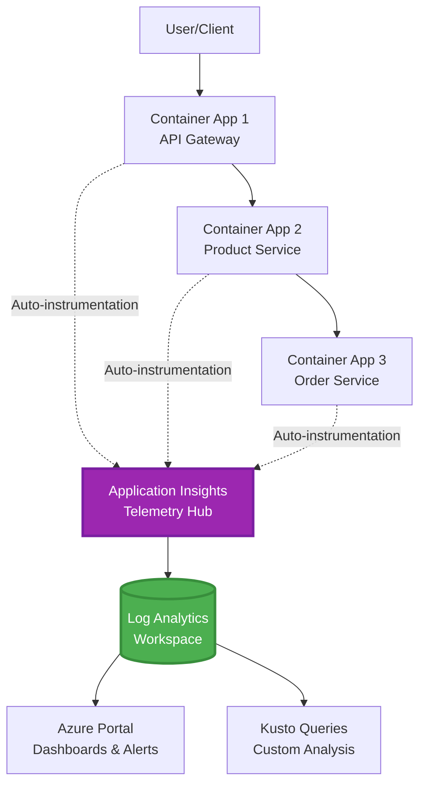
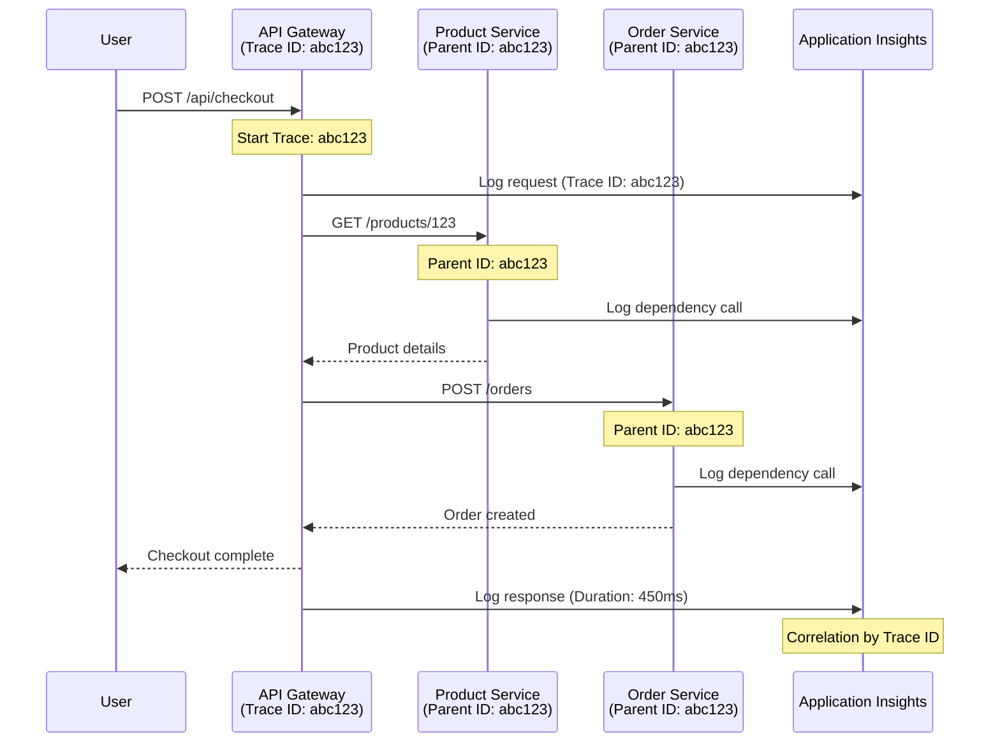

# AZD உடன் Application Insights ஒருங்கிணைப்பு

⏱️ **கணிக்கப்பட்ட நேரம்**: 40-50 நிமிடங்கள் | 💰 **செலவு தாக்கம்**: ~$5-15/மாதம் | ⭐ **சிக்கலம்**: இடைநிலை

**📚 கற்றல் பாதை:**
- ← முந்தையது: [Preflight Checks](preflight-checks.md) - முன்-பயன்படுத்தல் சரிபார்த்தல்
- 🎯 **நீங்கள் இங்கே**: Application Insights ஒருங்கிணைப்பு (மேலுள்ளோட்டம், தொலைதொடர்பு, பிழைத்திருத்தல்)
- → அடுத்தது: [Deployment Guide](../chapter-04-infrastructure/deployment-guide.md) - Azure இல் நிறுவுதல்
- 🏠 [பாடக் கட்டு முகப்பு](../../README.md)

---

## நீங்கள் கற்றுக்கொள்ளப்போகும் விஷயங்கள்

இந்த பாடத்தை முடித்தவுடன், நீங்கள்:
- AZD கட்டமைப்பில் **Application Insights** அறிவித்து SDK கருவி பொருத்தத்தை உள்ளமைக்கலாம்
- மிக்ரோசெர்வீசுகளுக்கான **பரவிய தடயக் கண்காணிப்பு** அமைக்கலாம்
- **இயற்கையான தொலைதொடர்பு** (அளவுகோல்கள், நிகழ்வுகள், சார்புகள்) செயலாக்கம் செய்யலாம்
- நேரடி கண்காணிப்பிற்காக **நேரடி அளவுகோல்கள்** அமைக்கலாம்
- AZD நிறுவுதல்களில் இருந்து **எச்சரிக்கைகள் மற்றும் அட்டவணைகள்** உருவாக்கலாம்
- **தொலைதொடர்பு விசாரணைகள்** மூலம் உற்பத்தி பிரச்சனைகளை பிழைத்திருத்தலாம்
- **செலவுகள் மற்றும் மாதிரிப்போக்கு** முறைகளை மேம்படுத்தலாம்
- **AI/LLM பயன்பாடுகளை** கண்காணிக்கலாம் (டோக்கன்கள், தாமதம், செலவுகள்)

## AZD உடன் Application Insights ஏன் முக்கியம்

### சவால்: உற்பத்திக் கண்காணிப்பு

**Application Insights இல்லாமல்:**
```
❌ No visibility into production behavior
❌ Manual log aggregation across services
❌ Reactive debugging (wait for customer complaints)
❌ No performance metrics
❌ Cannot trace requests across services
❌ Unknown failure rates and bottlenecks
```

**Application Insights + AZD உடன்:**
```
✅ Automatic telemetry collection
✅ Centralized logs from all services
✅ Proactive issue detection
✅ End-to-end request tracing
✅ Performance metrics and insights
✅ Real-time dashboards
✅ AZD provisions the monitoring declared in your templates
```

**உரையாடல்**: Application Insights உங்கள் பயன்பாட்டிற்கு "கருப்பு பெட்டி" விமான பதிவு சாதனம் + கட்டளை குழுவின் முகப்பகுதிச் சாளரம் போன்றது. நீங்கள் நடக்கும் அனைத்தையும் நேரடியாக பார்க்க முடியும் மற்றும் எந்தவொரு நிகழ்வையும் மீண்டும் முழுமையாக பின்தொடரலாம்.

---

## கட்டமைப்பின் மேற்பார்வை

### AZD கட்டமைப்பில் Application Insights



### தானாக கண்காணிக்கப்படுபவை என்னென்ன

ஆதரவு கொடுக்கப்பட்ட தானாக கருவி பொருத்தம் கோரிக்கைகள்/சார்புகளை பதிவுசெய்கிறது. தனிப்பயன் நிகழ்வுகள் மற்றும் அளவுகோல்கள் பயன்பாட்டுக் குறியீட்டைக் கொள்கின்றன; கிடைக்கத்தகுதிப் பரிசோதனைகள் தனித்தனியாக அமைக்கப்பட வேண்டும். வளம் உள்ளவரை கீழுள்ள ஒவ்வொரு வரியை அள்ளிக்கொள்ளாது.

| தொலைதொடர்பு வகை | அது பதிவு செய்யும் | பயன்பாட்டு நோக்கம் |
|----------------|------------------|----------|
| **கோரிக்கைகள்** | HTTP கோரிக்கைகள், நிலை குறியீடுகள், கால அளவு | API செயல்திறன் கண்காணிப்பு |
| **சார்புகள்** | வெளி அழைப்புகள் (தரவுத்தளம், APIகள், சேமிப்பகம்) | தடைகளை கண்டறிதல் |
| **விலகல்கள்** | கையாளப்படாத பிழைகள் மற்றும் ஸ்டாக் டிரேஸ் | பிழைத்திருத்தல் |
| **தனிப்பயன் நிகழ்வுகள்** | வணிக நிகழ்வுகள் (பதிவு, வாங்குதல்) | பகுப்பாய்வு மற்றும் பயணங்கள் |
| **அளவுகோல்கள்** | செயல்திறன் கண்ணிகள், தனிப்பயன் அளவுகோல்கள் | திறன் திட்டமிடல் |
| **அட்டவணைகள்** | கடுமையான பதிவுகள் | பிழைத்திருத்துதல் மற்றும் கணக்கெடுக்கும் |
| **கிடைக்கத்தன்மை** | கிடைக்கும் நேரமும் பதிலளிக்கும் நேரமும் பரிசோதனைகள் | SLA கண்காணிப்பு |

---

## தேவையானவை

### தேவையான கருவிகள்

```bash
# Verify Azure Developer CLI
azd version
# Command reference baseline: azd 1.37.2

# Verify Azure CLI
az --version
# ✅ Expected: azure-cli 2.50.0 or higher
```

### Azure தேவைகள்

- செயலாக்க Azure சந்தா
- உருவாக்க அனுமதிகள்:
  - Application Insights வளங்கள்
  - Log Analytics பணிநிலைகள்
  - Container Apps
  - வள குழுக்கள்

### அறிவு தேவைகள்

நீங்கள் முடித்திருக்க வேண்டும்:
- [AZD அடிப்படைகள்](../chapter-01-foundation/azd-basics.md) - AZD அடிப்படைக் கருத்துக்கள்
- [மைப்பு](../chapter-03-configuration/configuration.md) - சுற்றுச்சூழல் அமைப்பு
- [முதல் திட்டம்](../chapter-01-foundation/first-project.md) - அடிப்படை நிறுவுதல்

---

## பாடம் 1: AZD உடன் தானாக உருவாகும் Application Insights

### AZD எப்படி Application Insights ஐ உருவாக்குகிறது

AZD Application Insights ஐ **திட்டத்தின் கட்டமைப்பு மட்டும் அறிவிக்கையானபோது உருவாக்குகிறது**. `azure.yaml` தனக்கே கண்காணிப்பு அல்லது பயன்பாட்டுக் குறியீட்டை பொருத்ததில்லை.

> **உதாரண வரம்பு:** இந்த பாடத்தில் ஒருங்கிணைக்கும் துண்டுகள் அடங்கும், முழு `monitored-app` திட்டம் கிடையாது. முதன்மை வார்ப்புரு மற்றும் அளவுரு வரைபடம், Container Apps சுற்றுச்சூழல், பதிவு/படம் மற்றும் அடையாள அமைப்புகள், Dockerfile மற்றும் சேவை குறிச்சொற்கள் வழங்கப்பட வேண்டும். பிற பாடங்களில் மாற்று/விரிவாக்க துண்டுகள் காட்டப்படும், அனைத்தையும் ஒன்றாக மாற்றாமல் ஒட்டக்கூடாது. ஓடக்கூடிய அடிப்படை தேவைக்காக [microservices எடுத்துக்காட்டு](../../../../examples/microservices) தொடங்கவும்.

### திட்ட அமைப்பு

```
monitored-app/
├── azure.yaml                     # AZD configuration
├── infra/
│   ├── main.bicep                # Main infrastructure
│   ├── core/
│   │   └── monitoring.bicep      # Application Insights + Log Analytics
│   └── app/
│       └── api.bicep             # Container App with monitoring
└── src/
    ├── app.py                    # Application with telemetry
    ├── requirements.txt
    └── Dockerfile
```

---

### படி 1: AZD அமைத்தல் (azure.yaml)

**கோப்பு: `azure.yaml`**

```yaml
name: monitored-app
metadata:
  template: monitored-app@1.0.0

services:
  api:
    project: ./src
    language: python
    host: containerapp

# Monitoring must be declared in infra/ and enabled in application code.
```

இது நிறுவக்கூடிய சேவையை அறிவிக்கிறது. பின்வரும் Bicep மற்றும் SDK அமைப்புகள் கண்காணிப்பை வழங்குகின்றன; azd அவற்றை தானாக சேர்க்காது.

---

### படி 2: கண்காணிப்பு கட்டமைப்பு (Bicep)

**கோப்பு: `infra/core/monitoring.bicep`**

```bicep
param logAnalyticsName string
param applicationInsightsName string
param location string = resourceGroup().location
param tags object = {}

// Log Analytics Workspace (required for Application Insights)
resource logAnalytics 'Microsoft.OperationalInsights/workspaces@2022-10-01' = {
  name: logAnalyticsName
  location: location
  tags: tags
  properties: {
    sku: {
      name: 'PerGB2018'  // Pay-as-you-go pricing
    }
    retentionInDays: 30  // Keep logs for 30 days
    features: {
      enableLogAccessUsingOnlyResourcePermissions: true
    }
  }
}

// Application Insights
resource applicationInsights 'Microsoft.Insights/components@2020-02-02' = {
  name: applicationInsightsName
  location: location
  tags: tags
  kind: 'web'
  properties: {
    Application_Type: 'web'
    WorkspaceResourceId: logAnalytics.id
    IngestionMode: 'LogAnalytics'
    publicNetworkAccessForIngestion: 'Enabled'
    publicNetworkAccessForQuery: 'Enabled'
  }
}

// Outputs for Container Apps
output logAnalyticsWorkspaceId string = logAnalytics.id
output logAnalyticsWorkspaceName string = logAnalytics.name
output applicationInsightsConnectionString string = applicationInsights.properties.ConnectionString
output applicationInsightsInstrumentationKey string = applicationInsights.properties.InstrumentationKey
output applicationInsightsName string = applicationInsights.name
output applicationInsightsId string = applicationInsights.id
```

---

### படி 3: Container App ஐ Application Insights உடன் இணைத்தல்

**கோப்பு: `infra/app/api.bicep`**

```bicep
param name string
param location string
param tags object = {}
param containerAppsEnvironmentId string
param containerImage string
param applicationInsightsConnectionString string

resource containerApp 'Microsoft.App/containerApps@2023-05-01' = {
  name: name
  location: location
  tags: tags
  properties: {
    managedEnvironmentId: containerAppsEnvironmentId
    configuration: {
      ingress: {
        external: true
        targetPort: 8000
      }
      secrets: [
        {
          name: 'appinsights-connection-string'
          value: applicationInsightsConnectionString
        }
      ]
    }
    template: {
      containers: [
        {
          name: 'api'
          image: containerImage // Supply an accessible image and registry authentication
          resources: {
            cpu: json('0.5')
            memory: '1Gi'
          }
          env: [
            {
              name: 'APPLICATIONINSIGHTS_CONNECTION_STRING'
              secretRef: 'appinsights-connection-string'
            }
            {
              name: 'APPLICATIONINSIGHTS_ENABLED'
              value: 'true'
            }
          ]
        }
      ]
    }
  }
}

output uri string = 'https://${containerApp.properties.configuration.ingress.fqdn}'
```

---

### படி 4: தொலைதொடர்பு கொண்ட பயன்பாட்டு குறியீடு

**கோப்பு: `src/app.py`**

```python
from flask import Flask, request, jsonify
from azure.monitor.opentelemetry import configure_azure_monitor
import logging
import os

app = Flask(__name__)

# Get Application Insights connection string
connection_string = os.environ.get('APPLICATIONINSIGHTS_CONNECTION_STRING')

if connection_string:
    # Azure Monitor OpenTelemetry instruments supported libraries, including Flask.
    configure_azure_monitor(
        connection_string=connection_string,
        logger_name=__name__,
        enable_live_metrics=True
    )
    logger = logging.getLogger(__name__)
    logger.setLevel(logging.INFO)
    
    print("✅ Application Insights enabled")
else:
    logger = logging.getLogger(__name__)
    logger.setLevel(logging.INFO)
    print("⚠️ Application Insights not configured")

@app.route('/health')
def health():
    logger.info('Health check endpoint called')
    return jsonify({'status': 'healthy', 'monitoring': 'enabled' if connection_string else 'disabled'})

@app.route('/api/products')
def get_products():
    logger.info('Fetching products')
    
    # In-memory fixture: this is not a database dependency call.
    products = [
        {'id': 1, 'name': 'Laptop', 'price': 999.99},
        {'id': 2, 'name': 'Mouse', 'price': 29.99},
        {'id': 3, 'name': 'Keyboard', 'price': 79.99}
    ]
    
    logger.info(f'Returned {len(products)} products')
    return jsonify(products)

@app.route('/api/error-test')
def error_test():
    """Test error tracking"""
    logger.error('Testing error tracking')
    try:
        raise ValueError('This is a test exception')
    except Exception as e:
        logger.exception('Exception occurred in error-test endpoint')
        return jsonify({'error': str(e)}), 500

@app.route('/api/slow')
def slow_endpoint():
    """Test performance tracking"""
    import time
    logger.info('Slow endpoint called')
    time.sleep(3)  # Simulate slow operation
    logger.warning('Endpoint took 3 seconds to respond')
    return jsonify({'message': 'Slow operation completed'})

if __name__ == '__main__':
    app.run(host='0.0.0.0', port=8000)
```

**கோப்பு: `src/requirements.txt`**

```txt
Flask
azure-monitor-opentelemetry
gunicorn
requests
openai
```

உங்கள் திட்டத்தில் இந்த சார்புகளை தீர்க்கவும், ஒன்றாக சோதித்து முடிவு செய்யப்பட்ட பதிப்புகளை பூட்டவும். புதிய திட்டங்கள் Azure Monitor OpenTelemetry ஐ பயன்படுத்த வேண்டும், முடிவுக்கு வந்த OpenCensus Python ஏற்றுமதியாளர்களை பயன்படுத்த வேண்டாம்.

---

### படி 5: நிறுவி சரிபார்க்கவும்

```bash
# Deploy only after completing and wiring the infrastructure fragments above
azd up

# Get app URL
APP_URL=$(azd env get-value API_URL) # Requires this output in main.bicep

# Generate telemetry
curl $APP_URL/health
curl $APP_URL/api/products
curl $APP_URL/api/error-test
curl $APP_URL/api/slow
```

**✅ எதிர்பார்க்கப்படும் விளைவு:**
```json
{
  "status": "healthy",
  "monitoring": "enabled"
}
```

---

### படி 6: Azure போர்டல் இல் தொலைதொடர்பைக் காண்பிக்கவும்

```bash
# Get Application Insights details
azd env get-values | grep APPLICATIONINSIGHTS

# Open in Azure Portal
az monitor app-insights component show \
  --app $(azd env get-values | grep APPLICATIONINSIGHTS_NAME | cut -d '=' -f2 | tr -d '"') \
  --resource-group $(azd env get-values | grep AZURE_RESOURCE_GROUP | cut -d '=' -f2 | tr -d '"') \
  --query "appId" -o tsv
```

**Azure போர்டல் → Application Insights → Transaction Search செல்லவும்**

நீங்கள் காண்பீர்கள்:
- ✅ HTTP கோரிக்கைகள் நிலை குறியீடுக்களுடன்
- ✅ கோரிக்கை கால அளவு (3+ வினாடிகள் `/api/slow`க்காக)
- ✅ `/api/error-test`இலிருந்து விலக்கு விவரங்கள்
- ✅ தனிப்பயன் பதிவு செய்திகள்

---

## பாடம் 2: தனிப்பயன் தொலைதொடர்பு மற்றும் நிகழ்வுகள்

### வணிக நிகழ்வுகளை பின்தொடர்க

வணிக முக்கிய நிகழ்வுகளுக்கான தனிப்பயன் தொலைதொடர்பை சேர்ப்போம்.

**கோப்பு: `src/telemetry.py`**

```python
from contextlib import contextmanager
from azure.monitor.opentelemetry import configure_azure_monitor
from opentelemetry import metrics, trace
from opentelemetry.trace import SpanKind
import logging
import os

class TelemetryClient:
    """Custom telemetry client for Application Insights"""
    
    def __init__(self, connection_string=None):
        self.connection_string = connection_string or os.environ.get('APPLICATIONINSIGHTS_CONNECTION_STRING')
        
        # Configure once per process. If app.py already calls this, keep only
        # one configure_azure_monitor call and use logger_name='telemetry'.
        if self.connection_string:
            configure_azure_monitor(
                connection_string=self.connection_string,
                logger_name=__name__,
                enable_live_metrics=True
            )
        self.logger = logging.getLogger(__name__)
        self.logger.setLevel(logging.INFO)
        self.tracer = trace.get_tracer(__name__)
        self.meter = metrics.get_meter(__name__)
        self.instruments = {}
    
    def track_event(self, event_name: str, properties: dict = None):
        """Track custom business event"""
        properties = properties or {}
        self.logger.info(
            f"CustomEvent: {event_name}",
            extra={
                # OTel log attributes become customDimensions in App Insights.
                    'event_name': event_name,
                    **properties
            }
        )
    
    def track_metric(self, metric_name: str, value: float, properties: dict = None):
        """Track custom metric"""
        properties = properties or {}
        if metric_name not in self.instruments:
            self.instruments[metric_name] = self.meter.create_histogram(metric_name)
        self.instruments[metric_name].record(value, attributes=properties)
    
    @contextmanager
    def track_dependency(self, name: str):
        """Time the real operation inside a client span; exceptions mark failure."""
        with self.tracer.start_as_current_span(name, kind=SpanKind.CLIENT) as span:
            yield span

# Global telemetry client
telemetry = TelemetryClient()
```

### தனிப்பயன் நிகழ்வுகளுடன் பயன்பாட்டை புதுப்பிக்கவும்

**கோப்பு: `src/app.py` (மேம்படுத்தப்பட்டது)**

இருந்த Flask பயன்பாட்டிற்குச் இந்த வழித்தடங்களைச் சேர்; முன்பு இருந்த ஆரோக்கியம்/சோதனை வழித்தடங்களை வைத்திருக்கவும். கீழுள்ள குறுகிய தொகுதி தெளிவுக்காக தனித்த பயன்பாட்டைக் காட்டுகிறது. தொலைதொடர்பு துவக்கம் இப்போது `telemetry.py`இல் உள்ளது — ஏற்றுமதியாளர்களை இருமுறை துவக்க வேண்டாம்.

```python
from flask import Flask, request, jsonify
from telemetry import telemetry
import time
import random
import os

app = Flask(__name__)

@app.route('/api/purchase', methods=['POST'])
def purchase():
    """Track purchase event with custom telemetry"""
    data = request.get_json(silent=True) or {}
    product_id = data.get('product_id')
    quantity = data.get('quantity', 1)
    price = data.get('price', 0)
    if not isinstance(quantity, int) or quantity < 1 or \
       not isinstance(price, (int, float)) or price < 0:
        return jsonify({'error': 'quantity and price must be non-negative numbers; quantity >= 1'}), 400
    
    # Track business event
    telemetry.track_event('Purchase', {
        'product_id': product_id,
        'quantity': quantity,
        'total_amount': price * quantity,
        'user_id': request.headers.get('X-User-Id', 'anonymous')
    })
    
    # Track revenue metric
    telemetry.track_metric('Revenue', price * quantity, {
        'product_id': product_id,
        'currency': 'USD'
    })
    
    return jsonify({
        'order_id': f'ORD-{random.randint(1000, 9999)}',
        'status': 'confirmed',
        'total': price * quantity
    })

@app.route('/api/search')
def search():
    """Track search queries"""
    query = request.args.get('q', '')
    
    start_time = time.time()
    
    # Simulate search (would be real database query)
    results = [{'id': 1, 'name': f'Result for {query}'}]
    
    duration = (time.time() - start_time) * 1000  # Convert to ms
    
    # Track search event
    telemetry.track_event('Search', {
        'query': query,
        'results_count': len(results),
        'duration_ms': duration
    })
    
    # Track search performance metric
    telemetry.track_metric('SearchDuration', duration, {
        'query_length': len(query)
    })
    
    return jsonify({'results': results, 'count': len(results)})

@app.route('/api/external-call')
def external_call():
    """Track external API dependency"""
    import requests
    
    try:
        # Set an actual test endpoint; api.example.com is not a working API.
        with telemetry.track_dependency('ExternalAPI'):
            response = requests.get(os.environ['EXTERNAL_API_URL'], timeout=5)
            response.raise_for_status()
            result = response.json()
    except Exception as e:
        return jsonify({'error': 'External dependency failed'}), 502
    
    return jsonify(result)

if __name__ == '__main__':
    app.run(host='0.0.0.0', port=8000)
```

### தனிப்பயன் தொலைதொடர்பை சோதிக்கவும்

```bash
# Track purchase event
curl -X POST $APP_URL/api/purchase \
  -H "Content-Type: application/json" \
  -H "X-User-Id: user123" \
  -d '{"product_id": 1, "quantity": 2, "price": 29.99}'

# Track search event
curl "$APP_URL/api/search?q=laptop"

# Track external dependency
curl $APP_URL/api/external-call
```

**Azure போர்டல் இல் பார்க்கவும்:**

Application Insights → பதிவுகள் செல்லவும், பிறகு இயக்கவும்:

```kusto
// View purchase events
traces
| where customDimensions.event_name == "Purchase"
| project 
    timestamp,
    product_id = tostring(customDimensions.product_id),
    total_amount = todouble(customDimensions.total_amount),
    user_id = tostring(customDimensions.user_id)
| order by timestamp desc

// Revenue recorded in Purchase events (not a billing ledger)
traces
| where customDimensions.event_name == "Purchase"
| summarize TotalRevenue = sum(todouble(customDimensions.total_amount)) by bin(timestamp, 1h)
| render timechart

// View search performance
traces
| where customDimensions.event_name == "Search"
| summarize 
    AvgDuration = avg(todouble(customDimensions.duration_ms)),
    SearchCount = count()
  by bin(timestamp, 5m)
| render timechart
```

---

## பாடம் 3: மிக்ரோசெர்வீசுகளுக்கான பரவிய தடையியல்

### சேவைகள் இடையே தடையியல் செயல்படுத்தவும்

பொருத்தக்கூடிய கருவிச் சிறுகூறுகள் மற்றும் W3C தடையியல்-கொடுப்பு பரப்பலுடன், Application Insights கோரிக்கைகளை சேவைகளுக்கிடையில் சம்பந்தப்படுத்துகின்றது. வாழ்நாள் குறிச்சொல் பகிர்தல் மட்டும் பெற்றோா-குழந்தை இடைவெளிகளை ஏற்படுத்தாது. கீழுள்ள கட்டமைப்பு துண்டு நீங்கள் செயல்படுத்த வேண்டிய தொகுதிகளை குறிக்கிறது.

**கோப்பு: `infra/main.bicep`**

```bicep
targetScope = 'subscription'

param environmentName string
param location string = 'eastus'

var tags = { 'azd-env-name': environmentName }

resource rg 'Microsoft.Resources/resourceGroups@2021-04-01' = {
  name: 'rg-${environmentName}'
  location: location
  tags: tags
}

// Monitoring (shared by all services)
module monitoring './core/monitoring.bicep' = {
  name: 'monitoring'
  scope: rg
  params: {
    logAnalyticsName: 'log-${environmentName}'
    applicationInsightsName: 'appi-${environmentName}'
    location: location
    tags: tags
  }
}

// API Gateway
module apiGateway './app/api-gateway.bicep' = {
  name: 'api-gateway'
  scope: rg
  params: {
    name: 'ca-gateway-${environmentName}'
    location: location
    tags: union(tags, { 'azd-service-name': 'gateway' })
    applicationInsightsConnectionString: monitoring.outputs.applicationInsightsConnectionString
  }
}

// Product Service
module productService './app/product-service.bicep' = {
  name: 'product-service'
  scope: rg
  params: {
    name: 'ca-products-${environmentName}'
    location: location
    tags: union(tags, { 'azd-service-name': 'products' })
    applicationInsightsConnectionString: monitoring.outputs.applicationInsightsConnectionString
  }
}

// Order Service
module orderService './app/order-service.bicep' = {
  name: 'order-service'
  scope: rg
  params: {
    name: 'ca-orders-${environmentName}'
    location: location
    tags: union(tags, { 'azd-service-name': 'orders' })
    applicationInsightsConnectionString: monitoring.outputs.applicationInsightsConnectionString
  }
}

output APPLICATIONINSIGHTS_CONNECTION_STRING string = monitoring.outputs.applicationInsightsConnectionString
output GATEWAY_URL string = apiGateway.outputs.uri
```

### தொடர் கணக்கீடு காண்க



**தொடர் தடையியல் விசாரணை:**

```kusto
// Find complete request flow
let traceId = "abc123...";  // Copy operation_Id from a request in Application Insights
dependencies
| union requests
| where operation_Id == traceId
| project 
    timestamp,
    type = itemType,
    name,
    duration,
    success,
    cloud_RoleName
| order by timestamp asc
```

---

## பாடம் 4: நேரடி அளவுகோல்கள் மற்றும் நேரடியான கண்காணிப்பு

### நேரடி அளவுகோல் ஓட்டப்பாதையை செயல்படுத்தவும்

நேரடி அளவுகோல்கள் SDK ஆதரிக்கும் போது நெருக்கமான நேரடி தொலைதொடர்பை வழங்குகிறது. இது தாமத SLA அல்ல. மேலே உள்ள Python OpenTelemetry அமைப்பு இதில் `enable_live_metrics=True` பயன்படுத்துவதன் மூலம் தேர்வு செய்கிறது.

**நேரடி அளவுகோல்களை அணுகுவோம்:**

```bash
# Get Application Insights resource
APPI_NAME=$(azd env get-values | grep APPLICATIONINSIGHTS_NAME | cut -d '=' -f2 | tr -d '"')

# Get resource group
RG_NAME=$(azd env get-values | grep AZURE_RESOURCE_GROUP | cut -d '=' -f2 | tr -d '"')

echo "Navigate to: Azure Portal → Resource Groups → $RG_NAME → $APPI_NAME → Live Metrics"
```

**நேரடியாக நீங்கள் காண்பது:**
- ✅ வருகை கோரிக்கை விகிதம் (கோரிக்கைகள்/விநாடி)
- ✅ வெளியே செல்லும் சார்பான அழைப்புகள்
- ✅ வழிவு எண்ணிக்கை
- ✅ CPU மற்றும் நினைவக பயன்பாடு
- ✅ செயலில் உள்ள சேவையக எண்ணிக்கை
- ✅ மாதிரி தொலைதொடர்பு

### சோதனைக்காக பாரம் உருவாக்கவும்

```bash
# Generate load to see live metrics
for i in {1..100}; do
  curl --silent --max-time 10 "$APP_URL/api/products"
  curl --silent --max-time 10 "$APP_URL/api/search?q=test$i"
done

# Watch live metrics in Azure Portal
# You should see request rate spike
```

---

## நடைமுறைப் பயிற்சிகள்

### பயிற்சி 1: எச்சரிக்கைகள் அமைக்கவும் ⭐⭐ (இடைநிலை)

**கோள்**: உயர்ந்த பிழை விகிதங்களுக்கும் மெதுவாக என்ற பதில்களுக்குமான எச்சரிக்கைகள் உருவாக்கவும்.

**படி:**

1. **பிழை விகிதத்திற்கு எச்சரிக்கை உருவாக்கு:**

```bash
# Get Application Insights resource ID
APPI_ID=$(az monitor app-insights component show \
  --app $APPI_NAME \
  --resource-group $RG_NAME \
  --query "id" -o tsv)

# Create metric alert for failed requests
az monitor metrics alert create \
  --name "High-Error-Rate" \
  --resource-group $RG_NAME \
  --scopes $APPI_ID \
  --condition "count requests/failed > 10" \
  --window-size 5m \
  --evaluation-frequency 1m \
  --description "Alert when failed request count exceeds 10 per 5 minutes"
```

2. **மெதுவான பதில்களுக்கு எச்சரிக்கை உருவாக்கு:**

```bash
az monitor metrics alert create \
  --name "Slow-Responses" \
  --resource-group $RG_NAME \
  --scopes $APPI_ID \
  --condition "avg requests/duration > 3000" \
  --window-size 5m \
  --evaluation-frequency 1m \
  --description "Alert when average response time exceeds 3 seconds"
```

3. **Bicep மூலம் எச்சரிக்கை உருவாக்கு (AZDக்கு பரிந்துரைக்கப்படும்):**

**கோப்பு: `infra/core/alerts.bicep`**

```bicep
param applicationInsightsId string
param actionGroupId string = ''
param location string = resourceGroup().location

// High error rate alert
resource errorRateAlert 'Microsoft.Insights/metricAlerts@2018-03-01' = {
  name: 'high-error-rate'
  location: 'global'
  properties: {
    description: 'Alert when error rate exceeds threshold'
    severity: 2
    enabled: true
    scopes: [
      applicationInsightsId
    ]
    evaluationFrequency: 'PT1M'
    windowSize: 'PT5M'
    criteria: {
      'odata.type': 'Microsoft.Azure.Monitor.SingleResourceMultipleMetricCriteria'
      allOf: [
        {
          name: 'Error rate'
          metricName: 'requests/failed'
          operator: 'GreaterThan'
          threshold: 10
          timeAggregation: 'Count'
        }
      ]
    }
    actions: actionGroupId != '' ? [
      {
        actionGroupId: actionGroupId
      }
    ] : []
  }
}

// Slow response alert
resource slowResponseAlert 'Microsoft.Insights/metricAlerts@2018-03-01' = {
  name: 'slow-responses'
  location: 'global'
  properties: {
    description: 'Alert when response time is too high'
    severity: 3
    enabled: true
    scopes: [
      applicationInsightsId
    ]
    evaluationFrequency: 'PT1M'
    windowSize: 'PT5M'
    criteria: {
      'odata.type': 'Microsoft.Azure.Monitor.SingleResourceMultipleMetricCriteria'
      allOf: [
        {
          name: 'Response duration'
          metricName: 'requests/duration'
          operator: 'GreaterThan'
          threshold: 3000
          timeAggregation: 'Average'
        }
      ]
    }
  }
}

output errorAlertId string = errorRateAlert.id
output slowResponseAlertId string = slowResponseAlert.id
```

4. **எச்சரிக்கைகளை சோதிக்கவும்:**

```bash
# Generate errors
for i in {1..20}; do
  curl $APP_URL/api/error-test
done

# Generate slow responses
for i in {1..10}; do
  curl $APP_URL/api/slow
done

# Check rule configuration (not fired/resolved alert-instance history)
az monitor metrics alert list \
  --resource-group $RG_NAME \
  --query "[].{Name:name, Enabled:enabled}" \
  --output table
```

**✅ வெற்றி விதிகள்:**
- ✅ எச்சரிக்கைகள் வெற்றிகரமாக உருவாக்கப்பட்டன
- ✅ எல்லைப் கடந்தபோது எச்சரிக்கைகள் சிவசெய்கின்றன
- ✅ Azure போர்டலில் எச்சரிக்கை வரலாறு பார்க்க முடியும்
- ✅ AZD நிறுவலுடன் ஒத்துழைக்கின்றது

**நேரம்**: 20-25 நிமிடங்கள்

---

### பயிற்சி 2: தனிப்பயன் அட்டவணை உருவாக்கு ⭐⭐ (இடைநிலை)

**கோள்**: முக்கிய பயன்பாட்டு அளவுகோல்களை காட்டும் அட்டவணை கட்டமைக்கவும்.

**படி:**

1. **Azure போர்டல் மூலம் அட்டவணை உருவாக்கு:**

செல்லவும்: Azure போர்டல் → அட்டவணைகள் → புதிய அட்டவணை

2. **முக்கிய அளவுகோல்களுக்கான தாள்கள் சேர்க்க:**

- கடந்த 24 மணி நேரங்களில் கோரிக்கை எண்ணிக்கை
- மத்தியிலான பதில் நேரம்
- பிழை விகிதம்
- மிக மெதுவான 5 செயல்பாடுகள்
- பயனர்களின் புவியியல் பகிர்வு

3. **Bicep மூலம் அட்டவணை உருவாக்கு:**

**கோப்பு: `infra/core/dashboard.bicep`**

```bicep
param dashboardName string
param applicationInsightsId string
param location string = resourceGroup().location

resource dashboard 'Microsoft.Portal/dashboards@2020-09-01-preview' = {
  name: dashboardName
  location: location
  properties: {
    lenses: [
      {
        order: 0
        parts: [
          // Request count
          {
            position: {
              x: 0
              y: 0
              rowSpan: 4
              colSpan: 6
            }
            metadata: {
              type: 'Extension/Microsoft_OperationsManagementSuite_Workspace/PartType/LogsDashboardPart'
              inputs: [
                {
                  name: 'resourceId'
                  value: applicationInsightsId
                }
                {
                  name: 'query'
                  value: '''
                    requests
                    | summarize RequestCount = count() by bin(timestamp, 1h)
                    | render timechart
                  '''
                }
              ]
            }
          }
          // Error rate
          {
            position: {
              x: 6
              y: 0
              rowSpan: 4
              colSpan: 6
            }
            metadata: {
              type: 'Extension/Microsoft_OperationsManagementSuite_Workspace/PartType/LogsDashboardPart'
              inputs: [
                {
                  name: 'resourceId'
                  value: applicationInsightsId
                }
                {
                  name: 'query'
                  value: '''
                    requests
                    | summarize 
                        Total = count(),
                        Failed = countif(success == false)
                    | extend ErrorRate = (Failed * 100.0) / Total
                    | project ErrorRate
                  '''
                }
              ]
            }
          }
        ]
      }
    ]
  }
}

output dashboardId string = dashboard.id
```

4. **அட்டவணையை நிறுவு:**

```bicep
// Add to a subscription-scoped main.bicep with rg and monitoring declared
module dashboard './core/dashboard.bicep' = {
  name: 'dashboard'
  scope: rg
  params: {
    dashboardName: 'dashboard-${environmentName}'
    applicationInsightsId: monitoring.outputs.applicationInsightsId
    location: location
  }
}
```

```bash
# Deploy
azd up
```

**✅ வெற்றி விதிகள்:**
- ✅ அட்டவணை முக்கிய அளவுகோல்களை காட்டுகின்றது
- ✅ Azure போர்டல் முகப்புக்கு தள்ளி வைக்க முடியும்
- ✅ நேரடி புதுப்பிப்புகள்
- ✅ AZD மூலம் நிறுவக்கூடியது

**நேரம்**: 25-30 நிமிடங்கள்

---

### பயிற்சி 3: AI/LLM பயன்பாட்டைக் கண்காணி ⭐⭐⭐ (சிக்கலானது)

**கோள்**: Microsoft Foundry மாதிரிகள் பயன்பாடு (டோக்கன்கள், செலவுகள், தாமதம்) கண்காணி.

**படி:**

1. **AI கண்காணிப்பு ஓட்டாரை உருவாக்கு:**

**கோப்பு: `src/ai_telemetry.py`**

```python
from telemetry import telemetry
from openai import AzureOpenAI
import time

class MonitoredAzureOpenAI:
    """Microsoft Foundry Models client with automatic telemetry"""
    
    def __init__(self, api_key, endpoint, input_usd_per_million,
                 output_usd_per_million, api_version="2024-10-21"):
        self.client = AzureOpenAI(
            api_key=api_key,
            api_version=api_version,
            azure_endpoint=endpoint
        )
        self.input_rate = input_usd_per_million
        self.output_rate = output_usd_per_million
    
    def chat_completion(self, model: str, messages: list, **kwargs):
        """Track chat completion with telemetry"""
        start_time = time.time()
        
        try:
            # Call Microsoft Foundry Models
            response = self.client.chat.completions.create(
                model=model,
                messages=messages,
                **kwargs
            )
            
            duration = (time.time() - start_time) * 1000  # ms
            
            # Extract usage
            usage = response.usage
            prompt_tokens = usage.prompt_tokens
            completion_tokens = usage.completion_tokens
            total_tokens = usage.total_tokens
            
            # Approximation: supply actual deployment/region/contract rates.
            # Cached input, batch, provisioned and other charges need separate accounting.
            prompt_cost = (prompt_tokens / 1_000_000) * self.input_rate
            completion_cost = (completion_tokens / 1_000_000) * self.output_rate
            total_cost = prompt_cost + completion_cost
            
            # Track custom event
            telemetry.track_event('OpenAI_Request', {
                'model': model,
                'prompt_tokens': prompt_tokens,
                'completion_tokens': completion_tokens,
                'total_tokens': total_tokens,
                'duration_ms': duration,
                'cost_usd': total_cost,
                'success': True
            })
            
            # Track metrics
            telemetry.track_metric('OpenAI_Tokens', total_tokens, {
                'model': model,
                'type': 'total'
            })
            
            telemetry.track_metric('OpenAI_Cost', total_cost, {
                'model': model,
                'currency': 'USD'
            })
            
            telemetry.track_metric('OpenAI_Duration', duration, {
                'model': model
            })
            
            return response
            
        except Exception as e:
            duration = (time.time() - start_time) * 1000
            
            telemetry.track_event('OpenAI_Request', {
                'model': model,
                'duration_ms': duration,
                'success': False,
                'error': str(e)
            })
            
            raise
```

2. **கண்காணிக்கப்பட்ட கிளையண்டைப் பயன்படுத்தவும்:**

```python
from flask import Flask, request, jsonify
from ai_telemetry import MonitoredAzureOpenAI
import os

app = Flask(__name__)

# Initialize monitored OpenAI client
openai_client = MonitoredAzureOpenAI(
    api_key=os.environ['AZURE_OPENAI_API_KEY'],
    endpoint=os.environ['AZURE_OPENAI_ENDPOINT'],
    input_usd_per_million=float(os.environ['INPUT_USD_PER_MILLION']),
    output_usd_per_million=float(os.environ['OUTPUT_USD_PER_MILLION'])
)

@app.route('/api/chat', methods=['POST'])
def chat():
    data = request.json
    user_message = data.get('message')
    
    # Call with automatic monitoring
    response = openai_client.chat_completion(
        model=os.environ['AZURE_OPENAI_DEPLOYMENT'], # Deployment name, not catalog ID
        messages=[
            {'role': 'user', 'content': user_message}
        ]
    )
    
    return jsonify({
        'response': response.choices[0].message.content,
        'tokens': response.usage.total_tokens
    })
```

3. **AI அளவுகோல்களை விசாரிக்கவும்:**

```kusto
// Total AI spend over time
traces
| where customDimensions.event_name == "OpenAI_Request"
| where tobool(customDimensions.success) == true
| summarize TotalCost = sum(todouble(customDimensions.cost_usd)) by bin(timestamp, 1h)
| render timechart

// Token usage by model
traces
| where customDimensions.event_name == "OpenAI_Request"
| summarize 
    TotalTokens = sum(toint(customDimensions.total_tokens)),
    RequestCount = count()
  by Model = tostring(customDimensions.model)

// Average latency
traces
| where customDimensions.event_name == "OpenAI_Request"
| summarize AvgDuration = avg(todouble(customDimensions.duration_ms))
| project AvgDurationSeconds = AvgDuration / 1000

// Cost per request
traces
| where customDimensions.event_name == "OpenAI_Request"
| extend Cost = todouble(customDimensions.cost_usd)
| summarize 
    TotalCost = sum(Cost),
    RequestCount = count(),
    AvgCostPerRequest = avg(Cost)
```

**✅ வெற்றி விதிகள்:**
- ✅ ஒவ்வொரு OpenAI அழைப்பு தானாக கண்காணிக்கப்படுகிறது
- ✅ டோக்கன் பயன்பாடு மற்றும் செலவுகள் தெளிவாகக் காணப்படும்
- ✅ தாமதம் கண்காணிக்கப்பட்டுள்ளது
- ✅ பட்ஜெட் எச்சரிக்கைகள் அமைக்க முடியும்

**நேரம்**: 35-45 நிமிடங்கள்

---

## செலவு நுட்பமயமாக்கல்

### மாதிரிப்போக்கு முறைகள்

தொலைதொடர்பை மாதிரிப் பண்படுத்தல் மூலம் செலவுகளை கட்டுப்படுத்துக:

```python
import os

# Configure before the one configure_azure_monitor() call in your process.
os.environ["OTEL_TRACES_SAMPLER"] = "microsoft.fixed_percentage"
os.environ["OTEL_TRACES_SAMPLER_ARG"] = "0.1" # 10% trace sampling
```

தடையியல் மாதிரிப்பு ஒவ்வொரு தொலைதொடர்பு வகையையும் 90% குறைக்காது. அளவுகோல்கள் மற்றும் தனித்தனியாக வெளியிடப்படும் பதிவுகளுக்கு தனி மாதிரிப்பாட்டு கட்டுப்பாடுகள் தேவை. கண்காணிப்பு தேவைகளின் அடிப்படையில் வீதத்தை தேர்ந்தெடுக்கவும், அனைத்து உற்பத்தி தடையியல் தடை ஏதாவது இல்லை.

SDK மாதிரிப்பை தெளிவானவாறு அமைக்கவும்; கூறு `SamplingPercentage` பண்புக் கூறல் Python OpenTelemetry மாதிரிபட்டியாளரை மாற்றாது.

### தரவு போக்குவரத்துக் காலம்

```bicep
resource logAnalytics 'Microsoft.OperationalInsights/workspaces@2022-10-01' = {
  name: logAnalyticsName
  properties: {
    retentionInDays: 30  // Minimum (cheapest)
    // Options: 30, 31, 60, 90, 120, 180, 270, 365, 550, 730
  }
}
```

### மாதாந்திரிய செலவுக் கணக்கீடுகள்

| தரவு அளவு | போக்குவரத்து | மாதாந்திர செலவு |
|-------------|-----------|--------------|
| 1 GB/மாதம் | 30 நாட்கள் | ~$2-5 |
| 5 GB/மாதம் | 30 நாட்கள் | ~$10-15 |
| 10 GB/மாதம் | 90 நாட்கள் | ~$25-40 |
| 50 GB/மாதம் | 90 நாட்கள் | ~$100-150 |

இவை எடுத்துக்காட்டு மதிப்பீடுகள், விலை விதிகள் அல்ல. உங்கள் பிராந்தியத்திலும் ஒப்பந்தத்திலும் உள்ள மாற்றும், போக்குவரத்து, எச்சரிக்கை மற்றும் சோதனை விலைகளை சரிபார்க்கவும்; இலவச அளவுகோல்கள் Azure Monitor விலைப்பட்டியலின்படி பகிர்கின்றன/வரையறுக்கப்பட்டுள்ளன, ஒவ்வொரு Application Insights வளத்திற்கும் தனிப்பட்ட இலவச SKU உறுதி செய்யப்படவில்லை.

---

## அறிவு ஆய்வுத்தளம்

### 1. அடிப்படைக் ஒருங்கிணைப்பு ✓

உங்கள் புரிதலை சோதிக்கவும்:

- [ ] **Q1**: AZD எப்படி Application Insights ஐ உருவாக்குகிறது?
  - **பதில்**: திட்டத்தின் Bicep/Terraform வார்ப்புருக்கள் அறிவித்த கண்காணிப்பு வளங்களை நிறுவுகிறது.

- [ ] **Q2**: Application Insights ஐ செயல்படுத்தும் சுற்றுச்சூழல் மாறி என்ன?
  - **பதில்**: `APPLICATIONINSIGHTS_CONNECTION_STRING`

- [ ] **Q3**: முக்கியமான மூன்று தொலைதொடர்பு வகைகள் என்ன?
  - **பதில்**: கோரிக்கைகள் (HTTP அழைப்புகள்), சார்புகள் (வெளி அழைப்புகள்), விலகல்கள் (பிழைகள்)

**நடவடிக்கை சோதனை:**
```bash
# Check if Application Insights is configured
azd env get-values | grep APPLICATIONINSIGHTS

# Verify telemetry is flowing
az monitor app-insights metrics show \
  --app $APPI_NAME \
  --resource-group $RG_NAME \
  --metric "requests/count"
```

---

### 2. தனிப்பயன் தொலைதொடர்பு ✓

உங்கள் புரிதலை சோதிக்கவும்:

- [ ] **Q1**: தனிப்பயன் வணிக நிகழ்வுகளை எப்படி பின்தொடர்வது?
  - **பதில்**: இந்த பாடத்தில் உள்ள ஓட்டார் உருவாக்கிய OTel பதிவுகளுக்கு `event_name` பண்புகள், `traces` இல் விசாரிக்கத்தக்கவை; இவை தானாக `customEvents` அல்ல.

- [ ] **Q2**: நிகழ்வுகளும் அளவுகோல்களும் எப்படி வேறுபடுகின்றன?
  - **பதில்**: நிகழ்வுகள் தனித்துவமான நிகழ்வுகள், அளவுகோல்கள் எண்ணிக்கைக் கணக்கீடுகள்

- [ ] **Q3**: சேவைகளுக்கு இடையே தொலைதொடர்பை எப்படி சம்பந்தப்படுத்துகிறீர்கள்?
  - **பதில்**: Application Insights தானாக `operation_Id` ஐ பயன்படுத்துகிறது

**நடவடிக்கை சோதனை:**
```kusto
// Verify custom events
traces
| where customDimensions.event_name != ""
| summarize count() by tostring(customDimensions.event_name)
```

---

### 3. உற்பத்தியைக் கண்காணித்தல் ✓

உங்கள் புரிதலை சோதிக்கவும்:

- [ ] **Q1**: மாதிரிப்போக்கு என்ன மற்றும் ஏன் அதை பயன்படுத்துவது?
  - **பதில்**: மாதிரிப்போக்கு தொலைதொடர்பு தர அடியெடுக்க  (மற்றும் செலவு குறைக்க) ஒரு பங்கு மட்டுமே எடுத்துக்கொள்ள உதவுகின்றது

- [ ] **Q2**: எச்சரிக்கைகளை எப்படி அமைக்கிறீர்கள்?
  - **பதில்**: Application Insights அளவுகோல்களை அடிப்படையாக கொண்டு Bicep அல்லது Azure போர்டலில் அளவுகோல் எச்சரிக்கைகள் அமைக்கவும்

- [ ] **Q3**: Log Analytics மற்றும் Application Insights இடையேயான வேறுபாடு என்ன?
  - **பதில்**: Application Insights தரவை Log Analytics பணிநிலையில் சேமிக்கிறது; App Insights பயன்பாட்டு தனிப்பட்ட காட்சிகளை வழங்கிறது

**நடவடிக்கை சோதனை:**
```bash
# Check the sampler configured for the running application, not only the ARM component.
az containerapp show --name "$APP_NAME" --resource-group "$RG_NAME" \
  --query "properties.template.containers[].env[?starts_with(name, 'OTEL_TRACES_SAMPLER')]"
```

---

## சிறந்த நடைமுறைகள்

### ✅ செய்யவேண்டியவை:

1. **சம்பந்தப்பட்ட அடையாளக்குறிகளை பயன்படுத்தவும்**
   ```python
   logger.info('Processing order', extra={
           'order_id': order_id,
           'user_id': user_id
   })
   ```

2. **முக்கிய அளவுகோல்களுக்கு எச்சரிக்கைகளை அமைக்கவும்**
   ```bicep
   // Error rate, slow responses, availability
   ```

3. **கட்டமைக்கப்பட்ட பதிவு முறையைப் பயன்படுத்தவும்**
   ```python
   # ✅ GOOD: Structured
   logger.info('User signup', extra={'user_id': 'pseudonymous-id'})
   
   # ❌ BAD: Unstructured
   logger.info(f'User 123 signed up')
   ```

4. **சார்புகளை கண்காணிக்கவும்**
   ```python
   # Automatically track database calls, HTTP requests, etc.
   ```

5. **நிறுவுதலில் நேரடி அளவுகோல்களை பயன்படுத்தவும்**

### ❌ செய்யக்கூடாதவை:

1. **संवेदनशील தரவுகளை பதிவு செய்யக் கூடாது**
   ```python
   # ❌ BAD
   logger.info(f'Login: {username}:{password}')
   
   # ✅ GOOD
   logger.info('Login attempt', extra={'result': 'failed'})
   ```

2. **அளவு மற்றும் கண்டறியும் தேவைகளை அளவிடாமல் மாதிரியைத் தேர்ந்தெடுக்க கூடாது**
   ```python
   # ❌ Expensive
   # 100% traces may be appropriate for a small workload or investigation.
   
   # ✅ Cost-effective
   # A lower trace rate reduces visibility; validate coverage before enabling.
   ```

3. **மறைவு கடித வரிசைகளை புறக்கணிக்க கூடாது**

4. **தரவு சேமிப்பு வரம்புகளை அமைப்பதை மறக்க கூடாது**

---

## பிழைத்திருத்தல்

### பிரச்சனை: எந்த தொலைபார்வையும் தோன்றவில்லை

**கண்டறிதல்:**
```bash
# Check connection string is set
azd env get-values | grep APPLICATIONINSIGHTS

# Check application logs via Azure Monitor
azd monitor --logs

# Or use Azure CLI for Container Apps:
az containerapp logs show --name $APP_NAME --resource-group $RG_NAME --tail 50
```

**தீர்வு:**
```bash
# Verify connection string in Container App
az containerapp show \
  --name $APP_NAME \
  --resource-group $RG_NAME \
  --query "properties.template.containers[0].env" \
  | grep -i applicationinsights
```

---

### பிரச்சனை: அதிக செலவுகள்

**கண்டறிதல்:**
```bash
# Query ingestion volume in the linked Log Analytics workspace.
# WORKSPACE_ID is the workspace customer ID (GUID), not its ARM resource ID.
az monitor log-analytics query --workspace "$WORKSPACE_ID" \
  --analytics-query "Usage | where TimeGenerated > ago(30d) | where IsBillable == true | summarize IngestedMB=sum(Quantity) by DataType"
```

**தீர்வு:**
- மாதிரி வீதத்தை குறைக்கவும்
- தரவு சேமிப்பு காலத்தை குறைக்கவும்
- விரிவான பதிவு மாற்றங்களை அகற்றவும்

---

## மேலும் கற்றுக்கொள்ளவும்

### அதிகாரப்பூர்வ ஆவணங்கள்
- [Application Insights Overview](https://learn.microsoft.com/azure/azure-monitor/app/app-insights-overview)
- [Azure Monitor OpenTelemetry setup](https://learn.microsoft.com/azure/azure-monitor/app/opentelemetry-enable?tabs=python)
- [Kusto Query Language](https://learn.microsoft.com/azure/data-explorer/kusto/query/)
- [AZD Monitoring](https://learn.microsoft.com/azure/developer/azure-developer-cli/monitor-your-app)

### இந்த பாடத்தில் அடுத்த படிகள்
- ← முந்தையது: [Preflight Checks](preflight-checks.md)
- → அடுத்தது: [Deployment Guide](../chapter-04-infrastructure/deployment-guide.md)
- 🏠 [கkurs வலைப்பக்கம்](../../README.md)

### தொடர்புடைய உதாரணங்கள்
- [Microsoft Foundry Models Example](../../../../examples/azure-openai-chat) - செயற்கை நுண்ணறிவு தொலைபார்வை
- [Microservices Example](../../../../examples/microservices) - பகிர்ந்தளிக்கும் கண்காணிப்பு

---

## சுருக்கம்

**நீங்கள் கற்றுக்கொண்டது:**
- ✅ AZD மூலம் தானாக Application Insights கொடுக்கல் வைக்கல்
- ✅ தனிப்பயன் தொலைபார்வை (நிகழ்வுகள், அளவைகள், சார்புகள்)
- ✅ மைக்ரோசேவைகள் வழியாக பகிர்ந்தளிக்கும் கண்காணிப்பு
- ✅ நேரடி அளவைகள் மற்றும் நேரடி கண்காணிப்பு
- ✅ எச்சரிக்கை மற்றும் தாட்சணைகள்
- ✅ AI/LLM பயன்பாட்டு கண்காணிப்பு
- ✅ செலவு குறைக்கும் உத்திகள்

**சாரா எடுக்கக் கூடியவை:**
1. **கண்காணிப்பை தெளிவாக அறிவிக்கவும்** - AZD உங்கள் மாதிரிகளை இயக்கிறது; SDK கருவிகள் தொலைபார்வை அனுப்புகிறது
2. **கட்டமைக்கப்பட்ட பதிவு பயன்படுத்தவும்** - கேள்வி எடுப்பதை எளிதாக்குகிறது
3. **வணிக நிகழ்வுகளை கண்காணிக்கவும்** - தொழில்நுட்ப அளவைகள் மட்டும் அல்ல
4. **AI செலவுகளை கண்காணிக்கவும்** - டோக்கன்கள் மற்றும் செலவுகள் கண்காணிப்பு
5. **எச்சரிக்கைகளை அமைக்கவும்** - пас்ஸிவ் அல்ல, முன்னறிவிப்பாக இருங்கள்
6. **செலவுகளை மேம்படுத்தவும்** - மாதிரி மற்றும் சேமிப்பு வரம்புகளை பயன்படுத்தவும்

**அடுத்த படிகள்:**
1. நடைமுறை பயிற்சிகளை முடிக்கவும்
2. உங்கள் AZD திட்டங்களில் Application Insights சேர்க்கவும்
3. உங்கள் குழுவிற்கு தனிப்பயன் தாட்சணைகள் உருவாக்கவும்
4. கற்றுக்கொள்ளவும் [பயன்படுத்தல் வழிகாட்டி](../chapter-04-infrastructure/deployment-guide.md)

---

<!-- CO-OP TRANSLATOR DISCLAIMER START -->
**மறுப்பு**:
இந்த ஆவணம் AI மொழிபெயர்ப்பு சேவை [Co-op Translator](https://github.com/Azure/co-op-translator) பயன்படுத்தி மொழிபெயர்க்கப்பட்டுள்ளது. நாங்கள் துல்லியத்திற்காக முயற்சி செய்துள்ளோம், ஆனால் தானாக செய்யப்படும் மொழிபெயர்ப்புகளில் பிழைகள் அல்லது தவறுகள் இருக்கலாம் என்பதை கவனத்தில் கொள்ளவும். அசல் ஆவணம் அதன் தாய்மொழியில் அதிகாரப்பூர்வ ஆதாரமாக கருதப்பட வேண்டும். முக்கியமான தகவல்களுக்கு, தொழில்நுட்பமான மனித மொழிபெயர்ப்பு பரிந்துரைக்கப்படுகிறது. இந்த மொழிபெயர்ப்பைப் பயன்படுத்துவதால் ஏற்படும் எந்த தவறான புரிதல்கள் அல்லது தவறான விளக்கத்திற்கும் நாங்கள் பொறுப்பில்வில்லை.
<!-- CO-OP TRANSLATOR DISCLAIMER END -->