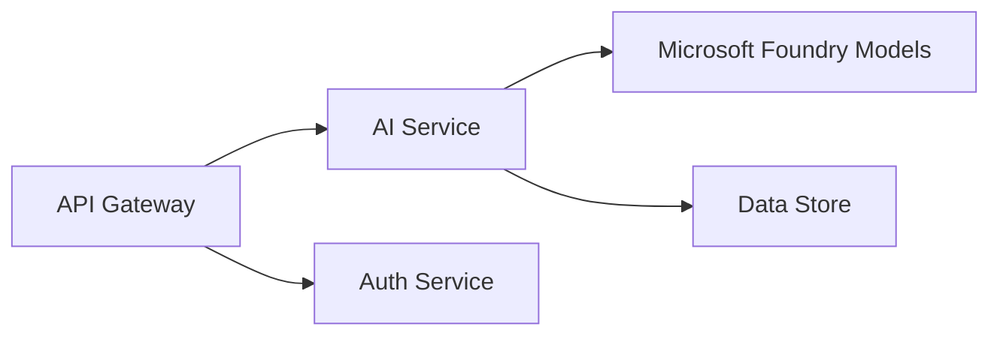
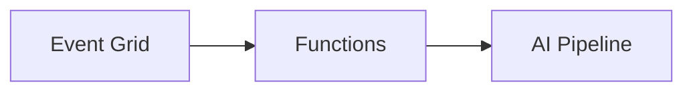

# அத்தியாயம் 8: உற்பத்தி & நிறுவன இட்டல் மாதிரிகள்

**📚 பாடநெறி**: [AZD ஆரம்பநிலை](../../README.md) | **⏱️ காலம்**: 2-3 மணி நேரம் | **⭐ சிக்கல் நிலை**: மேம்பட்டது

---

## கண்ணோட்டம்

இந்த அத்தியாயம் நிறுவன தயார் தன்மையுள்ள இணைக்கல் மாதிரிகள், பாதுகாப்பு கடினப்படுத்தல், கண்காணிப்பு மற்றும் உற்பத்தி AI பணிகளுக்கான செலவு அதிகரிப்பு குறைப்பு குறித்து கையாள்கிறது.

இது கட்டமைப்பு குறிப்பு, முழுமையான இயக்கக்கூடிய உற்பத்தி மாதிரி அல்ல. உதாரணங்கள் உங்கள் சொந்த விண்ணப்பத்தில் வழங்கி சோதிக்க வேண்டிய ஒருங்கிணைப்பு விவரங்களை தவிர்க்கின்றன; சரிபார்ப்பு பட்டியலை வாசிப்பது உற்பத்தி தயார் நிலையை உறுதி செய்வதாக இல்லை.

> **வெளியீடு மதிப்பாய்வு (2026-11-04):** AI CLI வழிகாட்டி `azd 1.37.2`, முகவர்கள் `1.0.0-beta.23` மற்றும் மதிப்பீடுகள் `1.0.0-beta.2` ஆவணங்கள்/மூலத்துடன் சரிபார்க்கப்பட்டது. இணக்கமான தேவைகள் மற்றும் மைக்ரேஷன் விவரங்களுக்கு [வெளியீட்டு மாற்றங்கள் மற்றும் திருத்தங்கள்](production-ai-practices.md#recent-release-changes-and-fixes) பார்க்கவும்; இது நேரடி இயக்க மதிப்பீடு அல்ல.

## கற்றல் குறிக்கோள்கள்

இந்த அத்தியாயத்தை முடித்தவுடன், நீங்கள்:
- பன்முக மண்டல சக்தி வாய்ந்த பயன்பாடுகளை இயக்கலாம்
- நிறுவன பாதுகாப்பு மாதிரிகளை செயல்படுத்தலாம்
- முழுமையான கண்காணிப்பை அமைக்கலாம்
- அளவுடன் செலவுகளை மேம்படுத்தலாம்
- AZD உடன் CI/CD குழாய்களை அமைக்கலாம்

---

## 📚 பாடங்கள்

| # | பாடம் | விளக்கம் | நேரம் |
|---|--------|-------------|------|
| 1 | [உற்பத்தி AI நடைமுறைகள்](production-ai-practices.md) | நிறுவன இட்டல் மாதிரிகள் | 90 நிமிடங்கள் |

---

## 🚀 உற்பத்தி சரிபார்ப்பு பட்டியல்

- [ ] நன்மை மிக்க பன்முக மண்டல இட்டல்
- [ ] அங்கீகாரத்திற்கு பராமரிக்கப்பட்ட அடையாளம் (சாவிகள் இல்லை)
- [ ] கண்காணிப்புக்கு பயன்பாட்டு உள்ளடக்கங்கள்
- [ ] செலவு பட்ஜெட்டுகள் மற்றும் எச்சரிக்கைகள் அமைக்கப்பட்டுள்ளன
- [ ] பாதுகாப்பு சரிபார்ப்புகள் இயக்கு
- [ ] CI/CD குழாய் ஒருங்கிணைப்பு
- [ ] பேரழிவை மீட்டெடுக்கும் திட்டம்

---

## 🏗️ கட்டமைப்பு மாதிரிகள்

### மாதிரி 1: மைக்ரோசெர்வீசஸ் AI



### மாதிரி 2: நிகழ்வுக்கான AI



---

## 🔐 பாதுகாப்பு சிறந்த நடைமுறைகள்

```bicep
// Illustrative properties from different resources, NOT a standalone Bicep file.
// Attach identity to the application host:
identity: {
  type: 'SystemAssigned'
}

// AI account properties (also require private endpoints, DNS and app connectivity):
properties: {
  publicNetworkAccess: 'Disabled'
  networkAcls: {
    defaultAction: 'Deny'
  }
}
```

---

## 💰 செலவு மேம்படுத்தல்

| रणनीति | முக்கிய கட்டுப்பாடு |
|----------|---------|
| பூஜ்ஜியமாக அளவிடுதல் (கன்டெய்னர் ஆப்ஸ்) | பொருத்தமான தூண்டுகோலை தேவைப்படுத்தும்; பிற சேவைகள் இன்னும் செலவுகள் உருவாக்கும் |
| வளர்ச்சிக்கான கட்டமைப்பு நிலைகள் பயன்படுத்தல் | தேர்ந்தெடுக்கப்பட்ட சேவை விலை மற்றும் பணிமனையை ஒப்பிடுதல் |
| அட்டவணைப்படி அளவிடுதல் | ஆதரவு உடைய கட்டமைப்பு/தானியக்க வழியாக அளவிடுதல் |
| முன்பதிவு/புரொவிஷன் திறன் | மட்டுமே ஆதரிக்கப்படும் போது; உறுதிமொழிகள் மந்தநிலை செலவுகளை உயர்த்தலாம் |

செல்லுபடியாகும் தொடக்க தேதி, பில்லிங் பரப்பு, பெறுநர்கள் மற்றும் அனுமதிகளுடன் கூடிய [முழுமையான பட்ஜெட் வள மாதிரியை](production-ai-practices.md#2-cost-monitoring-and-budgets) பயன்படுத்தவும். பட்ஜெட் எச்சரிக்கைகள் அனுப்புகிறது; இது செலவினத்தைக் கட்டுப்படுத்தாது. சேமிப்பு அளவுக்கேற்ப பயன்படுத்தப்பட்ட பயன்பாட்டின்மேல் சார்புடையது மற்றும் உறுதிப்படுத்தப்பட்ட சதவீதங்கள் இல்லை.

---

## 📊 கண்காணிப்பு அமைப்பு

```bash
# Open the Application Insights logs view (requires configured monitoring)
azd monitor --logs

# Check Application Insights
azd monitor --overview

# View metrics
az monitor metrics list --resource <resource-id>
```

---

## 🔗 வழிசெலுத்தல்

| திசை | அத்தியாயம் |
|-----------|---------|
| **முந்தைய** | [அத்தியாயம் 7: சிக்கல் நீக்கல்](../chapter-07-troubleshooting/README.md) |
| **பாடம் முடிவு** | [பாட நிரல் முகப்பு](../../README.md) |

---

## 📖 தொடர்புடைய வளங்கள்

- [AI முகவர்கள் கையேடு](../chapter-02-ai-development/agents.md)
- [ஆப்ளிகேஷன் இன்சைட்ஸ்](../chapter-06-pre-deployment/application-insights.md)
- [மல்டி-ஏஜென்ட் தீர்வுகள்](../chapter-05-multi-agent/README.md)
- [மைக்ரோசர்வீசஸ் எடுத்துக்காட்டு](../../examples/microservices/README.md)

---

<!-- CO-OP TRANSLATOR DISCLAIMER START -->
**மறுப்பு**:
இந்த ஆவணம் AI மொழிபெயர்ப்பு சேவை [Co-op Translator](https://github.com/Azure/co-op-translator) பயன்படுத்தி மொழிபெயர்க்கப்பட்டுள்ளது. நாங்கள் துல்லியத்திற்காக முயற்சி செய்துள்ளோம், ஆனால் தானாக செய்யப்படும் மொழிபெயர்ப்புகளில் பிழைகள் அல்லது தவறுகள் இருக்கலாம் என்பதை கவனத்தில் கொள்ளவும். அசல் ஆவணம் அதன் தாய்மொழியில் அதிகாரப்பூர்வ ஆதாரமாக கருதப்பட வேண்டும். முக்கியமான தகவல்களுக்கு, தொழில்நுட்பமான மனித மொழிபெயர்ப்பு பரிந்துரைக்கப்படுகிறது. இந்த மொழிபெயர்ப்பைப் பயன்படுத்துவதால் ஏற்படும் எந்த தவறான புரிதல்கள் அல்லது தவறான விளக்கத்திற்கும் நாங்கள் பொறுப்பில்வில்லை.
<!-- CO-OP TRANSLATOR DISCLAIMER END -->