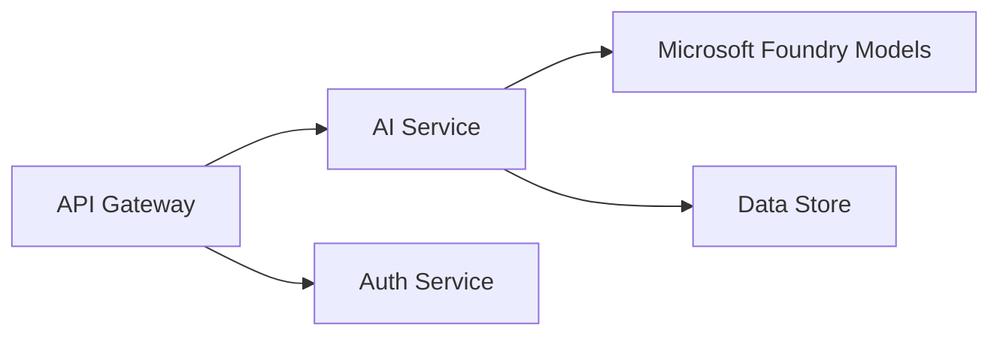

# அத்தியாயம் 8: உற்பத்தி மற்றும் நிறுவன மாதிரிகள்

**📚 பாடநெறி**: [AZD தொடக்கத்தரகவாரியாக](../../README.md) | **⏱️ கால அளவு**: 2-3 மணி நேரம் | **⭐ சிக்கல் நிலை**: மேம்பட்டது

---

## மேம்பார்வை

இந்த அத்தியாயம் நிறுவனத்துக்கு ஏற்றபடி வழங்கல் மாதிரிகள், பாதுகாப்பு வலுப்படுத்தல், கண்காணிப்பு மற்றும் உற்பத்தி AI பணிப்படுத்தல்களுக்கு செலவு முற்படுத்தலை உட்படக் கையாள்கிறது.

இது ஒரு கட்டமைப்பு குறிப்பு, முழுமையான இயங்கக்கூடிய உற்பத்தி கூறுகளுக்கான வார்ப்புரு அல்ல. எடுத்துக்காட்டுகள் ஒருங்கிணைப்பு விவரங்களைத் தவிர்க்கின்றன, அவற்றை உங்கள் சொந்த பயன்பாட்டில் வழங்கி சோதிக்க வேண்டும்; சரிபார்ப்புப்பட்டியலை வாசிப்பது உற்பத்தி தயார்நிலை உறுதிப்படுத்துவது அல்ல.

> **Foundry GA புதுப்பிப்பு (2026-11-09):** Foundry பணிநடவடிக்கைக்காக `azd >= 1.37.0` மற்றும் பொதுவாக கிடைக்கக்கூடிய `microsoft.foundry` 1.0 தொகுப்பை பயன்படுத்தவும்; மதிப்பீடுகள் தனியாக நிறுவப்படுகின்றன. [விடுவிப்பு வரம்பு மற்றும் இடம் மாற்றம்](production-ai-practices.md#recent-release-changes-and-fixes) மற்றும் [அங்கீகாரம் பெற்ற குழாய் எடுத்துக்காட்டு](production-ai-practices.md#cicd-pipeline-configuration) பார்க்கவும். இது ஆவண விமர்சனம், நேரடி வழங்கல் சரிபார்ப்பு அல்லது விருப்ப முன்னோட்ட அம்சங்களுக்கான முழுமையான GA நிலையை விடவில்லை.

## கற்றல் நோக்கங்கள்

இந்த அத்தியாயத்தை முடித்தால், நீங்கள்:
- பன்மண்டல பகுப்பாய்வு உருவாக்குதல்
- நிறுவன பாதுகாப்பு மாதிரிகளை நடைமுறைப்படுத்துதல்
- முழுமையான கண்காணிப்பை அமைத்தல்
- அளவிலான செலவு மேம்பாட்டை செய்தல்
- AZD உடன் CI/CD குழாய்களை அமைத்தல்

---

## 📚 பாடங்கள்

| # | பாடம் | விளக்கம் | நேரம் |
|---|--------|-------------|------|
| 1 | [உற்பத்தி AI நடைமுறைகள்](production-ai-practices.md) | நிறுவன அமர்வு மாதிரிகள் | 90 நிமிடங்கள் |

---

## 🚀 உற்பத்தி சரிபார்ப்பு பட்டியல்

- [ ] பன்மண்டல பகுப்பாய்வு
- [ ] அங்கீகாரத்திற்கான மேலாண்மை அடையாளம் (சாவிகள் இல்லாமல்)
- [ ] கண்காணிப்புக்கான பயன்பாட்டுக் கருத்து
- [ ] செலவு பட்ஜெட்டுகள் மற்றும் எச்சரிக்கைகள் அமைந்துள்ளன
- [ ] பாதுகாப்பு பரிசோதனை செயல்படுத்தப்பட்டது
- [ ] CI/CD குழாய் ஒருங்கிணைப்பு
- [ ] பேரிடர் மீட்டெடுப்பு திட்டம்

---

## 🏗️ கட்டமைப்பு மாதிரிகள்

### மாதிரி 1: மைக்ரோசர்வீசஸ் AI



### மாதிரி 2: நிகழ்வு இயக்கப்பட்ட AI


---

## 🔐 பாதுகாப்பு சிறந்த நடைமுறைகள்

```bicep
// Illustrative properties from different resources, NOT a standalone Bicep file.
// Attach identity to the application host:
identity: {
  type: 'SystemAssigned'
}

// AI account properties (also require private endpoints, DNS and app connectivity):
properties: {
  publicNetworkAccess: 'Disabled'
  networkAcls: {
    defaultAction: 'Deny'
  }
}
```

---

## 💰 செலவு மேம்பாடு

| திட்டம் | முக்கிய கட்டுப்பாடு |
|----------|---------|
| சுழற்ந்து பூஜ்யமாகும் (கண்டெய்னர் செயலிகள்) | ஏற்றுமதி உத்தைவரியைக் கொண்டிருக்க வேண்டும்; பிற சேவைகள் செலவுக் கொண்டிருக்கின்றன |
| மேம்பாட்டிற்கு உபயோக தன்மை நிலைகள் | தேர்ந்தெடுக்கப்பட்ட சேவை விலை மற்றும் பணியொத்தம் ஒப்பிடுதல் |
| திட்டமிடப்பட்ட அளவுகோல் | ஆதரவு பெற்ற கட்டமைப்பு/தானியக்கத்தின் மூலம் அளவிடுக |
| முன்பதிவு/ஒதுக்கீடு திறன் | ஆதரவு உள்ளபோதும் மட்டுமே; உறுதிமானங்கள் காலி செலவுகளை அதிகரிக்கலாம் |

செல்லுபடியான துவக்கத் தேதி, பில்லிங் வரம்பு, பெறுநர்கள் மற்றும் அனுமதிகளுடன் [முழு பட்ஜெட் வள மாதிரி](production-ai-practices.md#2-cost-monitoring-and-budgets) பயன்படுத்தவும். பட்ஜெட் எச்சரிக்கைகள் அனுப்புகிறது; செலவுக்கு வரம்பு இடாது. சேமிப்புகள் அளவிடப்பட்ட பயன்பாட்டினைக் கொணர்ந்து, விகிதங்களாக உறுதி செய்யப்படவில்லை.

---

## 📊 கண்காணிப்பு அமைப்பு

```bash
# Open the Application Insights logs view (requires configured monitoring)
azd monitor --logs

# Check Application Insights
azd monitor --overview

# View metrics
az monitor metrics list --resource <resource-id>
```

---

## 🔗 வழிசெலுத்தல்

| திசை | அத்தியாயம் |
|-----------|---------|
| **முந்தைய** | [அத்தியாயம் 7: சிக்கல் விசாரணை](../chapter-07-troubleshooting/README.md) |
| **பாடநெறி முடிவு** | [பாடநெறி முகப்பு](../../README.md) |

---

## 📖 தொடர்புடைய வளங்கள்

- [AI முகவர்கள் வழிகாட்டி](../chapter-02-ai-development/agents.md)
- [பயன்பாட்டு கருத்து](../chapter-06-pre-deployment/application-insights.md)
- [பன்முக முகவர் தீர்வுகள்](../chapter-05-multi-agent/README.md)
- [மைக்ரோசர்வீசஸ் எடுத்துக்காட்டு](../../examples/microservices/README.md)

---

<!-- CO-OP TRANSLATOR DISCLAIMER START -->
**மறுப்பு**:
இந்த ஆவணம் AI மொழிபெயர்ப்பு சேவை [Co-op Translator](https://github.com/Azure/co-op-translator) பயன்படுத்தி மொழிபெயர்க்கப்பட்டுள்ளது. நாங்கள் துல்லியத்திற்காக முயற்சி செய்துள்ளோம், ஆனால் தானாக செய்யப்படும் மொழிபெயர்ப்புகளில் பிழைகள் அல்லது தவறுகள் இருக்கலாம் என்பதை கவனத்தில் கொள்ளவும். அசல் ஆவணம் அதன் தாய்மொழியில் அதிகாரப்பூர்வ ஆதாரமாக கருதப்பட வேண்டும். முக்கியமான தகவல்களுக்கு, தொழில்நுட்பமான மனித மொழிபெயர்ப்பு பரிந்துரைக்கப்படுகிறது. இந்த மொழிபெயர்ப்பைப் பயன்படுத்துவதால் ஏற்படும் எந்த தவறான புரிதல்கள் அல்லது தவறான விளக்கத்திற்கும் நாங்கள் பொறுப்பில்வில்லை.
<!-- CO-OP TRANSLATOR DISCLAIMER END -->