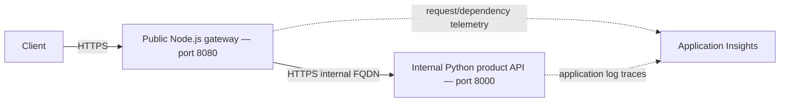

# இரு-சேவை மைக்ரோசெர்வீசுகள் — Azure Container Apps

**அடுக்கு:** நடுநிலை · **நேரம்:** அமைப்புடன் சேர்த்து 45–60 நிமிடங்கள்

இந்த கற்றல் மாதிரி ஒரு **Node.js API வாயிலாகம்** மற்றும் ஒரு **வாசிப்பதற்கான மட்டும் Python
தயாரிப்பு சேவை** ஐ நடைமுறைப்படுத்துகிறது. மூலக் குறியீடு, Dockerfiles, Bicep மற்றும் azd கட்டமைப்பு அடங்கும்.
இது ஒரு தயாரிப்பு-தவிர்க்கப்பட்ட அமைப்பு அல்ல.

## நீங்கள் கற்கப்போகும் விஷயங்கள்

- இரண்டு சேவைகளையும் தனிப்படுத்தி வாயிலாகம் செய்யவும்.
- HTTPS மூலம் உள்ளக பின்தள FQDN ஐ பயன்படுத்தவும்.
- வெற்றி, இல்லை-கிடைக்கப்பட்டது, மற்றும் கிடையாத சேவை பதில்களை உறுதிசெய்யவும்.
- தொலைநோக்கு வலைவியல் மற்றும் தனிப்பட்ட அளவீட்டு எல்லைகளைப் புரிந்துகொள்ளவும்.



தயாரிப்பு பட்டியலில் நினைவகத்தில் ஐந்து நிலையான தயாரிப்புகள் உள்ளன. **POST,
PUT, அல்லது DELETE ஹேண்ட்லர்கள்**, தரவுத்தளம், சேவை பஸ், ஆர்டர்/பயனர்/அறிவிப்பு சேவை,
C#, அல்லது Go குறியீடு இல்லை. அவை எதிர்கால மேம்பாட்டு எண்ணங்கள், சேர்க்கப்பட்ட அம்சங்கள் அல்ல.
வாயிலாகம் பயனர்களை அங்கீகரிக்காது; உள்ளமை உள்ளீடு பயன்பாட்டு அனுமதிப்புக்கு மாற்றுப்பாடு அல்ல.


## தேவையான முன் நிபந்தனைகள்

முதலில் [ஒற்றை Flask API](../../../../../examples/container-app/simple-flask-api) ஐ முடிக்கவும்.
தற்போதைய நிலையான azd ஐ நிறுவவும் (காணொளி வெளியீடு போது பதிப்பு: 1.37.2), Azure CLI,
மற்றும் Docker ஐ டிமன் இயக்கத்தில் நிறுவவும். Azure சந்தா, வளம்
உருவாக்கும் அனுமதிகள் மற்றும் Container Apps பிரதேச விகிதம் தேவை.

```bash
azd version
az version
docker info
azd auth login
az login
```

இரு CLI கருவிகளிலும் ஒரே சந்தாவைப் பயன்படுத்தவும். கீழுள்ள கட்டளைகள் Bash ஐ பயன்படுத்துகின்றன.

## வாயிலாகம் செய்து சரிபார்க்கவும்

களஞ்சியத்தின் ரூட் பத்திரிகை இடத்தில் இருந்து:

```bash
cd examples/container-app/microservices
azd env new microservices-demo
azd up
GATEWAY_URL=$(azd env get-value API_GATEWAY_URL)
RG_NAME=$(azd env get-value AZURE_RESOURCE_GROUP)
GATEWAY_NAME=$(azd env get-value API_GATEWAY_NAME)
PRODUCT_NAME=$(azd env get-value PRODUCT_SERVICE_NAME)

curl --fail-with-body "${GATEWAY_URL}/health"
curl --fail-with-body "${GATEWAY_URL}/api/products"
curl --fail-with-body "${GATEWAY_URL}/api/products/1"
curl -i "${GATEWAY_URL}/api/products/999"
```

**வெற்றி:** health 200; பட்டியல் 200 ஐ **ஐந்து** தயாரிப்புகளுடன்; தயாரிப்பு 1 ஒரு லேப்டாப்ப்,
விலை 999.99 மற்றும் வட்டி 50 உள்ளது; தெரியாத தயாரிப்பு 404 ஐ திருப்புகிறது.
விளக்கங்கள் பதில்களில் உள்ளன; நேரக்கோடுகள் மாறுபடுகின்றன.

ஆரம்ப ஏற்பாடு பொதுவான hello-world படங்களை போர்ட் 80 இல் பயன்படுத்துகின்றது, ஆகவே அது காலியான பதிவகத்திலிருந்து நிலைநிறுத்தப்படாத படங்களை எடுக்க முயற்சிப்பதில்லை.
சேவை-பிரத்தியேக Bicep தொகுதிகள்
மற்றும் அளவுரு கோப்புகள் அவற்றை உருவாக்கப்பட்ட படங்கள் மற்றும் செயலி போர்ட்டுகள்/தருகைகள் மூலம் மாற்றும் போது
`azd deploy`. முக்கிய அளவுருக்கள் பின்னர் வழங்கும் நோக்கத்திற்காக வெளியிடப்பட்ட பட பெயர்களை சேமிக்கின்றன.

## சேவைகள் மற்றும் நெட்வொர்க்கிங்

| சேவை | வெளிப்படுத்தப்பட்ட முடிவுகள் | இயல்புநிலை வளங்கள் |
|---|---|---|
| கெய்ட்வே | GET `/`, `/health`, `/api/products`, `/api/products/:id` | 1 vCPU, 2 GiB, 2–20 பிரதிகள் |
| தயாரிப்பு | GET `/`, `/health`, `/products`, `/products/<id>` | 0.5 vCPU, 1 GiB, 1–10 பிரதிகள் |

தயாரிப்பு இன்பிரேசில் `external: false` மற்றும் `allowInsecure: false` உள்ளன. பைசெப்
`PRODUCT_SERVICE_URL=https://<actual-internal-fqdn>` கெய்ட்வேவில் உள்ளே இடுகிறது. HTTP மறுசெலுத்தும்; HTTPS அமைக்கப்பட்ட
இன்பிரஸுடன் பொருந்தும். ஒரு சுருக்கமான DNS பெயர் பொருந்த வேண்டும்
**உண்மையான காலுக்கடவு பயன்பாட்டு பெயர்**, தவிர்க்க முடியாத சேவை விசை `product-service` அல்ல.
உங்கள் தனிப்பட்ட கணினியிலிருந்து நேரடியாக உள்ளக URL ஐ அழைக்க முயற்சிக்க வேண்டாம்.

தயாரிப்பு அழைப்புகளுக்கு காப்பறை ஐந்து வினாடிகள் நேரம்கാഴ் காப்பளிக்கிறது. தயாரிப்பு ஐடிக்கள் காணப்படாவிட்டால்
404 என பரவுகின்றன; போக்குவரத்து தோல்வி/பின்புலத் தோல்விகள் 503 ஐ மீட்டன.
காப்பறை `/health` காப்பறையையேச் சரிபார்க்கிறது, பின்புல கிடைப்பை அல்ல.

## கோப்புகள் மற்றும் கட்டமைப்பு

```text
azure.yaml
infra/main.bicep
infra/main.parameters.json
infra/abbreviations.json
infra/core/container-apps-environment.bicep
infra/core/monitor.bicep
infra/app/api-gateway.bicep
infra/app/api-gateway.parameters.json
infra/app/product-service.bicep
infra/app/product-service.parameters.json
src/api-gateway/{app.js,package.json,Dockerfile}
src/product-service/{main.py,requirements.txt,Dockerfile}
```

அளவு மாற்றம், CPU/மெமரி, துறைமுகங்கள், மற்றும் சோதனைகள் `infra/app/*.bicep` இல் அமைக்கப்படுகின்றன. அந்த
கோப்புகளை மாற்றி, கட்டமைப்பையும் மீண்டும் கணக்கிட `azd up` ஐ இயக்கவும். இதில் எந்த
`GATEWAY_MAX_REPLICAS` சூழல் மாறி அளவுரு இல்லை.

கோடு மட்டும் மாற்றங்களுக்காக:

```bash
azd deploy product-service
azd deploy api-gateway
```

Node படம் Node 22 ஐப் பயன்படுத்துகிறது; Python படம் Python 3.11 ஐப் பயன்படுத்துகிறது. இரண்டும்
`0.0.0.0`. இன்புலங்கள்/பரிசோதனைகள் முறையே போர்ட் 8080 (கேட்வே) மற்றும் 8000 (பொருள்) பயன்படுத்துகின்றன.

## டோக்கர் உடன் உள்ளூரான அபிவிருத்தி

இந்த எடுத்துக்காட்டு அடைவரியில் இருந்து இயக்கவும். பயனர் வரையறுக்கப்பட்ட நெட்வொர்க்கைப் பயன்படுத்தவும், **not `localhost`
ஒரு கண்டெயினரிலிருந்து மற்றொன்றை அணைபாக**:

```bash
docker network create azd-microservices-demo
docker build -t local-product ./src/product-service
docker build -t local-gateway ./src/api-gateway
docker run -d --name azd-product --network azd-microservices-demo local-product
docker run -d --name azd-gateway --network azd-microservices-demo \
  -p 8080:8080 -e PRODUCT_SERVICE_URL=http://azd-product:8000 local-gateway
curl --fail-with-body http://localhost:8080/api/products
```

எதிர்பார்க்கப்பட்டது: ஐந்து தயாரிப்புகள். HTTP இந்த உள்ளுள்ள Docker வலையமைப்பிற்காக மட்டுமே பயன்படுத்தப்படுகிறது.

```bash
docker stop azd-product azd-gateway
docker rm azd-product azd-gateway
docker network rm azd-microservices-demo
```

## கண்காணிப்பு

```bash
az containerapp logs show --name "$GATEWAY_NAME" --resource-group "$RG_NAME" --follow
# In a separate terminal:
az containerapp logs show --name "$PRODUCT_NAME" --resource-group "$RG_NAME" --tail 100
```

`azd monitor --logs` ஒரு போர்டல் காட்சியினைத் திறக்கிறது; இது டெர்மினல் பதிவு தொடர்வையா வழங்காது.
Node SDK வாயிலாக கோரிக்கைகள்/இணைப்புக்களை சேகரிக்கிறது. Python இன் `AzureLogHandler`
**பதிவு தடயங்களை** ஏற்றுமதி செய்கிறது, தானாக நிகழும் Flask கோரிக்கைகள், SQL இணைப்புக்கள் அல்லது முழுமையான
பகிரப்பட்ட தடயங்களை அல்ல. OpenCensus என்பது பழைய SDK ஆகும்; இந்த மாதிரியை விரிவுபடுத்தும்போது Azure Monitor OpenTelemetry-ஐ முன்னுரிமை அளிக்கவும்.


Application Insights பதிவுகளில், கோரிக்கைகளை உருவாக்கி ஆய்வு செய்யவும்:

```kusto
requests
| where timestamp > ago(1h)
| where name contains "products"
| summarize RequestCount=count(), AvgDuration=avg(duration) by bin(timestamp, 5m)
```

Python செயலி செய்திகள் க்காக:

```kusto
traces
| where timestamp > ago(1h)
| where message contains "products"
| project timestamp, message, severityLevel
```

உள்நுழைவு தாமதமும் மாதிரிச் சேகரிப்பும் அனுமதிக்கவும்; ஒரு துல்லியமான கோரிக்கை எண்ணிக்கை அல்லது
உறுதியான இடைவேளை எதிர்பார்க்க வேண்டாம். எந்தவொரு தனிப்பயன் எச்சரிக்கைகள் அல்லது டாஷ்போர்ட்களும் கட்டமைக்கப்படவில்லை.

## நடைமுறை பயிற்சிகள்

### பயிற்சி 1: பட்டியலை மாற்று

**தொடக்கப்புள்ளி:** `src/product-service/main.py`.
**கோள்:** சுயாதீன சேவை குறித்தத்தைச் சரிபார்க்கவும்.
கட்டுப்படுத்தப்பட்ட `products` பட்டியலில் லேப்டாப் பங்குகளை 50 இல் இருந்து 49 ஆக மாற்றி,
`azd deploy product-service` இயக்கி, பின்னர் `${GATEWAY_URL}/api/products/1` கோரிக்கை செய்யவும்.

**வெற்றி معیارات / தீர்வு:** HTTP 200 உடன் `"stock":49`. 50 ஐ மீட்டமைத்து மீண்டும் பரிமாற்று.
**இயல்பான பிரச்சனை:** கத்தாலாக் கட்டுப்படுத்தும் சேவையை அல்லாமல் கேட்வேயைத் திருத்துவது.
இது மூல தரவை மாற்றுகிறது, நிலையான பொருள் தரவுத்தளத்தை அல்ல.

### கருச்செறிவு 2: பிரதியமைவு கட்டமைப்பை சரிபார்க்கவும்

**தொடக்க புள்ளி:** `infra/app/product-service.bicep`.
**குறிக்கோள்:** ஆட்டோஸ்கேலிங் பற்றிய கணிப்பின்றி ஒரு அடித்தட மாற்றத்தை கவனிக்கவும்.
`minReplicas: 1` ஐ `minReplicas: 2` ஆக மாற்றி, `azd up` ஐ இயக்கி, பிறகு:

```bash
az containerapp show --name "$PRODUCT_NAME" --resource-group "$RG_NAME" \
  --query properties.template.scale -o json
```

**வெற்றி 기준ம்:** அமைக்கப்பட்ட குறைந்தபட்சம் 2 மற்றும் அதிகபட்சம் 10 ஆக உள்ளது.
குறைந்தபட்சம் 1 ஆக மீட்டமைத்து `azd up` ஐ இயக்கவும்.
**பொதுவான பிரச்சினை:** `azd deploy` மட்டும் தொடர்பற்ற பொதுவான
அடித்தளத்தில் மாற்றங்களைச் செயல்படுத்தாது. தோல்வி சிமுலேஷனுக்காக `maxReplicas` ஐ பூஜ்ஜியமாக அமைக்க அஞ்ச வேண்டாம்.
இது கட்டமைப்பை சரிபார்க்கிறது, ஒரு சுமை-சோதனை அல்லது உறுதியான உடனடி நகல் எண்ணிக்கையைக் கூறுவது அல்ல.

### பயிற்சி 3: உள்ளூர் தோற்றமில்லாத சேவையை சோதித்தல்

**தொடக்கப் புள்ளி:** மேலேயுள்ள உள்ளூர் Docker கன்டெயினர்கள் இரண்டும் இயங்கிக் கொண்டிருக்கின்றன.
**தீவிர நோக்கம்:** பின்னணி தோல்வியைக் கண்டறிந்து இல்லாத பொருளிலிருந்து வித்தியாசப்படுத்துதல்.
பொருள் கன்டெயினரை மட்டும் நிறுத்தவும்:

```bash
docker stop azd-product
curl -i http://localhost:8080/api/products
docker start azd-product
curl --fail-with-body http://localhost:8080/api/products
```

**வெற்றி 기준ம்:** நிறுத்தப்பட்ட போது, வாயில்கால் 503ஐ
`"error":"Product service unavailable"` உடன் திருப்பி வழங்க வேண்டும்; மீண்டும் துவங்கியபின் பட்டியல் 200 ஐ காட்ட வேண்டும்.
தேவையானால் குறுகிய துவக்க தாமதத்துக்குப் பிறகு மீண்டும் முயற்சி செய்யவும்.
**பொதுவான பிரச்சினை:** வாயில்காலை நிறுத்துவது வேறொரு தோல்வியை சோதிக்கும் (HTTP பதில் கிடையாது).

## செலவுகள் மற்றும் உற்பத்தி இடைவெளிகள்

இயல்புநிலை குறைந்தபட்ச நகல்கள் கணினியை இயங்க வைக்க வைத்திருக்கும். பதிவேட்டு மற்றும் கண்காணிப்பு கூட செலவுகளை ஏற்படுத்தும்.
நிலையான $50/மாதம் மொத்தம் சரிபார்க்கப்படவில்லை: பிராந்திய CPU/மெமரி,
நகல் மணிகள், கோரிக்கைகள், பதிவேட்டு மற்றும் பதிவு தக்கவைத்தல் ஆகியவற்றை
[Azure விலை கணக்கிடுபவர்](https://azure.microsoft.com/pricing/calculator/) இல் மதிப்பிடவும்.
பயிற்சி வளங்களை உடனடி அகற்று.

உற்பத்தி வேலைauthentication/authorization, மையமிட்ட மேலாண்மை அடையாளங்கள்,
நிலையான தரவு, உள்ளீடு/பதில் செல்லுபடியாக்கல், ஆதரவு பெறும் காண்கின்ற தனிமுறை,
சுமை/தோல்வி சோதனை, CI/CD, எச்சரிக்கை மற்றும் மீட்பு நடைமுறைகளை உள்ளடக்கியவை. ஒரு ஆர்டர்
சேவை, வரிசை அல்லது தரவுத்தளத்தை சேர்ப்பது தனித்தானான செயல்படுத்தல் பணியாகும், முடிக்கப்பட்ட
பயிற்சி அல்லது இங்கே ஏற்கனவே கிடைக்கும் அம்சம் அல்ல.

## சிக்கலான தீர்வு மற்றும் கழிவுறுப்பு

- **முதல் வழங்கலின் போது படம் கிடைக்கவில்லை:** புட்கம்ப் பொதுப் படத்தை பயன்படுத்த வேண்டும்;
  முக்கிய படம் பரிமாற்றத்தின் இயல்பு அமைப்புகளை மற்றும் பிணைப்புக் கட்டங்களை சரிபார்க்கவும்.
- **503 பொருட்கள்:** பொருள் பதிவு, படம் பதிப்பு, மற்றும் ஊடுருவியுள்ள உள் HTTPS URL ஐ சரிபார்க்கவும்.
- **404 எதிர்பாராத பாதை:** பொருள் API படிக்க மட்டுமே; பாதையை சரிபார்க்கவும், இல்லை டிண்டோ மாணவர்கள் கிடையாது.
- **தொடர்பு இல்லை:** இயக்கக இணைப்பு வரிசைகளை வெளிப்படுத்தாமல் ஆய்வு செய்யவும் மற்றும்
  உள்ளீடு தாமதத்தைக் கண்காணிக்கவும். Python கோரிக்கை அட்டவணைகள் அதன் பதிவு கையாளலால் நிரப்பப்படாது.

இந்த மாதிரி அடைவிலிருந்து:

```bash
azd down
```

அகற்றல் அறிவுறுத்தல்களை மதிப்பாய்வு செய்து, நிகரித்த வளக் குழுமம் அகற்றப்பட்டதை உறுதிசெய்க.

[முந்தையது: Flask API](../../../../../examples/container-app/simple-flask-api) · [அடுத்தது: தரவுத்தள செயலி](../../../../../examples/database-app) ·
[AI மேம்பாடு](../../../docs/chapter-02-ai-development/README.md) ·
[பாடத்திட்ட முகப்பு](../../../README.md) · [பிரச்சினையை அறிக்கையிடவும்](https://github.com/microsoft/AZD-for-beginners/issues)

---

<!-- CO-OP TRANSLATOR DISCLAIMER START -->
**மறுப்பு**:
இந்த ஆவணம் AI மொழிபெயர்ப்பு சேவை [Co-op Translator](https://github.com/Azure/co-op-translator) பயன்படுத்தி மொழிபெயர்க்கப்பட்டுள்ளது. நாங்கள் துல்லியத்திற்காக முயற்சி செய்துள்ளோம், ஆனால் தானாக செய்யப்படும் மொழிபெயர்ப்புகளில் பிழைகள் அல்லது தவறுகள் இருக்கலாம் என்பதை கவனத்தில் கொள்ளவும். அசல் ஆவணம் அதன் தாய்மொழியில் அதிகாரப்பூர்வ ஆதாரமாக கருதப்பட வேண்டும். முக்கியமான தகவல்களுக்கு, தொழில்நுட்பமான மனித மொழிபெயர்ப்பு பரிந்துரைக்கப்படுகிறது. இந்த மொழிபெயர்ப்பைப் பயன்படுத்துவதால் ஏற்படும் எந்த தவறான புரிதல்கள் அல்லது தவறான விளக்கத்திற்கும் நாங்கள் பொறுப்பில்வில்லை.
<!-- CO-OP TRANSLATOR DISCLAIMER END -->