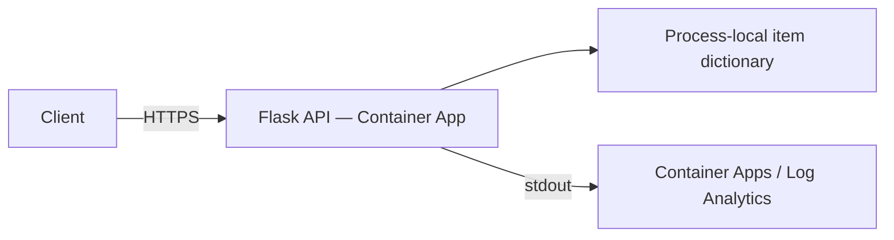

# எளிய Flask API — Azure Container Apps

**மயன்:** துவக்க நிலை · **நேரம்:** 30–45 நிமிடங்கள் அமைப்புடன் சேர்த்து

Azure Developer CLI (azd) உடன் Python Flask CRUD API ஐ நடைமுறைப் படு. மூலக்கோப்பு, Dockerfile,
Bicep, மற்றும் காணொளி deployment அளவுருக்கள் உள்ளன. இது ஒரு **கற்றல் மாதிரி**, 
உற்பத்திக்கு தயாரான API அல்ல.

## நீங்கள் கற்கப்போகும் விஷயங்கள்

- azd மூலம் ஒரு container கட்டி அச்சிடல் செய்.
- உள்ளேறுதல் மற்றும் liveness/readiness probes ஐ அமை.
- CRUD பதில்களை சரிபார் மற்றும் பயன்பாட்டு பதிவுகளை ஆய்வு செய்.
- நினைவகத்தில் உள்ள தரவு நிலையான பயன்பாடுகளுக்கு ஏற்றது அல்ல என்பதை புரிந்து கொள்.



**முக்கியம்:** உருப்படிகள் ஒரு செயலியில் வைத்திருக்கப்படுகின்றன. இயல்புநிலை **ஒரு Gunicorn பணியாளர்,
0–1 நகல்கள்**, பணியாளர்கள்/நகல்கள் இடையே தரவு முரண்பாடு தவிர்க்க ஒரு நுட்பமாக.
மீண்டும் துவக்கம், பதிப்பு மாற்றம், அல்லது அளவை சுழற்சி மூலம் உருப்படிகள் இழக்கப்படுகின்றன.
அதிக நகல்கள் தேவைக்கு பகிரப்பட்ட நிலையான சேமிப்பிடம் வேண்டும். API க்கு அங்கீகாரம் அல்லது அனுமதி இல்லை.

## முன் தேவைகள்

- [தற்போதைய நிலையான azd](https://learn.microsoft.com/azure/developer/azure-developer-cli/install-azd)
  (சரிபார்ப்பு நேரத்தில் வெளியிடப்பட்ட பதிப்பு: 1.37.2).
- சோதனைக்கான [Azure CLI](https://learn.microsoft.com/cli/azure/install-azure-cli).
- Docker அதன் daemon இயங்க வேண்டும்; இயல்புநிலை உள்ளூர் படம் கட்டல் இதன் மூலம் தனியார்.
- Azure subscription, வள-உருவாக்க அனுமதிகள் மற்றும் Container Apps பிராந்திய அளவுகோல்.
- கீழே உள்ள கட்டளைகளுக்கு Bash (அல்லது சமமான PowerShell).
- விருப்பமான உள்ளூர் மேம்பாட்டுக்கான Python 3.11.

```bash
azd version
az version
docker info
azd auth login
az login
```

CLI கருவிகள் தனித்துவமான உள்நுழைவு அமர்வுகள் கொண்டவை. இரண்டிலும் அதே subscription ஐ பயன்படுத்தவும்.

## விரைவு துவக்கம்

சேமிப்பக ஊருவாக்கத்திலிருந்து:

```bash
cd examples/container-app/simple-flask-api
azd env new flask-demo
azd up
API_URL=$(azd env get-value API_ENDPOINT)
RG_NAME=$(azd env get-value AZURE_RESOURCE_GROUP)
API_NAME=$(azd env get-value API_NAME)
curl --fail-with-body "${API_URL}/health"
```

எதிர்பார்ப்பு: HTTP 200 மற்றும் JSON உடன் `"status":"healthy"`,
`"service":"simple-flask-api"` மற்றும் தற்போதைய UTC காலச்சின்னம்.
Provisioning மற்றும் படம் கட்டல் சில நிமிடங்கள் எடுத்து முடியும்; நேரங்கள் மாறுபடும்.

முதலில் provisioning பொதுக் hello-world படம் பயன்படுத்தி port 80 மீது கேட்கிறது.
`azure.yaml` சேவைக்கான deployment க்காக `infra/app/api.bicep` மற்றும் அதற்கு பொருந்தும் அளவுரு கோப்பை தேர்ந்தெடுக்கும்,
இது படம், உள்ளேறுதல் மற்றும் ப்ரோப்ஸை port 8000 க்கு மாற்றும்.
அந்த deployment அளவுருக்களை நீக்க வேண்டாம்.

## CRUD ஐ உறுதிப்படுத்தவும்

அதே நகல் செயலில் இருப்பதால் கீழ்க்காணும் கட்டவைகளை வரிசையாக இயக்கு:

```bash
# Create: HTTP 201; note the returned id (1 for a fresh process).
curl -i -X POST "${API_URL}/api/items" \
  -H "Content-Type: application/json" \
  -d '{"name":"Test Item","description":"My first item"}'

# Read list: HTTP 200, total 1 in a fresh process.
curl --fail-with-body "${API_URL}/api/items"

# Replace 1 if your create response returned another id.
curl --fail-with-body "${API_URL}/api/items/1"
curl -i -X PUT "${API_URL}/api/items/1" \
  -H "Content-Type: application/json" -d '{"name":"Updated Item"}'
curl -i -X DELETE "${API_URL}/api/items/1"
curl -i "${API_URL}/api/items/1"
```

வெற்றி: POST 201, படிப்புகள்/PUT 200, DELETE 204 உடன் உடல் இல்லாமல், பின்னர் காணாமல் போன உருப்படி 404.
தவறான/பொருளற்ற JSON அல்லது வெறும் பெயர் 400 ஐ திருப்பும்.
உருப்படி கோரிக்கைகளுக்கு இடையே காணாமல் போனால், மீண்டும் துவக்கம் அல்லது அளவை சுழற்சியை சரிபார்;
இது ஒரு நோக்கம் கொண்ட நினைவக வரம்பாகும், நிலைத்தன்மை அல்ல.

| இடைமுகம் | முறைகள் |
|---|---|
| `/` | GET — சேவை தகவல் |
| `/health` | GET — liveness/readiness |
| `/api/items` | GET, POST |
| `/api/items/{id}` | GET, PUT, DELETE |

## பதிவுகள் மற்றும் அமைப்பு

```bash
az containerapp logs show --name "$API_NAME" --resource-group "$RG_NAME" --follow
```

எதிர்பார்ப்பு: Gunicorn துவக்கம், கோரிக்கை அணுகல் பதிவுகள் மற்றும் பயன்பாட்டு செய்திகள்.
`azd monitor --logs` ஒரு பங்குவிடை காணொளியை திறக்கும்; இது டெர்மினலில் நேரடியாக ஒளிபரப்பாக இல்லை.
Application Insights வழங்கப்பட்டிருந்தாலும் **இந்த Flask குறியீட்டால் கருவிப்படுத்தப்படவில்லை**;
stdout பதிவுகளுக்கு Container Apps/Log Analytics ஐ பயன்படுத்தவும்.

CPU/நினைவகம், நகல் எல்லைகள், அல்லது அளவை விதிகளை மாற்ற `infra/app/api.bicep` ஐத் திருத்தி, பின்னர்
`azd up` இயக்கவும். இயல்புகள் 0.5 vCPU, 1 GiB, குறைந்தபட்சம் 0 / அதிகபட்சம் 1 நகல்,
மற்றும் HTTP வீதம் 50 ஒரே நேர்காணல் கோரிக்கைகள். அளவை சுழற்சி முறையே மெதுவான துவக்க காலம் சேர்க்கலாம்.

வேறு `azd env set MAX_REPLICAS`, `API_KEY`, `LOG_LEVEL`, அல்லது
`SCALE_TO_ZERO_TIMEOUT` மதிப்புகள் **இந்த வார்ப்புரு அல்லது பயன்பாட்டுடன் இணைக்கப்படவில்லை**.
மதிப்பை அமைத்தாலும் அது தானாகவே செயற்பாட்டுத்தொகுதி சுற்றுப்புற மாறிலியல்ல ஆக மாறாது.
படம் port 8000 ஐ தெளிவாக கட்டுப்படுத்துகிறது; port மாற்றின் போது Dockerfile, Bicep உள்ளேறுதல், மற்றும் ப்ரோப்ஸை
ஒன்றாக புதுப்பிக்கவும்.

## கோப்புகள்

```text
azure.yaml
infra/main.bicep
infra/main.parameters.json
infra/app/container-apps.bicep       # Environment, registry, monitoring
infra/app/api.bicep                  # App, ingress, probes, scale settings
infra/app/api.parameters.json        # Image and resource values for azd deploy
src/app.py
src/Dockerfile
src/requirements.txt
```

## உள்ளூர் மேம்பாடு

இந்த எடுத்துக்காட்டு அடைவில் இருந்து:

```bash
python -m venv .venv
source .venv/bin/activate  # PowerShell: .\.venv\Scripts\Activate.ps1
python -m pip install -r src/requirements.txt
python src/app.py
```

வேறு டெர்மினலில் `http://localhost:8000/health` மற்றும் CRUD இடைமுகங்களை சோதனை செய்.
அல்லது உண்மையான படத்தை கட்டி இயக்கு:

```bash
docker build -t flask-api:local ./src
docker run --rm -p 8000:8000 flask-api:local
```

முதல் deployment பின் குறியீடு மாற்றங்களுக்கு, `azd deploy api` ஐ இயக்கவும்.
Bicep மாற்றங்களுக்காக, மறுபடியும் வழங்கவும் மற்றும் deployment செய்ய `azd up` ஐ இயக்கவும்.

## நடைமுறைப் பயிற்சிகள்

### 1. உள்ளீட்டை நிராகரிப்பை சரிபார்

**துவக்க நிலை:** deployment செய்யப்பட்ட API, மேல் `API_URL`.
**புரட்சி:** API தவறான JSON வடிவங்கள் மற்றும் பெயர்கள் இல்லாதவை நிராகரிக்கிறதா சரிபார்.

```bash
curl -i -X POST "${API_URL}/api/items" \
  -H "Content-Type: application/json" -d '[]'
curl -i -X POST "${API_URL}/api/items" \
  -H "Content-Type: application/json" -d '{"name":""}'
```

**வெற்றி அளவுகோல் / தீர்வு:** இரண்டும் 500 அல்லாமல் 400 ஐ JSON பிழை உடன் திருப்பும்.
**பொதுவான பிரச்சனை:** JSON content-type தலைப்பை தவறவிட்டல்.

### 2. ஒரு வாசிப்புக்கு மட்டும் பதிப்பு இடைமுகத்தைச் சேர்

**துவக்க நிலை:** `src/app.py`. **புரட்சி:** API ஐ நீட்டித்து மறுபடி வழங்கு.
`if __name__ == '__main__':` தொகுதியுக்கு முன் இதை சேர்:

```python
@app.route('/version', methods=['GET'])
def version():
    return jsonify({'version': '1.0.0'})
```

`azd deploy api` இட்ட பிறகு, `curl --fail-with-body "${API_URL}/version"` ஐ இயக்கு.
**வெற்றி அளவுகோல்:** HTTP 200 மற்றும் `{"version":"1.0.0"}`.
**பொதுவான பிரச்சனை:** தடுக்கும் `app.run()` அழைப்புக்குப் பிறகு பாதையை வைக்கும்போது
`python src/app.py` மூலம் சோதனை செய்தல்.

### அறிவார்க் கட்டுப்பாடு

தயவுசெய்து, நிலைத்த தரவுக்காக ஒரு பணியாளரும் போதாது? காரணம், ஒரே செயலும் மறுபடியும் துவங்கும்போது
அதன் அகராதியை இழக்கிறது. ஒரு உற்பத்தி பதிப்பிற்கு நிலைத்த பகிர்ந்த சேமிப்பு,
அங்கீகாரம், அனுமதி, மெருகேற்றல்கள், சோதனைகள் மற்றும் இயங்கும் கண்காணிப்பு தேவை.

## செலவுகள் மற்றும் பிழைத் திருத்தம்

இது $0 பங்கேற்பு உறுதிப்படுத்தப்பட்டுள்ளது என்று அர்த்தமில்லை: அடிப்படை பதிவு மற்றும் பதிவு சேமிப்பு/உள்ளீடு
செயலியின் கணக்கீடு பூஜ்யமாக இருக்கும் போதிலும் கட்டணங்கள் சம்பவிக்கலாம். உங்கள் பகுதியுக்கான
[விலைக்கணக்கி](https://azure.microsoft.com/pricing/calculator/)யைப் பயன்படுத்துங்கள்.

- **Docker கட்டுமான தோல்வி:** `docker info`, நெட்வொர்க் அணுகல் மற்றும் சார்புகளை உறுதிப்படுத்தவும்.
- **நோயுடைய செயலி:** கன்சோல்/கணினி பதிவு பாகங்களை பரிசோதித்து படம் போர்ட், இன்ப்ரெஸ்,
  மற்றும் ப்ரோப்கள் சம்மதிக்கப்பட்டுள்ளன என உறுதிப்படுத்துக. ஒரு இடமாற்றி Flask போர்டில் ப்ரோப் செய்யப்படக் கூடாது.
- **403/அனுமதிகள்:** சந்தா மற்றும் வள-உருவாக்க அனுமதிகளை உறுதிப்படுத்தவும்.
- **பொருட்கள் காணாமல் போகிறது:** நினைவக நிலை மறுதொடக்கம்/பருமாணக்கூடிய அளவுக்கு இழக்கிறது; நிலைத்த செயல்பாட்டிற்கான தரவுத்தளத்தை சேர்க்கவும்.


## சுத்தம் செய்தல் மற்றும் அடுத்த படிகள்

```bash
azd down
```

அகற்றல் படிக்குறிப்பை மதிப்பாய்வு செய்து குறிப்பிட்டுள்ள வள குழு அகற்றப்பட்டுள்ளது என்று உறுதிப்படுத்தவும்.
தொடர்புடைய தரவு உள்ள வள குழுவுக்கு விரோதமான சுத்தம் பயன்படுத்த வேண்டாம்.

[அடுத்து: தரவுத்தள செயலி](../../../../../examples/database-app) · [மைக்ரோசெர்விசஸ்](../../../../../examples/container-app/microservices) ·
[கன்டெய்னர் கண்ணோட்டம்](../README.md) · [பாடநெறி முகப்பு](../../../README.md) ·
[பிரச்சினை தெரிவி](https://github.com/microsoft/AZD-for-beginners/issues)

---

<!-- CO-OP TRANSLATOR DISCLAIMER START -->
**மறுப்பு**:
இந்த ஆவணம் AI மொழிபெயர்ப்பு சேவை [Co-op Translator](https://github.com/Azure/co-op-translator) பயன்படுத்தி மொழிபெயர்க்கப்பட்டுள்ளது. நாங்கள் துல்லியத்திற்காக முயற்சி செய்துள்ளோம், ஆனால் தானாக செய்யப்படும் மொழிபெயர்ப்புகளில் பிழைகள் அல்லது தவறுகள் இருக்கலாம் என்பதை கவனத்தில் கொள்ளவும். அசல் ஆவணம் அதன் தாய்மொழியில் அதிகாரப்பூர்வ ஆதாரமாக கருதப்பட வேண்டும். முக்கியமான தகவல்களுக்கு, தொழில்நுட்பமான மனித மொழிபெயர்ப்பு பரிந்துரைக்கப்படுகிறது. இந்த மொழிபெயர்ப்பைப் பயன்படுத்துவதால் ஏற்படும் எந்த தவறான புரிதல்கள் அல்லது தவறான விளக்கத்திற்கும் நாங்கள் பொறுப்பில்வில்லை.
<!-- CO-OP TRANSLATOR DISCLAIMER END -->