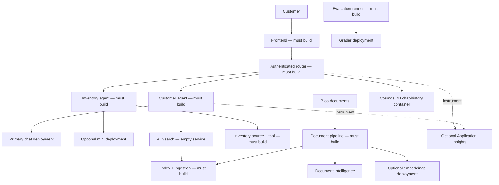

# பன்முக ஏஜென்ட் வாடிக்கையாளர் ஆதரவு — சில்லறை கட்டமைப்புக் குறிப்பு

**அத்தியாயம் 5: பன்முக ஏஜென்ட் AI தீர்வுகள்**

- [பாடநெறி முகப்பு](../README.md)
- [அத்தியாயம் 5](../docs/chapter-05-multi-agent/README.md)
- [முன்னிலை: AI ஒருங்கிணைப்பு](../docs/chapter-02-ai-development/microsoft-foundry-integration.md)
- [அடுத்தது: திறன் திட்டமிடல்](../docs/chapter-06-pre-deployment/capacity-planning.md)
- [ARM அடித்தளம் கட்டமைப்பு](retail-multiagent-arm-template/README.md)

> **கட்டமைப்பு வழிகாட்டு, செயற்படுத்தும் பயன்பாடு அல்ல.** ஒரே சில்லறை செயல்பாட்டு
> கோப்புகள் `azuredeploy.json`, `azuredeploy.parameters.json`, மற்றும் `deploy.sh` உள்ளன
> `retail-multiagent-arm-template/` இல். ரோட்டர்/முன் முனையக் கொண்டெய்னர்கள் hello-world
> இடதுசார் பகுதிகள் மட்டுமே. எந்த சில்லறை ஏஜென்டும், UI, உள்ளீட்டு குழாய், மதிப்பாய்வாளர், ஸ்கேனர், அல்லது
> பயன்பாட்டு சோதனை தொகுப்பும் உள்ளூர் நிலையில் இல்லை.

## கண்ணோட்டம்

**நோக்கம்:** வாடிக்கையாளர் ஏஜென்ட் மற்றும் சரக்கு ஏஜென்ட் உடன் வாடிக்கையாளர் ஆதரவு அமைப்பை வடிவமைத்து,
அடித்தளம் என்ன வழங்குகிறது என்பதை கண்டறிந்து, இல்லாத பயன்பாட்டு
ஒப்பந்தங்கள் மற்றும் சரிபார்ப்பை திட்டமிடல்.

**பார்வையாளர்கள்:** உள்ளூர்
[சரி பேசும் மாதிரி](../../../examples/azure-openai-chat) மற்றும் [இரு-சேவை கொண்டெய்னர் மாதிரி](../../../examples/container-app/microservices) முடித்துள்ள டெவலப்பர்கள்.
கட்டமைப்புப் படிப்பிற்கு 2-3 மணிநேரங்கள் ஒதுக்கவும். பயன்பாட்டை உருவாக்குதல் தனி
திட்டமாகும்: 80-120 அபிவிருத்தி மணி நேரம் அனுபவமிக்க டெவலப்பர்களுக்கான ஒரு எடுத்துக்காட்டு திட்ட மதிப்பீடு,
**வழங்கல் வாக்குறுதி அல்ல**; உற்பத்தி கடினப்படுத்தல், சோதனைகள்,
பாதுகாப்பு விமர்சனம் மற்றும் இயக்கம் கூடுதல் பணிகளை தேவைப்படுத்தும்.

### கற்றல் முடிவுகள்

- ரோட்டிங், அடிப்படை, கருவி அனுமதிகள் மற்றும் உரையாடல் உரிமையை விளக்கவும்.
- மாதிரி அடையாளங்கள், பயன்பாட்டு பெயர்கள், API பதிப்புகள் மற்றும் ARM பதிப்புகளை வேறுபடுத்தவும்.
- ஒத்துப்போகும் வேக்டர் பரிமாணங்களுடன் ஆவணக் கடத்தல் மற்றும் மீட்டெடுப்பை வடிவமைக்கவும்.
- சரிபார்க்கக்கூடிய செயற்பாட்டு, மதிப்பீட்டு மற்றும் தோல்வி-மீட்பு தேவைகளை வரையறுக்கவும்.
- விருப்பக்கூடிய கட்டமைப்பு இலக்குகளை உண்மையில் வழங்கப்படும் வளங்களிலிருந்து பிரித்தோடு எழுத்து செய்யவும்.

## தீர்வு கட்டமைப்பு



இது ஒரு **இலக்கான பயன்பாட்டு கட்டமைப்பு**, ஓடும் ஏஜென்ட்
சேவைகளின் வரைபடம் அல்ல. ARM அடித்தளம் அடிப்படை சேவைகள் மற்றும் இரண்டு இடதுசாரான
கொண்டெய்னர்களை மட்டுமே உருவாக்குகிறது. முன்னணி வாசல், பதிவு, மேலாண்மை அங்கீகாரம், பங்கு ஒதுக்கீடுகள்,
தனிப்பட்ட இடைமுகங்கள், மீண்டும் இயக்குதல், பயன்பாட்டு கருவிகள் மற்றும் எச்சரிக்கைகள் சேர்க்கப்படவில்லை.

### பொறுப்புகள் மற்றும் ஒப்பந்தங்கள்

| கூறு | தேவையான நடத்தை | முடிந்ததாயின் முன்னர் சான்று |
|---|---|---|
| முன்னணி | பயனர்களை சான்றளிக்க, உரையாடலை வெளிப்படுத்தவும், ஆவணங்களை பாதுகாப்பாகப் பதிவேற்றவும் | UI மற்றும் பதிவேற்ற சோதனைகள், அணுகக்கூடிய பிழைகள் |
| ரோட்டர் | கோரிக்கைகளை அங்கீகரிக்க, ஏஜென்டை தேர்வு செய்ய, கருவி அழைப்புகள்/கால அட்டவணைகளை கட்டுப்படுத்த | ரோட்டிங் சோதனைகள், அங்கீகாரம் சரிபார்ப்புகள், தோல்வி சோதனைகள் |
| வாடிக்கையாளர் ஏஜென்ட் | கோரிக்கை/தயாரிப்பு பதில்களை அங்கீகரிக்கப்பட்ட ஆதாரங்களில் அடிப்படையாக்க | துல்லிய மேற்கோள்கள், தரவு இல்லாதபோது தவிர்க்கல் |
| சரக்கு கருவி | உரிமை கொண்ட பங்கினை வலியுறுத்தி வாசிக்க | தீர்மானிக்கப்பட்ட பங்கு சோதனைகள்; குறையும் கிடைப்பின்மை |
| ஆவண குழாய் | எடுத்துக்கூறுதல், துண்டாக்கல், உள்ளீடு, குறியீடு, புதுப்பிப்பு/அகற்றல் | குறியீட்டு மாதிரிகள் மற்றும் மீண்டும் முயற்சி/சிக்கல் கொண்டவர்கள் நடத்துதல் |
| உரையாடல் சேமிப்பகம் | பயனர்களை தனித்து வைத்திருத்தல், பேணல் கட்டுப்பாடு | பயனர் அங்கீகாரச் சோதனைகள் மற்றும் காலவரைவு சோதனைகள் |
| மதிப்பீடு இயக்குநர் | விளைவுகளை உண்மை தரவு மற்றும் புள்ளிவிவரத்துடன் ஒப்பிடுதல் | பரப்புதலம், தோல்வி எண்ணிக்கை, பின்விளைவுகள் அறிக்கைகள் |

ரோட்டரை வரவேற்பறையில் உள்ள பணியாளராகவும் கருவிகளை கட்டுப்படுத்தப்பட்ட உள்ளக அமைப்புகளாகவும் கருதுக:
சிறப்பு நிபுணரை தேர்வு செய்வது எல்லா வாடிக்கையாளர் பதிவுகளையும் அணுக அனுமதி அல்ல.
அடையாளம் மற்றும் அனுமதிகளை பயன்பாட்டு குறியீடு மற்றும் தரவு சேவைகளில் கடைபிடிக்கவும், கூர்மைகளில் அல்ல.

## அடித்தளம் மற்றும் பயன்பாடு மாறுபாடு

வழங்குவதற்கு முன் [scaffold README](retail-multiagent-arm-template/README.md) ஐ படிக்கவும்.
அது சரியான வளங்கள், முறைகள், செலவுகள் மற்றும் வரம்புகளை பட்டியலிடுகிறது.

| தர்க்கபூர்வப் பயன்பாடு | ARM தொடக்கம் பெயர் | மாதிரி / பதிப்பு | இயல்புநிலை மாவட்டம் |
|---|---|---|---|
| வாடிக்கையாளர் உரையாடல் | `gpt-4.1-chat` | `gpt-4.1` / `2025-04-14` | `eastus2` |
| கையிருப்புத் தகவல் | `gpt-4.1-mini-inventory` | `gpt-4.1-mini` / `2025-04-14` | `westus2`, விருப்பம் |
| எம்பெட்டிங்ஸ் | `text-embedding-ada-002` | `text-embedding-ada-002` / `2` | `francecentral`, விருப்பம் |
| மதிப்பீடு | `gpt-4.1-grader` | `gpt-4.1` / `2025-04-14` | இயல்புநிலை முதல் மாவட்டம் |

மாதிரி/பதிப்பு/SKU கிடைக்கும் மற்றும் ஒதுக்கீட்டை **ஒவ்வொரு மாவட்டத்திலும்** சரிபார்க்கவும். உரையாடல்/மினி/மதிப்பாய்வாளர்
`GlobalStandard` பயன்படுத்துகிறது; எம்பெட்டிங்ஸ் `Standard` பயன்படுத்துகிறது. திறன் அலகு-க்கு-TPM வரைபடங்கள்
மாதிரி-சொந்தமானவை. கடவுள் வாக்குறுதி வண்ணமாக வேறு திறன் அலகுகளை சேர்க்க வேண்டாம்.

ஒரு Azure OpenAI கோரிக்கையின் `model` வாதம் **deploy பெயர்**, அவசியமாக
கேட்லாக் மாதிரி அடையாளங்காட்டி அல்ல. தரவை-பக்கிய API பதிப்பு `2024-10-21`
மாதிரி பதிப்பு `2025-04-14` மற்றும் ARM வள `apiVersion` என்ற விவகாரத்திலிருந்து வேறுபடும்.
கிடைக்காத மாதிரியை மாற்ற முடியாது தரவை-பக்கிய API பதிப்பை மட்டுமே மாற்றுவதால்.

`--no-multi-region` இரண்டாம் நிலை மற்றும் எம்பெட்டிங்ஸ் கணக்குகளை தவிர்க்கிறது. ஒரு முதன்மை உரையாடல் மற்றும்
சுயாதீன மதிப்பாய்வாளர் கணக்கு பங்களிக்கும். தனி மாதிரி கணக்குகள் தானாக வழங்கப்படுவதில்லை
டெல்அதிகாரம்; அதற்காக பயன்பாட்டு வழிசெய்தல், பொருத்தமான பணியமைப்புகள், ஆரோக்கிய சோதனைகள்,
மறுபயன்பாட்டு வரம்புகள் மற்றும் தரவு குடியுரிமை விமர்சனம் தேவைப்படுகிறது.

## அமல்படுத்தல் நடைமுறை

### 1. ஒரு சோதனை செய்யப்பட்ட தொடர்புடன் துவங்கவும்

பெரிய மேம்பாட்டு அமைப்பை வழங்குவதற்கு முன், உள்ளூர் உரையாடல் மாதிரியை பயன்படுத்தி
ஊக திறன்செலுத்தலை நிறுவவும். ஒரு பிரதிநிதி வாடிக்கையாளர் கேள்வியை, அங்கீகார செய்யப்பட்ட
பதில் மூலத்தை, எதிர்பார்க்கப்படும் மேற்கோளை மற்றும் அந்த மூலத்தை இழந்தால் தோல்வி நடத்தையை வரையறுக்கவும்.

### 2. வழிசெய்தல் மற்றும் கருவி எல்லைகளை வரையறுக்கவும்

உங்கள் சொந்த வழிசெய்தல் மூலத்தை, சார்பு அறிக்கையை, Dockerfile மற்றும் சோதனைகளை உருவாக்கவும். ஒரு
விளக்கக் கூட்டணி இருக்கலாம் `POST /chat` உடன் `{"message":"...","conversation_id":"..."}`.
**அந்த இறுதிப்புள்ளி ஒரு வடிவமைப்பு முன்மொழிவாகும்; அது ARM வடிவமைப்பு மூலம் செயல்படுத்தப்படவில்லை.**

உடல் வகைகள்/வரம்புகளை சரிபார்க்கவும், அங்கீகாரித்தல் மூலம் பயனர் அடையாளத்தை பெறவும், உரையாடல் உரிமையை அமைப்படுத்த
வேண்டியது, கோரிக்கை நேர வரம்புகளை பின்பற்றவும் மற்றும் பொருள் உள்ள பிழை குறியீடுகளை வழங்கவும்.
HTTP தோல்விகள் அல்லது காலியான பதில்களை வெற்றிகரமான முகவர் முடிவுகளாக கருத வேண்டாம்.

### 3. அடித்தளவிடுதல் மற்றும் உள்ளீடு செயல்படுத்தல்

ARM வடிவமைப்பில் தேடல் குறியீடு உருவாக்கப்படவில்லை. இது ஒரு **உங்கள் சொந்த குறியீட்டு வரையறையில் பழக
பயன்படுத்துவதற்கான குறிப்பு JSON துண்டு**, ரெப்போவில் ஏற்கனவே இருக்கிற கோப்பல்ல:

```json
{
  "name": "retail-product-index",
  "fields": [
    {"name": "id", "type": "Edm.String", "key": true},
    {"name": "title", "type": "Edm.String", "searchable": true},
    {"name": "content", "type": "Edm.String", "searchable": true},
    {"name": "category", "type": "Edm.String", "filterable": true},
    {
      "name": "content_vector",
      "type": "Collection(Edm.Single)",
      "searchable": true,
      "dimensions": 1536,
      "vectorSearchProfile": "retail-profile"
    }
  ],
  "vectorSearch": {
    "algorithms": [{"name": "retail-hnsw", "kind": "hnsw"}],
    "profiles": [{"name": "retail-profile", "algorithm": "retail-hnsw"}]
  }
}
```

சியாட்டு புலத்தை அதன் செயற்கருவுடன் இணைக்கப் புரொபைல். பரிமாணங்கள்
உண்மையான தொகுப்பு வெளியீட்டோடு பொருந்த வேண்டும் (இந்த `ada-002` பணியுருவுக்கு 1536). பைதான் மீட்டெடுக்கப்பட்டு,
ஒரு பூரணமற்ற அகராதியைப்போல் அல்லாமல் `azure.search.documents.models.VectorizedQuery` பயன்படுத்தவும்
அதன் சியாட்டுக் கேள்வி வகை இல்லாமல்:

```python
# Reference function only: supply an authenticated async SearchClient and an embedding.
from azure.search.documents.models import VectorizedQuery

async def retrieve(search_client, embedding):
    results = await search_client.search(
        search_text=None,
        vector_queries=[VectorizedQuery(
            vector=embedding,
            k_nearest_neighbors=5,
            fields="content_vector"
        )],
        select=["id", "title", "content"]
    )
    return [document async for document in results]
```

தனியான உள்ளீடு செயல்படுத்தலை உருவாக்கவும்:

1. பதிவேற்ற அணுகலை ஒப்புதல் அளிக்கவும் மற்றும் உள்ளடக்கம் வகை மற்றும் அளவை சரிபார்க்கவும்.
2. அங்கீகாரம் பெற்ற SDK அழைப்புகளைப் பயன்படுத்தி தனியார் புளாப்களை வாசிக்கிறது. தனியார் புளாப் URL அதேபோலவே
   Document Intelligence உள்ளீடாக **இல்லை**; பதிவிறக்கப்பட்ட பைட்களை
   `AnalyzeDocumentRequest(bytes_source=...)` உடன் அனுப்பவும் அல்லது சொந்த அணுகல் தேவைகளை மதிப்பாய்வு செய்து பிறகு குறுகிய காலத்துக்கான தேவையான அனுமதியேற்புடைய SAS ஐ பயன்படுத்தவும்.
   அணுகல் தேவைகளை பரிசீலித்த பின் சிறுகால SAS.
3. உரையை எடுத்துக் கொள்கிறது, அதை எம்பெட்டிங் வரம்புகளுக்கு ஏற்ப துண்டுகளாகப் பிரிக்கிறது, மற்றும் எம்பெட்டிங்களை உருவாக்குகிறது.
4. நிலையான செல்லுபடியான ஆவண கீகளை உருவாக்குகிறது மற்றும் பொருந்தும் வெக்டர்களுடன் துண்டுகளை பதிவேற்றுகிறது.
5. ஒவ்வொரு ஆவணத்திலும் காப்புறை விளைவுகளை சரிபார்க்கிறது, மீண்டும் முயற்சி செய்யும் செயல்களை கையாள்கிறது மற்றும் பழைய தரவுகளை புதுப்பிக்கிறது/நீக்குகிறது.

தனிப்பயன் பயனர் கீகள்/மதிப்புகளை OData வடிகட்டிகளில் இடையவரைப்படுத்த வேண்டாம். அனுமதியுள்ள புலங்களை மட்டும் அனுமதிக்கவும்,
மதிப்புகளின் வகைகளை சரிபார்க்கவும், மற்றும் வெற்றிடமுள்ள குறிமுத்திரைகளை நிரப்பவும். பூலியன் மற்றும் எண்ணியல் வடிகட்டிகள்
குறியீட்டற்ற குறுமதிப்புகள் வேண்டும், நோக்கிடப்பட்ட குறிமுத்திரைகள் அல்ல.

### 4. இணையக் கருதுகோள்

**Bing தேடல் v7 ஆகஸ்ட் 11, 2025 அன்று ஓய்வுபெற்றது.** பழைய `Microsoft.Bing/accounts`
வளமும் `api.bing.microsoft.com/v7.0/search` எடுத்துக்காட்டுகளும் ஆதரிக்கப்படும் செயலாக்க பாதை அல்ல.
Microsoft Foundry மற்றும் அதன் SDK, அனுமதிகள், பில்லிங் மற்றும் மேற்கோள் தேவைகளைப் பரிசீலித்து தற்போதைய ஆதரிக்கப்பட்ட நிலையான இணைப்பை மூலதனமாக்குங்கள்;
இதை இங்கு அமல்படுத்தவில்லை. ஓய்வுபெற்ற இடைமுகத்துக்குப் பதிலாக இது நேரடியாக மாற்றியமைக்கப்படவில்லை.


### 5. தொலைநோக்கு மற்றும் மதிப்பீட்டை சேர்க்கவும்

Application Insights உருவாக்குதல் குறியீட்டை கருவி செய்யவில்லை. புதிய பயன்பாட்டை கட்டும்போது ஆதரிக்கப்பட்ட Azure வரம்பிலான
OpenTelemetry கருவிகள் பயன்பாட்டை பயன்படுத்தவும், சேவைகள் இடையே தடையைக் கொண்டு செல்லவும், மற்றும் வாடிக்கையாளர் கேள்விகள், ஆவணங்கள் அல்லது ரகசியங்களை பதிவு செய்ய தவிர்க்கவும்.
ஒரு கேள்வியை குறைக்குதல் அதை அசல் தகவலற்றதாக மாற்றாது.


டோக்கன் பயன்பாடு, மற்றும் தடைசெய்தல் ஆகியவற்றை அளவிடுங்கள். நிலையான உண்மைகள்/கொள்கை தகவல்களை மதிப்பீட்டு வாயில்களுடன் ஒத்திணைக்கவும்:
ஒரு மதிப்பாய்வாளர் கேள்வி மற்றும் பதில் மட்டும் கொண்டு உண்மையான துல்லியத்தை நம்பகமாக நிரூபிக்க முடியாது.

ஒரு மதிப்பாய்வாளர் அமைப்பு மதிப்பீட்டு ஓட்டுநர் அல்ல. பதிப்பு கொண்ட ரூபிரிக்,

மற்றும் மனித படிப்புழுவான வழக்குகளை செயல்படுத்தவும். முற்றுமுற்றாக முடிவற்ற/பிழை வழக்குகளை தனிப்படியாக அறிக்கை செய்யவும்; அவற்றை வெற்றிகரமான மதிப்பெண்ணாக மாற்றவோ அல்லது மௌனமாக பூஜ்ஜிய தரம் மாதிரிகளுக்கு இணைத்துப்போகவோ கூடாது.

அதேபோல், சில முக்கிய வார்த்தை பரிசீலனைகள் பாதுகாப்பு சான்றிதழ் அல்ல. தோல்வியடைந்த HTTP
கோரிக்கை, குறைந்த பரிசோதனை முறை, அல்லது வெற்று பதில் ஒரு பரிசோதனையை **தீர்மானிக்க முடியாத அல்லது தோல்வியடைந்ததாக** மாற்ற வேண்டும், "100% பாதுகாப்பான" மதிப்பெண் தரக்கூடாது. உச்சுப்பயிற்சி உரிமப்பதிவுடன், பொருத்தமான கருவிகள் மற்றும் மனித பரிசீலனையுடன் உற்பத்தி தயார் கூற்றிற்கு முன் சோதனை செய்யவும்.

### 6. உங்கள் பயன்பாட்டை பிரயோகிக்கவும்

உங்கள் சொந்த மூல கோப்புறைகள், அறிவிப்புகள், சோதனைகள், பதிவு, மற்றும் பட இழுப்புச்
அனுமதிகளை உருவாக்கவும். கட்டுமான படங்களுடன் இடம் பிடிப்புகளை மாற்றவும் மற்றும் ஒவ்வொரு பயன்பாட்டின் செவிகைப் போர்டுக்கு பொருந்தும் போல உட்புகு/சோதனை வரிசைகளைக் புதுப்பிக்கவும். Bicep-ல் அல்லது spaicific ஆதரிக்கப்பட்ட azd சூழல் வரைபடத்தில் இயங்கும் சுழற்சி சுற்றுப்புற மாறிகளை அமைக்கவும்.

### 6. உங்கள் பயன்பாட்டை வெளியிடுங்கள்

உங்கள் சொந்த மூல கோப்புறை, எடுத்துக்காட்டுகள், சுங்கங்கள், பதிவகங்கள் மற்றும் படமெழுத்து
அனுமதிகளை உருவாக்குங்கள். தொடர்பு ஏற்படுத்திகளுடன் கட்டப்பட்ட படங்களை மாற்றி, ஒவ்வொரு
பயன்பாட்டின் கேட்கும் போர்ட்டுடன் ஏற்படுமாறு நுழைவு/தேர்வுகளையும் புதுப்பியுங்கள்.
Bicep அல்லது தெளிவான ஆதரிக்கப்பட்ட azd சுற்றுப்புற வரைபடத்தில் இயக்க சூழல் மாறிலிகளை வடிவமைக்கவும்.

azd சேவையின் கீழ் சுயமாக இயக்க சூழல் மாறிலிகளை உருவாக்கும் பொது `config` அகராதி எதுவும் இல்லை.
`azd env set` கூற்று தெளிவாக அந்த மதிப்புகளை பயன்படுத்தும் வளங்களை மட்டுமே மாற்றுகிறது.
எந்த கானரி, பகுதிகளின் பட்டியல், அல்லது நுணுக்க முறைப்புள்ளி இங்கு இந்த கட்டமைப்பில்
செயல்படுத்தப்படவில்லை.

## நடைமுறை வடிவமைப்பு பயிற்சிகள்

இவை **வலைமைப்புக் பயிற்சிகள்**, செயல்படுத்தக்கூடிய தொடங்குபவர் குறியீடுகள் அல்ல.

### பயிற்சி 1: எல்லையை சரிபார்

**தொடக்கப் புள்ளி:** `retail-multiagent-arm-template/` உள்ள மூன்று கோப்புகள்.
**இலக்கு:** வழங்கலை பயன்பாட்டு செயல்பாட்டிலிருந்து வேறுபடுத்துதல்.
`azuredeploy.json` திறக்கவும், இரு கண்டெய்னர் படங்களையும் `targetPort` மதிப்புகளையும் கண்டுபிடி,
பிறகு தொகுப்பகம் இல்லாத பயன்பாட்டு கூறுகளை பட்டியலிடுக.

**வெற்றி அலகுகள் / பதில்:** இரு படங்களும் 80 பორტில் காத்திருக்கும் hello-world இடம்பெயர்ச்சிகளாகும்;
முகவரிகள், உரையாடல் UI, வழிமுறை ஹேண்டிலர்கள், குறியீடு/உரைத்திறப்பு, மதிப்பாய்வாளர், மற்றும் ஸ்கேனர்
காணப்படவில்லை. வெற்றிகரமான இடம்பெயர்ச்சி முதற் கோரிக்கை `/chat` சரிபார்க்காது.
**இயல்பான பிரச்சனை:** `retail-router` போன்ற வளப்பெயர்களை செயல்படும் குறியீடாகவே புரிந்து கொள்ளுதல்.

### பயிற்சி 2: வெக்டார் அமைப்பை பின்தொடர்

**தொடக்கப் புள்ளி:** மேலே உள்ள குறியீட்டு JSON.
**இலக்கு:** புலம் → சுயவிவரம் → האל்காரிதம் தொடர்பை புரிந்துகொள்.
வேறு வெளிப்பாட்டு பரிமாணத்துடன் எம்பெடிங்க் மாதிரிக்கு மாறுகையில் எந்த மதிப்புகள் மாற்றப்பட வேண்டும் கண்டறி,
பிறகு `retrieve` செயல்பாட்டை ஆய்வு செய்.

**வெற்றி அலகுகள் / பதில்:** புலம் `dimensions` ஐ உண்மையான வெக்டார் நீளமாக மாற்று;
`vectorSearchProfile` ஐ அறிவிக்கப்பட்ட சுயவிவரம் மற்றும் அதன் ஆல்காரிதம் உடன் ஒத்திசைக்க வைத்து வைய;
`fields` கேள்வியில் வெக்டார் புலத்தை குறிப்பிட வேண்டும். எம்பெடிங்க் மாதிரி மாறுகையில் அங்குள்ள ஆவண வெக்டார்களை மீண்டும் உருவாக்கு.
எம்பெட்டிங் மாடல் மாற்றப்பட்ட போது.
**பொதுவான பிரச்சனை:** பொருத்தமற்ற வெக்டோகளை வைத்துக்கொண்டே மாதிரிப் பெயரை மட்டும் மாற்றுவது.

### பயிற்சி 3: தோல்வி சோதனையை வரையறுக்கவும்

**தொடக்க புள்ளி:** பொறுப்புக் குறிப்பு அட்டவணை.
**குறிக்காய்:** தவறான வெற்றியை தடுக்கவும்.
கிடைக்காத உள்ளமைப்பு API, பொருந்தாத ஆவணங்களுடன் கூடிய தேடல் குறியீடு, மற்றும் HTTP 503 ஐ
திருப்பும் மதிப்பீட்டுக் கோரிக்கைக்கு எதிர்பார்க்கப்படும் நடத்தை எழுதவும்.

**வெற்றி அளவுகோல்கள் / பதில்:** கண்டுபிடிக்கப்பட்டுள்ள எந்த உள்ளமைவு மதிப்புகளும் இல்லை; சூழல் இல்லை எனில் தெளிவான தப்புதவியோ அல்லது
மேம்படுத்தலோ; மதிப்பீடு தரம் அல்லது பாதுகாப்பு கடந்து செல்லாமல் போக்குவரத்து தோல்வி என அறிக்கையிடும். பயன்பாட்டை உருவாக்கும்போது இயக்கக்கூடிய சோதனைகளைச் சேர்க்கவும்.
**பொதுவான பிரச்சனை:** அனைத்துத் தவறுகளையும் பிடித்து காலியாக உள்ள பதிலுடன் தொடர்தல்.


- டோக்கன் செலவுகள் மாதிரி, சேமிக்கப்பட்ட/சேமிக்கப்படாத உள்ளீடு, வெளியீடு மற்றும் dağıtım SKU-க்கு பொருந்தும்.
  பயன்பாடுகள். தற்போதைய பிராந்திய விலை பயன்படுத்தவும்; “குறைந்தபட்சம்” அல்லது பன்முறை பிராந்தியங்கள் இலவசம் என்று பொருள் கொள்ள வேண்டாம்.
- டோக்கன் செலவுகள் மாதிரி, சேமிக்கப்பட்ட/சேமிக்கப்படாத உள்ளீடு, வெளியீடு மற்றும் பிரசारण SKU மீது சார்ந்தவை.
  வழிமாற்றம் பணம் சேமிக்க முடியும், ஆனால் அது அளவிடப்பட்ட பணி மற்றும் தரமான விளைவுகள் அதற்கு நியாயம் அளித்தால் மட்டுமே;
  ஒரு நிரந்தரமான 60–80% சேமிப்பு உறுதி செய்யப்படவில்லை.
- களவியல் வழங்குவதற்கு முன் மாதிரி கிடைப்பது மற்றும் கொட்டா (quota) ஐச் சரிபார்க்கவும்; அனுமதி,
  deployment-name, பிராந்திய(region), மாதிரி பதிப்பு, மற்றும் API பதிப்பு வழு குறைகளை வேறுபடுத்தவும்.
- காணாமல் போன `setup-data.sh`, மதிப்பாய்வாளர் CLI கள், அல்லது `pytest tests/` கட்டளைகளை இயக்கு வேண்டாம்.
  அவற்றின் செயல்பாடுகள் உங்கள் மேம்பாட்டு பின்புலத்தில் உள்ளன.
- அடித்தள வடிவமைப்பு ARM மட்டுமே: அதன்
  [சரிபார்ப்பு மற்றும் சுத்திகரிப்பு வழிமுறைகள்](retail-multiagent-arm-template/README.md) என்பதை பின்பற்றவும்.
  `azd down` அந்த வளங்களை நிர்வகிக்காது.

## தொடர்புடைய வளங்கள்

- [செயல்படுகிற உள்ளூர் உரையாடல் உதாரணம்](../../../examples/azure-openai-chat)
- [செயல்படுகிற இரண்டு சேவை கொள்கலன் உதாரணம்](../../../examples/container-app/microservices)
- [AI தேடல் வெக்டர் குறியீடுகள்](https://learn.microsoft.com/azure/search/vector-search-how-to-create-index)
- [கூடை பயன்பாடுகள் ஆவணம்](https://learn.microsoft.com/azure/container-apps/)
- [சிக்கல் தீர்க்குதல்](../docs/chapter-07-troubleshooting/common-issues.md)
- [ஒரு பிரச்சினையை அறிவிக்கவும்](https://github.com/microsoft/AZD-for-beginners/issues)

---

<!-- CO-OP TRANSLATOR DISCLAIMER START -->
**மறுப்பு**:
இந்த ஆவணம் AI மொழிபெயர்ப்பு சேவை [Co-op Translator](https://github.com/Azure/co-op-translator) பயன்படுத்தி மொழிபெயர்க்கப்பட்டுள்ளது. நாங்கள் துல்லியத்திற்காக முயற்சி செய்துள்ளோம், ஆனால் தானாக செய்யப்படும் மொழிபெயர்ப்புகளில் பிழைகள் அல்லது தவறுகள் இருக்கலாம் என்பதை கவனத்தில் கொள்ளவும். அசல் ஆவணம் அதன் தாய்மொழியில் அதிகாரப்பூர்வ ஆதாரமாக கருதப்பட வேண்டும். முக்கியமான தகவல்களுக்கு, தொழில்நுட்பமான மனித மொழிபெயர்ப்பு பரிந்துரைக்கப்படுகிறது. இந்த மொழிபெயர்ப்பைப் பயன்படுத்துவதால் ஏற்படும் எந்த தவறான புரிதல்கள் அல்லது தவறான விளக்கத்திற்கும் நாங்கள் பொறுப்பில்வில்லை.
<!-- CO-OP TRANSLATOR DISCLAIMER END -->