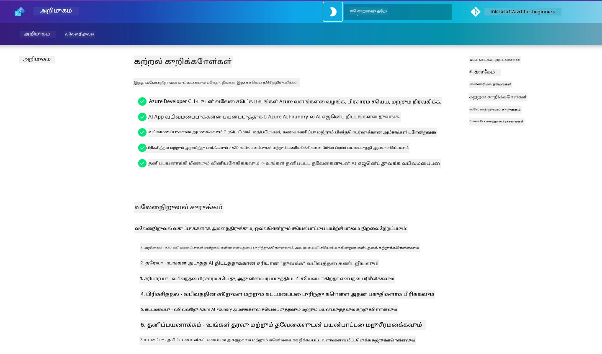

<div align="center">
  <div style="background: linear-gradient(135deg, #0078d4, #106ebe); border-radius: 10px; padding: 20px; margin: 20px 0; box-shadow: 0 4px 15px rgba(0, 120, 212, 0.3); border: 2px solid #005a9e;">
    <h2 style="color: white; margin: 0; font-size: 24px; text-shadow: 1px 1px 2px rgba(0,0,0,0.3);">
      🎯 AI டெவலப்பர்களுக்கான AZD பணிமனை
    </h2>
    <p style="color: white; margin: 10px 0 0 0; font-size: 16px; text-shadow: 1px 1px 2px rgba(0,0,0,0.3);">
      <strong>Azure Developer CLI உடன் AI பயன்பாடுகளை உருவாக்குவதற்கான பயிற்சி பணிமனை.</strong><br>
      AZD டெம்ப்ளேட்டுகள் மற்றும் AI பிரயோக விவரக்குறிப்புகளை நன்கு கற்றுக்கொள்ள 7 தொகுதிகளை முடிக்கவும்.
    </p>
    <div style="margin-top: 15px;">
      <span style="background: rgba(255,255,255,0.2); padding: 5px 10px; border-radius: 15px; color: white; font-size: 14px;">
        📅 மூல வழிகாட்டல் கடைசியாக பரிசீலிக்கப்பட்டது: நவம்பர் 2026
      </span>
    </div>
  </div>
</div>

# AI டெவலப்பர்களுக்கான AZD பணிமனை

AI பயன்பாடுகளை பணிமமைப்பதில் Azure Developer CLI (AZD) கற்றுக்கொள்ளும் பயிற்சி பணிமனையில் உங்களை வரவேற்கின்றோம். இந்தப் பணிமனை AZD டெம்ப்ளேட்டுகளை மூன்று படிகளாகப் புரிந்து கொள்ள உதவுகிறது:

1. **கண்டுபிடித்தல்** - உங்களுக்கு உரிய டெம்ப்ளேட்டை கண்டறியவும்.
1. **பிரயோகம்** - பிரயோகித்து அது வேலை செய்கிறதா என்று உறுதி செய்யவும்
1. **தனிப்பயனாக்கம்** - மாற்றி உங்கள் தேவைக்கு ஏற்ப முறைமை செய்யவும்!

இந்தப் பணிமனையின் முழு காலச்சுழற்சியில், முக்கியமான டெவலப்பர் கருவிகள் மற்றும் பணிவழிகள் அறிமுகப்படுத்தப்படுகின்றன, இது உங்கள் முழு அபிவிருத்தி பயணத்தை எளிதாக்கும்.

<br/>

## உலாவி அடிப்படையிலான வழிகாட்டி

இந்தச் சிபாய்த்தொடர்கள் மார்க்டவுனில் உள்ளன. நீங்கள் அவற்றை நேரடியாக GitHub இல் ஆராயலாம் - அல்லது கீழுள்ள ஸ்கிரீன் ஷாட்டில் காட்டப்பட்டபோல் உலாவி மூலம் பார்வையிடவும்.



இந்த விருப்பத்தை பயன்படுத்த, இந்த களஞ்சியத்தை உங்கள் ப்ரொபலுக்கு பகிரவும், பிறகு GitHub Codespaces ஐ துவக்கு. VS Code டெர்மினல் இயங்கும்போது, இந்தக் கட்டளையை இயக்கு:

இந்த உலாவி முன்னோட்டம் GitHub Codespaces, dev containers, அல்லது Python மற்றும் MkDocs நிறுவப்பட்ட உள்ளூர் கிளோனில் வேலை செய்கிறது.

```bash title="" linenums="0"
python -m pip install -r requirements-dev.txt
python -m mkdocs serve --config-file workshop/mkdocs.yml
```

இந்தக் கட்டளைகளை **கோர்ஸ் களஞ்சியத்தின் வேர் அடித்தளத்தில்** இயக்கவும், தனித்தனி AI மாதிரி ஏற்றிய இடம் அல்ல. பிழைகள் தெளிவாகக் காட்சியளிக்கும் விதமாக முன்னிலையில் வைத்து Ctrl+C மூலம் நிறுத்தவும். சேவை இல்லாமல் தளத்தைப் பார்க்க `python -m mkdocs build --strict --config-file workshop/mkdocs.yml` விளக்கமாக இயக்கு.

சில விநாடிகளுக்குள், ஒரு பாப்-அப் உரையாடல் தோன்றும். `Open in browser` என்ற விருப்பத்தைத் தேர்வுசெய்க. இப்போது வலை அடிப்படையிலான வழிகாட்டி புதிய உலாவி தாவலில் திறக்கும். இந்த முன்னோட்டத்தின் சில நன்மைகள்:

1. **உள்ளமைக்கப்பட்ட தேடல்** - முக்கிய வார்த்தைகள் மற்றும் பாடங்களை விரைவில் கண்டறிவது 
1. **பிரதி எடுக்கும் சின்னம்** - குறியீட்டு தொகுதிகளில் செல்லும் போது காணப்படும்
1. **தீம் மாற்றுதல்** - இருண்ட மற்றும் ஒளிர்வான தீம்களுக்கு இடையே மாறுதல்
1. **உதவி பெறுக** - கீழே உள்ள Discord ஐகானில் கிளிக் செய்யவும்!

<br/>

## பணிமனை சுருக்கம்

**கால அளவு:** 3-4 மணிநேரம்  
**நிலை:** தொடக்க நிலையிலிருந்து நடுத்தர நிலைக்கு  
**முந்தைய அனுபவம்:** Azure, AI கான்செப்ட்கள், VS Code மற்றும் கட்டளை வரிசை கருவிகளுக்கு பழக்கம்.

இது ஒரு செய்முறைபூர்வ பணிமனை, நீங்கள் செயல்படுத்திக் கற்றுக்கொள்கிறீர்கள். பணிகள் முடிந்தவுடன், பாதுகாப்பு மற்றும் தொழிற்திறன் சிறந்த நடைமுறைகள் பற்றி கற்றலுக்கு AZD For Beginners பாடத்திட்டத்தை பரிந்துரைக்கிறோம்.

| நேரம் | தொகுதி | நோக்கம் |
|:---|:---|:---|
| 15 நிமிடங்கள் | [அறிமுகம்](docs/instructions/0-Introduction.md) | மேடையை அமைத்து, குறிக்கோள்களை புரிந்து கொள் |
| 30 நிமிடங்கள் | [AI டெம்ப்ளேட்டை தேர்வு செய்](docs/instructions/1-Select-AI-Template.md) | விருப்பங்களை ஆராய்ந்து தொடக்கத்தை தேர்வு செய் | 
| 30 நிமிடங்கள் | [AI டெம்ப்ளேட்டை சரிபார்](docs/instructions/2-Validate-AI-Template.md) | இயல்புநிலை தீர்வை Azure இல் பிரயோகிப்பது |
| 30 நிமிடங்கள் | [AI டெம்ப்ளேட்டை பகுக்க](docs/instructions/3-Deconstruct-AI-Template.md) | கட்டமைப்பும் சார்ந்த தகவலும் ஆராய்க |
| 30 நிமிடங்கள் | [AI டெம்ப்ளேட்டை கட்டமை](docs/instructions/4-Configure-AI-Template.md) | கிடைக்கும் அம்சங்களை செயல்படுத்து மற்றும் முயற்சி செய் |
| 30 நிமிடங்கள் | [AI டெம்ப்ளேட்டை தனிப்பயனாக்கு](docs/instructions/5-Customize-AI-Template.md) | டெம்ப்ளேட்டை உங்கள் தேவைக்கேற்ப மாற்றுக |
| 30 நிமிடங்கள் | [வளத்தளத்தை அகற்றி விடு](docs/instructions/6-Teardown-Infrastructure.md) | சுத்தம் செய்தல் மற்றும் வளங்களை விடுவித்தல் |
| 15 நிமிடங்கள் | [முடிவு மற்றும் அடுத்த படிகள்](docs/instructions/7-Wrap-up.md) | கற்றல் வளங்கள், பணிமனை சவால் |

<br/>

## நீங்கள் என்ன கற்றுக் கொள்வீர்கள்

AZD டெம்ப்ளேட்டை Microsoft Foundry மேல் முழுமையான அபிவிருத்தி செய்ய பல திறன்கள் மற்றும் கருவிகளை ஆராய ஒரு கற்றல் விளையாட்டு மைதானமாக எண்ணுங்கள். பணிமனை முடிந்தவுடன், இந்த சூழலில் பல கருவிகள் மற்றும் கருத்துக்களை பிராரம்பிக உணர்வுடன் தெரிந்துகொள்ள முடியும்.

| கருத்து | நோக்கம் |
|:---|:---|
| **Azure Developer CLI** | கருவி கட்டளைகள் மற்றும் பணிவழிகள் புரிதல் |
| **AZD டெம்ப்ளேட்டுகள்** | திட்ட கட்டமைப்பு மற்றும் பொது தகவல் புரிதல் |
| **Azure AI முகவர்** | Microsoft Foundry திட்டத்தை பராமரித்து பிரயோகத்தில் வைக்கவும் |
| **Azure AI தேடல்** | முகவர்களுடன் சூழல் பொறியியலை இயக்கு |
| **கண்காணிப்பு** | கண்காணித்தல், சரிபார்த்தல் மற்றும் மதிப்பீடுகள் ஆராய்க |
| **சிவப்பு குழு செயல்கள்** | எதிரிகளின் சோதனைகள் மற்றும் தடுப்பு முறைகள் ஆராய்க |

<br/>

## பணிமனை அமைப்பு

இந்தப் பணிமனை உங்களுக்கு டெம்ப்ளேட் கண்டுபிடித்தல், பிரயோகம், பகுத்தறிதல் மற்றும் தனிப்பயனாக்கலை கொண்டு பயணம் செல்வதற்காக அமைக்கப்பட்டுள்ளது - அதிகாரப்பூர்வ [AI முகவர்களுடன் தொடங்குதல்](https://github.com/Azure-Samples/get-started-with-ai-agents) துவக்க டெம்ப்ளேட்டை அடிப்படையாக கொண்டு.

### [தொகுதி 1: AI டெம்ப்ளேட்டை தேர்வு செய்](docs/instructions/1-Select-AI-Template.md) (30 நிமிடங்கள்)

- AI டெம்ப்ளேட்கள் என்றால் என்ன?
- AI டெம்ப்ளேட்களை எங்கே கண்டுபிடிப்பது?
- AI முகவர்களை உருவாக்க எவ்வாறு துவங்குவது?
- **பயிற்சி**: Codespaces அல்லது dev container இல் விரைவாக துவக்கம்

### [தொகுதி 2: AI டெம்ப்ளேட்டை சரிபார்](docs/instructions/2-Validate-AI-Template.md) (30 நிமிடங்கள்)

- AI டெம்ப்ளேட் கட்டமைப்பு என்ன?
- AZD அபிவிருத்தி பணிவழி என்ன?
- AZD அபிவிருத்தியில் உதவி எவ்வாறு பெறுவது?
- **பயிற்சி**: முகவர்கள் டெம்ப்ளேட்டை பிரயோகித்து சரிபார்

### [தொகுதி 3: AI டெம்ப்ளேட்டை பகுக்க](docs/instructions/3-Deconstruct-AI-Template.md) (30 நிமிடங்கள்)

- `.azure/` இல் உங்கள் சுற்றுப்புறத்தை ஆராய்க 
- `infra/` இடத்தில் உங்கள் வள அமைப்பை ஆராய்க 
- `azure.yaml`களில் உங்கள் AZD அமைப்பை ஆராய்க
- **பயிற்சி**: சுற்றுப்புற மாறிலிகள் மாற்றி மீண்டும் பிரயோகம் செய்

### [தொகுதி 4: AI டெம்ப்ளேட்டை கட்டமை](docs/instructions/4-Configure-AI-Template.md) (30 நிமிடங்கள்)
- ஆராய்க: மீட்டெடுக்கும் அதிகரித்த பதிப்பு (Retrieval Augmented Generation)
- ஆராய்க: முகவர் மதிப்பீடு மற்றும் சிவப்பு குழு செயல்கள்
- ஆராய்க: கண்காணித்தலும் தடயவியல்
- **பயிற்சி**: AI முகவர் + கண்காணிப்பு ஆராய்க

### [தொகுதி 5: AI டெம்ப்ளேட்டை தனிப்பயனாக்கு](docs/instructions/5-Customize-AI-Template.md) (30 நிமிடங்கள்)
- வரையறு: கதாபாத்திர தேவைகளுடன் PRD 
- கட்டமை: AZD சுற்றுப்புற மாறிலிகள்
- செயல்படுத்து: கூடுதல் பணி வழங்கும் வாழ்நாள் ஹூக்கள்
- **பயிற்சி**: என் கதாபாத்திரத்துக்கான டெம்ப்ளேட்டை தனிப்பயனாக்கு

### [தொகுதி 6: வளத்தளத்தைக் அகற்று](docs/instructions/6-Teardown-Infrastructure.md) (30 நிமிடங்கள்)
- மறுபார்வை: AZD டெம்ப்ளேட்கள் என்றால் என்ன?
- மறுபார்வை: ஏன் Azure Developer CLI பயன்படுத்த வேண்டும்?
- அடுத்த படிகள்: வேறு டெம்ப்ளேட்டை முயற்சி செய்க!
- **பயிற்சி**: வளத்தளத்தைக் குறைத்தல் மற்றும் சுத்தம் செயல்

<br/>

## பணிமனை சவால்

மேலும் சவால் கொள்வதா? இங்கே சில திட்ட பரிந்துரைகள் - உங்களது யோசனைகளை எங்களுடன் பகிரவும்!!

| திட்டம் | விளக்கம் |
|:---|:---|
|1. **ஒரு சிக்கலான AI டெம்ப்ளேட்டை பகுக்க** | நாங்கள் கூறிய பணிவழி மற்றும் கருவிகளைப் பயன்படுத்தி வேறு AI தீர்வு டெம்ப்ளேட்டை பிரயோகித்து சரிபார்த்து தனிப்பயனாக்கிப் பாருங்களேன். _என்ன கற்றுக்கொண்டீர்கள்?_|
|2. **உங்கள் கதாபாத்திரத்துடன் தனிப்பயனாக்குக**  | வேறு கதாபாத்திரத்துக்கான PRD (பொருள் தேவைக் காகிதம்) எழுத முயற்சி செய்க. பிறகு GitHub Copilot ஐ உங்கள் டெம்ப்ளேட் பதிப்பகத்தில் முகவர் மாதிரியில் பயன்படுத்தி தனிப்பயனாக்கும் பணிவழியை உருவாக்கச் சொல்லுக. _என்ன கற்றீர்கள்? இவை மேலும் எப்படி மேம்படுத்தலாம்?_|
| | |

## கருத்துகள் உண்டா?

1. இந்த பதிப்பகத்தில் ஒரு பிரச்சனையைச் பதிவு செய்க - சுலபத்திற்காக `Workshop` என்று குறிச்சொல்லைக் கூருங்கள்.
1. Microsoft Foundry Discord இல் சேரவும் - உங்கள் சக ஒருமர்களுடன் இணைக்க!


| | | 
|:---|:---|
| **📚 பாடம் முகப்பு**| [AZD தொடக்கர்களுக்காக](../README.md)|
| **📖 ஆவணங்கள்** | [AI டெம்ப்ளேட்களுடன் துவங்க](https://learn.microsoft.com/en-us/azure/ai-foundry/how-to/develop/ai-template-get-started)|
| **🛠️AI டெம்ப்ளேட்கள்** | [Microsoft Foundry டெம்ப்ளேட்கள்](https://ai.azure.com/templates) |
|**🚀 அடுத்த படிகள்** | [பணிமனையைத் தொடங்கு](#workshop-overview) |
| | |

<br/>

---

**நெவிகேஷன்:** [முக்கிய பாடம்](../README.md) | [அறிமுகம்](docs/instructions/0-Introduction.md) | [தொகுதி 1: டெம்ப்ளேட்டை தேர்வு செய்](docs/instructions/1-Select-AI-Template.md)

**AZD உடன் AI பயன்பாடுகளை உருவாக்கத் தொடங்க தயார்?**

[பணிமனைத் தொடங்கு: அறிமுகம் →](docs/instructions/0-Introduction.md)

---

<!-- CO-OP TRANSLATOR DISCLAIMER START -->
**மறுப்பு**:
இந்த ஆவணம் AI மொழிபெயர்ப்பு சேவை [Co-op Translator](https://github.com/Azure/co-op-translator) பயன்படுத்தி மொழிபெயர்க்கப்பட்டுள்ளது. நாங்கள் துல்லியத்திற்காக முயற்சி செய்துள்ளோம், ஆனால் தானாக செய்யப்படும் மொழிபெயர்ப்புகளில் பிழைகள் அல்லது தவறுகள் இருக்கலாம் என்பதை கவனத்தில் கொள்ளவும். அசல் ஆவணம் அதன் தாய்மொழியில் அதிகாரப்பூர்வ ஆதாரமாக கருதப்பட வேண்டும். முக்கியமான தகவல்களுக்கு, தொழில்நுட்பமான மனித மொழிபெயர்ப்பு பரிந்துரைக்கப்படுகிறது. இந்த மொழிபெயர்ப்பைப் பயன்படுத்துவதால் ஏற்படும் எந்த தவறான புரிதல்கள் அல்லது தவறான விளக்கத்திற்கும் நாங்கள் பொறுப்பில்வில்லை.
<!-- CO-OP TRANSLATOR DISCLAIMER END -->