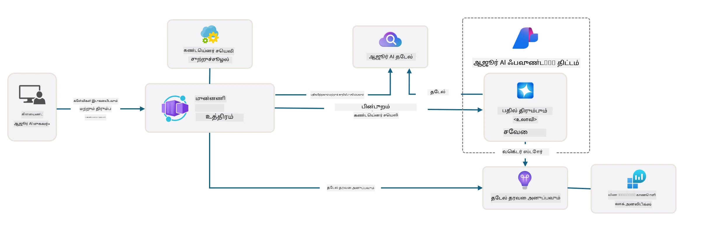

# 3. ஒரு டெம்ப்ளேட்டை உடைக்கவும்

!!! tip "இந்த மாட்யூல் முடிவில் நீங்கள் இந்த பணிகளைக் காணலாம்"

    - [ ] Use GitHub Copilot and optional MCP tools for Azure documentation and read-only exploration
    - [ ] Identify the template's application, infrastructure, configuration, and test entry points
    - [ ] Verify generated explanations against actual repository files
    - [ ] **Lab 3:** Trace one request and one configuration input through the project

---

## 1. GitHub Copilot ஐ செயல்படுத்து

தொடங்கிய AI மாதிரியை VS Code-ல் திறந்து [GitHub Copilot](https://code.visualstudio.com/docs/copilot/chat/chat-agent-mode) ஐ இயக்கு. தகுதியான திட்டமுள்ள கணக்குடன் உள்நுழையவும்; பயன்பாட்டு வரம்புகள் மாறுபடலாம். மாற்றங்களுக்கு முன், dépôt-ஐ Copilot-இல் விளக்கும்படி கேளுங்கள்.

### விருப்பமான MCP சேவைகள்

இந்த சேவைகள் கூடுதல் கருவிகளை வழங்கலாம்:

- [Azure MCP Server](https://learn.microsoft.com/azure/developer/azure-mcp-server/overview)
- [Microsoft Learn MCP Server](https://learn.microsoft.com/training/support/mcp)

VS Code-ல், [MCP கட்டமைப்பு வழிகாட்டியை](https://code.visualstudio.com/docs/copilot/chat/mcp-servers) பாருங்கள் மற்றும் தேவையானால் `.vscode/mcp.json` உருவாக்கவும்:

```json
{
  "servers": {
    "Azure MCP Server": {
      "type": "stdio",
      "command": "npx",
      "args": ["-y", "@azure/mcp@latest", "server", "start"]
    },
    "microsoft.docs.mcp": {
      "type": "http",
      "url": "https://learn.microsoft.com/api/mcp"
    }
  }
}
```

`npx` கட்டளைக்கு ஆதரவு Node.js/npm நிறுவல் தேவை மற்றும் அது செயற்குழு குறியீட்டை பதிவிறக்குகிறது. பேக்கேஜை பரிசீலித்து குழு அமைப்புக்காக ஒப்புக்கொள்ளப்பட்ட பதிப்பை அடைக்கவும். VS Code இன் MCP கட்டுப்பாடுகளைப் பயன்படுத்தி சர்வர்களை ஆரம்பித்து அவற்றின் கருவிகளை பார்வையிடுங்கள்; பெயர்கள் பதிப்புகளுக்கு மாறலாம்.

**அங்கீகாரம் தனி நிரல்.** AZD க்காக `azd auth login` பயன்படுத்தவும். Azure MCP-இன் ஆவணமிடப்பட்ட அங்கீகார ஒழுங்கை பின்பற்றவும்; AZD உள்நுழைவு மட்டும் MCP அமர்வை உருவாக்காது. Azure CLI-ஐ பயிற்சி அல்லது ஹுக்கிற்கு பயன்படுத்தும் போது தனியாக `az login` ஐ பயன்படுத்தவும்.

படிக்க மட்டுமே கூற்றுக்களை முயற்சிக்கவும்:

1. “Microsoft Learn MCP ஐ பயன்படுத்தி Azure Developer CLI கட்டமைப்பு ஆவணத்தை காணவும்.”
2. “இந்த dépôt இன் `azure.yaml` னை விளக்கவும்; ஒவ்வொரு ஹுக்கையும் இயக்கு கோப்புகளைக் குறிப்பிடவும்.”
3. “கிடைக்கும் Azure MCP கருவிகளை பயன்படுத்தி, எனது வினியோகிக்கப்பட்ட வளங்களை மாற்றாமலேயே பட்டியலிடவும்.”

தேர்ந்தெடுக்கப்பட்ட துணை/சந்தா மற்றும் ஒவ்வொரு முன்மொழிந்த கருவி அழைப்பையும் சரிபார்க்கவும். கட்டமைப்பை ஆராய பயனுள்ளதாக இருப்பதற்கே வளங்களை உருவாக்குவது, அழிப்பது அல்லது அணுகலை மாற்றுவது அங்கீகாரம் செய்யாதீர்கள்.

## 2. கட்டமைப்பை புரிந்துகொள்ளுங்கள்

மாதிரி ஒரு Python FastAPI பின்பின்னல் மற்றும் React/TypeScript முன்பக்கம் Azure Container Apps இல் இருக்கிறது. பின்பின்னல் Microsoft Foundry திட்டத்தில் உள்ள முகவருடன் தொடர்பு கொண்டுள்ளது. மீட்டெடுதல் மற்றும் கண்காணிப்பு செயல்பாடுகள் கட்டமைக்கப்பட்ட டெம்ப்ளேட் அம்சங்களையும் வெற்றிகரமாக அமைக்கப்பட்டதையும் சார்ந்தவை; செயலியில் மட்டும் இருப்பதால் உறுதி செய்யப்படாது.



இந்த வரைபடத்தை [தற்போதைய மேல்முறை வினியோக வழிகாட்டி](https://github.com/Azure-Samples/get-started-with-ai-agents/blob/main/docs/deployment.md) மற்றும் உங்கள் தற்போதைய வளங்களுடன் ஒப்பிடவும். கட்டமைக்கப்பட்ட மாதிரி வினியோகம், முகவர் கருவிகள், நிர்வகிக்கப்பட்ட அடையாளம், பங்கு நியமனங்கள் மற்றும் விருப்ப AI தேடல்/விண்ணப்ப நுண்ணறிவு வளங்களை சரிபார்க்கவும்.

**பயிற்சி:** Copilot-ஐ கேட்டு முன்பக்கம் மூலம் API -யின் வழியாக Foundry-க்கு ஒரு உரையாடல் கோரிக்கையை தடம் வீழ்த்து, கோப்பு மற்றும் செயல்பாட்டு குறிப்புகளை கூறச் சொல்லுங்கள். அந்த குறிப்புகளை திறந்து விளக்கத்தை சரிபார்க்கவும். ஒரே வரைபடத்தில் இருந்து செயல்படுத்தப்பட்ட அங்கீகாரம், வழிசெல் அல்லது அங்கீகாரத்தை காண வேண்டாம்.

## 3. dépôt அமைப்பு

பின்வரும் தேர்ந்தெடுக்கப்பட்ட பாதைகள் 4 நவம்பர் 2026 அன்று மாதிரியில் சரிபார்க்கப்பட்டது. உங்கள் தொடங்கிய திருத்தமே உண்மையான ஆதாரம்:

```text
get-started-with-ai-agents/
  azure.yaml
  docker-compose.yaml
  requirements-dev.txt
  .devcontainer/
  infra/
    main.bicep
    main.parameters.json
    api.bicep
    core/
  src/
    Dockerfile
    pyproject.toml
    requirements.txt
    api/
      main.py
      routes.py
      search_index_manager.py
    frontend/
      package.json
      src/
    files/
  scripts/
    validate_env_vars.sh
    validate_env_vars.ps1
    postdeploy.sh
    postdeploy.ps1
  tests/
    test_evaluation.py
    test_red_teaming.py
  docs/
    deployment.md
    deploy_customization.md
    ai_search.md
    observability.md
    local_development.md
    troubleshooting.md
```

### கட்டமைப்பு மற்றும் கட்டமைப்புக்கான கோப்புகள்

`infra/main.bicep` வளங்களை ஒருங்கிணைக்கிறது; `main.parameters.json` டெம்ப்ளேட் உள்ளீடுகளை AZD சுற்றுப்புற மதிப்புகளுடன் இணைக்கிறது. `azure.yaml` பயன்பாட்டு சேவையை மற்றும் வாழ்‌வாய்ப்பு ஹுக்குகளை தேர்வு செய்கிறது. `USE_AZURE_AI_SEARCH_SERVICE` போன்ற உள்ளீட்டை இந்த கோப்புகளில் தடம் வீழ்த்து உண்மையில் என்ன மாற்றம் ஏற்படுகிறது என கண்டறியவும்.

### செயலி மற்றும் அடையாளம்

`src/api/` மற்றும் `src/frontend/` ஐ சேர்த்து படியுங்கள். முகவரின் உருவாக்கச் செய்தல் அல்லது மீட்பு எங்கு நடைபெறுகிறது, அறிவுரைகள்/கருவிகள் எங்கு அமைக்கப்பட்டுள்ளன என்றும், ஒவ்வொரு Azure அழைப்பும் எந்த அடையாளத்தை பயன்படுத்துகிறது என்பதையும் கண்டறியவும். `src/files/` கீழுள்ள மாதிரி கோப்புகள் என்பது நிகழ்படும்தல் தரவு மட்டுமே; உற்பத்தி பட்டியல் அல்லது அங்கீகார மாடல் அல்ல.

### சோதனைகள் மற்றும் கண்காணிப்பு

தற்போதைய மதிப்பீடு மற்றும் ரெட்-டீமிங் நுழைவாயில்கள் `tests/` உட்பட உள்ளன; பழைய `evals/` மற்றும் `airedteaming/` அடைவு குறிப்புகள் இந்த மாதிரிக்கு தவறானவை. மேக சோதனைகள் நடத்துவதற்கு முன் தேவைகள் மற்றும் செலவுகளை மரியாதையுடன் `docs/observability.md` பார். இந்த பைத்தான் சோதனைகள் விருப்பமாக உள்ள `azure.ai.evaluations` AZD நீட்டிப்பிலிருந்து பிரித்துவைக்கப்படுகின்றன.

## 4. உங்கள் கண்டுபிடிப்புகளை சரிபார்க்கவும்

- ஒரு மாதிரி கேள்விக்கு API பாதை, முகவர் தொடர்பு மற்றும் மீட்டெடுக்கும் குறியீட்டை கண்டறியவும்.
- Foundry ஐ அணுகும் அடையாளம் மற்றும் அதன் முடிவை தேர்ந்தெடும் கட்டமைப்பை விளக்கவும்.
- உண்மையான முன்னர்-உயர்த்தும் மற்றும் பிறகு-வாமல் இயக்கும் ஸ்கிரிப்ட்களையும் அவற்றின் பிழை கையாளும் நடத்தை கண்டறியவும்.
- உங்கள் வினியோகத்தில் இல்லாத எந்த சார்புகள் அல்லது விருப்ப அம்சங்களையும் பட்டியலிடவும்.

தொடர [ஒரு வார்ப்புருவை அமைக்க](4-Configure-AI-Template.md).

---

<!-- CO-OP TRANSLATOR DISCLAIMER START -->
**மறுப்பு**:
இந்த ஆவணம் AI மொழிபெயர்ப்பு சேவை [Co-op Translator](https://github.com/Azure/co-op-translator) பயன்படுத்தி மொழிபெயர்க்கப்பட்டுள்ளது. நாங்கள் துல்லியத்திற்காக முயற்சி செய்துள்ளோம், ஆனால் தானாக செய்யப்படும் மொழிபெயர்ப்புகளில் பிழைகள் அல்லது தவறுகள் இருக்கலாம் என்பதை கவனத்தில் கொள்ளவும். அசல் ஆவணம் அதன் தாய்மொழியில் அதிகாரப்பூர்வ ஆதாரமாக கருதப்பட வேண்டும். முக்கியமான தகவல்களுக்கு, தொழில்நுட்பமான மனித மொழிபெயர்ப்பு பரிந்துரைக்கப்படுகிறது. இந்த மொழிபெயர்ப்பைப் பயன்படுத்துவதால் ஏற்படும் எந்த தவறான புரிதல்கள் அல்லது தவறான விளக்கத்திற்கும் நாங்கள் பொறுப்பில்வில்லை.
<!-- CO-OP TRANSLATOR DISCLAIMER END -->