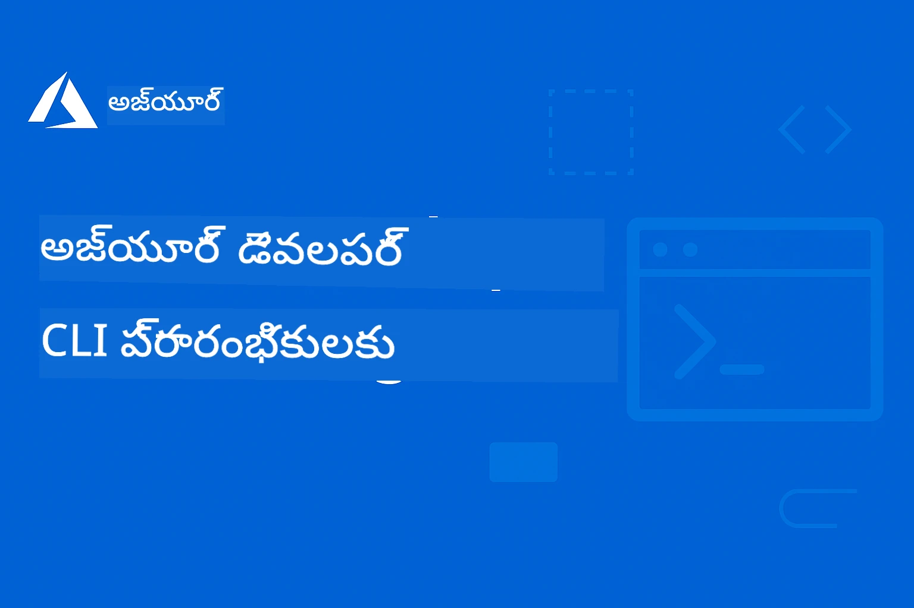

# AZD ప్రారంభించేవారికి: ఒక నిర్మిత అధ్యయన ప్రయాణం

 

[](https://github.com/microsoft/AZD-for-beginners)
[](https://GitHub.com/microsoft/azd-for-beginners/network/)
[](https://github.com/microsoft/AZD-for-beginners)

[](https://discord.com/invite/nkVh3dp)
[](https://discord.gg/nTYy5BXMWG)

---

### ఆటోమెటెడ్ అనువాదాలు (ఎప్పుడూ తాజా)

<!-- CO-OP TRANSLATOR LANGUAGES TABLE START -->
[Arabic](../ar/README.md) | [Bengali](../bn/README.md) | [Bulgarian](../bg/README.md) | [Burmese (Myanmar)](../my/README.md) | [Chinese (Simplified)](../zh-CN/README.md) | [Chinese (Traditional, Hong Kong)](../zh-HK/README.md) | [Chinese (Traditional, Macau)](../zh-MO/README.md) | [Chinese (Traditional, Taiwan)](../zh-TW/README.md) | [Croatian](../hr/README.md) | [Czech](../cs/README.md) | [Danish](../da/README.md) | [Dutch](../nl/README.md) | [Estonian](../et/README.md) | [Finnish](../fi/README.md) | [French](../fr/README.md) | [German](../de/README.md) | [Greek](../el/README.md) | [Hebrew](../he/README.md) | [Hindi](../hi/README.md) | [Hungarian](../hu/README.md) | [Indonesian](../id/README.md) | [Italian](../it/README.md) | [Japanese](../ja/README.md) | [Kannada](../kn/README.md) | [Khmer](../km/README.md) | [Korean](../ko/README.md) | [Lithuanian](../lt/README.md) | [Malay](../ms/README.md) | [Malayalam](../ml/README.md) | [Manipuri (Meitei Mayek)](../mni/README.md) | [Marathi](../mr/README.md) | [Nepali](../ne/README.md) | [Nigerian Pidgin](../pcm/README.md) | [Norwegian](../no/README.md) | [Persian (Farsi)](../fa/README.md) | [Polish](../pl/README.md) | [Portuguese (Brazil)](../pt-BR/README.md) | [Portuguese (Portugal)](../pt-PT/README.md) | [Punjabi (Gurmukhi)](../pa/README.md) | [Romanian](../ro/README.md) | [Russian](../ru/README.md) | [Serbian (Cyrillic)](../sr/README.md) | [Slovak](../sk/README.md) | [Slovenian](../sl/README.md) | [Spanish](../es/README.md) | [Swahili](../sw/README.md) | [Swedish](../sv/README.md) | [Tagalog (Filipino)](../tl/README.md) | [Tamil](../ta/README.md) | [Telugu](./README.md) | [Thai](../th/README.md) | [Turkish](../tr/README.md) | [Ukrainian](../uk/README.md) | [Urdu](../ur/README.md) | [Vietnamese](../vi/README.md)

> **స్థానికంగా క్లోన్ చేయడానికి ఇష్టపడుతున్నారా?**
>
> ఈ రిపాజిటరీ 50+ భాషా అనువాదాలను కలిగి ఉంది, ఇది డౌన్లోడ్ పరిమాణాన్ని గణనీయంగా పెంచుతుంది. అనువాదాలు లేకుండా క్లోన్ చేయడానికి, sparse checkout ఉపయోగించండి:
>
> **Bash / macOS / Linux:**
> ```bash
> git clone --filter=blob:none --sparse https://github.com/microsoft/AZD-for-beginners.git
> cd AZD-for-beginners
> git sparse-checkout set --no-cone '/*' '!translations' '!translated_images'
> ```
>
> **CMD (Windows):**
> ```cmd
> git clone --filter=blob:none --sparse https://github.com/microsoft/AZD-for-beginners.git
> cd AZD-for-beginners
> git sparse-checkout set --no-cone "/*" "!translations" "!translated_images"
> ```
>
> ఇది మీరు కోర్సును పూర్తిచేసేందుకు అవసరమైన ప్రతిదాన్నీ చాలా వేగంగా డౌన్లోడ్ చేస్తుంది.
<!-- CO-OP TRANSLATOR LANGUAGES TABLE END -->

## 🆕 azd నేడు ఏమి కొత్తగా ఉంది

> 📌 **AI CLI విడుదల సమీక్ష (2026-11-04):** మార్గదర్శకాలు ప్రచురించబడిన **`azd 1.37.2`**, **agents `1.0.0-beta.23`**, మరియు **evaluations `1.0.0-beta.2`** డాక్యుమెంటేషన్/సోర్స్‌తో సరిపోల్చారు. కలిపిన వర్క్‌ఫ్లో కోసం `azd >= 1.37.0` ఉపయోగించండి. ఎక్స్‌టెన్షన్‌ల ముందు `azd version` మరియు [కోర్ CLIని అప్డేట్ చేయండి](https://learn.microsoft.com/azure/developer/azure-developer-cli/install-azd). [విడుదల మార్పులు మరియు సవరణలు](docs/chapter-08-production/production-ai-practices.md#recent-release-changes-and-fixes) చూడండి. ఇది పూర్తి కోర్సు ప్రత్యక్ష అమలు సమీక్ష కాదు.

Azure Developer CLI అనేక అప్లికేషన్ రకాల‌కు మద్దతు ఇస్తుంది, వీటిలో వెబ్ యాప్స్, APIs, AI ఏజెంట్లు ఉన్నాయి, మద్దతు పొందిన హోస్టులు, టెంప్లేట్‌లు మరియు ఎక్స్‌టెన్షన్‌ల ద్వారా.

మీకు దీని అర్థం ఇలా:

- **AI ఏజెంట్లు ఇప్పుడు మొదటి స్థాయి azd వర్క్‌లోడ్‌లుగా ఉన్నాయి.** మీరు ఇప్పటికే తెలుసుకొన్న `azd init` → `azd up` వర్క్‌ఫ్లో ఉపయోగించి AI ఏజెంట్ ప్రాజెక్టులను ప్రారంభించవచ్చు, అమలు చేయవచ్చు, మరియు నిర్వహించవచ్చు.
- **రెండు ఎక్స్‌టెన్షన్‌ల ద్వారా ఏజెంట్ జీవనచక్రం.** ఏజెంట్లను ప్రారంభించడానికి, పిలవడానికి, ఆప్టిమైజ్ చేయడానికి మరియు ఎత్తివేయడానికి `azure.ai.agents` ఉపయోగించండి. **`azure.ai.evaluations`**ని వేరుగా ఇన్స్టాల్ చేయండి `azd ai eval init`, `generate`, మరియు `run start` కోసం. ఏజెంట్లు beta.22 పాత ఎవాల్యుయేషన్ వర్క్‌ఫ్లోను మార్చి ఆప్టిమైజేషన్ కాన్ఫిగరేషన్‌ని మార్చాయి; [మైగ్రేషన్ గైడ్](docs/chapter-08-production/production-ai-practices.md#evaluation-migration-and-quality-checks)ను అనుసరించండి.
- **మరిన్ని AI నిర్మాణ블ాక్స్.** కొత్త ప్రివ్యూ విస్తరణలు—`azure.ai.skills` మరియు `azure.ai.connections`—మిమ్మల్ని పునర్వినియోగ agent నైపుణ్యాలు మరియు Foundry కనెక్షన్లను నేరుగా azd తో నిర్వహించడానికి అనుమతిస్తాయి.
- **Microsoft Foundry సమ్మిళితం** మోడల్ డిప్లాయ్‌మెంట్, agent హోస్టింగ్ మరియు AI సేవా నియమాన్ని నేరుగా azd టెంప్లేట్ సిస్టంలో తీసుకువస్తుంది.
- **రోజువారీ సాధారణ పనులు సుగమంగా.** తాజా విడుదలలు `azd init` ను ఐడంపోటెంట్ (మరల రన్ చేయడానికి సురక్షితం) చేయించాయి, `azd auth login` ను ఆటోమేటిక్‌గా స్టేలే టోకెన్స్ క్లియర్ చేయించాయి, మరియు మిత్రభావమున్న `azd tool` మొదటి-రన్ సెటప్ ప్రాంప్ట్ జోడించాయి.
- **ప్రధాన వర్క్‌ఫ్లో మారలేదు.** మీరు టుడో యాప్, మైక్రోసర్వీస్, లేదా బహు-ఏజెంట్ AI పరిష్కారం ను డిప్లాయ్ చేస్తున్నారా, ఆదేశాలు ఒకేలా ఉంటాయి.

> **Aspire వినియోగదారులకు గమనిక:** Microsoft ఇప్పుడు ఉత్పత్తిని సారాంశంగా **Aspire** (మునుపటి ".NET Aspire") గా పిలుస్తుంది. azd యొక్క Aspire మద్దతు మారలేదు—పేరే మాత్రమే నవీకరించబడింది.

మీరు ఇంతకు ముందు azd ఉపయోగించి ఉంటే, AI మద్దతు సహజ విస్తరణ—వేరొక టూల్ లేదా అభివృద్ధి ట్రాక్ కాదు. మీరు కొత్తగా మొదలిస్తే, మీరు అందుకు సరిపోయే ఒక వర్క్‌ఫ్లో నేర్చుకుంటారు.

---

## 🚀 Azure Developer CLI (azd) అంటే ఏమిటి?

**Azure Developer CLI (azd)** అనేది అభివృద్ధిదారుల కోసం అనుకూలమైన కమాండ్-లైన్ సాధనం, ఇది Azure కి అనువర్తనాలను సులభంగా డిప్లాయ్ చేయటానికి సౌకర్యం కల్పిస్తుంది. అనేక Azure వనరులను చేతితో సృష్టించి కनेक్ట్ చేసుకునే బదులుగా, ఒకే ఆదేశంతో మొత్తం అనువర్తనాలను డిప్లాయ్ చేయవచ్చు.

### `azd up` మ్యాజిక్

```bash
# This single command does everything:
# ✅ Creates all Azure resources  
# ✅ Configures networking and security
# ✅ Builds your application code
# ✅ Deploys to Azure
# ✅ Gives you a working URL
azd up
```

టెంప్లేట్ అనువర్తనం మరియు ఇన్‌ఫ్రాస్ట్రక్చర్ కాన్ఫిగరేషన్ అందిస్తుంది. విజయవంతమైన డిప్లాయ్‌మెంట్ కి సపోర్టెడ్ సర్వీసులు/మోడల్స్, తగిన క్వోటా మరియు అనుమతులు, సరైన ఇన్‌పుట్‌లు మరియు డిప్లాయ్ చేసిన అనువర్తనం ధృవీకరణ అవసరం. `azd up` అనేది టెంప్లేట్ ని స్వయంచాలకంగా సురక్షితం, అనుకూలంగా, లేదా ప్రొడక్షన్-రెడీగా మార్చదు.

---

## ❓ Azure Developer CLI మరియు Azure CLI మధ్య తేడా ఏమిటి?

ఇది ప్రారంభమైన వారికి అత్యంత సాధారణ ప్రశ్న. దీనికి తేలికైన సమాధానం ఈ క్రింద ఉంది:

| ఫీచర్ | **Azure CLI (`az`)** | **Azure Developer CLI (`azd`)** |
|---------|---------------------|--------------------------------|
| **లక్ష్యం** | వ్యక్తిగత Azure వనరులను నిర్వహించండి | పూర్తి అనువర్తనాలను డిప్లాయ్ చేయండి |
| **మైండ్‌సెట్** | ఇన్‌ఫ్రాస్ట్రక్చర్-కేంద్రిత | అనువర్తన-కేంద్రిత |
| **ఉదాహరణ** | `az webapp create --name myapp...` | `azd up` |
| **నెర్పే సమాచారం** | Azure సేవలను తెలుసుకోవాలి | మీ యాప్ ని మాత్రమే తెలుసుకోండి |
| **ఉత్తమం ఎవరికీ** | DevOps, ఇన్‌ఫ్రాస్ట్రక్చర్ | అభివృద్ధిదారులు, ప్రోటోటైపింగ్ |

### సులభ ఉదాహరణ

- **Azure CLI** అనేది ఇంటి నిర్మాణానికి అవసరమైన అన్ని పరికరాలు—మూసలు, సా, పట్టు పిళ్లు—ఉన్నట్లు. ఏదైనా నిర్మించవచ్చు, కానీ నిర్మాణ విధానం తెలుసుకోవాలి.
- **Azure Developer CLI** అనేది కాంట్రాక్టర్ ని కూర hiring కాగానే - మీరు మీకు కావలసినది వివరిస్తూ, వారు నిర్మాణాన్ని నిర్వహిస్తారు.

### ఎప్పుడు ఏది ఉపయోగించాలి

| పరిస్థితి | దీన్ని ఉపయోగించండి |
|----------|----------|
| "నా వెబ్ యాప్ ను త్వరగా డిప్లాయ్ చేయాలి" | `azd up` |
| "నాకు కేవలం స్టోరేజ్ అకౌంట్ సృష్టించాలి" | `az storage account create` |
| "నేను పూర్తి AI అనువర్తనం తయారు చేస్తున్నాను" | `azd init --template azure-search-openai-demo` |
| "నాకు ఒక ప్రత్యేక Azure వనరును డీబగ్ చేయాలి" | `az resource show` |
| "నా నిర్దేశించిన ప్రొడక్షన్ వాతావరణంలో డిప్లాయ్ చేయాలి" | డిప్లాయ్ చేయడానికి ముందు కాన్ఫిగరేషన్, ప్రవేశం, ఖర్చు మరియు ఆపరేషన్ గేట్లను సమీక్షించండి `azd up --environment production` |

### అవి కలిసి పనిచేస్తాయి!

AZD మరియు Azure CLI కి వేరుపడిన authentication మరియు configuration ఉన్నాయి. AZD కోసం `azd auth login` ఉపయోగించండి, మరియు హుక్ లేదా డయాగ్నోస్టిక్ ఆదేశం స్పష్టంగా Azure CLI అవసరం ఉన్నప్పుడు `az login` ఉపయోగించండి. మీరు రెండింటినీ ఉపయోగించవచ్చు:
```bash
# Deploy your app with AZD
azd up

# Then fine-tune specific resources with Azure CLI
az webapp config set --name myapp --always-on true
```

---

## 🌟 Awesome AZD లో టెంప్లేట్లను కనుగొనండి

ప్రారంభించి ఉంటే కాదు! **Awesome AZD** అనేది కమ్యూనిటీ సేకరణ, సిద్ధంగా ఉన్న టెంప్లేట్లు ఉన్నాయి:

| వనరు | వివరణ |
|----------|-------------|
| 🔗 [**Awesome AZD గ్యాలరీ**](https://azure.github.io/awesome-azd/) | ఒక క్లిక్ డిప్లాయ్ తో 200+ టెంప్లేట్లు బ్రౌజ్ చేయండి |
| 🔗 [**టెంప్లేట్ సమర్పించండి**](https://github.com/Azure/awesome-azd/issues) | మీ స్వంత టెంప్లేట్ ని కమ్యూనిటీకి అందించండి |
| 🔗 [**GitHub రిపోజిటరీ**](https://github.com/Azure/awesome-azd) | స్టార్ చేయండి మరియు మూలాన్ని పరిశీలించండి |

### Awesome AZD నుండి ప్రముఖ AI టెంప్లేట్లు

ఒక్కో ఖాళీ డైరెక్టరీలో ఒక టెంప్లేట్ ఎంచుకోండి; క్రింద ఉన్న ఆదేశాలు ప్రత్యామ్నాయాలు. చివరలో `.` ఆ డైరెక్టరీని ప్రారంభిస్తుంది.

```bash
# RAG Chat with Microsoft Foundry Models + AI Search
azd init --template azure-search-openai-demo .

# Quick AI Chat Application
azd init --template openai-chat-app-quickstart .

# AI Agents with Foundry Agents
azd init --template get-started-with-ai-agents .
```

---

## 🎯 మూడు దశల్లో ప్రారంభించండి

మీరు మొదలు పెట్టకమునగ, మీ యంత్రం మీరు డిప్లాయ్ చేయదలచిన టెంప్లేట్ కి సిద్ధంగా ఉందో లేదో ఖచ్చితంగా చూసుకోండి:

**విండోస్:**
```powershell
.\validate-setup.ps1
```

**macOS / లినక్స్:**
```bash
bash ./validate-setup.sh
```

అవసరమైన ఏ చెకులు విఫలమైతే, ముందుగా అది సరి చేయండి మరియు వెంటనే త్వరిత ప్రారంభానికి కొనసాగండి.

### దశ 1: AZD ను ఇన్‌స్టాల్ చేయండి (2 నిమిషాలు)

**విండోస్:**
```powershell
winget install microsoft.azd
```

**macOS:**
```bash
brew tap azure/azd && brew install azd
```

**Linux:**
```bash
curl -fsSL https://aka.ms/install-azd.sh | bash
```

### దశ 2: AZD కోసం అథెంటికేట్ అవ్వండి

```bash
# Optional if you plan to use Azure CLI commands directly in this course
az login

# Required for AZD workflows
azd auth login
```

మీరు ఏదేది అవసరమో నిర్ధారించుకోకపోతే, [ఇన్‌స్టాలేషన్ & సెటప్](docs/chapter-01-foundation/installation.md#authentication-setup) లో పూర్తి సెటప్ ప్రക്രియను అనుసరించండి.

### దశ 3: మీ మొదటి అప్లికేషన్ డిప్లాయ్ చేయండి

```bash
# Initialize from a template
azd init --template todo-nodejs-mongo .

# Deploy to Azure (creates everything!)
azd up
```

**🎉 అంతే!** మీ యాప్ ఇప్పుడు Azure పై నేరుగా అందుబాటులో ఉంది.

### స్వచ్ఛందంగా శుభ్రపరచు (మర్చిపోకండి!)

```bash
# Remove all resources when done experimenting
azd down --force --purge
```

---

## 📚 ఈ కోర్సు ఉపయోగించడం ఎలా

ఈ కోర్సు **ప్రగతిశీల అభ్యాసం** కోసం రూపొందించబడింది - మీరు మీకు సౌకర్యమైన చోటుంచి ప్రారంభించి మెరుగ్గా పాఠాలు నేర్చుకోండి:

| మీ అనుభవం | ఇక్కడ ప్రారంభించండి |
|-----------------|------------|
| **Azure కు పూర్తిగా కొత్త** | [అధ్యాయం 1: పునాది](#-chapter-1-foundation--quick-start) |
| **Azure తెలుసు, AZD కొత్తది** | [అధ్యాయం 1: పునాది](#-chapter-1-foundation--quick-start) |
| **AI యాప్‌లను డిప్లాయ్ చేయాలనుకుంటున్నారా** | [అధ్యాయం 2: AI-ఫస్ట్ డెవలప్‌మెంట్](#-chapter-2-ai-first-development-recommended-for-ai-developers) |
| **ప్రయోగాత్మక అనుభవం కావాలి** | [🎓 ఇంటరాక్టివ్ వర్క్‌షాప్](workshop/README.md) - 3-4 గంటల మార్గనిర్దేశిత ప్రయోగశాల |
| **ప్రొడక్షన్ నమూనాలు కావాలి** | [అధ్యాయం 8: ప్రొడక్షన్ & ఎంటర్ప్రైజ్](#-chapter-8-production--enterprise-patterns) |

### త్వరిత సెటప్

1. **ఈ రిపోజిటరీని Fork చేయండి**: [](https://GitHub.com/microsoft/azd-for-beginners/fork)
2. **క్లోన్ చేయండి**: `git clone https://github.com/YOUR-USERNAME/azd-for-beginners.git`
3. **సహాయం పొందండి**: [Azure Discord Community](https://discord.com/invite/ByRwuEEgH4)

> **లోకల్‌గా క్లోన్ చేయడం ఇష్టమా?**

> ఈ రిపోజిటరీలో 50 కంటే ఎక్కువ భాషా అనువాదాలు ఉన్నాయి, అవి డౌన్‌లోడ్ పరిమాణాన్ని గణనీయంగా పెంచుతాయి. అనువాదాలు లేకుండా క్లోన్ చేయడానికి, స్పార్స్ చెకౌట్ ఉపయోగించండి:
> ```bash
> git clone --filter=blob:none --sparse https://github.com/microsoft/AZD-for-beginners.git
> cd AZD-for-beginners
> git sparse-checkout set --no-cone '/*' '!translations' '!translated_images'
> ```
> ఇది కోర్సును పూర్తి చేయడానికిగాను, చాలా వేగంగా డౌన్‌లోడ్ చేసుకునేందుకు కావలసిన ప్రతిని మీకు అందిస్తుంది.


## కోర్సు అవలోకనం

ప్రగతిశీల అభ్యాసం కోసం రూపొందించిన నిర్మిత అధ్యాయాల ద్వారా Azure Developer CLI (azd) లో ప్రావీణ్యం పొందండి. **Microsoft Foundry ఇంటిగ్రేషన్‌తో AI అప్లికేషన్ గా కేంద్రంగా ప్రత్యేక దృష్టి.**

### ప్రస్తుత కాలపు డెవలపర్లకు ఈ కోర్సు అవసరం ఎందుకు

AI వర్క్‌లోడ్లు డిప్లాయ్ చేసే డెవలపర్లు సాధారణంగా మార్గదర్శక అవసరం పడుతారు:
- సంక్లిష్ట బహుళ-సర్వీస్ AI ఆర్కిటెక్చర్లు
- ప్రొడక్షన్ AI డిప్లాయ్‌మెంట్ ఉత్తమ సాధనాలు  
- Azure AI సర్వీస్ ఇంటిగ్రేషన్ మరియు కాన్ఫిగరేషన్
- AI వర్క్‌లోడ్‌ల కోసం ఖర్చు ఆప్టిమైజేషన్
- AI ప్రత్యేక డిప్లాయ్‌మెంట్ సమస్యల పరిష్కారం

### అభ్యాస లక్ష్యాలు

ఈ నిర్మిత కోర్సును పూర్తి చేయడం ద్వారా, మీరు:
- **AZD యొక్క ప్రాథమికాలను మెరుగ్గా నేర్చుకోండి**: ప్రాథమికాంశాలు, ఇన్‌స్టాల్‌ లు మరియు కాన్ఫిగరేషన్
- **AI అప్లికేషన్లను డిప్లాయ్ చేయండి**: Microsoft Foundry సర్వీసులతో AZD ఉపయోగించి
- **ఇన్‌ఫ్రాస్ట్రక్చర్ ఆజ్ కోడ్ అమలు చేయండి**: Bicep టెంప్లేట్లతో Azure వనరులను నిర్వహించండి
- **డిప్లాయ్‌మెంట్లను troubleshoot చేయండి**: సాధారణ సమస్యలు పరిష్కరించండి మరియు డీబగ్గింగ్ చేసుకోండి
- **ప్రొడక్షన్ కోసం ఆప్టిమైజ్ చేయండి**: సెక్యూరిటీ, స్కేలింగ్, మానిటరింగ్, మరియు ఖర్చు నిర్వహణ
- **బహుళ-ఏజెంట్ పరిష్కారాలను నిర్మించండి**: సంక్లిష్ట AI ఆర్కిటెక్చర్లను డిప్లాయ్ చేయండి

## ప్రారంభించడానికి ముందే: ఖాతాలు, యాక్సెస్, మరియు ఊహాగానాలు

మీరు అధ్యాయము 1 ప్రారంభించేందుకుఈ కింది విషయాలు ఖచ్చితంగా ఉన్నట్లు చూసుకోండి. ఈ గైడులోని ఇన్‌స్టాలేషన్ దశలు అవి ఇప్పటికే చేయబడ్డాయని అనుకుంటాయి.

- **Azure సబ్‌స్క్రిప్షన్**: మీరు మీ పని లేదా వ్యక్తిగత ఖాతా నుండి ఇప్పటికే ఉన్న సబ్‌స్క్రిప్షన్ ఉపయోగించవచ్చు లేదా ప్రారంభించడానికి [ఫ్రీ ట్రయల్](https://aka.ms/azurefreetrial) సృష్టించవచ్చు.
- **Azure వనరులను సృష్టించడానికి అనుమతి**: ఎక్కువ ప్రాక్టీసులకు, మీరు లక్ష్య సబ్‌స్క్రిప్షన్ లేదా వనరు సమూహంలో కనీసం **కాంట్రీబ్యూటర్** యాక్సెస్ కలిగి ఉండాలి. కొందరు అధ్యాయాలు వనరు సమూహాలు, మేనేజ్‌డ్ ఐడెంటిటీస్, మరియు RBAC అసైన్మెంట్లు సృష్టించగలరని కూడా ఊహిస్తాయి.
- [**GitHub ఖాతా**](https://github.com): ఈ రెపాజిటరీని ఫోর্ক్ చేసుకోవడం, మీ స్వంత మార్పులు ట్రాక్ చేయడం, వర్క్‌షాప్ కోసం GitHub Codespaces ఉపయోగించడానికి ఇది ఉపయోగపడుతుంది.
- **టెంప్లేట్ రన్‌టైమ్ ముందస్తు అవసరాలు**: కొంత టెంప్లేట్లు స్థానిక పనిముట్లు అవసరం, ఉదాహరణకు Node.js, Python, Java, లేదా Docker. ప్రారంభించేముందు సెటప్ వాలిడేటర్ ని పరిగణించండి, తద్వారా లోపాలు త్వరగా తెలుస్తాయి.
- **బేసిక్ టర్మినల్ పరిచయం**: మీరు నిపుణులవాంటివిగా ఉండాలి కాదు, కాని `git clone`, `azd auth login` మరియు `azd up` వంటి కమాండ్లు రన్ చెయ్యడానికి సొంతంగా ఉండాలి.

> **ఎంటర్ప్రైజ్ సబ్‌స్క్రిప్షన్‌లో పని చేస్తున్నారా?**
> మీ Azure పర్యావరణం నిర్వాహకుడు చేత నిర్వహించబడితే, మీరు ఉపయోగించబోయే సబ్‌స్క్రిప్షన్ లేదా వనరు సమూహంలో వనరులు డిప్లాయ్ చేయగలరని ముందస్తుగా ధృవీకరించండి. లేకపోతే, ప్రారంభించకముందు సాండ్‌బాక్స్ సబ్‌స్క్రిప్షన్ లేదా కాంట్రీబ్యూటర్ యాక్సెస్ కోసం అడగండి.

> **Azure కొత్తగా నేర్చుకుంటున్నారా?**
> మీ స్వంత Azure ట్రయల్ లేదా పే-యాజ్-యూ సబ్‌స్క్రిప్షన్‌తో https://aka.ms/azurefreetrial ప్రారంభించండి, తద్వారా వ్యాయామాలను టెనంట్-స్థాయి ఆమోదాలు కోసం వేచిపోలేదు పూర్తి చేయవచ్చు.

## 🗺️ కోర్సు మ్యాప్: అధ్యాయం వారీగా త్వరిత నావిగేషన్

ప్రతి అధ్యాయానికి నేర్చుకోడానికి లక్ష్యాలు, త్వరిత ప్రారంభాలు మరియు వ్యాయామాలతో ప్రత్యేక README ఉంది:

| అధ్యాయం | విషయం | పాఠాలు | వ్యవధి | సంక్లిష్టత |
|---------|-------|---------|----------|------------|
| **[అధ్యాయం 1: పునాది](docs/chapter-01-foundation/README.md)** | ప్రారంభం | [AZD ప్రాథమికాలు](docs/chapter-01-foundation/azd-basics.md) &#124; [ఇన్‌స్టాలేషన్](docs/chapter-01-foundation/installation.md) &#124; [మొదటి ప్రాజెక్ట్](docs/chapter-01-foundation/first-project.md) | 30-45 నిమిషాలు | ⭐ |
| **[అధ్యాయం 2: AI అభివృద్ధి](docs/chapter-02-ai-development/README.md)** | AI-ఫస్ట్ యాప్స్ | [Foundry ఇంటిగ్రేషన్](docs/chapter-02-ai-development/microsoft-foundry-integration.md) &#124; [AI ఏజెంట్లు](docs/chapter-02-ai-development/agents.md) &#124; [మోడల్ డిప్లాయ్‌మెంట్](docs/chapter-02-ai-development/ai-model-deployment.md) &#124; [వర్క్‌షాప్](docs/chapter-02-ai-development/ai-workshop-lab.md) | 1-2 గంటలు | ⭐⭐ |
| **[అధ్యాయం 3: కాన్ఫిగరేషన్](docs/chapter-03-configuration/README.md)** | ఆథ్ & సెక్యూరిటీ | [కాన్ఫిగరేషన్](docs/chapter-03-configuration/configuration.md) &#124; [ఆథ్ & సెక్యూరిటీ](docs/chapter-03-configuration/authsecurity.md) | 45-60 నిమిషాలు | ⭐⭐ |
| **[అధ్యాయం 4: ఇన్‌ఫ్రాస్ట్రక్చర్](docs/chapter-04-infrastructure/README.md)** | IaC & డిప్లాయ్‌మెంట్ | [డిప్లాయ్‌మెంట్ గైడ్](docs/chapter-04-infrastructure/deployment-guide.md) &#124; [ప్రొవిజనింగ్](docs/chapter-04-infrastructure/provisioning.md) | 1-1.5 గంటలు | ⭐⭐⭐ |
| **[అధ్యాయం 5: బహుళ-ఏజెంట్](docs/chapter-05-multi-agent/README.md)** | AI ఏజెంట్ పరిష్కారాలు | [రిటైల్ సన్నివేశం](examples/retail-scenario.md) &#124; [కోఆర్డినేషన్ ప్యాటర్న్స్](docs/chapter-06-pre-deployment/coordination-patterns.md) | 2-3 గంటలు | ⭐⭐⭐⭐ |
| **[అధ్యాయం 6: ప్రీ-డిప్లాయ్‌మెంట్](docs/chapter-06-pre-deployment/README.md)** | ప్రణాళిక & ధృవీకరణ | [ప్రీఫ్లైట్ చెక్స్](docs/chapter-06-pre-deployment/preflight-checks.md) &#124; [సామర్థ్య ప్రణాళిక](docs/chapter-06-pre-deployment/capacity-planning.md) &#124; [SKU ఎంపిక](docs/chapter-06-pre-deployment/sku-selection.md) &#124; [ఆప్ ఇంసైట్స్](docs/chapter-06-pre-deployment/application-insights.md) | 1 గంట | ⭐⭐ |
| **[అధ్యాయం 7: ట్రబుల్షుట్](docs/chapter-07-troubleshooting/README.md)** | డీబగ్ & పరిష్కారం | [సాధారణ సమస్యలు](docs/chapter-07-troubleshooting/common-issues.md) &#124; [డీబగ్గింగ్](docs/chapter-07-troubleshooting/debugging.md) &#124; [AI సమస్యలు](docs/chapter-07-troubleshooting/ai-troubleshooting.md) | 1-1.5 గంటలు | ⭐⭐ |
| **[అధ్యాయం 8: ప్రొడక్షన్](docs/chapter-08-production/README.md)** | ఎంటర్ప్రైజ్ ప్యాటర్న్స్ | [ప్రొడక్షన్ ప్రాక్టీసులు](docs/chapter-08-production/production-ai-practices.md) | 2-3 గంటలు | ⭐⭐⭐⭐ |
| **[🎓 వర్క్‌షాప్](workshop/README.md)** | హ్యాండ్స్-ఆన్ ల్యాబ్ | [పరిచయం](workshop/docs/instructions/0-Introduction.md) &#124; [ఎంపిక](workshop/docs/instructions/1-Select-AI-Template.md) &#124; [ధృవీకరణ](workshop/docs/instructions/2-Validate-AI-Template.md) &#124; [విభజన](workshop/docs/instructions/3-Deconstruct-AI-Template.md) &#124; [కాన్ఫిగరేషన్](workshop/docs/instructions/4-Configure-AI-Template.md) &#124; [కస్టమైజేషన్](workshop/docs/instructions/5-Customize-AI-Template.md) &#124; [తీయడం](workshop/docs/instructions/6-Teardown-Infrastructure.md) &#124; [ముగింపు](workshop/docs/instructions/7-Wrap-up.md) | 3-4 గంటలు | ⭐⭐ |

**మొత్తం కోర్సు వ్యవధి:** ~10-14 గంటలు | **నెపథ్యంలో నైపుణ్యత:** ప్రారంభం → ప్రొడక్షన్-పెరుగుతున్నది

---

## 📚 నేర్చుకునే అధ్యాయాలు

*మీ అనుభవ స్థాయి మరియు లక్ష్యాల ఆధారంగా నేర్చుకునే మార్గాన్ని ఎంచుకోండి*

### 🚀 అధ్యాయం 1: పునాది & త్వరిత ప్రారంభం
**అవసరాలు**: Azure సబ్‌స్క్రిప్షన్, ప్రాథమిక కమాండ్ లైన్ పరిజ్ఞానం  
**వ్యవధి**: 30-45 నిమిషాలు  
**సంక్లిష్టత**: ⭐

#### మీరు నేర్చుకునేది
- Azure Developer CLI కి సంబంధించిన ప్రాథమికాంశాలు అర్థం చేసుకోవడం
- మీ ప్లాట్‌ఫామ్‌పై AZD ఇన్స్టాల్ చేయడం
- మీ తొలి విజయవంతమైన డిప్లాయ్‌మెంట్

#### నేర్చుకునే వనరులు
- **🎯 ఇక్కడ మొదలు పెట్టండి**: [Azure Developer CLI అంటే ఏమిటి?](#-what-is-azure-developer-cli-azd)
- **📖 సిద్ధాంతం**: [AZD ప్రాథమికాలు](docs/chapter-01-foundation/azd-basics.md) - ప్రాథమిక సంధానాలు మరియు పదజాలం
- **⚙️ సెటప్**: [ఇన్స్టాలేషన్ & సెటప్](docs/chapter-01-foundation/installation.md) - ప్లాట్‌ఫామ్‌కు ప్రత్యేక మార్గదర్శకాలు
- **🛠️ ప్రాక్టికల్**: [మీ మొదటి ప్రాజెక్ట్](docs/chapter-01-foundation/first-project.md) - దశల వారీ ట్యుటోరియల్
- **📋 త్వరిత సూచిక**: [కమాండ్ చీట్ షీట్](resources/cheat-sheet.md)

#### ప్రాక్టికల్ వ్యాయామాలు
```bash
# Quick installation check
azd version

# Deploy your first application
azd init --template todo-nodejs-mongo .
azd up
```

**💡 అధ్యాయం ఫలితం**: AZD ఉపయోగించి ఒక సులభమైన వెబ్ అప్లికేషన్ ను Azureలో విజయవంతంగా డిప్లాయ్ చేయడం

**✅ విజయ ధ్రువీకరణ:**
```bash
# After completing Chapter 1, you should be able to:
azd version              # Shows installed version
azd init --template todo-nodejs-mongo  # Initializes project
azd up                  # Deploys to Azure
azd show                # Displays running app URL
# Application opens in browser and works
azd down --force --purge  # Cleans up resources
```

**📊 సమయం పెట్టుబడి:** 30-45 నిమిషాలు  
**📈 తర్వాత నైపుణ్యం స్థాయి:** ప్రాథమిక అప్లికేషన్లను స్వతంత్రంగా డిప్లాయ్ చేయగలరు

---

### 🤖 అధ్యాయం 2: AI-ఫస్ట్ అభివృద్ధి (AI డెవలపర్ల కోసం సిఫార్సు)
**అవసరాలు**: అధ్యాయం 1 పూర్తి చేయాలి  
**వ్యవధి**: 1-2 గంటలు  
**సంక్లిష్టత**: ⭐⭐

#### మీరు నేర్చుకునేది
- AZDతో Microsoft Foundry ఇంటిగ్రేషన్
- AI శక్తితో కూడిన అప్లికేషన్లను డిప్లాయ్ చేయడం
- AI సర్వీస్ కాన్ఫిగరెషన్ల అర్థం చేసుకోవడం

#### నేర్చుకునే వనరులు
- **🎯 ఇక్కడ మొదలు పెట్టండి**: [Microsoft Foundry ఇంటిగ్రేషన్](docs/chapter-02-ai-development/microsoft-foundry-integration.md)
- **🤖 AI ఏజెంట్లు**: [AI ఏజెంట్ల గైడ్](docs/chapter-02-ai-development/agents.md) - AZD తో తెలివైన ఏజెంట్లు డిప్లాయ్ చేయండి
- **📖 ప్యాటర్న్లు**: [AI మోడల్ డిప్లాయ్‌మెంట్](docs/chapter-02-ai-development/ai-model-deployment.md) - AI మోడల్స్ ని డిప్లాయ్ చేసి నిర్వహించండి
- **🛠️ వర్క్‌షాప్**: [AI వర్క్‌షాప్ ల్యాబ్](docs/chapter-02-ai-development/ai-workshop-lab.md) - మీ AI పరిష్కారాలను AZD-కి సಿದ್ದం చేయండి
- **🎥 ఇంటరాక్టివ్ గైడ్**: [వర్క్‌షాప్ మెటీరియల్స్](workshop/README.md) - MkDocs తో బ్రౌజర్-ఆధారిత అభ్యాసం * DevContainer పర్యావరణం
- **📋 టెంప్లేట్లు**: [Microsoft Foundry టెంప్లేట్లు](#featured-microsoft-foundry-templates)
- **📝 ఉదాహరణలు**: [AZD డిప్లాయ్‌మెంట్ ఉదాహరణలు](examples/README.md)

#### ప్రాక్టికల్ వ్యాయామాలు
```bash
# Deploy your first AI application
azd init --template azure-search-openai-demo .
azd up

# Try additional AI templates
azd init --template openai-chat-app-quickstart .
azd init --template agent-openai-python-prompty .
```

**💡 అధ్యాయం ఫలితం**: RAG సామర్థ్యాలతో AI-శక్తిగల చాట్ అప్లికేషన్ డిప్లాయ్ చేసి కాన్ఫిగర్ చేయడం

**✅ విజయ ధ్రువీకరణ:**
```bash
# After Chapter 2, you should be able to:
azd init --template azure-search-openai-demo .
azd up
# Test the AI chat interface
# Ask questions and get AI-powered responses with sources
# Verify search integration works
azd monitor  # Check Application Insights shows telemetry
azd down --force --purge
```

**📊 సమయం పెట్టుబడి:** 1-2 గంటలు  
**📈 తర్వాత నైపుణ్యం స్థాయి:** AI అభ్యాస అప్లికేషన్లను డిప్లాయ్ చేయగలరు మరియు ప్రొడక్షన్-సిద్ధత అవసరాలను గుర్తించగలరు
**💰 ఖర్చు అవగాహన:** $80-150/నెల డెవ్ ఖర్చులు, $300-3500/నెల ప్రొడక్షన్ ఖర్చులు అర్థం చేసుకోండి

#### 💰 AI డిప్లాయ్‌మెంట్‌ల కొరకు ఖర్చు దృష్టులు

**అభివృద్ధి పర్యావరణం (అంచనా $80-150/నెల):**
- Microsoft Foundry మోడల్స్ (Pay-as-you-go): $0-50/నెల (టోకెన్ వినియోగంపై ఆధారపడి)
- AI సెర్చ్ (బేసిక్ టియర్): $75/నెల
- కంటైనర్ యాప్స్ (కన్సంప్షన్): $0-20/నెల
- స్టోరేజ్ (స్టాండర్డ్): $1-5/నెల

**ప్రొడక్షన్ పర్యావరణం (అంచనా $300-3,500+/నెల):**
- Microsoft Foundry మోడల్స్ (పటిష్ట ప్రదర్శన కోసం PTU): $3,000+/నెల లేదా అధిక వాల్యూమ్‌తో Pay-as-go
- AI సెర్చ్ (స్టాండర్డ్ టియర్): $250/నెల
- కంటైనర్ యాప్స్ (డెడికేటెడ్): $50-100/నెల
- అప్లికేషన్ ఇంసైట్స్: $5-50/నెల
- స్టోరేజ్ (ప్రీమియం): $10-50/నెల

**💡 ఖర్చు ఆప్టిమైజేషన్ సూచనలు:**
- మోడల్ ఇన్ఫరెన్స్ ధరలు మరియు ఖాతా-ప్రత్యేక క్రెడిట్లను తనిఖీ చేయండి; Azure OpenAIలో ఒక సమష్టిగా 50,000-టోకెన్లు నెలవారీ ఉచిత అలవెన్స్ లేదు
- ఎప్పుడు అవసరం లేకపోతే వనరులను తొలగించడానికి `azd down` ను పరిగణించండి, ఎంచుకున్న పర్యావరణాన్ని సమీక్షించిన తర్వాత
- కన్సంప్షన్ ఆధారిత బిల్లింగ్‌తో మొదలు చేసి, ప్రొడక్షన్ కోసం మాత్రమే PTU కి అప్‌గ్రేడ్ చేయండి
- ఆడిటు ఆపై కట్టుబడి ఉన్న ఆధారాలపై సేవలను ముందస్తుగా పరిగణించడానికి `azd provision --preview` ఉపయోగించండి మరియు Azure ధరల కాలక్యులేటర్‌తో ధర నిర్ణయించండి
- ఆటో-స్కేలింగ్ ను ఎనేబుల్ చేయండి: నిజమైన వినియోగం మాత్రమే చెల్లించండి

**ఖర్చు మానిటరింగ్:**
```bash
# Inspect planned resources (this does not calculate prices)
azd provision --preview

# Monitor actual costs in Azure Portal
az consumption budget list --resource-group <your-rg>
```

---

### ⚙️ అధ్యాయం 3: కాన్ఫిగరేషన్ & ఆథెంటికేషన్
**అవసరాలు**: అధ్యాయం 1 పూర్తి చేయాలి  
**వ్యవధి**: 45-60 నిమిషాలు  
**సంక్లిష్టత**: ⭐⭐

#### మీరు నేర్చుకునేది
- పర్యావరణం కాన్ఫిగరేషన్ మరియు నిర్వహణ
- ఆథెంటికేషన్ మరియు సెక్యూరిటీ ఉత్తమ సాధనాలు
- వనరు పేరుల నిర్ధారణ మరియు ఏర్పాట్లు

#### నేర్చుకునే వనరులు
- **📖 కాన్ఫిగరేషన్**: [కాన్ఫిగరేషన్ గైడ్](docs/chapter-03-configuration/configuration.md) - పర్యావరణం సెటప్
- **🔐 సెక్యూరిటీ**: [ఆథెంటికేషన్ ప్యాటర్న్లు మరియు మేనేజ్‌డ్ ఐడెంటిటీ](docs/chapter-03-configuration/authsecurity.md) - ఆథెంటికేషన్ ప్యాటర్న్లు
- **📝 ఉదాహరణలు**: [డేటాబేస్ యాప్ ఉదాహరణ](examples/database-app/README.md) - AZD డేటాబేస్ ఉదాహరణలు

#### ప్రాక్టికల్ వ్యాయామాలు
- బహుళ పర్యావరణాలు కాన్ఫిగర్ చేయండి (డెవ్, స్టేజింగ్, ప్రొడక్షన్)
- మేనేజ్‌డ్ ఐడెంటిటీ ఆథెంటికేషన్ సెటప్ చేయండి
- పర్యావరణ-ప్రత్యేక కాన్ఫిగరేషన్లు అమలు చేయండి

**💡 అధ్యాయం ఫలితం**: సరైన ఆథెంటికేషన్ మరియు సెక్యూరిటీతో బహుళ పర్యావరణాలను నిర్వహించండి

---

### 🏗️ అధ్యాయం 4: ఇన్‌ఫ్రాస్ట్రక్చర్ ఆజ్ కోడ్ & డిప్లాయ్‌మెంట్
**అవసరాలు**: అధ్యాయాలు 1-3 పూర్తి చేయాలి  
**వ్యవధి**: 1-1.5 గంటలు  
**సంక్లిష్టత**: ⭐⭐⭐

#### మీరు నేర్చుకునేది
- ఆధునిక డిప్లాయ్‌మెంట్ ప్యాటర్న్లు
- Bicep తో ఇన్‌ఫ్రాస్ట్రక్చర్ ఆజ్ కోడ్
- వనరు ప్రొవిజనింగ్ వ్యూహాలు

#### నేర్చుకునే వనరులు
- **📖 డిప్లాయ్‌మెంట్**: [డిప్లాయ్‌మెంట్ గైడ్](docs/chapter-04-infrastructure/deployment-guide.md) - పూర్తి వర్క్‌ఫ్లోలు
- **🏗️ ప్రొవిజనింగ్**: [వనరుల ప్రొవిజనింగ్](docs/chapter-04-infrastructure/provisioning.md) - Azure వనరు నిర్వహణ
- **📝 ఉదాహరణలు**: [కంటైనర్ యాప్ ఉదాహరణ](../../examples/container-app) - కంటైనర్ చేయబడిన డిప్లాయ్‌మెంట్‌లు

#### ప్రాక్టికల్ వ్యాయామాలు
- కస్టమ్ Bicep టెంప్లేట్లు సృష్టించండి
- బహుళ-సర్వీస్ అప్లికేషన్లను డిప్లాయ్ చేయండి
- బ్లూ-గ్రీన్ డిప్లాయ్‌మెంట్ వ్యూహాలు అమలు చేయండి

**💡 అధ్యాయం ఫలితం**: కస్టమ్ ఇన్‌ఫ్రాస్ట్రక్చర్ టెంప్లేట్లను ఉపయోగించి సంక్లిష్ట బహుళ-సర్వీస్ అప్లికేషన్లను డిప్లాయ్ చేయండి

---

### 🎯 అధ్యాయం 5: బహుళ-ఏజెంట్ AI పరిష్కారాలు (అగ్రశ్రేణి)
**అవసరాలు**: అధ్యాయాలు 1-2 పూర్తి చేయాలి  
**వ్యవధి**: 2-3 గంటలు  
**సంక్లిష్టత**: ⭐⭐⭐⭐

#### మీరు నేర్చుకునేది
- బహుళ-ఏజంట్ ఆర్కిటెక్చర్ ప్యాటర్న్లు
- ఏజెంట్ సంచలన మరియు సమన్వయం
- ప్రొడక్షన్-సిద్ధ AI డిప్లాయ్‌మెంట్‌లు

#### నేర్చుకునే వనరులు
- **🤖 ప్రత్యేక రూపకల్పన**: [రిటైల్ బహుళ-ఏజెంట్ పరిష్కారం](examples/retail-scenario.md) - ఆర్కిటెక్చర్ బ్లూస్ప్రింట్, పూర్తి అప్లికేషన్ కాదు
- **🛠️ ARM టెంప్లేట్లు**: [ARM టెంప్లేట్ ప్యాకేజ్](../../examples/retail-multiagent-arm-template) - ఇన్ఫ్రాస్ట్రక్చర్ స్కాఫోల్; ప్రీరిక్విజిట్స్ మరియు లేని అనువర్తన భాగాలను సమీక్షించండి
- **📖 ఆర్కిటెక్చర్**: [బహుళ-ఏజెంట్ సమన్వయ నమూనాలు](docs/chapter-06-pre-deployment/coordination-patterns.md) - నమూనాలు

#### ప్రాక్టికల్ వ్యాయామాలు
```bash
# Inspect the retail infrastructure scaffold before choosing to deploy it
cd examples/retail-multiagent-arm-template
cat README.md

# After an intentional deployment, inspect infrastructure state
az deployment group show --resource-group <rg-name> --name <deployment-name>
```

**💡 అధ్యాయ ఫలితము**: బహుళ-ఏజెంట్ డిజైన్ ను అర్థం చేసుకుని ఇన్ఫ్రాస్ట్రక్చర్ స్కాఫోల్ మించి అమలు, ధృవీకరణ మరియు కార్యనిర్వాహణ పనులను గుర్తించండి

---

### 🔍 అధ్యాయం 6: ప్రీ-డిప్లాయ్‌మెంట్ ధృవీకరణ & ప్రణాళిక
**ప్రీరిక్విజిట్స్**: అధ్యాయం 4 పూర్తయింది  
**కాల వ్యవధి**: 1 గంట  
**సంక్లిష్టత**: ⭐⭐

#### మీరు నేర్చుకునేది
- శక్తి ప్రణాళిక మరియు వనరు ధృవీకరణ
- SKU ఎంపిక వ్యూహాలు
- ప్రీ-ఫ్లైట్ తనిఖీలు మరియు ఆటోమేషన్

#### అధ్యయన వనరులు
- **📊 ప్రణాళిక**: [శక్తి ప్రణాళిక](docs/chapter-06-pre-deployment/capacity-planning.md) - వనరు ధృవీకరణ
- **💰 ఎంపిక**: [SKU ఎంపిక](docs/chapter-06-pre-deployment/sku-selection.md) - ధర-ప్రవేశ సామర్ధ్య ఎంపికలు
- **✅ ధృవీకరణ**: [ప్రీ-ఫ్లైట్ తనిఖీలు](docs/chapter-06-pre-deployment/preflight-checks.md) - ఆటోమేటెడ్ స్క్రిప్టులు

#### ప్రాక్టికల్ వ్యాయామాలు
- శక్తి ధృవీకరణ స్క్రిప్టులను అమలు చేయండి
- ఖర్చుకు అనుకూలంగా SKU ఎంపికలను ఆప్టిమైజ్ చేయండి
- ఆటోమేటెడ్ ప్రీ-డిప్లొయ్‌మెంట్ తనిఖీలను అమలు చేయండి

**💡 అధ్యాయ ఫలితం**: అమలుకి ముందుగా డిప్లాయ్‌మెంట్‌లను ధృవీకరించి ఆప్టిమైజ్ చేయండి

---

### 🚨 అధ్యాయం 7: సమస్య పరిష్కారం & డీబగ్గింగ్
**ప్రీరిక్విజిట్స్**: ఏ డిప్లాయ్‌మెంట్ అధ్యాయం అయినా పూర్తయినది  
**కాల వ్యవధి**: 1-1.5 గంటలు  
**సంక్లిష్టత**: ⭐⭐

#### మీరు నేర్చుకునేది
- వ్యవస్థాపక డీబగ్గింగ్ దృష్టికోణాలు
- సాధారణ సమస్యలు మరియు పరిష్కారాలు
- AI ప్రత్యేక సమస్య పరిష్కారం

#### అధ్యయన వనరులు
- **🔧 సాధారణ సమస్యలు**: [సాధారణ సమస్యలు](docs/chapter-07-troubleshooting/common-issues.md) - FAQ మరియు పరిష్కారాలు
- **🕵️ డీబగ్గింగ్**: [డీబగ్గింగ్ గైడ్](docs/chapter-07-troubleshooting/debugging.md) - దశలవారీ వ్యూహాలు
- **🤖 AI సమస్యలు**: [AI-స్పెసిఫిక్ సమస్య పరిష్కారం](docs/chapter-07-troubleshooting/ai-troubleshooting.md) - AI సేవా సమస్యలు

#### ప్రాక్టికల్ వ్యాయామాలు
- డిప్లాయ్‌మెంట్ వైఫల్యాలను గుర్తించండి
- ప్రమాణీకరణ సమస్యలను పరిష్కరించండి
- AI సేవ కనెక్షన్ డీబగ్గ్ చేయండి

**💡 అధ్యాయ ఫలితం**: స్వయంగా సమస్యలను గుర్తించి పరిష్కరించగలుగుతారు

---

### 🏢 అధ్యాయం 8: ప్రొడక్షన్ & ఎంటర్ప్రైజ్ నమూనాలు
**ప్రీరిక్విజిట్స్**: అధ్యాయాలు 1-4 పూర్తయినవి  
**కాల వ్యవధి**: 2-3 గంటలు  
**సంక్లిష్టత**: ⭐⭐⭐⭐

#### మీరు నేర్చుకునేది
- ప్రొడక్షన్ డిప్లాయ్‌మెంట్ వ్యూహాలు
- ఎంటర్ప్రైజ్ భద్రత నమూనాలు
- మానిటరింగ్ మరియు వ్యయ ఆప్టిమైజేషన్

#### అధ్యయన వనరులు
- **🏭 ప్రొడక్షన్**: [ప్రొడక్షన్ AI ఉత్తమ పనితీరులు](docs/chapter-08-production/production-ai-practices.md) - ఎంటర్ప్రైజ్ నమూనాలు
- **📝 ఉదాహరణలు**: [మైక్రోసర్వీసెస్ ఉదాహరణ](../../examples/microservices) - సంక్లిష్ట ఆర్కిటెక్ట్‌లు
- **📊 మానిటరింగ్**: [ఆప్లికేషన్ ఇన్సైట్స్ ఇంటిగ్రేషన్](docs/chapter-06-pre-deployment/application-insights.md) - మానిటరింగ్

#### ప్రాక్టికల్ వ్యాయామాలు
- ఎంటర్ప్రైజ్ భద్రత నమూనాలను అమలు చేయండి
- సమగ్ర మానిటరింగ్ సెట్ అప్ చేయండి
- సరిగా పాలనా విధానాలతో ప్రొడక్షన్‌కు డిప్లాయ్ చేయండి

**💡 అధ్యాయ ఫలితం**: పూర్తి ప్రొడక్షన్ సామర్థ్యాలతో ఎంటర్ప్రైజ్-సిద్ధ అనువర్తనాలను డిప్లాయ్ చేయండి

---

## 🎓 వర్క్‌షాప్ అవలోకనం: ప్రత్యక్ష అనుభవం

> **⚠️ వర్క్‌షాప్ స్థితి: క్రియాశీల అభివృద్ధి**  
> వర్క్‌షాప్ సామగ్రి ప్రస్తుతం అభివృద్ధి మరియు మెరుగుదలలో ఉంది. కోర్ మాడ్యూల్స్ పనిచేస్తున్నప్పటికీ కొన్ని అభివృద్ధి విభాగాలు పూర్తి కావాల్సి ఉంది. మేము సకల సమగ్రతను పూర్తి చేయడానికి శ్రమిస్తున్నాము. [ప్రమాణాలు ట్రాక్ చేయండి →](workshop/README.md)

### ఇంటరాక్టివ్ వర్క్‌షాప్ సాంప్రదాయాలు
**బ్రౌజర్ ఆధారిత సాధనాలు మరియు మార్గనిర్దేశక వ్యాయామాలతో సమగ్ర ప్రత్యక్ష ఆలోచన**

మా వర్క్‌షాప్ సామగ్రి పై పేర్కొన్న అధ్యాయ ఆధారిత పాఠ్యాంశాలుకు సాయపడేందుకు నిర్మితం అయిన నిర్మాణాత్మక, ఇంటరాక్టివ్ నేర్చుకునే అనుభవాన్ని అందిస్తుంది. వర్క్‌షాప్ స్వీయ-పేస్డ్ మరియు ఆచార్య-నిర్దేశిత సెషన్లకు రూపొందించబడింది.

#### 🛠️ వర్క్‌షాప్ లక్షణాలు
- **బ్రౌజర్-ఆధారిత ఇంటర్ఫేస్**: శోధన, కాపీ, మరియు థీమ్ లక్షణాలతో పూర్తయిన MkDocs-సమర్థ వర్క్‌షాప్
- **GitHub Codespaces ఇంటిగ్రేషన్**: ఒక క్లిక్ డెవలప్‌మెంట్ పరిసర అమరిక
- **నిర్మిత పాఠ్యపధకం**: 8 మాడ్యూల్ గైడెడ్ వ్యాయామాలు (సగటు 3-4 గంటలు)
- **ప్రగతిశీల పద్ధతి**: పరిచయం → ఎంపిక → ధృవీకరణ → విచ్ఛిన్నం → కన్ఫిగరేషన్ → అనుకూలీకరణ → డీటైర్డు → సమాప్తి
- **ఇంటరాక్టివ్ డెవ్‌కంటైనర్ పరిసరాలు**: ముందుగా అమర్చిన సాధనాలు మరియు ఆధారాలు

#### 📚 వర్క్‌షాప్ మాడ్యూల్ నిర్మాణం
వర్క్‌షాప్ **8-మాడ్యూల్ ప్రగతిశీల విధానాన్ని** అనుసరిస్తుంది, ఇది మీకు అన్వేషణ నుండి డిప్లాయ్‌మెంట్ నైపుణ్యాలను అందిస్తుంది:

| మాడ్యూల్ | విషయం | మీరు ఏమి చేయబోతున్నారు | కాల వ్యవధి |
|--------|-------|----------------|----------|
| **0. పరిచయం** | వర్క్‌షాప్ అవలోకనం | నేర్చుకునే లక్ష్యాలు, ముందస్తు అర్హతలు, మరియు వర్క్‌షాప్ నిర్మాణం అర్థం చేసుకోండి | 15 నిమిషాలు |
| **1. ఎంపిక** | టెంప్లేట్ అన్వేషణ | AZD టెంప్లేట్లను పరిశీలించి మీ సందర్భానికి సరైన AI టెంప్లేట్ ఎంచుకోండి | 20 నిమిషాలు |
| **2. ధృవీకరణ** | డిప్లాయ్ & పరీక్షించండి | `azd up`తో టెంప్లేట్‌ని డిప్లాయ్ చేసి ఇన్ఫ్రాస్ట్రక్చర్ పనిచేస్తుందో లేదో ధృవీకరించండి | 30 నిమిషాలు |
| **3. విచ్ఛిన్నం** | నిర్మాణం అర్థం చేసుకోండి | GitHub Copilot ఉపయోగించి టెంప్లేట్ ఆర్కిటెక్చర్, బీసెప్ ఫైళ్లను, మరియు కోడ్ ఏర్పాటు తెలుసుకోండి | 30 నిమిషాలు |
| **4. కన్ఫిగరేషన్** | azure.yaml లో లోతుగా చూడండి | `azure.yaml` కన్ఫిగరేషన్, లైఫ్ సైకిల్ హుక్స్, మరియు పరిసర వేరియబుల్స్ లో నైపుణ్యం పొందండి | 30 నిమిషాలు |
| **5. అనుకూలీకరణ** | మీదైనట్టు మార్చుకోండి | AI సెర్చ్, ట్రేసింగ్, అంచనాను సక్రియం చేసి మీ సందర్భానికి అనుగుణంగా అనుకూలీకరించండి | 45 నిమిషాలు |
| **6. డీటైర్డు** | శుభ్రంగా చేయండి | `azd down --purge`తో వనరులను సురక్షితంగా తొలగించండి | 15 నిమిషాలు |
| **7. సమాప్తి** | తరువాతి దశలు | విజయాలను సమీక్షించి కీలక సూత్రాలు తెలుసుకొని విద్యా ప్రయాణాన్ని కొనసాగించండి | 15 నిమిషాలు |

**వర్క్‌షాప్ ప్రవాహం:**
```
Introduction → Selection → Validation → Deconstruction → Configuration → Customization → Teardown → Wrap-up
     ↓            ↓           ↓              ↓               ↓              ↓            ↓           ↓
  Overview    Find the     Deploy &      Explore        Master         Customize     Clean up    Review &
             right        verify        code &        azure.yaml      for your      resources   next steps
             template                   structure                     scenario
```

#### 🚀 వర్క్‌షాప్ ప్రారంభించండి
```bash
# Option 1: GitHub Codespaces (Recommended)
# Click "Code" → "Create codespace on main" in the repository

# Option 2: Local Development
git clone https://github.com/microsoft/azd-for-beginners.git
cd azd-for-beginners/workshop
# Follow the setup instructions in workshop/README.md
```

#### 🎯 వర్క్‌షాప్ నేర్చుకునే ఫలితాలు
వర్క్‌షాప్ పూర్తిచేసిన తర్వాత పాల్గొన్నారు:
- **ప్రొడక్షన్ AI అనువర్తనాలను డిప్లాయ్ చేయండి**: AZD మరియు Microsoft Foundry సేవలతో ఉపయోగించండి
- **బహుళ-ఏజెంట్ ఆర్కిటెక్చర్లలో పట్టు పొందండి**: సమన్వయ AI ఏజెంట్ పరిష్కారాలను అమలు చేయండి
- **భద్రత ఉత్తమ పనితీరులను అమలు చేయండి**: ప్రమాణీకరణ మరియు యాక్సెస్ నియంత్రణను కన్ఫిగర్ చేయండి
- **విస్తృతీకరణ కోసం ఆప్టిమైజ్ చేయండి**: ఖర్చు-సమర్థవంతమైన, పనితీరు మెరుగైన డిప్లాయ్‌మెంట్‌లను రూపొందించండి
- **డిప్లాయ్‌మెంట్‌లను సమస్యలేకుండా పరిష్కరించండి**: సాధారణ సమస్యలను స్వయంగా పరిష్కరించండి

#### 📖 వర్క్‌షాప్ వనరులు
- **🎥 ఇంటరాక్టివ్ గైడ్**: [వర్క్‌షాప్ సాంప్రదాయాలు](workshop/README.md) - బ్రౌజర్ ఆధారిత నేర్చుకునే వాతావరణం
- **📋 మాడ్యూల్ బై మాడ్యూల్ సూచనలు**:
  - [0. పరిచయం](workshop/docs/instructions/0-Introduction.md) - వర్క్‌షాప్ అవలోకనం మరియు లక్ష్యాలు
  - [1. ఎంపిక](workshop/docs/instructions/1-Select-AI-Template.md) - AI టెంప్లేట్లను కనుగొని ఎంచుకోండి
  - [2. ధృవీకరణ](workshop/docs/instructions/2-Validate-AI-Template.md) - టెంప్లేట్లను డిప్లాయ్ చేసి ధృవీకరించండి
  - [3. విచ్ఛిన్నం](workshop/docs/instructions/3-Deconstruct-AI-Template.md) - టెంప్లేట్ ఆర్కిటెక్చర్ అన్వేషణ
  - [4. కన్ఫిగరేషన్](workshop/docs/instructions/4-Configure-AI-Template.md) - azure.yaml లో నైపుణ్యం పొందడం
  - [5. అనుకూలీకరణ](workshop/docs/instructions/5-Customize-AI-Template.md) - మీ సందర్భానికి అనుకూలీకరించండి
  - [6. డీటైర్డు](workshop/docs/instructions/6-Teardown-Infrastructure.md) - వనరులను శుభ్రం చేయండి
  - [7. సమాప్తి](workshop/docs/instructions/7-Wrap-up.md) - సమీక్ష మరియు తరువాతి దశలు
- **🛠️ AI వర్క్‌షాప్ ల్యాబ్**: [AI వర్క్‌షాప్ ల్యాబ్](docs/chapter-02-ai-development/ai-workshop-lab.md) - AI-కేంద్రీకృత వ్యాయామాలు
- **💡 వేగవంత ప్రారంభం**: [వర్క్‌షాప్ సెటప్ గైడ్](workshop/README.md#browser-based-guide) - పరిసరాల కాన్ఫిగరేషన్

**సరైనది కోసం**: కార్పొరేట్ శిక్షణ, విశ్వవిద్యాలయ కోర్సులు, స్వీయ-పేస్డ్ లెర్నింగ్, మరియు డెవలపర్ బూట్కాంపులు.

---

## 📖 లోతైన అవగాహన: AZD సామర్థ్యాలు

ప్రాథమికమైన దాని మించి, AZD ప్రొడక్షన్ డిప్లాయ్‌మెంట్‌ల కోసం శక్తివంతమైన లక్షణాలను అందిస్తుంది:

- **టెంప్లేట్ ఆధారిత డిప్లాయ్‌మెంట్‌లు** - సాధారణ అనువర్తన నమూనాల కోసం ముందుగా తయారుచేసిన టెంప్లేట్లను ఉపయోగించండి
- **ఇన్ఫ్రాస్ట్రక్చర్ ఆధారిత కోడ్** - Azure వనరులను Bicep లేదా Terraform తో నిర్వహించండి  
- **ఇంటిగ్రేటెడ్ వర్క్‌ఫ్లోలు** - అనువర్తనాలను అటోమేటిక్ provisioning, deployment మరియు మానిటరింగ్ చేయండి
- **డెవలపర్‌కు అనుకూలంగా** - డెవలపర్ ఉత్పాదకత మరియు అనుభవాన్ని మెరుగుపరచడానికి ఆప్టిమైజ్ చేయబడింది

### **AZD + Microsoft Foundry: AI డిప్లాయ్‌మెంట్‌ల కోసం సరైనది**

**ఏందుకు AI పరిష్కారాలకు AZD?** AZD AI డెవలపర్లు ఎదుర్కొనేవి ప్రధాన సమస్యలను పరిష్కరిస్తుంది:

- **AI-రెడీ టెంప్లేట్లు** - Microsoft Foundry మోడల్స్, Azure AI సేవలు, మరియు ML పనిభారాల కోసం ముందుగా కాన్ఫిగర్ చేసిన టెంప్లేట్లు
- **భద్రత కలిగిన AI డిప్లాయ్‌మెంట్‌లు** - AI సేవలు, API కీలు, మరియు మోడల్ ఎండ్పాయింట్ల కోసం నిర్మిత భద్రత నమూనాలు  
- **ప్రొడక్షన్ AI నమూనాలు** - వ్యాప్తి చెందగల, ఖర్చు-సమర్థ AI అనువర్తనాల ఉత్తమ పద్ధతులు
- **ఇండ-టు-ఎండ్ AI వర్క్‌ఫ్లోలు** - మోడల్ అభివృద్ధి నుండి ప్రొడక్షన్ డిప్లాయ్‌మెంట్ వరకు సరైన మానిటరింగ్ తో
- **ఖర్చు ఆప్టిమైజేషన్** - AI పనిభారాలకు సమర్థవంతైన వనరు కేటాయింపు మరియు వృద్ధి వ్యూహాలు
- **Microsoft Foundry ఇంటిగ్రేషన్** - Microsoft Foundry మోడల్ కాటలాగ్ మరియు ఎండ్పాయింట్లతో సులభమైన అనుసంధానం

---

## 🎯 టెంప్లేట్లు & ఉదాహరణ లైబ్రరీ

### ఫీచర్: Microsoft Foundry టెంప్లేట్లు
**మీరు AI అనువర్తనాలను డిప్లాయ్ చేస్తున్నట్లయితే ఇక్కడ ప్రారంభించండి!**

> **గమనిక:** ఈ టెంప్లేట్లు వివిధ AI నమూనాలను ప్రదర్శిస్తాయి. కొన్ని అవి బహిరంగ Azure సాంపిళ్లు, మరికొన్ని స్థానిక అమలు.

| టెంప్లేట్ | అధ్యాయం | సంక్లిష్టత | సేవలు | రకం |
|----------|---------|------------|----------|------|
| [**AI చాట్‌తో ప్రారంభించండి**](https://github.com/Azure-Samples/get-started-with-ai-chat) | అధ్యాయం 2 | ⭐⭐ | AzureOpenAI + Azure AI Model Inference API + Azure AI సెర్చ్ + Azure కంటైనర్ యాప్స్ + అప్లికేషన్ ఇన్సైట్స్ | బహిర్గతం |
| [**AI ఏజెంట్లతో ప్రారంభించండి**](https://github.com/Azure-Samples/get-started-with-ai-agents) | అధ్యాయం 2 | ⭐⭐ | Foundry ఏజెంట్స్ + AzureOpenAI + Azure AI సెర్చ్ + Azure కంటైనర్ యాప్స్ + అప్లికేషన్ ఇన్సైట్స్| బహిర్గతం |
| [**Azure సెర్చ్ + OpenAI డెమో**](https://github.com/Azure-Samples/azure-search-openai-demo) | అధ్యాయం 2 | ⭐⭐ | Azure OpenAI + Azure AI సెర్చ్ + కంటైనర్ యాప్స్ (డిఫాల్ట్) + స్టోరేజ్ | బహిర్గతం |
| [**OpenAI చాట్ యాప్ క్విక్‌స్టార్ట్**](https://github.com/Azure-Samples/openai-chat-app-quickstart) | అధ్యాయం 2 | ⭐ | AzureOpenAI + కంటైనర్ యాప్స్ + అప్లికేషన్ ఇన్సైట్స్ | బహిర్గతం |
| [**ఏజెంట్ OpenAI Python Prompty**](https://github.com/Azure-Samples/agent-openai-python-prompty) | అధ్యాయం 5 | ⭐⭐⭐ | AzureOpenAI + Azure ఫంక్షన్స్ + Prompty | బహిర్గతం |
| [**కాంటోసో చాట్ RAG**](https://github.com/Azure-Samples/contoso-chat) | అధ్యాయం 8 | ⭐⭐⭐⭐ | AzureOpenAI + AI సెర్చ్ + కోస్మాస్ DB + కంటైనర్ యాప్స్ | బహిర్గతం |
| [**రిటైల్ బహుళ-ఏజెంట్ పరిష్కారం**](examples/retail-scenario.md) | అధ్యాయం 5 | ⭐⭐⭐⭐ | ప్రతిపాదించిన ఆర్కిటెక్చర్ మరియు ఇన్ఫ్రాస్ట్రక్చర్ స్కాఫోల్; అనువర్తన అమలు అవసరం | **స్థానిక బ్లూప్రింట్** |

### ఫీచర్: పూర్తి నేర్చుకునే సందర్భాలు
**నియమిత అధ్యాయాలతో మ్యాప్ చేయబడిన ప్రొడక్షన్-సిద్ధ అనువర్తన టెంప్లేట్లు**

| టెంప్లేట్ | నేర్చుకునే అధ్యాయం | సంక్లిష్టత | ముఖ్యమైన నేర్చుకోవలసినది |
|----------|------------------|------------|--------------|
| [**openai-chat-app-quickstart**](https://github.com/Azure-Samples/openai-chat-app-quickstart) | అధ్యాయం 2 | ⭐ | ప్రాథమిక AI డిప్లాయ్‌మెంట్ నమూనాలు |
| [**azure-search-openai-demo**](https://github.com/Azure-Samples/azure-search-openai-demo) | అధ్యాయం 2 | ⭐⭐ | Azure AI సెర్చ్‌తో RAG అమలు |
| [**get-started-with-ai-agents**](https://github.com/Azure-Samples/get-started-with-ai-agents) | అధ్యాయం 2 | ⭐⭐ | ఏజెంట్ మద్దతు చాట్ మరియు నమూనాలు-నిర్దిష్ట అంచనా పరీక్షలు |
| [**agent-openai-python-prompty**](https://github.com/Azure-Samples/agent-openai-python-prompty) | అధ్యాయం 5 | ⭐⭐⭐ | ఏజెంట్ ఫ్రేమ్‌వర్క్ మరియు ఫంక్షన్ కాలింగ్ |
| [**contoso-chat**](https://github.com/Azure-Samples/contoso-chat) | అధ్యాయం 8 | ⭐⭐⭐ | ఎంటర్ప్రైజ్ AI ఆర్కెస్ట్రేషన్ |
| [**retail-multi-agent-solution**](examples/retail-scenario.md) | అధ్యాయం 5 | ⭐⭐⭐⭐ | కస్టమర్ మరియు ఇన్వెంటరీ ఏజెంట్లతో బహుళ-ఏజెంట్ ఆర్కిటెక్చర్ |

### ఉదాహరణ రకం ద్వారా నేర్చుకోవడం

> **📌 స్థానిక మరియు బహిరంగ ఉదాహరణలు:**  
> **స్థానిక ఉదాహరణలు** (ఈ రిపోలో) = అమలు స్థితి మరియు ముందస్తు అర్హతల కోసం ఉదాహరణ README చెక్ చేయండి
> **బహిరంగ ఉదాహరణలు** (Azure సాంపిళ్లు) = లింక్ చేయబడిన రిపాజిటరీల నుంచి క్లోన్ చేయండి

#### స్థానిక ఉదాహరణలు (ఉపయోగించడానికి సిద్ధంగా)
- [**రిటైల్ బహుళ-ఏజెంట్ పరిష్కారం**](examples/retail-scenario.md) - ఆర్కిటెక్చర్ బ్లూప్రింట్ తో ARM ఇన్ఫ్రాస్ట్రక్చర్ స్కాఫోల్
  - ప్రతిపాదించిన కస్టమర్ మరియు ఇన్వెంటరీ ఏజెంట్ పాత్రలు
  - మానిటరింగ్, అంచనా, మరియు అప్లికేషన్ కోడ్ అమలు చేయాలి మరియు ధృవీకరించాలి
  - వనరులు మాత్రమే అందజేస్తే పనిచేసే రిటైల్ అప్లికేషన్ తయారవదు

#### స్థానిక ఉదాహరణలు - కంటైనర్ అప్లికేషన్లు (అధ్యాయాలు 2-5)
**ఈ రిపోలో సమగ్ర కంటైనర్ డిప్లాయ్‌మెంట్ ఉదాహరణలు:**
- [**కంటైనర్ యాప్ ఉదాహరణలు**](examples/container-app/README.md) - కంటైనర్ డిప్లాయ్‌మెంట్‌ల పూర్తి గైడ్
  - [సింపుల్ ఫ్లాస్క్ API](../../examples/container-app/simple-flask-api) - స్కేల్-టూ-జీరోతో ప్రాథమిక REST API
  - [మైక్రోసర్వీసెస్ ఆర్కిటెక్చర్](../../examples/container-app/microservices) - రెండు-సేవల నేర్చుకునే నమూనా; ప్రొడక్షన్ హార్డెనింగ్ అదనపు పని
  - క్విక్ స్టార్ట్, ప్రొడక్షన్, మరియు అభివృద్ధి డిప్లాయ్‌మెంట్ నమూనాలు
  - మానిటరింగ్, భద్రత, మరియు ఖర్చు ఆప్టిమైజేషన్ మార్గదర్శకాలు

#### బహిరంగ ఉదాహరణలు - సాధారణ అనువర్తనాలు (అధ్యాయాలు 1-2)
**ఈ Azure సాంపిళ్ల రిపాజిటరీలను క్లోన్ చేయండి:**
- [సాధారణ వెబ్ యాప్ - Node.js + MongoDB](https://github.com/Azure-Samples/todo-nodejs-mongo) - ప్రాథమిక డిప్లాయ్‌మెంట్ నమూనాలు
- [స్థిర వెబ్‌సైట్ - React SPA](https://github.com/Azure-Samples/todo-csharp-sql-swa-func) - స్థిర కంటెంట్ డిప్లాయ్‌మెంట్
- [కంటైనర్ యాప్ - Python Flask](https://github.com/Azure-Samples/container-apps-store-api-microservice) - REST API డిప్లాయ్‌మెంట్

#### బహిరంగ ఉదాహరణలు - డేటాబేస్ ఇంటిగ్రేషన్ (అధ్యాయం 3-4)  
- [డేటాబేస్ యాప్ - C# + SQL](https://github.com/Azure-Samples/todo-csharp-sql) - డాటాబేస్ కనెక్టివిటీ నమూనాలు
- [ఫังก్షన్లు + కోస్మాస్ డిబి](https://github.com/Azure-Samples/todo-python-mongo-swa-func) - సర్వర్లెస్ డేటా వర్క్‌ఫ్లో

#### బాహ్య ఉదాహరణలు - అధునాతన నమూనాలు (అధ్యాయాలు 4-8)
- [జావా మైక్రోసర్వీసులు](https://github.com/Azure-Samples/java-microservices-aca-lab) - బహు-సేవా ఆర్కిటెక్చర్లు
- [కంటైనర్ యాప్స్ జాబ్స్](https://github.com/Azure-Samples/container-apps-jobs) - బ్యాక్‌గ్రౌండ్ ప్రాసెసింగ్  
- [ఎంటర్ప్రైస్ ఎంఎల్ పైప్లైన్](https://github.com/Azure/mlops-v2) - MLOps సూచిక నమూనాలు; డ్రాప్-ఇన్ AZD టెంప్లేట్ కాదు

### బాహ్య టెంప్లెట్ సేకరణలు
- [**అధికారిక AZD టెంప్లెట్ గ్యాలరీ**](https://azure.github.io/awesome-azd/) - అధికారిక మరియు కమ్యూనిటీ టెంప్లేట్స్ సేకరణ
- [**అజూర్ డెవలపర్ CLI టెంప్లేట్స్**](https://learn.microsoft.com/en-us/azure/developer/azure-developer-cli/azd-templates) - మైక్రోసాఫ్ట్ లెర్న్ టెంప్లెట్ డాక్యుమెంటేషన్
- [**ఉదాహరణల డైరెక్టరీ**](examples/README.md) - వివరమైన వివరణలతో లొకల్ లెర్నింగ్ ఉదాహరణలు

---

## 📚 అధ్యయన వనరులు & సూచనలు

### త్వరిత సూచనలు
- [**కమాండ్ చీట్ షీట్**](resources/cheat-sheet.md) - అధ్యాయాలవారీగా ఏర్పరచిన అవసరమైన azd కమాండ్లు
- [**పదజాలం**](resources/glossary.md) - అజూర్ మరియు azd పదవినియమాలు  
- [**సామాన్య ప్రశ్నలు**](resources/faq.md) - అధ్యయన అధ్యాయాలవారీగా వ్యవస్థీకృత సాధారణ ప్రశ్నలు
- [**అధ్యయనం గైడ్**](resources/study-guide.md) - సమగ్ర ఆచరణ ఉపయాసలు

### హ్యాండ్స్-ఆన్ వర్క్‌షాప్‌లు
- [**AI వర్క్‌షాప్ ల్యాబ్**](docs/chapter-02-ai-development/ai-workshop-lab.md) - మీ AI పరిష్కారాలను AZD-డిప్లాయబుల్ గా చేయండి (2-3 గంటలు)
- [**ఇంటరాక్టివ్ వర్క్‌షాప్**](workshop/README.md) - MkDocs మరియు GitHub Codespaces తో 8-మాడ్యూల్ మార్గనిర్దేశక ఉపయాసలు
  - అనుసరిస్తుంది: పరిచయం → సెలెక్షన్ → ధ్రువీకరణ → విచ్ఛేదన → కాన్ఫిగరేషన్ → అనుకూలీకరణ → టె어డౌన్ → ముగింపు

### బాహ్య అధ్యయన వనరులు
- [అజూర్ డెవలపర్ CLI డాక్యుమెంటేషన్](https://learn.microsoft.com/en-us/azure/developer/azure-developer-cli/)
- [అజూర్ ఆర్కిటెక్చర్ సెంటర్](https://learn.microsoft.com/en-us/azure/architecture/)
- [అజూర్ ధరల క్యాల్క్యులేటర్](https://azure.microsoft.com/pricing/calculator/)
- [అజూర్ స్థితి](https://status.azure.com/)

### మీ ఎడిటర్ కోసం AI ఏజెంట్ నైపుణ్యాలు
- [**skills.sh లో మైక్రోసాఫ్ట్ అజూర్ నైపుణ్యాలు**](https://skills.sh/microsoft/github-copilot-for-azure) - అజూర్ AI, ఫౌండ్రీ, డిప్లాయ్‌మెంట్, డయాగ్నోస్టిక్స్, ఖర్చు ఆప్టిమైజేషన్ మరియు మరికొన్ని కోసం 37 ఓపెన్ ఏజెంట్ నైపుణ్యాలు. వాటిని GitHub కోపిలట్, కర్సర్, క్లాడ్ కోడ్, లేదా మద్దతుదారుల ఏజెంట్‌లో ఇన్స్టాల్ చేయండి:
  ```bash
  npx skills add microsoft/github-copilot-for-azure
  ```

---

## 🔧 త్వరిత సమస్య పరిష్కార గైడ్

**కొత్తవారి ఎదుర్కొనే సాధారణ సమస్యలు మరియు తక్షణ పరిష్కారాలు:**

<details>
<summary><strong>❌ "azd: కమాండ్ కనుగొనబడలేదు"</strong></summary>

```bash
# Install AZD first
# Windows (PowerShell):
winget install microsoft.azd

# macOS:
brew tap azure/azd && brew install azd

# Linux:
curl -fsSL https://aka.ms/install-azd.sh | bash

# Verify installation
azd version
```
</details>

<details>
<summary><strong>❌ "సబ్‌స్క్రిప్షన్ కనుగొనబడలేదు" లేదా "సబ్‌స్క్రిప్షన్ సెటింగ్ లేదు"</strong></summary>

```bash
# List available subscriptions
az account list --output table

# Set default subscription
az account set --subscription "<subscription-id-or-name>"

# Set for AZD environment
azd env set AZURE_SUBSCRIPTION_ID "<subscription-id>"

# Verify
az account show
```
</details>

<details>
<summary><strong>❌ "InsufficientQuota" లేదా "క్వోటా అధిగమించాడు"</strong></summary>

```bash
# Try different Azure region
azd env set AZURE_LOCATION "westus2"
azd up

# Or use smaller SKUs in development
# Edit infra/main.parameters.json:
{
  "sku": "B1"  // Instead of "P1V2"
}
```
</details>

<details>
<summary><strong>❌ "azd up" వ్యవస్థాపనలో మధ్యలో విఫలమవుతుంది</strong></summary>

```bash
# Option 1: Inspect the error and retry after correcting its cause
azd show
azd up --debug

# Option 2: Just fix infrastructure
azd provision

# Option 3: Check detailed status
azd show

# Option 4: Check logs in Azure Monitor
azd monitor --logs
```
</details>

<details>
<summary><strong>❌ "ఆథెంటికేషన్ విఫలం" లేదా "టోకెన్ గడువు ముగిసింది"</strong></summary>

```bash
# Re-authenticate for AZD
azd auth logout
azd auth login

# Optional: refresh Azure CLI too if you are running az commands
az logout
az login

# Verify authentication
az account show
```
</details>

<details>
<summary><strong>❌ "సంపత్తి ఇప్పటికే ఉంది" లేదా నామకరణ ఘర్షణలు</strong></summary>

```bash
# Inspect the conflicting resource before changing or deleting anything.
# For an isolated new deployment, create a separate environment:
azd env new dev-v2
azd up
```
</details>

<details>
<summary><strong>❌ టెంప్లేట్ వ్యవస్థాపన కోసం చాలా సమయం పడుతోంది</strong></summary>

**సాధారణ వేచి సమయాలు:**
- సరళమైన వెబ్ యాప్: 5-10 నిమిషాలు
- డాటాబేస్ ఉన్న యాప్: 10-15 నిమిషాలు
- AI అప్లికేషన్లు: 15-25 నిమిషాలు (OpenAI ప్రావిజనింగ్ నెమ్మదిగా ఉంటుంది)

```bash
# Check progress
azd show

# If stuck >30 minutes, check Azure Portal:
azd monitor --overview
# Look for failed deployments
```
</details>

<details>
<summary><strong>❌ "అనుమతి నిరాకరించబడింది" లేదా "నిషేదించబడింది"</strong></summary>

```bash
# Check your Azure role
az role assignment list --assignee $(az account show --query user.name -o tsv)

# You need at least "Contributor" role
# Ask your Azure admin to grant:
# - Contributor (for resources)
# - User Access Administrator (for role assignments)
```
</details>

<details>
<summary><strong>❌ డిప్లాయ్ చేసిన యాప్ URL కనుగొనలేకపోతున్నారు</strong></summary>

```bash
# Show all service endpoints
azd show

# Or open Azure Portal
azd monitor

# Check specific service
azd env get-values
# Look for *_URL variables
```
</details>

### 📚 పూర్తి సమస్య పరిష్కార వనరులు

- **సాధారణ సమస్యల గైడ్:** [వివరమైన పరిష్కారాలు](docs/chapter-07-troubleshooting/common-issues.md)
- **AI-స్పెసిఫిక్ సమస్యలు:** [AI సమస్య పరిష్కారం](docs/chapter-07-troubleshooting/ai-troubleshooting.md)
- **డీబగ్గింగ్ గైడ్:** [దశలవారీగా డీబగ్గింగ్](docs/chapter-07-troubleshooting/debugging.md)
- **సాయం పొందండి:** [అజూర్ డిస్కార్డ్](https://discord.gg/microsoft-azure) #azure-developer-cli

---

## 🎓 కోర్సు పూర్తి & సర్టిఫికేషన్

### ప్రగతిని ట్రాక్ చేయడం
ప్రతి అధ్యాయాన్ని మీరు నేర్చుకుంటూ ఎలా ఉన్నారో ట్రాక్ చేయండి:

- [ ] **అధ్యాయం 1**: పునాది & త్వరిత ప్రారంభం ✅
- [ ] **అధ్యాయం 2**: AI-ఫస్ట్ అభివృద్ధి ✅  
- [ ] **అధ్యాయం 3**: కాన్ఫిగరేషన్ & ఆథెంటికేషన్ ✅
- [ ] **అధ్యాయం 4**: ఇన్‌ఫ్రాస్ట్రక్చర్ ఏస్ కోడ్ & డిప్లాయ్‌మెంట్ ✅
- [ ] **అధ్యాయం 5**: బహు-ఏజెంట్ AI పరిష్కారాలు ✅
- [ ] **అధ్యాయం 6**: ప్రీ-డిప్లాయ్‌మెంట్ ధ్రువీకరణ & ప్రణాళిక ✅
- [ ] **అధ్యాయం 7**: సమస్య పరిష్కారం & డీబగ్గింగ్ ✅
- [ ] **అధ్యాయం 8**: ప్రొడక్షన్ & ఎంటర్పైస్ నమూనాలు ✅

### నేర్చుకున్నదాన్ని నిర్ధారించడం
ప్రతి అధ్యాయం పూర్తి చేసిన తర్వాత జ్ఞానాన్ని నిర్థారించండి:
1. **ప్రాక్టికల్ అభ్యాసం**: అధ్యాయం యొక్క ప్రాయోగిక డిప్లాయ్‌మెంట్ పూర్తిచేయండి
2. **జ్ఞాన తనిఖీ**: మీ అధ్యాయానికి FAQ విభాగాన్ని సమీక్షించండి
3. **కమ్యూనిటీ చర్చ**: మీ అనుభవాన్ని అజూర్ డిస్కార్డ్ లో పంచుకోండి
4. **తరువాతి అధ్యాయం**: తదుపరి సంక్లిష్టత స్థాయికి వెళ్లండి

### కోర్సు పూర్తి ఫలితాలు
అన్ని అధ్యాయాలను పూర్తి చేసిన తర్వాత, మీకు కలుగును:
- **ఉత్పత్తి అనుభవం**: నిజమైన AI అప్లికేషన్లను అజూర్‌లో డిప్లాయ్ చేశారు
- **ప్రొఫెషనల్ నైపుణ్యాలు**: ఎంటర్ప్రైస్-తయారైన డిప్లాయ్‌మెంట్ సామర్థ్యాలు  
- **కమ్యూనిటీ గుర్తింపు**: అజూర్ డెవలపర్ కమ్యూనిటీ లో చురుకుగా సభ్యుడు
- **కేరియర్ పురోగతి**: డిమాండ్‌లో ఉన్న AZD మరియు AI డిప్లాయ్‌మెంట్ నైపుణ్యాలు

---

## 🤝 కమ్యూనిటీ & మద్దతు

### సాయం & మద్దతు పొందండి
- **సాంకేతిక సమస్యలు**: [పగుళ్లు నివేదించండి మరియు ఫీచర్లు అభ్యర్థించండి](https://github.com/microsoft/azd-for-beginners/issues)
- **అధ్యయన ప్రశ్నలు**: [మైక్రోసాఫ్ట్ అజూర్ డిస్కార్డ్ కమ్యూనిటీ](https://discord.gg/microsoft-azure) మరియు [](https://discord.gg/nTYy5BXMWG)
- **AI-స్పెసిఫిక్ సహాయం**: లో పాల్గొనండి [](https://discord.gg/nTYy5BXMWG)
- **డాక్యుమెంటేషన్**: [అధికారిక అజూర్ డెవలపర్ CLI డాక్యుమెంటేషన్](https://learn.microsoft.com/en-us/azure/developer/azure-developer-cli/)

### మైక్రోసాఫ్ట్ ఫౌండ్రీ డిస్కార్డ్ నుండి కమ్యూనిటీ అవగాహన

**కమ్యూనిటీ చర్చించిన విషయాలు:**
- బహు-సేవా డిప్లాయ్‌మెంట్‌లు, ప్రమాణ పత్ర నిర్వహణ, మరియు ఉత్పత్తి సిద్ధత
- AI-స్పెసిఫిక్ టెంప్లేట్లు, సమస్య పరిష్కార గైడ్‌లు, మరియు ఉత్తమ ఆచారాలు

**మా కమ్యూనిటీలో చేరండి:**
- మీ AZD + AI అనుభవాలను పంచుకోండి మరియు సహాయం పొందండి
- కొత్త AI టెంప్లేట్ల ప్రాథమిక ప్రివ్యూలను యాక్సెస్ చేయండి
- AI డిప్లాయ్‌మెంట్ ఉత్తమ ఆచారాలకు సహకరించండి
- భవిష్యత్ AI + AZD ఫీచర్ అభివృద్ధిని ప్రభావితం చేయండి

### కోర్సుకు సహకారం
మేము దానికోసం స్వాగతిస్తున్నాము! వివరాలకు దయచేసి మా [సహకారం గైడ్](CONTRIBUTING.md)ని చదవండి:
- **కంటెంట్ మెరుగుదలలు**: ఉన్న అధ్యాయాలు మరియు ఉదాహరణలను మెరుగుపరచండి
- **కొత్త ఉదాహరణలు**: వాస్తవ ప్రపంచ పరిస్థితులు మరియు టెంప్లేట్లు జోడించండి  
- **అనువాదం**: బహుభాషా మద్దతును నిర్వహించడంలో సహాయం చేయండి
- **బగ్ నివేదికలు**: ఖచ్చితత్వం మరియు స్పష్టతను మెరుగుపరచండి
- **కమ్యూనిటీ ప్రమాణాలు**: మా సమగ్ర కమ్యూనిటీ మార్గదర్శకాలను అనుసరించండి

---

## 📄 కోర్సు సమాచారం

### లైసెన్స్
ఈ ప్రాజెక్టు MIT లైసెన్స్ క్రింద లైసెన్సు పొందింది - వివరాలకు [LICENSE](../../LICENSE) ఫైల్ చూడండి.

### సంబంధిత మైక్రోసాఫ్ట్ అధ్యయన వనరులు

మా బృందం ఇతర సమగ్ర అధ్యయన కోర్సులను తయారుచేస్తుంది:

<!-- CO-OP TRANSLATOR OTHER COURSES START -->
### లాంగ్‌చైన్
[](https://aka.ms/langchain4j-for-beginners)
[](https://aka.ms/langchainjs-for-beginners?WT.mc_id=m365-94501-dwahlin)
[](https://github.com/microsoft/langchain-for-beginners?WT.mc_id=m365-94501-dwahlin)
---

### అజూర్ / ఎడ్జ్ / MCP / ఏజెంట్లు
[](https://github.com/microsoft/AZD-for-beginners?WT.mc_id=academic-105485-koreyst)
[](https://github.com/microsoft/edgeai-for-beginners?WT.mc_id=academic-105485-koreyst)
[](https://github.com/microsoft/mcp-for-beginners?WT.mc_id=academic-105485-koreyst)
[](https://github.com/microsoft/ai-agents-for-beginners?WT.mc_id=academic-105485-koreyst)

---
 
### జనరేటివ్ AI సిరీస్
[](https://github.com/microsoft/generative-ai-for-beginners?WT.mc_id=academic-105485-koreyst)
[-9333EA?style=for-the-badge&labelColor=E5E7EB&color=9333EA)](https://github.com/microsoft/Generative-AI-for-beginners-dotnet?WT.mc_id=academic-105485-koreyst)
[-C084FC?style=for-the-badge&labelColor=E5E7EB&color=C084FC)](https://github.com/microsoft/generative-ai-for-beginners-java?WT.mc_id=academic-105485-koreyst)
[-E879F9?style=for-the-badge&labelColor=E5E7EB&color=E879F9)](https://github.com/microsoft/generative-ai-with-javascript?WT.mc_id=academic-105485-koreyst)

---
 
### కోర్ లెర్నింగ్
[](https://aka.ms/ml-beginners?WT.mc_id=academic-105485-koreyst)
[](https://aka.ms/datascience-beginners?WT.mc_id=academic-105485-koreyst)
[](https://aka.ms/ai-beginners?WT.mc_id=academic-105485-koreyst)
[](https://github.com/microsoft/Security-101?WT.mc_id=academic-96948-sayoung)
[](https://aka.ms/webdev-beginners?WT.mc_id=academic-105485-koreyst)
[](https://aka.ms/iot-beginners?WT.mc_id=academic-105485-koreyst)
[](https://github.com/microsoft/xr-development-for-beginners?WT.mc_id=academic-105485-koreyst)

---
 
### కోపైలట్ సిరీస్
[](https://aka.ms/GitHubCopilotAI?WT.mc_id=academic-105485-koreyst)
[](https://github.com/microsoft/mastering-github-copilot-for-dotnet-csharp-developers?WT.mc_id=academic-105485-koreyst)
[](https://github.com/microsoft/CopilotAdventures?WT.mc_id=academic-105485-koreyst)
<!-- CO-OP TRANSLATOR OTHER COURSES END -->

---

## 🗺️ కోర్సు నావిగేషన్

**🚀 నేర్చుకోవడానికి సిద్దమవ్వండి?**

**ప్రారంభಿಕులు**: ప్రారంభించండి [అధ్యాయం 1: ప్రాతిపదిక & త్వరిత ప్రారంభం](#-chapter-1-foundation--quick-start)  
**ఎఐ అభివృద్ధికారులు**: స్విచ్ చేయండి [అధ్యాయం 2: ఎఐ-ఫస్ట్ అభివృద్ది](#-chapter-2-ai-first-development-recommended-for-ai-developers)  
**అనుభవజ్ఞులైన అభివృద్ధికారులు**: ప్రారంభించండి [అధ్యాయం 3: కాన్ఫిగరేషన్ & ప్రమాణీకరణ](#️-chapter-3-configuration--authentication)

**తదుపరి దశలు**: [అధ్యాయం 1 ప్రారంభించండి - AZD మౌలికాలు](docs/chapter-01-foundation/azd-basics.md) →

---

<!-- CO-OP TRANSLATOR DISCLAIMER START -->
**అస్వీకరణ**:
ఈ పత్రం AI అనువాద సేవ [Co-op Translator](https://github.com/Azure/co-op-translator) ఉపయోగించి అనువదించబడింది. మేము ఖచ్చితత్వానికి ప్రయత్నిస్తున్నప్పటికీ, ఆటోమేటెడ్ అనువాదాలు తప్పులు లేదా అసమగ్రతలను కలిగి ఉండవచ్చు. దాని స్వదేశ భాషలో ఉన్న అసలు పత్రాన్ని అధికారం కలిగిన మూలంగా పరిగణించాలి. కీలకమైన సమాచారం కోసం, ప్రొఫెషనల్ మానవ అనువాదాన్ని సిఫారసు చేస్తాము. ఈ అనువాదం ఉపయోగం వల్ల కలిగే ఏవైనా అపార్థాలు లేదా తప్పుదారులు కోసం మేము బాధ్యత వహించము.
<!-- CO-OP TRANSLATOR DISCLAIMER END -->