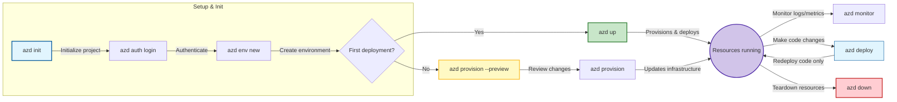
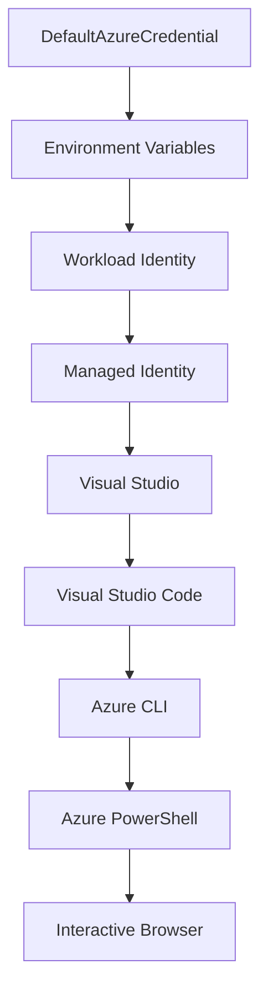

# AZD મૂળాలు - ప్రాథమిక భావనలు మరియు ప్రాథమిక పాఠాలు

**అధ్యాయం నావిగేషన్:**
- **📚 కోర్సు హోమ్**: [AZD For Beginners](../../README.md)
- **📖 ప్రస్తుత అధ్యాయం**: అధ్యాయం 1 - స్థాపన & క్విక్ స్టార్ట్
- **⬅️ ముందు**: [Course Overview](../../README.md#-chapter-1-foundation--quick-start)
- **➡️ తరువాత**: [Installation & Setup](installation.md)
- **🚀 తరువాత అధ్యాయం**: [Chapter 2: AI-First Development](../chapter-02-ai-development/microsoft-foundry-integration.md)

## పరిచయం

> `azd 1.37.2` కు సమీక్షించబడింది (నవంబర్ 2026). బాష్ కమాండ్లు మీరు భర్తీ చేయవలసిన ఉటంకిత ప్లేస్‌హోల్డర్లు ఉపయోగిస్తాయి. టెంప్లేట్ వర్క్‌ఫ్లోలు ప్రస్తుత డైరెక్టరీని ప్రారంభించడానికి `.` ఉపయోగిస్తాయి; డైరెక్టరీ ఆర్గ్యుమెంట్ లేకపోతే, టెంప్లేట్ ప్రారంభీకరణ ఒక ఉపడైరెక్టరీని సృష్టిస్తుంది మరియు మీ షెల్ ఆపరేటింగ్ డైరెక్టరీని మార్చదు. అభివృద్ధి స్నిపెట్లు ఒక ఉదాహరణ మాత్రమే, సంపూర్ణ ప్రాజెక్టులు కాదు.

ఈ పాఠం Azure Developer CLI (azd)తో పరిచయం చేస్తుంది, ఇది బలమైన కమాండ్-లైన్ సాధనం, ఇది స్థానిక అభివృద్ధి నుండి Azure పంపిణీకి మీ ప్రయాణాన్ని వేగవంతం చేస్తుంది. మీరు ప్రాథమిక సూత్రాలు, మూలభూత లక్షణాలు నేర్పబడతారు మరియు azd మేఘ-స్థానిక అప్లికేషన్ పంపిణీని సులభతరం చేసే విధానాన్ని అర్థం చేసుకుంటారు.

## అభ్యాస లక్ష్యాలు

ఈ పాఠం শেষে, మీరు:
- Azure Developer CLI అనేది ఏమిటి మరియు దాని ప్రాథమిక ఉద్దేశ్యం ఏమిటి అనే విషయాన్ని అర్థం చేసుకుంటారు
- టెంప్లేట్లు, పరిసరాలు, మరియు సేవల మూల సిద్ధాంతాలను నేర్చుకుంటారు
- టెంప్లేట్-చాలిత అభివృద్ధి మరియు Infrastructure as Code సహా ముఖ్య ఫీచర్లను పరిశీలిస్తారు
- azd ప్రాజెక్టు నిర్మాణం మరియు వర్క్‌ఫ్లో గురించి అర్థం చేసుకుంటారు
- మీ అభివృద్ధి పరిసరానికి azd ను ఇన్‌స్టాల్ చేసి కాన్ఫిగర్ చేయడానికి సన్నద్ధం అవుతారు

## అభ్యాస ఫలితాలు

ఈ పాఠం పూర్తి చేసిన తర్వాత, మీరు చేయగలుగుతారు:
- ఆధునిక క్లౌడ్ అభివృద్ధి పనివిధానాలలో azd యొక్క పాత్రను వివరించండి
- azd ప్రాజెక్ట్ నిర్మాణం యొక్క భాగాలను గుర్తించండి
- టెంప్లేట్లు, పర్యావరణాలు, మరియు సేవలు ఎలా కలిసి పనిచేస్తాయో వివరిం చండి
- azd తో ఇన్‌ఫ్రాస్ట్రక్చర్ ఆస్ కోడ్ లాభాలను అర్థం చేసుకోండి
- వేరే వేరే azd కమాండ్లను మరియు వాటి ఉద్దేశాలను గుర్తించండి

## Azure Developer CLI (azd) అంటే ఏమిటి?

Azure Developer CLI (azd) అనేది స్థానిక అభివృద్ధి నుండి Azure డిప్లాయ్‌మెంట్‌కి మీ ప్రయాణాన్ని వేగవంతం చేయడానికి రూపొందించిన కమాండ్-లైన్ టూల్. ఇది Azureపై క్లౌడ్-దేశీయ అనువర్తనాలను నిర్మించడం, డిప్లాయ్ చేయడం, మరియు నిర్వహించడాన్నిఉపరిష్కరించును.

### మీరు azd తో ఏమి డిప్లాయ్ చేయవచ్చు?

azd విస్తృత శ్రేణి వర్క్‌లోడ్లకు మద్దతును ఇస్తుంది—మరియు జాబితా పెరుగుతుంది. ఈ రోజు, మీరు azd ను ఉపయోగించి క్రింద విషయాలను డిప్లాయ్ చేయవచ్చు:

| వర్క్‌లోడ్ రకం | ఉదాహరణలు | అదే వర్క్‌ఫ్లో? |
|---------------|----------|----------------|
| **సాంప్రదాయ అప్లికేషన్లు** | వెబ్ యాప్స్, REST APIs, స్టాటిక్ సైట్స్ | ✅ `azd up` |
| **సర్వీసులు మరియు మైక్రోసర్వీసులు** | కంటైనర్ యాప్స్, ఫంక్షన్ యాప్స్, బహు-సర్వీస్ బ్యాక్‌ఎండ్స్ | ✅ `azd up` |
| **AI- ఆధారిత అప్లికేషన్లు** | మైక్రోసాఫ్ట్ ఫౌండరీ మోడల్స్ తో చాట్ యాప్స్, AI సెర్చ్‌తో RAG సొల్యూషన్స్ | ✅ `azd up` |
| **ఇంటెలిజెంట్ ఏజెంట్లు** | ఫౌండరీ-ఆధారిత ఏజెంట్లు, బహుఏజెంట్ ఆర్చెస్ట్‌రేషన్స్ | ✅ `azd up` |

ముఖ్యాంశం ఏమంటే **మీరు ఏమి డిప్లాయ్ చేస్తున్నారో ప్రారంభించకుండా azd లైఫ్‌సైకిల్ ఎప్పటికీ ఒకటే ఉంటుంది**. మీరు ప్రాజెక్ట్‌ను ప్రారంభిస్తారు, ఇన్ఫ్రాస్ట్రక్చర్‌ను ప్రావిజన్ చేస్తారు, మీ కోడ్‌ను డిప్లాయ్ చేస్తారు, మీ యాప్‌ను మానిటర్ చేస్తారు, మరియు క్లీన్ అప్ చేస్తారు— అది ఒక సాధారణ వెబ్‌సైట్ కాకుండా, అధునాతన AI ఏజెంట్ అయినా సరే.

ఇది డిజైన్ ప్రకారం కొనసాగింపుగా ఉంది. azd AI సామర్థ్యాలను మీ అప్లికేషన్ ఉపయోగించగల మరో రకమైన సర్వీసులాగా చూసుకుంటుంది, పూర్తిగా భిన్నమైనదిగా కాకుండా. మైక్రోసాఫ్ట్ ఫౌండరీ మోడల్స్‌తో బ్యాక్ చేయబడిన ఒక చాట్ ఎండ్పాయింట్, azd దృష్టిలో, కేవలం మరొక సర్వీస్‌ను కాన్ఫిగర్ చేసి డిప్లాయ్ చేయడమమే.

### 🎯 AZD ని ఎందుకు ఉపయోగించాలి? ఒక వాస్తవ ప్రపంచ సరిపోలిక

ఒక సాధారణ వెబ్ యాప్ డేటాబేస్‌తో డిప్లాయ్ చేయడాన్ని పోల్చుకుందాం:

#### ❌ AZD లేకుండా: మానువల్ అజ్యూర్ డిప్లాయ్‌మెంట్ (30+ నిమిషాలు)

**ప్రదర్శనాత్మక బాష్ సరిపోలిక, ఇది రన్ చేయదగిన అప్లికేషన్ స్టార్టర్ కాదు.** ఇది ముందు నుండే ఉన్న అప్లికేషన్ కోడ్, ప్రత్యేక రిసోర్స్ పేర్లు, అజ్యూర్ CLI ఆథెంటికేషన్, మరియు అవసరమైన CLI ఎక్స్టెన్షన్స్‌ను అనుమానిస్తూ ఉంటుంది. మద్దతు ఇవ్వబడిన ఎండ్-టు-ఎండ్ మార్గం కోసం క్రింద టెంప్లేట్ వ్యాయామం ఉపయోగించండి.

```bash
# Step 1: Create resource group
az group create --name myapp-rg --location eastus

# Step 2: Create App Service Plan
az appservice plan create --name myapp-plan \
  --resource-group myapp-rg \
  --sku B1 --is-linux

# Step 3: Create Web App
az webapp create --name myapp-web-unique123 \
  --resource-group myapp-rg \
  --plan myapp-plan \
  --runtime "NODE:22-lts"

# Step 4: Create Cosmos DB account (10-15 minutes)
az cosmosdb create --name myapp-cosmos-unique123 \
  --resource-group myapp-rg \
  --kind MongoDB

# Step 5: Create database
az cosmosdb mongodb database create \
  --account-name myapp-cosmos-unique123 \
  --resource-group myapp-rg \
  --name tododb

# Step 6: Create collection
az cosmosdb mongodb collection create \
  --account-name myapp-cosmos-unique123 \
  --resource-group myapp-rg \
  --database-name tododb \
  --name todos

# Step 7: Get connection string
CONN_STR=$(az cosmosdb keys list \
  --name myapp-cosmos-unique123 \
  --resource-group myapp-rg \
  --type connection-strings \
  --query "connectionStrings[0].connectionString" -o tsv)

# Step 8: Configure app settings
az webapp config appsettings set \
  --name myapp-web-unique123 \
  --resource-group myapp-rg \
  --settings MONGODB_URI="$CONN_STR"

# Step 9: Enable logging
az webapp log config --name myapp-web-unique123 \
  --resource-group myapp-rg \
  --application-logging filesystem \
  --detailed-error-messages true

# Step 10: Set up Application Insights
az monitor app-insights component create \
  --app myapp-insights \
  --location eastus \
  --resource-group myapp-rg

# Step 11: Link App Insights to Web App
INSTRUMENTATION_KEY=$(az monitor app-insights component show \
  --app myapp-insights \
  --resource-group myapp-rg \
  --query "instrumentationKey" -o tsv)

az webapp config appsettings set \
  --name myapp-web-unique123 \
  --resource-group myapp-rg \
  --settings APPINSIGHTS_INSTRUMENTATIONKEY="$INSTRUMENTATION_KEY"

# Step 12: Build application locally
npm install
npm run build

# Step 13: Create deployment package
zip -r app.zip . -x "*.git*" "node_modules/*"

# Step 14: Deploy application
az webapp deployment source config-zip \
  --resource-group myapp-rg \
  --name myapp-web-unique123 \
  --src app.zip

# Step 15: Wait and pray it works 🙏
# (No automated validation, manual testing required)
```

**సమస్యలు:**
- ❌ 15+ జ్ఞాపకంలో ఉంచుకోవడానికి మరియు ఆదేశాలను క్రమంలో అమలు చేయడానికి
- ❌ 30-45 నిమిషాల మానవ శ్రమ
- ❌ తప్పులు చేయడం సులభం (టైపోలు, తప్పు పరామితులు)
- ❌ క్రెడెన్షియల్స్ స్పష్టమైన నిర్వహణ అవసరం; డీ బగ్ లాగ్లు మరియు షెల్ ట్రేసింగ్ వాటిని బయటపెట్టవచ్చు
- ❌ ఏదైనా విఫలమైతే ఆటోమేటెడ్ రోల్బ్యాక్ లేదు
- ❌ బృంద సభ్యులకు పునరుత్పత్తి చేయడం కష్టమైంది
- ❌ ప్రతిసారీ వేరే ఉంటుంది (పునరాబృతం కావదు)

#### ✅ AZD తో: ఆటోమేటెడ్ డిప్లాయ్‌మెంట్ (5 కమాండ్లతో, 10-15 నిమిషాలు)

```bash
# Step 1: Initialize from template
azd init --template todo-nodejs-mongo .

# Step 2: Authenticate
azd auth login

# Step 3: Select the environment created during init
azd env select dev

# Step 4: Preview changes (optional but recommended)
azd provision --preview

# Step 5: Deploy everything
azd up

# ✨ Done! Everything is deployed, configured, and monitored
```

**లాభాలు:**
- ✅ **5 కమాండ్లు** مقابل 15+ మానవ దశలు
- ✅ **మొత్తం సమయం 10-15 నిమిషాలు** (ప్రధానంగా Azure కోసం వేచి ఉండటం)
- ✅ **తగ్గిన మానవ తప్పిదాలు** - స్థిరమైన, టెంప్లేట్ ఆధారిత వర్క్‌ఫ్లో
- ✅ **సురక్షిత సీక్రెట్ హ్యాండ్లింగ్** - అనేక టెంప్లేట్లు Azure-నిర్వహించబడిన సీక్రెట్ నిల్వను ఉపయోగిస్తాయి
- ✅ **పునరావృతమైన డిప్లాయ్‌మెంట్లు** - ప్రతిసారీ అదే వర్క్‌ఫ్లో
- ✅ **పునరావృతమైన ఇన్‌ఫ్రాస్ట్రక్చర్ నిర్వచనలు** - క్వాటాలు, ప్రాంతం లభ్యత మరియు టెంప్లేట్ సంస్కరణలపై ఆధారపడినవి
- ✅ **బృందానికి సన్నద్ధం** - ఎవరికైనా అదే కమాండ్లతో డిప్లాయ్ చేయవచ్చు
- ✅ **కోడ్ రూపంలో ఇన్‌ఫ్రాస్ట్రక్చర్** - వెర్షన్ నియంత్రణలో Bicep టెంప్లేట్లు
- ✅ **టెంప్లేట్ నిర్వచించిన మానిటరింగ్** - టెంప్లేట్‌లో చేర్చబడితే ఆప్లికేషన్ ఇన్సైట్స్

### సమయం మరియు నమ్మకదరిమి

పై సమయాలు అంచనాలే, బెంచ్‌మార్క్‌లు కాదు. azd మీరు సమన్వయపరచాల్సిన కమాండ్లను తగ్గిస్తుంది, కానీ డిప్లాయ్‌మెంట్ వ్యవధిని హామీ చేయదు, తప్పిదాలను తొలగించదు లేదా ఆటోమేటెడ్ అప్లికేషన్/డేటాబేస్ రోల్బ్యాక్ అందించదు. వర్కింగ్ సంస్కరణలను సోర్స్ కంట్రోల్లో ఉంచి రికవరీ ప్రొసీజర్స్‌ను పరీక్షించండి.

## మౌలిక సూత్రాలు

### టెంప్లేట్లు
టెంప్లేట్లు azd యొక్క మూలానికి అనుమతిస్తాయి. అవి కలిగి ఉంటాయి:
- **ఆప్లికేషన్ కోడ్** - మీ మూలకోడ్ మరియు ఆధారిత భాగాలు
- **ఇన్‌ఫ్రాస్ట్రక్చర్ నిర్వచనలు** - Bicep లేదా Terraformలో నిర్వచించిన Azure వనరులు
- **కాన్ఫిగరేషన్ ఫైళ్ళు** - సెట్టింగులు మరియు వాతావరణ మாற్పులు
- **డిప్లాయ్‌మెంట్ స్క్రిప్ట్లు** - ఆటోమేటెడ్ డిప్లాయ్‌మెంట్ వర్క్‌ఫ్లోలు

### వాతావరణాలు
వాతావరణాలు వివిధ డిప్లాయ్‌మెంట్ లక్ష్యాలను సూచిస్తాయి:
- **అభివృద్ధి** - పరీక్ష మరియు అభివృద్ధికి
- **స్టేజింగ్** - ప్రీ-ఉత్పత్తి వాతావరణం
- **ఉత్పత్తి** - ప్రత్యక్ష ఉత్పత్తి వాతావరణం

ప్రతి వాతావరణం దాని స్వంత వుంటుంది:
- వాతావరణ పేరు మరియు విలువలు; వనరుల విడిపిరితనం ఇన్‌ఫ్రాస్ట్రక్చర్ టెంప్లేట్ మీద ఆధారపడుతుంది
- కాన్ఫిగరేషన్ సెట్టింగులు
- డిప్లాయ్‌మెంట్ స్థితి

### సేవలు
`azure.yaml` లోని సేవలు డిప్లాయ్ చేయగల ఆప్లికేషన్ భాగాలను సూచిస్తాయి:
- **ఫ్రంట్‌ఎండ్** - వెబ్ ఆప్లికేషన్‌లు, SPAs
- **బ్యాక్‌ఎండ్** - APIs, మైక్రోసర్వీసులు

డేటాబేసులు మరియు నిల్వ సాధారణంగా ఇన్‌ఫ్రాస్ట్రక్చర్ వనరులుగా ఏర్పాటుచేశారు, సృష్టించిన సేవా హోస్ట్‌లు కాదని, ఉదాహరణకు `host: postgres` వంటి.

## ముఖ్య సവിശేషతలు

### 1. టెంప్లేట్ ఆధారిత అభివృద్ధి
```bash
# Browse available templates
azd template list

# Initialize from a template
azd init --template "<template-name>" .
```

### 2. కోడ్ రూపంలో ఇన్‌ఫ్రాస్ట్రక్చర్
- **Bicep** - Azure యొక్క డొమైన్-స్పెసిఫిక్ భాష
- **Terraform** - బహు-క్లౌడ్ ఇన్‌ఫ్రాస్ట్రక్చర్ సాధనం
- Bicep ARM టెంప్లేట్లకు కంపైల్ చేస్తుంది; మచ్చిక ARM JSON ప్రత్యేకమైన సృష్టించబడిన `infra.provider` కాదు.

### 3. సమగ్ర వర్క్‌ఫ్లోలు
```bash
# Complete deployment workflow
azd up            # Provision + Deploy this is hands off for first time setup

# 🧪 NEW: Preview infrastructure changes before deployment (SAFE)
azd provision --preview    # Simulate infrastructure deployment without making changes

azd provision     # Create Azure resources if you update the infrastructure use this
azd deploy        # Deploy application code or redeploy application code once update
azd down          # Clean up resources
```

#### 🛡️ పూర్వవీక్షతో సురక్షిత ఇన్‌ఫ్రాస్ట్రక్చర్ ప్రణాళిక
`azd provision --preview` కమాండ్ సురక్షిత డిప్లాయ్‌మెంట్‌ల కోసం గేమ్-చేంజర్:
- **డ్రై-రన్ విశ్లేషణ** - ఏమి సృష్టించబడుతుందో, మార్పు చేయబడుతుందో, లేదా తొలగించబడుతుందో చూపిస్తుంది
- **ఇన్‌ఫ్రాస్ట్రక్చర్ దృష్టాంతం లేదు** - ప్రొవైడర్ మార్పులను సమీక్షిస్తుంది; ప్రాజెక్ట్ హుక్స్‌ను ముందుగా పరిశీలించండి, ఎందుకంటే హుక్స్ సైడ్ ఎఫెక్ట్స్ ఉన్న కమాండ్లను నడిపించవచ్చు
- **బృంద సహకారం** - డిప్లాయ్‌మెంట్‌కి ముందు పూర్వవీక్ష ఫలితాలను పంచుకోండి
- **ఖర్చు ప్రణాళిక ఇన్‌పుట్** - ప్రతిపాదిత SKUలను పరిశీలించి, ఆపై Azure ధరల కెలక్యులేటర్‌తో ధరలు అంచనా వేయండి; పూర్వవీక్ష ధరలు లెక్కించదు

```bash
# Example preview workflow
azd provision --preview           # See what will change
# Review the output, discuss with team
azd provision                     # Apply changes with confidence
```

### 📊 విజువల్: AZD అభివృద్ధి వర్క్‌ఫ్లో



**వర్క్‌ఫ్లో వివరణ:**
1. **ఇనిట్** - టెంప్లేట్ లేదా కొత్త ప్రాజెక్టుతో ప్రారంభించండి
2. **అథ్** - Azure తో ఆథెంటికేట్ చేయండి
3. **ఎన్‌విరోన్మెంట్** - వేరుచేసిన డిప్లాయ్‌మెంట్ వాతావరణం సృష్టించండి
4. **ప్రివ్యూ** - 🆕 ముడి కన్స్ట్రక్షన్ మార్చులు ముందుగా ఎప్పుడూ ప్రివ్యూ చేయండి (భద్రమైన కర్మాచరణ)
5. **ప్రొవిజన్** - Azure వనరుల ఏర్పాట్లు / నవీకరణలు చేయండి
6. **డిప్లాయ్** - మీ అప్లికేషన్ కోడ్ నొక్కండి
7. **మానిటర్** - అప్లికేషన్ పనితీరును గమనించండి
8. **ఇటరేట్** - మార్పులు చేయండి మరియు కోడ్ మళ్లీ పంపండి
9. **క్లీన్‌అప్** - కార్యం పూర్తయ్యిన తర్వాత వనరులను తొలగించండి

### 4. వాతావరణ నిర్వహణ
```bash
# Create and manage environments
azd env new "<environment-name>"
azd env select "<environment-name>"
azd env list
```

### 5. విస్తరణలు మరియు AI కమాండ్లు

azd కోర్ CLIకి మించి సామర్థ్యాలు జోడించడానికి విస్తరణ వ్యవస్థను ఉపయోగిస్తుంది. ఇది ప్రత్యేకంగా AI వర్క్‌లోడ్‌లకు ఉపయోగకరం:

```bash
# List available extensions
azd extension list

# Install the GA Foundry bundle (requires azd >= 1.37.0)
azd ext install microsoft.foundry

# Initialize an AI agent project interactively
azd ai agent init

# Test a deployed agent (shows latency and time-to-first-byte)
azd ai agent invoke

# Start the MCP server for AI-assisted development (Alpha)
azd mcp start
```

**ఏజెంట్ లైఫ్‌సైకిల్, మొదలునుండి చివరి దాకా.** GA `microsoft.foundry` బండిల్‌లో `azure.ai.agents` మరియు ఆరుగురు ఇతర కీ విస్తరణలు ఉన్నాయి. `azure.ai.evaluations`ని వేరుగా అమర్చండి మదింపు కోసం. ఈ వర్క్‌ఫ్లోకు `azd >= 1.37.0` ఉపయోగించండి. మొదటి రోజు ఈ అన్ని అవసరం లేదు:

| దశ | కమాండ్ | ఇది ఏం చేస్తుంది |
|-------|---------|--------------|
| **స్కాఫ్‌ఫోల్డ్** | `azd ai agent init --template <path-to-azure.yaml>` | ప్రస్తుత ఏజెంట్ ప్రాజెక్ట్ టెంప్లేట్‌ను అనుసరించండి |
| **స్థానికంగా రన్ చేయండి** | `azd ai agent run`, తరువాత మరో టెర్మినల్‌లో `azd ai agent invoke --local "Test prompt"` | ఏజెంట్ ఇన్‌స్పెక్టర్‌లో స్థానిక కార్యకలాపాలను తనిఖీ చేయండి; మోడల్ కాల్స్ Azure ను ఉపయోగిస్తాయి |
| **డిప్లాయ్** | `azd deploy` | కోడ్-మోడ్ హోస్టెడ్ ఏజెంట్‌ల కోసం, ఫౌండ్రీ నిర్మాణం కోసం మూలాన్ని అప్లోడ్ చేయండి |
| **టెస్ట్** | `azd ai agent invoke` | ఏజెంట్‌ని కాల్ చేసి ప్రతిస్పందన సమయాన్ని చూడండి |
| **మీజర్** | `azd ai eval init`, `generate`, `run start` | వేరువేరు విస్తరణ ఉపయోగించి వాటిని కాన్ఫిగర్ చేసి, డిప్లాయ్ చేసి, అంచనాలు నడపండి |
| **ఇంప్రూవ్** | `azd ai agent optimize --eval <evaluation-name> --optimize-model <optimizer-deployment>` | ఏజెంట్‌ను మెరుగుపరిచేందుకు అనుకూలమైన అంచనాని మళ్ళీ ఉపయోగించండి |
| **ఇన్‌స్పెక్ట్** | `azd ai agent endpoint show` | లైవ్ ఎండ్‌పాయింట్ కాన్ఫిగరేషన్ చూడండి |
| **క్లీన్ అప్** | `azd ai agent delete` | హోస్టెడ్ ఏజెంట్ మరియు దాని అన్ని సంస్కరణలను తొలగించండి |

> ప్రారంభించండి [GA హోస్టెడ్-ఏజెంట్ వాక్‌థ్రూ](../chapter-02-ai-development/microsoft-foundry-integration.md#hosted-agent-walkthrough-ga)తో, ఇది ప్రాథమిక అవసరాలు, ప్రొవిజనింగ్, మరియు సురక్షిత శుభ్రత గురించి پوش్ చేస్తుంది. ఎక్స్టెన్షన్ల గురించి మరింత [AZD AI CLI Commands](../chapter-08-production/production-ai-practices.md#azd-ai-cli-commands-and-extensions) సూచికలో చర్చించబడింది.

## 📁 ప్రాజెక్ట్ నిర్మాణం

సాధారణ azd ప్రాజెక్ట్ నిర్మాణం:
```
my-app/
├── .azure/                  # Local environments and selected-environment config
│   ├── config.json
│   └── dev/.env
├── .devcontainer/          # Development container config
├── .github/workflows/      # GitHub Actions
├── .vscode/               # VS Code settings
├── infra/                 # Infrastructure code
│   ├── main.bicep        # Main infrastructure template
│   ├── main.parameters.json
│   └── modules/          # Reusable modules
├── src/                  # Application source code
│   ├── api/             # Backend services
│   └── web/             # Frontend application
├── azure.yaml           # azd project configuration
└── README.md
```

## 🔧 కాన్ఫిగరేషన్ ఫైళ్ల

### azure.yaml
ప్రధాన ప్రాజెక్ట్ కాన్ఫిగరేషన్ ఫైల్:
```yaml
name: my-awesome-app
metadata:
  template: my-template@1.0.0

services:
  web:
    project: ./src/web
    language: js
    host: appservice
  api:
    project: ./src/api
    language: js
    host: appservice

hooks:
  preprovision:
    shell: pwsh
    run: echo "Preparing to provision..."
```

### .azure/config.json
ప్రాజెక్ట్-స్థానిక డిఫాల్ట్ ఎన్విరాన్‌మెంట్ ఎంపిక (ఉదాహరణకి; azd ద్వారా నిర్వహింపబడింది):
```json
{
  "defaultEnvironment": "dev"
}
```

## 🎪 సాధారణ పనితీరు మరియు హ్యాండ్స్-ఆన్ వ్యాయామాలు

> **💡 నేర్చుకునే సూచన:** ఈ వ్యాయామాలను క్రమంగా అనుసరించి మీ AZD నైపుణ్యాలను జోడించండి.

### 🎯 వ్యాయామం 1: మీ మొదటి ప్రాజెక్ట్‌ను ఆరంభించండి

**లక్ష్యం:** ఒక AZD ప్రాజెక్ట్ సృష్టించి దాని నిర్మాణాన్ని అన్వేషించండి

**దశలు:**
```bash
# Use a proven template
mkdir azd-basics-practice
cd azd-basics-practice
# Choose "dev" for the environment name when prompted
azd init --template todo-nodejs-mongo .

# Explore the generated files
ls -la  # View all files including hidden ones

# Key files created:
# - azure.yaml (main config)
# - infra/ (infrastructure code)
# - src/ (application code)
```

**✅ విజయవంతం:** మీ వద్ద azure.yaml, infra/, మరియు src/ డైరెక్టరీలు ఉన్నాయి

---

### 🎯 వ్యాయామం 2: Azureకి డిప్లాయ్ చేయండి

**లక్ష్యం:** పూర్తిస్థాయి ఎండ్-టు-ఎండ్ డిప్లాయ్‌మెంట్ పూర్తి చేయండి

**పైజిలు:**
```bash
# 1. Authenticate
azd auth login

# 2. Select the dev environment created in Exercise 1
azd env select dev
azd env set AZURE_LOCATION eastus

# 3. Preview changes (RECOMMENDED)
azd provision --preview

# 4. Deploy everything
azd up

# 5. Verify deployment
azd show    # View your app URL
```

**అంచనా సమయం:** 10-15 నిమిషాలు  
**✅ విజయం:** అప్లికేషన్ URL బ్రౌజర్లో తెరుస్తుంది

---

### 🎯 వ్యాయామం 3: బహుళ వాతావరణాలు

**లక్ష్యం:** డెవ్ మరియు స్టేజింగ్‌కు మోపడం

**పైజిలు:**
```bash
# Already have dev, create staging
azd env new staging
azd env set AZURE_LOCATION westus2
azd up

# Switch between them
azd env list
azd env select dev
```

**✅ విజయం:** Azure పోర్టల్‌లో రెండు ప్రత్యేక వనరుల సమూహాలు

**శుభ్రపరిచే:** వ్యాయామం 3 రెండవ బిల్లబుల్ మోపుడును సృష్టిస్తుంది. ముగిస్తే రెండింటినీ కూడా తుడవండి:

```bash
azd down --environment dev
azd down --environment staging
```

---

### 🛡️ ధ్వં‍സాత్మక శుభ్రపరిచే: `azd down --force --purge`

మీరు ఎంచుకున్న వాతావరణం యొక్క Azure వనరులను ఉద్దేశపూర్వకంగా తొలగించాలని ఉన్నప్పుడు:

```bash
azd down --force --purge
```

**ఇది ఏమి చేస్తుంది:**
- `--force`: నిర్ధారణ ప్రాంప్టులను ప్రదర్శించదు
- `--purge`: మద్దతు పొందిన సాఫ్ట్-డిలీట్ చేసిన వనరులను (ఉదా: కీ వాల్ట్స్) శాశ్వతంగా కూడా తొలగిస్తుంది, పర్జ్ రక్షణ ఇది అనుమతిస్తే. ఇది స్థానిక `.azure/` డైరెక్టరీను తొలగించదు.

**వాడకం ఎప్పుడు:** వినియోగించిన వాతావరణం పూర్తయ్యాక. ధ్వంసాత్మక శుభ్రపరిచేతో ప్రథమ ప్రతిస్పందనగా గుర్తింపు, కోటా లేదా కాన్ఫిగరేషన్ దోషాన్ని చికిత్స చేయవద్దు.

---

## 🎪 అసలు పని ప్రవాహ సూచిక

### కొత్త ప్రాజెక్ట్ ప్రారంభించడం
```bash
# Method 1: Use existing template
azd init --template todo-nodejs-mongo .

# Method 2: Start from scratch
azd init

# Method 3: Use current directory
azd init .
```

### అభివృద్ధి చక్రం
```bash
# Set up development environment
azd auth login
azd env new dev
azd env select dev

# Deploy everything
azd up

# Make changes and redeploy
azd deploy

# Clean up when done
azd down --force --purge # Deletes this environment's discovered Azure resources; review before forcing deletion.
```

## `azd down --force --purge` గురించి అవగాహన
`azd down --force --purge` ఆదేశం మీ azd వాతావరణాన్ని మరియు అన్ని అనుబంధ వనరులను పూర్తిగా తొలగించే శక్తివంతమైన మార్గం. ప్రతి ఫ్లాగ్ ఏమి చేస్తుందో ఇక్కడ ఉంది:
```
--force
```
- నిర్ధారణ ప్రాంప్టులను దాటివెర్లేదు.
- మానవీయ ఇన్పుట్ సాధ్యం కానప్పుడు ఆటోమేషన్ లేదా స్క్రిప్టింగ్‌కు ఉపయోగకరం.
- అనుమతులు, పర్జ్ రక్షణ, లేదా తొలగింపు విఫలతలను ಮೀರించదు.

```
--purge
```
మరొక నిర్ధారణ లేకుండా మద్దతుగా ఉన్న సాఫ్ట్-డిలీట్ చేయబడ్డ Azure వనరులను శాశ్వతంగా మాయమవుస్తుంది. పర్స్ రక్షణ మరియు అనుమతులు ఇంకా వర్తించును. ఇది **కాదు** స్థానిక వాతావరణాలను లేదా `.azure/` ఫోల్డర్‌ని తీసివేయడం.


### ఎందుకు రెండింటినీ ఉపయోగించాలి?
మీరు ఎంపికచేసిన ఎన్విరాన్‌మెంట్ యొక్క Azure వనరులను తొలగించి తిరిగి పొందగల వనరులను శుద్ధి చేయాలని అనుకుంటున్నప్పుడు మాత్రమే రెండింటినీ ఉపయోగించండి. ఇది ఒక వినాశకర శుభ్రత, సాధారణ మరమ్మతు లేదా స్థానిక-స్థితి రీసెట్ కాదు.

ఇది ప్రత్యేకంగా Azure పోర్టల్‌లో మానవీయ వనరు తొలగింపులు చేసిన తర్వాత లేదా టెంప్లేట్లు, ఎన్విరాన్‌మెంట్లు, లేదా వనరు గ్రూప్ పేరు నిర్దేశాలను మార్చేప్పుడు సహాయపడుతుంది.


### బహుళ వాతావరణాలను నిర్వహించడం
```bash
# Create staging environment
azd env new staging
azd env select staging
azd up

# Switch back to dev
azd env select dev

# Compare environments
azd env list
```

## 🔐 సత్యపరచడం మరియు గుర్తింపు వివరాలు

మోపడం సత్యపరచడం (`azd auth login`) మరియు అప్లికేషన్ SDK సత్యపరచడం (`DefaultAzureCredential`) ను వేరు చేసుకోండి. అవి విడిగా ఉంటాయి. azd మాకు Azure CLI గుర్తింపు వివరాలను డిఫాల్ట్‌గా ఉపయోగించదు.

### Azure CLI సత్యపరచడం (`az login`)

azd కోసం `azd auth login` నడపండి. క్రింది Azure CLI ఆదేశాలు ఐచ్ఛికం మరియు `az` ఆదేశాలను విడిగా సత్యపరచుతాయి:

```bash
# Interactive login (opens browser)
az login

# Login with specific tenant
az login --tenant "<tenant-id>"

# Login with service principal
az login --service-principal -u "<app-id>" -p "<password>" --tenant "<tenant-id>"

# Check current login status
az account show

# List available subscriptions
az account list --output table

# Set default subscription
az account set --subscription "<subscription-id>"
```

### సత్యపరచడం ప్రసరణ
1. **ఇంటరాక్టివ్ లాగిన్**: మీ డిఫాల్ట్ బ్రౌజర్‌ని సత్యపరచడానికి తెరుస్తుంది
2. **డివైస్ కోడ్‌ ఫ్లో**: బ్రౌజర్ యాక్సెస్ లేని వాతావరణాల కోసం
3. **సర్వీస్ ప్రిన్సిపాల్**: ఆటోమేషన్ మరియు CI/CD పరిస్థితుల కోసం
4. **మెనేజ్డ్ ఐడెంటిటీ**: ఆజూర్-ఆతిథ్యాపరమైన అప్లికేషన్ల కోసం

### DefaultAzureCredential చైన్న్

`DefaultAzureCredential` అనేది ఒక క్రెడెన్షియల్ రకం, ఇది నిర్దిష్ట క్రమంలో అనేక క్రెడెన్షియల్ మూలాలను ఆటోమేటిగ్గా ప్రయత్నించడం ద్వారా సులభమైన प्रमాణీకరణ అనుభవాన్ని అందిస్తుంది:

#### అప్లికేషన్ SDK క్రెడెన్షియల్ చైన్న్

ఖచ్చితమైన చైన్న్ ఆజూర్ ఐడెంటిటీ SDK భాష, సంస్కరణ, ఇన్స్టాల్ చేసిన ప్లగిన్లు, మరియు ఎంపికలపై ఆధారపడి ఉంటుంది. ఈ డయాగ్రామ్ కాన్సెప్చువల్, స్థిరమైన azd ప్రమాణీకరణ క్రమంగా కాదు; ఇటీవల SDKలు ఆజూర్ డెవలపర్ CLI క్రెడెన్షియల్స్‌ను కూడా కలిగి ఉండవచ్చు.


#### 1. వాతావరణ చరాలు
```bash
# Set environment variables for service principal
export AZURE_CLIENT_ID="<app-id>"
export AZURE_CLIENT_SECRET="<password>"
export AZURE_TENANT_ID="<tenant-id>"
```

#### 2. వర్క్‌లోడ్ ఐడెంటిటీ (క్యుబెర్నెట్స్/గిట్‌హబ్ యాక్షన్స్)
ఆటోమేటిగ్గా ఉపయోగించబడుతుంది:
- ఆజూర్ క్యుబెర్నెట్స్ సర్వీస్ (AKS) వర్క్‌లోడ్ ఐడెంటిటీతో
- గిట్‌హబ్ యాక్షన్స్ OIDC ఫెడరేషన్‌తో
- ఇతర ఫెడరేటెడ్ ఐడెంటిటీ సందర్భాలు

#### 3. మేనేజ్డ్ ఐడెంటిటీ
ఆజూర్ వనరుల కోసం:
- వర్చువల్ మెషీన్లు
- యాప్ సర్వీస్
- ఆజూర్ ఫంక్షన్స్
- కంటైనర్ ఇన్‌స్టాన్సెస్

```bash
# Inspect a deployed Container App's configured identity (requires az login)
az containerapp show --name "<app-name>" --resource-group "<rg-name>" --query identity
```

#### 4. డెవలపర్ టూల్స్ ఇంటిగ్రేషన్
- **విజువల్ స్టూడియో**: సైన్-ఇన్ చేసిన ఖాతాను ఆటోమేటిగ్గా ఉపయోగిస్తుంది
- **VS కోడ్**: సపోర్ట్ SDK మరియు దాని మద్దతు బ్రోకర్/ప్లగిన్ సెటప్ మీద ఆధారపడి ఉంటుంది
- **ఆజూర్ CLI**: `az login` క్రెడెన్షియల్స్‌ను ఉపయోగిస్తుంది (స్థానిక అభివృద్ధికి అత్యంత సాధారణం)

### AZD ప్రమాణీకరణ సెటప్

```bash
# Method 1: Direct azd authentication (recommended)
azd auth login

# Method 2: Direct azd authentication
azd auth login --use-device-code  # For headless environments

# Method 3: Check authentication status
azd auth login --check-status

# Method 4: Logout and re-authenticate
azd auth logout
azd auth login
```

### ప్రమాణీకరణ ఉత్తమ ఆచరణలు

#### స్థానిక అభివృద్ధికి
```bash
# 1. Log in to azd
azd auth login

# 2. Select the subscription for this initialized environment
azd env set AZURE_SUBSCRIPTION_ID "<subscription-id>"

# 3. Check azd sign-in details (read the status message)
azd auth login --check-status
```

#### CI/CD పైప్‌లైన్లు కోసం
```yaml
# Partial GitHub Actions steps: assumes checkout, azd installation,
# required AZURE_* environment values, and pipeline secret configuration.
- name: Deploy with azd
  run: |
    azd auth login --client-id ${{ secrets.AZURE_CLIENT_ID }} \
                    --client-secret ${{ secrets.AZURE_CLIENT_SECRET }} \
                    --tenant-id ${{ secrets.AZURE_TENANT_ID }}
    azd up --no-prompt
```

#### ఉత్పత్తి వాతావరణాల కోసం
- ఆజూర్ వనరులపై నడుస్తున్నప్పుడు **మెనేజ్డ్ ఐడెంటిటీ** ఉపయోగించండి
- ఆటోమేషన్ సందర్భాలకు **సర్వీస్ ప్రిన్సిపాల్** ఉపయోగించండి
- క్రెడెన్షియల్స్‌ను కోడ్ లేదా కాన్ఫిగరేషన్ ఫైల్స్‌లో నిల్వ చేయడం నివారించండి
- సున్నితమైన కాన్ఫిగరేషన్ కోసం **ఆజూర్ కీ వాల్ట్** ఉపయోగించండి

### సాధారణ ప్రమాణీకరణ సమస్యలు మరియు పరిష్కారాలు

#### సమస్య: "సబ్‌స్క్రిప్షన్ కనుగొనబడలేదు"
```bash
# Solution: Set default subscription
az account list --output table
az account set --subscription "<subscription-id>"
azd env set AZURE_SUBSCRIPTION_ID "<subscription-id>"
```

#### సమస్య: "అనుమతులు తక్కువగా ఉన్నాయి"
```bash
# Solution: Check and assign required roles
az role assignment list --assignee $(az account show --query user.name --output tsv)

# Common required roles:
# - Contributor (for resource management)
# - User Access Administrator (for role assignments)
```

#### సమస్య: "టోకెన్ అవధి ముగిసింది"
```bash
# Solution: Re-authenticate
az logout
az login
azd auth logout
azd auth login
```

### వివిధ సందర్భాల్లో ప్రమాణీకరణ

#### స్థానిక అభివృద్ధి
```bash
# Personal development account
az login
azd auth login
```

#### బృంద అభివృద్ధి
```bash
# Use specific tenant for organization
az login --tenant contoso.onmicrosoft.com
azd auth login --tenant-id "<tenant-id>"
```

#### బహు-టెనంట్ సందర్భాలు
```bash
# Switch between tenants
az login --tenant tenant1.onmicrosoft.com
azd auth login --tenant-id "<tenant-1-id>"
# Select an environment configured with tenant 1's subscription
azd env select tenant1-dev
# Deploy to tenant 1
azd up

az login --tenant tenant2.onmicrosoft.com  
azd auth login --tenant-id "<tenant-2-id>"
azd env select tenant2-dev
# Deploy to tenant 2
azd up
```

### భద్రతా పరిగణనలు

1. **క్రెడెన్షియల్ నిల్వ**: ఎప్పుడూ క్రెడెన్షియల్స్‌ను సోర్స్ కోడ్‌లో నిల్వ చేయకండి
2. **పరిధి పరిమితి**: సర్వీస్ ప్రిన్సిపాల్‌ల కోసం తక్కువ హక్కుల సూత్రం పాటించండి
3. **టోకెన్ రొటేషన్**: సర్వీస్ ప్రిన్సిపాల్ సీక్రెట్లను సవ్యంగా మళ్ళీ మార్చండి
4. **ఆడిట్ ట్రయిల్**: ప్రమాణీకరణ మరియు డిప్లాయ్‌మెంట్ కార్యకలాపాలను పర్యవేక్షించండి
5. **నెట్‌వర్క్ భద్రత**: సాధ్యమైనప్పుడు ప్రైవేట్ ఎండ్పాయింట్లు ఉపయోగించండి

### ప్రమాణీకరణ లో ట్రబుల్‌షూటింగ్

```bash
# Debug authentication issues
azd auth login --check-status
az account show
az account get-access-token

# Common diagnostic commands
whoami                          # Current user context
az ad signed-in-user show      # Microsoft Entra ID user details
az group list                  # Test resource access
```

## కమాండ్ డిస్కవరీ

### డిస్కవరీ
```bash
azd template list              # Browse templates
azd template list --help       # Template discovery options
azd init --help               # Initialization options
```

### ప్రాజెక్ట్ నిర్వహణ
```bash
azd show                     # Project overview
azd env list                # Available environments and selected default
azd config show            # Configuration settings
```

### మానిటరింగ్
```bash
azd monitor                  # Open Azure portal monitoring
azd monitor --logs           # View application logs
azd monitor --live           # View live metrics
azd pipeline config          # Set up CI/CD
```

## ఉత్తమ ఆచరణలు

### 1. అర్థవంతమైన పేర్లు ఉపయోగించండి
```bash
# Good
azd env new production-east
azd init --template todo-nodejs-mongo .

# Avoid
azd env new env1
azd init --template template1 .
```

### 2. టెంప్లేట్లను ఉపయోగించుకోండి
- ఇప్పటికే ఉన్న టెంప్లేట్లతో ప్రారంభించండి
- మీ అవసరాల ప్రకారం అనుకూలీకరించండి
- మీ సంస్థ కోసం పునర్వాడీ టెంప్లేట్లను సృష్టించండి

### 3. వాతావరణాల విభజన
- డేవ్/స్టేజింగ్/ప్రొడക്ഷన్ కోసం వేర్వేరు వాతావరణాలను ఉపయోగించండి
- స్థానిక యంత్రం నుండి నేరుగా ఉత్పత్తికి పంపిణీ చేయద్దు
- ఉత్పత్తి డిప్లాయ్‌మెంట్స్ కోసం CI/CD పైప్‌లైన్లను ఉపయోగించండి

### 4. కాన్ఫిగరేషన్ నిర్వహణ
- సీక్రెట్ల కోసం మేనేజ్డ్ ఐడెంటిటీ మరియు కీ వాల్ట్ ఉపయోగించండి; సాధారణ `azd env set` విలువలు స్థానిక సాదాసీదీ వచనం
- కాన్ఫిగరేషన్‌ను వెర్షన్ కంట్రోల్‌లో ఉంచండి
- వాతావరణ-ప్రత్యేక సెట్టింగ్లను డాక్యుమెంట్ చేయండి

## నేర్చుకునే ప్రగతి

### ప్రారంభస్థాయి (వారం 1-2)
1. azd ని ఇన్‌స్టాల్ చేసి ప్రమాణీకరించుకోవడం
2. ఒక సింపుల్ టెంప్లెట్‌ని డిప్లాయ్ చేయడం
3. ప్రాజెక్ట్ నిర్మాణాన్ని అర్థం చేసుకోవడం
4. ప్రాథమిక కమాండ్లను నేర్చుకోవడం (అప్ప్, డౌన్, డిప్లాయ్)

### మధ్యస్థాయి (వారం 3-4)
1. టెంప్లేట్లను అనుకూలీకరించడం
2. బహుళ వాతావరణాలను నిర్వహించడం
3. ఇన్‌ఫ్రాస్ట్రక్చర్ కోడ్ అర్థం చేసుకోవడం
4. CI/CD పైప్‌లైన్లను సెటప్ చేయడం

### ఆడ్వాన్స్‌డ్ (వారం 5+)
1. కస్టమ్ టెంప్లేట్లను సృష్టించడం
2. అధునాతన ఇన్‌ఫ్రాస్ట్రక్చర్ నమూనాలు
3. బహుళ ప్రాంతాల డిప్లాయ్‌మెంట్స్
4. ఎంటర్‌ప్రైజ్-గ్రేడ్ కాన్ఫిగరేషన్స్

## తదుపరి దశలు

**📖 అధ్యాయం 1 నేర్చుకోవడం కొనసాగించండి:**
- [సంస్థాపన & సెటప్](installation.md) - azdని ఇన్‌స్టాల్ చేసి కాన్ఫిగర్ చేయండి
- [మీ మొదటి ప్రాజెక్ట్](first-project.md) - హ్యాండ్స్-ఆన్ ట్యూటోరియల్ పూర్తిచేయండి
- [కాన్ఫిగరేషన్ గైడ్](../chapter-03-configuration/configuration.md) - అధునాతన కాన్ఫిగరేషన్ ఎంపికలు

**🎯 తదుపరి అధ్యాయం కోసం సిద్ధం?**
- [అధ్యాయం 2: AI-ఫస్ట్ డెవలప్‌మెంట్](../chapter-02-ai-development/microsoft-foundry-integration.md) - AI అప్లికేషన్లు నిర్మించడం ప్రారంభించండి

## అదనపు వనరులు

- [ఆజూర్ డెవలపర్ CLI అవలోకనం](https://learn.microsoft.com/en-us/azure/developer/azure-developer-cli/)
- [టెంప్లెట్ గ్యాలరీ](https://azure.github.io/awesome-azd/)
- [క‌మ్యూనిటీ శాంపిల్స్](https://github.com/Azure-Samples)

---

## 🙋 తరచుగా అడిగే ప్రశ్నలు

### సాధారణ ప్రశ్నలు

**Q: AZD మరియు ఆజూర్ CLI మధ్య తేడా ఏమిటీ?**

A: ఆజూర్ CLI (`az`) వ్యక్తిగత ఆజూర్ వనరులను నిర్వహించడానికి. AZD (`azd`) మొత్తం అప్లికేషన్లను నిర్వహించడానికి:

```bash
# Azure CLI - Low-level resource management
az webapp create --name myapp --resource-group rg
az sql server create --name myserver --resource-group rg
# ...many more commands needed

# AZD - Application-level management
azd up  # Deploys entire app with all resources
```

**ఇలా ఆలోచించండి:**
- `az` = వ్యక్తిగత లెగో బ్లాక్స్ మీద ఆపరేట్ చేయడం
- `azd` = పూర్తి లెగో సెట్లు తో పనిచేయడం

---

**Q: AZD ఉపయోగించడానికి నాకు బిసెప్ లేదా టెర్రాఫార్మ్ తెలుసుకోవలసినవా?**

A: లేదు! టెంప్లేట్లతో ప్రారంభించండి:
```bash
# Use existing template - no IaC knowledge needed
azd init --template todo-nodejs-mongo .
azd up
```

మీరు తరువాత బిసెప్ నేర్చుకుని ఇన్‌ఫ్రాస్ట్రక్చర్‌ను అనుకూలీకరించవచ్చు. టెంప్లేట్లు పనిచేసే నమూనాలను అందిస్తాయి.

---

**Q: AZD టెంప్లేట్స్ నడిపేందుకు ఎంతో ఖర్చు అవుతుంది?**

A: ఖర్చులు ప్రాంతం, SKU, యుటైమ్, డేటాబేస్ మోడ్, మరియు మోడల్ వినియోగం ఆధారంగా మారుతాయి. ఒక అభివృద్ధి వాతావరణం ఖాళీగా ఉన్నా కూడా నెలసరి చాలా ఖర్చులు కలిగించగలదు; $50-150 సగటు అన్న విషయం అందరికీ వర్తించదు:

```bash
# Preview resource changes (not prices)
azd provision --preview

# Always cleanup when not using
azd down --force --purge  # Removes all resources
```

**ప్రో టిప్:** అందుబాటులో ఉన్నచోట ఉచిత టియర్‌లను ఉపయోగించండి:
- యాప్ సర్వీస్: F1 (ఉచితం) టియర్
- ఆజూర్ ఓపెన్ AI: సాధారణంగా నెలసరి ఉచిత టోకెన్ల హక్కు లేదు; ప్రస్తుత మోడల్ మరియు ఆఫర్ ధరలు చూడండి
- కోస్మాస్ DB: అర్హత ఉన్న ప్రొవిజన్డ్-త్రూపుట్ ఖాతాలు ఉచిత టియర్లోకి ఎంచుకోగలవు; సర్వర్‌లెస్ టెంప్లేట్లు స్వయంచాలకంగా అర్హత పొందవు

---

**Q: నేను ఇప్పటికే ఉన్న ఆజూర్ వనరులతో AZD ఉపయోగించగలనా?**

A: అవును, కానీ కొత్తగా ప్రారంభించడం సులభం. AZD పూర్తి జీవిత చక్రాన్ని నిర్వహించగలిగితే ఉత్తమం. ఇప్పటికే ఉన్న వనరులకోసం:

```bash
# Option 1: Import existing resources (advanced)
azd init
# Then modify infra/ to reference existing resources

# Option 2: Start fresh (recommended)
azd init --template "<verified-template-name>" .
azd up  # Creates new environment
```

---

**Q: నా ప్రాజెక్ట్‌ను టీమ్‌మెట్లతో ఎలా పంచుకోవాలి?**

A: AZD ప్రాజెక్ట్‌ను Gitకు కమిట్ చేయండి (కాని .azure ఫోల్డరు కాదు):

```bash
# Already in .gitignore by default
.azure/        # Contains secrets and environment data
*.env          # Environment variables

# Team members then:
git clone "<your-repo>"
# Change into the cloned repository before running the remaining commands.
azd auth login
azd env new "<their-name>-dev"
azd up
```

అందరూ ఒకే టెంప్లేట్ల నుండి సమానమైన ఇన్‌ఫ్రాస్ట్రక్చర్‌ను పొందుతారు.

---

### ట్రబుల్‌షూటింగ్ ప్రశ్నలు

**Q: "azd up" మధ్యలో విఫలమైంది. నేను ఏమి చేయాలి?**

A: లోపాన్ని తనిఖీ చేసి, దానిని సరిచేసి ఆపై మళ్ళీ ప్రయత్నించండి:

```bash
# Capture detailed diagnostics (redact sensitive values before sharing)
azd up --debug

# Common fixes:

# 1. If quota exceeded:
azd env set AZURE_LOCATION "westus2"  # Try different region

# 2. If resource name conflict:
azd down --force --purge  # Clean slate
azd up  # Retry

# 3. If auth expired:
az login
azd auth login
azd up
```

**సాధారణ సమస్య:** తప్పు ఆజూర్ సబ్‌స్క్రిప్షన్ ఎంచుకున్నారు
```bash
az account list --output table
az account set --subscription "<correct-subscription>"
azd env set AZURE_SUBSCRIPTION_ID "<correct-subscription-id>"
```

---

**Q: రీప్రొవిజనింగ్ లేకుండా కేవలం కోడ్ మార్పులను ఎలా డిప్లాయ్ చేయవచ్చు?**

A: `azd deploy` వాడండి, `azd up` కాకుండా:

```bash
azd up          # First time: provision + deploy (slow)

# Make code changes...

azd deploy      # Subsequent times: deploy only (fast)
```

వేగం తులన:
- `azd up`: 10-15 నిమిషాలు (ఇన్‌ఫ్రాస్ట్రక్చర్ ప్రొవైజన్ చేస్తుంది)
- `azd deploy`: 2-5 నిమిషాలు (కేవలం కోడ్)

---

**Q: నేను ఇన్‌ఫ్రాస్ట్రక్చర్ టెంప్లేట్లను అనుకూలీకరించగలనా?**

A: అవును! `infra/`లో బిసెప్ ఫైల్‌లను ఎడిట్ చేయండి:

```bash
# After azd init
cd infra/
code main.bicep  # Edit in VS Code

# Preview changes
azd provision --preview

# Apply changes
azd provision
```

**సూచన:** మొదట చిన్నదిగా ప్రారంభించండి - మొదట SKUs మార్చండి:
```bicep
// infra/main.bicep
sku: {
  name: 'B1'  // Change to 'P1V2' for production
}
```

---

**Q: AZD సృష్టించిన అన్ని వనరులనూ ఎలా డిలీట్ చేయాలి?**

A: ఒకే కమాండ్‌తో అన్ని వనరుల్ని తొలగించవచ్చు:

```bash
azd down --force --purge

# This deletes:
# - Azure resources/resource groups discovered for the selected environment
# - Supported soft-deleted resources, if purge protection allows
# Local .azure files remain; shared/external resources may remain too.
```

**ఎప్పుడైతే ఈ ఆపరేషన్ చేయాలి:**
- ఒక టెంప్లెట్ పరీక్ష పూర్తయింది
- వేరే ప్రాజెక్టుకు మారుతూ ఉన్నప్పుడు
- కొత్తగా ప్రారంభించాలనుకున్నప్పుడు

**ఖర్చుల తనిఖీ:** ఆజూర్‌లో తొలగింపు నిర్ధారించండి మరియు నిల్వ/పొత్తపు వనరులను తనిఖీ చేయండి. ఇప్పటికే జరిగిన ఖర్చులు ఇప్పటికీ వర్తిస్తాయి.

---

**Q: నేను అపరిచితంగా ఆజూర్ పోర్టలులో వనరులను తొలగించేశెయ్ అయితే?**

A: AZD స్టేట్ అదుపు మి౦దు పోవచ్చు. శుభ్రంగా ప్రారంభించడానికి ఈ విధానం:

```bash
# 1. Delete remaining resources only if that is your intent
azd down --force --purge

# 2. Start fresh
azd up

# Alternative: Let AZD detect and fix
azd provision  # Will create missing resources
```

---

### ఆడ్వాన్స్‌డ్ ప్రశ్నలు

**Q: CI/CD పైప్‌లైన్లలో AZD వాడవచ్చా?**

A: అవును! గిట్‌హబ్ యాక్షన్స్ ఉదాహరణ:

```yaml
# .github/workflows/deploy.yml
name: Deploy with AZD

on:
  push:
    branches: [main]

jobs:
  deploy:
    runs-on: ubuntu-latest
    steps:
      - uses: actions/checkout@v4
      
      - name: Install azd
        run: curl -fsSL https://aka.ms/install-azd.sh | bash
      
      - name: Azure Login
        run: |
          azd auth login \
            --client-id ${{ secrets.AZURE_CLIENT_ID }} \
            --client-secret ${{ secrets.AZURE_CLIENT_SECRET }} \
            --tenant-id ${{ secrets.AZURE_TENANT_ID }}
      
      - name: Deploy
        env:
          AZURE_ENV_NAME: dev
          AZURE_LOCATION: ${{ vars.AZURE_LOCATION }}
          AZURE_SUBSCRIPTION_ID: ${{ vars.AZURE_SUBSCRIPTION_ID }}
        run: azd up --no-prompt
```

---

**Q: సీక్రెట్స్ మరియు సున్నితమైన డేటాను ఎలా నిర్వహించాలి?**

A: స్పష్టంగా కీ వాల్ట్ ఉపయోగించండి. `azd env set` సాధారణ విలువలను స్థానిక వాతావరణ ఫైల్‌లో వ్రాస్తుంది; ఇది ఆటోమేటిగ్గా వాల్ట్ సృష్టించదు, పాత్రలను అప్పగించదు, లేదా సీక్రెట్స్‌ను మీ అప్లికేషన్‌లో ఇంజెక్ట్ చేయదు.

```bash
# Interactive: create/select a Key Vault secret and save its reference
azd env set-secret DATABASE_PASSWORD
```

మీకు అనువైన వాల్ట్ అనుమతులు అవసరం. మీ ఇన్‌ఫ్రాస్ట్రక్చర్/అప్లికేషన్ ఇంకా సీక్రెట్‌ను దాని వినియోగదారుకు కనెక్ట్ చేసి రన్‌టైమ్ ఐడెంటిటీకి యాక్సెస్ ఇవ్వాలి. లాగ్స్‌లో పరిష్కరించిన సీక్రెట్ విలువలు ముద్రించకండి.

**ఎప్పుడూ కమిట్ చేయకండి:**
- `.azure/` ఫోల్డరు (వాతావరణ డేటా ఉంటుంది)
- `.env` ఫైళ్లు (స్థానిక సీక్రెట్స్)
- కనెక్షన్ స్ట్రింగ్లు

---

**Q: నేను బహుళ ప్రాంతాలకు డిప్లాయ్ చేయాలనుకుంటే?**

A: అవును, ప్రతి ప్రాంతానికి వాతావరణం సృష్టించండి:

```bash
# East US environment
azd env new prod-eastus
azd env set AZURE_LOCATION eastus
azd up

# West Europe environment
azd env new prod-westeurope
azd env set AZURE_LOCATION westeurope
azd up

# Each environment is independent
azd env list
```

నిజమైన బహుళ ప్రాంతాల అప్లికేషన్ల కోసం, బిసెప్ టెంప్లేట్లను అనుకూలీకరించి బహుళ ప్రాంతాలకు ఇదే సమయంలో డిప్లాయ్ చేయండి.

---

**Q: నేను ఇబ్బంది పడుతున్నప్పుడు సహాయం ఎక్కడ పొందగలను?**

1. **AZD డాక్యుమెంటేషన్:** https://learn.microsoft.com/azure/developer/azure-developer-cli/
2. **గిట్‌హబ్ ఇష్యూస్:** https://github.com/Azure/azure-dev/issues
3. **డిస్కార్డ్:** [Azure Discord](https://discord.gg/microsoft-azure) - #azure-developer-cli ఛానల్
4. **స్టాక్ ఓవర్‌ఫ్లో:** ట్యాగ్ `azure-developer-cli`
5. **ఈ కోర్సు:** [Troubleshooting Guide](../chapter-07-troubleshooting/common-issues.md)

**ప్రో టిప్:** అడిగేముందు, ఈ కమాండ్ నడపండి:
```bash
azd show       # Shows current state
azd version    # Shows your version
```
 మీ ప్రశ్నలో ఈ సమాచారం చేర్చండి, త్వరగా సహాయం కోసం.

---

## 🎓 తదుపరి ఏమిటి?

మీరు ఇప్పుడు AZD బేసిక్స్ అర్థం చేసుకున్నారు. మీ మార్గాన్ని ఎంచుకోండి:

### 🎯 మొదటివారి కోసం:
1. **తదుపరి:** [సంస్థాపన & సెటప్](installation.md) - మీ యంత్రంలో AZD ఇన్‌స్టాల్ చేయండి
2. **ఆపై:** [మీ మొదటి ప్రాజెక్ట్](first-project.md) - మీ మొదటి అప్లికేషన్‌ని డిప్లాయ్ చేయండి
3. **అభ్యాసం:** ఈ పాఠంలో 3 వ్యాయామాలు పూర్తి చేయండి

### 🚀 AI డెవలపర్స్ కోసం:
1. **దాటవేయండి:** [అధ్యాయం 2: AI-ఫస్ట్ డెవలప్‌మెంట్](../chapter-02-ai-development/microsoft-foundry-integration.md)
2. **డిప్లాయ్ చేయండి:** ఖాళీ ప్రాజెక్ట్ డైరెక్టరీలో నుండి `azd init --template get-started-with-ai-chat .` తో ప్రారంభించండి
3. **కలవండి:** డిప్లాయ్ చేస్తున్నప్పుడు నిర్మించండి

### 🏗️ అనుభవజ్ఞులు కోసం:
1. **సమీక్షించండి:** [కాన్ఫిగరేషన్ గైడ్](../chapter-03-configuration/configuration.md) - అధునాతన సెట్టింగులు
2. **అన్వేషించండి:** [ఇన్‌ఫ్రాస్ట్రక్చర్ ఆజ్ కోడ్](../chapter-04-infrastructure/provisioning.md) - బిసెప్ లో లోతైన అవగాహన
3. **నిర్మించండి:** మీ స్టాక్ కోసం అనుకూల టెంప్లేట్లను సృష్టించండి

---

**అధ్యాయం నావిగేషన్:**
- **📚 కోర్సు హోమ్**: [AZD For Beginners](../../README.md)
- **📖 ప్రస్తుత అధ్యాయం**: అధ్యాయం 1 - బేసిక్స్ & తక్షణ ప్రారంభం  
- **⬅️ మునుపటి**: [కోర్స్ అవలోకనం](../../README.md#-chapter-1-foundation--quick-start)
- **➡️ తదుపరి**: [సంస్థాపన & సెటప్](installation.md)
- **🚀 తదుపరి అధ్యాయం**: [అధ్యాయం 2: AI-ఫస్ట్ డెవలప్‌మెంట్](../chapter-02-ai-development/microsoft-foundry-integration.md)

---

<!-- CO-OP TRANSLATOR DISCLAIMER START -->
**అస్వీకరణ**:
ఈ పత్రం AI అనువాద సేవ [Co-op Translator](https://github.com/Azure/co-op-translator) ఉపయోగించి అనువదించబడింది. మేము ఖచ్చితత్వానికి ప్రయత్నిస్తున్నప్పటికీ, ఆటోమేటెడ్ అనువాదాలు తప్పులు లేదా అసమగ్రతలను కలిగి ఉండవచ్చు. దాని స్వదేశ భాషలో ఉన్న అసలు పత్రాన్ని అధికారం కలిగిన మూలంగా పరిగణించాలి. కీలకమైన సమాచారం కోసం, ప్రొఫెషనల్ మానవ అనువాదాన్ని సిఫారసు చేస్తాము. ఈ అనువాదం ఉపయోగం వల్ల కలిగే ఏవైనా అపార్థాలు లేదా తప్పుదారులు కోసం మేము బాధ్యత వహించము.
<!-- CO-OP TRANSLATOR DISCLAIMER END -->