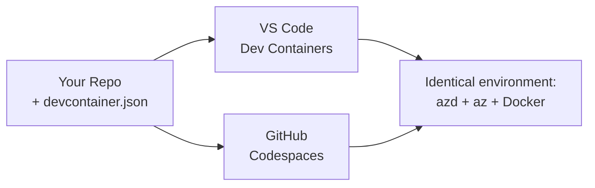

# azd కోసం Dev Containers & GitHub Codespaces

**అధ్యాయం నావిగేషన్:**
- **📚 కోర్సు హోమ్**: [AZD For Beginners](../../README.md)
- **📖 ప్రస్తుత అధ్యాయం**: అధ్యాయం 1 - ఆధారం & త్వరిత ప్రారంభం
- **⬅️ ముందటి**: [Bring Your Own App](bring-your-own-app.md)
- **🚀 తదుపరి అధ్యాయం**: [అధ్యాయం 2: AI-First Development](../chapter-02-ai-development/README.md)

> ఆదేశం మరియు కాన్ఫిగరేషన్ సమీక్ష లక్ష్యం: `azd 1.37.2` (నవంబర్ 2026). కంటైనర్ నిర్మాణాలు మరియు అజ్యూర్ విస్తరణలు ఈ సమీక్ష భాగంగా అమలు చేయబడలేదు.

## పరిచయం

azd, సరైన భాష రంటైమ్, Docker, మరియు Azure CLI ప్రతి యంత్రంపై ఇన్‌స్టాల్ చేయడం ఒక కష్టం—మరియు "నా యంత్రంపై పనిచేస్తుంది" అనేది ఇంకొరరికైనప్పుడు విఫలమయ్యే మొదటి కారణం. ఒక **డెవ్ కంటైనర్** మీ మొత్తం టూల్‌చైన్‌ను ఒక ఫైల్‌లో వివరిస్తూ దీన్ని పరిష్కరించును. ఎవరైనా ప్రాజెక్ట్‌ను VS కోడ్ లేదా GitHub Codespaces లో తెరిచినప్పుడల్లా, అజ్‌డ్ ఇప్పటికే ఇన్‌స్టాల్ చేసిన ఒకకెల్లా వాతావరణాన్ని పొందుతారు. ఈ పాఠం మీరు ఒక Dev Container ఎలా చేర్చాలో చూపిస్తుంది.

## నేర్చుకునే లక్ష్యాలు

ఈ పాఠం ముగిసేటప్పటి వరకు, మీరు:
- Dev Container అంటే ఏమిటో మరియు ఎందుకు azd తో సహాయం చేస్తుందో అర్థం చేసుకోవడం
- ప్రాజెక్టుకు కనిష్ట `.devcontainer/devcontainer.json` జోడించడం
- Dev Container *ఫీచర్లు* ద్వారా azd, Azure CLI, మరియు Docker చేర్చడం
- GitHub Codespaces లేదా VS కోడ్ లో ప్రాజెక్ట్ తెరవడం

## నేర్చుకున్న ఫలితాలు

ఈ పాఠం పూర్తి చేసిన తర్వాత, మీరు చేయగలుగుతారు:
- azd ప్రాజెక్ట్ కోసం `devcontainer.json` రచించడం
- మాన్యువల్ ఇన్‌స్టాల్‌లు లేకుండా azd మరియు Azure టూలింగ్ జోడించడం
- కంటైనర్ లేదా Codespace లో నుంచి `azd up` నడపడం

---

## Dev Container అంటే ఏమిటి?

ఒక dev container అనేది మీ రిపాజిటరీలో ఉన్న `.devcontainer/devcontainer.json` ఫైల్ ద్వారా నిర్వచించబడిన Docker ఆధారిత అభివృద్ధి వాతావరణం. మీరు ప్రాజెక్ట్ తెరిచినప్పుడు:

- **VS కోడ్** (Dev Containers విస్తరణతో) కంటైనర్‌ని నిర్మించి దానికి జతచేస్తుంది.
- **GitHub Codespaces** అదే కంటైనర్‌ను క్లౌడ్‌లో నిర్మించి మీకు బ్రౌజర్-ఆధారిత ఎడిటర్ అందిస్తుంది.

ఏ విధంగానైనా, ప్రతి సహకారుడు ఒకటే సాధనాలను పొందుతారు—"మీరు azd ఇన్‌స్టాల్ చేసుకున్నారా?" అనే సమస్యలు రావు.



---

## దశ 1: devcontainer ఫైల్ సృష్టించండి

మీ ప్రాజెక్ట్ రూట్‌లో `.devcontainer/devcontainer.json` సృష్టించండి:

```json
{
  "name": "azd-project",
  "image": "mcr.microsoft.com/devcontainers/base:bookworm",
  "features": {
    "ghcr.io/devcontainers/features/azure-cli:1": {},
    "ghcr.io/azure/azure-dev/azd:0": { "version": "1.37.2" },
    "ghcr.io/devcontainers/features/docker-in-docker:2": {},
    "ghcr.io/devcontainers/features/node:1": {}
  },
  "customizations": {
    "vscode": {
      "extensions": [
        "ms-azuretools.azure-dev",
        "ms-azuretools.vscode-bicep"
      ]
    }
  },
  "forwardPorts": [3000],
  "postCreateCommand": "azd version"
}
```

ప్రతి భాగం ఏమి చేస్తుందో:

| కీ | ఉద్దేశం |
|-----|---------|
| `image` | కంటైనర్ కోసం బేస్ OS |
| `features` | ముందుగా తయారు చేసిన ఇన్‌స్టాలర్లు—ఇక్కడ: Azure CLI, **azd**, Docker, మరియు Node.js |
| `customizations.vscode.extensions` | azd మరియు Bicep VS కోడ్ విస్తరణలను ఆటోమేటిక్‌గా ఇన్‌స్టాల్ చేస్తుంది |
| `forwardPorts` | మీ యాప్ పోర్ట్‌ను బ్రౌజర్‌కి అందుబాటులో ఉంచుతుంది |
| `postCreateCommand` | కంటైనర్ నిర్మాణం తర్వాత ఒక్కసారిగా నడిపే స్క్రిప్ట్ (ఇక్కడ, ఒక సాధారణ తనిఖీ) |

> ఫీచర్ వర్షన్ (`azd:0`) మరియు ఇన్‌స్టాల్ చేసిన CLI వర్షన్ భిన్నంగా ఉంటాయి. CLIని పిన్ చేయడానికి ఫీచర్ యొక్క `version` ఎంపికను `"1.37.2"` గా సెట్ చేయండి; ఫీచర్ ట్యాగ్‌గా CLI వర్షన్ ని ఉపయోగించవద్దు.

---

## దశ 2: మీ యాప్ భాషకు ఫీచర్‌ను సరిపోల్చండి

మీ యాప్ ఉపయోగించే భాషకు అనుగుణంగా `node` ఫీచర్‌ను మార్చండి:

```jsonc
// Python project
"ghcr.io/devcontainers/features/python:1": {},

// .NET project
"ghcr.io/devcontainers/features/dotnet:2": {},

// Java project
"ghcr.io/devcontainers/features/java:1": {},

// Go project
"ghcr.io/devcontainers/features/go:1": {}
```

స్థానికంగా ఇమేజ్‌లు నిర్మిస్తున్నప్పుడు `docker-in-docker` ఉంచండి. కాన్ఫిగర్ చేసిన రిమోట్ ACR నిర్మాణం (`docker.remoteBuild: true`) ఒక ప్రత్యామ్నాయం; హోస్ట్ టైపు మాత్రమే ఎల్లప్పుడూ స్థానిక Docker అవసరం ఉండదు.

---

## దశ 3: దీన్ని తెరవండి

**VS కోడ్ లో:**
1. **Dev Containers** విస్తరణను ఇన్‌స్టాల్ చేయండి.
2. ప్రాజెక్ట్ ఫోల్డర్ తెరవండి.
3. ప్రాంప్ట్ వచ్చినప్పుడు **Reopen in Container** క్లిక్ చేయండి (లేదా *Dev Containers: Reopen in Container* నడపండి).

**GitHub Codespaces లో:**
1. రిపోను GitHubకు పుష్ చేయండి.
2. **Code → Codespaces → Create codespace on main** క్లిక్ చేయండి.
3. కంటైనర్ నిర్మాణం పూర్తయ్యే వరకు వేచిఉండి—టెర్మినల్ లో azd సిద్ధంగా ఉంటుంది.

---

## దశ 4: కంటైనర్ లోనికి ప్రవేశించి విస్తరించండి

కంటైనర్ azd ప్రీఇన్స్టాల్ చేయబడి ఉంది, కాబట్టి వ్యత్యాసమేమీ లేకుండా సాధారణ ప్రాసెస్ పనిచేస్తుంది:

```bash
azd auth login --use-device-code   # device code is handy inside Codespaces
azd up
```

> **ఎందుకంటే `--use-device-code`?** రిమోట్ కంటైనర్ లేదా Codespace లో స్థానిక బ్రౌజర్ ఉండదు, కాబట్టి device-code లాగిన్ నమ్మదగిన మార్గం. మీరు సైన్-ఇన్ పూర్తి చేయడానికి బ్రౌజర్ టాబ్ లో ఒక కోడ్ పేస్ట్ చేస్తారు.

---

## సాధారణ పిట్ఫాల్స్

| పిట్ఫాల్ | పరిష్కారం |
|---------|-----|
| `azd up` ఇమేజ్‌ని నిర్మించలేకపోవడం | `docker-in-docker` ఫీచర్ జోడించండి |
| Codespaces లో బ్రౌజర్ లాగిన్ హ్యాంగ్ అవ్వడం | `azd auth login --use-device-code` ఉపయోగించండి |
| స్నేహితుల మధ్య టూల్స్ భేదాలు | azd ఫీచర్ యొక్క `version` ఎంపిక ద్వారా CLIని పిన్ చేయండి మరియు భాష రంటైమ్‌లను పిన్ చేయండి |
| యాప్ బ్రౌజర్ లో అందుబాటులో లేనప్పుడు | పోర్టును `forwardPorts` లో జోడించండి |

---

## సారాంశం

- ఒక డెవ్ కంటైనర్ మీ azd టూల్‌చైన్‌ను అందరికీ పునరుత్పాదకంగా చేస్తుంది.
- Dev Container *ఫీచర్స్* ద్వారా azd, Azure CLI, మరియు Docker జోడించండి.
- మీ యాప్‌కు భాష ఫీచర్ సరిపోల్చండి మరియు కంటైనర్ హోస్ట్‌లకు `docker-in-docker` ఉంచండి.
- Codespaces లో నడుపుతున్నప్పుడు device-code లాగిన్ ఉపయోగించండి.

---

## 🔗 నావిగేషన్

| దిశ | వనరు |
|-----------|----------|
| **ముందటి** | [Bring Your Own App](bring-your-own-app.md) |
| **అధ్యాయం హోమ్** | [అధ్యాయం 1: ఆధారం & త్వరిత ప్రారంభం](README.md) |
| **తదుపరి అధ్యాయం** | [అధ్యాయం 2: AI-First Development](../chapter-02-ai-development/README.md) |

## 📖 సంబంధిత వనరులు

- [ఇన్‌స్టాలేషన్ & సెటప్](installation.md)
- [కమాండ్ చీట్ షీట్](../../resources/cheat-sheet.md)
- [అధికార Dev Containers స్పెసిఫికేషన్](https://containers.dev/)
- [azd Dev Container ఫీచర్](https://github.com/Azure/azure-dev/tree/main/ext/devcontainer)

---

<!-- CO-OP TRANSLATOR DISCLAIMER START -->
**అస్వీకరణ**:
ఈ పత్రం AI అనువాద సేవ [Co-op Translator](https://github.com/Azure/co-op-translator) ఉపయోగించి అనువదించబడింది. మేము ఖచ్చితత్వానికి ప్రయత్నిస్తున్నప్పటికీ, ఆటోమేటెడ్ అనువాదాలు తప్పులు లేదా అసమగ్రతలను కలిగి ఉండవచ్చు. దాని స్వదేశ భాషలో ఉన్న అసలు పత్రాన్ని అధికారం కలిగిన మూలంగా పరిగణించాలి. కీలకమైన సమాచారం కోసం, ప్రొఫెషనల్ మానవ అనువాదాన్ని సిఫారసు చేస్తాము. ఈ అనువాదం ఉపయోగం వల్ల కలిగే ఏవైనా అపార్థాలు లేదా తప్పుదారులు కోసం మేము బాధ్యత వహించము.
<!-- CO-OP TRANSLATOR DISCLAIMER END -->