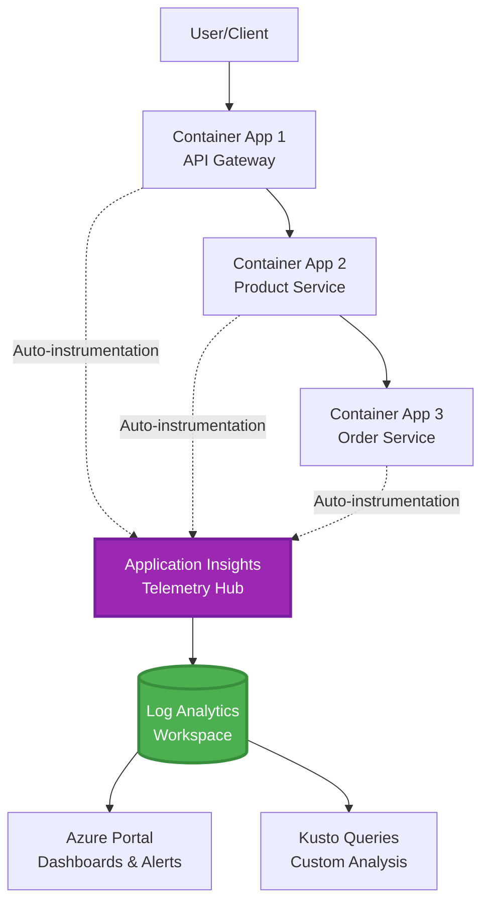
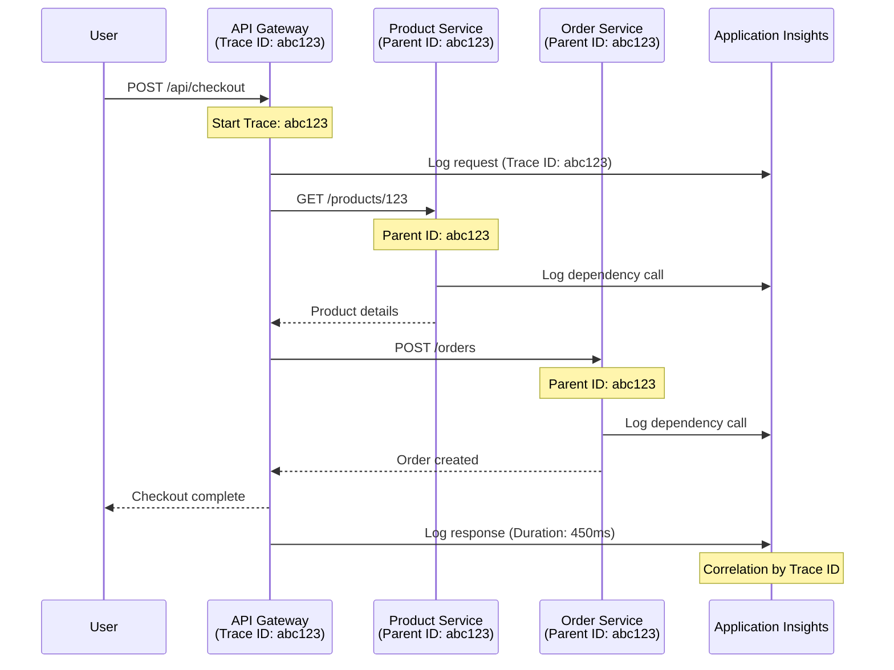

# AZD తో అప్లికేషన్ ఇన్‌సైట్ సమగ్రత

⏱️ **అంచనా సమయం**: 40-50 నిమిషాలు | 💰 **ఖర్చు ప్రభావం**: ~$5-15/నెల | ⭐ **సంక్లిష్టత**: మధ్యస్థాయి

**📚 నేర్చుకునే పాఠం:**
- ← మునుపటి: [చెక్కింపు ముందస్తు పరీక్షలు](preflight-checks.md) - ప్రీ-డిప్లాయ్ చెక్
- 🎯 **మీరు ఇక్కడ ఉన్నారు**: అప్లికేషన్ ఇన్‌సైట్ సమగ్రత (మానిటరింగ్, టెలిమెట్రీ, డీబగ్గింగ్)
- → తరువాత: [డిప్లాయ్ గైడ్](../chapter-04-infrastructure/deployment-guide.md) - Azureకి డిప్లాయ్ చేయండి
- 🏠 [కార్సు హోమ్](../../README.md)

---

## మీరు నేర్చుకోబోయేది

ఈ పాఠం పూర్తి చేయడం ద్వారా మీరు:
- AZD ఇన్‌ఫ్రాస్ట్రక్చర్‌లో **అప్లికేషన్ ఇన్‌సైట్స్** ని ప్రకటించి SDK ఇన్‌స్ట్రూమెంటేషన్‌ను సెట్టుచేయడం
- మైక్రోసర్వీసుల కోసం **డిస్ట్రిబ్యూటెడ్ ట్రేసింగ్** ను కాష్టమైజ్ చేయడం
- **అనుకూల టెలిమెట్రీ** (మెట్రిక్స్, ఈవెంట్స్, డిపెండెన్సీలు) అమలు చేయడం
- రియల్-టైమ్ మానిటరింగ్ కోసం **లైవ్ మెట్రిక్స్** ఏర్పాటు
- AZD డిప్లాయ్‌మెంట్ నుండి **అలర్ట్స్ మరియు డ్యాష్‌బోర్డ్స్** సృష్టించడం
- **టెలిమెట్రీ క్వెరీలు** తో ప్రొడక్షన్ సమస్యలను డీబగ్ చేయడం
- **ఖర్చులు మరియు నమూనాలు** వ్యూహాలను ఆప్టిమైజ్ చేయడం
- **AI/LLM అప్లికేషన్‌లు** (టోకెన్లు, ఆలస్యం, ఖర్చులు) ను మానిటర్ చేయడం

## AZDతో అప్లికేషన్ ఇన్ సైట్స్ ఎందుకు ముఖ్యం

### సవాలు: ప్రొడక్షన్ ఆబ్జర్వబిలిటీ

**అప్లికేషన్ ఇన్ సైట్స్ లేకుండా:**
```
❌ No visibility into production behavior
❌ Manual log aggregation across services
❌ Reactive debugging (wait for customer complaints)
❌ No performance metrics
❌ Cannot trace requests across services
❌ Unknown failure rates and bottlenecks
```

**అప్లికేషన్ ఇన్‌సైట్స్ + AZDతో:**
```
✅ Automatic telemetry collection
✅ Centralized logs from all services
✅ Proactive issue detection
✅ End-to-end request tracing
✅ Performance metrics and insights
✅ Real-time dashboards
✅ AZD provisions the monitoring declared in your templates
```

**ఉపమా**: అప్లికేషన్ ఇన్ సైట్స్ అనేది మీ అప్లికేషన్ కోసం ఒక "బ్లాక్ బాక్స్" ఫ్లైట్ రికార్డర్ + కాక్‌పిట్ డ్యాష్‌బోర్డ్ లా ఉంటుంది. మీరు రియల్-టైమ్ లో జరిగే ప్రతిదీ చూడొచ్చు మరియు ఏదైనా ఘటనను మళ్లీ ప్లే చేయవచ్చు.

---

## వాస్తవ నిర్మాణ అవలోకనం

### AZD వాస్తవ నిర్మాణంలో అప్లికేషన్ ఇన్ సైట్స్



### స్వయంచాలకంగా ఏం మానిటర్ అవుతుంది

మద్దతు ఉన్న ఆటో-ఇన్‌స్ట్రూమెంటేషన్ ఇన్‌స్ట్రూమెంటెడ్ లైబ్రరీల కోసం అభ్యర్థనలు/ఆధారాలను క్యాప్చర్ చేస్తుంది. అనుకూల ఈవెంట్స్ మరియు మెట్రిక్స్ కోసం అప్లికేషన్ కోడ్ అవసరం; అందుబాటు పరీక్షలు వేయాలి. వనరు ఉన్నందున అన్నింటికీ క్రింద ప్రతీ రోలను సేకరించదు.

| టెలిమెట్రీ రకం | అది క్యాప్చర్ చేసేది | ఉపయోగం |
|----------------|------------------|----------|
| **అభ్యర్థనలు** | HTTP అభ్యర్థనలు, స్థితి కోడ్స్, వ్యవధి | API ప్రదర్శన మానిటరింగ్ |
| **డిపెండెన్సీలు** | బయటి కాల్స్ (డేటాబేస్, APIs, స్టోరేజ్) | బాటిల్‌నెక్స్ గుర్తించడం |
| **విశేషాలు** | హ్యాండిల్ కాని లోపాలు మరియు స్టాక్ ట్రేసులు | వైఫల్యాల డీబగ్గింగ్ |
| **కస్టమ్ ఈవెంట్స్** | వ్యాపార సంబంఘింత ఈవెంట్స్ (సైన్ అప్, కొనుగోలు) | విశ్లేషణలు మరియు ఫన్నెల్స్ |
| **మెట్రిక్స్** | ప్రదర్శన కౌంటర్లు, కస్టమ్ మెట్రిక్స్ | సామర్థ్య ప్రణాళిక |
| **ట్రేస్‌లు** | తీవ్రమైన లాగ్ సందేశాలు | డీబగ్గింగ్ మరియు ఆడిటింగ్ |
| **అందుబాటు** | అప్టైమ్ మరియు స్పందన స్థితి పరీక్షలు | SLA మానిటరింగ్ |

---

## అవసరమైన పరికరాలు

### అవసరమైన పరికరాలు

```bash
# Verify Azure Developer CLI
azd version
# Command reference baseline: azd 1.37.2

# Verify Azure CLI
az --version
# ✅ Expected: azure-cli 2.50.0 or higher
```

### Azure అవసరాలు

- యాక్టివ్ Azure సబ్‌స్క్రిప్షన్
- క్రియేటు చేసే అనుమతులు:
  - అప్లికేషన్ ఇన్ సైట్స్ వనరులు
  - లాగ్ అనలిటిక్స్ వర్క్‌స్పేసులు
  - కంటైనర్ యాప్స్
  - వనరు సమూహాలు

### జ్ఞాన అవసరాలు

మీరు పూర్తిచేసి ఉండాలి:
- [AZD మూలకం](../chapter-01-foundation/azd-basics.md) - ప్రాథమిక AZD కాన్సెప్ట్స్
- [కన్ఫిగరేషన్](../chapter-03-configuration/configuration.md) - వాతావరణ సెట్టింగ్స్
- [మొదటి ప్రాజెక్ట్](../chapter-01-foundation/first-project.md) - ప్రాథమిక డిప్లాయ్‌మెంట్

---

## పాఠం 1: AZDతో ఆటోమేటిక్ అప్లికేషన్ ఇన్‌సైట్స్

### AZD ఎలా అప్లికేషన్ ఇన్‌సైట్స్ ప్రావిషన్ చేస్తుంది

AZD అప్లికేషన్ ఇన్ సైట్స్ **ప్రాజెక్ట్ ఇన్‌ఫ్రా స్పష్టం చేసినప్పుడు మాత్రమే ప్రావిషన్ చేస్తుంది**. `azure.yaml` మాత్రమే మానిటరింగ్ సృష్టించదు లేదా అప్లికేషన్ కోడ్ ను ఇన్‌స్ట్రూమెంటు చేయదు.

> **ఉదాహరణ పరిధి:** ఈ పాఠం సమగ్ర భాగాల కలిగి ఉంది, ఈ రిపోజిటరీలో పూర్తి `monitored-app` ప్రాజెక్ట్ కాదు. ప్రధాన టెంప్లేట్ మరియు పారామెటర్ మ్యాపింగ్, కంటైనర్ యాప్స్ వాతావరణం, రిజిస్ట్రీ/ఇమేజ్ మరియు ఐడెంటిటీ సెట్టింగ్స్, డాకర్ ఫైల్ మరియు సేవ ట్యాగ్‌లు అందించాలి ముందు డిప్లాయ్ చేయడానికి. తర్వాత పాఠాలు వేరే/పెంపొందింపు భాగాలు చూపిస్తాయి, అన్ని ఫైళ్ళను మార్చకుండా కలిసి ఉపయోగించరాదు. మీరు ఒక పనిచేయగల [మైక్రోసర్వీసెస్ ఉదాహరణ](../../../../examples/microservices)తో ప్రారంభించండి అవసరం అయితే.

### ప్రాజెక్ట్ నిర్మాణం

```
monitored-app/
├── azure.yaml                     # AZD configuration
├── infra/
│   ├── main.bicep                # Main infrastructure
│   ├── core/
│   │   └── monitoring.bicep      # Application Insights + Log Analytics
│   └── app/
│       └── api.bicep             # Container App with monitoring
└── src/
    ├── app.py                    # Application with telemetry
    ├── requirements.txt
    └── Dockerfile
```

---

### దశ 1: AZD కాన్ఫిగర్ చేయండి (azure.yaml)

**ఫైల్: `azure.yaml`**

```yaml
name: monitored-app
metadata:
  template: monitored-app@1.0.0

services:
  api:
    project: ./src
    language: python
    host: containerapp

# Monitoring must be declared in infra/ and enabled in application code.
```

ఇది డిప్లాయ్ చేయదగిన సేవను ప్రకటిస్తుంది. క్రింది బైసెప్ మరియు SDK కాన్ఫిగరేషన్ మానిటరింగ్ అందిస్తాయి; azd అవి స్వయంచాలకంగా జతపరచదు.

---

### దశ 2: మానిటరింగ్ వనరులు (Bicep)

**ఫైల్: `infra/core/monitoring.bicep`**

```bicep
param logAnalyticsName string
param applicationInsightsName string
param location string = resourceGroup().location
param tags object = {}

// Log Analytics Workspace (required for Application Insights)
resource logAnalytics 'Microsoft.OperationalInsights/workspaces@2022-10-01' = {
  name: logAnalyticsName
  location: location
  tags: tags
  properties: {
    sku: {
      name: 'PerGB2018'  // Pay-as-you-go pricing
    }
    retentionInDays: 30  // Keep logs for 30 days
    features: {
      enableLogAccessUsingOnlyResourcePermissions: true
    }
  }
}

// Application Insights
resource applicationInsights 'Microsoft.Insights/components@2020-02-02' = {
  name: applicationInsightsName
  location: location
  tags: tags
  kind: 'web'
  properties: {
    Application_Type: 'web'
    WorkspaceResourceId: logAnalytics.id
    IngestionMode: 'LogAnalytics'
    publicNetworkAccessForIngestion: 'Enabled'
    publicNetworkAccessForQuery: 'Enabled'
  }
}

// Outputs for Container Apps
output logAnalyticsWorkspaceId string = logAnalytics.id
output logAnalyticsWorkspaceName string = logAnalytics.name
output applicationInsightsConnectionString string = applicationInsights.properties.ConnectionString
output applicationInsightsInstrumentationKey string = applicationInsights.properties.InstrumentationKey
output applicationInsightsName string = applicationInsights.name
output applicationInsightsId string = applicationInsights.id
```

---

### దశ 3: కంటైనర్ యాప్‌ను అప్లికేషన్ ఇన్ సైట్స్‌కు కనెక్ట్ చేయండి

**ఫైల్: `infra/app/api.bicep`**

```bicep
param name string
param location string
param tags object = {}
param containerAppsEnvironmentId string
param containerImage string
param applicationInsightsConnectionString string

resource containerApp 'Microsoft.App/containerApps@2023-05-01' = {
  name: name
  location: location
  tags: tags
  properties: {
    managedEnvironmentId: containerAppsEnvironmentId
    configuration: {
      ingress: {
        external: true
        targetPort: 8000
      }
      secrets: [
        {
          name: 'appinsights-connection-string'
          value: applicationInsightsConnectionString
        }
      ]
    }
    template: {
      containers: [
        {
          name: 'api'
          image: containerImage // Supply an accessible image and registry authentication
          resources: {
            cpu: json('0.5')
            memory: '1Gi'
          }
          env: [
            {
              name: 'APPLICATIONINSIGHTS_CONNECTION_STRING'
              secretRef: 'appinsights-connection-string'
            }
            {
              name: 'APPLICATIONINSIGHTS_ENABLED'
              value: 'true'
            }
          ]
        }
      ]
    }
  }
}

output uri string = 'https://${containerApp.properties.configuration.ingress.fqdn}'
```

---

### దశ 4: టెలిమెట్రీతో అప్లికేషన్ కోడ్

**ఫైల్: `src/app.py`**

```python
from flask import Flask, request, jsonify
from azure.monitor.opentelemetry import configure_azure_monitor
import logging
import os

app = Flask(__name__)

# Get Application Insights connection string
connection_string = os.environ.get('APPLICATIONINSIGHTS_CONNECTION_STRING')

if connection_string:
    # Azure Monitor OpenTelemetry instruments supported libraries, including Flask.
    configure_azure_monitor(
        connection_string=connection_string,
        logger_name=__name__,
        enable_live_metrics=True
    )
    logger = logging.getLogger(__name__)
    logger.setLevel(logging.INFO)
    
    print("✅ Application Insights enabled")
else:
    logger = logging.getLogger(__name__)
    logger.setLevel(logging.INFO)
    print("⚠️ Application Insights not configured")

@app.route('/health')
def health():
    logger.info('Health check endpoint called')
    return jsonify({'status': 'healthy', 'monitoring': 'enabled' if connection_string else 'disabled'})

@app.route('/api/products')
def get_products():
    logger.info('Fetching products')
    
    # In-memory fixture: this is not a database dependency call.
    products = [
        {'id': 1, 'name': 'Laptop', 'price': 999.99},
        {'id': 2, 'name': 'Mouse', 'price': 29.99},
        {'id': 3, 'name': 'Keyboard', 'price': 79.99}
    ]
    
    logger.info(f'Returned {len(products)} products')
    return jsonify(products)

@app.route('/api/error-test')
def error_test():
    """Test error tracking"""
    logger.error('Testing error tracking')
    try:
        raise ValueError('This is a test exception')
    except Exception as e:
        logger.exception('Exception occurred in error-test endpoint')
        return jsonify({'error': str(e)}), 500

@app.route('/api/slow')
def slow_endpoint():
    """Test performance tracking"""
    import time
    logger.info('Slow endpoint called')
    time.sleep(3)  # Simulate slow operation
    logger.warning('Endpoint took 3 seconds to respond')
    return jsonify({'message': 'Slow operation completed'})

if __name__ == '__main__':
    app.run(host='0.0.0.0', port=8000)
```

**ఫైల్: `src/requirements.txt`**

```txt
Flask
azure-monitor-opentelemetry
gunicorn
requests
openai
```

ఈ డిపెండెన్సీలను మీ ప్రాజెక్టులో పరిష్కరించి, వాటిని కలిసి పరీక్షించండి, మరియు పొందిన సంచికలను లాక్ చేయండి. కొత్త ప్రాజెక్టులు Azure Monitor OpenTelemetry ఉపయోగించాలి, రిటైర్డ్ OpenCensus Python ఎక్స్పార్టర్లను కాకుండా.

---

### దశ 5: డిప్లాయ్ చేసి ధృవీకరించండి

```bash
# Deploy only after completing and wiring the infrastructure fragments above
azd up

# Get app URL
APP_URL=$(azd env get-value API_URL) # Requires this output in main.bicep

# Generate telemetry
curl $APP_URL/health
curl $APP_URL/api/products
curl $APP_URL/api/error-test
curl $APP_URL/api/slow
```

**✅ ఆశించదగిన అవుట్‌పుట్:**
```json
{
  "status": "healthy",
  "monitoring": "enabled"
}
```

---

### దశ 6: Azure పోర్టల్‌లో టెలిమెట్రీను వీక్షించండి

```bash
# Get Application Insights details
azd env get-values | grep APPLICATIONINSIGHTS

# Open in Azure Portal
az monitor app-insights component show \
  --app $(azd env get-values | grep APPLICATIONINSIGHTS_NAME | cut -d '=' -f2 | tr -d '"') \
  --resource-group $(azd env get-values | grep AZURE_RESOURCE_GROUP | cut -d '=' -f2 | tr -d '"') \
  --query "appId" -o tsv
```

**Azure పోర్టల్ → అప్లికేషన్ ఇన్ సైట్స్ → ట్రాన్సాక్షన్ శోధనకు వెళ్ళండి**

మీరు చూడగలరు:
- ✅ HTTP అభ్యర్థనలు స్థితి కోడ్స్‌తో
- ✅ అభ్యర్థన వ్యవధి (3+ సెకన్లు `/api/slow`కి)
- ✅ `/api/error-test` నుండి తప్పులు వివరాలు
- ✅ కస్టమ్ లాగ్ సందేశాలు

---

## పాఠం 2: కస్టమ్ టెలిమెట్రీ మరియు ఈవెంట్స్

### వ్యాపార ఈవెంట్స్ ట్రాక్ చేయండి

వ్యాపార-గుర్తుతో ముడిపడిన ఈవెంట్స్ కోసం కస్టమ్ టెలిమెట్రీ జోడిద్దాం.

**ఫైల్: `src/telemetry.py`**

```python
from contextlib import contextmanager
from azure.monitor.opentelemetry import configure_azure_monitor
from opentelemetry import metrics, trace
from opentelemetry.trace import SpanKind
import logging
import os

class TelemetryClient:
    """Custom telemetry client for Application Insights"""
    
    def __init__(self, connection_string=None):
        self.connection_string = connection_string or os.environ.get('APPLICATIONINSIGHTS_CONNECTION_STRING')
        
        # Configure once per process. If app.py already calls this, keep only
        # one configure_azure_monitor call and use logger_name='telemetry'.
        if self.connection_string:
            configure_azure_monitor(
                connection_string=self.connection_string,
                logger_name=__name__,
                enable_live_metrics=True
            )
        self.logger = logging.getLogger(__name__)
        self.logger.setLevel(logging.INFO)
        self.tracer = trace.get_tracer(__name__)
        self.meter = metrics.get_meter(__name__)
        self.instruments = {}
    
    def track_event(self, event_name: str, properties: dict = None):
        """Track custom business event"""
        properties = properties or {}
        self.logger.info(
            f"CustomEvent: {event_name}",
            extra={
                # OTel log attributes become customDimensions in App Insights.
                    'event_name': event_name,
                    **properties
            }
        )
    
    def track_metric(self, metric_name: str, value: float, properties: dict = None):
        """Track custom metric"""
        properties = properties or {}
        if metric_name not in self.instruments:
            self.instruments[metric_name] = self.meter.create_histogram(metric_name)
        self.instruments[metric_name].record(value, attributes=properties)
    
    @contextmanager
    def track_dependency(self, name: str):
        """Time the real operation inside a client span; exceptions mark failure."""
        with self.tracer.start_as_current_span(name, kind=SpanKind.CLIENT) as span:
            yield span

# Global telemetry client
telemetry = TelemetryClient()
```

### అనుకూల ఈవెంట్స్ తో అప్లికేషన్ను నవీకరించండి

**ఫైల్: `src/app.py` (వృద్ధి చేయబడింది)**

ఈ మార్గాలను ఉన్న Flask అప్లికేషన్‌కు జోడించండి; ముందరి హెల్త్/టెస్ట్ మార్గాలు ఉంచండి. క్రింద సంక్షిప్త బ్లాక్ స్పష్టత కోసం ప్రత్యేక అప్లికేషన్ చూపిస్తుంది. టెలిమెట్రీ ప్రారంభికాలు ఇప్పుడు `telemetry.py`లో ఉంటాయి — ఎక్స్‌పోర్ట్‌ల‌ను రెండుసార్లు ప్రారంభించకండి.

```python
from flask import Flask, request, jsonify
from telemetry import telemetry
import time
import random
import os

app = Flask(__name__)

@app.route('/api/purchase', methods=['POST'])
def purchase():
    """Track purchase event with custom telemetry"""
    data = request.get_json(silent=True) or {}
    product_id = data.get('product_id')
    quantity = data.get('quantity', 1)
    price = data.get('price', 0)
    if not isinstance(quantity, int) or quantity < 1 or \
       not isinstance(price, (int, float)) or price < 0:
        return jsonify({'error': 'quantity and price must be non-negative numbers; quantity >= 1'}), 400
    
    # Track business event
    telemetry.track_event('Purchase', {
        'product_id': product_id,
        'quantity': quantity,
        'total_amount': price * quantity,
        'user_id': request.headers.get('X-User-Id', 'anonymous')
    })
    
    # Track revenue metric
    telemetry.track_metric('Revenue', price * quantity, {
        'product_id': product_id,
        'currency': 'USD'
    })
    
    return jsonify({
        'order_id': f'ORD-{random.randint(1000, 9999)}',
        'status': 'confirmed',
        'total': price * quantity
    })

@app.route('/api/search')
def search():
    """Track search queries"""
    query = request.args.get('q', '')
    
    start_time = time.time()
    
    # Simulate search (would be real database query)
    results = [{'id': 1, 'name': f'Result for {query}'}]
    
    duration = (time.time() - start_time) * 1000  # Convert to ms
    
    # Track search event
    telemetry.track_event('Search', {
        'query': query,
        'results_count': len(results),
        'duration_ms': duration
    })
    
    # Track search performance metric
    telemetry.track_metric('SearchDuration', duration, {
        'query_length': len(query)
    })
    
    return jsonify({'results': results, 'count': len(results)})

@app.route('/api/external-call')
def external_call():
    """Track external API dependency"""
    import requests
    
    try:
        # Set an actual test endpoint; api.example.com is not a working API.
        with telemetry.track_dependency('ExternalAPI'):
            response = requests.get(os.environ['EXTERNAL_API_URL'], timeout=5)
            response.raise_for_status()
            result = response.json()
    except Exception as e:
        return jsonify({'error': 'External dependency failed'}), 502
    
    return jsonify(result)

if __name__ == '__main__':
    app.run(host='0.0.0.0', port=8000)
```

### కస్టమ్ టెలిమెట్రీని పరీక్షించండి

```bash
# Track purchase event
curl -X POST $APP_URL/api/purchase \
  -H "Content-Type: application/json" \
  -H "X-User-Id: user123" \
  -d '{"product_id": 1, "quantity": 2, "price": 29.99}'

# Track search event
curl "$APP_URL/api/search?q=laptop"

# Track external dependency
curl $APP_URL/api/external-call
```

**Azure పోర్టల్‌లో వీక్షించండి:**

అప్లికేషన్ ఇన్ సైట్స్ → లాగ్స్ కి వెళ్లి, తరువాత నడపండి:

```kusto
// View purchase events
traces
| where customDimensions.event_name == "Purchase"
| project 
    timestamp,
    product_id = tostring(customDimensions.product_id),
    total_amount = todouble(customDimensions.total_amount),
    user_id = tostring(customDimensions.user_id)
| order by timestamp desc

// Revenue recorded in Purchase events (not a billing ledger)
traces
| where customDimensions.event_name == "Purchase"
| summarize TotalRevenue = sum(todouble(customDimensions.total_amount)) by bin(timestamp, 1h)
| render timechart

// View search performance
traces
| where customDimensions.event_name == "Search"
| summarize 
    AvgDuration = avg(todouble(customDimensions.duration_ms)),
    SearchCount = count()
  by bin(timestamp, 5m)
| render timechart
```

---

## పాఠం 3: మైక్రోసర్వీసుల కోసం డిస్ట్రిబ్యూటెడ్ ట్రేసింగ్

### క్రాస్-సర్వీస్ ట్రేసింగ్‌ను ఎనేబుల్ చేయండి

అనుకూల ఇన్‌స్ట్రూమెంటేషన్ మరియు W3C ట్రేస్-కాంటెక్స్ట్ ప్రచారంతో, అప్లికేషన్ ఇన్ సైట్స్ సేవల మధ్య అభ్యర్థనలను అనుసంధానం చేస్తుంది. కనెక్షన్ స్ట్రింగ్ పంచుకోవడం తండ్రి-పిల్ల spanలను స్థాపించదు. ఈ క్రింది వాస్తవ నిర్మాణ భాగం మీరు అమలు చేయాల్సిన మాడ్యూల్స్‌ను సూచిస్తుంది.

**ఫైల్: `infra/main.bicep`**

```bicep
targetScope = 'subscription'

param environmentName string
param location string = 'eastus'

var tags = { 'azd-env-name': environmentName }

resource rg 'Microsoft.Resources/resourceGroups@2021-04-01' = {
  name: 'rg-${environmentName}'
  location: location
  tags: tags
}

// Monitoring (shared by all services)
module monitoring './core/monitoring.bicep' = {
  name: 'monitoring'
  scope: rg
  params: {
    logAnalyticsName: 'log-${environmentName}'
    applicationInsightsName: 'appi-${environmentName}'
    location: location
    tags: tags
  }
}

// API Gateway
module apiGateway './app/api-gateway.bicep' = {
  name: 'api-gateway'
  scope: rg
  params: {
    name: 'ca-gateway-${environmentName}'
    location: location
    tags: union(tags, { 'azd-service-name': 'gateway' })
    applicationInsightsConnectionString: monitoring.outputs.applicationInsightsConnectionString
  }
}

// Product Service
module productService './app/product-service.bicep' = {
  name: 'product-service'
  scope: rg
  params: {
    name: 'ca-products-${environmentName}'
    location: location
    tags: union(tags, { 'azd-service-name': 'products' })
    applicationInsightsConnectionString: monitoring.outputs.applicationInsightsConnectionString
  }
}

// Order Service
module orderService './app/order-service.bicep' = {
  name: 'order-service'
  scope: rg
  params: {
    name: 'ca-orders-${environmentName}'
    location: location
    tags: union(tags, { 'azd-service-name': 'orders' })
    applicationInsightsConnectionString: monitoring.outputs.applicationInsightsConnectionString
  }
}

output APPLICATIONINSIGHTS_CONNECTION_STRING string = monitoring.outputs.applicationInsightsConnectionString
output GATEWAY_URL string = apiGateway.outputs.uri
```

### ఎండ్-టు-ఎండ్ ట్రాన్సాక్షన్‌ను వీక్షించండి



**ఎండ్-టు-ఎండ్ ట్రేస్ కోసం క్వెరీ:**

```kusto
// Find complete request flow
let traceId = "abc123...";  // Copy operation_Id from a request in Application Insights
dependencies
| union requests
| where operation_Id == traceId
| project 
    timestamp,
    type = itemType,
    name,
    duration,
    success,
    cloud_RoleName
| order by timestamp asc
```

---

## పాఠం 4: లైవ్ మెట్రిక్స్ మరియు రియల్-టైమ్ మానిటరింగ్

### లైవ్ మెట్రిక్స్ స్ట్రీమ్ ఎనేబుల్ చేయండి

SDK మద్దతుతో మరియు ఎనేబుల్ చేసినప్పుడు లైవ్ మెట్రిక్స్ సమీప-సమయం టెలిమెట్రీని అందిస్తుంది. ఇది ఆలస్య SLA కాదు. పై Python OpenTelemetry సెటప్ `enable_live_metrics=True`తో ఆప్ట్ఇన్ చేస్తుంది.

**లైవ్ మెట్రిక్స్ యాక్సెస్ చేయండి:**

```bash
# Get Application Insights resource
APPI_NAME=$(azd env get-values | grep APPLICATIONINSIGHTS_NAME | cut -d '=' -f2 | tr -d '"')

# Get resource group
RG_NAME=$(azd env get-values | grep AZURE_RESOURCE_GROUP | cut -d '=' -f2 | tr -d '"')

echo "Navigate to: Azure Portal → Resource Groups → $RG_NAME → $APPI_NAME → Live Metrics"
```

**మీరు రియల్-టైమ్‌లో చూడగలరు:**
- ✅ వచ్చిన అభ్యర్థన రేటు (requests/sec)
- ✅ బయటి ఆధారాలు (డిపెండెన్సీ కాల్స్)
- ✅ తప్పుల లెక్క
- ✅ CPU మరియు మెమరీ వినియోగం
- ✅ సక్రియ సర్వర్ లెక్క
- ✅ నమూనా టెలిమెట్రీ

### పరీక్ష కోసం లోడ్ ఉత్పత్తి చేయండి

```bash
# Generate load to see live metrics
for i in {1..100}; do
  curl --silent --max-time 10 "$APP_URL/api/products"
  curl --silent --max-time 10 "$APP_URL/api/search?q=test$i"
done

# Watch live metrics in Azure Portal
# You should see request rate spike
```

---

## ప్రాక్టికల్ ప్రాక్టీస్‌లు

### వ్యాయామం 1: అలర్ట్స్ సెటప్ చేయండి ⭐⭐ (మధ్యస్థ)

**లక్ష్యం**: అధిక లోపాల రేట్లు మరియు మందగించిన ప్రతిస్పందనలకు అలర్ట్స్ సృష్టించండి.

**దశలు:**

1. **లోపాల రేటుకు అలర్ట్ సృష్టించండి:**

```bash
# Get Application Insights resource ID
APPI_ID=$(az monitor app-insights component show \
  --app $APPI_NAME \
  --resource-group $RG_NAME \
  --query "id" -o tsv)

# Create metric alert for failed requests
az monitor metrics alert create \
  --name "High-Error-Rate" \
  --resource-group $RG_NAME \
  --scopes $APPI_ID \
  --condition "count requests/failed > 10" \
  --window-size 5m \
  --evaluation-frequency 1m \
  --description "Alert when failed request count exceeds 10 per 5 minutes"
```

2. **మందగించిన ప్రతిస్పందనలకు అలర్ట్ సృష్టించండి:**

```bash
az monitor metrics alert create \
  --name "Slow-Responses" \
  --resource-group $RG_NAME \
  --scopes $APPI_ID \
  --condition "avg requests/duration > 3000" \
  --window-size 5m \
  --evaluation-frequency 1m \
  --description "Alert when average response time exceeds 3 seconds"
```

3. **బైసెప్ ద్వారా అలర్ట్ సృష్టించండి (AZDకి ప్రాధాన్యం):**

**ఫైల్: `infra/core/alerts.bicep`**

```bicep
param applicationInsightsId string
param actionGroupId string = ''
param location string = resourceGroup().location

// High error rate alert
resource errorRateAlert 'Microsoft.Insights/metricAlerts@2018-03-01' = {
  name: 'high-error-rate'
  location: 'global'
  properties: {
    description: 'Alert when error rate exceeds threshold'
    severity: 2
    enabled: true
    scopes: [
      applicationInsightsId
    ]
    evaluationFrequency: 'PT1M'
    windowSize: 'PT5M'
    criteria: {
      'odata.type': 'Microsoft.Azure.Monitor.SingleResourceMultipleMetricCriteria'
      allOf: [
        {
          name: 'Error rate'
          metricName: 'requests/failed'
          operator: 'GreaterThan'
          threshold: 10
          timeAggregation: 'Count'
        }
      ]
    }
    actions: actionGroupId != '' ? [
      {
        actionGroupId: actionGroupId
      }
    ] : []
  }
}

// Slow response alert
resource slowResponseAlert 'Microsoft.Insights/metricAlerts@2018-03-01' = {
  name: 'slow-responses'
  location: 'global'
  properties: {
    description: 'Alert when response time is too high'
    severity: 3
    enabled: true
    scopes: [
      applicationInsightsId
    ]
    evaluationFrequency: 'PT1M'
    windowSize: 'PT5M'
    criteria: {
      'odata.type': 'Microsoft.Azure.Monitor.SingleResourceMultipleMetricCriteria'
      allOf: [
        {
          name: 'Response duration'
          metricName: 'requests/duration'
          operator: 'GreaterThan'
          threshold: 3000
          timeAggregation: 'Average'
        }
      ]
    }
  }
}

output errorAlertId string = errorRateAlert.id
output slowResponseAlertId string = slowResponseAlert.id
```

4. **అలర్ట్స్ పరీక్షించండి:**

```bash
# Generate errors
for i in {1..20}; do
  curl $APP_URL/api/error-test
done

# Generate slow responses
for i in {1..10}; do
  curl $APP_URL/api/slow
done

# Check rule configuration (not fired/resolved alert-instance history)
az monitor metrics alert list \
  --resource-group $RG_NAME \
  --query "[].{Name:name, Enabled:enabled}" \
  --output table
```

**✅ విజయ లక్ష్యాలు:**
- ✅ అలర్ట్‌లు విజయవంతంగా సృష్టించబడినవి
- ✅ పరిమితులు మించినప్పుడు అలర్ట్‌లు నిడివిని చేసేవి
- ✅ Azure పోర్టల్ లో అలర్ట్ చరిత్ర చూడగలరు
- ✅ AZD డిప్లాయ్‌మెంట్‌తో సమగ్రత

**సమయం**: 20-25 నిమిషాలు

---

### వ్యాయామం 2: కస్టమ్ డ్యాష్‌బోర్డ్ సృష్టించండి ⭐⭐ (మధ్యస్థ)

**లక్ష్యం**: ప్రధాన అప్లికేషన్ మెట్రిక్స్ చూపించే డ్యాష్‌బోర్డ్ తయారుచేయండి.

**దశలు:**

1. **Azure పోర్టల్ ద్వారా డ్యాష్‌బోర్డ్ సృష్టించండి:**

Azure పోర్టల్ → డ్యాష్‌బోర్డ్స్ → కొత్త డ్యాష్‌బోర్డ్ కి వెళ్లండి

2. **ప్రధాన మెట్రిక్స్ కోసం టైల్స్ జోడించండి:**

- అభ్యర్థన లెక్క (గత 24 గంటలు)
- సగటు స్పందన సమయం
- లోపాల రేటు
- టాప్ 5 మందగించిన ఆపరేషన్‌లు
- వినియోగదారుల భౌగోళిక పంపిణీ

3. **బైసెప్ ద్వారా డ్యాష్‌బోర్డ్ సృష్టించండి:**

**ఫైల్: `infra/core/dashboard.bicep`**

```bicep
param dashboardName string
param applicationInsightsId string
param location string = resourceGroup().location

resource dashboard 'Microsoft.Portal/dashboards@2020-09-01-preview' = {
  name: dashboardName
  location: location
  properties: {
    lenses: [
      {
        order: 0
        parts: [
          // Request count
          {
            position: {
              x: 0
              y: 0
              rowSpan: 4
              colSpan: 6
            }
            metadata: {
              type: 'Extension/Microsoft_OperationsManagementSuite_Workspace/PartType/LogsDashboardPart'
              inputs: [
                {
                  name: 'resourceId'
                  value: applicationInsightsId
                }
                {
                  name: 'query'
                  value: '''
                    requests
                    | summarize RequestCount = count() by bin(timestamp, 1h)
                    | render timechart
                  '''
                }
              ]
            }
          }
          // Error rate
          {
            position: {
              x: 6
              y: 0
              rowSpan: 4
              colSpan: 6
            }
            metadata: {
              type: 'Extension/Microsoft_OperationsManagementSuite_Workspace/PartType/LogsDashboardPart'
              inputs: [
                {
                  name: 'resourceId'
                  value: applicationInsightsId
                }
                {
                  name: 'query'
                  value: '''
                    requests
                    | summarize 
                        Total = count(),
                        Failed = countif(success == false)
                    | extend ErrorRate = (Failed * 100.0) / Total
                    | project ErrorRate
                  '''
                }
              ]
            }
          }
        ]
      }
    ]
  }
}

output dashboardId string = dashboard.id
```

4. **డిప్లాయ్ చేయండి:**

```bicep
// Add to a subscription-scoped main.bicep with rg and monitoring declared
module dashboard './core/dashboard.bicep' = {
  name: 'dashboard'
  scope: rg
  params: {
    dashboardName: 'dashboard-${environmentName}'
    applicationInsightsId: monitoring.outputs.applicationInsightsId
    location: location
  }
}
```

```bash
# Deploy
azd up
```

**✅ విజయ లక్ష్యాలు:**
- ✅ డ్యాష్‌బోర్డ్ ప్రధాన మెట్రిక్స్ చూపిస్తుంది
- ✅ Azure పోర్టల్ హోమ్‌కు పిన్ చేయవచ్చు
- ✅ రియల్-టైమ్‌లో నవీకరణలు
- ✅ AZD ద్వారా డిప్లాయ్ చేయదగినది

**సమయం**: 25-30 నిమిషాలు

---

### వ్యాయామం 3: AI/LLM అప్లికేషన్ మానిటరింగ్ ⭐⭐⭐ (అత్యాధునిక)

**లక్ష్యం**: Microsoft Foundry మోడల్‌లు ఉపయోగం (టోకెన్లు, ఖర్చులు, ఆలస్యం) ను ట్రాక్ చేయండి.

**దశలు:**

1. **AI మానిటరింగ్ రాపర్ సృష్టించండి:**

**ఫైల్: `src/ai_telemetry.py`**

```python
from telemetry import telemetry
from openai import AzureOpenAI
import time

class MonitoredAzureOpenAI:
    """Microsoft Foundry Models client with automatic telemetry"""
    
    def __init__(self, api_key, endpoint, input_usd_per_million,
                 output_usd_per_million, api_version="2024-10-21"):
        self.client = AzureOpenAI(
            api_key=api_key,
            api_version=api_version,
            azure_endpoint=endpoint
        )
        self.input_rate = input_usd_per_million
        self.output_rate = output_usd_per_million
    
    def chat_completion(self, model: str, messages: list, **kwargs):
        """Track chat completion with telemetry"""
        start_time = time.time()
        
        try:
            # Call Microsoft Foundry Models
            response = self.client.chat.completions.create(
                model=model,
                messages=messages,
                **kwargs
            )
            
            duration = (time.time() - start_time) * 1000  # ms
            
            # Extract usage
            usage = response.usage
            prompt_tokens = usage.prompt_tokens
            completion_tokens = usage.completion_tokens
            total_tokens = usage.total_tokens
            
            # Approximation: supply actual deployment/region/contract rates.
            # Cached input, batch, provisioned and other charges need separate accounting.
            prompt_cost = (prompt_tokens / 1_000_000) * self.input_rate
            completion_cost = (completion_tokens / 1_000_000) * self.output_rate
            total_cost = prompt_cost + completion_cost
            
            # Track custom event
            telemetry.track_event('OpenAI_Request', {
                'model': model,
                'prompt_tokens': prompt_tokens,
                'completion_tokens': completion_tokens,
                'total_tokens': total_tokens,
                'duration_ms': duration,
                'cost_usd': total_cost,
                'success': True
            })
            
            # Track metrics
            telemetry.track_metric('OpenAI_Tokens', total_tokens, {
                'model': model,
                'type': 'total'
            })
            
            telemetry.track_metric('OpenAI_Cost', total_cost, {
                'model': model,
                'currency': 'USD'
            })
            
            telemetry.track_metric('OpenAI_Duration', duration, {
                'model': model
            })
            
            return response
            
        except Exception as e:
            duration = (time.time() - start_time) * 1000
            
            telemetry.track_event('OpenAI_Request', {
                'model': model,
                'duration_ms': duration,
                'success': False,
                'error': str(e)
            })
            
            raise
```

2. **మానిటరింగ్ చేసిన క్లయింట్ ఉపయోగించండి:**

```python
from flask import Flask, request, jsonify
from ai_telemetry import MonitoredAzureOpenAI
import os

app = Flask(__name__)

# Initialize monitored OpenAI client
openai_client = MonitoredAzureOpenAI(
    api_key=os.environ['AZURE_OPENAI_API_KEY'],
    endpoint=os.environ['AZURE_OPENAI_ENDPOINT'],
    input_usd_per_million=float(os.environ['INPUT_USD_PER_MILLION']),
    output_usd_per_million=float(os.environ['OUTPUT_USD_PER_MILLION'])
)

@app.route('/api/chat', methods=['POST'])
def chat():
    data = request.json
    user_message = data.get('message')
    
    # Call with automatic monitoring
    response = openai_client.chat_completion(
        model=os.environ['AZURE_OPENAI_DEPLOYMENT'], # Deployment name, not catalog ID
        messages=[
            {'role': 'user', 'content': user_message}
        ]
    )
    
    return jsonify({
        'response': response.choices[0].message.content,
        'tokens': response.usage.total_tokens
    })
```

3. **AI మెట్రిక్స్ కోసం క్వెరీ:**

```kusto
// Total AI spend over time
traces
| where customDimensions.event_name == "OpenAI_Request"
| where tobool(customDimensions.success) == true
| summarize TotalCost = sum(todouble(customDimensions.cost_usd)) by bin(timestamp, 1h)
| render timechart

// Token usage by model
traces
| where customDimensions.event_name == "OpenAI_Request"
| summarize 
    TotalTokens = sum(toint(customDimensions.total_tokens)),
    RequestCount = count()
  by Model = tostring(customDimensions.model)

// Average latency
traces
| where customDimensions.event_name == "OpenAI_Request"
| summarize AvgDuration = avg(todouble(customDimensions.duration_ms))
| project AvgDurationSeconds = AvgDuration / 1000

// Cost per request
traces
| where customDimensions.event_name == "OpenAI_Request"
| extend Cost = todouble(customDimensions.cost_usd)
| summarize 
    TotalCost = sum(Cost),
    RequestCount = count(),
    AvgCostPerRequest = avg(Cost)
```

**✅ విజయ లక్ష్యాలు:**
- ✅ ప్రతి OpenAI కాల్ ఆటోమేటిక్‌గా ట్రాక్ చేయబడింది
- ✅ టోకెన్ వినియోగం మరియు ఖర్చులు కనిపిస్తాయి
- ✅ ఆలస్యం మానిటర్ చేయబడింది
- ✅ బడ్జెట్ అలర్ట్స్ సెట్ చేయవచ్చు

**సమయం**: 35-45 నిమిషాలు

---

## ఖర్చు ఆప్టిమైజేషన్

### నమూనా వ్యూహాలు

టెలిమెట్రీని నమూనా చేయడం ద్వారా ఖర్చులను నియంత్రించండి:

```python
import os

# Configure before the one configure_azure_monitor() call in your process.
os.environ["OTEL_TRACES_SAMPLER"] = "microsoft.fixed_percentage"
os.environ["OTEL_TRACES_SAMPLER_ARG"] = "0.1" # 10% trace sampling
```

ట్రేస్ నమూనా ప్రతి టెలిమెట్రీ వర్గాన్ని 90% తగ్గించదు. మెట్రిక్స్ మరియు స్వతంత్రంగా పంపే లాగ్లకు వారి స్వంత వాల్యూం నియంత్రణ అవసరం. ఆబ్జర్వబిలిటీ అవసరాల ఆధారంగా రేటు ఎంచుకోండి, ఒక సాధారణ ప్రొడక్షన్ నిషేధం కాదు.

SDK నమూనాను స్పష్టంగా సెట్ చేయండి; కాంపోనెంట్ యొక్క `SamplingPercentage` లక్షణం Python OpenTelemetry నమూనాదారుని కాన్ఫిగర్ చేయడానికి ప్రత్యామ్నాయం కాదు.

### డేటా రిటెన్షన్

```bicep
resource logAnalytics 'Microsoft.OperationalInsights/workspaces@2022-10-01' = {
  name: logAnalyticsName
  properties: {
    retentionInDays: 30  // Minimum (cheapest)
    // Options: 30, 31, 60, 90, 120, 180, 270, 365, 550, 730
  }
}
```

### నెలవారీ ఖర్చుల అంచనాలు

| డేటా వాల్యూం | నిలుపుదల | నెలవారీ ఖర్చు |
|-------------|-----------|--------------|
| 1 GB/నెల | 30 రోజులు | ~$2-5 |
| 5 GB/నెల | 30 రోజులు | ~$10-15 |
| 10 GB/నెల | 90 రోజులు | ~$25-40 |
| 50 GB/నెల | 90 రోజులు | ~$100-150 |

ఈ సంఖ్యలు సూచనీయంగా ఉన్నాయి, కోట్‌లు కాదు. మీ ప్రాంతంలో, ఒప్పందంలో ఇంజెక్షన్, నిలుపుదల, అలర్ట్ మరియు పరీక్ష ధరలను ధృవీకరించండి; ఉచిత అనుమతులు Azure Monitor ధరల ప్రకారం పంచుకోబడతాయి / పరిశీలించబడతాయి, ప్రతి అప్లికేషన్ ఇన్ సైట్స్ వనరు కోసం గ్యారెంటీచేసిన ఉచిత SKU కాదు.

---

## జ్ఞానCheckpoint

### 1. ప్రాథమిక సమగ్రత ✓

మీ అవగాహనను పరీక్షించండి:

- [ ] **Q1**: AZD ఎలా అప్లికేషన్ ఇన్ సైట్స్ ప్రావిషన్ చేస్తుంది?
  - **A**: ఇది ప్రాజెక్ట్ యొక్క బైసెప్/టెర్రాఫార్మ్ టెంప్లేట్స్‌లో స్పష్టంగా ప్రకటించిన మానిటరింగ్ వనరులను డిప్లాయ్ చేస్తుంది.

- [ ] **Q2**: ఏ వాతావరణ చల్ల ఉంచడం అప్లికేషన్ ఇన్ సైట్స్‌ను ఎనేబుల్ చేస్తుంది?
  - **A**: `APPLICATIONINSIGHTS_CONNECTION_STRING`

- [ ] **Q3**: ప్రధానమైన మూడు టెలిమెట్రీ రకాలు ఏమిటి?
  - **A**: అభ్యర్థనలు (HTTP కాల్స్), ఆధారాలు (బయటి కాల్స్), తప్పులు (లోపాలు)

**ప్రయోగాత్మక ధృవీకరణ:**
```bash
# Check if Application Insights is configured
azd env get-values | grep APPLICATIONINSIGHTS

# Verify telemetry is flowing
az monitor app-insights metrics show \
  --app $APPI_NAME \
  --resource-group $RG_NAME \
  --metric "requests/count"
```

---

### 2. కస్టమ్ టెలిమెట్రీ ✓

మీ అవగాహనను పరీక్షించండి:

- [ ] **Q1**: మీరు కస్టమ్ వ్యాపార ఈవెంట్స్‌ను ఎలా ట్రాక్ చేస్తారు?
  - **A**: ఈ పాఠంలో రాపర్ `event_name` గుణాలతో రాసిన OTel లాగులను, `traces`లో క్వెరీ చేయగలిగేట్టు ఉంచుతుంది; అవి ఆటోమేటిక్‌గా `customEvents` కాదు.

- [ ] **Q2**: ఈవెంట్స్ మరియు మెట్రిక్స్ మధ్య వ్యత్యాసం ఏమిటి?
  - **A**: ఈవెంట్స్ ప్రత్యేక సందర్భాలు, మెట్రిక్స్ సంఖ్యాత్మక కొలతలు

- [ ] **Q3**: మీరు టెలిమెట్రీని సేవల మధ్య ఎలా అనుసంధానం చేస్తారు?
  - **A**: అప్లికేషన్ ఇన్ సైట్స్ ఆటోమేటిక్‌గా `operation_Id` ని అనుసంధానం కోసం ఉపయోగిస్తుంది

**ప్రయోగాత్మక ధృవీకరణ:**
```kusto
// Verify custom events
traces
| where customDimensions.event_name != ""
| summarize count() by tostring(customDimensions.event_name)
```

---

### 3. ప్రొడక్షన్ మానిటరింగ్ ✓

మీ అవగాహనను పరీక్షించండి:

- [ ] **Q1**: నమూనా అంటే ఏమిటి మరియు దాన్ని ఎందుకు ఉపయోగిస్తారు?
  - **A**: నమూనా టెలిమెట్రీ డేటా వాల్యూం (మరియు ఖర్చు) ను కొంత శాతం మాత్రమే క్యాప్చర్ చేసి తగ్గిస్తుంది

- [ ] **Q2**: మీరు అలర్ట్‌లు ఎలా సెటప్ చేస్తారు?
  - **A**: అప్లికేషన్ ఇన్ సైట్స్ మెట్రిక్స్ ఆధారంగా బైసెప్ లేదా Azure పోర్టల్‌లో మెట్రిక్ అలర్ట్స్ ఉపయోగించండి

- [ ] **Q3**: లాగ్ అనలిటిక్స్ మరియు అప్లికేషన్ ఇన్ సైట్స్ మధ్య తేడా ఏమిటి?
  - **A**: అప్లికేషన్ ఇన్ సైట్స్ డేటాను లాగ్ అనలిటిక్స్ వర్క్‌స్పేస్‌లో నిల్వ చేస్తుంది; App Insights అప్లికేషన్-స్పెసిఫిక్ దృశ్యాలను అందిస్తుంది

**ప్రయోగాత్మక ధృవీకరణ:**
```bash
# Check the sampler configured for the running application, not only the ARM component.
az containerapp show --name "$APP_NAME" --resource-group "$RG_NAME" \
  --query "properties.template.containers[].env[?starts_with(name, 'OTEL_TRACES_SAMPLER')]"
```

---

## ఉత్తమ ఆచారాలు

### ✅ చేయండి:

1. **కరలేషన్ IDs ఉపయోగించండి**
   ```python
   logger.info('Processing order', extra={
           'order_id': order_id,
           'user_id': user_id
   })
   ```

2. **ముఖ్యమైన మెట్రిక్స్ కోసం అలర్ట్స్ సెటప్ చేయండి**
   ```bicep
   // Error rate, slow responses, availability
   ```

3. **సంరచిత లాగింగ్ ఉపయోగించండి**
   ```python
   # ✅ GOOD: Structured
   logger.info('User signup', extra={'user_id': 'pseudonymous-id'})
   
   # ❌ BAD: Unstructured
   logger.info(f'User 123 signed up')
   ```

4. **డిపెండెన్సీలను మానిటర్ చేయండి**
   ```python
   # Automatically track database calls, HTTP requests, etc.
   ```

5. **డిప్లాయ్‌మెంట్ల సమయంలో లైవ్ మెట్రిక్స్ ఉపయోగించండి**

### ❌ చేయవద్దు:

1. **సెన్సిటివ్ డేటాను లాగ్ చేయవద్దు**
   ```python
   # ❌ BAD
   logger.info(f'Login: {username}:{password}')
   
   # ✅ GOOD
   logger.info('Login attempt', extra={'result': 'failed'})
   ```

2. **వాల్యూమ్ మరియు డయాగ్నోస్టిక్ అవసరాలను కొలవకుండా సాంప్లింగ్ ఎంచుకోవద్దు**
   ```python
   # ❌ Expensive
   # 100% traces may be appropriate for a small workload or investigation.
   
   # ✅ Cost-effective
   # A lower trace rate reduces visibility; validate coverage before enabling.
   ```

3. **డెడ్ లెటర్ క్యూలను నిర్లక్ష్యంగా వదలవద్దు**

4. **డేటా నిల్వ పరిమితులు సెట్ చేయడం మర్చిపోకండి**

---

## సమస్య పరిష్కారం

### స‌మ‌స్య: టెలిమెట్రీ కనిపించడంలేదు

**నిర్ధారణ:**
```bash
# Check connection string is set
azd env get-values | grep APPLICATIONINSIGHTS

# Check application logs via Azure Monitor
azd monitor --logs

# Or use Azure CLI for Container Apps:
az containerapp logs show --name $APP_NAME --resource-group $RG_NAME --tail 50
```

**పరిష్కారం:**
```bash
# Verify connection string in Container App
az containerapp show \
  --name $APP_NAME \
  --resource-group $RG_NAME \
  --query "properties.template.containers[0].env" \
  | grep -i applicationinsights
```

---

### స‌మ‌స్య: అధిక ఖర్చులు

**నిర్ధారణ:**
```bash
# Query ingestion volume in the linked Log Analytics workspace.
# WORKSPACE_ID is the workspace customer ID (GUID), not its ARM resource ID.
az monitor log-analytics query --workspace "$WORKSPACE_ID" \
  --analytics-query "Usage | where TimeGenerated > ago(30d) | where IsBillable == true | summarize IngestedMB=sum(Quantity) by DataType"
```

**పరిష్కారం:**
- సాంప్లింగ్ రేటును తగ్గించండి
- నిల్వ వ్యవధిని తగ్గించండి
- వివరణాత్మక లాగింగ్ తొలగించండి

---

## మరింత నేర్చుకోండి

### అధికారిక డాక్యుమెంటేషన్
- [అప్లికేషన్ ఇన్సైట్స్ అవలోకనం](https://learn.microsoft.com/azure/azure-monitor/app/app-insights-overview)
- [అజూర్ మోనిటర్ ఓపెన్‌టెలిమెట్రీ సెటప్](https://learn.microsoft.com/azure/azure-monitor/app/opentelemetry-enable?tabs=python)
- [కుస్తో క్వరీ లాంగ్వేజ్](https://learn.microsoft.com/azure/data-explorer/kusto/query/)
- [AZD మానిటరింగ్](https://learn.microsoft.com/azure/developer/azure-developer-cli/monitor-your-app)

### ఈ కోర్సులో తదుపరి దశలు
- ← ముందు: [ప్రీఫ్లైట్ తనిఖీలు](preflight-checks.md)
- → తర్వాత: [డిప్లాయ్‌మెంట్ గైడ్](../chapter-04-infrastructure/deployment-guide.md)
- 🏠 [కోర్సు హోమ్](../../README.md)

### సంబంధిత ఉదాహరణలు
- [మైక్రోసాఫ్ట్ ఫౌండ్రి మోడల్స్ ఉదాహరణ](../../../../examples/azure-openai-chat) - AI టెలిమెట్రీ
- [మైక్రోసర్వీసెస్ ఉదాహరణ](../../../../examples/microservices) - పంపిణీ ట్రేసింగ్

---

## సారాంశం

**మీరు నేర్చుకున్నది:**
- ✅ AZDతో ఆటోమేటిక్ అప్లికేషన్ ఇన్సైట్స్ ప్రొవిజనింగ్
- ✅ కస్టమ్ టెలిమెట్రీ (ఈవెంట్స్, మీట్రిక్స్, డిపెండెన్సీలు)
- ✅ మైక్రోసర్వీసుల మధ్య పంపిణీ ట్రేసింగ్
- ✅ లైవ్ మీట్రిక్స్ మరియు రియల్-టైమ్ మానిటరింగ్
- ✅ అలర్ట్స్ మరియు డాష్‌బోర్డ్స్
- ✅ AI/LLM అప్లికేషన్ మానిటరింగ్
- ✅ ఖర్చు ఆప్టిమైజేషన్ వ్యూహాలు

**ప్రధాన TAKEAWAYS:**
1. **మానిటరింగ్‌ను స్పష్టంగా ప్రకటించండి** - AZD మీ టెంప్లేట్లను డిప్లాయ్ చేస్తుంది; SDK ఇన్స్ట్రుమెంటేషన్ టెలిమెట్రీ పంపిస్తుంది
2. **సంరచనాత్మక లాగ్ చేస్తుండండి** - క్వెరింగ్ సులభం చేస్తుంది
3. **బిజినెస్ ఈవెంట్స్‌ను ట్రాక్ చేయండి** - కేవలం సాంకేతిక మీట్రిక్స్ కాదు
4. **AI ఖర్చులను మానిటర్ చేయండి** - టోకెన్లు మరియు ఖర్చులను ట్రాక్ చేయండి
5. **అలర్ట్స్ ఏర్పాటు చేయండి** - ప్రతిస్పందనకు కాకుండా ముందస్తు చర్యలు తీసుకోండి
6. **ఖర్చులను ఆప్టిమైజ్ చేయండి** - సాంప్లింగ్ మరియు నిల్వ పరిమితులను ఉపయోగించండి

**తదుపరి దశలు:**
1. ప్రాక్టికల్ వ్యాయామాలు పూర్తి చేయండి
2. మీ AZD ప్రాజెక్టులకు అప్లికేషన్ ఇన్సైట్స్ జత చేయండి
3. మీ బృందానికి కస్టమ్ డాష్‌బోర్డ్స్ సృష్టించండి
4. నేర్చుకోండి [డిప్లాయ్ మెంట్ గైడ్](../chapter-04-infrastructure/deployment-guide.md)

---

<!-- CO-OP TRANSLATOR DISCLAIMER START -->
**అస్వీకరణ**:
ఈ పత్రం AI అనువాద సేవ [Co-op Translator](https://github.com/Azure/co-op-translator) ఉపయోగించి అనువదించబడింది. మేము ఖచ్చితత్వానికి ప్రయత్నిస్తున్నప్పటికీ, ఆటోమేటెడ్ అనువాదాలు తప్పులు లేదా అసమగ్రతలను కలిగి ఉండవచ్చు. దాని స్వదేశ భాషలో ఉన్న అసలు పత్రాన్ని అధికారం కలిగిన మూలంగా పరిగణించాలి. కీలకమైన సమాచారం కోసం, ప్రొఫెషనల్ మానవ అనువాదాన్ని సిఫారసు చేస్తాము. ఈ అనువాదం ఉపయోగం వల్ల కలిగే ఏవైనా అపార్థాలు లేదా తప్పుదారులు కోసం మేము బాధ్యత వహించము.
<!-- CO-OP TRANSLATOR DISCLAIMER END -->