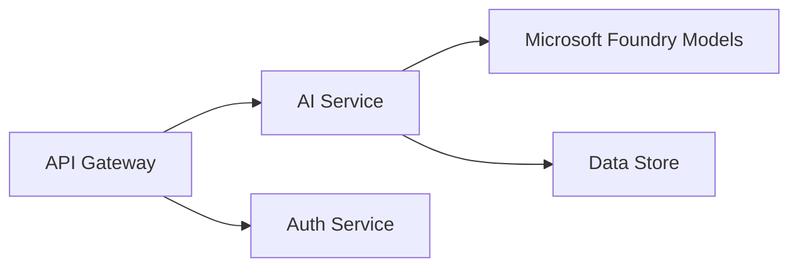
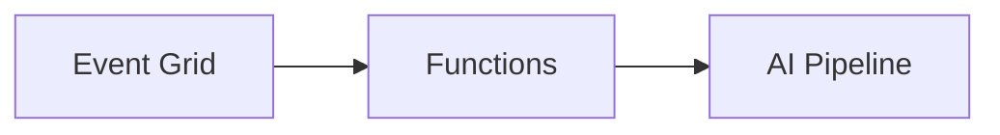

# అధ్యాయం 8: ఉత్పత్తి & ఎంటర్ప్రైజ్ నమూనాలు

**📚 కోర్సు**: [AZD For Beginners](../../README.md) | **⏱️ వ్యవధి**: 2-3 గంటలు | **⭐ సంక్లిష్టత**: అధునాతన

---

## అవలోకనం

ఈ అధ్యాయం ఎంటర్ప్రైజ్-సిద్ధమైన జమాకరణ నమూనాలు, భద్రత గట్టింపులు, పర్యవేక్షణ మరియు ఉత్పత్తి AI లోడుల కోసం ఖర్చు సరళీకరణను కవర్ చేస్తుంది.

ఇది ఒక ఆర్కిటెక్చరల్ సూచిక మాత్రమే, పూర్తిగా కూర్పుగా ఉత్పత్తి టెంప్లేట్ కాదు. ఉదాహరణలు మీ స్వంత అనువర్తనంలో సమకూర్పు వివరాలు అందించబడాలి మరియు పరీక్షించబడాలి; చెక్‌లిస్ట్ చదవడం ఉత్పత్తి సిద్ధతను ధృవీకరించదు.

> **Foundry GA అప్‌డేట్ (2026-11-09):** Foundry వర్క్‌‌ఫ్లో కోసం `azd >= 1.37.0` మరియు సాధారణంగా లభించే `microsoft.foundry` 1.0 బండిల్ ఉపయోగించండి; అంచనాలు ప్రత్యేకంగా ఇన్స్టాల్ చేస్తారు. [రివైజన్ పరిధి మరియు మైగ్రేషన్](production-ai-practices.md#recent-release-changes-and-fixes) మరియు [ఆధారిత పైప్‌లైన్ ఉదాహరణ](production-ai-practices.md#cicd-pipeline-configuration) చూడండి. ఇది డాక్యుమెంటేషన్ సమీక్ష మాత్రమే, ప్రత్యక్ష జమాకరణ ధృవీకరణ లేదా ఐచ్ఛిక ప్రివ్యూ ఫీచర్లకు సర్వత్ర GA స్థితి కాదు.

## అభ్యాస లక్ష్యాలు

ఈ అధ్యాయం పూర్తిచేసి, మీరు:
- బహువు ప్రాంత స్థిరత్వ అనువర్తనాలను జమాకరించగలుగుతారు
- ఎంటర్ప్రైజ్ భద్రత నమూనాలను అమలు చేయగలుగుతారు
- సమగ్ర పర్యవేక్షణను కూర్చునబడగలుగుతారు
- పెద్దపరిమాణంలో ఖర్చులను సరళీకరించగలుగుతారు
- AZD తో CI/CD పైప్‌లైన్‌లను ఏర్పాటుచేయగలుగుతారు

---

## 📚 పాఠాలు

| # | పాఠం | వివరణ | సమయం |
|---|--------|-------------|------|
| 1 | [ఉత్పత్తి AI ఆచార్యలు](production-ai-practices.md) | ఎంటర్ప్రైజ్ జమాకరణ నమూనాలు | 90 నిమి |

---

## 🚀 ఉత్పత్తి చెక్‌లిస్ట్

- [ ] స్థిరత్వం కోసం బహు ప్రాంత జమాకరణ
- [ ] ధృవీకరణ కోసం నిర్వహిత గుర్తింపు (కీలేదు)
- [ ] పర్యవేక్షణ కోసం అప్లికేషన్ ఇన్సైట్స్
- [ ] ఖర్చు బడ్జెట్లు మరియు అలర్ట్‌లు ఏర్పాటు చేయబడ్డాయి
- [ ] భద్రత స్కానింగ్ అందుబాటులో ఉంది
- [ ] CI/CD పైప్‌లైన్ సమకూర్పు
- [ ] విపత్తు పునరుద్ధరణ ప్రణాళిక

---

## 🏗️ వాస్తవ నమూనాలు

### నమూనా 1: మైక్రోసర్విసెస్ AI



### నమూనా 2: ఈవెంట్-చాలిత AI



---

## 🔐 భద్రత ఉత్తమ ఆచార్యలు

```bicep
// Illustrative properties from different resources, NOT a standalone Bicep file.
// Attach identity to the application host:
identity: {
  type: 'SystemAssigned'
}

// AI account properties (also require private endpoints, DNS and app connectivity):
properties: {
  publicNetworkAccess: 'Disabled'
  networkAcls: {
    defaultAction: 'Deny'
  }
}
```

---

## 💰 ఖర్చు సరళీకరణ

| వ్యూహం | ప్రధాన ఆంక్ష |
|----------|---------|
| జీరోకి స్కేలు (కంటైనర్ యాప్స్) | సరైన ట్రిగ్గర్ అవసరం; ఇతర సేవలు ఇంకా ఖర్చు కలిగిస్తాయి |
| అభివృద్ధి కోసం వినియోగ స్థానాలు ఉపయోగించండి | ఎంచుకున్న సేవ ధరను మరియు పని భారాన్ని తులనాచేయండి |
| షెడ్యూల్ చేసిన స్కేలింగ్ | మద్దతు పొందిన ఇన్‌ఫ్రాస్ట్రక్చర్/ఆటోమేషన్ ద్వారా స్కేలింగ్ |
| రిజర్వేషన్లు/ఆధారిత సామర్థ్యం | మద్దతు ఉన్నప్పుడు మాత్రమే; కట్టుబాట్లు నిర్దిష్ట ఖర్చులను పెంచవచ్చు |

సరైన ప్రారంభ తేదీ, బిల్లింగ్ పరిధి, స్వీకరులు మరియు అనుమతులతో [పూర్తి బడ్జెట్ వనరు నమూనా](production-ai-practices.md#2-cost-monitoring-and-budgets) ఉపయోగించండి. బడ్జెట్ అలర్ట్‌లను పంపుతుంది; ఖర్చును పరిమితం చేయదు. ఆదా కొలవబడిన ఉపయోగాన్ని ఆధారపడి ఉంటుంది మరియు శాతం హామీ ఇవ్వబడదు.

---

## 📊 పర్యవేక్షణ ఏర్పాటు

```bash
# Open the Application Insights logs view (requires configured monitoring)
azd monitor --logs

# Check Application Insights
azd monitor --overview

# View metrics
az monitor metrics list --resource <resource-id>
```

---

## 🔗 నావిగేషన్

| దిశ | అధ్యాయం |
|-----------|---------|
| **మునుపటి** | [అధ్యాయం 7: సమస్య పరిష్కారం](../chapter-07-troubleshooting/README.md) |
| **కోర్సు పూర్తయింది** | [కోర్సు హోమ్](../../README.md) |

---

## 📖 సంబంధించిన వనరులు

- [AI ఏజెంట్ల గైడ్](../chapter-02-ai-development/agents.md)
- [అప్లికేషన్ ఇన్సైట్స్](../chapter-06-pre-deployment/application-insights.md)
- [బహు-ఏజెంట్ పరిష్కారాలు](../chapter-05-multi-agent/README.md)
- [మైక్రోసర్విసెస్ ఉదాహరణ](../../examples/microservices/README.md)

---

<!-- CO-OP TRANSLATOR DISCLAIMER START -->
**అస్వీకరణ**:
ఈ పత్రం AI అనువాద సేవ [Co-op Translator](https://github.com/Azure/co-op-translator) ఉపయోగించి అనువదించబడింది. మేము ఖచ్చితత్వానికి ప్రయత్నిస్తున్నప్పటికీ, ఆటోమేటెడ్ అనువాదాలు తప్పులు లేదా అసమగ్రతలను కలిగి ఉండవచ్చు. దాని స్వదేశ భాషలో ఉన్న అసలు పత్రాన్ని అధికారం కలిగిన మూలంగా పరిగణించాలి. కీలకమైన సమాచారం కోసం, ప్రొఫెషనల్ మానవ అనువాదాన్ని సిఫారసు చేస్తాము. ఈ అనువాదం ఉపయోగం వల్ల కలిగే ఏవైనా అపార్థాలు లేదా తప్పుదారులు కోసం మేము బాధ్యత వహించము.
<!-- CO-OP TRANSLATOR DISCLAIMER END -->