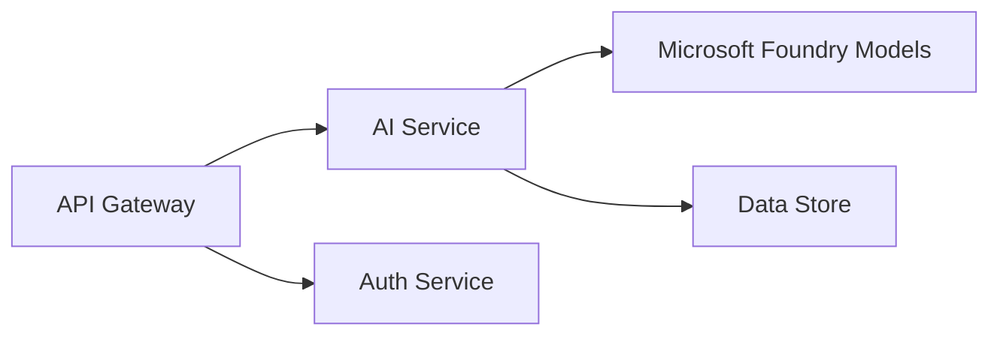

# అధ్యాయం 8: ఉత్పత్తి & ఎంటర్ప్రైజ్ నమూనాలు

**📚 కోర్సు**: [AZD ప్రారంభికులకు](../../README.md) | **⏱️ కాలం**: 2-3 గంటలు | **⭐ సంక్లిష్టత**: అడ్వాన్స్‌డ్

---

## సారి

ఈ అధ్యాయం ఎంటర్ప్రైజ్-సిద్ధమైన డిప్లాయ్‌మెంట్ నమూనాలు, భద్రత హార్డెనింగ్, మానిటరింగ్, మరియు ఉత్పత్తి AI పనితీరు కోసం ఖర్చు ఆప్టిమైజేషన్‌ను కవర్ చేస్తుంది.

ఇది ఒక వాస్తుశిల్ప సూచిక, పూర్తి డిప్లాయ్ అయ్యే ఉత్పత్తి టెంప్లేట్ కాదు. ఉదాహరణలు మీ స్వంత అప్లికేషన్‌లో సరఫరా చేసి పరీక్షించాల్సిన ఇంటిగ్రేషన్ వివరాలను మిస్ చేస్తాయి; చెక్లిస్ట్ చదవడం ఉత్పత్తి సిద్దతను ధృవీకరించడం కాదు.

> **విడుదల సమీక్ష (2026-11-04):** AI CLI మార్గదర్శకాన్ని `azd 1.37.2`, ఎజెంట్లు `1.0.0-beta.23`, మరియు అంచనాలు `1.0.0-beta.2` డాక్యుమెంటేషన్/సోర్స్‌తో తనిఖీ చేశారు. అనుకూలత అవసరాలు మరియు మైగ్రేషన్ వివరాలకు [విడుదల మార్పులు మరియు సవరణలు](production-ai-practices.md#recent-release-changes-and-fixes) చూడండి; ఇది ప్రత్యక్ష డిప్లాయ్‌మెంట్ ధృవీకరణ కాదు.

## అభ్యాస లక్ష్యాలు

ఈ అధ్యాయం పూర్తి చేయడం ద్వారా మీరు:
- బహురాష్ట్రం ప్రతిఘటించే అప్లికేషన్లు డిప్లాయ్ చేయడం
- ఎంటర్ప్రైజ్ భద్రతా నమూనాలను అమలు చేయడం
- సమగ్ర మానిటరింగ్ ఉపకరణాలను ఏర్పాటు చేయడం
- స్కేల్‌పై ఖర్చులను ఆప్టిమైజ్ చేయడం
- AZD తో CI/CD పైప్లైన్లను సెట్ చేయడం

---

## 📚 పాఠాలు

| # | పాఠం | వివరణ | కాలం |
|---|--------|-------------|------|
| 1 | [ఉత్పత్తి AI అభ్యాసాలు](production-ai-practices.md) | ఎంటర్ప్రైజ్ డిప్లాయ్‌మెంట్ నమూనాలు | 90 నిమి |

---

## 🚀 ఉత్పత్తి చెక్లిస్ట్

- [ ] ప్రతిఘటించే బహురాష్ట్ర డిప్లాయ్‌మెంట్
- [ ] మేనేజ్ చేయబడిన ఐడెంటిటీ (కీలు లేవు) ద్వారా ఆటోమేటిక్ ప్రామాణీకరణ
- [ ] మానిటరింగ్ కోసం అప్లికేషన్ ఇన్‌సైట్స్
- [ ] ఖర్చు బడ్జెట్‌లు మరియు అలర్ట్లు సెట్ చేయబడ్డాయి
- [ ] భద్రతా స్కానింగ్ సక్రియం చేయబడింది
- [ ] CI/CD పైప్లైన్ ఇంటిగ్రేషన్
- [ ] విపత్తు పునరుద్ధరణ ప్రణాళిక

---

## 🏗️ వాస్తుశిల్ప నమూనాలు

### నమూనా 1: మైక్రోసర్వీసెస్ AI



### నమూనా 2: ఈవెంట్-డ్రివెన్ AI


---

## 🔐 భద్రత ఉత్తమ అభ్యాసాలు

```bicep
// Illustrative properties from different resources, NOT a standalone Bicep file.
// Attach identity to the application host:
identity: {
  type: 'SystemAssigned'
}

// AI account properties (also require private endpoints, DNS and app connectivity):
properties: {
  publicNetworkAccess: 'Disabled'
  networkAcls: {
    defaultAction: 'Deny'
  }
}
```

---

## 💰 ఖర్చు ఆప్టిమైజేషన్

| వ్యూహం | ప్రధాన పరిమితి |
|----------|---------|
| జీరో వరకు స్కేల్ చేయడం (కంటైర్ ఆప్స్) | సరైన ట్రిగ్గర్ అవసరం; ఇతర సేవలు ఖర్చులు తెస్తాయి |
| డెవలప్మెంట్ కోసం కన్సంప్షన్ టియర్‌లు ఉపయోగించడం | ఎంచుకున్న సేవ ధర మరియు పని భారాన్ని సరిపోల్చండి |
| షెడ్యూల్ స్కేలింగ్ | మద్దతు ఉన్న మౌలిక సదుపాయాలు/ఆటోమేషన్ ద్వారా స్కేల్ చేయడం |
| రిజర్వేషన్లు/ప్రొవిజ‌న్డ్ కెపాసిటీ | మద్దతు ఉన్నప్పుడల్లా మాత్రమే; కమీట్మెంట్లు ఇడిల్ ఖర్చులను పెంచవచ్చు |

ఒక చెల్లుబాటు అయ్యే ప్రారంభ తేదీ, బిల్లింగ్ స్కోప్, అందుకునేవారిని మరియు అనుమతులను కలిగిన [పూర్తి బడ్జెట్ వనరు నమూనా](production-ai-practices.md#2-cost-monitoring-and-budgets) ఉపయోగించండి. బడ్జెట్ అలర్టులు పంపుతుంది; ఖర్చును సరిధర పోదు. పొదుపు కొలిచిన వినియోగం ఆధారంగా ఉంటుంది మరియు శాతం హామీ ఇవ్వబడదు.

---

## 📊 మానిటరింగ్ సెటప్

```bash
# Open the Application Insights logs view (requires configured monitoring)
azd monitor --logs

# Check Application Insights
azd monitor --overview

# View metrics
az monitor metrics list --resource <resource-id>
```

---

## 🔗 నావిగేషన్

| దిశ | అధ్యాయం |
|-----------|---------|
| **మునుజటి** | [అధ్యాయం 7: సమస్య పరిష్కారం](../chapter-07-troubleshooting/README.md) |
| **కోర్సు పూర్తయింది** | [కోర్సు హోమ్](../../README.md) |

---

## 📖 సంబంధిత వనరులు

- [AI ఎజెంట్లు గైడ్](../chapter-02-ai-development/agents.md)
- [అప్లికేషన్ ఇన్‌సైట్స్](../chapter-06-pre-deployment/application-insights.md)
- [బహుఎజెంట్ పరిష్కారాలు](../chapter-05-multi-agent/README.md)
- [మైక్రోసర్వీసెస్ ఉదాహరణ](../../examples/microservices/README.md)

---

<!-- CO-OP TRANSLATOR DISCLAIMER START -->
**అస్వీకరణ**:
ఈ పత్రం AI అనువాద సేవ [Co-op Translator](https://github.com/Azure/co-op-translator) ఉపయోగించి అనువదించబడింది. మేము ఖచ్చితత్వానికి ప్రయత్నిస్తున్నప్పటికీ, ఆటోమేటెడ్ అనువాదాలు తప్పులు లేదా అసమగ్రతలను కలిగి ఉండవచ్చు. దాని స్వదేశ భాషలో ఉన్న అసలు పత్రాన్ని అధికారం కలిగిన మూలంగా పరిగణించాలి. కీలకమైన సమాచారం కోసం, ప్రొఫెషనల్ మానవ అనువాదాన్ని సిఫారసు చేస్తాము. ఈ అనువాదం ఉపయోగం వల్ల కలిగే ఏవైనా అపార్థాలు లేదా తప్పుదారులు కోసం మేము బాధ్యత వహించము.
<!-- CO-OP TRANSLATOR DISCLAIMER END -->