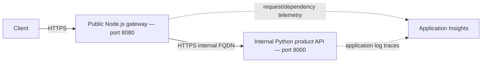

# రెండు-సేవా మైక్రోసర్వీసులు — Azure కంటైనర్ అప్స్

**స్థాయి:** మధ్యంతర · **సమయం:** సర్దుబాటు సహితం 45–60 నిమిషాలు

ఈ అభ్యాస నమూనా ఒక **Node.js API గేట్వే** మరియు ఒక **ఓ చదవ-only Python ఉత్పత్తి సేవ**ని అమలు చేస్తుంది.
మూలం, Dockerfiles, Bicep, మరియు azd కాన్ఫిగరేషన్ చేర్చబడి ఉన్నాయి.
ఇది ఉత్పత్తి-దృఢమైన వ్యవస్థ కాదు.

## మీరు నేర్చుకునేటది

- రెండు సేవలను స్వతంత్రంగా పంపిణీ చేయడం.
- HTTPS పై అంతర్గత బ్యాకెండ్ FQDN ఉపయోగించడం.
- విజయం, కనుగొనబడలేదు, మరియు అందుబాటులో లేని సేవ ప్రతిస్పందనలను ధృవీకరించడం.
- టెలిమెట్రీ మరియు స్వతంత్ర స్కేలింగ్ పరిమితుల గురించి అర్థం చేసుకోవడం.



ఉత్పత్తుల క్యాలగ్లో ఐదు స్థిర ఉత్పత్తులు మemoryలో ఉంటాయి. అక్కడ **POST, PUT, లేదా DELETE హ్యాండ్లర్లు లేరు**,
డేటాబేసు, సర్వీస్ బస్, ఆర్డర్/వాడుకరి/నోటిఫికేషన్ సేవ, C#, లేదా Go కోడ్ అందుబాటులో లేవు.
అవి భవిష్యత్తు అభివృద్ధి ఆలోచనలు, చేర్చని ఫీచర్లుగా మాత్రమే ఉన్నాయి.
గేట్వే యూజర్లను ఆథెంటికేట్ చేయదు; అంతర్గత ఇన్గ్రస్ అప్లికేషన్ అధికారం కోసం భర్తీ కాదు.


## ముందస్తు అర్హతలు

ముందుగా [సింగిల్ ఫ్లాస్క్ API](../../../../../examples/container-app/simple-flask-api) పూర్తి చేయండి.
ఒక ప్రస్తుత స్థిరమైన azd (సమీక్ష సమయంలో ప్రచురించిన విడుదల: 1.37.2), Azure CLI,
మరియు డాకర్ డీమన్ రన్ అవుతూ ఇన్‌స్టాల్ చేయండి. మీరు Azure సబ్‌స్క్రిప్షన్, వనరు
సృష్టి అనుమతులు మరియు కంటైనర్ యాప్స్ ప్రాంతీయ కోటా అవసరం.

```bash
azd version
az version
docker info
azd auth login
az login
```

ఇద్దరు CLI టూల్స్‌లో ఒకే సబ్‌స్క్రిప్షన్ ఉపయోగించండి. దిగువ కమాండ్లు బాష్ ఉపయోగిస్తాయి.

## డిప్లాయ్ చేసి ధృవీకరించండి

రిపాజిటరీ రూట్ నుండి:

```bash
cd examples/container-app/microservices
azd env new microservices-demo
azd up
GATEWAY_URL=$(azd env get-value API_GATEWAY_URL)
RG_NAME=$(azd env get-value AZURE_RESOURCE_GROUP)
GATEWAY_NAME=$(azd env get-value API_GATEWAY_NAME)
PRODUCT_NAME=$(azd env get-value PRODUCT_SERVICE_NAME)

curl --fail-with-body "${GATEWAY_URL}/health"
curl --fail-with-body "${GATEWAY_URL}/api/products"
curl --fail-with-body "${GATEWAY_URL}/api/products/1"
curl -i "${GATEWAY_URL}/api/products/999"
```

**విజయం:** హెల్త్ 200; లిస్ట్ 200 తో **ఐదు** ఉత్పత్తులు; ఉత్పత్తి 1 ల్యాప్టాప్
ధర 999.99 మరియు స్టాక్ 50 తో; తెలియని ఉత్పత్తి 404 ఇస్తుంది.
వివరణలు ప్రతిస్పందనల్లో ఉన్నాయి; టైమ్‌స్టాంప్స్ మారుతుంటాయి.

ప్రారంభ ప్రావిజన్ పోర్ట్ 80 పై పబ్లిక్ హెల్లో-వరల్డ్ ఇమేజెస్ ఉపయోగిస్తుంది కాబట్టి అది
ఖాళీ రిజిస్ట్రీ నుండి లభించని ఇమేజెస్ వద్ధుకోదుటకు ప్రయత్నించదు. సర్వీస్-నిర్దిష్ట
బైసెప్ మాడ్యూల్స్ మరియు పారామీటర్ ఫైళ్లు వాటిని నిర్మిత ఇమేజీలు మరియు యాప్ పోర్ట్స్/ప్రోబ్స్ తో
`azd deploy` సమయంలో మార్చుతాయి. ప్రధాన పారామీటర్లు తరువాత ప్రావిజనింగ్ కొరకు ప్రచురించిన ఇమేజ్ పేర్లను పాక్షికంగా నిలుపుకుంటాయి.

## సర్వీసులు మరియు నెట్వర్కింగ్

| సర్వీస్ | ఎక్స్‌పోజ్డ్ ఎండ్‌పాయింట్లు | డిఫాల్ట్ వనరులు |
|---|---|---|
| గేట్వే | GET `/`, `/health`, `/api/products`, `/api/products/:id` | 1 vCPU, 2 GiB, 2–20 ప్రతులు |
| ఉత్పత్తి | GET `/`, `/health`, `/products`, `/products/<id>` | 0.5 vCPU, 1 GiB, 1–10 ప్రతులు |

ఉత్పత్తి ఇన్‌గ్రెస్సు వద్ద `external: false` మరియు `allowInsecure: false` ఉన్నాయి. బైసెప్
గేట్వేలో `PRODUCT_SERVICE_URL=https://<actual-internal-fqdn>` చొప్పిస్తుంది. HTTP అవుతుంది
redirect; HTTPS కన్ఫిగర్ చేసిన ఇంగ్రెస్కు సరిపోతుంది. ఒక చిన్న DNS పేరు తప్పనిసరిగా సరిపోవాలి
**అసలు కంటైనర్ యాప్ పేరు**, తర్కసంగతమైన సేవా కీ కాదు `product-service`.
మీ ల్యాప్టాప్ నుంచి అంతర్గత URL నేరుగా కాల్ చేయడానికి ప్రయత్నించవద్దు.

గేట్వేకు ఉత్పత్తి కాల్ల కోసం ఐదు సెకన్ల టైమ్‌ఔట్ ఉంటుంది. ఉత్పత్తి ID లు లేకపోతే
404 గా వ్యాపిస్తాయి; రవాణా వైఫల్యాలు/ఇతర బ్యాక్‌ఎండ్ వైఫల్యాలు 503 ను తిరిగి ఇస్తాయి. గేట్వే
`/health` గేట్వేను మాత్రమే తనిఖీ చేస్తుంది, బ్యాక్‌ఎండ్ అందుబాటును కాదు.

## ఫైళ్లు మరియు కాంకుంటేషన్

```text
azure.yaml
infra/main.bicep
infra/main.parameters.json
infra/abbreviations.json
infra/core/container-apps-environment.bicep
infra/core/monitor.bicep
infra/app/api-gateway.bicep
infra/app/api-gateway.parameters.json
infra/app/product-service.bicep
infra/app/product-service.parameters.json
src/api-gateway/{app.js,package.json,Dockerfile}
src/product-service/{main.py,requirements.txt,Dockerfile}
```

స్కేలింగ్, CPU/మెమరీ, పోర్టులు మరియు సర్వేలు `infra/app/*.bicep` లో సెట్ చేయబడ్డాయి. ఆ
ఫైళ్లను మార్చి, డ్రాప్ చేసి ఇన్‌ఫ్రాస్ట్రక్చర్‌ను అమలు చేయడానికి `azd up` నడపండి. ఈ నమూనాలో
`GATEWAY_MAX_REPLICAS` ఎన్‌విరాన్‌మెంట్-వేరియబుల్ పారామీటర్ లేదు.

కోడ్-కేవలం మార్పుల కోసం:

```bash
azd deploy product-service
azd deploy api-gateway
```

నోడ్ ఇమేజ్ నోడ్ 22 ను ఉపయోగిస్తాయి; పైథాన్ ఇమేజ్ పైథాన్ 3.11ను ఉపయోగిస్తుంది. రెండూ
`0.0.0.0` కు బైండ్ అవుతాయి. ఇంగ్రెస్కు/సర్వేలకు క్రమంగా 8080 (గేట్వే) మరియు 8000 (ఉత్పత్తి) పోర్టులు ఉపయోగిస్తాయి.

## డోకర్‌తో స్థానిక అభివృద్ధి

ఈ ఉదాహరణ డైరెక్టరీ నుండి నడపండి. ఒక వినియోగదారు నిర్వచించిన నెట్‌వర్క్‌ని ఉపయోగించండి, **కాకుండా `localhost`
ఒక కంటైనర్ నుండి మరొకటికి చేరుకునేందుకు**:

```bash
docker network create azd-microservices-demo
docker build -t local-product ./src/product-service
docker build -t local-gateway ./src/api-gateway
docker run -d --name azd-product --network azd-microservices-demo local-product
docker run -d --name azd-gateway --network azd-microservices-demo \
  -p 8080:8080 -e PRODUCT_SERVICE_URL=http://azd-product:8000 local-gateway
curl --fail-with-body http://localhost:8080/api/products
```

అంచనా: ఐదు ఉత్పత్తులు. ఈ ప్రాంతీయ Docker నెట్‌వర్క్ కోసం మాత్రమే HTTP ఉపయోగించబడుతుంది.

```bash
docker stop azd-product azd-gateway
docker rm azd-product azd-gateway
docker network rm azd-microservices-demo
```

## పర్యవేక్షణ

```bash
az containerapp logs show --name "$GATEWAY_NAME" --resource-group "$RG_NAME" --follow
# In a separate terminal:
az containerapp logs show --name "$PRODUCT_NAME" --resource-group "$RG_NAME" --tail 100
```

`azd monitor --logs` పోర్టల్ వీక్షణను తెరుస్తుంది; ఇది టెర్మినల్ లాగ్‌లను స్ట్రీమ్ చేయdoes.
నోడ్ SDK గేట్‌వే అభ్యర్థనలు/అనుబంధాలను సేకరిస్తుంది. Python యొక్క `AzureLogHandler`
**లాగ్ ట్రేస్**లను ఎగుమతి చేస్తుంది, ఆటోమాటిక్ ఫ్లాస్క్ అభ్యర్థనలు, SQL అనుబంధాలు లేదా పూర్తి
పంపిణీ చేయబడిన ట్రేస్‌లను కాదు. OpenCensus ఒక పాత SDK; ఈ నమూనాను పెంపొందిస్తున్నప్పుడు Azure Monitor OpenTelemetry
ను ప్రాధాన్యం ఇవ్వండి.

యాప్లికేషన్ ఇన్సైట్స్ లాగ్‌లలో, అభ్యర్థనలను ఉత్పత్తి చేసి పరిశీలించండి:

```kusto
requests
| where timestamp > ago(1h)
| where name contains "products"
| summarize RequestCount=count(), AvgDuration=avg(duration) by bin(timestamp, 5m)
```

Python యాప్లికేషన్ సందేశాల కోసం:

```kusto
traces
| where timestamp > ago(1h)
| where message contains "products"
| project timestamp, message, severityLevel
```

అవగాహన ఆలస్యం మరియు శాంపిలింగ్‌ను అనుమతించండి; ఖచ్చితమైన అభ్యర్థన లెక్క లేదా 
హామీ ఇచ్చిన ఆలస్యం ఆశించవద్దు. ఏ కస్టమ్ అలర్ట్‌లు లేదా డ్యాష్‌బోర్డులు కాన్ఫిగర్ చేయబడలేదు.

## ప్రాక్టికల్ వ్యాయామాలు

### వ్యాయామం 1: కాటలాగ్‌ను మార్చండి

**ప్రారంభ బిందువు:** `src/product-service/main.py`.
**లక్ష్యం:** స్వతంత్ర సేవా అమరికను నిర్ధారించండి.
ల్యాప్టాప్ స్టాక్‌ను 50 నుండి 49కి మార్చి ఫిక్స్ చేసిన `products` జాబితాలో,
`azd deploy product-service` నడిపించి, తరువాత `${GATEWAY_URL}/api/products/1` అభ్యర్థించండి.

**విజయానికి ప్రమాణాలు / పరిష్కారం:** HTTP 200 తో `"stock":49`. 50ని పునఃస్థాపించండి మరియు మళ్ళీ డిప్లాయ్ చేయండి.
**సాధారణ సమస్య:** క్యాటలॉग‌ను కలిగి ఉన్న సర్వీస్ ను కాకుండా గేట్వే ను ఇడిట్ చేయడం.
ఇది మూల డేటాను మార్చుతుంది, ఒక శాశ్వత ఇన్వెంటరీ డేటాబేస్‌ను కాదు.

### వ్యాయామం 2: రిప్లికా కాన్ఫిగరేషన్‌ని ధృవీకరించండి

**ప్రారంభ బిందువు:** `infra/app/product-service.bicep`.
**లక్ష్యం:** ఆటోస్కేలింగ్‌ను ఊహించకుండా మౌలిక సౌకర్యంలో మార్పును గమనించండి.
`minReplicas: 1` ని `minReplicas: 2` గా మార్చి, `azd up` నడిపించండి, ఆపై:

```bash
az containerapp show --name "$PRODUCT_NAME" --resource-group "$RG_NAME" \
  --query properties.template.scale -o json
```

**విజయ ప్రమాణాలు:** కాంఫిగర్ చేయబడిన కనీసం 2 మరియు గరిష్టం 10 గా ఉంటుంది.
కనీసాన్ని 1కి తిరిగి సెట్ చేసి `azd up` ను అమలు చేయండి.
**సాధారణ సమస్య:** `azd deploy` మాత్రమే సంబంధం లేని పంచుకున్న
ఇన్‌ఫ్రాస్ట్రక్చర్‌కు మార్పులు చేయదు. విఫలం అనుకరిస్తున్న ఏకంగా `maxReplicas` ని సున్నా చేయవద్దు.
ఇది కాన్పిగరేషన్‌ని ధృవీకరిస్తుంది, లోడ్-టెస్ట్ లేదా తక్షణ ప్రతికృతి సంఖ్య గ్యారంటీ కాదు.

### వ్యాయామం 3: స్థానికంగా అందుబాటులో లేని సేవని పరీక్షించండి

**ప్రారంభ స్థానము:** పై రెండు స్థానిక Docker కంటెయినర్లు నడుస్తున్నవి.
**లక్ష్యం:** బ్యాక్​ఎండ్ వైఫల్యాన్ని తప్పిపోయిన ఉత్పత్తి నుండి భేదించండి.
ఉత్పత్తి కంటెయినర్‌ని మాత్రమే ఆపండి:

```bash
docker stop azd-product
curl -i http://localhost:8080/api/products
docker start azd-product
curl --fail-with-body http://localhost:8080/api/products
```

**విజయ ప్రమాణాలు:** ఆపివేసినప్పుడు, గేట్‌వే 503 తో ప్రత్యుత్తరం ఇస్తుంది
`"error":"Product service unavailable"`; రీస్టార్ట్ తర్వాత జాబితా 200 ని తిరిగి ఇస్తుంది.
అవసరమైతే చిన్న స్టార్టప్ ఆలస్యం తర్వాత మళ్లీ ప్రయత్నించండి.
**సాధారణ సమస్య:** గేట్‌వే ఆపడం వేరే వైఫల్యాన్ని పరీక్షిస్తుంది (HTTP ప్రత్యుత్తరంలేకపోవటం).

## ఖర్చులు మరియు ఉత్పత్తి లోపాలు

డిఫాల్ట్ కనీస ప్రతుల సంఖ్య నిరంతరం కంప్యూటింగ్ కొనసాగిస్తుంది. రిజిస్ట్రీ మరియు మానిటరింగ్ కూడా
చార్జీలు కలిగి ఉంటాయి. ఒక స్థిరమైన 50$ /నెల మొత్తమని ధృవీకరించలేదు: ప్రాంతీయ CPU/మెమరీ,
ప్ర‌త్యేక గంటలు, అభ్యర్థనలు, రిజిస్ట్రీ, మరియు లాగ్ నిల్వను అంచనా వేదండి
[Azure pricing calculator](https://azure.microsoft.com/pricing/calculator/)లో.
నేర్చుకునే వనరులను తక్షణమే తొలగించండి.

ఉత్పత్తి పనిలో ప్రమాణపత్రాల/అధికారాలు, స్కోప్ చేయుచున్న నిర్వహించబడే IDలు,
నిరంతర డేటా, ఇన్పుట్/ప్రత్యుత్తర చక్ర తప్పుల పరిశీలనం, మద్దతు ఉన్న పరిశీలన సాధనాలు,
లోడ్/వైఫల్య పరీక్షలు, CI/CD, అలర్ట్లు మరియు పునరుద్ధరణ విధానాలు ఉంటాయి. ఆర్డర్
సేవ, క్యూను లేదా డేటాబేస్‌ను చేర్చడం వేరే అమలుకి సంబంధించిన పని, ఇది ముగిసిపోయిన
వ్యాయామం గాని ఇక్కడ ఇప్పటికే అందుబాటులో ఉన్న ఫీచర్ గానీ కాదు.

## సమస్య పరిష్కారం మరియు శుభ్రపరచడం

- **మొదటి ప్రోవిజన్ సమయంలో చిత్రం కనుగొనబడలేదు:** బూట్‌స్ట్రాప్ పబ్లిక్ చిత్రాన్ని ఉపయోగించాలి;
  ప్రధాన చిత్రం పారామీటర్ డిఫాల్ట్‌లు మరియు డిప్లాయ్‌మెంట్ మాడ్యూల్ మ్యాపింగ్లను ధృవీకరించండి.
- **503 ఉత్పత్తులు:** ఉత్పత్తి లాగ్‌లు, చిత్రం సంస్కరణ, మరియు ఇంజెక్ట్ చేసిన అంతర్గత HTTPS URLను తనిఖీ చేయండి.
- **404 అనుకోలేదు మార్గం:** ఉత్పత్తి API రీడ్-ఓన్లీ; మార్గాన్ని తనిఖీ చేయండి, లేని CRUD హ్యాండ్లర్ కాదు.
- **టెలిమెట్రీ లేదు:** రన్‌టైమ్ కనెక్షన్ స్ట్రింగ్స్‌ను ఎక్స్‌పోజ్ చేయకుండా పరిశీలించండి మరియు
  దిగుబడిని ఆలస్యం చేయండి. Python అభ్యర్థన పట్టికలు దాని లాగ్ హ్యాండ్లర్ ద్వారా నింపబడవు.

ఈ నమూనా డైరెక్టరీ నుండి:

```bash
azd down
```

తొలగింపు సూచనలను సమీక్షించి, కేటాయించబడిన వనరు గ్రూప్ తొలగించబడిందని నిర్ధారించండి.

[మునుపటి: Flask API](../../../../../examples/container-app/simple-flask-api) · [తదుపరి: డేటాబేస్ యాప్](../../../../../examples/database-app) ·
[AI డెవలప్మెంట్](../../../docs/chapter-02-ai-development/README.md) ·
[కోర్సు హోమ్](../../../README.md) · [సమస్య నివేదించండి](https://github.com/microsoft/AZD-for-beginners/issues)

---

<!-- CO-OP TRANSLATOR DISCLAIMER START -->
**అస్వీకరణ**:
ఈ పత్రం AI అనువాద సేవ [Co-op Translator](https://github.com/Azure/co-op-translator) ఉపయోగించి అనువదించబడింది. మేము ఖచ్చితత్వానికి ప్రయత్నిస్తున్నప్పటికీ, ఆటోమేటెడ్ అనువాదాలు తప్పులు లేదా అసమగ్రతలను కలిగి ఉండవచ్చు. దాని స్వదేశ భాషలో ఉన్న అసలు పత్రాన్ని అధికారం కలిగిన మూలంగా పరిగణించాలి. కీలకమైన సమాచారం కోసం, ప్రొఫెషనల్ మానవ అనువాదాన్ని సిఫారసు చేస్తాము. ఈ అనువాదం ఉపయోగం వల్ల కలిగే ఏవైనా అపార్థాలు లేదా తప్పుదారులు కోసం మేము బాధ్యత వహించము.
<!-- CO-OP TRANSLATOR DISCLAIMER END -->