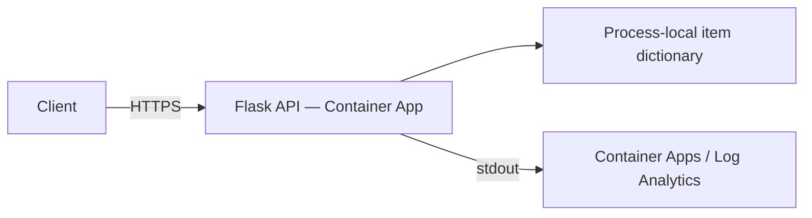

# సింపుల్ Flask API — Azure కంటైనర్ యాప్స్

**స్థాయి:** ప్రారంభుడు · **సమయం:** సెటప్ సహా 30–45 నిమిషాలు

Azure Developer CLI (azd) తో Python Flask CRUD API ని డిప్లాయ్ చేయండి. సోర్స్, Dockerfile,
Bicep, మరియు డిప్లాయ్‌మెంట్ పారామీటర్లను కలిగి ఉంది. ఇది ఒక **అభ్యాస నమూనా**, కాదు
ప్రొడక్షన్-సిద్ధమైన API.

## మీరు నేర్చుకునేది

- azd ద్వారా కంటైనర్ నిర్మించడం మరియు ప్రచురించడం.
- ఇన్గ్రెస్ మరియు లైవ్‌నెస్/రెడీనెస్ ప్రోబ్స్‌ని సెటప్ చేయడం.
- CRUD ప్రతిస్పందనలను ధృవీకరించడం మరియు అప్లికేషన్ లాగ్‌లను పరిక్షించండి.
- ఇన్-మెమరీ డేటా దృఢమైన యాప్స్‌కు ఎందుకు అనుచితమో అర్థం చేసుకోండి.



**ప్రధానమైనది:** అంశాలు ఒక ప్రాసెస్‌లో ఉంచబడతాయి. డిఫాల్ట్ **ఒక Gunicorn వర్కర్,
0–1 రెప్లికాస్** ఉంటుంది, వర్కర్లు/రెప్లికాస్ మధ్య అసమతుల డేటాను నిరోధించడానికి.
రీస్టార్ట్, రివిజన్ మార్పు లేదా స్కేల్-టు-జీరో సమయంలో అంశాలు కోల్పోతాయి. రెప్లికాస్ పెంచటం
కోసం షేరింగ్ పర్సిస్టెంట్ స్టోరేజ్ అవసరం. APIకి ఎటువంటి authentication లేదా authorization లేదు.

## ముందస్తు అవసరాలు

- [ప్రస్తుత స్థిరమైన azd](https://learn.microsoft.com/azure/developer/azure-developer-cli/install-azd)
  (సమీక్ష సమయానికి ప్రచురించిన రీలీజ్: 1.37.2).
- సరిపోల్చుకోడానికి [Azure CLI](https://learn.microsoft.com/cli/azure/install-azure-cli).
- డాకర్ మరియు దాని డేమన్ రన్ అవుతున్నది; ఇది డిఫాల్ట్ స్థాని ఇమేజ్ నిర్మాణానికి అవసరం.
- Azure సబ్‌స్క్రిప్షన్, వనరు సృష్టించే అనుమతులు, మరియు కంటైనర్ యాప్స్ ప్రాంతీయ క్వోటా.
- కింద ఉన్న కమాండ్ల కోసం Bash (లేదా సమానమైన PowerShell).
- స్వచ్చంద స్థానిక అభివృద్ధికి Python 3.11.

```bash
azd version
az version
docker info
azd auth login
az login
```

CLI టూల్స్ కి వేరే లాగిన్ సెషన్లు ఉంటాయి. రెండింటిలో కూడా అదే సబ్‌స్క్రిప్షన్ ఉపయోగించండి.

## త్వరితప్రారంభం

రిపోజిటరీ రూట్ నుండి:

```bash
cd examples/container-app/simple-flask-api
azd env new flask-demo
azd up
API_URL=$(azd env get-value API_ENDPOINT)
RG_NAME=$(azd env get-value AZURE_RESOURCE_GROUP)
API_NAME=$(azd env get-value API_NAME)
curl --fail-with-body "${API_URL}/health"
```

అనుకుంటున్నది: HTTP 200 మరియు JSON లో `"status":"healthy"`,
`"service":"simple-flask-api"`, మరియు ప్రస్తుత UTC టైమ్‌స్టాంప్.
ప్రావిజనింగ్ మరియు ఇమేజ్ బిల్డింగ్ సాధారణంగా కొన్ని నిమిషాలు పడుతుంది; టైమింగ్స్ మారుతుండవచ్చు.

ప్రారంభ ప్రావిజనింగ్ కోసం 80 పోర్ట్‌ను వినిపించే పబ్లిక్ hello-world ఇమేజ్ ఉపయోగిస్తున్నది.
`azure.yaml` తీసుకుంటే `infra/app/api.bicep` మరియు దాని సరిపోలే పారామీటర్ ఫైల్ సేవా డిప్లాయ్‌మెంట్ కోసం
ఎంపిక అవుతుంది, ఇది ఇమేజ్, ఇన్గ్రెస్, ప్రోబ్స్ అన్నీ 8000 పోర్ట్‌కు మార్చుతుంది.
ఆ డిప్లాయ్‌మెంట్ పారామీటర్లను తొలగించవద్దు.

## CRUDని ధృవీకరించండి

అదే రెప్లికా యాక్టివ్ గా ఉన్నప్పుడు క్రమంగా క్రింద ఇచ్చినవి రన్ చేయండి:

```bash
# Create: HTTP 201; note the returned id (1 for a fresh process).
curl -i -X POST "${API_URL}/api/items" \
  -H "Content-Type: application/json" \
  -d '{"name":"Test Item","description":"My first item"}'

# Read list: HTTP 200, total 1 in a fresh process.
curl --fail-with-body "${API_URL}/api/items"

# Replace 1 if your create response returned another id.
curl --fail-with-body "${API_URL}/api/items/1"
curl -i -X PUT "${API_URL}/api/items/1" \
  -H "Content-Type: application/json" -d '{"name":"Updated Item"}'
curl -i -X DELETE "${API_URL}/api/items/1"
curl -i "${API_URL}/api/items/1"
```

విజయవంతం: POST 201, రీడ్స్/PUT 200, DELETE 204 ఎలాంటి బాడీ లేకుండా, తర్వాత మిస్సింగ్ ఐటమ్ 404.
తప్పుగా రూపుదిద్దిన/నాన్-ఆబ్జెక్టు JSON లేదా ఖాళీ పేరుతో 400 రిటర్న్ అవుతుంది.
ఐటమ్ అడుగుచేసిన మధ్యలో కనబడకపోతే, రీస్టార్ట్ లేదా స్కేల్-టు-జీరోని తనిఖీ చేయండి;
ఇది ఉద్దేశపూర్వక ఇన్-మెమరీ పరిమితి, పర్సిస్టెన్స్ కాదు.

| ఎండ్పాయింట్ | మెతడ్స్ |
|---|---|
| `/` | GET — సేవ సమాచారం |
| `/health` | GET — లైవ్‌నెస్/రెడీనెస్ |
| `/api/items` | GET, POST |
| `/api/items/{id}` | GET, PUT, DELETE |

## లాగ్స్ మరియు కాన్ఫిగరేషన్

```bash
az containerapp logs show --name "$API_NAME" --resource-group "$RG_NAME" --follow
```

ఆశించినది: Gunicorn స్టార్టప్, అభ్యర్థన యాక్సెస్ లాగ్స్, మరియు అప్లికేషన్ సందేశాలు.
`azd monitor --logs` ఒక పోర్టల్ వీక్షణను తెరుచుకుంటుంది; ఇది టెర్మినల్‌కు స్ట్రీమ్ చేయదు.
అప్లికేషన్ ఇన్సైట్స్ ప్రావిజన్ చేయబడింది కానీ **ఈ Flask కోడ్ తో ఇన్స్ట్రూమెంట్ చేయబడలేదు**;
stdout లాగ్స్ కోసం కంటైనర్ యాప్స్/లాగ్ అనలిటిక్స్ ఉపయోగించండి.

CPU/మెమరి, రెప్లికా పరిమితులు, లేదా స్కేల్ రూల్స్ కోసం `infra/app/api.bicep` ఎడిట్ చేయండి, తరువాత
`azd up` రన్ చేయండి. డిఫాల్ట్‌లు 0.5 vCPU, 1 GiB, కనీసం 0 / గరిష్ఠం 1 రెప్లికా, మరియు
HTTP త్రెషోల్డ్ 50 సConcurrent అభ్యర్థనలు. స్కేల్-టు-జీరో శీతల ప్రారంభ ఆలస్యం తెచ్చవచ్చు.

యాదృచ్చిక `azd env set MAX_REPLICAS`, `API_KEY`, `LOG_LEVEL` లేదా
`SCALE_TO_ZERO_TIMEOUT` విలువలు **ఈ టెంప్లేట్ లేదా యాప్‌తో సంబంధం కలిగి లేవు**.
విలువ సెటింగ్ చేయడమంటే ఆటోమేటిక్‌గా రన్‌టైమ్ ఎన్విరాన్మెంట్ వేరియబుల్ కాదు.
ఇమేజ్ 8000 పోర్ట్‌ను స్పష్టంగా బైండ్ చేస్తుంది; పోర్ట్ మార్చితే Dockerfile, Bicep ఇన్గ్రెస్, మరియు ప్రోబ్స్
కలిసి నవీకరించండి.

## ఫైళ్లు

```text
azure.yaml
infra/main.bicep
infra/main.parameters.json
infra/app/container-apps.bicep       # Environment, registry, monitoring
infra/app/api.bicep                  # App, ingress, probes, scale settings
infra/app/api.parameters.json        # Image and resource values for azd deploy
src/app.py
src/Dockerfile
src/requirements.txt
```

## లోకల్ అభివృద్ధి

ఈ ఉదాహరణ ఫోల్డర్ నుండి:

```bash
python -m venv .venv
source .venv/bin/activate  # PowerShell: .\.venv\Scripts\Activate.ps1
python -m pip install -r src/requirements.txt
python src/app.py
```

మరొక టెర్మినల్‌లో, `http://localhost:8000/health` మరియు CRUD ఎండ్పాయింట్లను పరీక్షించండి.
లేదా అసలు ఇమేజ్‌ను నిర్మించి రన్ చేయండి:

```bash
docker build -t flask-api:local ./src
docker run --rm -p 8000:8000 flask-api:local
```

మొదటి డిప్లాయ్‌మెంట్ తర్వాత కేవలం కోడ్ మార్పుల కొరకు `azd deploy api` రన్ చేయండి.
Bicep మార్పుల కోసం, తిరిగి ప్రావిజన్ చేసి డిప్లాయ్ చెయ్యడానికి `azd up` రన్ చేయండి.

## ప్రత్యక్ష అభ్యాసాలు

### 1. ఇన్‌పుట్ తిరస్కరణ నిర్ధారించుకోండి

**ప్రారంభ బిందువు:** డిప్లాయ్ అయిన API, పై `API_URL`.
**లక్ష్యం:** API తప్పు JSON ఆకారాలు మరియు లేని పేర్లను తిరస్కరిస్తుందో నిర్ధారించండి.

```bash
curl -i -X POST "${API_URL}/api/items" \
  -H "Content-Type: application/json" -d '[]'
curl -i -X POST "${API_URL}/api/items" \
  -H "Content-Type: application/json" -d '{"name":""}'
```

**విజయ నిర్ధారణ / పరిష్కారం:** రెండూ 400 JSON లో తప్పు తో రిటర్న్ అవుతాయి, 500 కాదు.
**సాధారణ సమస్య:** JSON కంటెంట్-టైప్ హెడ్డర్ మిస్ చేయడం.

### 2. రీడ్-ఓన్లీ వెర్షన్ ఎండ్పాయింట్‌ను జోడించండి

**ప్రారంభ బిందువు:** `src/app.py`. **లక్ష్యం:** APIను పొడగించి మళ్ళీ డిప్లాయ్ చేయండి.
ఇది `if __name__ == '__main__':` బ్లాక్ ముందు జోడించండి:

```python
@app.route('/version', methods=['GET'])
def version():
    return jsonify({'version': '1.0.0'})
```

`azd deploy api` రన్ చేసి, తరువాత `curl --fail-with-body "${API_URL}/version"`.
**విజయ నిర్ధారణ:** HTTP 200 మరియు `{"version":"1.0.0"}`.
**సాధారణ సమస్య:** పరీక్షల సమయంలో బ్లాక్ చేసే `app.run()` కాల్ తర్వాత రూట్ పెడితే
ఇది ఏర్పడుతుంది `python src/app.py`.

### జ్ఞాన పరీక్ష

నెగ్గని డేటాకు ఒక కార్మికుడు ఎందుకు సరిపోదు? ఎందుకంటే ఒక ప్రాసెస్ కూడా
రీస్టార్ట్ అయినప్పుడు దాని డిక్షనరీని కోల్పోతుంది. ఉత్పత్తి సంస్కరణకు తేలికపనిది అయిన పంచుకున్న నిల్వ,
ప్రామాణీకరణ, అనుమతులు, మైగ్రేషన్లు, పరీక్షలు మరియు కార్యాచరణ పర్యవేక్షణ అవసరం.

## ఖర్చులు మరియు సమస్య పరిష్కారం

ఇది $0 ఏర్పాటు హామీ కాదు: ప్రాథమిక రిజిస్ట్రీ మరియు లాగ్ నిల్వ/ఆహరణ
అప్లికేషన్ గణన లేకపోయినా కూడా సరాలకు కారణమవుతాయి. మీ ప్రాంతానికి
[ధరల కాలిక్యులేటర్](https://azure.microsoft.com/pricing/calculator/) ఉపయోగించండి.

- **డోకర్ బిల్డ్ విఫలము:** `docker info`, నెట్‌వర్క్ యాక్సెస్, మరియు ఆధారాలను నిర్ధారించండి.
- **ఆరోగ్యంలేని యాప్:** కన్సోల్/సిస్టమ్ లాగ్‌లను తనిఖీ చేసి, చిత్రం పోర్ట్, ఇన్‌గ్రెస్,
  మరియు ప్రోబ్లు సరిపోలుతున్నాయా చూసుకోండి. ఫ్లాస్క్ పోర్ట్‌పై ప్లేస్‌హోల్డర్ ప్రోబ్ చేయాలి కాదు.
- **403/అనుమతులు:** సబ్‌స్క్రిప్షన్ మరియు వనరుల సృష్టి అనుమతులను నిర్ధారించండి.
- **పదార్థాలు దొరుకుతాయని లేదు:** రీస్టార్ట్/స్కేల్-టు-జీరో సందర్భంలో మెమరీలోని స్థితి రీసెట్ అవుతుంది; దీర్ఘకాలిక ప్రవర్తన కోసం డేటాబేస్‌ను జోడించండి.
  

## శుభ్రపరిచుట మరియు తర్వాతి చర్యలు

```bash
azd down
```

తొలగింపు ప్రాంప్ట్‌ను సమీక్షించి ప్రత్యేక వనరు సమూహం తీసివేయబడిందని ధృవీకరించండి.
సంబంధం లేని డేటా ఉన్న వనరు సమూహంపై విధ్వంసక శుభ్రపరిచుటను ఉపయోగించవద్దు.

[తరువాత: డేటాబేస్ యాప్](../../../../../examples/database-app) · [మైక్రోసర్వీసులు](../../../../../examples/container-app/microservices) ·
[కంటెయినర్ అవలోకనం](../README.md) · [కోర్సు హోమ్](../../../README.md) ·
[సమస్యను నివేదించండి](https://github.com/microsoft/AZD-for-beginners/issues)

---

<!-- CO-OP TRANSLATOR DISCLAIMER START -->
**అస్వీకరణ**:
ఈ పత్రం AI అనువాద సేవ [Co-op Translator](https://github.com/Azure/co-op-translator) ఉపయోగించి అనువదించబడింది. మేము ఖచ్చితత్వానికి ప్రయత్నిస్తున్నప్పటికీ, ఆటోమేటెడ్ అనువాదాలు తప్పులు లేదా అసమగ్రతలను కలిగి ఉండవచ్చు. దాని స్వదేశ భాషలో ఉన్న అసలు పత్రాన్ని అధికారం కలిగిన మూలంగా పరిగణించాలి. కీలకమైన సమాచారం కోసం, ప్రొఫెషనల్ మానవ అనువాదాన్ని సిఫారసు చేస్తాము. ఈ అనువాదం ఉపయోగం వల్ల కలిగే ఏవైనా అపార్థాలు లేదా తప్పుదారులు కోసం మేము బాధ్యత వహించము.
<!-- CO-OP TRANSLATOR DISCLAIMER END -->