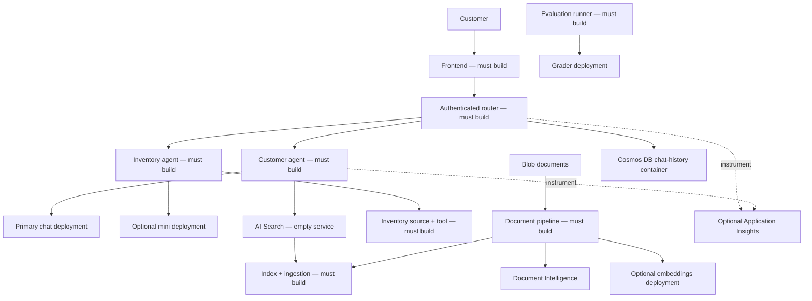

# బహుళ-ఏజెంట్ కస్టమర్ సపోర్ట్ — రిటైల్ ఆర్కిటెక్చర్ బ్లూప్రింట్

**అధ్యాయం 5: బహుళ-ఏజెంట్ AI పరిష్కారాలు**

- [కోర్సు హోమ్](../README.md)
- [అధ్యాయం 5](../docs/chapter-05-multi-agent/README.md)
- [పూర్వాపేక్ష: AI ఇంటిగ్రేషన్](../docs/chapter-02-ai-development/microsoft-foundry-integration.md)
- [తర్వాత: సామర్థ్య ప్రణాళిక](../docs/chapter-06-pre-deployment/capacity-planning.md)
- [ARM ఇన్‌ఫ్రాస్ట్రక్చర్ స్క్యాఫోల్డ్](retail-multiagent-arm-template/README.md)

> **ఆర్కిటెక్చర్ మార్గదర్శకము, పని చేసే అనువర్తనం కాదు.** ఏకైక రిటైల్ అమలు
> ఫైళ్లు ఉన్నాయి `azuredeploy.json`, `azuredeploy.parameters.json`, మరియు `deploy.sh` లో
> `retail-multiagent-arm-template/`. రౌటర్/ఫ్రంటెండ్ కంటైనర్లు హలో-ప్రపంచం
> ప్లేస్‌హోల్డర్స్. రిటైల్ ఏజెంట్, UI, ఇంజెక్షన్ పైప్‌లైన్, ఎల్యూయేటర్, స్కానర్, లేదా
> అనువర్తన పరీక్ష సూట్ స్థానికంగా లేవు.

## అవలోకనం

**లక్ష్యం:** కస్టమర్ సపోర్ట్ వ్యవస్థను ఒక కస్టమర్ ఏజెంట్ మరియు ఇన్వెంటరీ
ఏజెంట్ తో రూపకల్పన చేయడం, ఇన్‌ఫ్రాస్ట్రక్చర్ ఏమి అందిస్తుందో గుర్తించడం, మరియు
లేని అనువర్తన ఒప్పందాలు మరియు ధృవీకరణను ప్రణాళిక చేయడం.

**ప్రేక్షకులు:** స్థానిక
[చాట్ నమూనా](../../../examples/azure-openai-chat) మరియు [రెండు-సేవ కంటైనర్ నమూనా](../../../examples/container-app/microservices) పూర్తి చేసిన డెవలపర్లు.
ఆర్కిటెక్చర్ అధ్యయనానికి 2-3 గంటల సమయం కేటాయించండి. అనువర్తనం నిర్మాణం ఒక వేరే
ప్రాజెక్ట్: 80-120 అభివృద్ధి గంటలు అనుభవజ్ఞులైన డెవలపర్ల కోసం ఉదాహరణాత్మకమైన ప్రణాళిక అంచనాగా ఉంటుంది,
**డెలివరీ హామీ కాదు**; ఉత్పత్తి కఠినత, పరీక్షలు,
భద్రత సమీక్ష, మరియు ఆపరేషన్లు అదనపు పని అవసరం.

### నేర్చుకోవడం ఫలితాలు

- రౌటింగ్, గౌండింగ్, సాధన అనుమతులు, మరియు సంభాషణ యజమాన్యాన్ని వివరించండి.
- మోడల్ ఐడెంటిఫయర్స్, డిప్లాయ్‌మెంట్ పేర్లు, API సంస్కరణలు, మరియు ARM సంస్కరణలను వేరుచేయండి.
- స‌మానం వెక్ట‌ర్ పరిమాణాలతో డాక్యుమెంటు ఇంజెక్షన్ మరియు రీట్రీవల్‌ను రూపకల్పన చేయండి.
- ధృవీకరించదగిన ఫంక్షనల్, మూల్యాంకన, మరియు వైఫల్యం-పునరుద్ధరణ అవసరాలు నిర్వచించండి.
- ఐచ్ఛిక ఆర్కిటెక్చర్ లక్ష్యాలు వాస్తవంలో అందించబడిన వనరుల నుండి విడగొట్టండి.

## పరిష్కారం ఆర్కిటెక్చర్



ఇది ఒక **లక్ష్య అనువర్తనం ఆర్కిటెక్చర్**, నడుస్తున్న ఏజెంట్
సేవల డయాగ్రామ్ కాదు. ARM స్క్యాఫోల్డ్ ప్రాథమిక సేవలు మరియు రెండు ప్లేస్‌హోల్డర్
కంటైనర్లను మాత్రమే సృష్టిస్తుంది. ఫ్రంట్ డోర్, రిజిస్ట్రీ, నిర్వహిత గుర్తింపులు, పాత్ర కేటాయింపులు,
ప్రైవేట్ ఎండ్‌పాయింట్లు, ఫెయిల్ఓవర్, అనువర్తనం ఇన్‌స్ట్రుమెంటేషన్, మరియు అలర్ట్స్ చేర్చబడి లేవు.

### బాధ్యతలు మరియు ఒప్పందాలు

| భాగం | అవసరమైన ప్రవర్తన | పూర్తి అయినట్లు పిలిచే ముందు సాక్ష్యం |
|---|---|---|
| ఫ్రంటెండ్ | వినియోగదారులను ఆధారపడ్డించండి, చాట్‌ను ప్రదర్శించండి, సురక్షితంగా డాక్యుమెంట్లు అప్లోడ్ చేయండి | UI మరియు అప్లోడ్ పరీక్షలు, అందుబాటులో ఉన్న పొరపాట్లు |
| రౌటర్ | అభ్యర్థనలను అనుమతించండి, ఏజెంట్‌ను ఎంచుకోండి, బాధ్యమైన సాధన కాల్స్/టైమ్ ఔట్‌లు | రౌటింగ్ పరీక్షలు, అనుమతుల తనిఖీలు, వైఫల్యం పరీక్షలు |
| కస్టమర్ ఏజెంట్ | మంజూరు చేసిన మూలాలు నుండి విధాన/ఉత్పత్తి జవాబులను స్థిరపరచండి | సరైన ఉల్లేఖనలు, డేటా లేని సందర్భంలో మానవీయత |
| ఇన్వెంటరీ సాధనం | పరిమిత అనుమతులతో అధికారిక స్టాక్‌ని చదవండి | నిర్దిష్ట స్టాక్ పరీక్షలు; కల్పిత అందుబాటు కాదు |
| డాక్యుమెంట్ పైప్‌లైన్ | సంగ్రహించు, భాగాలుగా విభజించు, ఎంబెడ్ చేయు, సూచిక, నవీకరణ/తొలగింపు | సూచిక చేసిన ఫిక్చర్స్ మరియు రీట్రై/డెడ్-లెటర్ ప్రవర్తనే |
| సంభాషణ నిల్వ | వినియోగదారులను వేరుచేయండి, రిటెన్షన్‌ను అమలు చేయండి | క్రాస్-వినియోగదారు అనుమతి మరియు TTL పరీక్షలు |
| మూల్యాంకన రన్నర్ | అవుట్పుట్లను గ్రౌండ్ ట్రూత్ మరియు రుబ్రిక్‌తో పోల్చండి | కవరేజ్, వైఫల్యం లెక్కలు, పునరుత్పాదక నివేదికలు |

రౌటర్‌ను రిసెప్షన్ డెస్క్ అని మరియు సాధనాలను పరిమిత అంతర్గత వ్యవస్థలుగా భావించండి:
ఒక నిపుణుడిని ఎంచుకోవడమంటే ప్రతి కస్టమర్ రికార్డులను యాక్సెస్ చేయడానికి అనుమతి కాదు.
అభ్యర్థనల కోడులో మరియు డేటా సేవల్లో ఐడెంటిటీ మరియు అనుమతులను అమలు చేయండి, ప్రాంప్ట్‌లు కాదు.

## ఇన్‌ఫ్రాస్ట్రక్చర్ వర్సెస్ అనువర్తనం

provisioning చేయటానికి ముందు [scaffold README](retail-multiagent-arm-template/README.md) ను చదవండి.
ఇది ఖచ్చితమైన వనరులు, మోడ్‌లు, ఖర్చులు, మరియు పరిమితులను పಟ್ಟಿ చేస్తుంది.

| తార్కిక ఉపయోగం | ARM డిప్లాయ్‌మెంట్ పేరు | మోడల్ / వెర్షన్ | డిఫాల్ట్ ప్రాంతం |
|---|---|---|---|
| కస్టమర్ చాట్ | `gpt-4.1-chat` | `gpt-4.1` / `2025-04-14` | `eastus2` |
| ఇన్వెంటరీ | `gpt-4.1-mini-inventory` | `gpt-4.1-mini` / `2025-04-14` | `westus2`, ఐచ్ఛికం |
| ఎంబెడ్డింగ్స్ | `text-embedding-ada-002` | `text-embedding-ada-002` / `2` | `francecentral`, ఐచ్ఛికం |
| మూల్యాంకనం | `gpt-4.1-grader` | `gpt-4.1` / `2025-04-14` | ప్రాథమిక ప్రాంతం డిఫాల్ట్‌గాను |

ప్రతి ప్రాంతంలో మోడల్/వెర్షన్/SKU అందుబాటును మరియు క్వోటాను తనిఖీ చేయండి. చాట్/మిని/గ్రేడర్
కోసం `GlobalStandard` ఉపయోగిస్తారు; ఎంబెడ్డింగ్స్ కోసం `Standard`. కెపాసిటీ-యూనిట్-to-TPM మ్యాపింగ్స్
మోడల్-ప్రత్యేకంగా ఉంటాయి. సామాన్య క్వోటా హామీగా అలంకరిణి కెపాసిటీ యూనిట్లను జోడించకండి.

ఒక Azure OpenAI అభ్యర్థన యొక్క `model` ఆర్గుమెంట్ **డిప్లాయ్‌మెంట్ పేరు** ఉంటుంది, అనివార్యంగా
కాకుండా క్యాటలాగ్ మోడల్ గుర్తింపు కాదు. డేటా-ప్లేన్ API వెర్షన్ `2024-10-21`
మోడల్ వెర్షన్ `2025-04-14` మరియు ARM వనరు `apiVersion` నుండి వేరిగా ఉంటాయి.
కేవలం డేటా-ప్లేన్ API వెర్షన్ మార్చడం ద్వారా అందుబాటులో లేని మోడల్‌ను సరిదిద్దలేరు.

`--no-multi-region` ద్వితీయ మరియు ఎంబెడ్డింగ్స్ ఖాతాలను దాటివేస్తుంది. ఒక ప్రాథమిక చాట్ మరియు
స్వతంత్ర గ్రేడర్ ఖాతా మాత్రమే ఉంటుంది. వేరు మోడల్ ఖాతాలు స్వయంచాలకంగా
ఫెయిలోవర్ ఇవ్వవు; దానికి అన్వయ అప్లికేషన్ రౌటింగ్, అనుకూల డిప్లాయ్‌మెంట్‌లు, హెల్త్ చెప్స్,
రీట్రయ్ పరిమితులు, మరియు డేటా-నివాసం సమీక్ష అవసరం.

## అమలు రోడ్‌మ్యాప్

### 1. ఒక పరీక్షించిన ఇంటరాక్షన్‌తో ప్రారంభించండి

పెద్ద స్కాఫోల్డ్ ప్రోవిజనింగ్ చేయకముందు, లోకల్ చాట్ నమూనా ఉపయోగించి
ఇన్ఫరెన్స్ కనెక్టువిటీని స్థాపించండి. ఒక ప్రాతినిధ్య కస్టమర్ ప్రశ్న, అనుమతించబడిన
సమాధాన మూలం, ఆశించిన ఉల్లేఖనం, మరియు ఆ మూలం లేనప్పుడు విఫలత ప్రవర్తన నిర్వచించండి.

### 2. రౌటింగ్ మరియు సాధన సరిహద్దులను నిర్వచించండి

మీ స్వంత రౌటర్ మూలం, డిపెండెన్సీ మానిఫెస్ట్, డాకర్ ఫైల్, మరియు పరీక్షలును తయారు చేయండి. ఒక
ఉదాహరణ కాంట్రాక్ట్ ఉండవచ్చు `POST /chat` తో `{"message":"...","conversation_id":"..."}`.
**ఆ ఎండ్‌పాయింట్ ఒక డిజైన్ ప్రతిపాదన; ఇది ARM టెంప్లేట్ ద్వారా అమలు చేయబడ లేదు.**

బాడీ రకాల/పరిధులను ధృవీకరించండి, ధ్రువీకరణ నుండి صارف గుర్తింపును పొందండి, సంభాషణ యాజమాన్యం అమలు చేయండి,
అభ్యర్థన సమయ పరిమితులను వర్తింపజేయండి మరియు అర్థవంతమైన లోప కოდులను తిరిగి ఇవ్వండి.
HTTP వైఫల్యాలు లేదా ఖాళీ సమాధానాలను విజయవంతమైన ఏజెంట్ ఫలితంగా పరిగణించకండి.

### 3. గ్రౌండింగ్ మరియు ఇన్జెస్ట్షన్‌ను అమలు చేయండి

ARM టెంప్లేట్ సెర్చ్ ఇండెక్స్ సృష్టించదు. ఇది **మీ స్వంత ఇండెక్స్ నిర్వచనంలో అనుసరించాల్సిన
సూచిక JSON ఫ్రాగ్మెంట్**, కాని ఇప్పటికే రిపోలో ఉన్న ఫైలు కాదు:

```json
{
  "name": "retail-product-index",
  "fields": [
    {"name": "id", "type": "Edm.String", "key": true},
    {"name": "title", "type": "Edm.String", "searchable": true},
    {"name": "content", "type": "Edm.String", "searchable": true},
    {"name": "category", "type": "Edm.String", "filterable": true},
    {
      "name": "content_vector",
      "type": "Collection(Edm.Single)",
      "searchable": true,
      "dimensions": 1536,
      "vectorSearchProfile": "retail-profile"
    }
  ],
  "vectorSearch": {
    "algorithms": [{"name": "retail-hnsw", "kind": "hnsw"}],
    "profiles": [{"name": "retail-profile", "algorithm": "retail-hnsw"}]
  }
}
```

ప్రొఫైల్ వెక్టర్ ఫీల్డ్‌ను దాని ఆల్గోరిథంతో లింక్ చేస్తుంది. డైమెన్షన్లు నిజమైన
ఎంబెడ్డింగ్ అవుట్‌పుట్‌కు సరిపోాలి (ఈ `ada-002` డిప్లాయ్‌మెంట్‌కి 1536). Python
రిట్రీవల్ కోసం, పూర్తి కాని డిక్షనరీని పక్కన పెట్టి `azure.search.documents.models.VectorizedQuery` ఉపయోగించండి
దాని వెక్టర్ క్వెరీ రకాన్ని లేకుండా:

```python
# Reference function only: supply an authenticated async SearchClient and an embedding.
from azure.search.documents.models import VectorizedQuery

async def retrieve(search_client, embedding):
    results = await search_client.search(
        search_text=None,
        vector_queries=[VectorizedQuery(
            vector=embedding,
            k_nearest_neighbors=5,
            fields="content_vector"
        )],
        select=["id", "title", "content"]
    )
    return [document async for document in results]
```

ఒక ప్రత్యేక ఇంజెస్టెన్ అమలు సృష్టించండి ఇది:

1. అప్లోడ్ యాక్సెస్‌ని అంగీకరిస్తుంది మరియు కంటెంట్ రకం మరియు పరిమాణాన్ని ధృవీకరిస్తుంది.
2. అథెంటికేటెడ్ SDK కాల్స్ ఉపయోగించి ప్రైవేట్ బ్లాబ్స్‌ని చదువుతుంది. ప్రైవేట్ బ్లాబ్ URL తోనే
   **కాదు** చదవగలిగిన డాక్యుమెంట్ ఇంటెలిజెన్స్ ఇన్‌పుట్; డౌన్లోడ్ చేసిన బైట్లను
   `AnalyzeDocumentRequest(bytes_source=...)` తో పంపండి లేదా తగిన ప్రామాణికమైన,
   తక్కువ కాలపరిమితి SAS ను యాక్సెస్ అవసరాలు సమీక్షించిన తర్వాత ఉపయోగించండి.
3. టెక్స్ట్‌ను తీసుకోండి, అది ఎంబెడింగ్ పరిమితులకు సరిపోడానికి భాగాలుగా విభజించండి, మరియు ఎంబెడింగ్‌లను రూపొందించండి.
4. స్థిరమైన చెల్లుబాటు ఉన్న డాక్యుమెంట్ కీలు సృష్టిస్తుంది మరియు తగిన వెక్టర్లతో భాగాలను అప్‌లోడ్ చేస్తుంది.
5. డాక్యుమెంట్ ప్రమాణాల సూచీకరణ ఫలితాలను తనిఖీ చేస్తుంది, తిరిగి ప్రయత్నాలు నిర్వహిస్తుంది, మరియు పాత డేటాను అప్‌డేట్/తొలగిస్తుంది.

ఎరిబ్రహ్త యూజర్ కీలు/విలువలను OData ఫిల్టర్లలో అనూహ్యంగా చేర్చకండి. అనుమతించబడిన ఫీల్డ్లను ఆమోదించండి,
విలువల రకాలను ధృవీకరించండి, మరియు స్ట్రింగ్ గోట్లు ఎస్కేప్ చేయండి. బూలియన్ మరియు సంఖ్యా ఫిల్టర్‌లకు
టైప్ చేసిన లిటరల్స్ అవసరం, గోట్ చేసిన స్ట్రింగ్‌లు కాదు.

### 4. వెబ్ గ్రౌండింగ్

**Bing Search v7 ఆగస్ట్ 11, 2025 న రిటైర్ అయింది.** పాత `Microsoft.Bing/accounts`
వనరు మరియు `api.bing.microsoft.com/v7.0/search` ఉదాహరణలు మద్దతు పొందిన అమలు మార్గం కావు.
మైక్రోసాఫ్ట్ ఫౌండ్రీలో ప్రస్తుతం మద్దతు పొందిన గ్రౌండింగ్ ఇంటిగ్రేషన్‌ను, దాని SDK, అనుమతులు, బిల్లింగ్, మరియు సూచన అవసరాలను
అంచనా వేయండి; ఇవి ఇక్కడ అమలు చేయబడలేదు. ఇది రిటైర్ అయిన ఎండ్‌పాయింట్ కోసం ప్రత్యక్ష మార్పిడి కాదు.


### 5. టెలిమెట్రీ మరియు మూల్యాంకనాన్ని యాడ్ చేయండి

అప్లికేషన్ ఇన్‌సైట్స్ సృష్టించడం కోడ్ ను ఇన్‌స్ట్రుమెంట్ చేయదు. కొత్త అప్లికేషన్ నిర్మిస్తుండగా మద్దతు పొందిన Azure Monitor
OpenTelemetry ఇన్‌స్ట్రుమెంటేషన్ ఉపయోగించండి, సేవల మధ్య ట్రేస్ కంటెక్స్ట్‌ను వ్యాప్తి చేయండి, మరియు కస్టమర్ ప్రాంప్టులు, డాక్యుమెంట్లు, లేదా రహస్యాలను లాగ్ చేయడాన్ని నివారించండి.

క్వెరీని తరిగించడం దానిని గోప్యంగా చేయదు.

అభ్యర్థన వ్యవధి, రౌటింగ్/టూల్ విఫలమౌతున్నవి, పునఃపొందు సారూప్యత, సూచన సరైనత, టోకెన్ వినియోగం, మరియు విరామాన్ని కొలవండి.
గ్రౌండ్-ట్రూత్ ఇన్వెంటరీ/నీతిగత వాస్తవాలను మూల్యాంకన కేసుల మీద నిల్వ చేయండి: ఒక గ్రేడర్ కేవలం ఒక ప్రశ్న మరియు జవాబుతో వాస్తవ సరిచూకును నమ్మదగిన విధంగా నిర్ధారించలేడు.


నిర్మిత అవుట్‌పుట్/స్కీమా ధృవీకరణ, స్కోర్-శ్రేణి తనిఖీలు, రవాణా వైఫల్య లెక్కలు,
మరియు మానవ-సమీక్షించిన కేసులను అమలు చేయండి. అసంపూర్ణ/లోపం కేసులను వేరుగా నివేదించండి; అవి విజయవంతమైన గ్రేడ్‌లుగా మార్చవద్దు లేదా నిశ్శబ్దంగా తక్కువ-నాణ్యత మోడల్ ప్రతిస్పందనలుగా చేర్చవద్దు.


అభ్యర్థన, టైెస్ట్ వ్యూహం లేమి, లేదా ఖాళీ ప్రతిస్పందన ఒక పరీక్షను ** inconclusive లేదా
అభ్యర్థన, కోల్పోయిన పరీక్షా వ్యూహం, లేదా ఖాళీ స్పందన ఒక పరీక్షను **నిర్ణయించలేని**దిగా చేయాలి లేదా
విఫలమైతే**, “100% సురక్షిత” స్కోర్ ఇవ్వదు. సరైన టూలింగ్ మరియు మానవ సమీక్షతో అధికారం పొందిన పరీక్షలను నిర్వహించండి
ప్రతి ఉత్పత్తి-సన్నద్ధతా గుర్తింపు claims ముందు.

### 6. మీ అప్లికేషన్‌ను అమలు చేయండి

మీ స్వంత సోర్స్ డైరెక్టరీలు, మానిఫెస్ట్లు, పరీక్షలు, రిజిస్ట్రీ, మరియు ఇమేజ్-పుల్
అనుమతులను సృష్టించండి. ప్లేస్‌హోల్డర్లను నిర్మించిన చిత్రాలతో మార్చి ఇన్గ్రెస్ను/ప్రోబ్‌లను నవీకరించండి
ప్రతి యాప్ వినిపించే పోర్టును సరిపోల్చండి. Bicep లో రన్‌టైమ్ ఎన్విరాన్మెంట్ వేరియబుల్స్‌ను కాన్ఫిగర్ చేయండి
లేదా స్పష్టమైన మద్దతు పొందిన azd ఎన్విరాన్మెంట్ మ్యాపింగ్‌లో.

azd సర్వీస్ క్రింద సార్వత్రిక `config` డిక్షనరీ లేదు, ఇది ఆటోమేటిక్‌గా
రన్‌టైమ్ ఎన్విరాన్మెంట్ వేరియబుల్స్ సృష్టించదు. `azd env set` కేవలం ఆ వేరియబుల్స్‌ను
స్పష్టంగా ఉపయోగించే వనరులను మాత్రమే మారుస్తుంది. ఈ స్కాఫోల్డ్‌లో ఎటువంటి కెనరీ, ప్రాంతాల జాబితా, లేదా ఫైన్-ట్యూనింగ్ హుక్
అమలు చేయబడలేదు.

## ప్రాక్టికల్ డిజైన్ వ్యాయామాలు

ఇవి **అభియాన్ వ్యాయామాలు**, అమలు చేయగల రిటైల్ స్టార్టర్ కోడ్ యొక్క ఆరోపణలు కాదు.

### వ్యాయామం 1: సరిహద్దును నిర్ధారించండి

**ప్రారంభ పాయింట్:** `retail-multiagent-arm-template/` లో ఉన్న మూడు ఫైళ్లు.
**లక్ష్యం:** ప్రొవిజనింగ్ మరియు అప్లికేషన్ ఫంక్షనాలిటీని విభజించండి.
`azuredeploy.json` ను తెరవండి, రెండు కంటైనర్ చిత్రాలు మరియు `targetPort` విలువలను గుర్తించండి,
ఆపై రిపాజిటరీలో లేని అప్లికేషన్ కంపోనెంట్ల జాబితాను తయారు చేయండి.

**విజయం ప్రమాణాలు / జవాబు:** రెండు చిత్రాలు పోర్ట్ 80 పై వినిపించే హలో-ప్రపంచ ప్లేస్‌హోల్డర్‌లు; ఏజెంట్లు, చాట్ UI,
రూటర్ హ్యాండ్లర్లు, ఇండెక్స్/ఇంజెస్టియన్, ఎవాల్యూయేటర్ మరియు స్కానర్ లేవు.
విజయవంతమైన ప్లేస్‌హోల్డర్ రూట్ అభ్యర్థన `/chat` ని ధృవీకరించదు.
**సాధారణ సమస్య:** వనరు పేర్లను `retail-router` వంటి పనిచేస్తున్న కోడ్‌గా అర్థం చేసుకోవడం.

### వ్యాయామం 2: వెక్టర్ కాన్ఫిగరేషన్‌ను ట్రేస్ చేయండి

**ప్రారంభ పాయింట్:** పై ఇండెక్స్ JSON.
**లక్ష్యం:** ఫీల్డ్ → ప్రొఫైల్ → అల్గోరిథం సంబంధాన్ని అర్థం చేసుకోవడం.
ఓ embedding మోడల్‌కు మారినప్పుడు ఏ విలువలు మారవలెను గుర్తించండి, అవి
వేరువేరు అవుట్‌పుట్ డిమెన్షన్ కలిగి ఉంటాయి, ఆపై `retrieve` ఫంక్షన్‌ను పరిశీలించండి.

**విజయం ప్రమాణాలు / జవాబు:** ఫీల్డ్ `dimensions` ను వాస్తవ వెక్టర్ పొడవుగా మార్చాలి;
`vectorSearchProfile` ను ప్రకటిత ప్రొఫైల్ మరియు దాని అల్గోరిథంతో సరిపోల్చాలి;
`fields` లో కూడలి ఫీల్డ్ పేరుని ఉపయోగించాలి. embedding మోడల్ మారినప్పుడు ఉన్న డాక్యుమెంట్ వెక్టార్లను మళ్ళీ జనరేట్ చేయండి.

**సాధారణ సమస్య:** అసంగతమైన వెక్టార్లను ఉంచి కేవలం మోడల్ పేరును మార్చడం.

### వ్యాయామం 3: ఒక వైఫల్య పరీక్ష నిర్వచించండి

**ప్రారంభ పాయింట్:** బాధ్యతల పట్టిక.
**లక్ష్యం:** తప్పు విజయాన్ని నివారించడం.
అందుబాటులో లేని ఇన్వెంటరీ API, సరిపోలే దస్తావేజులు లేని శోధన ఇండెక్స్ మరియు HTTP 503 తిరిగి ఇచ్చే మదింపు అభ్యర్థనకు ఆశించదగిన ప్రవర్తన వ్రాయండి.


మదింపు రిపోర్టు నాణ్యత లేదా భద్రత పాస్ కాకుండా ట్రాన్స్‌పోర్ట్ వైఫల్యాన్ని తెలియజేస్తుంది.
అప్లికేషన్ నిర్మించినప్పుడు అమలు పరీక్షలను జోడించండి.
**సాధారణ సమస్య:** ప్రతి తప్పిదాన్ని పట్టుకొని ఖాళీ జవాబుతో ముందుకు పోవడం.


## ఖర్చులు, సమస్య పరిష్కారం మరియు క్లీనప్

- శూన్య శోధన ఇండెక్స్‌లు మరియు ప్లేస్‌హోల్డర్ యాప్స్ ఉండగా కూడా ఇన్‌ఫ్రాస్ట్రక్చర్‌కు కొనసాగుతున్న ఛార్జీలు ఉన్నాయి.
  ప్రస్తుత ప్రాంతీయ ధరలను ఉపయోగించండి; “సామాన్యమైన” లేదా బహురాష్ట్రీయంగా ఉచితం అని భావించవద్దు.
- టోకెన్ ఖర్చులు మోడల్, క్యాష్ చేయబడిన/చేయని ఇన్‌పుట్, అవుట్‌పుట్ మరియు డిప్లాయ్‌మెంట్ SKUపై ఆధారపడి ఉంటాయి.
  రౌటింగ్ మితమైన పని లోడ్ మరియు నాణ్యమైన ఫలితాలు ఉన్నప్పుడు మాత్రమే డబ్బు ఆదా చేయగలదు;
  స్థిరమైన 60–80% ఆదా హామీ లేదు.
- ప్రొవిజనింగ్ ముందు మోడల్ అందుబాటును మరియు కోటాను తనిఖీ చేయండి; అనుమతి,
  డిప్లాయ్‌మెంట్ నేమ్, ప్రాంతం, మోడల్ వెర్షన్, మరియు API-వర్షన్ లోపాలను వేరుచేయండి.
- కనిపించని `setup-data.sh`, ఎవాల్యుయేటర్ CLIలు, లేదా `pytest tests/` కమాండ్లను నడపవద్దు.
  వీటి అమలు మీ అభివృద్ధి బ్యాక్లోగ్‌లో భాగమవుతుంది.
- ఈ స్కాఫోల్డ్ ARM-కే పరిమితం: దాని
  [పరీక్ష మరియు క్లీనప్ సూచనలు](retail-multiagent-arm-template/README.md) ని అనుసరించండి.
  `azd down` ఆ వనరులను నిర్వహించదు.

## సంబంధించిన వనరులు

- [పనిచేసే స్థానిక చాట్ నమూనా](../../../examples/azure-openai-chat)
- [పనిచేసే రెండు-సర్వీస్ కంటైనర్ నమూనా](../../../examples/container-app/microservices)
- [AI శోధన వెక్టర్ సూచికలు](https://learn.microsoft.com/azure/search/vector-search-how-to-create-index)
- [కంటైనర్ యాప్స్ డాక్యుమెంటేషన్](https://learn.microsoft.com/azure/container-apps/)
- [సమస్య పరిష్కారం](../docs/chapter-07-troubleshooting/common-issues.md)
- [సమస్యను నివేదించండి](https://github.com/microsoft/AZD-for-beginners/issues)

---

<!-- CO-OP TRANSLATOR DISCLAIMER START -->
**అస్వీకరణ**:
ఈ పత్రం AI అనువాద సేవ [Co-op Translator](https://github.com/Azure/co-op-translator) ఉపయోగించి అనువదించబడింది. మేము ఖచ్చితత్వానికి ప్రయత్నిస్తున్నప్పటికీ, ఆటోమేటెడ్ అనువాదాలు తప్పులు లేదా అసమగ్రతలను కలిగి ఉండవచ్చు. దాని స్వదేశ భాషలో ఉన్న అసలు పత్రాన్ని అధికారం కలిగిన మూలంగా పరిగణించాలి. కీలకమైన సమాచారం కోసం, ప్రొఫెషనల్ మానవ అనువాదాన్ని సిఫారసు చేస్తాము. ఈ అనువాదం ఉపయోగం వల్ల కలిగే ఏవైనా అపార్థాలు లేదా తప్పుదారులు కోసం మేము బాధ్యత వహించము.
<!-- CO-OP TRANSLATOR DISCLAIMER END -->