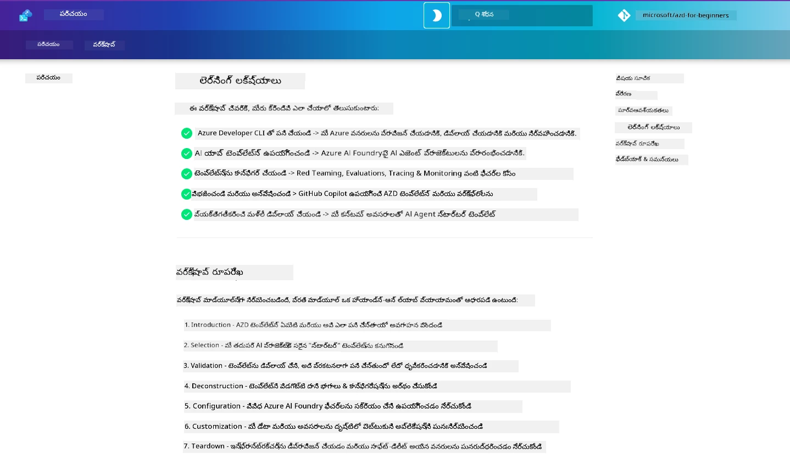

<div align="center">
  <div style="background: linear-gradient(135deg, #0078d4, #106ebe); border-radius: 10px; padding: 20px; margin: 20px 0; box-shadow: 0 4px 15px rgba(0, 120, 212, 0.3); border: 2px solid #005a9e;">
    <h2 style="color: white; margin: 0; font-size: 24px; text-shadow: 1px 1px 2px rgba(0,0,0,0.3);">
      🎯 AI డెవలపర్ల కోసం AZD వర్క్‌షాప్
    </h2>
    <p style="color: white; margin: 10px 0 0 0; font-size: 16px; text-shadow: 1px 1px 2px rgba(0,0,0,0.3);">
      <strong>Azure Developer CLI తో AI అనువర్తనాలను నిర్మించడానికి ఒక ప్రాయోగిక వర్క్‌షాప్.</strong><br>
      AZD టెంప్లేట్స్ మరియు AI పంపిణీ వర్క్‌ఫ్లోలను పూర్తి 7 మాడ్యూల్స్ ద్వారా మాస్టర్ చేయండి.
    </p>
    <div style="margin-top: 15px;">
      <span style="background: rgba(255,255,255,0.2); padding: 5px 10px; border-radius: 15px; color: white; font-size: 14px;">
        📅 మూల సూచన సమీక్షించబడింది: నవంబర్ 2026
      </span>
    </div>
  </div>
</div>

# AI డెవలపర్ల కోసం AZD వర్క్‌షాప్

Azure Developer CLI (AZD) నేర్చుకోవడానికి మరియు AI అనువర్తనం పంపిణీపై దృష్టి పెట్టిన ప్రాయోగిక వర్క్‌షాప్‌కి స్వాగతం. ఈ వర్క్‌షాప్ 3 దశలలో AZD టెంప్లేట్ల అన్వయానుభూతిని పొందేందుకు సహాయం చేస్తుంది:

1. **దొరెనము** - మీకు సరిపోయే టెంప్లేట్ కనుగొనండి.
1. **పంపిణీ** - పంపిణీ చేసి అది పనిచేస్తుందో లేదో ధృవీకరించండి.
1. **అనుకూలీకరణ** - మీ అవసరాలకి తగినట్లు మార్చండి మరియు పునరావృతం చేయండి!

ఈ వర్క్‌షాప్ కోర్స్‌లో, మీరు ప్రాథమిక డెవలపర్ టూల్స్ మరియు వర్క్‌ఫ్లోలతో కూడా పరిచయం అవుతారు, ఇది మీ సంపూర్ణ అభివృద్ధి ప్రయాణాన్ని సులభతరం చేస్తుంది.

<br/>

## బ్రౌజర్-ఆధారిత మార్గదర్శిని

వర్క్‌షాప్ పాఠాలు మార్క్‌డౌన్‌లో ఉన్నాయి. మీరు వాటిని నేరుగా GitHubలో నావిగేట్ చేసుకోవచ్చు - లేదా క్రింద స్క్రీన్షాట్‌లో చూపినట్లుగా బ్రౌజర్-ఆధారిత ప్రివ్యూ ప్రారంభించండి.



ఈ ఎంపిక ఉపయోగించడానికి - రిపాజిటరీని మీ ప్రొఫైల్‌కి ఫోర్క్ చేసుకుని, GitHub Codespaces ప్రారంభించండి. VS Code టెర్మినల్ యాక్టివ్ అయిన తర్వాత ఈ కమాండ్ టైప్ చేయండి:

ఈ బ్రౌజర్ ప్రివ్యూ GitHub Codespaces, డెవ్ కంటెయినర్లు, లేదా Python మరియు MkDocs ఇన్‌స్టాల్ చేయబడిన ఒక లోకల్ క్లోన్‌లో పనిచేస్తుంది.

```bash title="" linenums="0"
python -m pip install -r requirements-dev.txt
python -m mkdocs serve --config-file workshop/mkdocs.yml
```

ఈ కమాండ్లను **కోర్స్ రిపోజిటరీ రూట్** నుండి నడిపించండి, ప్రత్యేకంగా ప్రారంభించిన AI నమూనా నుండి కాదు. తప్పిదాలు కనిపించేలా ముందుముఖంలో ప్రివ్యూ ఉంచండి; Ctrl+Cతో ఆపండి. సర్వ్ చేయకుండా సైట్‌ను తనిఖీ చేయడానికి `python -m mkdocs build --strict --config-file workshop/mkdocs.yml` నడపండి.

కొన్ని సెకన్లలో, మీరు ఒక పాప్-అప్ డైలాగ్ చూడగలరు. `Open in browser` ఆప్షన్‌ని ఎంచుకోండి. వెబ్-ఆధారిత గైడ్ ఇప్పుడు కొత్త బ్రౌజర్ టాబ్‌లో ఓపెన్ అవుతుంది. ఈ ప్రివ్యూ కొన్ని లాభాలు:

1. **బిల్ట్-ఇన్ సెర్చ్** - కీవర్డ్లు లేదా పాఠాలను త్వరగా కనుగొనండి.
1. **కాపీ ఐకాన్** - కోడ్‌బ్లాక్స్‌పై హోవర్ చేయండి ఈ ఆప్షన్ చూడటానికి
1. **థీమ్ టోగుల్** - డార్క్ మరియు లైట్ థీమ్స్ మధ్య మార్చుకోండి
1. **సహాయం పొందండి** - ఫుటర్‌లో డిస్కార్డ్ ఐకాన్‌పై క్లిక్ చేసి చేరండి!

<br/>

## వర్క్‌షాప్ సమీక్ష

**కాలవ్యవధి:** 3-4 గంటలు  
**స్థాయి:** ప్రారంభం నుంచి మాధ్యమం వరకు  
**ముందస్తు జ్ఞానం:** అజ్యూర్, AI భావనలు, VS కోడ్ & కమాండ్ లైన్ టూల్స్ పరిచయం.

ఇది ఒక ప్రాక్టికల్ వర్క్‌షాప్, మీరు చేయడం ద్వారా నేర్చుకుంటారు. వ్యాయామాలు పూర్తయిన తర్వాత, సెక్యూరిటీ మరియు ప్రొడక్టివిటీ ఉత్తమ అభ్యాసాలకు మీ ప్రయాణాన్ని కొనసాగించడానికి AZD ఫర్ బిగినర్స్ పాఠ్యક્રમ సమీక్ష చేయాలని మనసుపడుతుంది.

| కాలం| మాడ్యూల్  | లక్ష్యం |
|:---|:---|:---|
| 15 నిమి | [పరిచయం](docs/instructions/0-Introduction.md) | స్థితిని సెట్ చేయండి, లక్ష్యాలను అర్థం చేసుకోండి |
| 30 నిమి | [AI టెంప్లేట్ ఎంచుకోండి](docs/instructions/1-Select-AI-Template.md) | ఎంపికలను పరిశీలించి స్టార్టర్ ఎంచుకోండి | 
| 30 నిమి | [AI టెంప్లేట్ పరిశీలించండి](docs/instructions/2-Validate-AI-Template.md) | డిఫాల్ట్ సొల్యూషన్‌ను అజ్యూర్‌లో నిమగ్నం చేయండి |
| 30 నిమి | [AI టెంప్లేట్ విడగొట్టండి](docs/instructions/3-Deconstruct-AI-Template.md) | నిర్మాణం మరియు కాన్ఫిగరేషన్‌ను అన్వేషించండి |
| 30 నిమి | [AI టెంప్లేట్ సెట్ చేయండి](docs/instructions/4-Configure-AI-Template.md) | అందుబాటులో ఫీచర్లను యాక్టివేట్ చేసి ప్రయత్నించండి |
| 30 నిమి | [AI టెంప్లేట్ కస్టమైజ్ చేయండి](docs/instructions/5-Customize-AI-Template.md) | నమూనాను మీ అవసరాలకు అనుగుణంగా మార్చుకోండి |
| 30 నిమి | [మౌలిక సదుపాయాల తొలగింపు](docs/instructions/6-Teardown-Infrastructure.md) | వనరులను శుభ్రపరిచి విడుదల చేయండి |
| 15 నిమి | [ముగింపు & తదుపరి దశలు](docs/instructions/7-Wrap-up.md) | అభ్యాస వనరులు, వర్క్‌షాప్ ఛాలెంజ్ |

<br/>

## మీరు నేర్చుకునేది

AZD టెంప్లేట్‌ను మైక్రోసాఫ్ట్ ఫౌండ్‌రీలో ఎండ్-టు-ఎండ్ అభివృద్ధికి వివిధ సామర్ధ్యాలు మరియు టూల్స్ అన్వేషించడానికి ఒక అభ్యాస వేదికగా ఆలోచించండి. ఈ వర్క్‌షాప్ ముగిసేవరకు, మీరు ఈ సందర్భంలో వివిధ టూల్స్ మరియు భావనలకు అనుభూతి కలిగిస్తారు.

| భావన  | లక్ష్యం |
|:---|:---|
| **అజ్యూర్ డెవలపర్ CLI** | టూల్ కమాండ్లు మరియు వర్క్‌ఫ్లోలను అర్థం చేసుకోండి |
| **AZD టెంప్లేట్స్**| ప్రాజెక్ట్ నిర్మాణం మరియు కాన్ఫిగరేషన్ అర్థం చేసుకోండి |
| **అజ్యూర్ AI ఏజెంట్**| మైక్రోసాఫ్ట్ ఫౌండ్‌రీ ప్రాజెక్ట్‌ను ప్రావీషనింగ్ & డిప్లాయ్ చేయండి  |
| **అజ్యూర్ AI సెర్చ్**| ఏజెంట్లతో సందర్భం ఇంజనీరింగ్‌ను ప్రారంభించండి |
| **నిరీక్షణ**| ట్రేసింగ్, మానిటరింగ్ మరియు అంచనాలను అన్వేషించండి |
| **రెడ్ టీమింగ్**| ప్రయోజనాత్మక పరీక్షన్లు మరియు పరిహారాలను చూడండి |

<br/>

## వర్క్‌షాప్ నిర్మాణం

ఈ వర్క్‌షాప్‌ను టెంప్లేట్ అన్వేషణ నుండి ప్రారంభించి, డిప్లాయ్‌మెంట్, విడగొట్టడం, మరియు అనుకూలీకరణ వరకు ప్రయాణం చేసేలా నిర్మించారు - అధికారిక [Getting Started with AI Agents](https://github.com/Azure-Samples/get-started-with-ai-agents) స్టార్టర్ టెంప్లేట్ ఆధారంగా.

### [మాడ్యూల్ 1: AI టెంప్లేట్ ఎంచుకోండి](docs/instructions/1-Select-AI-Template.md) (30 నిమి)

- AI టెంప్లేట్స్ అంటే ఏమిటి?
- AI టెంప్లేట్స్ ఎక్కడ కనుగొనగలను?
- AI ఏజెంట్లు ఎలా నిర్మించటం ప్రారంభించాలి?
- **ల్యాబ్**: కోడ్స్‌పేసెస్ లేదా డెవ్ కంటైనర్‌లో క్విక్‌స్టార్ట్

### [మాడ్యూల్ 2: AI టెంప్లేట్ నిర్ధారించండి](docs/instructions/2-Validate-AI-Template.md) (30 నిమి)

- AI టెంప్లేట్ ఆర్కిటెక్చర్ ఏమిటి?
- AZD అభివృద్ధి వర్క్‌ఫ్లో ఏమిటి?
- AZD అభివృద్ధికి సహాయం ఎలా పొందాలి?
- **ల్యాబ్**: AI ఏజెంట్లు టెంప్లేట్‌ను డిప్లాయ్ & నిర్ధారించండి

### [మాడ్యూల్ 3: AI టెంప్లేట్ విడగొట్టండి](docs/instructions/3-Deconstruct-AI-Template.md) (30 నిమి)

- మీ పర్యావరణాన్ని `.azure/` లో అన్వేషించండి 
- మీరు సెట్ చేసిన వనరులను `infra/` లో చూసుకోండి 
- AZD కాన్ఫిగరేషన్‌ను `azure.yaml` లో అన్వేషించండి
- **ల్యాబ్**: పర్యావరణ 변ుల‌ల‌ను మార్చి తిరిగి నిమగ్నం చేయండి

### [మాడ్యూల్ 4: AI టెంప్లేట్ నిర్మాణం](docs/instructions/4-Configure-AI-Template.md) (30 నిమి)
- అన్వేషించండి: రిట్రీవల్ ఆగ్మెంటెడ్ జనరేషన్
- అన్వేషించండి: ఏజెంట్ మూల్యాంకన & రెడ్ టీమింగ్
- అన్వేషించండి: ట్రేసింగ్ & మానిటరింగ్
- **ల్యాబ్**: AI ఏజెంట్ + నిరీక్షణ అన్వేషించండి 

### [మాడ్యూల్ 5: AI టెంప్లేట్ అనుకూలీకరించండి](docs/instructions/5-Customize-AI-Template.md) (30 నిమి)
- నిర్వచించండి: దృశ్యం అవసరాలతో PRD
- సెట్ చేయండి: AZD కోసం పర్యావరణ 변ుల్స్
- అమలు చేయండి: అదనపు పనులకు జీవితచక్ర హూక్స్
- **ల్యాబ్**: నా సందర్భం కోసం టెంప్లేట్ అనుకూలీకరించడం

### [మాడ్యూల్ 6: మౌలిక సదుపాయాల తొలగింపు](docs/instructions/6-Teardown-Infrastructure.md) (30 నిమి)
- సమీక్షించండి: AZD టెంప్లేట్స్ అంటే ఏమిటి?
- సమీక్షించండి: ఏజ్యూర్ డెవలపర్ CLI ఎందుకు ఉపయోగించాలి?
- తదుపరి దశలు: వేరే టెంప్లేట్ ప్రయత్నించండి!
- **ల్యాబ్**: మౌలిక సదుపాయాల తొలగింపు & శుభ్రపరిచటం

<br/>

## వర్క్‌షాప్ ఛాలెంజ్

మీను మరింత సవాలు చేయాలనుకుంటున్నారా? ఇక్కడ కొన్ని ప్రాజెక్ట్ సూచనలు ఉన్నాయి - లేక మీ ఆలోచనలను మాతో పంచుకోండి!!

| ప్రాజెక్ట్ | వివరణ |
|:---|:---|
|1. **ఒక సంక్లిష్ట AI టెంప్లేట్ విభజించండి** | మనం వివరించిన వర్క్‌ఫ్లో మరియు టూల్స్ ఉపయోగించి వేరే AI సొల్యూషన్ టెంప్లేట్ను డిప్లాయ్, నిర్ధారించండి మరియు అనుకూలీకరించగలారా చూడండి. _మీకు ఏమి నేర్చుకున్నాయి?_|
|2. **మీ సందర్భంతో అనుకూలీకరించండి**  | వేరే దృశ్యం కోసం PRD (ఉత్పత్తి అవసరాల డాక్యుమెంట్) రాయడానికి ప్రయత్నించండి. తర్వాత Agent Modelలో మీ టెంప్లేట్ రిపోలో GitHub Copilot ఉపయోగించి అనుకూలీకరణ వర్క్‌ఫ్లో జనరేట్ చేయమని అడగండి. _మీరు ఏమి నేర్చుకున్నారు? ఈ సూచనలను ఎలా మెరుగుపర్చగలరు?_|
| | |

## అభిప్రాయం ఉన్నదా?

1. ఈ రిపోలో ఇష్యూ పోస్ట్ చేయండి - సౌకర్యానికి దానికి `Workshop` ట్యాగ్ పెట్టండి.
1. మైక్రోసాఫ్ట్ ఫౌండ్‌రీ డిస్కార్డ్‌లో చేరండి - మీ సహచరులతో కనెక్ట్ అవ్వండి!


| | | 
|:---|:---|
| **📚 కోర్స్ హోమ్**| [AZD ఫర్ బిగినర్స్](../README.md)|
| **📖 డాక్యుమెంటేషన్** | [AI టెంప్లేట్లతో ప్రారంభించండి](https://learn.microsoft.com/en-us/azure/ai-foundry/how-to/develop/ai-template-get-started)|
| **🛠️AI టెంప్లేట్స్** | [మైక్రోసాఫ్ట్ ఫౌండ్‌రీ టెంప్లేట్స్](https://ai.azure.com/templates) |
|**🚀 తదుపరి దశలు** | [వర్క్‌షాప్ మొదలు పెట్టండి](#workshop-overview) |
| | |

<br/>

---

**నావిగేషన్:** [ప్రధాన కోర్స్](../README.md) | [పరిచయం](docs/instructions/0-Introduction.md) | [మాడ్యూల్ 1: టెంప్లేట్ ఎంచుకోండి](docs/instructions/1-Select-AI-Template.md)

**AZDతో AI అప్లికేషన్లను నిర్మించడం ప్రారంభించేందుకు సిద్ధంగా ఉన్నారా?**

[వర్క్‌షాప్ ప్రారంభించండి: పరిచయం →](docs/instructions/0-Introduction.md)

---

<!-- CO-OP TRANSLATOR DISCLAIMER START -->
**అస్వీకరణ**:
ఈ పత్రం AI అనువాద సేవ [Co-op Translator](https://github.com/Azure/co-op-translator) ఉపయోగించి అనువదించబడింది. మేము ఖచ్చితత్వానికి ప్రయత్నిస్తున్నప్పటికీ, ఆటోమేటెడ్ అనువాదాలు తప్పులు లేదా అసమగ్రతలను కలిగి ఉండవచ్చు. దాని స్వదేశ భాషలో ఉన్న అసలు పత్రాన్ని అధికారం కలిగిన మూలంగా పరిగణించాలి. కీలకమైన సమాచారం కోసం, ప్రొఫెషనల్ మానవ అనువాదాన్ని సిఫారసు చేస్తాము. ఈ అనువాదం ఉపయోగం వల్ల కలిగే ఏవైనా అపార్థాలు లేదా తప్పుదారులు కోసం మేము బాధ్యత వహించము.
<!-- CO-OP TRANSLATOR DISCLAIMER END -->