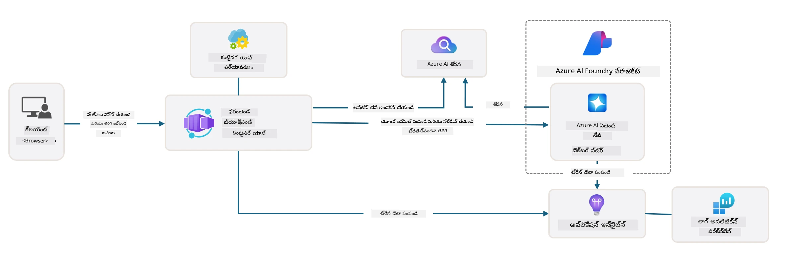

# 3. ఒక టెంప్లేట్‌ను విశ్లేషించండి

!!! tip "ఈ మాడ్యూల్ ముగిసే వరకు మీరు చేయగలిగే అంశాలు"

    - [ ] Use GitHub Copilot and optional MCP tools for Azure documentation and read-only exploration
    - [ ] Identify the template's application, infrastructure, configuration, and test entry points
    - [ ] Verify generated explanations against actual repository files
    - [ ] **Lab 3:** Trace one request and one configuration input through the project

---

## 1. GitHub Copilot ను ప్రారంభించండి

VS Code లో ఆరంభమైన AI నమూనాను తెరిచి [GitHub Copilot](https://code.visualstudio.com/docs/copilot/chat/chat-agent-mode) ను ప్రారంభించండి. అర్హత ఉన్న ప్లాన్ కలిగిన ఖాతాతో సైన్ ఇన్ అవ్వండి; ఉపయోగ పరిమితులు మారుతుంటాయి. మార్పులను అనుమతించే ముందు కాపిలట్‌ను రిపోజిటరీ ను వివరిస్తుందిగా అడగండి.

### ఐచ్ఛిక MCP సర్వర్లు

ఈ సేవలు అదనపు సాధనాలను అందించవచ్చు:

- [Azure MCP Server](https://learn.microsoft.com/azure/developer/azure-mcp-server/overview)
- [Microsoft Learn MCP Server](https://learn.microsoft.com/training/support/mcp)

VS Code లో, [MCP కాన్ఫిగరేషన్ మార్గదర్శకాలు](https://code.visualstudio.com/docs/copilot/chat/mcp-servers) ను సమీక్షించి అవసరమైతే `.vscode/mcp.json` సృష్టించండి:

```json
{
  "servers": {
    "Azure MCP Server": {
      "type": "stdio",
      "command": "npx",
      "args": ["-y", "@azure/mcp@latest", "server", "start"]
    },
    "microsoft.docs.mcp": {
      "type": "http",
      "url": "https://learn.microsoft.com/api/mcp"
    }
  }
}
```

`npx` కమాండ్‌కు మద్దతు ఇచ్చే Node.js/npm సంస్థాపన అవసరం, ఇది అమలుబాటులో ఉన్న కోడ్‌ను డౌన్లోడ్ చేస్తుంది. ప్యాకేజీని సమీక్షించి పునరుత్పాదక బృంద ఏర్పాటుకు ఆమోదించబడిన వెర్షన్‌ను పిన్ చేయండి. VS Code యొక్క MCP నియంత్రణలతో సర్వర్లను ప్రారంభించి, అందుబాటులో ఉన్న సాధనాలను పరిశీలించండి; వెర్షన్ల మధ్య పేరు మారవచ్చు.

**ప్రామాణీకరణ వేరు.** AZD కోసం `azd auth login` ఉపయోగించండి. Azure MCP సాధనాల ప్రమాణీకరణ ప్రవాహాన్ని అనుసరించండి; AZD లాగిన్ మాత్రమే MCP సెషన్‌ను ఏర్పరచదు. ఒక వ్యాయామం లేదా హుక్ Azure CLI ను పిలిస్తే వేరు గా `az login` ఉపయోగించండి.

చదవగలిగే మాత్రమే ఆదేశాలను ప్రయత్నించండి:

1. “Microsoft Learn MCP ను ఉపయోగించి Azure Developer CLI కాన్ఫిగరేషన్ డాక్యుమెంటేషన్‌ను కనుగొనండి.”
2. “ఈ రిపోజిటరీ యొక్క `azure.yaml` ని వివరించండి; ప్రతి హుక్‌ను అమలుచేసే ఫైళ్లను సూచించండి.”
3. “అందుబాటులో ఉన్న Azure MCP సాధనాలను ఉపయోగించి నా డిప్లాయ్ చేసిన వనరులను ఏ మార్పులు చేయకుండా జాబితా చేయండి.”

ఎంపిక చేసిన టెనెంట్/సబ్స్‌క్రిప్షన్ మరియు ప్రతీ ప్రతిపాదిత సాధన కాల్ ను తనిఖీ చేయండి. వనరుల సృష్టి, తొలగింపు లేదా యాక్సెస్ మార్పులను సాంకేతిక నిర్మాణం తెలుసుకోవడానికి మాత్రమే అనుమతించవద్దు.

## 2. ఆర్కిటెక్చర్‌ను అర్థం చేసుకోండి

ఈ నమూనా Azure కంటైనర్ యాప్స్‌లో Python FastAPI బ్యాక్‌ఎండ్ మరియు React/TypeScript ఫ్రন্টెండ్‌ను హోస్ట్ చేస్తుంది. బ్యాక్‌ఎండ్ Microsoft Foundry ప్రాజెక్టులోని ఏజెంట్‌తో కమ్యూనికేట్ చేస్తుంది. రిట్రీవల్ మరియు పరిశీలన టెంప్లేట్ ఫీచర్ల ఆధారంగా, మరియు సెట్ అప్ విజయవంతం అయితేనే ఉంటుంది; యాప్ అమర్చబడడం మాత్రమే పర్యవేక్షణకి హామీ కాదు.



ఈ డయాగ్రామ్‌ను [ప్రస్తుత అప్‌స్ట్రీమ్ డిప్లాయ్‌మెంట్ గైడ్](https://github.com/Azure-Samples/get-started-with-ai-agents/blob/main/docs/deployment.md) మరియు మీ వాస్తవ వనరులతో పోల్చండి. కాన్ఫిగర్ చేయబడిన మోడల్ డిప్లాయ్‌మెంట్, ఏజెంట్ సాధనాలు, నిర్వహిత ఐడెంటిటీ, రోల్ అసైన్‌మెంట్‌లు మరియు ఐచ్ఛిక AI సెర్చ్/అప్లికేషన్ ఇన్‌సైట్స్ వనరులను తనిఖీ చేయండి.

**వ్యాయామం:** ఫ్రంటెండ్ నుంచి API ద్వారా Foundryకు ఒక చాట్ అభ్యర్థనను ట్రేస్ చేయమని Copilot ను అడిగి, ఫైల్ మరియు ఫంక్షన్ సూచనలను పొందండి. ఆ సూచనలను తెరిచి వివరణను నిర్ధారించండి. ఒక డయాగ్రామ్ ఆధారంగా అమలు చేయబడిన ప్రమాణీకరణ, రౌటింగ్ లేదా ఆమోదాన్ని ఊహించకండి.

## 3. రిపోజిటరీ నిర్మాణం

క్రింది ఎంచుకోబడిన మార్గాలు 2026 నవంబర్ 4న నమూనాతో తనిఖీ చేయబడ్డాయి. మీ ఆరంభించిన సంస్కరణ యథාර්థానికి మూలం:

```text
get-started-with-ai-agents/
  azure.yaml
  docker-compose.yaml
  requirements-dev.txt
  .devcontainer/
  infra/
    main.bicep
    main.parameters.json
    api.bicep
    core/
  src/
    Dockerfile
    pyproject.toml
    requirements.txt
    api/
      main.py
      routes.py
      search_index_manager.py
    frontend/
      package.json
      src/
    files/
  scripts/
    validate_env_vars.sh
    validate_env_vars.ps1
    postdeploy.sh
    postdeploy.ps1
  tests/
    test_evaluation.py
    test_red_teaming.py
  docs/
    deployment.md
    deploy_customization.md
    ai_search.md
    observability.md
    local_development.md
    troubleshooting.md
```

### సౌకర్యాలు మరియు కాన్ఫిగరేషన్

`infra/main.bicep` వనరులను సమన్వయ పరుస్తుంది; `main.parameters.json` టెంప్లేట్ ఇన్‌పుట్లను AZD వాతావరణ విలువలకు కనెక్ట్ చేస్తుంది. `azure.yaml` అప్లికేషన్ సర్వీస్ మరియు జీవ చక్ర హుక్స్‌ని ఎంచుకుంటుంది. ఉదాహరణకు `USE_AZURE_AI_SEARCH_SERVICE` వంటి ఇన్‌పుట్‌ను ఈ ఫైళ్లలో ట్రేస్ చేసి ఏమి మారుతుందో కనుగొనండి.

### అప్లికేషన్ మరియు ఐడెంటిటీ

`src/api/` మరియు `src/frontend/` ను కలిసి చదవండి. ఏజెంట్ ఎక్కడ సృష్టించబడుతున్నది లేదా రిట్రీవ్ అవుతున్నది, సూచనలు/సాధనలు ఎక్కడ కాన్ఫిగర్ చేయబడ్డాయో, మరియు ప్రతి Azure పిలుపు ఏ ఐడెంటిటీ ఉపయోగిస్తున్నదో గుర్తించండి. `src/files/` కింద ఉదాహరణ ఫైళ్లు ప్రదర్శన డేటా మాత్రమే, ఉత్పత్తి క్యాటలాగ్ లేదా ఆమోద నమూనా మాత్రం కాదు.

### పరీక్షలు మరియు పరిశీలన

ప్రస్తుత మూల్యాంకన మరియు రెడ్-టీమింగ్ ప్రవేశ బిందువులు `tests/` కింద ఉన్నాయి; పాత `evals/` మరియు `airedteaming/` డైరెక్టరీ సూచనలు ఈ నమూనాకు పురాతనమయ్యాయి. క్లౌడ్ పరీక్షల నడిపే ముందు `docs/observability.md` చదవండి. ఈ Python పరీక్షలు ఐచ్ఛిక `azure.ai.evaluations` AZD ఎక్స్‌టెన్షన్ నుండి వేరు.

## 4. మీ కనుగొన్న విషయాలను ధృవీకరించండి

- ఒక నమూనా ప్రశ్న కోసం API మార్గం, ఏజెంట్ పరస్పర చర్య, మరియు రిట్రీవల్ కోడ్‌ను గుర్తించండి.
- Foundryని యాక్సెస్ చేసే ఐడెంటిటీ ఏదో, మరియు దాని ఎండ్‌పాయింట్‌ను ఎంచుకునే కాన్ఫిగరేషన్ ఏదో వివరించండి.
- అసలు ప్రీ-అప్ మరియు పోస్ట్-డిప్లాయ్ స్క్రిప్టులు మరియు వాటి లోపాల నిర్వహణ ప్రవర్తనని కనుగొనండి.
- మీ డిప్లాయ్‌మెంట్‌లో లేని ఏవైనా ఆధారాలు లేదా ఐచ్ఛిక ఫీచర్లను జాబితా చేయండి.

కొనసాగండి [టెంప్లేట్‌ను కాన్ఫిగర్ చేయండి](4-Configure-AI-Template.md).

---

<!-- CO-OP TRANSLATOR DISCLAIMER START -->
**అస్వీకరణ**:
ఈ పత్రం AI అనువాద సేవ [Co-op Translator](https://github.com/Azure/co-op-translator) ఉపయోగించి అనువదించబడింది. మేము ఖచ్చితత్వానికి ప్రయత్నిస్తున్నప్పటికీ, ఆటోమేటెడ్ అనువాదాలు తప్పులు లేదా అసమగ్రతలను కలిగి ఉండవచ్చు. దాని స్వదేశ భాషలో ఉన్న అసలు పత్రాన్ని అధికారం కలిగిన మూలంగా పరిగణించాలి. కీలకమైన సమాచారం కోసం, ప్రొఫెషనల్ మానవ అనువాదాన్ని సిఫారసు చేస్తాము. ఈ అనువాదం ఉపయోగం వల్ల కలిగే ఏవైనా అపార్థాలు లేదా తప్పుదారులు కోసం మేము బాధ్యత వహించము.
<!-- CO-OP TRANSLATOR DISCLAIMER END -->