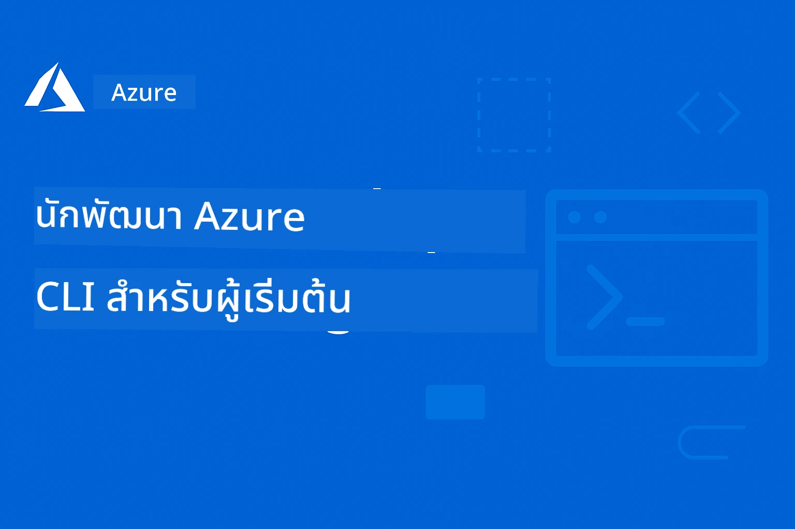

# AZD สำหรับผู้เริ่มต้น: การเรียนรู้ที่เป็นระบบ

 

[](https://GitHub.com/microsoft/azd-for-beginners/watchers/)
[](https://GitHub.com/microsoft/azd-for-beginners/network/)
[](https://GitHub.com/microsoft/azd-for-beginners/stargazers/)

[](https://discord.com/invite/nkVh3dp)
[](https://discord.gg/nTYy5BXMWG)

---

### การแปลอัตโนมัติ (อัปเดตล่าสุดเสมอ)

<!-- CO-OP TRANSLATOR LANGUAGES TABLE START -->
[Arabic](../ar/README.md) | [Bengali](../bn/README.md) | [Bulgarian](../bg/README.md) | [Burmese (Myanmar)](../my/README.md) | [Chinese (Simplified)](../zh-CN/README.md) | [Chinese (Traditional, Hong Kong)](../zh-HK/README.md) | [Chinese (Traditional, Macau)](../zh-MO/README.md) | [Chinese (Traditional, Taiwan)](../zh-TW/README.md) | [Croatian](../hr/README.md) | [Czech](../cs/README.md) | [Danish](../da/README.md) | [Dutch](../nl/README.md) | [Estonian](../et/README.md) | [Finnish](../fi/README.md) | [French](../fr/README.md) | [German](../de/README.md) | [Greek](../el/README.md) | [Hebrew](../he/README.md) | [Hindi](../hi/README.md) | [Hungarian](../hu/README.md) | [Indonesian](../id/README.md) | [Italian](../it/README.md) | [Japanese](../ja/README.md) | [Kannada](../kn/README.md) | [Khmer](../km/README.md) | [Korean](../ko/README.md) | [Lithuanian](../lt/README.md) | [Malay](../ms/README.md) | [Malayalam](../ml/README.md) | [Manipuri (Meitei Mayek)](../mni/README.md) | [Marathi](../mr/README.md) | [Nepali](../ne/README.md) | [Nigerian Pidgin](../pcm/README.md) | [Norwegian](../no/README.md) | [Persian (Farsi)](../fa/README.md) | [Polish](../pl/README.md) | [Portuguese (Brazil)](../pt-BR/README.md) | [Portuguese (Portugal)](../pt-PT/README.md) | [Punjabi (Gurmukhi)](../pa/README.md) | [Romanian](../ro/README.md) | [Russian](../ru/README.md) | [Serbian (Cyrillic)](../sr/README.md) | [Slovak](../sk/README.md) | [Slovenian](../sl/README.md) | [Spanish](../es/README.md) | [Swahili](../sw/README.md) | [Swedish](../sv/README.md) | [Tagalog (Filipino)](../tl/README.md) | [Tamil](../ta/README.md) | [Telugu](../te/README.md) | [Thai](./README.md) | [Turkish](../tr/README.md) | [Ukrainian](../uk/README.md) | [Urdu](../ur/README.md) | [Vietnamese](../vi/README.md)

> **ต้องการโคลนไปเครื่องคุณเองใช่ไหม?**
>
> แหล่งเก็บนี้รวมการแปลมากกว่า 50 ภาษา ซึ่งเพิ่มขนาดการดาวน์โหลดอย่างมาก หากต้องการโคลนโดยไม่รวมการแปล ให้ใช้ sparse checkout:
>
> **Bash / macOS / Linux:**
> ```bash
> git clone --filter=blob:none --sparse https://github.com/microsoft/AZD-for-beginners.git
> cd AZD-for-beginners
> git sparse-checkout set --no-cone '/*' '!translations' '!translated_images'
> ```
>
> **CMD (Windows):**
> ```cmd
> git clone --filter=blob:none --sparse https://github.com/microsoft/AZD-for-beginners.git
> cd AZD-for-beginners
> git sparse-checkout set --no-cone "/*" "!translations" "!translated_images"
> ```
>
> วิธีนี้จะให้คุณทุกอย่างที่จำเป็นสำหรับการเรียนหลักสูตรโดยดาวน์โหลดได้เร็วขึ้นมาก
<!-- CO-OP TRANSLATOR LANGUAGES TABLE END -->

## 🆕 มีอะไรใหม่ใน azd วันนี้

> 📌 หลักสูตรนี้ตรวจสอบแล้วกับ **`azd 1.27.1`** (กรกฎาคม 2026) รัน `azd version` เพื่อตรวจสอบการสร้าง และ `azd upgrade` เพื่อรับเวอร์ชันล่าสุด

Azure Developer CLI เติบโตเกินกว่าแอปเว็บและ API แบบเดิมๆ วันนี้ azd เป็นเครื่องมือเดียวสำหรับปรับใช้แอปพลิเคชัน **ใด ๆ** สู่ Azure — รวมแอป AI และเอเย่นต์อัจฉริยะ

นี่คือสิ่งที่หมายถึงสำหรับคุณ:

- **เอเย่นต์ AI เป็นงานใน azd ชั้นหนึ่ง** คุณสามารถเริ่มต้น ปรับใช้ และจัดการโปรเจกต์เอเย่นต์ AI โดยใช้กระบวนการ `azd init` → `azd up` ที่คุณคุ้นเคยแล้ว
- **วงจรชีวิตเอเย่นต์ครบถ้วนจาก CLI** ส่วนขยาย `azure.ai.agents` ครอบคลุมทุกขั้นตอน — `azd ai agent init` เพื่อสร้างโครงร่าง, `azd ai agent invoke` เพื่อทดสอบ (พร้อมผลลัพธ์เวลาตอบสนอง), `azd ai agent eval generate` และ `azd ai agent optimize` เพื่อวัดและปรับปรุงคุณภาพ, และ `azd ai agent delete` เพื่อทำความสะอาด
- **บล็อกการสร้าง AI เพิ่มเติม** ส่วนขยายตัวอย่างใหม่—`azure.ai.skills` และ `azure.ai.connections`—ช่วยให้คุณจัดการทักษะเอเย่นต์ที่ใช้ซ้ำและการเชื่อมต่อ Foundry ได้โดยตรงกับ azd
- **การรวม Microsoft Foundry** นำการปรับใช้โมเดล, การโฮสต์เอเย่นต์ และการตั้งค่าเซอร์วิส AI เข้าสู่ระบบแม่แบบ azd โดยตรง
- **พื้นฐานประจำวันที่ราบรื่นขึ้น** การอัปเดตล่าสุดทำให้ `azd init` เป็นแบบ idempotent (ปลอดภัยที่จะรันซ้ำ), ทำให้ `azd auth login` ลบโทเค็นหมดอายุโดยอัตโนมัติ และเพิ่มคำแนะนำการตั้งค่า `azd tool` แบบเป็นมิตรในครั้งแรกที่ใช้งาน
- **เวิร์กโฟลว์หลักไม่เปลี่ยนแปลง** ไม่ว่าคุณจะกำลังปรับใช้แอปทูโด, ไมโครเซอร์วิส หรือโซลูชัน AI หลายเอเจนต์ คำสั่งก็เหมือนกัน

> **หมายเหตุสำหรับผู้ใช้ Aspire:** Microsoft ตอนนี้เรียกผลิตภัณฑ์นี้เพียงว่า **Aspire** (เดิม ".NET Aspire") การสนับสนุน Aspire ของ azd ไม่เปลี่ยนแปลง—มีเพียงชื่อที่ได้รับการอัปเดต

หากคุณเคยใช้ azd มาก่อน การสนับสนุน AI เป็นส่วนขยายโดยธรรมชาติ—ไม่ใช่เครื่องมือแยกหรือเส้นทางขั้นสูง หากคุณเริ่มต้นใหม่ คุณจะได้เรียนรู้เวิร์กโฟลว์เดียวที่ใช้ได้กับทุกอย่าง

---

## 🚀 Azure Developer CLI (azd) คืออะไร?

**Azure Developer CLI (azd)** เป็นเครื่องมือบรรทัดคำสั่งที่ใช้งานง่ายสำหรับนักพัฒนา ซึ่งทำให้การปรับใช้แอปพลิเคชันไปยัง Azure เป็นเรื่องง่าย แทนที่จะสร้างและเชื่อมต่อทรัพยากร Azure หลายสิบรายการด้วยตนเอง คุณสามารถปรับใช้แอปพลิเคชันทั้งหมดได้ด้วยคำสั่งเดียว

### ความมหัศจรรย์ของ `azd up`

```bash
# This single command does everything:
# ✅ Creates all Azure resources  
# ✅ Configures networking and security
# ✅ Builds your application code
# ✅ Deploys to Azure
# ✅ Gives you a working URL
azd up
```

**แค่นั้นแหละ!** ไม่มีการคลิก Azure Portal ไม่มีแม่แบบ ARM ซับซ้อนให้ต้องเรียนรู้ก่อน ไม่มีการกำหนดค่าด้วยตนเอง—แค่แอปพลิเคชันที่ทำงานได้บน Azure

---

## ❓ Azure Developer CLI กับ Azure CLI ต่างกันอย่างไร?

นี่เป็นคำถามที่พบบ่อยที่สุดสำหรับมือใหม่ คำตอบง่ายๆ คือ:

| ฟีเจอร์ | **Azure CLI (`az`)** | **Azure Developer CLI (`azd`)** |
|---------|---------------------|--------------------------------|
| **วัตถุประสงค์** | จัดการทรัพยากร Azure รายบุคคล | ปรับใช้แอปพลิเคชันครบชุด |
| **แนวคิด** | มุ่งเน้นโครงสร้างพื้นฐาน | มุ่งเน้นแอปพลิเคชัน |
| **ตัวอย่าง** | `az webapp create --name myapp...` | `azd up` |
| **ความยากในการเรียนรู้** | ต้องรู้บริการ Azure | แค่รู้จักแอปของคุณ |
| **เหมาะสำหรับ** | DevOps, โครงสร้างพื้นฐาน | นักพัฒนา, การสร้างต้นแบบ |

### อุปมาอย่างง่าย

- **Azure CLI** เหมือนกับมีเครื่องมือทั้งหมดสำหรับสร้างบ้าน—ค้อน, เลื่อย, ตะปู คุณสร้างอะไรได้ทั้งหมด แต่คุณต้องรู้การก่อสร้าง
- **Azure Developer CLI** เหมือนกับการจ้างผู้รับเหมา—คุณบอกสิ่งที่ต้องการแล้วพวกเขาจะจัดการเรื่องก่อสร้าง

### เมื่อไหร่ควรใช้แต่ละตัว

| สถานการณ์ | ใช้ตัวนี้ |
|----------|----------|
| "ฉันต้องการปรับใช้เว็บแอปได้เร็วๆ นี้" | `azd up` |
| "ฉันต้องสร้างแค่บัญชีจัดเก็บข้อมูล" | `az storage account create` |
| "ฉันกำลังสร้างแอป AI ครบวงจร" | `azd init --template azure-search-openai-demo` |
| "ฉันต้องดีบักทรัพยากร Azure เฉพาะ" | `az resource show` |
| "ฉันต้องการปรับใช้ที่พร้อมใช้งานในเวลาไม่กี่นาที" | `azd up --environment production` |

### ทั้งสองทำงานร่วมกันได้!

AZD ใช้ Azure CLI เป็นพื้นหลัง คุณสามารถใช้ทั้งสองได้:
```bash
# Deploy your app with AZD
azd up

# Then fine-tune specific resources with Azure CLI
az webapp config set --name myapp --always-on true
```

---

## 🌟 ค้นหาแม่แบบใน Awesome AZD

ไม่ต้องเริ่มจากศูนย์! **Awesome AZD** คือคอลเลกชันชุมชนของแม่แบบพร้อมใช้งานสำหรับการปรับใช้:

| ทรัพยากร | คำอธิบาย |
|----------|-------------|
| 🔗 [**Awesome AZD Gallery**](https://azure.github.io/awesome-azd/) | เรียกดูแม่แบบกว่า 200 แม่แบบ พร้อมปรับใช้ด้วยคลิกเดียว |
| 🔗 [**ส่งแม่แบบ**](https://github.com/Azure/awesome-azd/issues) | มีส่วนร่วมส่งแม่แบบของคุณเองให้กับชุมชน |
| 🔗 [**ที่เก็บ GitHub**](https://github.com/Azure/awesome-azd) | กดดาวและสำรวจซอร์สโค้ด |

### แม่แบบ AI ยอดนิยมจาก Awesome AZD

```bash
# RAG Chat with Microsoft Foundry Models + AI Search
azd init --template azure-search-openai-demo

# Quick AI Chat Application
azd init --template openai-chat-app-quickstart

# AI Agents with Foundry Agents
azd init --template get-started-with-ai-agents
```

---

## 🎯 เริ่มต้นใน 3 ขั้นตอน

ก่อนเริ่มต้น ให้แน่ใจว่าเครื่องของคุณพร้อมสำหรับแม่แบบที่คุณต้องการใช้งาน:

**Windows:**
```powershell
.\validate-setup.ps1
```

**macOS / Linux:**
```bash
bash ./validate-setup.sh
```

หากการตรวจสอบใด ๆ ที่จำเป็นล้มเหลว ให้แก้ไขก่อนแล้วจึงดำเนินการต่อด้วยการเริ่มต้นอย่างรวดเร็ว

### ขั้นตอนที่ 1: ติดตั้ง AZD (2 นาที)

**Windows:**
```powershell
winget install microsoft.azd
```

**macOS:**
```bash
brew tap azure/azd && brew install azd
```

**Linux:**
```bash
curl -fsSL https://aka.ms/install-azd.sh | bash
```

### ขั้นตอนที่ 2: ตรวจสอบสิทธิ์สำหรับ AZD

```bash
# Optional if you plan to use Azure CLI commands directly in this course
az login

# Required for AZD workflows
azd auth login
```

หากคุณไม่แน่ใจว่าต้องการอันไหน ให้ทำตามขั้นตอนการติดตั้งทั้งหมดใน [Installation & Setup](docs/chapter-01-foundation/installation.md#authentication-setup).

### ขั้นตอนที่ 3: นำแอปของคุณขึ้นใช้งานครั้งแรก

```bash
# Initialize from a template
azd init --template todo-nodejs-mongo

# Deploy to Azure (creates everything!)
azd up
```

**🎉 เสร็จสิ้น!** แอปของคุณพร้อมใช้งานบน Azure แล้ว

### ทำความสะอาด (อย่าลืม!)

```bash
# Remove all resources when done experimenting
azd down --force --purge
```

---

## 📚 วิธีการใช้คอร์สนี้

คอร์สนี้ออกแบบมาเพื่อการเรียนรู้แบบ **ก้าวหน้า** - เริ่มจากจุดที่คุณรู้สึกสบายใจแล้วค่อย ๆ พัฒนาขึ้นไป:

| ประสบการณ์ของคุณ | เริ่มที่นี่ |
|-----------------|------------|
| **ใหม่กับ Azure** | [บทที่ 1: พื้นฐาน](#-chapter-1-foundation--quick-start) |
| **รู้จัก Azure, ใหม่กับ AZD** | [บทที่ 1: พื้นฐาน](#-chapter-1-foundation--quick-start) |
| **ต้องการดีพลอยแอป AI** | [บทที่ 2: การพัฒนาแบบ AI-First](#-chapter-2-ai-first-development-recommended-for-ai-developers) |
| **ต้องการฝึกปฏิบัติจริง** | [🎓 เวิร์กช็อปเชิงโต้ตอบ](workshop/README.md) - แล็บที่ได้รับคำแนะนำ 3-4 ชั่วโมง |
| **ต้องการรูปแบบการใช้งานจริงในผลิตภัณฑ์** | [บทที่ 8: การผลิตและองค์กร](#-chapter-8-production--enterprise-patterns) |

### การตั้งค่าอย่างรวดเร็ว

1. **Fork รีโพซิทอรีนี้**: [](https://GitHub.com/microsoft/azd-for-beginners/fork)
2. **โคลนมัน**: `git clone https://github.com/YOUR-USERNAME/azd-for-beginners.git`
3. **ขอความช่วยเหลือ**: [Azure Discord Community](https://discord.com/invite/ByRwuEEgH4)

> **ชอบโคลนในเครื่องไหม?**

> รีโพซิทอรีนี้มีการแปลมากกว่า 50 ภาษา ซึ่งทำให้ขนาดการดาวน์โหลดเพิ่มขึ้นอย่างมาก หากต้องการโคลนโดยไม่รวมการแปล ให้ใช้ sparse checkout:
> ```bash
> git clone --filter=blob:none --sparse https://github.com/microsoft/AZD-for-beginners.git
> cd AZD-for-beginners
> git sparse-checkout set --no-cone '/*' '!translations' '!translated_images'
> ```
> วิธีนี้จะให้ทุกสิ่งที่คุณต้องการเพื่อทำหลักสูตรให้เสร็จด้วยการดาวน์โหลดที่รวดเร็วมากขึ้น


## ภาพรวมหลักสูตร

เชี่ยวชาญ Azure Developer CLI (azd) ผ่านบทเรียนที่จัดโครงสร้างไว้อย่างเป็นขั้นตอนเพื่อการเรียนรู้แบบก้าวหน้า **เน้นพิเศษที่การปรับใช้แอป AI พร้อมการผสาน Microsoft Foundry**

### ทำไมหลักสูตรนี้จึงจำเป็นสำหรับนักพัฒนาร่วมสมัย

โดยอิงจากข้อมูลเชิงลึกจากชุมชน Microsoft Foundry Discord, **45% ของนักพัฒนาต้องการใช้ AZD สำหรับงาน AI** แต่ประสบปัญหากับ:
- สถาปัตยกรรม AI หลายบริการที่ซับซ้อน
- แนวทางปฏิบัติที่ดีที่สุดสำหรับการปรับใช้ AI ในสภาพแวดล้อมการผลิต
- การผสานและการกำหนดค่าบริการ AI บน Azure
- การเพิ่มประสิทธิภาพต้นทุนสำหรับเวิร์กโหลด AI
- การแก้ไขปัญหาการปรับใช้เฉพาะ AI

### เป้าหมายการเรียนรู้

โดยการทำหลักสูตรที่มีโครงสร้างนี้ให้สำเร็จ คุณจะ:
- **เชี่ยวชาญพื้นฐาน AZD**: แนวคิดหลัก การติดตั้ง และการตั้งค่า
- **ปรับใช้แอป AI**: ใช้ AZD กับบริการ Microsoft Foundry
- **นำนโยบาย Infrastructure as Code มาใช้**: จัดการทรัพยากร Azure ด้วยเท็มเพลต Bicep
- **แก้ไขปัญหาการติดตั้ง**: แก้ไขปัญหาทั่วไปและดีบักปัญหา
- **เพิ่มประสิทธิภาพสำหรับการใช้งานจริง**: ความปลอดภัย, การปรับขนาด, การตรวจสอบ และการจัดการค่าใช้จ่าย
- **สร้างโซลูชัน Multi-Agent**: ติดตั้งสถาปัตยกรรม AI ที่ซับซ้อน

## ก่อนที่คุณจะเริ่ม: บัญชี, การเข้าถึง, และสมมติฐาน

ก่อนที่คุณจะเริ่มบทที่ 1 ให้แน่ใจว่าคุณมีสิ่งต่อไปนี้พร้อมใช้งาน ขั้นตอนการติดตั้งในคู่มือต่อไปนี้จะสมมติว่าคุณได้จัดการสิ่งพื้นฐานเหล่านี้แล้ว

- **การสมัครสมาชิก Azure**: คุณสามารถใช้การสมัครสมาชิกที่มีอยู่จากที่ทำงานหรือตามบัญชีของคุณเอง หรือสร้าง [ทดลองใช้ฟรี](https://aka.ms/azurefreetrial) เพื่อเริ่มต้น
- **สิทธิ์การสร้างทรัพยากร Azure**: สำหรับแบบฝึกหัดส่วนใหญ่ คุณควรมีการเข้าถึงอย่างน้อยระดับ **Contributor** บนการสมัครสมาชิกหรือกลุ่มทรัพยากรเป้าหมาย บางบทอาจสมมติว่าคุณสามารถสร้างกลุ่มทรัพยากร, managed identities และการกำหนด RBAC
- [**บัญชี GitHub**](https://github.com): มีประโยชน์สำหรับการ Fork รีโพสิทอรี ติดตามการเปลี่ยนแปลงของตัวเอง และใช้ GitHub Codespaces สำหรับเวิร์กช็อป
- **ข้อกำหนดการรันไทม์ของเท็มเพลต**: เท็มเพลตบางชุดต้องมีเครื่องมือท้องถิ่นเช่น Node.js, Python, Java หรือ Docker ให้รันตัวตรวจสอบการตั้งค่าก่อนเริ่มต้นเพื่อจับข้อผิดพลาดของเครื่องมือที่ขาดหายไปตั้งแต่ต้น
- **ความคุ้นเคยพื้นฐานกับ Terminal**: คุณไม่จำเป็นต้องเป็นผู้เชี่ยวชาญ แต่ควรใช้งานคำสั่งเช่น `git clone`, `azd auth login`, และ `azd up` ได้อย่างสบายใจ

> **ทำงานในสภาพแวดล้อมองค์กร?**
> หากสภาพแวดล้อม Azure ของคุณถูกจัดการโดยผู้ดูแลระบบ ให้ยืนยันล่วงหน้าว่าคุณสามารถติดตั้งทรัพยากรในการสมัครสมาชิกหรือกลุ่มทรัพยากรที่คุณตั้งใจใช้ได้หรือไม่ หากไม่ได้ ให้ขอการสมัครสมาชิกทรงกล่องทรายหรือสิทธิ์ Contributor ก่อนเริ่ม

> **ใหม่กับ Azure?**
> เริ่มต้นด้วยการทดลองใช้ฟรี Azure ของตัวเอง หรือสมัครสมาชิกแบบจ่ายตามการใช้งานที่ https://aka.ms/azurefreetrial เพื่อให้คุณสามารถทำแบบฝึกหัดตั้งแต่ต้นจนจบได้โดยไม่ต้องรอการอนุมัติระดับ tenant

## 🗺️ แผนที่หลักสูตร: นำทางด่วนตามบท

แต่ละบทมี README เฉพาะพร้อมวัตถุประสงค์การเรียนรู้ การเริ่มต้นอย่างรวดเร็ว และแบบฝึกหัด:

| บท | หัวข้อ | บทเรียน | ระยะเวลา | ความซับซ้อน |
|---------|-------|---------|----------|------------|
| **[บท 1: รากฐาน](docs/chapter-01-foundation/README.md)** | การเริ่มต้น | [พื้นฐาน AZD](docs/chapter-01-foundation/azd-basics.md) &#124; [การติดตั้ง](docs/chapter-01-foundation/installation.md) &#124; [โปรเจกต์แรก](docs/chapter-01-foundation/first-project.md) | 30-45 นาที | ⭐ |
| **[บท 2: การพัฒนา AI](docs/chapter-02-ai-development/README.md)** | แอป AI-First | [Microsoft Foundry การผสานรวม](docs/chapter-02-ai-development/microsoft-foundry-integration.md) &#124; [AI Agents](docs/chapter-02-ai-development/agents.md) &#124; [การติดตั้งโมเดล](docs/chapter-02-ai-development/ai-model-deployment.md) &#124; [เวิร์กช็อป](docs/chapter-02-ai-development/ai-workshop-lab.md) | 1-2 ชั่วโมง | ⭐⭐ |
| **[บท 3: การตั้งค่า](docs/chapter-03-configuration/README.md)** | การตรวจสอบความถูกต้องและความปลอดภัย | [การตั้งค่า](docs/chapter-03-configuration/configuration.md) &#124; [การตรวจสอบความถูกต้องและความปลอดภัย](docs/chapter-03-configuration/authsecurity.md) | 45-60 นาที | ⭐⭐ |
| **[บท 4: โครงสร้างพื้นฐาน](docs/chapter-04-infrastructure/README.md)** | IaC & การติดตั้ง | [คู่มือการติดตั้ง](docs/chapter-04-infrastructure/deployment-guide.md) &#124; [การจัดสรรทรัพยากร](docs/chapter-04-infrastructure/provisioning.md) | 1-1.5 ชั่วโมง | ⭐⭐⭐ |
| **[บท 5: Multi-Agent](docs/chapter-05-multi-agent/README.md)** | โซลูชัน AI Agent | [สถานการณ์ค้าปลีก](examples/retail-scenario.md) &#124; [รูปแบบการประสานงาน](docs/chapter-06-pre-deployment/coordination-patterns.md) | 2-3 ชั่วโมง | ⭐⭐⭐⭐ |
| **[บท 6: ก่อนการติดตั้ง](docs/chapter-06-pre-deployment/README.md)** | การวางแผน & การตรวจสอบ | [การตรวจสอบก่อนเริ่ม](docs/chapter-06-pre-deployment/preflight-checks.md) &#124; [การวางแผนกำลังการผลิต](docs/chapter-06-pre-deployment/capacity-planning.md) &#124; [การเลือก SKU](docs/chapter-06-pre-deployment/sku-selection.md) &#124; [App Insights](docs/chapter-06-pre-deployment/application-insights.md) | 1 ชั่วโมง | ⭐⭐ |
| **[บท 7: การแก้ไขปัญหา](docs/chapter-07-troubleshooting/README.md)** | การดีบักและแก้ไข | [ปัญหาทั่วไป](docs/chapter-07-troubleshooting/common-issues.md) &#124; [การดีบัก](docs/chapter-07-troubleshooting/debugging.md) &#124; [ปัญหา AI](docs/chapter-07-troubleshooting/ai-troubleshooting.md) | 1-1.5 ชั่วโมง | ⭐⭐ |
| **[บท 8: การใช้งานจริง](docs/chapter-08-production/README.md)** | รูปแบบองค์กร | [แนวปฏิบัติด้านการผลิต](docs/chapter-08-production/production-ai-practices.md) | 2-3 ชั่วโมง | ⭐⭐⭐⭐ |
| **[🎓 เวิร์กช็อป](workshop/README.md)** | ห้องปฏิบัติการปฏิบัติ | [แนะนำ](workshop/docs/instructions/0-Introduction.md) &#124; [การเลือก](workshop/docs/instructions/1-Select-AI-Template.md) &#124; [การตรวจสอบ](workshop/docs/instructions/2-Validate-AI-Template.md) &#124; [การแยกส่วน](workshop/docs/instructions/3-Deconstruct-AI-Template.md) &#124; [การตั้งค่า](workshop/docs/instructions/4-Configure-AI-Template.md) &#124; [การปรับแต่ง](workshop/docs/instructions/5-Customize-AI-Template.md) &#124; [การรื้อถอน](workshop/docs/instructions/6-Teardown-Infrastructure.md) &#124; [สรุป](workshop/docs/instructions/7-Wrap-up.md) | 3-4 ชั่วโมง | ⭐⭐ |

**ระยะเวลาทั้งหมดของหลักสูตร:** ~10-14 ชั่วโมง | **การพัฒนาทักษะ:** ผู้เริ่มต้น → พร้อมใช้งานจริง

---

## 📚 บทเรียนการเรียนรู้

*เลือกเส้นทางการเรียนรู้ของคุณตามระดับประสบการณ์และเป้าหมาย*

### 🚀 บทที่ 1: รากฐาน & เริ่มต้นด่วน
**ข้อกำหนดล่วงหน้า**: การสมัครสมาชิก Azure, ความรู้พื้นฐานเกี่ยวกับบรรทัดคำสั่ง  
**ระยะเวลา**: 30-45 นาที  
**ความซับซ้อน**: ⭐

#### สิ่งที่คุณจะได้เรียนรู้
- ความเข้าใจพื้นฐาน Azure Developer CLI
- การติดตั้ง AZD บนแพลตฟอร์มของคุณ
- การติดตั้งโปรเจกต์แรกที่สำเร็จ

#### แหล่งข้อมูลสำหรับการเรียนรู้
- **🎯 เริ่มที่นี่**: [Azure Developer CLI คืออะไร?](#what-is-azure-developer-cli)
- **📖 ทฤษฎี**: [พื้นฐาน AZD](docs/chapter-01-foundation/azd-basics.md) - แนวคิดหลักและคำศัพท์
- **⚙️ การติดตั้ง**: [การติดตั้งและตั้งค่า](docs/chapter-01-foundation/installation.md) - คู่มือเฉพาะแพลตฟอร์ม
- **🛠️ ปฏิบัติ**: [โปรเจกต์แรกของคุณ](docs/chapter-01-foundation/first-project.md) - บทช่วยสอนทีละขั้นตอน
- **📋 เอกสารอ้างอิงด่วน**: [แผ่นคำสั่งคำสั่ง](resources/cheat-sheet.md)

#### แบบฝึกหัดปฏิบัติ
```bash
# Quick installation check
azd version

# Deploy your first application
azd init --template todo-nodejs-mongo
azd up
```

**💡 ผลลัพธ์ของบทเรียน**: ติดตั้งแอปเว็บง่าย ๆ บน Azure โดยใช้ AZD ได้สำเร็จ

**✅ การยืนยันความสำเร็จ:**
```bash
# After completing Chapter 1, you should be able to:
azd version              # Shows installed version
azd init --template todo-nodejs-mongo  # Initializes project
azd up                  # Deploys to Azure
azd show                # Displays running app URL
# Application opens in browser and works
azd down --force --purge  # Cleans up resources
```

**📊 เวลาที่ใช้:** 30-45 นาที  
**📈 ระดับทักษะหลังเรียน:** สามารถติดตั้งแอปพื้นฐานได้ด้วยตนเอง
**📈 ระดับทักษะหลังเรียน:** สามารถติดตั้งแอปพื้นฐานได้ด้วยตนเอง

---

### 🤖 บทที่ 2: การพัฒนา AI-First (แนะนำสำหรับนักพัฒนา AI)
**ข้อกำหนดล่วงหน้า**: จบบทที่ 1  
**ระยะเวลา**: 1-2 ชั่วโมง  
**ความซับซ้อน**: ⭐⭐

#### สิ่งที่คุณจะได้เรียนรู้
- การผสานรวม Microsoft Foundry กับ AZD
- การติดตั้งแอปพลิเคชันที่ขับเคลื่อนด้วย AI
- ความเข้าใจการกำหนดค่าบริการ AI

#### แหล่งข้อมูลสำหรับการเรียนรู้
- **🎯 เริ่มที่นี่**: [การผสานรวม Microsoft Foundry](docs/chapter-02-ai-development/microsoft-foundry-integration.md)
- **🤖 AI Agents**: [คู่มือ AI Agents](docs/chapter-02-ai-development/agents.md) - ติดตั้งตัวแทนอัจฉริยะด้วย AZD
- **📖 รูปแบบ**: [การติดตั้งโมเดล AI](docs/chapter-02-ai-development/ai-model-deployment.md) - ติดตั้งและจัดการโมเดล AI
- **🛠️ เวิร์กช็อป**: [ห้องปฏิบัติการ AI Workshop](docs/chapter-02-ai-development/ai-workshop-lab.md) - ทำให้โซลูชัน AI ของคุณพร้อมกับ AZD
- **🎥 คู่มืออินเทอร์แอกทีฟ**: [วัสดุเวิร์กช็อป](workshop/README.md) - การเรียนรู้ผ่านบราวเซอร์ด้วย MkDocs * สภาพแวดล้อม DevContainer
- **📋 เท็มเพลต**: [เท็มเพลต Microsoft Foundry](#featured-microsoft-foundry-templates)
- **📝 ตัวอย่าง**: [ตัวอย่างการติดตั้ง AZD](examples/README.md)

#### แบบฝึกหัดปฏิบัติ
```bash
# Deploy your first AI application
azd init --template azure-search-openai-demo
azd up

# Try additional AI templates
azd init --template openai-chat-app-quickstart
azd init --template agent-openai-python-prompty
```

**💡 ผลลัพธ์ของบทเรียน**: ติดตั้งและกำหนดค่าแอปแชต AI ที่มีความสามารถ RAG

**✅ การยืนยันความสำเร็จ:**
```bash
# After Chapter 2, you should be able to:
azd init --template azure-search-openai-demo
azd up
# Test the AI chat interface
# Ask questions and get AI-powered responses with sources
# Verify search integration works
azd monitor  # Check Application Insights shows telemetry
azd down --force --purge
```

**📊 เวลาที่ใช้:** 1-2 ชั่วโมง  
**📈 ระดับทักษะหลังเรียน:** สามารถติดตั้งและกำหนดค่าแอป AI ที่พร้อมใช้งานจริงได้  
**💰 ระวังค่าใช้จ่าย:** เข้าใจถึงค่าใช้จ่ายในการพัฒนา $80-150/เดือน, ค่าใช้จ่ายจริง $300-3500/เดือน

#### 💰 การพิจารณาค่าใช้จ่ายสำหรับการติดตั้ง AI

**สภาพแวดล้อมการพัฒนา (ประมาณ $80-150/เดือน):**
- โมเดล Microsoft Foundry (จ่ายตามการใช้งาน): $0-50/เดือน (ขึ้นกับการใช้ token)
- AI Search (ระดับพื้นฐาน): $75/เดือน
- Container Apps (แบบการใช้): $0-20/เดือน
- Storage (มาตรฐาน): $1-5/เดือน

**สภาพแวดล้อมการใช้งานจริง (ประมาณ $300-3,500+/เดือน):**
- โมเดล Microsoft Foundry (PTU เพื่อประสิทธิภาพสม่ำเสมอ): $3,000+/เดือน หรือ จ่ายตามการใช้ที่มีปริมาณสูง
- AI Search (ระดับมาตรฐาน): $250/เดือน
- Container Apps (แบบเฉพาะ): $50-100/เดือน
- Application Insights: $5-50/เดือน
- Storage (พรีเมียม): $10-50/เดือน

**💡 เคล็ดลับการปรับค่าใช้จ่าย:**
- ใช้โมเดล Microsoft Foundry ใน **ระดับฟรี** สำหรับการเรียนรู้ (Azure OpenAI รวม 50,000 tokens/เดือน)
- รัน `azd down` เพื่อยกเลิกการจัดสรรทรัพยากรเมื่อไม่พัฒนาอย่างต่อเนื่อง
- เริ่มต้นด้วยการคิดค่าบริการตามการใช้งาน อัปเกรดเป็น PTU เฉพาะสำหรับการใช้งานจริง
- ใช้ `azd provision --preview` เพื่อประเมินค่าใช้จ่ายก่อนติดตั้ง
- เปิดใช้งานการปรับขนาดอัตโนมัติ: จ่ายเฉพาะการใช้งานจริง

**การตรวจสอบค่าใช้จ่าย:**
```bash
# Check estimated monthly costs
azd provision --preview

# Monitor actual costs in Azure Portal
az consumption budget list --resource-group <your-rg>
```

---

### ⚙️ บทที่ 3: การตั้งค่า & การตรวจสอบความถูกต้อง
**ข้อกำหนดล่วงหน้า**: จบบทที่ 1  
**ระยะเวลา**: 45-60 นาที  
**ความซับซ้อน**: ⭐⭐

#### สิ่งที่คุณจะได้เรียนรู้
- การตั้งค่าและการจัดการสภาพแวดล้อม
- แนวทางปฏิบัติที่ดีที่สุดด้านการตรวจสอบความถูกต้องและความปลอดภัย
- การตั้งชื่อและการจัดระเบียบทรัพยากร

#### แหล่งข้อมูลสำหรับการเรียนรู้
- **📖 การตั้งค่า**: [คู่มือการตั้งค่า](docs/chapter-03-configuration/configuration.md) - การตั้งค่าสภาพแวดล้อม
- **🔐 ความปลอดภัย**: [รูปแบบการตรวจสอบความถูกต้องและ managed identity](docs/chapter-03-configuration/authsecurity.md) - รูปแบบการตรวจสอบความถูกต้อง
- **📝 ตัวอย่าง**: [ตัวอย่างแอปฐานข้อมูล](examples/database-app/README.md) - ตัวอย่างฐานข้อมูล AZD

#### แบบฝึกหัดปฏิบัติ
- ตั้งค่าสภาพแวดล้อมหลายชุด (dev, staging, prod)
- ตั้งค่าการตรวจสอบความถูกต้องด้วย managed identity
- นำนโยบายเฉพาะสำหรับสภาพแวดล้อมไปใช้

**💡 ผลลัพธ์ของบทเรียน**: จัดการสภาพแวดล้อมหลายชุดด้วยการตรวจสอบความถูกต้องและความปลอดภัยที่เหมาะสม

---

### 🏗️ บทที่ 4: Infrastructure as Code & การติดตั้ง
**ข้อกำหนดล่วงหน้า**: จบบทที่ 1-3  
**ระยะเวลา**: 1-1.5 ชั่วโมง  
**ความซับซ้อน**: ⭐⭐⭐

#### สิ่งที่คุณจะได้เรียนรู้
- รูปแบบการติดตั้งขั้นสูง
- Infrastructure as Code ด้วย Bicep
- กลยุทธ์การจัดสรรทรัพยากร

#### แหล่งข้อมูลสำหรับการเรียนรู้
- **📖 การติดตั้ง**: [คู่มือการติดตั้ง](docs/chapter-04-infrastructure/deployment-guide.md) - เวิร์กโฟลว์ครบวงจร
- **🏗️ การจัดสรรทรัพยากร**: [การจัดสรรทรัพยากร](docs/chapter-04-infrastructure/provisioning.md) - การจัดการทรัพยากร Azure
- **📝 ตัวอย่าง**: [ตัวอย่าง Container App](../../examples/container-app) - การติดตั้งแบบ containerized

#### แบบฝึกหัดปฏิบัติ
- สร้างเท็มเพลต Bicep ที่กำหนดเอง
- ติดตั้งแอปพลิเคชันหลายบริการ
- นำนโยบาย blue-green deployment ไปใช้

**💡 ผลลัพธ์ของบทเรียน**: ติดตั้งแอปพลิเคชันหลายบริการที่ซับซ้อนโดยใช้เท็มเพลตโครงสร้างพื้นฐานที่กำหนดเอง

---

### 🎯 บทที่ 5: โซลูชัน AI Multi-Agent (ขั้นสูง)
**ข้อกำหนดล่วงหน้า**: จบบทที่ 1-2  
**ระยะเวลา**: 2-3 ชั่วโมง  
**ความซับซ้อน**: ⭐⭐⭐⭐

#### สิ่งที่คุณจะได้เรียนรู้
- รูปแบบโครงสร้างหลายตัวแทน
- การจัดการและประสานงานตัวแทน
- การติดตั้ง AI ที่พร้อมใช้งานจริง

#### แหล่งข้อมูลสำหรับการเรียนรู้
- **🤖 โปรเจกต์เด่น**: [โซลูชัน Multi-Agent ค้าปลีก](examples/retail-scenario.md) - การติดตั้งครบวงจร
- **🛠️ เท็มเพลต ARM**: [แพ็คเกจเท็มเพลต ARM](../../examples/retail-multiagent-arm-template) - การติดตั้งด้วยคลิกเดียว
- **📖 สถาปัตยกรรม**: [รูปแบบการประสานงาน Multi-agent](docs/chapter-06-pre-deployment/coordination-patterns.md) - รูปแบบต่าง ๆ

#### แบบฝึกหัดปฏิบัติ
```bash
# Deploy the complete retail multi-agent solution
cd examples/retail-multiagent-arm-template
./deploy.sh

# Explore agent configurations
az deployment group show --resource-group <rg-name> --name <deployment-name>
```

**💡 ผลลัพธ์ของบทเรียน**: ติดตั้งและจัดการโซลูชัน AI แบบ multi-agent ที่พร้อมใช้งานจริง พร้อมตัวแทนลูกค้าและตัวแทนสินค้าคงคลัง

---

### 🔍 บทที่ 6: การวางแผนและตรวจสอบก่อนการติดตั้ง
**ข้อกำหนดล่วงหน้า**: จบบทที่ 4  
**ระยะเวลา**: 1 ชั่วโมง  
**ความซับซ้อน**: ⭐⭐

#### สิ่งที่คุณจะได้เรียนรู้
- การวางแผนกำลังการผลิตและการตรวจสอบทรัพยากร
- กลยุทธ์การเลือก SKU
- การตรวจสอบก่อนทำการติดตั้งและระบบอัตโนมัติ

#### แหล่งข้อมูลสำหรับการเรียนรู้
- **📊 การวางแผน**: [การวางแผนความจุ](docs/chapter-06-pre-deployment/capacity-planning.md) - การตรวจสอบทรัพยากร
- **💰 การเลือก**: [การเลือก SKU](docs/chapter-06-pre-deployment/sku-selection.md) - ตัวเลือกที่คุ้มค่า
- **✅ การตรวจสอบ**: [การตรวจสอบก่อนบิน](docs/chapter-06-pre-deployment/preflight-checks.md) - สคริปต์อัตโนมัติ

#### แบบฝึกหัดปฏิบัติ
- รันสคริปต์ตรวจสอบความจุ
- ปรับแต่งการเลือก SKU เพื่อความคุ้มค่า
- ดำเนินการตรวจสอบอัตโนมัติก่อนการปรับใช้

**💡 ผลลัพธ์บทเรียน**: ตรวจสอบและปรับปรุงการปรับใช้ก่อนการดำเนินการ

---

### 🚨 บทที่ 7: การแก้ไขปัญหา & การดีบัก
**ข้อกำหนดเบื้องต้น**: บทใดก็ได้ที่เกี่ยวกับการปรับใช้เสร็จสมบูรณ์  
**ระยะเวลา**: 1-1.5 ชั่วโมง  
**ความซับซ้อน**: ⭐⭐

#### สิ่งที่คุณจะได้เรียนรู้
- วิธีการดีบักอย่างเป็นระบบ
- ปัญหาทั่วไปและวิธีแก้ไข
- การแก้ไขปัญหาเฉพาะ AI

#### แหล่งการเรียนรู้
- **🔧 ปัญหาทั่วไป**: [ปัญหาทั่วไป](docs/chapter-07-troubleshooting/common-issues.md) - คำถามที่พบบ่อยและวิธีแก้ไข
- **🕵️ การดีบัก**: [คู่มือการดีบัก](docs/chapter-07-troubleshooting/debugging.md) - กลยุทธ์ทีละขั้นตอน
- **🤖 ปัญหา AI**: [การแก้ไขปัญหา AI เฉพาะ](docs/chapter-07-troubleshooting/ai-troubleshooting.md) - ปัญหาเกี่ยวกับบริการ AI

#### แบบฝึกหัดปฏิบัติ
- วินิจฉัยความล้มเหลวในการปรับใช้
- แก้ไขปัญหาการพิสูจน์ตัวตน
- ดีบักการเชื่อมต่อบริการ AI

**💡 ผลลัพธ์บทเรียน**: วินิจฉัยและแก้ไขปัญหาการปรับใช้อย่างอิสระ

---

### 🏢 บทที่ 8: รูปแบบการผลิต & องค์กร
**ข้อกำหนดเบื้องต้น**: บทที่ 1-4 เสร็จสมบูรณ์  
**ระยะเวลา**: 2-3 ชั่วโมง  
**ความซับซ้อน**: ⭐⭐⭐⭐

#### สิ่งที่คุณจะได้เรียนรู้
- กลยุทธ์การปรับใช้การผลิต
- รูปแบบความปลอดภัยขององค์กร
- การตรวจสอบและการเพิ่มประสิทธิภาพต้นทุน

#### แหล่งการเรียนรู้
- **🏭 การผลิต**: [แนวทางปฏิบัติที่ดีที่สุดสำหรับ AI ในการผลิต](docs/chapter-08-production/production-ai-practices.md) - รูปแบบองค์กร
- **📝 ตัวอย่าง**: [ตัวอย่างไมโครเซอร์วิส](../../examples/microservices) - สถาปัตยกรรมซับซ้อน
- **📊 การตรวจสอบ**: [การผสาน Application Insights](docs/chapter-06-pre-deployment/application-insights.md) - การตรวจสอบ

#### แบบฝึกหัดปฏิบัติ
- ดำเนินการรูปแบบความปลอดภัยขององค์กร
- ตั้งค่าการตรวจสอบครอบคลุม
- ปรับใช้สู่การผลิตพร้อมการกำกับดูแลที่เหมาะสม

**💡 ผลลัพธ์บทเรียน**: ปรับใช้แอปพลิเคชันพร้อมใช้ในองค์กรด้วยความสามารถการผลิตครบถ้วน

---

## 🎓 ภาพรวมเวิร์กช็อป: ประสบการณ์เรียนรู้แบบลงมือทำ

> **⚠️ สถานะเวิร์กช็อป: กำลังพัฒนา**  
> วัสดุเวิร์กช็อปกำลังถูกพัฒนาและปรับปรุง โมดูลหลักสามารถใช้งานได้ แต่ยังมีบางส่วนระดับสูงที่ยังไม่เสร็จสมบูรณ์ เรากำลังเร่งทำเนื้อหาให้ครบถ้วน [ติดตามความคืบหน้า →](workshop/README.md)

### วัสดุเวิร์กช็อปแบบโต้ตอบ
**เรียนรู้เชิงลึกด้วยเครื่องมือเบราว์เซอร์และแบบฝึกหัดนำทาง**

วัสดุเวิร์กช็อปของเราให้ประสบการณ์การเรียนรู้ที่มีโครงสร้างและโต้ตอบ เข้ากับหลักสูตรแบบแบ่งบทเรียน เวิร์กช็อปนี้ออกแบบเพื่อเรียนรู้ด้วยตนเองและการเรียนการสอนโดยผู้ดูแล

#### 🛠️ ฟีเจอร์เวิร์กช็อป
- **อินเทอร์เฟซบนเบราว์เซอร์**: เวิร์กช็อปที่ใช้ MkDocs ครบถ้วน พร้อมการค้นหา คัดลอก และฟีเจอร์ธีม
- **ผสาน GitHub Codespaces**: การตั้งค่าสภาพแวดล้อมพัฒนาแบบคลิกเดียว
- **เส้นทางเรียนรู้ที่มีโครงสร้าง**: 8 โมดูลแบบฝึกหัดนำทาง (เวลา 3-4 ชั่วโมงรวม)
- **วิธีการแบบก้าวหน้า**: แนะนำ → การเลือก → การตรวจสอบ → การแยกวิเคราะห์ → การกำหนดค่า → การปรับแต่ง → การรื้อถอน → สรุป
- **สภาพแวดล้อม DevContainer โต้ตอบได้**: เครื่องมือและส่วนประกอบที่ติดตั้งไว้ล่วงหน้า

#### 📚 โครงสร้างโมดูลเวิร์กช็อป
เวิร์กช็อปนี้แนะนำโดย **วิธีการแบบก้าวหน้า 8 โมดูล** ที่พาคุณจากการค้นพบไปสู่ความชำนาญในการปรับใช้:

| โมดูล | หัวข้อ | สิ่งที่คุณจะทำ | ระยะเวลา |
|--------|-------|----------------|----------|
| **0. แนะนำ** | ภาพรวมเวิร์กช็อป | เข้าใจวัตถุประสงค์การเรียนรู้ ข้อกำหนดเบื้องต้น และโครงสร้างเวิร์กช็อป | 15 นาที |
| **1. การเลือก** | การค้นหาเทมเพลต | สำรวจเทมเพลต AZD และเลือกเทมเพลต AI ที่เหมาะกับสถานการณ์ของคุณ | 20 นาที |
| **2. การตรวจสอบ** | ปรับใช้ & ตรวจสอบ | ปรับใช้เทมเพลตด้วย `azd up` และตรวจสอบว่าโครงสร้างทำงาน | 30 นาที |
| **3. การแยกวิเคราะห์** | เข้าใจโครงสร้าง | ใช้ GitHub Copilot เพื่อสำรวจสถาปัตยกรรมเทมเพลต ไฟล์ Bicep และการจัดการโค้ด | 30 นาที |
| **4. การกำหนดค่า** | ประเมินรายละเอียด azure.yaml | เชี่ยวชาญการกำหนดค่า `azure.yaml`, lifecycle hooks, และตัวแปรสภาพแวดล้อม | 30 นาที |
| **5. การปรับแต่ง** | ทำให้เป็นของคุณเอง | เปิดใช้งาน AI Search, tracing, evaluation และปรับแต่งตามสถานการณ์ของคุณ | 45 นาที |
| **6. การรื้อถอน** | ล้างข้อมูล | ยกเลิกทรัพยากรอย่างปลอดภัยด้วย `azd down --purge` | 15 นาที |
| **7. สรุป** | ขั้นตอนถัดไป | ทบทวนผลงาน แนวคิดสำคัญ และเดินหน้าต่อกับการเรียนรู้ของคุณ | 15 นาที |

**ลำดับขั้นตอนเวิร์กช็อป:**
```
Introduction → Selection → Validation → Deconstruction → Configuration → Customization → Teardown → Wrap-up
     ↓            ↓           ↓              ↓               ↓              ↓            ↓           ↓
  Overview    Find the     Deploy &      Explore        Master         Customize     Clean up    Review &
             right        verify        code &        azure.yaml      for your      resources   next steps
             template                   structure                     scenario
```

#### 🚀 เริ่มต้นกับเวิร์กช็อป
```bash
# Option 1: GitHub Codespaces (Recommended)
# Click "Code" → "Create codespace on main" in the repository

# Option 2: Local Development
git clone https://github.com/microsoft/azd-for-beginners.git
cd azd-for-beginners/workshop
# Follow the setup instructions in workshop/README.md
```

#### 🎯 ผลลัพธ์การเรียนรู้เวิร์กช็อป
เมื่อเสร็จเวิร์กช็อปนี้ ผู้เข้าร่วมจะสามารถ:
- **ปรับใช้แอปพลิเคชัน AI สำหรับการผลิต**: ใช้ AZD ร่วมกับบริการ Microsoft Foundry
- **ชำนาญสถาปัตยกรรมหลายเอเยนต์**: นำเสนอวิธีแก้ปัญหา AI agent ประสานงาน
- **ประยุกต์ใช้แนวปฏิบัติด้านความปลอดภัย**: กำหนดการพิสูจน์ตัวตนและควบคุมการเข้าถึง
- **ปรับให้เหมาะกับขนาด**: ออกแบบการปรับใช้ที่มีประสิทธิภาพและคุ้มค่า
- **แก้ไขปัญหาการปรับใช้**: แก้ไขปัญหาทั่วไปด้วยตนเอง

#### 📖 แหล่งข้อมูลเวิร์กช็อป
- **🎥 คู่มือโต้ตอบ**: [วัสดุเวิร์กช็อป](workshop/README.md) - สภาพแวดล้อมเรียนรู้บนเบราว์เซอร์
- **📋 คำแนะนำทีละโมดูล**:
  - [0. แนะนำ](workshop/docs/instructions/0-Introduction.md) - ภาพรวมและวัตถุประสงค์เวิร์กช็อป
  - [1. การเลือก](workshop/docs/instructions/1-Select-AI-Template.md) - ค้นหาและเลือกเทมเพลต AI
  - [2. การตรวจสอบ](workshop/docs/instructions/2-Validate-AI-Template.md) - ปรับใช้และตรวจสอบเทมเพลต
  - [3. การแยกวิเคราะห์](workshop/docs/instructions/3-Deconstruct-AI-Template.md) - สำรวจสถาปัตยกรรมเทมเพลต
  - [4. การกำหนดค่า](workshop/docs/instructions/4-Configure-AI-Template.md) - เชี่ยวชาญ azure.yaml
  - [5. การปรับแต่ง](workshop/docs/instructions/5-Customize-AI-Template.md) - ปรับแต่งตามสถานการณ์ของคุณ
  - [6. การรื้อถอน](workshop/docs/instructions/6-Teardown-Infrastructure.md) - ล้างทรัพยากร
  - [7. สรุป](workshop/docs/instructions/7-Wrap-up.md) - ทบทวนและขั้นตอนถัดไป
- **🛠️ ห้องแลบเวิร์กช็อป AI**: [ห้องแลบเวิร์กช็อป AI](docs/chapter-02-ai-development/ai-workshop-lab.md) - แบบฝึกหัดเน้น AI
- **💡 เริ่มต้นอย่างรวดเร็ว**: [คู่มือการตั้งค่าเวิร์กช็อป](workshop/README.md#quick-start) - การกำหนดค่าสภาพแวดล้อม

**เหมาะสำหรับ**: การฝึกอบรมองค์กร หลักสูตรมหาวิทยาลัย การเรียนรู้ด้วยตนเอง และคอร์สบูตแคมป์สำหรับนักพัฒนา

---

## 📖 เจาะลึก: ความสามารถของ AZD

นอกเหนือจากพื้นฐานแล้ว AZD ยังมอบคุณสมบัติที่ทรงพลังสำหรับการปรับใช้ในสภาพแวดล้อมการผลิต:

- **การปรับใช้ด้วยเทมเพลต** - ใช้เทมเพลตที่เตรียมไว้ล่วงหน้าสำหรับรูปแบบแอปพลิเคชันทั่วไป
- **โครงสร้างพื้นฐานเป็นโค้ด** - จัดการทรัพยากร Azure ด้วย Bicep หรือ Terraform  
- **เวิร์กโฟลว์แบบบูรณาการ** - ให้บริการติดตั้ง ปรับใช้ และตรวจสอบแอปพลิเคชันอย่างราบรื่น
- **เป็นมิตรกับนักพัฒนา** - ปรับให้เหมาะกับประสิทธิภาพและประสบการณ์ของนักพัฒนา

### **AZD + Microsoft Foundry: เหมาะสำหรับการปรับใช้ AI**

**ทำไมต้อง AZD สำหรับโซลูชัน AI?** AZD แก้ไขปัญหาหลักที่นักพัฒนา AI เผชิญ:

- **เทมเพลตพร้อมใช้งานสำหรับ AI** - เทมเพลตที่ตั้งค่าล่วงหน้าสำหรับโมเดล Microsoft Foundry, บริการ Azure AI และการทำงาน ML
- **การปรับใช้ AI ที่ปลอดภัย** - รูปแบบความปลอดภัยในตัวสำหรับบริการ AI, API keys และ endpoints ของโมเดล  
- **รูปแบบ AI สำหรับการผลิต** - แนวทางปฏิบัติที่ดีที่สุดสำหรับการปรับใช้แอป AI ที่ขยายได้และคุ้มค่า
- **เวิร์กโฟลว์ AI จากต้นทางถึงปลายทาง** - จากการพัฒนาโมเดลสู่การปรับใช้การผลิตพร้อมการตรวจสอบอย่างเหมาะสม
- **การเพิ่มประสิทธิภาพต้นทุน** - การจัดสรรทรัพยากรอย่างชาญฉลาดและกลยุทธ์การปรับขนาดสำหรับงาน AI
- **การผสาน Microsoft Foundry** - การเชื่อมต่อที่ไร้รอยต่อกับแคตตาล็อกโมเดลและ endpoints ของ Microsoft Foundry

---

## 🎯 ไลบรารีเทมเพลต & ตัวอย่าง

### ไฮไลท์: เทมเพลต Microsoft Foundry
**เริ่มที่นี่หากคุณกำลังปรับใช้แอป AI!**

> **หมายเหตุ:** เทมเพลตเหล่านี้แสดงรูปแบบ AI ต่าง ๆ บางส่วนเป็นตัวอย่าง Azure ภายนอก บางส่วนเป็นการใช้งานภายในเครื่อง

| เทมเพลต | บท | ความซับซ้อน | บริการ | ประเภท |
|----------|---------|------------|----------|------|
| [**เริ่มต้นกับแชท AI**](https://github.com/Azure-Samples/get-started-with-ai-chat) | บทที่ 2 | ⭐⭐ | AzureOpenAI + Azure AI Model Inference API + Azure AI Search + Azure Container Apps + Application Insights | ภายนอก |
| [**เริ่มต้นกับ AI agents**](https://github.com/Azure-Samples/get-started-with-ai-agents) | บทที่ 2 | ⭐⭐ | Foundry Agents + AzureOpenAI + Azure AI Search + Azure Container Apps + Application Insights| ภายนอก |
| [**สาธิต Azure Search + OpenAI**](https://github.com/Azure-Samples/azure-search-openai-demo) | บทที่ 2 | ⭐⭐ | AzureOpenAI + Azure AI Search + App Service + Storage | ภายนอก |
| [**เริ่มต้นอย่างรวดเร็วแอปแชท OpenAI**](https://github.com/Azure-Samples/openai-chat-app-quickstart) | บทที่ 2 | ⭐ | AzureOpenAI + Container Apps + Application Insights | ภายนอก |
| [**Agent OpenAI Python Prompty**](https://github.com/Azure-Samples/agent-openai-python-prompty) | บทที่ 5 | ⭐⭐⭐ | AzureOpenAI + Azure Functions + Prompty | ภายนอก |
| [**Contoso Chat RAG**](https://github.com/Azure-Samples/contoso-chat) | บทที่ 8 | ⭐⭐⭐⭐ | AzureOpenAI + AI Search + Cosmos DB + Container Apps | ภายนอก |
| [**โซลูชันหลายเอเยนต์สำหรับค้าปลีก**](examples/retail-scenario.md) | บทที่ 5 | ⭐⭐⭐⭐ | AzureOpenAI + AI Search + Storage + Container Apps + Cosmos DB | **ภายในเครื่อง** |

### ไฮไลท์: สถานการณ์การเรียนรู้ครบถ้วน
**เทมเพลตแอปที่พร้อมใช้งานสำหรับการผลิต จัดแมปกับบทเรียนต่าง ๆ**

| เทมเพลต | บทเรียน | ความซับซ้อน | การเรียนรู้หลัก |
|----------|------------------|------------|--------------|
| [**openai-chat-app-quickstart**](https://github.com/Azure-Samples/openai-chat-app-quickstart) | บทที่ 2 | ⭐ | รูปแบบพื้นฐานของการปรับใช้ AI |
| [**azure-search-openai-demo**](https://github.com/Azure-Samples/azure-search-openai-demo) | บทที่ 2 | ⭐⭐ | การใช้งาน RAG ด้วย Azure AI Search |
| [**ai-document-processing**](https://github.com/Azure-Samples/ai-document-processing) | บทที่ 4 | ⭐⭐ | การบูรณาการ Document Intelligence |
| [**agent-openai-python-prompty**](https://github.com/Azure-Samples/agent-openai-python-prompty) | บทที่ 5 | ⭐⭐⭐ | กรอบงาน agent และการเรียกใช้งานฟังก์ชัน |
| [**contoso-chat**](https://github.com/Azure-Samples/contoso-chat) | บทที่ 8 | ⭐⭐⭐ | การประสานงาน AI ขององค์กร |
| [**retail-multi-agent-solution**](examples/retail-scenario.md) | บทที่ 5 | ⭐⭐⭐⭐ | สถาปัตยกรรมหลายเอเยนต์กับเอเยนต์ลูกค้าและสินค้าคงคลัง |

### การเรียนรู้ด้วยตัวอย่างตามประเภท

> **📌 ตัวอย่างภายในเครื่อง vs ภายนอก:**  
> **ตัวอย่างภายในเครื่อง** (ในที่เก็บนี้) = พร้อมใช้ทันที  
> **ตัวอย่างภายนอก** (Azure Samples) = โคลนจากที่เก็บที่ลิงก์ไว้

#### ตัวอย่างภายในเครื่อง (พร้อมใช้)
- [**โซลูชันหลายเอเยนต์สำหรับค้าปลีก**](examples/retail-scenario.md) - การใช้งานพร้อมผลิตอย่างครบถ้วนด้วยเทมเพลต ARM
  - สถาปัตยกรรมหลายเอเยนต์ (เอเยนต์ลูกค้า + สินค้าคงคลัง)
  - การตรวจสอบและประเมินผลอย่างครบถ้วน
  - ปรับใช้แบบคลิกเดียวผ่านเทมเพลต ARM

#### ตัวอย่างภายในเครื่อง - แอปคอนเทนเนอร์ (บทที่ 2-5)
**ตัวอย่างการปรับใช้คอนเทนเนอร์ที่ครบถ้วนในที่เก็บนี้:**
- [**ตัวอย่างแอปคอนเทนเนอร์**](examples/container-app/README.md) - คู่มือครบถ้วนสำหรับการปรับใช้แบบคอนเทนเนอร์
  - [API Flask ง่าย ๆ](../../examples/container-app/simple-flask-api) - REST API พื้นฐานพร้อม scale-to-zero
  - [สถาปัตยกรรมไมโครเซอร์วิส](../../examples/container-app/microservices) - การปรับใช้หลายบริการพร้อมใช้ในผลิต
  - รูปแบบเริ่มต้นใช้งาน, การผลิต และการปรับใช้ขั้นสูง
  - คำแนะนำการตรวจสอบ ความปลอดภัย และการเพิ่มประสิทธิภาพต้นทุน

#### ตัวอย่างภายนอก - แอปพลิเคชันง่าย ๆ (บทที่ 1-2)
**โคลนที่เก็บตัวอย่าง Azure เหล่านี้เพื่อเริ่มต้น:**
- [เว็บแอปง่าย ๆ - Node.js + MongoDB](https://github.com/Azure-Samples/todo-nodejs-mongo) - รูปแบบการปรับใช้พื้นฐาน
- [เว็บไซต์สถิติคงที่ - React SPA](https://github.com/Azure-Samples/todo-csharp-sql-swa-func) - การปรับใช้เนื้อหาสถิติคงที่
- [แอปคอนเทนเนอร์ - Python Flask](https://github.com/Azure-Samples/container-apps-store-api-microservice) - การปรับใช้ REST API

#### ตัวอย่างภายนอก - การบูรณาการฐานข้อมูล (บทที่ 3-4)  
- [แอปฐานข้อมูล - C# + SQL](https://github.com/Azure-Samples/todo-csharp-sql) - รูปแบบการเชื่อมต่อฐานข้อมูล
- [ฟังก์ชัน + Cosmos DB](https://github.com/Azure-Samples/todo-python-mongo-swa-func) - เวิร์กโฟลว์ข้อมูลแบบไร้เซิร์ฟเวอร์

#### ตัวอย่างภายนอก - รูปแบบขั้นสูง (บทที่ 4-8)
- [ไมโครเซอร์วิส Java](https://github.com/Azure-Samples/java-microservices-aca-lab) - สถาปัตยกรรมหลายบริการ
- [งาน Container Apps](https://github.com/Azure-Samples/container-apps-jobs) - การประมวลผลเบื้องหลัง  
- [ML Pipeline องค์กร](https://github.com/Azure-Samples/mlops-v2) - รูปแบบ ML พร้อมพัฒนาผลิต

### คอลเลกชันเทมเพลตภายนอก
- [**แกลเลอรีเทมเพลต AZD อย่างเป็นทางการ**](https://azure.github.io/awesome-azd/) - คอลเลกชันคัดสรรเทมเพลตอย่างเป็นทางการและชุมชน
- [**เทมเพลต Azure Developer CLI**](https://learn.microsoft.com/en-us/azure/developer/azure-developer-cli/azd-templates) - เอกสารเทมเพลต Microsoft Learn
- [**ไดเรกทอรีตัวอย่าง**](examples/README.md) - ตัวอย่างการเรียนรู้ภายในด้วยคำอธิบายละเอียด

---

## 📚 แหล่งการเรียนรู้ & การอ้างอิง

### เอกสารอ้างอิงอย่างรวดเร็ว
- [**แผ่นชีทคำสั่ง**](resources/cheat-sheet.md) - คำสั่ง azd ที่จำเป็นจัดเรียงตามบทเรียน
- [**ศัพท์เฉพาะ**](resources/glossary.md) - คำศัพท์ของ Azure และ azd  
- [**คำถามที่พบบ่อย**](resources/faq.md) - คำถามทั่วไปจัดเรียงตามบทเรียน
- [**คู่มือการศึกษา**](resources/study-guide.md) - แบบฝึกหัดครบวงจร

### เวิร์กช็อปเชิงปฏิบัติ
- [**ห้องปฏิบัติการเวิร์กช็อป AI**](docs/chapter-02-ai-development/ai-workshop-lab.md) - ทำให้โซลูชัน AI ของคุณสามารถ deploy ด้วย AZD (2-3 ชั่วโมง)
- [**เวิร์กช็อปแบบโต้ตอบ**](workshop/README.md) - แบบฝึกหัดแนะนำ 8 โมดูล ด้วย MkDocs และ GitHub Codespaces
  - ตามลำดับ: แนะนำ → เลือก → ตรวจสอบ → แยกส่วน → กำหนดค่า → ปรับแต่ง → ทำลาย → สรุป

### แหล่งเรียนรู้นอก
- [เอกสาร Azure Developer CLI](https://learn.microsoft.com/en-us/azure/developer/azure-developer-cli/)
- [ศูนย์สถาปัตยกรรม Azure](https://learn.microsoft.com/en-us/azure/architecture/)
- [เครื่องคิดเลขราคา Azure](https://azure.microsoft.com/pricing/calculator/)
- [สถานะ Azure](https://status.azure.com/)

### ทักษะเอเจนต์ AI สำหรับตัวแก้ไขของคุณ
- [**ทักษะ Microsoft Azure บน skills.sh**](https://skills.sh/microsoft/github-copilot-for-azure) - ทักษะเอเจนต์เปิด 37 รายการ สำหรับ Azure AI, Foundry, การ deploy, การวินิจฉัย, การเพิ่มประสิทธิภาพราคา และอื่นๆ ติดตั้งได้ใน GitHub Copilot, Cursor, Claude Code หรือเอเจนต์ที่รองรับ:
  ```bash
  npx skills add microsoft/github-copilot-for-azure
  ```

---

## 🔧 คู่มือแก้ไขปัญหาอย่างรวดเร็ว

**ปัญหาทั่วไปที่ผู้เริ่มต้นเจอและวิธีแก้ไขทันที:**

<details>
<summary><strong>❌ "azd: ไม่พบคำสั่ง"</strong></summary>

```bash
# Install AZD first
# Windows (PowerShell):
winget install microsoft.azd

# macOS:
brew tap azure/azd && brew install azd

# Linux:
curl -fsSL https://aka.ms/install-azd.sh | bash

# Verify installation
azd version
```
</details>

<details>
<summary><strong>❌ "ไม่พบการสมัครใช้งาน" หรือ "ยังไม่ได้ตั้งค่าการสมัครใช้งาน"</strong></summary>

```bash
# List available subscriptions
az account list --output table

# Set default subscription
az account set --subscription "<subscription-id-or-name>"

# Set for AZD environment
azd env set AZURE_SUBSCRIPTION_ID "<subscription-id>"

# Verify
az account show
```
</details>

<details>
<summary><strong>❌ "InsufficientQuota" หรือ "เกินโควต้า"</strong></summary>

```bash
# Try different Azure region
azd env set AZURE_LOCATION "westus2"
azd up

# Or use smaller SKUs in development
# Edit infra/main.parameters.json:
{
  "sku": "B1"  // Instead of "P1V2"
}
```
</details>

<details>
<summary><strong>❌ "azd up" ล้มเหลวกึ่งกลางทาง</strong></summary>

```bash
# Option 1: Clean and retry
azd down --force --purge
azd up

# Option 2: Just fix infrastructure
azd provision

# Option 3: Check detailed status
azd show

# Option 4: Check logs in Azure Monitor
azd monitor --logs
```
</details>

<details>
<summary><strong>❌ "การรับรองความถูกต้องล้มเหลว" หรือ "โทเค็นหมดอายุ"</strong></summary>

```bash
# Re-authenticate for AZD
azd auth logout
azd auth login

# Optional: refresh Azure CLI too if you are running az commands
az logout
az login

# Verify authentication
az account show
```
</details>

<details>
<summary><strong>❌ "ทรัพยากรมีอยู่แล้ว" หรือปัญหาการตั้งชื่อซ้ำ</strong></summary>

```bash
# AZD generates unique names, but if conflict:
azd down --force --purge

# Then retry with fresh environment
azd env new dev-v2
azd up
```
</details>

<details>
<summary><strong>❌ การ deploy เทมเพลตใช้เวลานานเกินไป</strong></summary>

**เวลารอปกติ:**
- แอปเว็บง่ายๆ: 5-10 นาที
- แอปที่มีฐานข้อมูล: 10-15 นาที
- แอป AI: 15-25 นาที (การจัดเตรียม OpenAI ช้า)

```bash
# Check progress
azd show

# If stuck >30 minutes, check Azure Portal:
azd monitor --overview
# Look for failed deployments
```
</details>

<details>
<summary><strong>❌ "ไม่ได้รับอนุญาต" หรือ "ถูกปฏิเสธ"</strong></summary>

```bash
# Check your Azure role
az role assignment list --assignee $(az account show --query user.name -o tsv)

# You need at least "Contributor" role
# Ask your Azure admin to grant:
# - Contributor (for resources)
# - User Access Administrator (for role assignments)
```
</details>

<details>
<summary><strong>❌ ไม่พบ URL แอปที่ deploy แล้ว</strong></summary>

```bash
# Show all service endpoints
azd show

# Or open Azure Portal
azd monitor

# Check specific service
azd env get-values
# Look for *_URL variables
```
</details>

### 📚 แหล่งข้อมูลแก้ไขปัญหาเต็มรูปแบบ

- **คู่มือปัญหาทั่วไป:** [วิธีแก้ไขโดยละเอียด](docs/chapter-07-troubleshooting/common-issues.md)
- **ปัญหาเจาะจง AI:** [แก้ไขปัญหา AI](docs/chapter-07-troubleshooting/ai-troubleshooting.md)
- **คู่มือดีบั๊ก:** [ดีบั๊กทีละขั้นตอน](docs/chapter-07-troubleshooting/debugging.md)
- **ขอความช่วยเหลือ:** [Azure Discord](https://discord.gg/microsoft-azure) #azure-developer-cli

---

## 🎓 การเรียนจบหลักสูตรและการรับรอง

### การติดตามความก้าวหน้า
ติดตามความก้าวหน้าการเรียนรู้ตามแต่ละบทได้ดังนี้:

- [ ] **บทที่ 1**: พื้นฐานและเริ่มต้นอย่างรวดเร็ว ✅
- [ ] **บทที่ 2**: การพัฒนา AI-First ✅  
- [ ] **บทที่ 3**: การกำหนดค่าและการรับรองความถูกต้อง ✅
- [ ] **บทที่ 4**: โครงสร้างพื้นฐานเป็นโค้ดและการ deploy ✅
- [ ] **บทที่ 5**: โซลูชัน AI หลายเอเจนต์ ✅
- [ ] **บทที่ 6**: การตรวจสอบและวางแผนก่อน deploy ✅
- [ ] **บทที่ 7**: การแก้ไขปัญหาและดีบั๊ก ✅
- [ ] **บทที่ 8**: รูปแบบการผลิตและองค์กร ✅

### การตรวจสอบการเรียนรู้
หลังจากจบบทเรียนแต่ละบท ตรวจสอบความรู้ของคุณโดย:
1. **แบบฝึกปฏิบัติ**: ทำการ deploy มือในบท
2. **ตรวจสอบความรู้**: ทบทวนส่วนคำถามที่พบบ่อยของบท
3. **อภิปรายในชุมชน**: แชร์ประสบการณ์ใน Azure Discord
4. **บทต่อไป**: ไปยังบทถัดไปที่มีความซับซ้อนมากขึ้น

### ประโยชน์จากการเรียนจบหลักสูตร
หลังจากเรียนจบครบทุกบท คุณจะได้รับ:
- **ประสบการณ์ผลิตจริง**: Deploy แอป AI จริงบน Azure
- **ทักษะมืออาชีพ**: ความสามารถการ deploy สำหรับองค์กร  
- **การยอมรับในชุมชน**: สมาชิกที่มีส่วนร่วมในชุมชนนักพัฒนา Azure
- **ความก้าวหน้าในอาชีพ**: ความเชี่ยวชาญ AZD และ AI ที่ต้องการ

---

## 🤝 ชุมชนและการสนับสนุน

### ขอความช่วยเหลือและสนับสนุน
- **ปัญหาทางเทคนิค**: [รายงานบั๊กและขอฟีเจอร์](https://github.com/microsoft/azd-for-beginners/issues)
- **คำถามด้านการเรียนรู้**: [ชุมชน Microsoft Azure Discord](https://discord.gg/microsoft-azure) และ [](https://discord.gg/nTYy5BXMWG)
- **ความช่วยเหลือเฉพาะ AI**: เข้าร่วม [](https://discord.gg/nTYy5BXMWG)
- **เอกสาร**: [เอกสาร Azure Developer CLI อย่างเป็นทางการ](https://learn.microsoft.com/en-us/azure/developer/azure-developer-cli/)

### ข้อมูลเชิงลึกจาก Microsoft Foundry Discord

**ผลโหวตรายล่าสุดจากช่อง #Azure:**
- **45%** ของนักพัฒนาต้องการใช้ AZD สำหรับงาน AI
- **ความท้าทายสูงสุด**: การ deploy หลายบริการ, การจัดการข้อมูลรับรอง, ความพร้อมผลิต  
- **คำขอมากที่สุด**: เทมเพลต AI เจาะจง, คู่มือแก้ไขปัญหา, แนวปฏิบัติที่ดีที่สุด

**เข้าร่วมชุมชนของเราเพื่อ:**
- แชร์ประสบการณ์ AZD + AI และรับความช่วยเหลือ
- เข้าถึงตัวอย่าง AI เทมเพลตรุ่นทดลองล่วงหน้า
- ร่วมพัฒนาแนวปฏิบัติที่ดีที่สุดสำหรับการ deploy AI
- มีอิทธิพลต่อการพัฒนา AI + AZD ในอนาคต

### การมีส่วนร่วมกับหลักสูตร
เรายินดีรับการมีส่วนร่วม! โปรดอ่าน [คู่มือการมีส่วนร่วม](CONTRIBUTING.md) เพื่อดูรายละเอียดเกี่ยวกับ:
- **ปรับปรุงเนื้อหา**: พัฒนาบทเรียนและตัวอย่างที่มีอยู่
- **ตัวอย่างใหม่**: เพิ่มสถานการณ์และเทมเพลตจากโลกจริง  
- **การแปลภาษา**: ช่วยรักษาการสนับสนุนหลายภาษา
- **รายงานบั๊ก**: ปรับปรุงความถูกต้องและความชัดเจน
- **มาตรฐานชุมชน**: ปฏิบัติตามแนวทางชุมชนที่ครอบคลุม

---

## 📄 ข้อมูลหลักสูตร

### ใบอนุญาต
โครงการนี้ใช้ใบอนุญาต MIT License - ดูไฟล์ [LICENSE](../../LICENSE) สำหรับรายละเอียด

### แหล่งการเรียนรู้ที่เกี่ยวข้องของ Microsoft

ทีมงานของเราผลิตหลักสูตรการเรียนรู้อื่น ๆ ที่ครอบคลุม:

<!-- CO-OP TRANSLATOR OTHER COURSES START -->
### LangChain
[](https://aka.ms/langchain4j-for-beginners)
[](https://aka.ms/langchainjs-for-beginners?WT.mc_id=m365-94501-dwahlin)
[](https://github.com/microsoft/langchain-for-beginners?WT.mc_id=m365-94501-dwahlin)
---

### Azure / Edge / MCP / Agents
[](https://github.com/microsoft/AZD-for-beginners?WT.mc_id=academic-105485-koreyst)
[](https://github.com/microsoft/edgeai-for-beginners?WT.mc_id=academic-105485-koreyst)
[](https://github.com/microsoft/mcp-for-beginners?WT.mc_id=academic-105485-koreyst)
[](https://github.com/microsoft/ai-agents-for-beginners?WT.mc_id=academic-105485-koreyst)

---
 
### ชุด Generative AI
[](https://github.com/microsoft/generative-ai-for-beginners?WT.mc_id=academic-105485-koreyst)
[-9333EA?style=for-the-badge&labelColor=E5E7EB&color=9333EA)](https://github.com/microsoft/Generative-AI-for-beginners-dotnet?WT.mc_id=academic-105485-koreyst)
[-C084FC?style=for-the-badge&labelColor=E5E7EB&color=C084FC)](https://github.com/microsoft/generative-ai-for-beginners-java?WT.mc_id=academic-105485-koreyst)
[-E879F9?style=for-the-badge&labelColor=E5E7EB&color=E879F9)](https://github.com/microsoft/generative-ai-with-javascript?WT.mc_id=academic-105485-koreyst)

---
 
### การเรียนรู้พื้นฐาน
[](https://aka.ms/ml-beginners?WT.mc_id=academic-105485-koreyst)
[](https://aka.ms/datascience-beginners?WT.mc_id=academic-105485-koreyst)
[](https://aka.ms/ai-beginners?WT.mc_id=academic-105485-koreyst)
[](https://github.com/microsoft/Security-101?WT.mc_id=academic-96948-sayoung)
[](https://aka.ms/webdev-beginners?WT.mc_id=academic-105485-koreyst)
[](https://aka.ms/iot-beginners?WT.mc_id=academic-105485-koreyst)
[](https://github.com/microsoft/xr-development-for-beginners?WT.mc_id=academic-105485-koreyst)

---
 
### ชุด Copilot
[](https://aka.ms/GitHubCopilotAI?WT.mc_id=academic-105485-koreyst)
[](https://github.com/microsoft/mastering-github-copilot-for-dotnet-csharp-developers?WT.mc_id=academic-105485-koreyst)
[](https://github.com/microsoft/CopilotAdventures?WT.mc_id=academic-105485-koreyst)
<!-- CO-OP TRANSLATOR OTHER COURSES END -->

---

## 🗺️ การนำทางหลักสูตร

**🚀 พร้อมเริ่มเรียนหรือยัง?**

**ผู้เริ่มต้น**: เริ่มที่ [บทที่ 1: พื้นฐานและเริ่มต้นอย่างรวดเร็ว](#-chapter-1-foundation--quick-start)  
**นักพัฒนา AI**: ข้ามไปที่ [บทที่ 2: การพัฒนา AI-First](#-chapter-2-ai-first-development-recommended-for-ai-developers)  
**นักพัฒนามากประสบการณ์**: เริ่มที่ [บทที่ 3: การกำหนดค่าและการรับรองความถูกต้อง](#️-chapter-3-configuration--authentication)

**ขั้นตอนถัดไป**: [เริ่มบทที่ 1 - พื้นฐาน AZD](docs/chapter-01-foundation/azd-basics.md) →

---

<!-- CO-OP TRANSLATOR DISCLAIMER START -->
**ปฏิเสธความรับผิดชอบ**:
เอกสารนี้ได้รับการแปลโดยใช้บริการแปลภาษา AI [Co-op Translator](https://github.com/Azure/co-op-translator) ขณะที่เราพยายามให้ความถูกต้อง โปรดทราบว่าการแปลโดยอัตโนมัติอาจมีข้อผิดพลาดหรือความไม่ถูกต้อง เอกสารต้นฉบับในภาษาต้นทางควรถูกพิจารณาเป็นแหล่งข้อมูลที่เชื่อถือได้ สำหรับข้อมูลที่สำคัญ แนะนำให้ใช้การแปลโดยมนุษย์มืออาชีพ เราไม่รับผิดชอบต่อความเข้าใจผิดหรือการตีความที่ผิดพลาดที่เกิดขึ้นจากการใช้การแปลนี้
<!-- CO-OP TRANSLATOR DISCLAIMER END -->