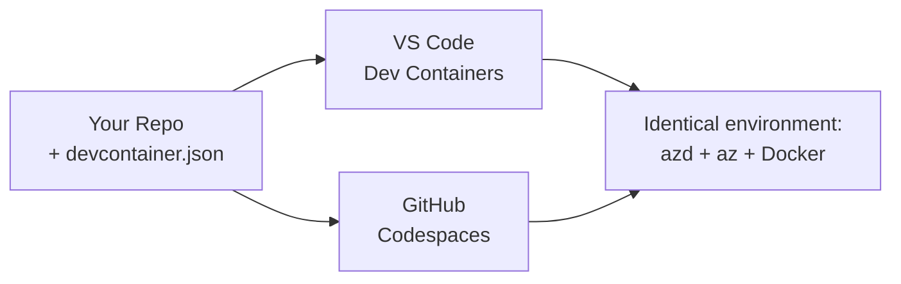

# Dev Containers & GitHub Codespaces สำหรับ azd

**การนำทางบทเรียน:**
- **📚 หน้าแรกของคอร์ส**: [AZD สำหรับผู้เริ่มต้น](../../README.md)
- **📖 บทเรียนปัจจุบัน**: บทที่ 1 - พื้นฐาน & เริ่มต้นอย่างรวดเร็ว
- **⬅️ ก่อนหน้า**: [นำแอปของคุณมาเอง](bring-your-own-app.md)
- **🚀 บทต่อไป**: [บทที่ 2: การพัฒนาด้วย AI เป็นหลัก](../chapter-02-ai-development/README.md)

> เป้าหมายการตรวจสอบคำสั่งและการตั้งค่า: `azd 1.37.2` (พฤศจิกายน 2026) การสร้างคอนเทนเนอร์และการปรับใช้ Azure ไม่ได้ดำเนินการเป็นส่วนหนึ่งของการตรวจสอบนี้

## บทนำ

การติดตั้ง azd, runtime ภาษา, Docker และ Azure CLI บนทุกเครื่องนั้นเป็นงานที่ยุ่งยาก — และนี่คือสาเหตุอันดับหนึ่งที่บทเรียนที่ "ใช้งานได้บนเครื่องของฉัน" ล้มเหลวกับคนอื่น ๆ **dev container** แก้ปัญหานี้โดยอธิบายชุดเครื่องมือทั้งหมดของคุณในไฟล์ ใครก็ตามที่เปิดโปรเจกต์ใน VS Code หรือ GitHub Codespaces จะได้รับสภาพแวดล้อมเหมือนกันเป๊ะ พร้อมกับ azd ที่ติดตั้งไว้แล้ว บทเรียนนี้จะแสดงวิธีเพิ่ม

## เป้าหมายการเรียนรู้

เมื่อจบบทเรียนนี้ คุณจะ:
- เข้าใจว่า dev container คืออะไร และช่วยเรื่อง azd อย่างไร
- เพิ่ม `.devcontainer/devcontainer.json` ที่เรียบง่ายในโปรเจกต์
- รวม azd, Azure CLI และ Docker ผ่าน Dev Container *features*
- เปิดโปรเจกต์ใน GitHub Codespaces หรือ VS Code

## ผลลัพธ์การเรียนรู้

หลังจากจบบทเรียนนี้ คุณจะสามารถ:
- เขียน `devcontainer.json` สำหรับโปรเจกต์ azd
- เพิ่ม azd และเครื่องมือ Azure โดยไม่ต้องติดตั้งด้วยตนเอง
- รัน `azd up` จากภายในคอนเทนเนอร์หรือ Codespace

---

## Dev Container คืออะไร?

Dev container คือสภาพแวดล้อมการพัฒนาที่ใช้ Docker ซึ่งกำหนดโดยไฟล์ `.devcontainer/devcontainer.json` ในที่เก็บของคุณ เมื่อคุณเปิดโปรเจกต์:

- **VS Code** (พร้อมส่วนขยาย Dev Containers) จะสร้างคอนเทนเนอร์และเชื่อมต่อกับมัน
- **GitHub Codespaces** สร้างคอนเทนเนอร์เดียวกันในคลาวด์และให้คุณใช้ตัวแก้ไขผ่านเบราว์เซอร์

ไม่ว่าจะอย่างไร ทุกคนที่ร่วมพัฒนาด้วยกันจะได้เครื่องมือเหมือนกัน — ไม่มีปัญหา "คุณติดตั้ง azd หรือยัง?"



---

## ขั้นตอนที่ 1: สร้างไฟล์ devcontainer

สร้าง `.devcontainer/devcontainer.json` ที่โฟลเดอร์รากของโปรเจกต์ของคุณ:

```json
{
  "name": "azd-project",
  "image": "mcr.microsoft.com/devcontainers/base:bookworm",
  "features": {
    "ghcr.io/devcontainers/features/azure-cli:1": {},
    "ghcr.io/azure/azure-dev/azd:0": { "version": "1.37.2" },
    "ghcr.io/devcontainers/features/docker-in-docker:2": {},
    "ghcr.io/devcontainers/features/node:1": {}
  },
  "customizations": {
    "vscode": {
      "extensions": [
        "ms-azuretools.azure-dev",
        "ms-azuretools.vscode-bicep"
      ]
    }
  },
  "forwardPorts": [3000],
  "postCreateCommand": "azd version"
}
```

แต่ละส่วนทำหน้าที่อย่างไร:

| คีย์ | จุดประสงค์ |
|-----|---------|
| `image` | ระบบปฏิบัติการฐานสำหรับคอนเทนเนอร์ |
| `features` | ตัวติดตั้งสำเร็จรูป — ที่นี่: Azure CLI, **azd**, Docker และ Node.js |
| `customizations.vscode.extensions` | ติดตั้งส่วนขยาย azd และ Bicep สำหรับ VS Code อัตโนมัติ |
| `forwardPorts` | เปิดเผยพอร์ตแอปของคุณให้เบราว์เซอร์ |
| `postCreateCommand` | รันครั้งเดียวหลังจากคอนเทนเนอร์ถูกสร้าง (ที่นี่, เช็คความถูกต้อง) |

> เวอร์ชันฟีเจอร์ (`azd:0`) และเวอร์ชัน CLI ที่ติดตั้งไม่ตรงกัน ตั้งค่า `version` ของฟีเจอร์เป็น `"1.37.2"` เพื่อบังคับใช้ CLI; อย่าใช้เวอร์ชัน CLI เป็นแท็กฟีเจอร์

---

## ขั้นตอนที่ 2: จับคู่ฟีเจอร์กับภาษาของแอปคุณ

เปลี่ยนฟีเจอร์ `node` ให้ตรงกับภาษาที่แอปของคุณใช้:

```jsonc
// Python project
"ghcr.io/devcontainers/features/python:1": {},

// .NET project
"ghcr.io/devcontainers/features/dotnet:2": {},

// Java project
"ghcr.io/devcontainers/features/java:1": {},

// Go project
"ghcr.io/devcontainers/features/go:1": {}
```

รักษา `docker-in-docker` เมื่อสร้างอิมเมจในเครื่อง การตั้งค่าการสร้างผ่าน ACR ระยะไกล (`docker.remoteBuild: true`) เป็นทางเลือก; ประเภทโฮสต์เพียงอย่างเดียวไม่ได้หมายความว่าจะต้องใช้ Docker ในเครื่องเสมอไป

---

## ขั้นตอนที่ 3: เปิดใช้งาน

**ใน VS Code:**
1. ติดตั้งส่วนขยาย **Dev Containers**
2. เปิดโฟลเดอร์โปรเจกต์
3. คลิก **เปิดใหม่ในคอนเทนเนอร์** เมื่อมีคำขอ (หรือรัน *Dev Containers: Reopen in Container*)

**ใน GitHub Codespaces:**
1. ผลักที่เก็บไปยัง GitHub
2. คลิก **Code → Codespaces → Create codespace on main**
3. รอให้คอนเทนเนอร์ถูกสร้าง — azd พร้อมใช้งานในเทอร์มินัล

---

## ขั้นตอนที่ 4: ปรับใช้จากภายในคอนเทนเนอร์

คอนเทนเนอร์มี azd ติดตั้งไว้แล้ว ทำให้เวิร์กโฟลว์ปกติใช้ได้ทันที:

```bash
azd auth login --use-device-code   # device code is handy inside Codespaces
azd up
```

> **ทำไมต้อง `--use-device-code`?** ในคอนเทนเนอร์ระยะไกลหรือ Codespace จะไม่มีเบราว์เซอร์ในเครื่องให้เปลี่ยนเส้นทาง ดังนั้นการล็อกอินด้วย device-code จึงเป็นวิธีที่น่าเชื่อถือ คุณจะต้องวางโค้ดในแท็บเบราว์เซอร์เพื่อทำการเข้าสู่ระบบให้เสร็จสมบูรณ์

---

## ปัญหาทั่วไป

| ปัญหา | วิธีแก้ |
|---------|-----|
| `azd up` สร้างอิมเมจไม่ได้ | เพิ่มฟีเจอร์ `docker-in-docker` |
| การล็อกอินเบราว์เซอร์ค้างใน Codespaces | ใช้ `azd auth login --use-device-code` |
| เครื่องมือไม่ตรงกันระหว่างเพื่อนร่วมทีม | บังคับใช้ CLI ผ่านตัวเลือก `version` ของฟีเจอร์ azd และบังคับใช้ runtime ภาษา |
| แอปใช้งานไม่ได้ในเบราว์เซอร์ | เพิ่มพอร์ตใน `forwardPorts` |

---

## สรุป

- dev container ช่วยให้ชุดเครื่องมือ azd ของคุณทำซ้ำได้สำหรับทุกคน
- เพิ่ม azd, Azure CLI และ Docker ผ่าน Dev Container *features*
- จับคู่ฟีเจอร์ภาษาให้ตรงกับแอปของคุณและรักษา `docker-in-docker` สำหรับโฮสต์คอนเทนเนอร์
- ใช้การล็อกอิน device-code เมื่อรันใน Codespaces

---

## 🔗 การนำทาง

| ทิศทาง | แหล่งข้อมูล |
|-----------|----------|
| **ก่อนหน้า** | [นำแอปของคุณมาเอง](bring-your-own-app.md) |
| **หน้าแรกบทเรียน** | [บทที่ 1: พื้นฐาน & เริ่มต้นอย่างรวดเร็ว](README.md) |
| **บทต่อไป** | [บทที่ 2: การพัฒนาด้วย AI เป็นหลัก](../chapter-02-ai-development/README.md) |

## 📖 แหล่งข้อมูลที่เกี่ยวข้อง

- [การติดตั้ง & การตั้งค่า](installation.md)
- [คำสั่ง Cheat Sheet](../../resources/cheat-sheet.md)
- [สเปคอย่างเป็นทางการของ Dev Containers](https://containers.dev/)
- [ฟีเจอร์ azd Dev Container](https://github.com/Azure/azure-dev/tree/main/ext/devcontainer)

---

<!-- CO-OP TRANSLATOR DISCLAIMER START -->
**ปฏิเสธความรับผิดชอบ**:
เอกสารนี้ได้รับการแปลโดยใช้บริการแปลภาษา AI [Co-op Translator](https://github.com/Azure/co-op-translator) ขณะที่เราพยายามให้ความถูกต้อง โปรดทราบว่าการแปลโดยอัตโนมัติอาจมีข้อผิดพลาดหรือความไม่ถูกต้อง เอกสารต้นฉบับในภาษาต้นทางควรถูกพิจารณาเป็นแหล่งข้อมูลที่เชื่อถือได้ สำหรับข้อมูลที่สำคัญ แนะนำให้ใช้การแปลโดยมนุษย์มืออาชีพ เราไม่รับผิดชอบต่อความเข้าใจผิดหรือการตีความที่ผิดพลาดที่เกิดขึ้นจากการใช้การแปลนี้
<!-- CO-OP TRANSLATOR DISCLAIMER END -->