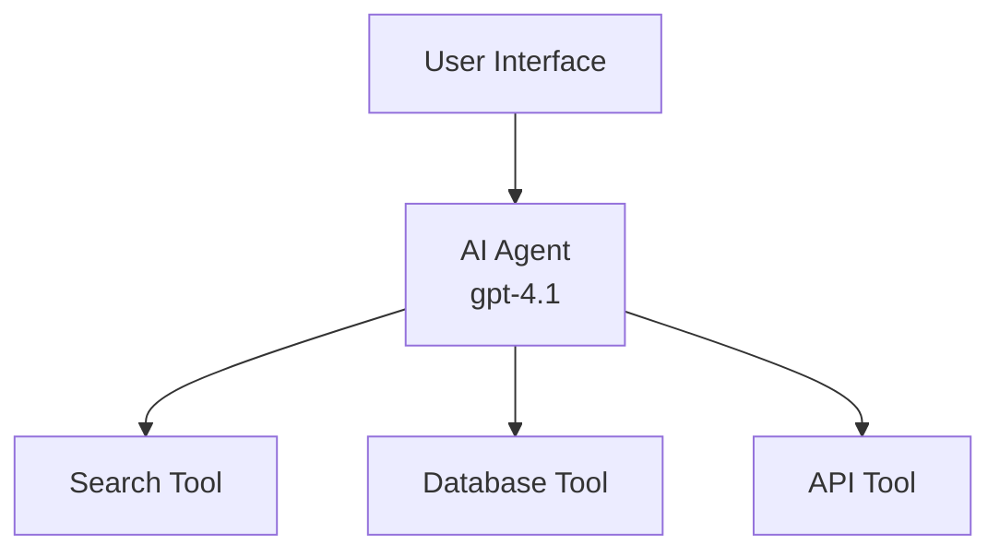
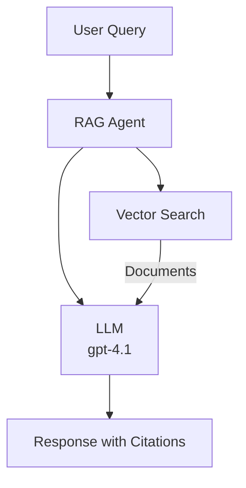
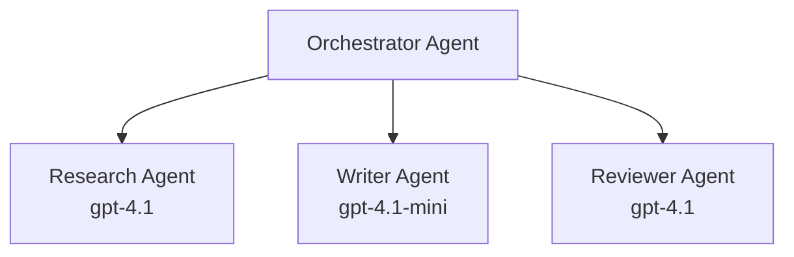

# ตัวแทน AI กับ Azure Developer CLI

**การนำทางบทเรียน:**
- **📚 หน้าแรกหลักสูตร**: [AZD สำหรับผู้เริ่มต้น](../../README.md)
- **📖 บทเรียนปัจจุบัน**: บทที่ 2 - การพัฒนาแบบ AI-First
- **⬅️ ก่อนหน้า**: [การผสานรวม Microsoft Foundry](microsoft-foundry-integration.md)
- **➡️ ถัดไป**: [การปรับใช้โมเดล AI](ai-model-deployment.md)
- **🚀 ขั้นสูง**: [โซลูชันหลายตัวแทน](../../examples/retail-scenario.md)

---

## บทนำ

ตัวแทน AI คือโปรแกรมอิสระที่สามารถรับรู้สภาพแวดล้อม, ตัดสินใจ, และดำเนินการเพื่อบรรลุเป้าหมายเฉพาะ แทนที่จะเป็นแชทบอทธรรมดาที่ตอบกลับคำสั่ง ตัวแทนสามารถ:

- **ใช้เครื่องมือ** - เรียก API, ค้นหาฐานข้อมูล, รันโค้ด
- **วางแผนและเหตุผล** - แบ่งงานที่ซับซ้อนออกเป็นขั้นตอน
- **เรียนรู้จากบริบท** - รักษาหน่วยความจำและปรับพฤติกรรม
- **ทำงานร่วมกัน** - ทำงานกับตัวแทนอื่น (ระบบหลายตัวแทน)

คู่มือนี้แสดงวิธีการปรับใช้ตัวแทน AI สู่ Azure ด้วย Azure Developer CLI (azd)

การใช้บริบทการสนทนาไม่ใช่การฝึกโมเดล: หน่วยความจำถาวร, การควบคุมการเข้าถึง, และการเก็บรักษาต้องถูกพัฒนาหรือกำหนดค่าโดยแอปพลิเคชัน

> **อัปเดต Foundry GA (2026-11-09):** ติดตั้งชุด `microsoft.foundry` 1.0 ที่วางจำหน่ายทั่วไปด้วย `azd >= 1.37.0` การประเมินผลติดตั้งแยกต่างหาก; ฟีเจอร์พรีวิวและ SDK แบบคลาสสิกด้านล่างไม่ได้รับการส่งเสริมสู่ GA ตามการประกาศชุดนี้ คำแนะนำนี้อ้างอิงจาก [การประกาศ GA](https://devblogs.microsoft.com/azure-sdk/microsoft-foundry-azure-developer-cli-ga/) และเอกสาร ไม่ใช่การปรับใช้ Azure จริง

## เป้าหมายการเรียนรู้

หลังจากทำคู่มือนี้จบ คุณจะ:
- เข้าใจว่าตัวแทน AI คืออะไรและแตกต่างจากแชทบอทอย่างไร
- ปรับใช้แม่แบบตัวแทน AI ที่สร้างไว้ล่วงหน้าด้วย AZD
- กำหนดค่าตัวแทน Foundry สำหรับตัวแทนที่กำหนดเอง
- นำรูปแบบตัวแทนพื้นฐานมาใช้ (การใช้เครื่องมือ, RAG, ระบบหลายตัวแทน)
- ตรวจสอบและแก้ไขตัวแทนที่ปรับใช้แล้ว

## ผลลัพธ์การเรียนรู้

เมื่อสำเร็จแล้ว คุณจะสามารถ:
- ปรับใช้แอปพลิเคชันตัวแทน AI ไปยัง Azure ด้วยคำสั่งเดียว
- กำหนดค่าเครื่องมือและความสามารถของตัวแทน
- นำการสร้างข้อมูลเสริมด้วยการดึงข้อมูล (RAG) กับตัวแทนมาใช้
- ออกแบบสถาปัตยกรรมตัวแทนหลายตัวสำหรับเวิร์กโฟลว์ที่ซับซ้อน
- แก้ไขปัญหาทั่วไปของการปรับใช้ตัวแทน

---

## 🤖 อะไรทำให้ตัวแทนแตกต่างจากแชทบอท?

| คุณสมบัติ | แชทบอท | ตัวแทน AI |
|---------|---------|----------|
| **พฤติกรรม** | ตอบกลับคำสั่ง | ดำเนินการอัตโนมัติ |
| **เครื่องมือ** | อาจใช้การค้นหรือเครื่องมือ | ใช้เครื่องมือในวงจรเป้าหมายโดยทั่วไป |
| **หน่วยความจำ** | ขึ้นกับแอป | หน่วยความจำถาวรเมื่อถูกพัฒนาเท่านั้น |
| **การวางแผน** | ตอบกลับครั้งเดียว | กระบวนการคิดหลายขั้นตอน |
| **การทำงานร่วมกัน** | เป็นเอนทิตีเดียว | ทำงานร่วมกับตัวแทนอื่นได้ |

### อุปมาเรียบง่าย

- **แชทบอท** = บุคคลช่วยเหลือตอบคำถามที่โต๊ะข้อมูล
- **ตัวแทน AI** = ผู้ช่วยส่วนตัวที่รับโทรศัพท์, จองนัดหมาย, และทำงานให้คุณ

---

## 🚀 เริ่มต้นอย่างรวดเร็ว: ปรับใช้ตัวแทนตัวแรกของคุณ

เลือกตัวเลือกหนึ่งใน **ไดเรกทอรีงานใหม่ว่างเปล่า** `.` จะเริ่มต้นที่นั่น; ถ้าไม่มีปลายทางระบุ AZD ปัจจุบันอาจสร้างไดเรกทอรีย่อยตามชื่อแม่แบบและไม่ได้เปลี่ยนไดเรกทอรีของเชลล์คุณ เก็บแม่แบบ/สภาพแวดล้อมแยกกันในไดเรกทอรีแยกต่างหาก

ช่วงเวลา/ต้นทุนด้านล่างเป็นแค่ตัวอย่าง ไม่ใช่การอ้างราคาอย่างเป็นทางการ ตรวจสอบความต้องการ, ราคา, โควต้ารุ่น และบริการเสริมของแต่ละตัวอย่างก่อนปรับใช้

### ตัวเลือก 1: แม่แบบ Foundry Agents (แนะนำ)

```bash
# Initialize the AI agents template
azd init --template get-started-with-ai-agents .

# Deploy to Azure
azd up
```

**สิ่งที่จะปรับใช้:** โครงสร้างพื้นฐานปัจจุบันและตัวเลือกที่เลือกของตัวอย่างกำหนดรุ่น, เครื่องมือ, โฮสต์, และทรัพยากรการตรวจสอบ ศึกษา README และ `infra/` ก่อนจัดหา; อย่าสันนิษฐานว่าแม่แบบตัวแทนทุกตัวมี Search หรืออินเทอร์เฟซเว็บ

**เวลา:** ~15-20 นาที
**ค่าใช้จ่าย:** ~$100-150/เดือน (พัฒนา)

### ตัวเลือก 2: ตัวแทนเขียนเชิงสร้างสรรค์กับ Prompty

```bash
# Initialize the Prompty-based agent template
azd init --template https://github.com/Azure-Samples/contoso-creative-writer .

# Deploy to Azure
azd up
```

**สิ่งที่จะปรับใช้:** ตัวอย่างการเขียนหลายตัวแทน FastAPI/Prompty ใช้ Azure OpenAI, Bing Grounding, และ Azure AI Search ที่เก็บ `agent-openai-python-prompty` เดิมยังเปลี่ยนเส้นทางมาดีที่นี่ ไม่ใช่แม่แบบตัวแทนอากาศ Azure Functions แบบขั้นต่ำ ปฏิบัติตาม README ปัจจุบันสำหรับโฮสต์, โควต้ารุ่น, และความต้องการเบื้องต้น Bing Grounding

**เวลา:** ~10-15 นาที
**ค่าใช้จ่าย:** ~$50-100/เดือน (พัฒนา)

### ตัวเลือก 3: ตัวแทนแชท RAG

```bash
# Initialize RAG chat template
azd init --template azure-search-openai-demo .

# Deploy to Azure
azd up
```

**สิ่งที่จะปรับใช้:**
- ✅ โมเดล Microsoft Foundry
- ✅ Azure AI Search กับข้อมูลตัวอย่าง
- ✅ ท่อประมวลผลเอกสาร
- ✅ อินเทอร์เฟซแชทพร้อมแหล่งอ้างอิง

**เวลา:** ~15-25 นาที
**ค่าใช้จ่าย:** ~$80-150/เดือน (พัฒนา)

### ตัวเลือก 4: ตัวแทนโฮสต์กับชุด Foundry GA

ใช้ [คำแนะนำตัวแทนโฮสต์ครบถ้วน](microsoft-foundry-integration.md#hosted-agent-walkthrough-ga) สำหรับตัวอย่าง API ตอบสนอง Python Agent Framework พื้นฐาน เส้นทางปรับใช้โค้ดนี้ต้องการ Python 3.13+, uv ปัจจุบัน, สิทธิ์ Foundry, และโควต้ารุ่นในภูมิภาค การตรวจสอบสิทธิ์การเรียก SDK ในเครื่องต้องทำแยกต่างหากโดยใช้ข้อมูลประจำตัว Azure CLI

```bash
azd auth login
azd ext install microsoft.foundry
```

ในไดเรกทอรีว่างเปล่า ให้เริ่มต้นตัวอย่าง:

```text
azd ai agent init --template https://github.com/microsoft-foundry/foundry-samples/blob/main/samples/python/hosted-agents/agent-framework/responses/01-basic/azure.yaml --deploy-mode code --src .
```

เลือกโปรเจกต์ใหม่หรือรายการที่มีอยู่, ตรวจสอบ `azure.yaml`, และรัน `azd provision` ใช้ `azd ai agent run` เปิด Agent Inspector และจากเทอร์มินอลอื่นในไดเรกทอรีนั้น รัน `azd ai agent invoke --local "Explain how this agent is hosted."` หลังจากตรวจสอบในเครื่องแล้ว ใช้ `azd deploy` และ `azd ai agent invoke "Explain how this agent is hosted."` เปรียบเทียบการตอบกลับที่ปรับใช้ Foundry สร้างซอร์สที่อัปโหลดจากระยะไกล; ไม่จำเป็นต้องสร้างคอนเทนเนอร์ในเครื่อง

**เมื่อใดควรใช้ `azd ai agent init` กับ `azd init --template`:**

| วิธีการ | เหมาะสำหรับ | วิธีการทำงาน |
|----------|----------|------|
| `azd init --template` | เริ่มจากแอปตัวอย่างที่ทำงานได้ | โคลนรีโปแม่แบบเต็มที่มีโค้ด + โครงสร้างพื้นฐาน |
| `azd ai agent init --template` | ยอมรับโปรเจกต์ตัวแทน Foundry ปัจจุบัน | ใช้เอกสารโปรเจกต์ `azure.yaml` และคำจำกัดความ |

> **คำแนะนำ:** ตัวเลือกที่ 1-3 เริ่มต้นจากเทมเพลตแอปพลิเคชันเต็มรูปแบบ; ตัวเลือกที่ 4 สอนวิธีการทำงานของ GA hosted-agent โค้ดเริ่มต้นทั้งสองไม่ย้าย manifest ของเอเจนต์รุ่นเก่าโดยอัตโนมัติ หากต้องการเพิ่มการกำหนดเอเจนต์โดยตรงในโปรเจ็กต์ที่มีอยู่แล้ว ให้ดู [คำแนะนำการเริ่มต้นและการย้ายข้อมูล](../chapter-08-production/production-ai-practices.md#initializing-agent-projects-with-azd-ai-agent-init).

ติดตั้ง `azure.ai.evaluations` แยกต่างหากเพื่อสร้างและตรวจสอบข้อมูลการทดสอบ/เกณฑ์การประเมินผล กำหนดค่าการประเมิน และรันโดยใช้ `azd ai eval` การปรับแต่งสามารถใช้การประเมินที่เข้ากันได้ซ้ำได้ ให้ตรวจสอบตัวเลือกก่อนที่จะปรับใช้โดยชัดเจน ทำตาม [ขั้นตอนการประเมินผล](../chapter-08-production/production-ai-practices.md#evaluation-migration-and-quality-checks) และ [การย้ายข้อมูลการปรับแต่ง](../chapter-08-production/production-ai-practices.md#optimization-configuration-migration) ก่อนนำตัวอย่างเก่ามาใช้ซ้ำ สำหรับการทำความสะอาด ทรัพยากรของโปรเจ็กต์ Foundry ที่ใช้ซ้ำจะคงอยู่หลัง `azd down`; กลุ่มทรัพยากรของโปรเจ็กต์ที่สร้างใหม่จะถูกลบ ดู [คำแนะนำการทำความสะอาดแบบทีละขั้นตอน](microsoft-foundry-integration.md#7-clean-up-deliberately).

---

## 🏗️ รูปแบบสถาปัตยกรรมเอเย่นต์

### แบบแผนที่ 1: ตัวแทนเดียวกับเครื่องมือ

แบบแผนตัวแทนที่เรียบง่ายที่สุด - ตัวแทนหนึ่งตัวที่สามารถใช้เครื่องมือหลายตัว



**เหมาะสำหรับ:**
- บอทสนับสนุนลูกค้า
- ผู้ช่วยวิจัย
- ตัวแทนวิเคราะห์ข้อมูล

**ตัวอย่างแอปพลิเคชันที่เกี่ยวข้อง:** `azure-search-openai-demo` แสดงตัวอย่าง RAG ไม่ใช่วงจรเอเจนต์เครื่องมือทั่วไปแบบสุ่ม

### รูปแบบที่ 2: เอเจนต์ RAG (Retrieval-Augmented Generation)

เอเจนต์ที่ดึงเอกสารที่เกี่ยวข้องก่อนสร้างคำตอบ



**เหมาะสำหรับ:**
- ฐานความรู้ขององค์กร
- ระบบถามตอบเอกสาร
- การวิจัยด้านการปฏิบัติตามกฎระเบียบและกฎหมาย

**เทมเพลต AZD:** `azure-search-openai-demo`

### รูปแบบที่ 3: ระบบแบบหลายเอเจนต์

ตัวแทนเฉพาะทางหลายตัวทำงานร่วมกันในงานที่ซับซ้อน



**เหมาะสำหรับ:**
- การสร้างเนื้อหาที่ซับซ้อน
- เวิร์กโฟลว์หลายขั้นตอน
- งานที่ต้องการความเชี่ยวชาญที่แตกต่างกัน

**เรียนรู้เพิ่มเติม:** [แพทเทิร์นการประสานงานแบบตัวแทนหลายตัว](../chapter-06-pre-deployment/coordination-patterns.md)

---

## ⚙️ การกำหนดค่าเครื่องมือของตัวแทน

ตัวแทนจะทรงพลังเมื่อตัวแทนสามารถใช้เครื่องมือ นี่คือวิธีการกำหนดค่าเครื่องมือทั่วไป:

### การกำหนดค่าเครื่องมือใน Foundry Agents

เศษส่วน **SDK บริการตัวแทนคลาสสิก** นี้เจาะจง `azure-ai-projects==1.0.0` และ `azure-ai-agents==1.1.0` ด้วย `azure-identity` ซึ่งไม่ใช่ API เวอร์ชันใหม่แบบ versioned-agent/Responses ที่ใช้ในเทมเพลต Foundry บางอันในปัจจุบัน หรือการขยาย `azure.ai.agents` AZD (เป็นแพ็คเกจที่แตกต่างกัน) ห้ามผสมผสาน API รุ่นเหล่านี้กัน ตั้งค่า `PROJECT_ENDPOINT` เป็นจุดสิ้นสุดโครงการ Foundry แบบคลาสสิก และ `MODEL_DEPLOYMENT_NAME` เป็นการปรับใช้งานโมเดลที่รองรับที่มีอยู่ แล้วตรวจสอบสิทธิ์ด้วย `az login` ในเครื่องของคุณและให้สิทธิ์โครงการที่จำเป็น

```python
# agent_config.py
import os
from azure.ai.projects import AIProjectClient
from azure.ai.agents.models import FunctionTool
from azure.identity import DefaultAzureCredential

def search_knowledge_base(query: str) -> str:
    """Search the demonstration knowledge base.

    :param query: Search text.
    :return: Matching demonstration information.
    """
    # Local fixture only, not a production search implementation.
    return "Demo policy: returns are accepted within 30 days."

project_client = AIProjectClient(
    endpoint=os.environ["PROJECT_ENDPOINT"],
    credential=DefaultAzureCredential(),
)
search_tool = FunctionTool(functions={search_knowledge_base})
project_client.agents.enable_auto_function_calls(search_tool)
agent = project_client.agents.create_agent(
    model=os.environ["MODEL_DEPLOYMENT_NAME"],
    name="Support Agent",
    instructions="Use search_knowledge_base for policy questions. Label results as demo data.",
    tools=search_tool.definitions,
)
```

การลงทะเบียนสคีมาฟังก์ชันไม่ได้รัน Python บนบริการ ใน SDK นี้ `enable_auto_function_calls` รวมกับ `agents.runs.create_and_process(...)` จะรัน callback ที่ลงทะเบียนในกระบวนการไคลเอนต์ของคุณ ดูตัวอย่าง SDK ที่เผยแพร่ [released SDK example](https://github.com/Azure/azure-sdk-for-python/blob/azure-ai-agents_1.1.0/sdk/ai/azure-ai-agents/samples/agents_tools/sample_agents_auto_function_call.py) ปิดไคลเอนต์และลบตัวแทน/เธรดตัวอย่างเมื่อเสร็จสิ้น

### การกำหนดค่าสภาพแวดล้อม

ชื่อเหล่านี้เป็น **อินพุตแม่แบบกำหนดเองเชิงตัวอย่าง** ไม่ใช่สวิตช์ AZD ในตัว ก่อนอื่นให้เดินสายแต่ละค่าผ่าน `infra/main.parameters.json` โครงสร้างพื้นฐาน และโค้ดแอปพลิเคชัน `azd env set` เพียงอย่างเดียวไม่เปลี่ยนเครื่องมือหรือตัวคำสั่งของตัวแทน

```bash
# Set up agent-specific environment variables
azd env set AZURE_OPENAI_MODEL "gpt-4.1"
azd env set AGENT_INSTRUCTIONS "You are a helpful assistant..."
azd env set ENABLE_CODE_INTERPRETER "true"
azd env set ENABLE_FILE_SEARCH "true"

# Apply wired infrastructure and application changes
azd up
```

---

## 📊 ตัวแทนตรวจสอบ

### การรวม Application Insights

หากเทมเพลตที่คุณเลือกจัดเตรียม Application Insights และกำหนดค่าเครื่องมือวัด:

```bash
# Open monitoring dashboard
azd monitor --overview

# Open the Application Insights logs view (not a streaming log tail)
azd monitor --logs

# View live metrics
azd monitor --live
```

### ตัวชี้วัดสำคัญที่ต้องติดตาม

| เมตริก | คำอธิบาย | เป้าหมาย |
|--------|-------------|--------|
| Response Latency | เวลาที่ใช้ในการสร้างการตอบสนอง | < 5 วินาที |
| Token Usage | จำนวนโทเค็นต่อคำขอ | ตรวจสอบต้นทุน |
| Tool Call Success Rate | % ของการเรียกใช้เครื่องมือที่สำเร็จ | > 95% |
| Error Rate | คำขอของตัวแทนที่ล้มเหลว | < 1% |
| User Satisfaction | คะแนนความพึงพอใจจากผู้ใช้ | > 4.0/5.0 |

### การบันทึกแบบกำหนดเองสำหรับตัวแทน

```python
import os
from azure.monitor.opentelemetry import configure_azure_monitor
from opentelemetry import trace

# Configure Azure Monitor with OpenTelemetry
configure_azure_monitor(
    connection_string=os.environ["APPLICATIONINSIGHTS_CONNECTION_STRING"]
)

tracer = trace.get_tracer(__name__)

def log_agent_interaction(user_query, agent_response, tools_used, latency_ms):
    with tracer.start_as_current_span("agent_interaction") as span:
        span.set_attributes({
            "query_length": len(user_query),  # Do not log raw prompts or personal data
            "response_length": len(agent_response),
            "tools_used": tools_used,
            "latency_ms": latency_ms
        })
```

> **หมายเหตุ:** ติดตั้งแพ็กเกจที่จำเป็น: `pip install azure-monitor-opentelemetry` ซึ่งจะนำเข้าขึ้นอยู่กับ OpenTelemetry; การนำเข้า namespace ไม่ใช่ข้อกำหนดการติดตั้งแพ็กเกจชื่อ `opentelemetry`

---

## 💰 การพิจารณาต้นทุน

### ค่าประมาณรายเดือนตามรูปแบบ

เหล่านี้เป็นช่วงการวางแผนตัวอย่าง ไม่ใช่ใบเสนอราคาหรือขีดจำกัดการใช้จ่าย ภูมิภาค โทเค็นโมเดล SKU การค้นหา/คำนวณ เซสชันเครื่องมือ พื้นที่จัดเก็บ และการจราจรสามารถเกินขอบเขตเหล่านี้ได้ ตรวจสอบคำแนะนำด้านต้นทุนและราคาของ Azure ก่อน `azd up`

| รูปแบบ | สภาพแวดล้อม Dev | การผลิต |
|---------|-----------------|------------|
| ตัวแทนเดี่ยว | $50-100 | $200-500 |
| ตัวแทน RAG | $80-150 | $300-800 |
| ตัวแทนหลายตัว (2-3 ตัว) | $150-300 | $500-1,500 |
| ตัวแทนหลายตัวสำหรับองค์กร | $300-500 | $1,500-5,000+ |

### เคล็ดลับการเพิ่มประสิทธิภาพต้นทุน

1. **ใช้ gpt-4.1-mini สำหรับงานง่ายๆ** (เฉพาะถ้าเทมเพลตของคุณใช้ข้อมูลนำเข้านี้)
   ```bash
   azd env set AZURE_OPENAI_MODEL "gpt-4.1-mini"
   ```

2. **ใช้การแคชแบบมีขอบเขตสำหรับการสอบถามซ้ำอย่างปลอดภัย** รวมการอนุญาตผู้เช่า/ผู้ใช้ การปรับใช้โมเดล คำแนะนำ และเวอร์ชันการดึงไว้ในคีย์แคช ตั้งเวลาหมดอายุ อย่าแชร์การตอบสนองการสนทนาส่วนตัวผ่านแคชอ่านอย่างเดียวของกระบวนการ ตัวแทน SDK ไม่มีเมธอด `agent.run()` ทั่วไป

3. **ตั้งค่าขีดจำกัดโทเค็นต่อรัน**
   ```python
   # Set max_completion_tokens when running the agent, not during creation
   run = project_client.agents.runs.create_and_process(
       thread_id=thread.id,
       agent_id=agent.id,
       max_completion_tokens=1000  # Budget across the run; may finish as incomplete
   )
   ```

4. **ปรับขนาด Container Apps ที่มีสิทธิ์เป็นศูนย์เมื่อไม่ใช้งาน**
   ```bash
   # Custom-template input: must map to template.scale.minReplicas
   azd env set MIN_REPLICAS "0"
   ```
 ใช้การเปลี่ยนแปลงโครงสร้างพื้นฐานด้วย `azd provision` หรือ `azd up` การปรับขนาดเป็นศูนย์ต้องมีทริกเกอร์ที่เหมาะสมและไม่ได้หยุดการค้นหา พื้นที่จัดเก็บ หรือค่าบริการโมเดล/เครื่องมือ

---

## 🔧 การแก้ไขปัญหาตัวแทน

### ปัญหาทั่วไปและวิธีแก้ไข

<details>
<summary><strong>❌ ตัวแทนไม่ตอบสนองต่อการเรียกใช้เครื่องมือ</strong></summary>

```bash
# Inspect the application deployment (not the agent's registered tools)
azd show

# Verify OpenAI deployment
az cognitiveservices account deployment list \
  --name $AZURE_OPENAI_NAME \
  --resource-group $RG_NAME

# Check agent logs
azd monitor --logs
```

**สาเหตุทั่วไป:**
- การลงนามฟังก์ชันเครื่องมือไม่ตรงกัน
- ขาดสิทธิ์ที่จำเป็น
- ไม่สามารถเข้าถึง API endpoint
</details>

<details>
<summary><strong>❌ การตอบสนองตัวแทนมีความหน่วงสูง</strong></summary>

```bash
# Check Application Insights for bottlenecks
azd monitor --live

# Consider using a faster model
azd env set AZURE_OPENAI_MODEL "gpt-4.1-mini"
azd up
```

**เคล็ดลับเพิ่มประสิทธิภาพ:**
- ใช้การตอบสนองแบบสตรีมมิง
- ใช้การแคชการตอบสนอง
- ลดขนาดหน้าต่างบริบท
</details>

<details>
<summary><strong>❌ ตัวแทนส่งคืนข้อมูลผิดหรือข้อมูลหลอกลวง</strong></summary>

```python
# Improve with better system prompts
instructions = """
You are a helpful assistant. IMPORTANT:
- Only answer based on provided context
- If you don't know, say "I don't know"
- Always cite your sources
- Never make up information
"""

# Use these instructions in the agent definition.
# For classic file search, first upload/index documents in a vector store,
# then use FileSearchTool(vector_store_ids=[...]) and pass both its
# .definitions and .resources when creating the agent.
```
 คำแนะนำและการดึงข้อมูลช่วยลดความเสี่ยง; แต่ไม่มีการรับประกันคำตอบที่เป็นข้อเท็จจริง ประเมินคำถามที่มีแหล่งข้อมูลและนอกขอบเขตกับคำตอบที่ทราบ
</details>

<details>
<summary><strong>❌ ข้อผิดพลาดเกินขีดจำกัดโทเค็น</strong></summary>

```python
# Implement context window management
def truncate_context(messages, max_tokens=8000, model="gpt-4.1"):
    """Approximate content-only budget for objects with .content strings."""
    import tiktoken
    encoding = tiktoken.encoding_for_model(model)
    total_tokens = 0
    truncated = []
    
    for msg in reversed(messages):
        msg_tokens = len(encoding.encode(msg.content))
        if total_tokens + msg_tokens > max_tokens:
            break
        truncated.insert(0, msg)
        total_tokens += msg_tokens
    
    return truncated
```
ตัวช่วยนี้ยกเว้นสคีมาของบทบาท/เครื่องมือ คำสั่งระบบ โทเค็นของภาพ และภาระของโปรโตคอล สำรองพื้นที่สำหรับสิ่งเหล่านั้นและผลลัพธ์; อย่าแบ่งคู่เครื่องมือเรียก/ผลลัพธ์ หรือทิ้งคำสั่งระบบที่จำเป็น ติดตั้ง `tiktoken` แยกต่างหาก มันไม่ใช่ตัวตรวจสอบหน้าต่างบริบททั่วไป
</details>

---

## 🎓 แบบฝึกหัดลงมือทำ

### แบบฝึกหัดที่ 1: ติดตั้งเอเย่นต์พื้นฐาน (20 นาที)

**เป้าหมาย:** ติดตั้งเอเย่นต์ AI ตัวแรกของคุณโดยใช้ AZD

```bash
# Step 1: Initialize template
azd init --template get-started-with-ai-agents .

# Step 2: Login to Azure
azd auth login
# If you work across tenants, add --tenant-id <tenant-id>

# Step 3: Deploy
azd up

# Step 4: Test the agent
# Expected output after deployment:
#   Deployment Complete!
#   Endpoint: https://<app-name>.<region>.azurecontainerapps.io
# Open the URL shown in the output and try asking a question

# Step 5: View monitoring
azd monitor --overview

# Step 6: Review the listed resources and confirm cleanup
azd down
```

**เกณฑ์ความสำเร็จ:**
- [ ] ตัวแทนตอบคำถาม
- [ ] สามารถเข้าถึงแดชบอร์ดมอนิเตอร์ผ่าน `azd monitor`
- [ ] ลบทรัพยากรเรียบร้อยแล้ว

### แบบฝึกหัดที่ 2: เพิ่มเครื่องมือที่กำหนดเอง (30 นาที)

**เป้าหมาย:** ขยายตัวแทนด้วยเครื่องมือที่กำหนดเอง

**จุดเริ่มต้น:** ใช้ลูกค้า SDK แบบคลาสสิกจาก [Tool Configuration](#tool-configuration-in-foundry-agents) แทนการใช้เทมเพลตแบบสุ่มที่สร้าง SDK รุ่นต่างกัน

1. เพิ่มฟิกซ์เจอร์ที่กำหนดเชิงเดี่ยวนี้ไปยัง `agent_config.py`:
   ```python
   def get_weather(location: str) -> str:
       """Return demonstration weather, not live conditions.

       :param location: City name.
       :return: A clearly labelled fixture.
       """
       print(f"TOOL_CALLED: {location}")
       return f"Demo weather in {location}: Sunny, 72°F (fixture, not live)"
   ```
2. แทนที่บล็อกการลงทะเบียนและสร้าง search-tool ด้วย:
   ```python
   weather_tool = FunctionTool(functions={get_weather})
   project_client.agents.enable_auto_function_calls(weather_tool)
   agent = project_client.agents.create_agent(
       model=os.environ["MODEL_DEPLOYMENT_NAME"],
       name="Weather Agent",
       instructions="Call get_weather for weather questions; explain that it returns demo data.",
       tools=weather_tool.definitions,
   )
   thread = project_client.agents.threads.create()
   try:
       project_client.agents.messages.create(
           thread_id=thread.id, role="user", content="Use get_weather for Seattle."
       )
       run = project_client.agents.runs.create_and_process(
           thread_id=thread.id, agent_id=agent.id
       )
       if run.status != "completed":
           raise RuntimeError(f"Run status: {run.status}; error: {run.last_error}")
       for message in project_client.agents.messages.list(thread_id=thread.id):
           for text in message.text_messages:
               print(text.text.value)
   finally:
       project_client.agents.threads.delete(thread.id)
       project_client.agents.delete_agent(agent.id)
       project_client.close()
   ```
3. รันในเครื่อง (โค้ดนี้เรียกใช้โปรเจกต์ Azure ที่มีอยู่และมีค่าบริการโมเดล):
   ```bash
   python agent_config.py
   # Expected: TOOL_CALLED: Seattle, then a completed answer labelled demo data.
   ```

**เกณฑ์ความสำเร็จ:**
- [ ] ตัวแทนรู้จักคำถามเกี่ยวกับสภาพอากาศ
- [ ] เรียกใช้เครื่องมือถูกต้อง
- [ ] การตอบรับมีข้อมูลสภาพอากาศ

### แบบฝึกหัดที่ 3: สร้างตัวแทน RAG (45 นาที)

**เป้าหมาย:** สร้างตัวแทนที่ตอบคำถามจากเอกสารของคุณ

```bash
# Step 1: Deploy RAG template
azd init --template azure-search-openai-demo .
azd up

# Step 2: Upload your documents
# For the sample's local ingestion path, place supported files in data/.
# Run from the sample root after following its Python environment setup:
./scripts/prepdocs.sh
# Windows PowerShell equivalent: .\\scripts\\prepdocs.ps1

# Step 3: Test with domain-specific questions
# Open the web app URL from the azd up output
# Ask questions about your uploaded documents
# Responses should include citation references like [doc.pdf]
```

**เกณฑ์ความสำเร็จ:**
- [ ] ตัวแทนตอบคำถามจากเอกสารที่อัปโหลด
- [ ] การตอบรับมีการอ้างอิง
- [ ] คำถามทดสอบนอกขอบเขตได้รับการจัดการโดยไม่มีข้อเรียกร้องที่ไม่สนับสนุน (ไม่รับประกันสำหรับคำถามทุกคำถามในอนาคต)

หาก `USE_CLOUD_INGESTION=true` ให้ใช้เวิร์กโฟลว์คลาวด์สำหรับการรวบรวม/อัปโหลดตัวอย่างแทน; ตัวเตรียมท้องถิ่นข้ามขั้นตอนการรวบรวมโดยเจตนา หลังการทดสอบ ให้รัน `azd down` ในสภาพแวดล้อม RAG และตรวจสอบทรัพยากรที่จะลบ

---

## 📚 ขั้นตอนถัดไป

ตอนนี้ที่คุณเข้าใจตัวแทน AI แล้ว ให้สำรวจหัวข้อขั้นสูงเหล่านี้:

| หัวข้อ | คำอธิบาย | ลิงก์ |
|-------|-------------|------|
| **ระบบตัวแทนหลายตัว** | สร้างระบบที่มีตัวแทนหลายตัวร่วมมือกัน | [ตัวอย่างตัวแทนหลายตัวสำหรับค้าปลีก](../../examples/retail-scenario.md) |
| **รูปแบบการประสานงาน** | เรียนรู้แบบแผนการประสานและการสื่อสาร | [รูปแบบการประสานงาน](../chapter-06-pre-deployment/coordination-patterns.md) |
| **การปรับใช้งานจริง** | การปรับใช้งานตัวแทนในระดับองค์กร | [แนวปฏิบัติ AI สำหรับการผลิต](../chapter-08-production/production-ai-practices.md) |
| **การประเมินตัวแทน** | ทดสอบและประเมินประสิทธิภาพตัวแทน | [การแก้ไขปัญหา AI](../chapter-07-troubleshooting/ai-troubleshooting.md) |
| **ห้องปฏิบัติการเวิร์กช็อป AI** | ลงมือทำ: ทำให้งาน AI ของคุณพร้อม AZD | [ห้องปฏิบัติการเวิร์กช็อป AI](ai-workshop-lab.md) |

---

## 📖 แหล่งข้อมูลเพิ่มเติม

### เอกสารทางการ
- [Microsoft Foundry Agent Service](https://learn.microsoft.com/azure/ai-services/agents/)
- [Microsoft Foundry Agent Service Quickstart](https://learn.microsoft.com/azure/ai-services/agents/quickstart)
- [Semantic Kernel Agent Framework](https://learn.microsoft.com/semantic-kernel/)

### เทมเพลต AZD สำหรับตัวแทน
- [เริ่มต้นกับตัวแทน AI](https://github.com/Azure-Samples/get-started-with-ai-agents)
- [ตัวแทนการเขียนสร้างสรรค์ด้วย Prompty](https://github.com/Azure-Samples/contoso-creative-writer)
- [สาธิต Azure Search OpenAI](https://github.com/Azure-Samples/azure-search-openai-demo)

### แหล่งข้อมูลชุมชน
- [Awesome AZD - เทมเพลตตัวแทน](https://azure.github.io/awesome-azd/?tags=ai-agents)
- [Azure AI Discord](https://discord.gg/microsoft-azure)
- [Microsoft Foundry Discord](https://discord.gg/nTYy5BXMWG)

### ทักษะตัวแทนสำหรับโปรแกรมแก้ไขของคุณ
- [**ทักษะตัวแทน Microsoft Azure**](https://skills.sh/microsoft/github-copilot-for-azure) - ติดตั้งทักษะตัวแทน AI ที่นำกลับมาใช้ใหม่ได้สำหรับการพัฒนา Azure ใน GitHub Copilot, Cursor หรือเอเจนต์ที่รองรับอื่น ๆ รวมถึงทักษะสำหรับ [Azure AI](https://skills.sh/microsoft/github-copilot-for-azure/azure-ai), [Microsoft Foundry](https://skills.sh/microsoft/github-copilot-for-azure/microsoft-foundry), [การปรับใช้](https://skills.sh/microsoft/github-copilot-for-azure/azure-deploy) และ [การวินิจฉัย](https://skills.sh/microsoft/github-copilot-for-azure/azure-diagnostics):
  ```bash
  npx skills add microsoft/github-copilot-for-azure
  ```

---

**การนำทาง**
- **บทเรียนก่อนหน้า**: [การผสานรวม Microsoft Foundry](microsoft-foundry-integration.md)
- **บทเรียนถัดไป**: [การปรับใช้โมเดล AI](ai-model-deployment.md)

---

<!-- CO-OP TRANSLATOR DISCLAIMER START -->
**ปฏิเสธความรับผิดชอบ**:
เอกสารนี้ได้รับการแปลโดยใช้บริการแปลภาษา AI [Co-op Translator](https://github.com/Azure/co-op-translator) ขณะที่เราพยายามให้ความถูกต้อง โปรดทราบว่าการแปลโดยอัตโนมัติอาจมีข้อผิดพลาดหรือความไม่ถูกต้อง เอกสารต้นฉบับในภาษาต้นทางควรถูกพิจารณาเป็นแหล่งข้อมูลที่เชื่อถือได้ สำหรับข้อมูลที่สำคัญ แนะนำให้ใช้การแปลโดยมนุษย์มืออาชีพ เราไม่รับผิดชอบต่อความเข้าใจผิดหรือการตีความที่ผิดพลาดที่เกิดขึ้นจากการใช้การแปลนี้
<!-- CO-OP TRANSLATOR DISCLAIMER END -->