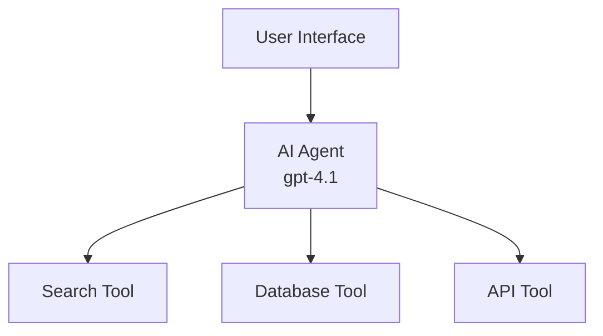
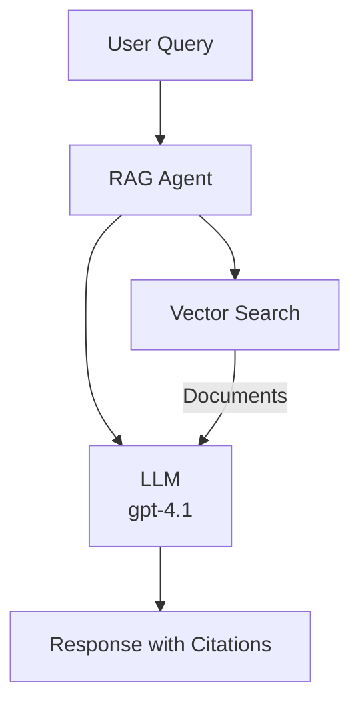
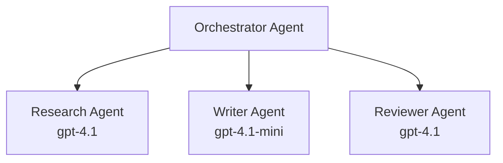

# ตัวแทน AI กับ Azure Developer CLI

**การนำทางบทเรียน:**
- **📚 หน้าแรกหลักสูตร**: [AZD สำหรับผู้เริ่มต้น](../../README.md)
- **📖 บทปัจจุบัน**: บทที่ 2 - การพัฒนา AI-First
- **⬅️ ก่อนหน้า**: [การผนวกรวม Microsoft Foundry](microsoft-foundry-integration.md)
- **➡️ ถัดไป**: [การปรับใช้โมเดล AI](ai-model-deployment.md)
- **🚀 ขั้นสูง**: [โซลูชันหลายตัวแทน](../../examples/retail-scenario.md)

---

## บทนำ

ตัวแทน AI คือโปรแกรมอิสระที่สามารถรับรู้สภาพแวดล้อมของตน ตัดสินใจ และดำเนินการเพื่อบรรลุเป้าหมายเฉพาะ แทนที่จะเป็นแชทบอทที่ตอบคำถาม ตัวแทนสามารถ:

- **ใช้เครื่องมือ** - เรียก API ค้นหาฐานข้อมูล และรันโค้ด
- **วางแผนและใช้เหตุผล** - แยกงานที่ซับซ้อนออกเป็นขั้นตอน
- **เรียนรู้จากบริบท** - รักษาความทรงจำและปรับพฤติกรรม
- **ทำงานร่วมกัน** - ทำงานกับตัวแทนอื่น ๆ (ระบบหลายตัวแทน)

คู่มือนี้แสดงวิธีปรับใช้ตัวแทน AI บน Azure โดยใช้ Azure Developer CLI (azd)

การใช้บริบทการสนทนาไม่ใช่การฝึกโมเดล: ความทรงจำถาวร การควบคุมการเข้าถึง และการเก็บรักษาต้องถูกดำเนินการ/กำหนดค่าโดยแอปพลิเคชัน

> **การตรวจสอบเวอร์ชัน (2026-11-04):** ตัวอย่าง CLI ถูกตรวจสอบกับเอกสาร/แหล่งที่มาของ `azd` `1.37.2`, `azure.ai.agents` `1.0.0-beta.23`, และ `azure.ai.evaluations` `1.0.0-beta.2` ไม่ใช่การปรับใช้ Azure จริง ใช้ `azd >= 1.37.0` สำหรับเวิร์กโฟลว์รวม ดู [การเปลี่ยนแปลงและแก้ไขล่าสุด](../chapter-08-production/production-ai-practices.md#recent-release-changes-and-fixes) ก่อนอัปเกรดโปรเจกต์เก่า

## เป้าหมายการเรียนรู้

เมื่อทำคู่มือนี้เสร็จสิ้น คุณจะ:
- เข้าใจว่าตัวแทน AI คืออะไรและแตกต่างจากแชทบอทอย่างไร
- ปรับใช้เทมเพลตตัวแทน AI ที่สร้างไว้ล่วงหน้าด้วย AZD
- กำหนดค่าตัวแทน Foundry สำหรับตัวแทนที่กำหนดเอง
- ใช้วิธีการพื้นฐานของตัวแทน (การใช้เครื่องมือ, RAG, หลายตัวแทน)
- ตรวจสอบและดีบักตัวแทนที่ปรับใช้

## ผลลัพธ์การเรียนรู้

เมื่อเสร็จแล้ว คุณจะสามารถ:
- ปรับใช้แอปพลิเคชันตัวแทน AI ไปยัง Azure ด้วยคำสั่งเดียว
- กำหนดค่าเครื่องมือและความสามารถของตัวแทน
- ใช้การสร้างเนื้อหาเสริมด้วยการดึงข้อมูล (RAG) กับตัวแทน
- ออกแบบสถาปัตยกรรมหลายตัวแทนสำหรับเวิร์กโฟลว์ที่ซับซ้อน
- แก้ไขปัญหาการปรับใช้ตัวแทนที่พบทั่วไป

---

## 🤖 ตัวแทนต่างจากแชทบอทอย่างไร?

| คุณสมบัติ | แชทบอท | ตัวแทน AI |
|---------|---------|----------|
| **พฤติกรรม** | ตอบคำถามตามข้อความที่ได้รับ | ดำเนินการอย่างอิสระ |
| **เครื่องมือ** | อาจใช้การดึงข้อมูลหรือเครื่องมือ | มักใช้เครื่องมือในลูปที่กำหนดเป้าหมาย |
| **ความทรงจำ** | ขึ้นกับแอปพลิเคชัน | ความทรงจำถาวรเฉพาะเมื่อถูกสร้างขึ้นโดยชัดแจ้ง |
| **การวางแผน** | ตอบกลับครั้งเดียว | ใช้เหตุผลหลายขั้นตอน |
| **การทำงานร่วมกัน** | เอนทิตีเดียว | สามารถทำงานกับตัวแทนอื่นได้ |

### อุปมาอย่างง่าย

- **แชทบอท** = คนช่วยตอบคำถามที่โต๊ะข้อมูล
- **ตัวแทน AI** = ผู้ช่วยส่วนตัวที่สามารถโทร นัดหมาย และทำงานแทนคุณ

---

## 🚀 เริ่มต้นอย่างรวดเร็ว: ปรับใช้ตัวแทนแรกของคุณ

เลือกตัวเลือกหนึ่งใน **ไดเรกทอรีทำงานใหม่ที่ว่างเปล่า** `.` จะเริ่มต้นที่นั่น; หากไม่มีปลายทางระบุไว้ AZD ปัจจุบันอาจสร้างไดเรกทอรีย่อยที่ใช้ชื่อเทมเพลตและจะไม่เปลี่ยนไดเรกทอรีเชลล์ของคุณ รักษาเทมเพลต/สภาพแวดล้อมแยกกันในไดเรกทอรีแยกต่างหาก

ช่วงเวลา/ค่าใช้จ่ายด้านล่างเป็นแค่ตัวอย่าง ไม่ใช่ราคาอย่างเป็นทางการ ตรวจสอบข้อกำหนดปัจจุบัน ราคาค่าบริการ โควต้าโมเดล และบริการเสริมสำหรับแต่ละตัวอย่างก่อนปรับใช้

### ตัวเลือกที่ 1: เทมเพลตตัวแทน Foundry (แนะนำ)

```bash
# Initialize the AI agents template
azd init --template get-started-with-ai-agents .

# Deploy to Azure
azd up
```

**สิ่งที่จะถูกปรับใช้:** โครงสร้างพื้นฐานปัจจุบันของตัวอย่างและตัวเลือกที่เลือกจะกำหนดโมเดล เครื่องมือ โฮสติ้ง และทรัพยากรการตรวจสอบ อ่าน README และ `infra/` ก่อนจัดหา อย่าสมมติว่าเทมเพลตทุกตัวมี Search หรือเว็บอินเทอร์เฟซ

**เวลา:** ~15-20 นาที
**ค่าใช้จ่าย:** ~$100-150/เดือน (สำหรับการพัฒนา)

### ตัวเลือกที่ 2: ตัวแทนเขียนเชิงสร้างสรรค์กับ Prompty

```bash
# Initialize the Prompty-based agent template
azd init --template https://github.com/Azure-Samples/contoso-creative-writer .

# Deploy to Azure
azd up
```

**สิ่งที่จะถูกปรับใช้:** ตัวอย่างงานเขียนแบบหลายตัวแทน FastAPI/Prompty ใช้ Azure OpenAI, Bing Grounding, และ Azure AI Search ที่เก็บ `agent-openai-python-prompty` เดิมชี้มายังที่นี่; ไม่ใช่เทมเพลตตัวแทนอากาศ Azure Functions ที่เล็กที่สุด อ่าน README ปัจจุบันเพื่อที่อยู่อาศัย การจำกัดโมเดล และข้อกำหนด Bing Grounding

**เวลา:** ~10-15 นาที
**ค่าใช้จ่าย:** ~$50-100/เดือน (สำหรับการพัฒนา)

### ตัวเลือกที่ 3: ตัวแทนแชท RAG

```bash
# Initialize RAG chat template
azd init --template azure-search-openai-demo .

# Deploy to Azure
azd up
```

**สิ่งที่จะถูกปรับใช้:**
- ✅ โมเดล Microsoft Foundry
- ✅ Azure AI Search พร้อมข้อมูลตัวอย่าง
- ✅ ท่อประมวลผลเอกสาร
- ✅ อินเทอร์เฟซแชทพร้อมการอ้างอิง

**เวลา:** ~15-25 นาที
**ค่าใช้จ่าย:** ~$80-150/เดือน (สำหรับการพัฒนา)

### ตัวเลือกที่ 4: การเริ่มต้นตัวแทน AI AZD (ตัวอย่างเทมเพลตโปรเจกต์)

ใช้ `azd ai agent init` แบบโต้ตอบ หรือรับโปรเจกต์ตัวแทน `azure.yaml` ปัจจุบันพร้อม `--template`/`-t` ตัวเลือกเก่า `--manifest`/`-m` เป็นชื่อย่อเลิกใช้ ไม่ใช่ตัวแปลงสำหรับแมนนิแฟสต์เก่า

```bash
# Install the AI agents extension
azd extension install azure.ai.agents

# Optional: verify the installed preview version
azd extension show azure.ai.agents

# Initialize from a current agent project template (supply your template path)
azd ai agent init --template ./templates/support-agent/azure.yaml

# Deploy to Azure
azd up

# Test the deployed agent (shows latency + time-to-first-byte)
azd ai agent invoke
```

**เมื่อใช้ `azd ai agent init` กับ `azd init --template`:**

| แนวทาง | เหมาะสำหรับ | วิธีการทำงาน |
|----------|----------|------|
| `azd init --template` | เริ่มจากตัวอย่างแอปที่พร้อมใช้งาน | คลอนโค้ดและโครงสร้างเทมเพลตเต็มรูปแบบ |
| `azd ai agent init --template` | รับโปรเจกต์ตัวแทน Foundry ปัจจุบัน | ใช้เอกสารโปรเจกต์ `azure.yaml` และคำจำกัดความ |

> **เคล็ดลับ:** ใช้ `azd init --template` เมื่อเรียนรู้ (ตัวเลือก 1-3 ข้างต้น) ใช้ `azd ai agent init` สำหรับเวิร์กโฟลว์ตัวแทน Foundry ในการเพิ่มการกำหนดตัวแทนโดยตรงไปยังโครงการที่มีอยู่ ดูที่ [คำแนะนำเกี่ยวกับการเริ่มต้นและการย้ายข้อมูล](../chapter-08-production/production-ai-practices.md#initializing-agent-projects-with-azd-ai-agent-init).

หลังจาก `azd up` ใช้ `azd ai agent invoke` เพื่อทดสอบ ส่วนขยาย `azure.ai.evaluations` แยกต่างหาก (`azd ai eval init`, `generate`, และ `run start`) เพื่อวัดคุณภาพ และ `azd ai agent optimize` เพื่อปรับปรุงโดยใช้การกำหนดค่าการประเมินผลใหม่ Agents beta.22 แทนที่เวิร์กโฟลว์การประเมินผลแบบเดิมและเปลี่ยนรูปแบบ `--config` ของการปรับแต่ง ดู [evaluation migration](../chapter-08-production/production-ai-practices.md#evaluation-migration-and-quality-checks) และ [optimization migration](../chapter-08-production/production-ai-practices.md#optimization-configuration-migration) ก่อนที่จะใช้ตัวอย่างเก่าอีกครั้ง

---

## 🏗️ แบบแผนสถาปัตยกรรมของเอเจนต์

### รูปแบบที่ 1: ตัวแทนเดียวกับเครื่องมือ

รูปแบบตัวแทนที่ง่ายที่สุด - ตัวแทนหนึ่งคนที่สามารถใช้เครื่องมือหลายอย่างได้



**เหมาะสำหรับ:**
- บอทสนับสนุนลูกค้า
- ผู้ช่วยวิจัย
- ตัวแทนวิเคราะห์ข้อมูล

**ตัวอย่างแอปพลิเคชันที่เกี่ยวข้อง:** `azure-search-openai-demo` แสดงตัวอย่าง RAG ไม่ใช่วงจรตัวแทนอุปกรณ์ใด ๆ ทั่วไป

### แบบที่ 2: ตัวแทน RAG (Retrieval-Augmented Generation)

ตัวแทนที่ดึงเอกสารที่เกี่ยวข้องก่อนที่จะสร้างคำตอบ



**เหมาะสำหรับ:**
- ฐานความรู้ในองค์กร
- ระบบถามตอบเอกสาร
- การวิจัยด้านการปฏิบัติตามกฎหมายและกฎหมาย

**เทมเพลต AZD:** `azure-search-openai-demo`

### แบบที่ 3: ระบบหลายตัวแทน

ตัวแทนเฉพาะทางหลายตัวทำงานร่วมกันในงานที่ซับซ้อน



**เหมาะสำหรับ:**
- การสร้างเนื้อหาที่ซับซ้อน
- เวิร์กโฟลว์หลายขั้นตอน
- งานที่ต้องใช้ความเชี่ยวชาญหลากหลายด้าน

**เรียนรู้เพิ่มเติม:** [รูปแบบการประสานงานของตัวแทนหลายตัว](../chapter-06-pre-deployment/coordination-patterns.md)

---

## ⚙️ การกำหนดค่าเครื่องมือตัวแทน

ตัวแทนจะมีพลังเมื่อสามารถใช้เครื่องมือได้ ต่อไปนี้คือวิธีการกำหนดค่าเครื่องมือทั่วไป:

### การกำหนดค่าเครื่องมือใน Foundry Agents

ชิ้นส่วน **Agent Service SDK แบบคลาสสิก** นี้มุ่งเป้าไปที่ `azure-ai-projects==1.0.0` และ `azure-ai-agents==1.1.0` ด้วย `azure-identity` ซึ่งไม่ใช่ API รุ่นใหม่ versioned-agent/Responses ที่ใช้ในบางเทมเพลต Foundry ปัจจุบัน หรือส่วนขยาย AZD `azure.ai.agents` (เป็นแพ็กเกจที่ต่างออกไป) หลีกเลี่ยงการผสมผสาน API รุ่นต่างๆ เหล่านี้ ตั้งค่า `PROJECT_ENDPOINT` ให้เป็นจุดสิ้นสุดโครงการ Foundry แบบคลาสสิก และ `MODEL_DEPLOYMENT_NAME` เป็นการปรับใช้โมเดลที่รองรับอยู่แล้ว; ยืนยันตัวตนด้วย `az login` ในเครื่องและให้สิทธิ์ที่จำเป็นกับโครงการ

```python
# agent_config.py
import os
from azure.ai.projects import AIProjectClient
from azure.ai.agents.models import FunctionTool
from azure.identity import DefaultAzureCredential

def search_knowledge_base(query: str) -> str:
    """Search the demonstration knowledge base.

    :param query: Search text.
    :return: Matching demonstration information.
    """
    # Local fixture only, not a production search implementation.
    return "Demo policy: returns are accepted within 30 days."

project_client = AIProjectClient(
    endpoint=os.environ["PROJECT_ENDPOINT"],
    credential=DefaultAzureCredential(),
)
search_tool = FunctionTool(functions={search_knowledge_base})
project_client.agents.enable_auto_function_calls(search_tool)
agent = project_client.agents.create_agent(
    model=os.environ["MODEL_DEPLOYMENT_NAME"],
    name="Support Agent",
    instructions="Use search_knowledge_base for policy questions. Label results as demo data.",
    tools=search_tool.definitions,
)
```

การลงทะเบียนสคีมาฟังก์ชันจะไม่รัน Python บนบริการ ใน SDK นี้ `enable_auto_function_calls` ร่วมกับ `agents.runs.create_and_process(...)` จะรันการเรียกกลับที่ลงทะเบียนในกระบวนการไคลเอนต์ของคุณ ดูตัวอย่าง [SDK ที่ปล่อยออกมาแล้ว](https://github.com/Azure/azure-sdk-for-python/blob/azure-ai-agents_1.1.0/sdk/ai/azure-ai-agents/samples/agents_tools/sample_agents_auto_function_call.py) ปิดไคลเอนต์และลบตัวแทน/เธรดสาธิตเมื่อเสร็จสิ้น

### การกำหนดค่าสภาพแวดล้อม

ชื่อเหล่านี้เป็น **อินพุตเทมเพลตกำหนดเองแบบตัวอย่าง** ไม่ใช่สวิตช์ภายใน AZD ก่อนอื่นให้เดินสายค่าทุกค่าผ่าน `infra/main.parameters.json` โครงสร้างพื้นฐาน และโค้ดแอปพลิเคชัน `azd env set` เพียงอย่างเดียวจะไม่เปลี่ยนเครื่องมือหรือตัวกำหนดคำสั่งของตัวแทน

```bash
# Set up agent-specific environment variables
azd env set AZURE_OPENAI_MODEL "gpt-4.1"
azd env set AGENT_INSTRUCTIONS "You are a helpful assistant..."
azd env set ENABLE_CODE_INTERPRETER "true"
azd env set ENABLE_FILE_SEARCH "true"

# Apply wired infrastructure and application changes
azd up
```

---

## 📊 ตัวแทนตรวจสอบ

### การรวม Application Insights

หากแม่แบบที่คุณเลือกจัดเตรียม Application Insights และกำหนดค่าเครื่องมือวัด:

```bash
# Open monitoring dashboard
azd monitor --overview

# Open the Application Insights logs view (not a streaming log tail)
azd monitor --logs

# View live metrics
azd monitor --live
```

### ตัวชี้วัดสำคัญที่ต้องติดตาม

| ตัวชี้วัด | คำอธิบาย | เป้าหมาย |
|--------|-------------|--------|
| ความล่าช้าของการตอบสนอง | เวลาในการสร้างการตอบสนอง | < 5 วินาที |
| การใช้โทเค็น | โทเค็นต่อคำขอ | ตรวจสอบเพื่อควบคุมค่าใช้จ่าย |
| อัตราความสำเร็จการเรียกใช้เครื่องมือ | % ของการดำเนินการเครื่องมือที่สำเร็จ | > 95% |
| อัตราความผิดพลาด | คำขอของตัวแทนที่ล้มเหลว | < 1% |
| ความพึงพอใจของผู้ใช้ | คะแนนความคิดเห็น | > 4.0/5.0 |

### การบันทึกกำหนดเองสำหรับตัวแทน

```python
import os
from azure.monitor.opentelemetry import configure_azure_monitor
from opentelemetry import trace

# Configure Azure Monitor with OpenTelemetry
configure_azure_monitor(
    connection_string=os.environ["APPLICATIONINSIGHTS_CONNECTION_STRING"]
)

tracer = trace.get_tracer(__name__)

def log_agent_interaction(user_query, agent_response, tools_used, latency_ms):
    with tracer.start_as_current_span("agent_interaction") as span:
        span.set_attributes({
            "query_length": len(user_query),  # Do not log raw prompts or personal data
            "response_length": len(agent_response),
            "tools_used": tools_used,
            "latency_ms": latency_ms
        })
```

> **หมายเหตุ:** ติดตั้งแพ็กเกจที่จำเป็น: `pip install azure-monitor-opentelemetry` ซึ่งนำเข้าการพึ่งพา OpenTelemetry; การนำเข้าไลบรารีเป็นเพียงการนำมาใช้ ไม่ใช่ความจำเป็นสำหรับการติดตั้งแพ็กเกจชื่อ `opentelemetry`

---

## 💰 การพิจารณาค่าใช้จ่าย

### ค่าประมาณรายเดือนตามรูปแบบ

เหล่านี้คือช่วงการวางแผนที่เป็นตัวอย่าง ไม่ใช่ใบเสนอราคาหรือขีดจำกัดการใช้จ่าย ภูมิภาค โทเค็นของโมเดล SKU การค้นหา/การประมวลผล เซสชันเครื่องมือ พื้นที่จัดเก็บ และการรับส่งข้อมูลอาจเกินค่าเหล่านี้ ตรวจสอบคำแนะนำด้านค่าใช้จ่ายและราคาของ Azure ก่อน `azd up`

| รูปแบบ | สภาพแวดล้อมการพัฒนา | การผลิต |
|---------|-----------------|------------|
| ตัวแทนเดียว | $50-100 | $200-500 |
| ตัวแทน RAG | $80-150 | $300-800 |
| ตัวแทนหลายตัว (2-3 ตัวแทน) | $150-300 | $500-1,500 |
| ตัวแทนหลายตัวสำหรับองค์กร | $300-500 | $1,500-5,000+ |

### เคล็ดลับการปรับค่าใช้จ่าย

1. **ใช้ gpt-4.1-mini สำหรับงานง่ายๆ** (เฉพาะเมื่อแม่แบบของคุณใช้ข้อมูลนี้)
   ```bash
   azd env set AZURE_OPENAI_MODEL "gpt-4.1-mini"
   ```

2. **ใช้การเก็บแคชแบบกำหนดขอบเขตสำหรับคำถามที่ปลอดภัยและใช้ซ้ำได้** รวมการตรวจสอบสิทธิ์ของผู้เช่า/ผู้ใช้ การปรับใช้โมเดล คำแนะนำ และเวอร์ชันการดึงข้อมูลในคีย์แคช พร้อมกำหนดวันหมดอายุ อย่าแชร์คำตอบการสนทนาส่วนตัวผ่านแคชแบบอ่านอย่างเดียวทั่วทั้งกระบวนการ อ็อบเจ็กต์ตัวแทน SDK ไม่มีเมธอด `agent.run()` ทั่วไป

3. **ตั้งค่าขีดจำกัดโทเค็นต่อการทำงาน**
   ```python
   # Set max_completion_tokens when running the agent, not during creation
   run = project_client.agents.runs.create_and_process(
       thread_id=thread.id,
       agent_id=agent.id,
       max_completion_tokens=1000  # Budget across the run; may finish as incomplete
   )
   ```

4. **ปรับขนาด Container Apps ที่เหมาะสมเป็นศูนย์เมื่อไม่ใช้งาน**
   ```bash
   # Custom-template input: must map to template.scale.minReplicas
   azd env set MIN_REPLICAS "0"
   ```
   ใช้การเปลี่ยนแปลงโครงสร้างพื้นฐานกับ `azd provision` หรือ `azd up` การปรับขนาดเป็นศูนย์ต้องการทริกเกอร์ที่เหมาะสมและไม่หยุดการค้นหา พื้นที่จัดเก็บ หรือค่าบริการโมเดล/เครื่องมือ

---

## 🔧 การแก้ไขปัญหาตัวแทน

### ปัญหาทั่วไปและวิธีแก้ไข

<details>
<summary><strong>❌ ตัวแทนไม่ตอบสนองต่อการเรียกใช้เครื่องมือ</strong></summary>

```bash
# Inspect the application deployment (not the agent's registered tools)
azd show

# Verify OpenAI deployment
az cognitiveservices account deployment list \
  --name $AZURE_OPENAI_NAME \
  --resource-group $RG_NAME

# Check agent logs
azd monitor --logs
```

**สาเหตุทั่วไป:**
- การลงนามฟังก์ชันของเครื่องมือไม่ตรงกัน
- ไม่มีสิทธิ์ที่จำเป็น
- ไม่สามารถเข้าถึง API endpoint ได้
</details>

<details>
<summary><strong>❌ ความล่าช้าสูงในการตอบสนองของตัวแทน</strong></summary>

```bash
# Check Application Insights for bottlenecks
azd monitor --live

# Consider using a faster model
azd env set AZURE_OPENAI_MODEL "gpt-4.1-mini"
azd up
```

**เคล็ดลับการปรับปรุง:**
- ใช้การตอบสนองแบบสตรีมมิ่ง
- ใช้การเก็บแคชการตอบสนอง
- ลดขนาดหน้าต่างบริบท
</details>

<details>
<summary><strong>❌ ตัวแทนส่งคืนข้อมูลที่ไม่ถูกต้องหรือสร้างคำตอบผิดพลาด</strong></summary>

```python
# Improve with better system prompts
instructions = """
You are a helpful assistant. IMPORTANT:
- Only answer based on provided context
- If you don't know, say "I don't know"
- Always cite your sources
- Never make up information
"""

# Use these instructions in the agent definition.
# For classic file search, first upload/index documents in a vector store,
# then use FileSearchTool(vector_store_ids=[...]) and pass both its
# .definitions and .resources when creating the agent.
```
คำแนะนำและการดึงข้อมูลลดความเสี่ยง; ทั้งสองไม่ได้รับประกันคำตอบที่ถูกต้อง ประเมินคำถามที่มีฐานข้อมูลและอยู่นอกขอบเขตเทียบกับคำตอบที่ทราบ
</details>

<details>
<summary><strong>❌ เกิดข้อผิดพลาดเนื่องจากเกินขีดจำกัดโทเค็น</strong></summary>

```python
# Implement context window management
def truncate_context(messages, max_tokens=8000, model="gpt-4.1"):
    """Approximate content-only budget for objects with .content strings."""
    import tiktoken
    encoding = tiktoken.encoding_for_model(model)
    total_tokens = 0
    truncated = []
    
    for msg in reversed(messages):
        msg_tokens = len(encoding.encode(msg.content))
        if total_tokens + msg_tokens > max_tokens:
            break
        truncated.insert(0, msg)
        total_tokens += msg_tokens
    
    return truncated
```
ตัวช่วยนี้ไม่รวมสคีมาบทบาท/เครื่องมือ คำสั่งระบบ โทเค็นรูปภาพ และค่าใช้จ่ายของโปรโตคอล จัดสรรพื้นที่สำหรับสิ่งเหล่านั้นและการเติมข้อความ; ห้ามแยกคู่การเรียก/ผลลัพธ์ของเครื่องมือ หรือทิ้งคำสั่งระบบที่จำเป็น ติดตั้ง `tiktoken` แยกต่างหาก ไม่ใช่ตัวตรวจสอบบริบททั่วไปของหน้าต่าง
</details>

---

## 🎓 แบบฝึกหัดภาคปฏิบัติ

### แบบฝึกหัด 1: ปล่อยตัวแทนพื้นฐาน (20 นาที)

**เป้าหมาย:** ปล่อยตัวแทน AI แรกของคุณโดยใช้ AZD

```bash
# Step 1: Initialize template
azd init --template get-started-with-ai-agents .

# Step 2: Login to Azure
azd auth login
# If you work across tenants, add --tenant-id <tenant-id>

# Step 3: Deploy
azd up

# Step 4: Test the agent
# Expected output after deployment:
#   Deployment Complete!
#   Endpoint: https://<app-name>.<region>.azurecontainerapps.io
# Open the URL shown in the output and try asking a question

# Step 5: View monitoring
azd monitor --overview

# Step 6: Clean up
azd down --force --purge
```

**เกณฑ์ความสำเร็จ:**
- [ ] ตัวแทนตอบคำถามได้
- [ ] สามารถเข้าถึงแผงควบคุมการตรวจสอบผ่าน `azd monitor`
- [ ] ล้างทรัพยากรได้สำเร็จ

### แบบฝึกหัด 2: เพิ่มเครื่องมือที่กำหนดเอง (30 นาที)

**เป้าหมาย:** ขยายตัวแทนด้วยเครื่องมือที่กำหนดเอง

**จุดเริ่มต้น:** ใช้ไคลเอนต์ SDK แบบคลาสสิกจาก [การตั้งค่าเครื่องมือ](#tool-configuration-in-foundry-agents) ไม่ใช่แม่แบบสุ่มที่มาพร้อมกับการสร้าง SDK ที่ต่างกัน

1. เพิ่มฟิกซ์เจอร์ที่กำหนดค่าได้นี้ไปยัง `agent_config.py`:
   ```python
   def get_weather(location: str) -> str:
       """Return demonstration weather, not live conditions.

       :param location: City name.
       :return: A clearly labelled fixture.
       """
       print(f"TOOL_CALLED: {location}")
       return f"Demo weather in {location}: Sunny, 72°F (fixture, not live)"
   ```
2. แทนที่บล็อกการลงทะเบียนและการสร้าง search-tool ด้วย:
   ```python
   weather_tool = FunctionTool(functions={get_weather})
   project_client.agents.enable_auto_function_calls(weather_tool)
   agent = project_client.agents.create_agent(
       model=os.environ["MODEL_DEPLOYMENT_NAME"],
       name="Weather Agent",
       instructions="Call get_weather for weather questions; explain that it returns demo data.",
       tools=weather_tool.definitions,
   )
   thread = project_client.agents.threads.create()
   try:
       project_client.agents.messages.create(
           thread_id=thread.id, role="user", content="Use get_weather for Seattle."
       )
       run = project_client.agents.runs.create_and_process(
           thread_id=thread.id, agent_id=agent.id
       )
       if run.status != "completed":
           raise RuntimeError(f"Run status: {run.status}; error: {run.last_error}")
       for message in project_client.agents.messages.list(thread_id=thread.id):
           for text in message.text_messages:
               print(text.text.value)
   finally:
       project_client.agents.threads.delete(thread.id)
       project_client.agents.delete_agent(agent.id)
       project_client.close()
   ```
3. รันในเครื่อง (ซึ่งจะเรียกโปรเจกต์ Azure ที่มีอยู่และคิดค่าบริการโมเดล):
   ```bash
   python agent_config.py
   # Expected: TOOL_CALLED: Seattle, then a completed answer labelled demo data.
   ```

**เกณฑ์ความสำเร็จ:**
- [ ] ตัวแทนรู้จำคำถามที่เกี่ยวกับสภาพอากาศ
- [ ] เครื่องมือถูกเรียกใช้อย่างถูกต้อง
- [ ] คำตอบรวมข้อมูลสภาพอากาศ

### แบบฝึกหัด 3: สร้างตัวแทน RAG (45 นาที)

**เป้าหมาย:** สร้างตัวแทนที่ตอบคำถามจากเอกสารของคุณ

```bash
# Step 1: Deploy RAG template
azd init --template azure-search-openai-demo .
azd up

# Step 2: Upload your documents
# For the sample's local ingestion path, place supported files in data/.
# Run from the sample root after following its Python environment setup:
./scripts/prepdocs.sh
# Windows PowerShell equivalent: .\\scripts\\prepdocs.ps1

# Step 3: Test with domain-specific questions
# Open the web app URL from the azd up output
# Ask questions about your uploaded documents
# Responses should include citation references like [doc.pdf]
```

**เกณฑ์ความสำเร็จ:**
- [ ] ตัวแทนตอบจากเอกสารที่อัปโหลด
- [ ] คำตอบมีการอ้างอิง
- [ ] คำถามทดสอบที่อยู่นอกขอบเขตได้รับการจัดการโดยไม่มีข้อกล่าวหาที่ไม่ได้รับการสนับสนุน (ไม่รับประกันสำหรับคำถามในอนาคตทั้งหมด)

หาก `USE_CLOUD_INGESTION=true` ให้ใช้เวิร์กโฟลว์การดูดซับ/อัปโหลดในคลาวด์ของตัวอย่างแทน; ตัว wrapper ในเครื่องตั้งใจข้ามการดูดซับ หลังการทดสอบ รัน `azd down` ในสภาพแวดล้อม RAG และตรวจสอบทรัพยากรที่จะถูกลบ

---

## 📚 ขั้นตอนถัดไป

ตอนนี้คุณเข้าใจตัวแทน AI แล้ว ให้สำรวจหัวข้อขั้นสูงเหล่านี้:

| หัวข้อ | คำอธิบาย | ลิงก์ |
|-------|-------------|------|
| **ระบบตัวแทนหลายตัว** | สร้างระบบที่มีตัวแทนหลายตัวทำงานร่วมกัน | [ตัวอย่างตัวแทนหลายตัวสำหรับค้าปลีก](../../examples/retail-scenario.md) |
| **รูปแบบการประสานงาน** | เรียนรู้รูปแบบการจัดการและการสื่อสาร | [รูปแบบการประสานงาน](../chapter-06-pre-deployment/coordination-patterns.md) |
| **การปรับใช้ในผลิตจริง** | การปรับใช้งานตัวแทนในองค์กร | [แนวทางการใช้ AI ในผลิตจริง](../chapter-08-production/production-ai-practices.md) |
| **การประเมินตัวแทน** | ทดสอบและประเมินประสิทธิภาพตัวแทน | [การแก้ปัญหา AI](../chapter-07-troubleshooting/ai-troubleshooting.md) |
| **ห้องทดลองเวิร์กช็อป AI** | ปฏิบัติจริง: ทำให้โซลูชัน AI ของคุณพร้อมใช้ AZD | [ห้องทดลองเวิร์กช็อป AI](ai-workshop-lab.md) |

---

## 📖 แหล่งข้อมูลเพิ่มเติม

### เอกสารอย่างเป็นทางการ
- [Microsoft Foundry Agent Service](https://learn.microsoft.com/azure/ai-services/agents/)
- [คำแนะนำเริ่มต้น Microsoft Foundry Agent Service](https://learn.microsoft.com/azure/ai-services/agents/quickstart)
- [กรอบงานตัวแทน Semantic Kernel](https://learn.microsoft.com/semantic-kernel/)

### เทมเพลต AZD สำหรับตัวแทน
- [เริ่มต้นใช้ตัวแทน AI](https://github.com/Azure-Samples/get-started-with-ai-agents)
- [ตัวแทนการเขียนเชิงสร้างสรรค์กับ Prompty](https://github.com/Azure-Samples/contoso-creative-writer)
- [สาธิต Azure Search OpenAI](https://github.com/Azure-Samples/azure-search-openai-demo)

### แหล่งข้อมูลชุมชน
- [Awesome AZD - เทมเพลตตัวแทน](https://azure.github.io/awesome-azd/?tags=ai-agents)
- [Discord Azure AI](https://discord.gg/microsoft-azure)
- [Discord Microsoft Foundry](https://discord.gg/nTYy5BXMWG)

### ทักษะตัวแทนสำหรับโปรแกรมแก้ไขของคุณ
- [**ทักษะตัวแทน Microsoft Azure**](https://skills.sh/microsoft/github-copilot-for-azure) - ติดตั้งทักษะตัวแทน AI ที่นำกลับมาใช้ใหม่ได้สำหรับการพัฒนา Azure ใน GitHub Copilot, Cursor หรือโปรแกรมแก้ไขที่รองรับ รวมทักษะสำหรับ [Azure AI](https://skills.sh/microsoft/github-copilot-for-azure/azure-ai), [Microsoft Foundry](https://skills.sh/microsoft/github-copilot-for-azure/microsoft-foundry), [การปรับใช้](https://skills.sh/microsoft/github-copilot-for-azure/azure-deploy), และ [การวินิจฉัย](https://skills.sh/microsoft/github-copilot-for-azure/azure-diagnostics):
  ```bash
  npx skills add microsoft/github-copilot-for-azure
  ```

---

**การนำทาง**
- **บทเรียนก่อนหน้า**: [การผสานรวม Microsoft Foundry](microsoft-foundry-integration.md)
- **บทเรียนถัดไป**: [การปรับใช้โมเดล AI](ai-model-deployment.md)

---

<!-- CO-OP TRANSLATOR DISCLAIMER START -->
**ปฏิเสธความรับผิดชอบ**:
เอกสารนี้ได้รับการแปลโดยใช้บริการแปลภาษา AI [Co-op Translator](https://github.com/Azure/co-op-translator) ขณะที่เราพยายามให้ความถูกต้อง โปรดทราบว่าการแปลโดยอัตโนมัติอาจมีข้อผิดพลาดหรือความไม่ถูกต้อง เอกสารต้นฉบับในภาษาต้นทางควรถูกพิจารณาเป็นแหล่งข้อมูลที่เชื่อถือได้ สำหรับข้อมูลที่สำคัญ แนะนำให้ใช้การแปลโดยมนุษย์มืออาชีพ เราไม่รับผิดชอบต่อความเข้าใจผิดหรือการตีความที่ผิดพลาดที่เกิดขึ้นจากการใช้การแปลนี้
<!-- CO-OP TRANSLATOR DISCLAIMER END -->