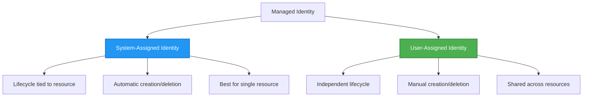

# รูปแบบการตรวจสอบสิทธิ์และ Managed Identity

⏱️ **เวลาประมาณการ**: 45-60 นาทีในการอ่าน; เผื่อเวลาสำหรับการฝึกปฏิบัติ | 💰 **ผลกระทบทางค่าใช้จ่าย**: Identity/RBAC ฟรี; การคำนวณที่ปรับใช้, การจัดเก็บ, และ Key Vault มีค่าบริการ | ⭐ **ความซับซ้อน**: ระดับกลาง

> ทบทวนตาม `azd 1.37.2` (พฤศจิกายน 2026) บทเรียนนี้ประกอบด้วย **ตัวอย่างชิ้นส่วนการผนวกรวม ไม่ใช่เทมเพลต `secure-app` ที่ดาวน์โหลดได้ครบถ้วน** สร้างไฟล์ที่อ้างอิง, จัดเตรียมโครงสร้างพื้นฐานที่ตรงกัน และแทนที่ตัวยึดที่ว่างก่อนการปรับใช้ ไม่มีการจัดเตรียมทรัพยากร Azure ในระหว่างการทบทวน

**📚 เส้นทางการเรียนรู้:**
- ← ก่อนหน้า: [การจัดการการกำหนดค่า](configuration.md) - การจัดการตัวแปรสภาพแวดล้อมและความลับ
- 🎯 **คุณอยู่ที่นี่**: การตรวจสอบสิทธิ์ & ความปลอดภัย (Managed Identity, Key Vault, รูปแบบที่ปลอดภัย)
- → ถัดไป: [โครงสร้างพื้นฐานเป็นโค้ด](../chapter-04-infrastructure/README.md) - การจัดหาและปรับใช้ทรัพยากร
- 🏠 [หน้าแรกของหลักสูตร](../../README.md)

---

## สิ่งที่คุณจะได้เรียนรู้

โดยการทำบทเรียนนี้ให้เสร็จสิ้น คุณจะ:
- เข้าใจรูปแบบการตรวจสอบสิทธิ์ของ Azure (คีย์, สตริงการเชื่อมต่อ, managed identity)
- นำ **Managed Identity** ไปใช้สำหรับการตรวจสอบสิทธิ์โดยไม่ต้องใช้รหัสผ่าน
- รักษาความปลอดภัยความลับด้วยการผนวกรวมกับ **Azure Key Vault**
- กำหนดค่า **role-based access control (RBAC)** สำหรับการปรับใช้ AZD
- ใช้แนวทางปฏิบัติที่ดีที่สุดในด้านความปลอดภัยใน Container Apps และบริการ Azure
- ย้ายจากการตรวจสอบสิทธิ์โดยใช้คีย์เป็นแบบใช้ตัวตน

## ทำไม Managed Identity ถึงสำคัญ

### ปัญหา: การตรวจสอบสิทธิ์แบบดั้งเดิม

**ก่อน Managed Identity:**
```javascript
// ❌ SECURITY RISK: Hardcoded secrets in code
const connectionString = "Server=mydb.database.windows.net;User=admin;Password=P@ssw0rd123";
const storageKey = "xK7mN9pQ2wR5tY8uI0oP3aS6dF1gH4jK...";
const cosmosKey = "C2x7B9n4M1p8Q5w3E6r0T2y5U8i1O4p7...";
```

**ปัญหา:**
- 🔴 **ความลับที่เปิดเผย** ในโค้ด, ไฟล์คอนฟิก, ตัวแปรสภาพแวดล้อม
- 🔴 **การหมุนเวียนข้อมูลประจำตัว** ต้องเปลี่ยนโค้ดและปรับใช้ใหม่
- 🔴 **ฝันร้ายด้านการตรวจสอบ** - ใครเข้าถึงอะไร, เมื่อไร?
- 🔴 **การกระจาย** - ความลับกระจายอยู่ในหลายระบบ
- 🔴 **ความเสี่ยงด้านการปฏิบัติตามข้อกำหนด** - ไม่ผ่านการตรวจสอบความปลอดภัย

### ทางแก้ไข: Managed Identity

**หลัง Managed Identity:**
```javascript
// ✅ SECURE: No secrets in code
const credential = new DefaultAzureCredential();
const client = new BlobServiceClient(
  "https://mystorageaccount.blob.core.windows.net",
  credential  // Azure automatically handles authentication
);
```

**ประโยชน์:**
- ✅ **ไม่มีความลับ** ในโค้ดหรือคอนฟิก
- ✅ **การหมุนเวียนข้อมูลอัตโนมัติ** - Azure ดูแลให้
- ✅ **บันทึกการตรวจสอบครบถ้วน** ในบันทึก Microsoft Entra ID
- ✅ **ความปลอดภัยรวมศูนย์** - จัดการใน Azure Portal
- ✅ **พร้อมสำหรับการปฏิบัติตาม** - เป็นไปตามมาตรฐานความปลอดภัย

**สำนวนเปรียบเทียบ**: การตรวจสอบสิทธิ์แบบดั้งเดิมเหมือนกับการพกกุญแจหลายอันสำหรับประตูที่แตกต่างกัน Managed Identity เหมือนกับมีบัตรประจำตัวความปลอดภัยที่ให้สิทธิ์โดยอัตโนมัติตามตัวตนของคุณ—ไม่มีการทำหาย, ก็อปปี้, หรือหมุนเวียนกุญแจ

---

## ภาพรวมสถาปัตยกรรม

### กระบวนการตรวจสอบสิทธิ์ด้วย Managed Identity

```mermaid
sequenceDiagram
    participant App as Your Application<br/>(Container App)
    participant MI as Managed Identity<br/>(Microsoft Entra ID)
    participant KV as Key Vault
    participant Storage as Azure Storage
    participant DB as Azure SQL
    
    App->>MI: Request access token<br/>(automatic)
    MI->>MI: Verify identity<br/>(no password needed)
    MI-->>App: Return token for requested audience<br/>(lifetime varies)
    
    App->>KV: Get secret<br/>(using token)
    KV->>KV: Check RBAC permissions
    KV-->>App: Return secret value
    
    App->>Storage: Upload blob<br/>(using token)
    Storage->>Storage: Check RBAC permissions
    Storage-->>App: Success
    
    App->>DB: Query data<br/>(using token)
    DB->>DB: Check SQL permissions
    DB-->>App: Return results
    
    Note over App,DB: Request a separate token for each service audience;<br/>SDK credentials handle caching and renewal
```

### ประเภทของ Managed Identities



| คุณลักษณะ | แบบที่กำหนดโดยระบบ | แบบที่กำหนดโดยผู้ใช้ |
|---------|----------------|---------------|
| **วงจรชีวิต** | ผูกกับทรัพยากร | อิสระ |
| **การสร้าง** | อัตโนมัติพร้อมทรัพยากร | สร้างด้วยตนเอง |
| **การลบ** | ลบพร้อมทรัพยากร | คงอยู่หลังจากทรัพยากรถูกลบ |
| **การแชร์** | ทรัพยากรหนึ่งรายการเท่านั้น | หลายทรัพยากร |
| **กรณีใช้งาน** | กรณีเรียบง่าย | กรณีหลายทรัพยากรที่ซับซ้อน |
| **ตัวเลือกเทมเพลต** | กำหนดในโครงสร้างพื้นฐาน | กำหนดในโครงสร้างพื้นฐาน |

---

## ข้อกำหนดเบื้องต้น

### เครื่องมือที่ต้องใช้

คุณควรติดตั้งเครื่องมือเหล่านี้แล้วจากบทเรียนก่อนหน้า:

```bash
# Verify Azure Developer CLI
azd version
# ✅ Expected: azd version 1.0.0 or higher

# Verify Azure CLI
az --version
# ✅ Expected: azure-cli 2.50.0 or higher
```

### ข้อกำหนดของ Azure

- การสมัครสมาชิก Azure ที่ใช้งานอยู่
- สิทธิ์ในการ:
  - สร้าง managed identities
  - กำหนดบทบาท RBAC
  - สร้างทรัพยากร Key Vault
  - ปรับใช้ Container Apps

### ความรู้เบื้องต้นที่ต้องมี

คุณควรทำให้เสร็จ:
- [คู่มือการติดตั้ง](../chapter-01-foundation/installation.md) - การตั้งค่า AZD
- [พื้นฐาน AZD](../chapter-01-foundation/azd-basics.md) - แนวคิดหลัก
- [การจัดการการกำหนดค่า](configuration.md) - ตัวแปรสภาพแวดล้อม

---

## บทเรียน 1: เข้าใจรูปแบบการตรวจสอบสิทธิ์

### รูปแบบที่ 1: สตริงการเชื่อมต่อ (แบบเก่า - ควรหลีกเลี่ยง)

**การทำงาน:**
```bash
# Connection string contains credentials
STORAGE_CONNECTION_STRING="DefaultEndpointsProtocol=https;AccountName=myaccount;AccountKey=xK7mN9pQ2wR5..."
COSMOS_CONNECTION_STRING="AccountEndpoint=https://myaccount.documents.azure.com:443/;AccountKey=C2x7..."
SQL_CONNECTION_STRING="Server=myserver.database.windows.net;User=admin;Password=P@ssw0rd..."
```

**ปัญหา:**
- ❌ ความลับแสดงในตัวแปรสภาพแวดล้อม
- ❌ ถูกบันทึกในระบบปรับใช้
- ❌ หมุนเวียนได้ยาก
- ❌ ไม่มีประวัติการเข้าถึง

**เมื่อใดควรใช้:** เมื่อบริการเป้าหมายต้องการการตรวจสอบสิทธิ์โดยใช้คีย์ ชื่นชอบการใช้ตัวตนหากรองรับ มิฉะนั้นให้จัดเก็บคีย์อย่างปลอดภัยและหมุนเวียนรวมทั้งในโปรดักชัน

---

### รูปแบบที่ 2: การอ้างอิง Key Vault (ดีกว่า)

**การทำงาน:**
**ชิ้นส่วน Bicep บางส่วน:** ละเว้นฟิลด์ vault ที่จำเป็น, ตัวตนของ Container App และรายการ `configuration.secrets` ของมัน `secretRef` ตั้งชื่อความลับของ Container App; ความลับนั้น **ไม่ใช่** URI Key Vault ในตัว เพื่อใช้ Key Vault ให้กำหนดความลับที่ตั้งชื่อนั้นด้วย `keyVaultUrl` และ `identity` ที่ได้รับอนุญาต

```bicep
// Store secret in Key Vault
resource keyVault 'Microsoft.KeyVault/vaults@2023-02-01' = {
  name: 'mykv'
  properties: {
    enableRbacAuthorization: true
  }
}

// Reference in Container App
env: [
  {
    name: 'STORAGE_KEY'
    secretRef: 'storage-key'  // References Key Vault
  }
]
```

**ประโยชน์:**
- ✅ ความลับเก็บไว้อย่างปลอดภัยใน Key Vault
- ✅ การจัดการความลับแบบรวมศูนย์
- ✅ การหมุนเวียนโดยไม่ต้องเปลี่ยนโค้ด

**ข้อจำกัด:**
- ⚠️ ยังคงใช้คีย์/รหัสผ่าน
- ⚠️ ต้องจัดการการเข้าถึง Key Vault

**เมื่อใดควรใช้:** ขั้นตอนการเปลี่ยนผ่านจากสตริงการเชื่อมต่อไปยัง managed identity

---

### รูปแบบที่ 3: Managed Identity (แนวทางปฏิบัติที่ดีที่สุด)

**การทำงาน:**
**Bicep บางส่วน:** รวมบล็อกตัวตนเข้ากับ Container App ที่สมบูรณ์และจัดหาทั้ง `storageAccount` และคำจำกัดความบทบาท การกำหนดบทบาทยังต้องใช้ `name` แบบเป็นที่แน่นอน

```bicep
// Enable managed identity
resource containerApp 'Microsoft.App/containerApps@2023-05-01' = {
  name: 'myapp'
  identity: {
    type: 'SystemAssigned'  // Automatically creates identity
  }
}

// Grant permissions
resource roleAssignment 'Microsoft.Authorization/roleAssignments@2022-04-01' = {
  name: guid(storageAccount.id, containerApp.id, storageBlobDataContributorRole)
  scope: storageAccount
  properties: {
    roleDefinitionId: storageBlobDataContributorRole
    principalId: containerApp.identity.principalId
    principalType: 'ServicePrincipal'
  }
}
```

**โค้ดแอปพลิเคชัน:**
```javascript
// No secrets needed!
const { DefaultAzureCredential } = require('@azure/identity');
const { BlobServiceClient } = require('@azure/storage-blob');

const credential = new DefaultAzureCredential();
const blobServiceClient = new BlobServiceClient(
  'https://mystorageaccount.blob.core.windows.net',
  credential
);
```

**ประโยชน์:**
- ✅ ไม่มีความลับในโค้ด/คอนฟิก
- ✅ การหมุนเวียนข้อมูลรับรองอัตโนมัติ
- ✅ บันทึกการตรวจสอบครบถ้วน
- ✅ สิทธิ์ตาม RBAC
- ✅ พร้อมสำหรับการปฏิบัติตาม

**เมื่อใดควรใช้:** ชื่นชอบสำหรับแอปพลิเคชันที่โฮสต์ใน Azure ซึ่งเข้าถึงบริการที่สนับสนุนการตรวจสอบสิทธิ์ Microsoft Entra

---

### รูปแบบที่ 4: Service Principals (CI/CD & อัตโนมัติ)

Managed identity เป็นมาตรฐานทองคำ *สำหรับทรัพยากรที่ทำงานภายใน Azure* แล้วทรัพยากรที่ทำงาน **นอก** Azure ล่ะ—เช่น CI/CD pipeline บน build agent หรือสคริปต์บนแล็ปท็อปที่ไม่สามารถใช้การเข้าสู่ระบบแบบโต้ตอบของคุณได้? นั่นคือที่มาของ **service principal**: ตัวตนอัตโนมัติที่ไม่ใช่มนุษย์ มีข้อมูลรับรองของตัวเองซึ่งกระบวนการอัตโนมัติสามารถเข้าสู่ระบบแทนได้

**การทำงาน:**

สร้าง service principal ที่มีขอบเขตบน resource group (สิทธิ์น้อยที่สุด):

```bash
az ad sp create-for-rbac \
  --name "myapp-cicd" \
  --role contributor \
  --scopes "/subscriptions/<sub-id>/resourceGroups/<rg-name>"
```

สิ่งนี้จะแสดง client ID, client secret, และ tenant ID azd สามารถเข้าสู่ระบบด้วยข้อมูลเหล่านี้โดยไม่ต้องโต้ตอบ:

```bash
azd auth login \
  --client-id "<appId>" \
  --client-secret "<password>" \
  --tenant-id "<tenant>"
```

**ชื่นชอบการใช้ federated credentials (OIDC) แทน secrets.** แทนที่จะใช้ client secret ที่มีอายุยาวนาน ให้กำหนด federated credential ดังนั้น pipeline จะแลกเปลี่ยนโทเค็นอายุสั้น—ไม่มีความลับให้รั่วไหลหรือต้องหมุนเวียน:

```bash
azd auth login \
  --client-id "<appId>" \
  --federated-credential-provider "github" \
  --tenant-id "<tenant>"
```

> `azd pipeline config` จัดการสิ่งนี้ให้อัตโนมัติ ดูการสาธิต CI/CD ใน [บทที่ 8](../chapter-08-production/production-ai-practices.md).

**ประโยชน์:**
- ✅ ทำงานนอก Azure (build agents, on-premises, เมฆอื่น)
- ✅ สามารถกำหนดขอบเขตเป็น resource group เดียวกับบทบาทเดียว
- ✅ แบบ federated (OIDC) ไม่มีความลับที่จัดเก็บไว้

**ข้อแลกเปลี่ยน:**
- ⚠️ แบบใช้ความลับต้องเก็บและหมุนเวียนอย่างระมัดระวัง
- ⚠️ ความลับที่รั่วไหลจะให้สิทธิ์ทั้งหมดที่ SP มี—ควรจำกัดขอบเขตให้เข้มงวด

**เมื่อใดควรใช้:** CI/CD pipeline และอัตโนมัติที่ไม่สามารถใช้ managed identity ชื่นชอบเวอร์ชัน **federated/OIDC** แทน client secret และชื่นชอบ managed identity ทุกครั้งที่ workload ทำงานภายใน Azure

**การจัดเก็บข้อมูลรับรองอย่างปลอดภัย:**
- ห้ามคอมมิตความลับ—ใช้ที่เก็บความลับของ pipeline (GitHub Actions secrets, Azure DevOps variable groups / Key Vault)
- กำหนดขอบเขต SP ให้มีบทบาทและ resource group เล็กที่สุดที่จำเป็น
- กำหนดวันหมดอายุและหมุนเวียน หรือเลิกใช้ความลับด้วย OIDC

---

## บทเรียน 2: การใช้งาน Managed Identity ด้วย AZD

### การนำไปใช้ทีละขั้นตอน

ชิ้นส่วนตัวอย่างต่อไปนี้แสดงวิธีการผนวกรวม managed identity เข้ากับโครงการ Container App พวกมัน **ไม่ใช่ตัวอย่างที่คัดลอกและใช้งานได้ทันที**: โมดูล Storage, โครงสร้างพื้นฐานสิ่งแวดล้อมครบ/รีจิสทรี, Dockerfile และไฟล์พารามิเตอร์ไม่ได้ให้มาทั้งหมดที่นี่ เริ่มจากเทมเพลต Container Apps ที่ใช้ได้จริงและผสานรูปแบบเหล่านี้ไว้พร้อมกับการกำหนดค่ารีจิสทรีและแท็กบริการเดิม

### โครงสร้างโครงการ

```
secure-app/
├── azure.yaml                 # AZD configuration
├── infra/
│   ├── main.bicep            # Main infrastructure
│   ├── core/
│   │   ├── identity.bicep    # Managed identity setup
│   │   ├── keyvault.bicep    # Key Vault configuration
│   │   └── storage.bicep     # Storage with RBAC
│   └── app/
│       └── container-app.bicep
└── src/
    ├── app.js                # Application code
    ├── package.json
    └── Dockerfile
```

### 1. กำหนดค่า AZD (azure.yaml)

```yaml
name: secure-app
metadata:
  template: secure-app@1.0.0

services:
  api:
    project: ./src
    language: js
    host: containerapp

# Managed identity must be enabled in the infrastructure, not by this YAML.
```

### 2. โครงสร้างพื้นฐาน: เปิดใช้งาน Managed Identity

**ไฟล์: `infra/main.bicep`**

```bicep
targetScope = 'subscription'

param environmentName string
param location string = 'eastus'
param containerAppsEnvironmentId string
param containerImage string

var tags = { 'azd-env-name': environmentName }

// Resource group
resource rg 'Microsoft.Resources/resourceGroups@2021-04-01' = {
  name: 'rg-${environmentName}'
  location: location
  tags: tags
}

// Storage Account
module storage './core/storage.bicep' = {
  name: 'storage'
  scope: rg
  params: {
    name: 'st${uniqueString(rg.id)}'
    location: location
    tags: tags
  }
}

// Key Vault
module keyVault './core/keyvault.bicep' = {
  name: 'keyvault'
  scope: rg
  params: {
    name: 'kv-${uniqueString(rg.id)}'
    location: location
    tags: tags
  }
}

// Container App with Managed Identity
module containerApp './app/container-app.bicep' = {
  name: 'container-app'
  scope: rg
  params: {
    name: 'ca-${environmentName}'
    location: location
    tags: tags
    storageAccountName: storage.outputs.name
    keyVaultName: keyVault.outputs.name
    containerAppsEnvironmentId: containerAppsEnvironmentId
    containerImage: containerImage
  }
}

// Grant Container App access to Storage
module storageRoleAssignment './core/role-assignment.bicep' = {
  name: 'storage-role'
  scope: rg
  params: {
    principalId: containerApp.outputs.identityPrincipalId
    roleDefinitionId: 'ba92f5b4-2d11-453d-a403-e96b0029c9fe'  // Storage Blob Data Contributor
    targetResourceType: 'storage'
    targetResourceName: storage.outputs.name
  }
}

// Grant Container App access to Key Vault
module kvRoleAssignment './core/role-assignment.bicep' = {
  name: 'kv-role'
  scope: rg
  params: {
    principalId: containerApp.outputs.identityPrincipalId
    roleDefinitionId: '4633458b-17de-408a-b874-0445c86b69e6'  // Key Vault Secrets User
    targetResourceType: 'keyvault'
    targetResourceName: keyVault.outputs.name
  }
}

// Outputs
output AZURE_STORAGE_ACCOUNT_NAME string = storage.outputs.name
output AZURE_KEY_VAULT_NAME string = keyVault.outputs.name
output APP_URL string = containerApp.outputs.url
```

### 3. Container App พร้อมระบบตัวตนที่กำหนดโดยระบบ

**ไฟล์: `infra/app/container-app.bicep`**

```bicep
param name string
param location string
param tags object = {}
param storageAccountName string
param keyVaultName string
param containerAppsEnvironmentId string
param containerImage string

resource containerApp 'Microsoft.App/containerApps@2023-05-01' = {
  name: name
  location: location
  tags: union(tags, { 'azd-service-name': 'api' })
  identity: {
    type: 'SystemAssigned'  // 🔑 Enable managed identity
  }
  properties: {
    managedEnvironmentId: containerAppsEnvironmentId
    configuration: {
      ingress: {
        external: true
        targetPort: 3000
      }
    }
    template: {
      containers: [
        {
          name: 'api'
          image: containerImage // Must exist; configure registry credentials for private images
          resources: {
            cpu: json('0.5')
            memory: '1Gi'
          }
          env: [
            {
              name: 'AZURE_STORAGE_ACCOUNT_NAME'
              value: storageAccountName
            }
            {
              name: 'AZURE_KEY_VAULT_NAME'
              value: keyVaultName
            }
            // 🔑 No secrets - managed identity handles authentication!
          ]
        }
      ]
    }
  }
}

// Output the identity for RBAC assignments
output identityPrincipalId string = containerApp.identity.principalId
output id string = containerApp.id
output url string = 'https://${containerApp.properties.configuration.ingress.fqdn}'
```

### 4. โมดูลการกำหนดบทบาท RBAC

**ไฟล์: `infra/core/role-assignment.bicep`**

```bicep
param principalId string
param roleDefinitionId string  // Azure built-in role ID
@allowed(['storage', 'keyvault'])
param targetResourceType string
param targetResourceName string

// Typed existing resources give Bicep a valid resource scope, not a string ID.
resource storageTarget 'Microsoft.Storage/storageAccounts@2023-01-01' existing = {
  name: targetResourceName
}
resource vaultTarget 'Microsoft.KeyVault/vaults@2023-02-01' existing = {
  name: targetResourceName
}

resource storageAssignment 'Microsoft.Authorization/roleAssignments@2022-04-01' = if (targetResourceType == 'storage') {
  name: guid(storageTarget.id, principalId, roleDefinitionId)
  scope: storageTarget
  properties: {
    roleDefinitionId: subscriptionResourceId('Microsoft.Authorization/roleDefinitions', roleDefinitionId)
    principalId: principalId
    principalType: 'ServicePrincipal'
  }
}

resource vaultAssignment 'Microsoft.Authorization/roleAssignments@2022-04-01' = if (targetResourceType == 'keyvault') {
  name: guid(vaultTarget.id, principalId, roleDefinitionId)
  scope: vaultTarget
  properties: {
    roleDefinitionId: subscriptionResourceId('Microsoft.Authorization/roleDefinitions', roleDefinitionId)
    principalId: principalId
    principalType: 'ServicePrincipal'
  }
}

// This module assigns at the target resource scope, not the whole resource group.
```

### 5. โค้ดแอปพลิเคชันกับ Managed Identity

**ไฟล์: `src/app.js`**

```javascript
const express = require('express');
const { DefaultAzureCredential } = require('@azure/identity');
const { BlobServiceClient } = require('@azure/storage-blob');
const { SecretClient } = require('@azure/keyvault-secrets');

const app = express();
const PORT = process.env.PORT || 3000;

// 🔑 Initialize credential (works automatically with managed identity)
const credential = new DefaultAzureCredential();

// Azure Storage setup
const storageAccountName = process.env.AZURE_STORAGE_ACCOUNT_NAME;
const blobServiceClient = new BlobServiceClient(
  `https://${storageAccountName}.blob.core.windows.net`,
  credential  // No keys needed!
);

// Key Vault setup
const keyVaultName = process.env.AZURE_KEY_VAULT_NAME;
const secretClient = new SecretClient(
  `https://${keyVaultName}.vault.azure.net`,
  credential  // No keys needed!
);

// Health check
app.get('/health', (req, res) => {
  res.json({ status: 'healthy', authentication: 'managed-identity' });
});

// Upload file to blob storage
app.post('/upload', async (req, res) => {
  try {
    const containerClient = blobServiceClient.getContainerClient('uploads');
    await containerClient.createIfNotExists();
    
    const blobName = `file-${Date.now()}.txt`;
    const blockBlobClient = containerClient.getBlockBlobClient(blobName);
    
    const content = 'Hello from managed identity!';
    await blockBlobClient.upload(content, Buffer.byteLength(content));
    
    res.json({
      success: true,
      blobName: blobName,
      message: 'File uploaded using managed identity!'
    });
  } catch (error) {
    console.error('Upload error:', error);
    res.status(500).json({ error: error.message });
  }
});

// Get secret from Key Vault
app.get('/secret/:name', async (req, res) => {
  try {
    const secretName = req.params.name;
    const secret = await secretClient.getSecret(secretName);
    
    res.json({
      name: secretName,
      retrieved: secret.value !== undefined, // Never return the secret value to callers
      message: 'Secret retrieved using managed identity!'
    });
  } catch (error) {
    console.error('Secret error:', error);
    res.status(500).json({ error: error.message });
  }
});

// List blob containers (demonstrates read access)
app.get('/containers', async (req, res) => {
  try {
    const containers = [];
    for await (const container of blobServiceClient.listContainers()) {
      containers.push(container.name);
    }
    
    res.json({
      containers: containers,
      count: containers.length,
      message: 'Containers listed using managed identity!'
    });
  } catch (error) {
    console.error('List error:', error);
    res.status(500).json({ error: error.message });
  }
});

app.listen(PORT, () => {
  console.log(`Secure API listening on port ${PORT}`);
  console.log('Authentication: Managed Identity (passwordless)');
});
```

**ไฟล์: `src/package.json`**

```json
{
  "name": "secure-app",
  "version": "1.0.0",
  "dependencies": {
    "express": "^4.18.2",
    "@azure/identity": "^4.0.0",
    "@azure/storage-blob": "^12.17.0",
    "@azure/keyvault-secrets": "^4.7.0"
  },
  "scripts": {
    "start": "node app.js"
  }
}
```

### 6. ปรับใช้และทดสอบ

รันคำสั่งเหล่านี้ **หลังจาก** เสร็จสิ้นโครงสร้างพื้นฐานที่ขาดไป, Dockerfile และ `main.parameters.json` ที่ตรงกันในโครงการของคุณ ลงชื่อเข้าใช้ azd ด้วย `azd auth login`; ลงชื่อเข้าใช้แยกต่างหากด้วย `az login` สำหรับการตรวจสอบ CLI ของ Azure ในภายหลัง จุดสิ้นสุดที่แสดงไว้เป็นเพียงการสาธิตและจำเป็นต้องมีการควบคุมการเข้าถึงก่อนเปิดใช้สาธารณะ

```bash
# Initialize AZD environment
azd init

# Deploy infrastructure and application
azd up

# Get the app URL
APP_URL=$(azd env get-value APP_URL)

# Test health check
curl $APP_URL/health
```

**✅ ผลลัพธ์ที่คาดหวัง:**
```json
{
  "status": "healthy",
  "authentication": "managed-identity"
}
```

**ทดสอบการอัปโหลด blob:**
```bash
curl -X POST $APP_URL/upload
```

**✅ ผลลัพธ์ที่คาดหวัง:**
```json
{
  "success": true,
  "blobName": "file-1700404800000.txt",
  "message": "File uploaded using managed identity!"
}
```

**ทดสอบการแสดงรายการ container:**
```bash
curl $APP_URL/containers
```

**✅ ผลลัพธ์ที่คาดหวัง:**
```json
{
  "containers": ["uploads"],
  "count": 1,
  "message": "Containers listed using managed identity!"
}
```

---

## บทบาท Azure RBAC ทั่วไป

### รหัสบทบาทในตัวสำหรับ Managed Identity

| บริการ | ชื่อบทบาท | รหัสบทบาท | สิทธิ์ |
|---------|-----------|---------|-------------|
| **Storage** | Storage Blob Data Reader | `2a2b9908-6ea1-4ae2-8e65-a410df84e7d1` | อ่านบล็อบและคอนเทนเนอร์ |
| **Storage** | Storage Blob Data Contributor | `ba92f5b4-2d11-453d-a403-e96b0029c9fe` | อ่าน, เขียน, ลบบล็อบ |
| **Storage** | Storage Queue Data Contributor | `974c5e8b-45b9-4653-ba55-5f855dd0fb88` | อ่าน, เขียน, ลบคิว/ข้อความ |
| **Key Vault** | Key Vault Secrets User | `4633458b-17de-408a-b874-0445c86b69e6` | อ่านความลับ |
| **Key Vault** | Key Vault Secrets Officer | `b86a8fe4-44ce-4948-aee5-eccb2c155cd7` | อ่าน, เขียน, ลบความลับ |
| **Cosmos DB** | Cosmos DB Built-in Data Reader | `00000000-0000-0000-0000-000000000001` | อ่านข้อมูล Cosmos DB |
| **Cosmos DB** | Cosmos DB Built-in Data Contributor | `00000000-0000-0000-0000-000000000002` | อ่าน, เขียนข้อมูล Cosmos DB |
| **SQL Database** | SQL DB Contributor | `9b7fa17d-e63e-47b0-bb0a-15c516ac86ec` | จัดการทรัพยากรฐานข้อมูล; ไม่ได้ให้สิทธิ์เข้าถึงข้อมูล SQL |
| **Service Bus** | Azure Service Bus Data Owner | `090c5cfd-751d-490a-894a-3ce6f1109419` | ส่ง, รับ, จัดการข้อความ |

### วิธีค้นหารหัสบทบาท

รหัสสองตัวสำหรับ Cosmos DB สำหรับ NoSQL ข้างต้นเป็น **คำจำกัดความบทบาทระดับข้อมูล Cosmos ดั้งเดิม** ไม่ใช่รหัสบทบาท Azure RBAC ในการสมัครสมาชิก ให้กำหนดโดยใช้ `az cosmosdb sql role assignment create` (หรือ `Microsoft.DocumentDB/databaseAccounts/sqlRoleAssignments`) ไม่ใช่ `az role assignment create` การเข้าถึงข้อมูล SQL ต้องมีผู้ใช้ฐานข้อมูล Entra และสิทธิ์ SQL

```bash
# List all built-in roles
az role definition list --query "[].{Name:roleName, ID:name}" --output table

# Search for specific role
az role definition list --query "[?contains(roleName, 'Storage Blob')].{Name:roleName, ID:name}" --output table

# Get role details
az role definition list --name "Storage Blob Data Contributor"
```

---

## ฝึกปฏิบัติ

**ข้อกำหนดในการผนวกรวมสำหรับแบบฝึกหัดทั้งสาม:** เทมเพลต Container App ที่ใช้งานได้ในโครงการของคุณ, ทรัพยากร Bicep ที่ตรงกัน, การลงชื่อเข้าใช้ Azure CLI/azd และสิทธิ์ในการกำหนดบทบาทที่จำเป็น นี่เป็นการปรับแต่งตามแนวทาง ไม่ใช่ตัวเริ่มต้นแบบสแตนด์อโลนในเครื่อง ให้แทนที่ชื่อทรัพยากรตัวอย่างด้วยชื่อจริงที่คุณปรับใช้

### แบบฝึกหัด 1: เปิดใช้งาน Managed Identity สำหรับแอปที่มีอยู่ ⭐⭐ (ระดับกลาง)

**เป้าหมาย**: เพิ่ม managed identity ให้กับการปรับใช้ Container App ที่มีอยู่

**สถานการณ์**: คุณมี Container App ที่ใช้สตริงการเชื่อมต่อ แปลงเป็น managed identity

**จุดเริ่มต้น**: Container App ที่มีการกำหนดค่าดังนี้:

```bicep
// ❌ Current: Using connection string
env: [
  {
    name: 'STORAGE_CONNECTION_STRING'
    secretRef: 'storage-connection'
  }
]
```

**ขั้นตอน**:

1. **เปิดใช้งาน managed identity ใน Bicep:**

```bicep
resource containerApp 'Microsoft.App/containerApps@2023-05-01' = {
  name: 'myapp'
  identity: {
    type: 'SystemAssigned'  // Add this
  }
  // ... rest of configuration
}
```

2. **ให้สิทธิ์เข้าถึง Storage:**

```bicep
// Get storage account reference
resource storageAccount 'Microsoft.Storage/storageAccounts@2023-01-01' existing = {
  name: storageAccountName
}

// Assign role
resource roleAssignment 'Microsoft.Authorization/roleAssignments@2022-04-01' = {
  name: guid(containerApp.id, 'ba92f5b4-2d11-453d-a403-e96b0029c9fe', storageAccount.id)
  scope: storageAccount
  properties: {
    roleDefinitionId: subscriptionResourceId('Microsoft.Authorization/roleDefinitions', 'ba92f5b4-2d11-453d-a403-e96b0029c9fe')
    principalId: containerApp.identity.principalId
    principalType: 'ServicePrincipal'
  }
}
```

3. **อัปเดตโค้ดแอปพลิเคชัน:**

**ก่อนหน้า (สตริงการเชื่อมต่อ):**
```javascript
const { BlobServiceClient } = require('@azure/storage-blob');

const blobServiceClient = BlobServiceClient.fromConnectionString(
  process.env.STORAGE_CONNECTION_STRING
);
```

**หลังจาก (managed identity):**
```javascript
const { DefaultAzureCredential } = require('@azure/identity');
const { BlobServiceClient } = require('@azure/storage-blob');

const credential = new DefaultAzureCredential();
const blobServiceClient = new BlobServiceClient(
  `https://${process.env.STORAGE_ACCOUNT_NAME}.blob.core.windows.net`,
  credential
);
```

4. **อัปเดตตัวแปรสภาพแวดล้อม:**

```bicep
env: [
  {
    name: 'STORAGE_ACCOUNT_NAME'
    value: storageAccountName  // Just the name, no secrets!
  }
  // Remove STORAGE_CONNECTION_STRING
]
```

5. **ปรับใช้และทดสอบ:**

```bash
# Redeploy
azd up

# Test that it still works
APP_URL=$(azd show --output json | jq -er '.services.api.ingressUrl')
curl --fail -X POST "$APP_URL/upload"
```

**✅ เกณฑ์ความสำเร็จ:**
- ✅ แอปพลิเคชันปรับใช้โดยไม่มีข้อผิดพลาด
- ✅ การดำเนินการใน Storage ทำงาน (อัปโหลด, แสดงรายการ, ดาวน์โหลด)
- ✅ ไม่มีสตริงการเชื่อมต่อในตัวแปรสภาพแวดล้อม
- ✅ ตัวตนปรากฏใน Azure Portal ภายใต้บานหน้าต่าง "Identity"

**การตรวจสอบ:**

```bash
# Check managed identity is enabled
az containerapp show \
  --name myapp \
  --resource-group rg-myapp \
  --query "identity.type"
# ✅ Expected: "SystemAssigned"

# Check role assignment
az role assignment list \
  --assignee $(az containerapp show --name myapp --resource-group rg-myapp --query "identity.principalId" -o tsv) \
  --scope /subscriptions/{sub-id}/resourceGroups/rg-myapp/providers/Microsoft.Storage/storageAccounts/mystorageaccount
# ✅ Expected: Shows "Storage Blob Data Contributor" role
```

**เวลา**: 20-30 นาที

---

### แบบฝึกหัด 2: การเข้าถึงหลายบริการด้วย User-Assigned Identity ⭐⭐⭐ (ระดับสูง)

**เป้าหมาย**: สร้าง user-assigned identity ที่แชร์ระหว่าง Container Apps หลายตัว

**สถานการณ์**: คุณมีไมโครเซอร์วิส 3 ตัวที่ต้องการเข้าถึงบัญชี Storage และ Key Vault เดียวกัน

**ขั้นตอน:**

1. **สร้าง user-assigned identity:**

**ไฟล์: `infra/core/identity.bicep`**

```bicep
param name string
param location string
param tags object = {}

resource userAssignedIdentity 'Microsoft.ManagedIdentity/userAssignedIdentities@2023-01-31' = {
  name: name
  location: location
  tags: tags
}

output id string = userAssignedIdentity.id
output principalId string = userAssignedIdentity.properties.principalId
output clientId string = userAssignedIdentity.properties.clientId
```

2. **กำหนดบทบาทให้ user-assigned identity:**

```bicep
// In main.bicep
module userIdentity './core/identity.bicep' = {
  name: 'user-identity'
  scope: rg
  params: {
    name: 'id-${environmentName}'
    location: location
    tags: tags
  }
}

// Grant Storage access
resource storageRoleAssignment 'Microsoft.Authorization/roleAssignments@2022-04-01' = {
  name: guid(storageAccount.id, environmentName, 'storage-contributor')
  scope: storageAccount
  properties: {
    roleDefinitionId: subscriptionResourceId('Microsoft.Authorization/roleDefinitions', 'ba92f5b4-2d11-453d-a403-e96b0029c9fe')
    principalId: userIdentity.outputs.principalId
    principalType: 'ServicePrincipal'
  }
}

// Grant Key Vault access
resource kvRoleAssignment 'Microsoft.Authorization/roleAssignments@2022-04-01' = {
  name: guid(keyVault.id, environmentName, 'kv-secrets-user')
  scope: keyVault
  properties: {
    roleDefinitionId: subscriptionResourceId('Microsoft.Authorization/roleDefinitions', '4633458b-17de-408a-b874-0445c86b69e6')
    principalId: userIdentity.outputs.principalId
    principalType: 'ServicePrincipal'
  }
}
```

3. **กำหนดตัวตนให้กับ Container Apps หลายตัว:**

```bicep
resource apiGateway 'Microsoft.App/containerApps@2023-05-01' = {
  name: 'api-gateway'
  identity: {
    type: 'UserAssigned'
    userAssignedIdentities: {
      '${userIdentity.outputs.id}': {}
    }
  }
  // ... rest of config
}

resource productService 'Microsoft.App/containerApps@2023-05-01' = {
  name: 'product-service'
  identity: {
    type: 'UserAssigned'
    userAssignedIdentities: {
      '${userIdentity.outputs.id}': {}
    }
  }
  // ... rest of config
}

resource orderService 'Microsoft.App/containerApps@2023-05-01' = {
  name: 'order-service'
  identity: {
    type: 'UserAssigned'
    userAssignedIdentities: {
      '${userIdentity.outputs.id}': {}
    }
  }
  // ... rest of config
}
```

4. **โค้ดแอปพลิเคชัน (บริการทั้งหมดใช้รูปแบบเดียวกัน):**

```javascript
const { ManagedIdentityCredential } = require('@azure/identity');
const { BlobServiceClient } = require('@azure/storage-blob');

// For user-assigned identity, specify the client ID
const credential = new ManagedIdentityCredential(
  process.env.AZURE_CLIENT_ID  // User-assigned identity client ID
);

// Alternative (choose ONE credential declaration):
// const { DefaultAzureCredential } = require('@azure/identity');
// const credential = new DefaultAzureCredential({
//   managedIdentityClientId: process.env.AZURE_CLIENT_ID
// });

const blobServiceClient = new BlobServiceClient(
  `https://${process.env.STORAGE_ACCOUNT_NAME}.blob.core.windows.net`,
  credential
);
```

ตั้งค่า runtime ของ Container App แต่ละตัวโดยกำหนด `AZURE_CLIENT_ID` เป็น `userIdentity.outputs.clientId` และ `STORAGE_ACCOUNT_NAME` เป็นชื่อ storage ของคุณใน Bicep การกำหนดตัวตนเพียงอย่างเดียวหรือตาราง `azd env set` ไม่ได้ตั้งค่าค่า runtime เหล่านี้

5. **ปรับใช้และตรวจสอบ:**

```bash
azd up

# Test all services can access storage
# Replace with the actual ingress URLs reported for your three services
curl --fail -X POST "$API_GATEWAY_URL/upload"
curl --fail -X POST "$PRODUCT_SERVICE_URL/upload"
curl --fail -X POST "$ORDER_SERVICE_URL/upload"
```

**✅ เงื่อนไขความสำเร็จ:**
- ✅ ตัวตนเดียวที่ใช้ร่วมกันใน 3 บริการ
- ✅ บริการทั้งหมดสามารถเข้าถึง Storage และ Key Vault ได้
- ✅ ตัวตนยังคงอยู่หากคุณลบบริการหนึ่ง
- ✅ การจัดการสิทธิ์แบบรวมศูนย์

**ประโยชน์ของ User-Assigned Identity:**
- ตัวตนเดียวที่จัดการได้ง่าย
- สิทธิ์ที่สอดคล้องกันในบริการทั้งหมด
- อยู่รอดจากการลบบริการ
- เหมาะสำหรับสถาปัตยกรรมที่ซับซ้อน

**เวลา**: 30-40 นาที

---

### แบบฝึกหัด 3: ดำเนินการหมุนรหัสลับใน Key Vault ⭐⭐⭐ (ขั้นสูง)

**เป้าหมาย**: จัดเก็บคีย์ API จากบุคคลที่สามใน Key Vault และเข้าถึงโดยใช้ managed identity

**สถานการณ์**: แอปของคุณต้องเรียก API ภายนอก (OpenAI, Stripe, SendGrid) ซึ่งต้องใช้คีย์ API

**ขั้นตอน:**

1. **สร้าง Key Vault พร้อม RBAC:**

**ไฟล์: `infra/core/keyvault.bicep`**

```bicep
param name string
param location string
param tags object = {}

resource keyVault 'Microsoft.KeyVault/vaults@2023-02-01' = {
  name: name
  location: location
  tags: tags
  properties: {
    enableRbacAuthorization: true  // Use RBAC instead of access policies
    sku: {
      family: 'A'
      name: 'standard'
    }
    tenantId: subscription().tenantId
    enableSoftDelete: true
    softDeleteRetentionInDays: 90
  }
}

// Allow Container App to read secrets
output id string = keyVault.id
output name string = keyVault.name
output uri string = keyVault.properties.vaultUri
```

2. **จัดเก็บรหัสลับใน Key Vault:**

```bash
# Get Key Vault name
KV_NAME=$(azd env get-value AZURE_KEY_VAULT_NAME)

# Store third-party API keys
az keyvault secret set \
  --vault-name $KV_NAME \
  --name "OpenAI-ApiKey" \
  --value "sk-proj-xxxxxxxxxxxxx"

az keyvault secret set \
  --vault-name $KV_NAME \
  --name "Stripe-ApiKey" \
  --value "sk_live_xxxxxxxxxxxxx"

az keyvault secret set \
  --vault-name $KV_NAME \
  --name "SendGrid-ApiKey" \
  --value "SG.xxxxxxxxxxxxx"
```

3. **โค้ดแอปพลิเคชันเพื่อดึงรหัสลับ:**

**ไฟล์: `src/config.js`**

```javascript
const { DefaultAzureCredential } = require('@azure/identity');
const { SecretClient } = require('@azure/keyvault-secrets');

class Config {
  constructor() {
    this.credential = new DefaultAzureCredential();
    this.secretClient = new SecretClient(
      `https://${process.env.AZURE_KEY_VAULT_NAME}.vault.azure.net`,
      this.credential
    );
    this.cache = {};
  }

  async getSecret(secretName) {
    // Check cache first
    if (this.cache[secretName]) {
      return this.cache[secretName];
    }

    try {
      const secret = await this.secretClient.getSecret(secretName);
      this.cache[secretName] = secret.value;
      console.log(`✅ Retrieved secret: ${secretName}`);
      return secret.value;
    } catch (error) {
      console.error(`❌ Failed to get secret ${secretName}:`, error.message);
      throw error;
    }
  }

  async getOpenAIKey() {
    return this.getSecret('OpenAI-ApiKey');
  }

  async getStripeKey() {
    return this.getSecret('Stripe-ApiKey');
  }

  async getSendGridKey() {
    return this.getSecret('SendGrid-ApiKey');
  }
}

module.exports = new Config();
```

4. **ใช้รหัสลับในแอปพลิเคชัน:**

**ไฟล์: `src/app.js`**

ส่วน **ตัวอย่างแอปพลิเคชันนี้** ต้องใช้ `npm install openai` คีย์บุคคลที่สามจริง โมเดลที่เข้าถึงได้ และโครงสร้างพื้นฐานจากโปรเจกต์ของคุณ มันเรียก OpenAI โดยตรง ไม่ใช่การใช้งาน Azure OpenAI คีย์ตัวอย่างด้านล่างนี้ไม่ได้อนุญาตให้ส่งคำขอ

```javascript
const express = require('express');
const config = require('./config');
const { OpenAI } = require('openai');

const app = express();

// Initialize OpenAI with key from Key Vault
let openaiClient;

async function initializeServices() {
  const openaiKey = await config.getOpenAIKey();
  openaiClient = new OpenAI({ apiKey: openaiKey });
  console.log('✅ Services initialized with secrets from Key Vault');
}

app.post('/chat', async (req, res) => {
  try {
    const completion = await openaiClient.chat.completions.create({
      model: 'gpt-4.1',
      messages: [{ role: 'user', content: 'Hello!' }]
    });
    
    res.json({
      response: completion.choices[0].message.content,
      authentication: 'Key from Key Vault via Managed Identity'
    });
  } catch (error) {
    res.status(500).json({ error: error.message });
  }
});

// Start listening only after initialization succeeds.
initializeServices().then(() => {
  app.listen(3000, () => console.log('Key Vault demo running'));
}).catch(error => {
  console.error('Initialization failed:', error.message);
  process.exitCode = 1;
});
```

5. **ปรับใช้และทดสอบ:**

```bash
azd up

# Test that API keys work
curl -X POST https://myapp.azurecontainerapps.io/chat \
  -H "Content-Type: application/json" \
  -d '{"message":"Hello AI"}'
```

**✅ เงื่อนไขความสำเร็จ:**
- ✅ ไม่มีคีย์ API ในโค้ดหรือ environment variables
- ✅ แอปพลิเคชันดึงคีย์จาก Key Vault
- ✅ APIs ของบุคคลที่สามทำงานถูกต้อง
- ✅ สามารถหมุนคีย์ได้โดยไม่ต้องเปลี่ยนโค้ด

**หมุนรหัสลับ:**

```bash
# Update secret in Key Vault
az keyvault secret set \
  --vault-name $KV_NAME \
  --name "OpenAI-ApiKey" \
  --value "sk-proj-NEW_KEY_HERE"

# Find the active revision name, then restart it to clear the in-process cache
az containerapp revision list --name myapp --resource-group rg-myapp --output table
az containerapp revision restart \
  --name myapp \
  --resource-group rg-myapp \
  --revision "<active-revision-name>"
```

**เวลา**: 25-35 นาที

---

## จุดตรวจสอบความรู้

### 1. รูปแบบการตรวจสอบสิทธิ์ ✓

ทดสอบความเข้าใจของคุณ:

- [ ] **ถาม 1**: รูปแบบการตรวจสอบสิทธิ์หลักสามแบบคืออะไร? 
  - **ตอบ**: connection strings (แบบเก่า), Key Vault references (การเปลี่ยนผ่าน), Managed Identity (ดีที่สุด)

- [ ] **ถาม 2**: ทำไม managed identity ถึงดีกว่า connection strings?
  - **ตอบ**: ไม่มีความลับในโค้ด, หมุนอัตโนมัติ, มี audit trail ครบถ้วน, มีสิทธิ์ RBAC

- [ ] **ถาม 3**: เมื่อใดควรใช้ user-assigned identity แทน system-assigned?
  - **ตอบ**: เมื่อใช้ตัวตนร่วมกันในหลายทรัพยากร หรือเมื่อตัวตนต้องเป็นอิสระจากวงจรชีวิตของทรัพยากร

**การตรวจสอบด้วยตนเอง:**
```bash
# Check what type of identity your app uses
az containerapp show \
  --name myapp \
  --resource-group rg-myapp \
  --query "identity.type"

# List all role assignments for the identity
az role assignment list \
  --assignee $(az containerapp show --name myapp --resource-group rg-myapp --query "identity.principalId" -o tsv)
```

---

### 2. RBAC และสิทธิ์ ✓

ทดสอบความเข้าใจของคุณ:

- [ ] **ถาม 1**: รหัส role ID สำหรับ "Storage Blob Data Contributor" คืออะไร?
  - **ตอบ**: `ba92f5b4-2d11-453d-a403-e96b0029c9fe`

- [ ] **ถาม 2**: สิทธิ์ที่ "Key Vault Secrets User" ให้คืออะไร?
  - **ตอบ**: สิทธิ์อ่านเท่านั้นสำหรับรหัสลับ (ไม่สามารถสร้าง, อัปเดต หรือ ลบได้)

- [ ] **ถาม 3**: วิธีให้สิทธิ์ Container App เข้าถึง Azure SQL อย่างไร?
  - **ตอบ**: ตั้งค่าการพิสูจน์ตัวตน Microsoft Entra, สร้างตัวตนเป็นผู้ใช้ฐานข้อมูล, และให้สิทธิ์ SQL ที่จำเป็น "SQL DB Contributor" จัดการเฉพาะทรัพยากร Azure; ไม่อนุญาตการสืบค้น

**การตรวจสอบด้วยตนเอง:**
```bash
# Find specific role
az role definition list --name "Storage Blob Data Contributor"

# Check what roles are assigned to your identity
PRINCIPAL_ID=$(az containerapp show --name myapp --resource-group rg-myapp --query "identity.principalId" -o tsv)
az role assignment list --assignee $PRINCIPAL_ID --output table
```

---

### 3. การผสาน Key Vault ✓

ทดสอบความเข้าใจของคุณ:

- [ ] **ถาม 1**: วิธีเปิดใช้งาน RBAC สำหรับ Key Vault แทนนโยบายการเข้าถึงอย่างไร?
  - **ตอบ**: กำหนดค่า `enableRbacAuthorization: true` ใน Bicep

- [ ] **ถาม 2**: ไลบรารี SDK ของ Azure ใดที่จัดการการพิสูจน์ตัวตนด้วย managed identity?
  - **ตอบ**: `@azure/identity` พร้อมคลาส `DefaultAzureCredential`

- [ ] **ถาม 3**: รหัสลับใน Key Vault cache ได้นานเท่าไร?
  - **ตอบ**: ขึ้นอยู่กับแอปพลิเคชัน; ต้องวางแผนแคชชิ่งเอง

**การตรวจสอบด้วยตนเอง:**
```bash
# Test Key Vault access
az keyvault secret show \
  --vault-name $KV_NAME \
  --name "OpenAI-ApiKey" \
  --query "{name:name,enabled:attributes.enabled}"

# Check RBAC is enabled
az keyvault show \
  --name $KV_NAME \
  --query "properties.enableRbacAuthorization"
# ✅ Expected: true
```

---

## แนวทางปฏิบัติด้านความปลอดภัย

### ✅ ควรทำ:

1. **ใช้ managed identity ในการผลิตเสมอ**
   ```bicep
   identity: {
     type: 'SystemAssigned'
   }
   ```

2. **ใช้บทบาท RBAC ที่จำกัดสิทธิ์มากที่สุด**
   - ใช้บทบาท "Reader" บ่อยครั้งที่สุดเมื่อเป็นไปได้
   - หลีกเลี่ยงบทบาท "Owner" หรือ "Contributor" หากไม่จำเป็น

3. **จัดเก็บคีย์ของบุคคลที่สามใน Key Vault**
   ```javascript
   const apiKey = await secretClient.getSecret('ThirdPartyApiKey');
   ```

4. **เปิดใช้งานบันทึกตรวจสอบ** (โค้ดบางส่วนของทรัพยากร; ให้รวมกับประกาศ vault และ workspace ของคุณ)
   ```bicep
   resource vaultDiagnostics 'Microsoft.Insights/diagnosticSettings@2021-05-01-preview' = {
     name: 'vault-audit'
     scope: keyVault
     properties: {
       workspaceId: logAnalytics.id
       logs: [{ category: 'AuditEvent', enabled: true }]
     }
   }
   ```

5. **ใช้ตัวตนแยกสำหรับ dev/staging/prod**
   ```bash
   azd env new dev
   azd env new staging
   azd env new prod
   ```

6. **หมุนรหัสลับเป็นประจำ**
   - ตั้งค่าวันหมดอายุสำหรับรหัสลับใน Key Vault
   - อัตโนมัติการหมุนด้วย Azure Functions

### ❌ ควรหลีกเลี่ยง:

1. **อย่าซ่อนรหัสลับในโค้ด**
   ```javascript
   // ❌ BAD
   const apiKey = "sk-proj-xxxxxxxxxxxxx";
   ```

2. **อย่าใช้ connection strings ในการผลิต**
   ```javascript
   // ❌ BAD
   BlobServiceClient.fromConnectionString(process.env.STORAGE_CONNECTION_STRING)
   ```

3. **อย่าให้สิทธิ์มากเกินไป**
   ```bicep
   // ❌ BAD - too much access
   roleDefinitionId: subscriptionResourceId('Microsoft.Authorization/roleDefinitions', '8e3af657-a8ff-443c-a75c-2fe8c4bcb635')
   
   // ✅ GOOD - least privilege
   roleDefinitionId: subscriptionResourceId('Microsoft.Authorization/roleDefinitions', '2a2b9908-6ea1-4ae2-8e65-a410df84e7d1')
   ```

4. **อย่าบันทึกรหัสลับ**
   ```javascript
   // ❌ BAD
   console.log('API Key:', apiKey);
   
   // ✅ GOOD
   console.log('API Key retrieved successfully');
   ```

5. **อย่าใช้ตัวตนในสภาพแวดล้อมการผลิตร่วมกันระหว่างสภาพแวดล้อมอื่น ๆ**
   ```bicep
   // ❌ BAD - same identity for dev and prod
   // ✅ GOOD - separate identities per environment
   ```

---

## คู่มือแก้ไขปัญหา

### ปัญหา: "Unauthorized" เมื่อเข้าถึง Azure Storage

**อาการ:**
```
Error: Unauthorized (403)
AuthorizationPermissionMismatch: This request is not authorized to perform this operation
```

**การวินิจฉัย:**

```bash
# Check if managed identity is enabled
az containerapp show \
  --name myapp \
  --resource-group rg-myapp \
  --query "identity.type"
# ✅ Expected: "SystemAssigned" or "UserAssigned"

# Check role assignments
PRINCIPAL_ID=$(az containerapp show --name myapp --resource-group rg-myapp --query "identity.principalId" -o tsv)
az role assignment list --assignee $PRINCIPAL_ID

# Expected: Should see "Storage Blob Data Contributor" or similar role
```

**วิธีแก้ไข:**

1. **มอบหมายบทบาท RBAC ที่ถูกต้อง:**
```bash
STORAGE_ID=$(az storage account show --name mystorageaccount --resource-group rg-myapp --query "id" -o tsv)
az role assignment create \
  --assignee $PRINCIPAL_ID \
  --role "Storage Blob Data Contributor" \
  --scope $STORAGE_ID
```

2. **รอการเผยแพร่ (อาจใช้เวลา 5-10 นาที):**
```bash
# Check role assignment status
az role assignment list --assignee $PRINCIPAL_ID --scope $STORAGE_ID
```

3. **ตรวจสอบว่าโค้ดแอปพลิเคชันใช้ credential ที่ถูกต้อง:**
```javascript
// Make sure you're using DefaultAzureCredential
const credential = new DefaultAzureCredential();
```

---

### ปัญหา: การเข้าถึง Key Vault ถูกปฏิเสธ

**อาการ:**
```
Error: Forbidden (403)
The user, group or application does not have secrets get permission
```

**การวินิจฉัย:**

```bash
# Check Key Vault RBAC is enabled
az keyvault show \
  --name $KV_NAME \
  --query "properties.enableRbacAuthorization"
# ✅ Expected: true

# Check role assignments
az role assignment list \
  --assignee $PRINCIPAL_ID \
  --scope /subscriptions/{sub-id}/resourceGroups/rg-myapp/providers/Microsoft.KeyVault/vaults/$KV_NAME
```

**วิธีแก้ไข:**

1. **เปิดใช้งาน RBAC บน Key Vault:**
```bash
az keyvault update \
  --name $KV_NAME \
  --enable-rbac-authorization true
```

2. **มอบหมายบทบาท Key Vault Secrets User:**
```bash
KV_ID=$(az keyvault show --name $KV_NAME --query "id" -o tsv)
az role assignment create \
  --assignee $PRINCIPAL_ID \
  --role "Key Vault Secrets User" \
  --scope $KV_ID
```

---

### ปัญหา: DefaultAzureCredential ล้มเหลวในเครื่องท้องถิ่น

**อาการ:**
```
Error: DefaultAzureCredential failed to retrieve a token
CredentialUnavailableError: No credential available
```

**การวินิจฉัย:**

```bash
# Check if you're logged in
az account show

# Check Azure CLI authentication
az ad signed-in-user show
```

**วิธีแก้ไข:**

1. **เข้าสู่ระบบ Azure CLI:**
```bash
az login
```

2. **ตั้งค่าการสมัครสมาชิก Azure:**
```bash
az account set --subscription "Your Subscription Name"
```

3. **สำหรับการพัฒนาในเครื่องท้องถิ่น ให้ใช้ environment variables:**
```bash
export AZURE_TENANT_ID="your-tenant-id"
export AZURE_CLIENT_ID="your-client-id"
export AZURE_CLIENT_SECRET="your-client-secret"
```

4. **หรือใช้ credential แบบอื่นในเครื่องท้องถิ่น:**
```javascript
const { DefaultAzureCredential, AzureCliCredential } = require('@azure/identity');

// Use AzureCliCredential for local dev
const credential = process.env.NODE_ENV === 'production' 
  ? new DefaultAzureCredential()
  : new AzureCliCredential();
```

---

### ปัญหา: การมอบหมายบทบาทใช้เวลานานเกินไปในการเผยแพร่

**อาการ:**
- มอบหมายบทบาทสำเร็จ
- ยังคงได้รับข้อผิดพลาด 403
- การเข้าถึงแบบสลับ (บางครั้งใช้ได้ บางครั้งไม่ได้)

**คำอธิบาย:**
การเปลี่ยนแปลง RBAC ของ Azure อาจใช้เวลาระหว่าง 5-10 นาทีในการเผยแพร่ทั่วโลก

**วิธีแก้ไข:**

```bash
# Wait and retry
echo "Waiting for RBAC propagation..."
sleep 300  # Wait 5 minutes

# Test access
curl --fail -X POST "$APP_URL/upload"

# If still failing, restart the app
az containerapp revision restart \
  --name myapp \
  --resource-group rg-myapp \
  --revision "<active-revision-name>"
```

---

## การพิจารณาด้านต้นทุน

### ต้นทุนของ Managed Identity

| ทรัพยากร | ต้นทุน |
|----------|------|
| **Managed Identity** | 🆓 **ฟรี** - ไม่มีค่าใช้จ่าย |
| **การมอบหมายบทบาท RBAC** | 🆓 **ฟรี** - ไม่มีค่าใช้จ่าย |
| **คำขอโทเค็น Microsoft Entra ID** | 🆓 **ฟรี** - รวมอยู่แล้ว |
| **การดำเนินการ Key Vault** | $0.03 ต่อ 10,000 การดำเนินการ |
| **การจัดเก็บรหัสลับใน Key Vault** | ตรวจสอบราคาปัจจุบัน; ไม่ควรสมมติค่าจัดเก็บรายเดือนต่อรหัสลับ |

**Managed identity ช่วยประหยัดเงินโดย:**
- ✅ ยกเลิกการดำเนินการ Key Vault สำหรับการตรวจสอบตัวตนบริการต่อบริการ
- ✅ ลดเหตุการณ์ความปลอดภัย (ไม่มีข้อมูลประจำตัวรั่วไหล)
- ✅ ลดภาระการดำเนินงาน (ไม่มีการหมุนด้วยตนเอง)

จำนวนคำขอของแอปพลิเคชันไม่เท่ากับจำนวนการดำเนินการ Key Vault: แคชชิ่งและรูปแบบการหมุนเป็นตัวกำหนดต้นทุนการอ่านรหัสลับ ตัวตนไม่ช่วยลดค่าใช้จ่ายทางการประมวลผล/จัดเก็บ ตรวจสอบ [ราคาของ Key Vault](https://azure.microsoft.com/pricing/details/key-vault/) และเครื่องคิดราคาของ Azure ในภูมิภาคของคุณแทนการสันนิษฐานการประหยัดรายเดือนจากจำนวนคำขอเท่านั้น

---

## เรียนรู้เพิ่มเติม

### เอกสารอย่างเป็นทางการ
- [Azure Managed Identity](https://learn.microsoft.com/entra/identity/managed-identities-azure-resources/overview)
- [Azure RBAC](https://learn.microsoft.com/azure/role-based-access-control/overview)
- [Azure Key Vault](https://learn.microsoft.com/azure/key-vault/general/overview)
- [DefaultAzureCredential](https://learn.microsoft.com/dotnet/api/azure.identity.defaultazurecredential)

### เอกสาร SDK
- [@azure/identity (Node.js)](https://www.npmjs.com/package/@azure/identity)
- [Azure.Identity (C#)](https://www.nuget.org/packages/Azure.Identity/)
- [azure-identity (Python)](https://pypi.org/project/azure-identity/)

### ขั้นตอนถัดไปในคอร์สนี้
- ← ก่อนหน้า: [การจัดการการตั้งค่า](configuration.md)
- → ถัดไป: [โครงสร้างพื้นฐานเป็นโค้ด](../chapter-04-infrastructure/README.md)
- 🏠 [หน้าหลักของคอร์ส](../../README.md)

### ตัวอย่างที่เกี่ยวข้อง
- [ตัวอย่างแชทโมเดล Microsoft Foundry](../../../../examples/azure-openai-chat) - ใช้ managed identity สำหรับ Microsoft Foundry Models
- [ตัวอย่างไมโครเซอร์วิส](../../../../examples/microservices) - รูปแบบการตรวจสอบสิทธิ์สำหรับบริการหลายตัว

---

## สรุป

**คุณได้เรียนรู้:**
- ✅ รูปแบบการตรวจสอบสิทธิ์สามแบบ (connection strings, Key Vault, managed identity)
- ✅ วิธีเปิดใช้งานและตั้งค่า managed identity ใน AZD
- ✅ การมอบหมายบทบาท RBAC สำหรับบริการ Azure
- ✅ การผสาน Key Vault สำหรับรหัสลับบุคคลที่สาม
- ✅ ตัวตน user-assigned กับ system-assigned
- ✅ แนวทางปฏิบัติด้านความปลอดภัยและการแก้ไขปัญหา

**ข้อสรุปสำคัญ:**
1. **ใช้ managed identity ในการผลิตเสมอ** - ไม่มีความลับ, หมุนอัตโนมัติ
2. **ใช้บทบาท RBAC ที่จำกัดสิทธิ์มากที่สุด** - ให้สิทธิ์ที่จำเป็นเท่านั้น
3. **จัดเก็บคีย์บุคคลที่สามใน Key Vault** - การจัดการรหัสลับรวมศูนย์
4. **แยกตัวตนตามสภาพแวดล้อม** - แยก dev, staging, prod
5. **เปิดใช้งานบันทึกตรวจสอบ** - ติดตามว่าใครเข้าถึงอะไรบ้าง

**ขั้นตอนถัดไป:**
1. ทำแบบฝึกหัดภาคปฏิบัติที่กล่าวมาแล้วให้สมบูรณ์
2. ย้ายแอปที่มีอยู่จาก connection strings ไปเป็น managed identity
3. ทบทวนการปรับใช้สำหรับผู้เริ่มต้น: [โปรเจกต์แรก](../chapter-01-foundation/first-project.md)

---

<!-- CO-OP TRANSLATOR DISCLAIMER START -->
**ปฏิเสธความรับผิดชอบ**:
เอกสารนี้ได้รับการแปลโดยใช้บริการแปลภาษา AI [Co-op Translator](https://github.com/Azure/co-op-translator) ขณะที่เราพยายามให้ความถูกต้อง โปรดทราบว่าการแปลโดยอัตโนมัติอาจมีข้อผิดพลาดหรือความไม่ถูกต้อง เอกสารต้นฉบับในภาษาต้นทางควรถูกพิจารณาเป็นแหล่งข้อมูลที่เชื่อถือได้ สำหรับข้อมูลที่สำคัญ แนะนำให้ใช้การแปลโดยมนุษย์มืออาชีพ เราไม่รับผิดชอบต่อความเข้าใจผิดหรือการตีความที่ผิดพลาดที่เกิดขึ้นจากการใช้การแปลนี้
<!-- CO-OP TRANSLATOR DISCLAIMER END -->