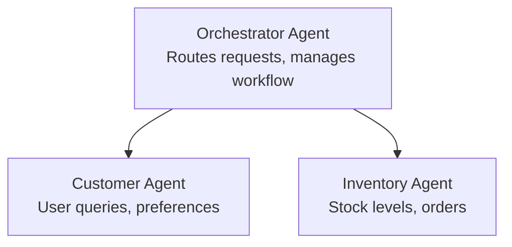

# บทที่ 5: โซลูชัน AI หลายเอเจนต์

**📚 คอร์ส**: [AZD สำหรับผู้เริ่มต้น](../../README.md) | **⏱️ ระยะเวลา**: 2-3 ชั่วโมง | **⭐ ความซับซ้อน**: ขั้นสูง

---

## ภาพรวม

บทนี้ครอบคลุมรูปแบบสถาปัตยกรรมหลายเอเจนต์ขั้นสูง การประสานงานเอเจนต์ และการปรับใช้งาน AI ที่พร้อมสำหรับการผลิตในสถานการณ์ที่ซับซ้อน

> คำแนะนำคำสั่งได้รับการตรวจสอบจากการอ้างอิง `azd 1.37.2` ที่ปล่อยออกมา ยังไม่ได้ดำเนินการปรับใช้บนคลาวด์

## วัตถุประสงค์การเรียนรู้

เมื่อจบบทนี้ คุณจะสามารถ:
- เข้าใจรูปแบบสถาปัตยกรรมหลายเอเจนต์
- ปรับใช้ระบบเอเจนต์ AI ที่ประสานงานกัน
- ใช้การสื่อสารระหว่างเอเจนต์
- สร้างโซลูชันหลายเอเจนต์ที่พร้อมสำหรับการผลิต

---

## 📚 บทเรียน

| # | บทเรียน | คำอธิบาย | เวลา |
|---|--------|-------------|------|
| 1 | [พื้นฐานหลายเอเจนต์](multi-agent-basics.md) | ปฏิบัติ: ปรับใช้แอปหลายเอเจนต์ที่ใช้งานได้จริงด้วย `azd up` | 45 นาที |
| 2 | [รูปแบบการประสานงาน](../chapter-06-pre-deployment/coordination-patterns.md) | ยุทธศาสตร์การประสานงานเอเจนต์ (ต่อเนื่องในบทที่ 6) | 30 นาที |
| 3 | [การปรับใช้ ARM Template](../../examples/retail-multiagent-arm-template/README.md) | ตัวอย่างการปรับใช้ด้วยคลิกเดียว | 30 นาที |

> **เริ่มจากบทเรียนที่ 1.** เป็นบทเรียนเดียวในบทนี้ที่มีการปฏิบัติและปรับใช้ได้จริง บทเรียน 2 อยู่ในบทที่ 6 (แชร์กับการวางแผนก่อนปรับใช้) และ [โซลูชันหลายเอเจนต์สำหรับธุรกิจค้าปลีก](../../examples/retail-scenario.md) คือแบบสถาปัตยกรรม – เป็นแบบอ้างอิงการออกแบบ ไม่ใช่แม่แบบคำสั่งเดียว

---

## 🚀 เริ่มต้นอย่างรวดเร็ว

```bash
# Option 1: Deploy the multi-agent template used in Lesson 1
azd init --template Azure-Samples/contoso-creative-writer .
azd up

# Option 2: Initialize a Foundry agent interactively (requires azure.ai.agents)
azd extension install azure.ai.agents
azd ai agent init
azd up
```

> **ใช้แนวทางไหน?** ใช้ `azd init --template` เพื่อเริ่มจากตัวอย่างที่ใช้งานได้ ใช้ `azd ai agent init` แบบโต้ตอบ หรือ `azd ai agent init --template <path-to-azure.yaml>` เพื่อรับโปรเจกต์เอเจนต์ปัจจุบัน ดู [เอกสารอ้างอิง AZD AI CLI](../chapter-08-production/production-ai-practices.md#azd-ai-cli-commands-and-extensions) สำหรับข้อกำหนดเวอร์ชันและการย้ายข้อมูลประเมินผล

รันทางเลือกเหล่านี้ในโฟลเดอร์ว่างแยกต่างหาก ส่วนขยายเอเจนต์ `1.0.0-beta.23` ต้องการ `azd >= 1.37.0`; การไหลแบบโต้ตอบของมันจะไม่สร้าง pipeline Service Bus แบบกำหนดเองในบทเรียนการประสานงาน

---

## 🤖 สถาปัตยกรรมหลายเอเจนต์



---

## 🎯 โซลูชันเด่น: หลายเอเจนต์สำหรับธุรกิจค้าปลีก

โซลูชัน [Retail Multi-Agent](../../examples/retail-scenario.md) แสดงให้เห็น:

- **Customer Agent**: จัดการการโต้ตอบและความชอบของผู้ใช้
- **Inventory Agent**: จัดการสต็อกและการประมวลผลคำสั่งซื้อ
- **Orchestrator**: ประสานงานระหว่างตัวแทน
- **Shared Memory**: การจัดการบริบทข้ามตัวแทน

### บริการที่ใช้

| บริการ | วัตถุประสงค์ |
|---------|---------|
| Microsoft Foundry Models | การเข้าใจภาษา |
| Azure AI Search | แคตตาล็อกสินค้า |
| Cosmos DB | สถานะและหน่วยความจำของตัวแทน |
| Container Apps | โฮสต์ตัวแทน |
| Application Insights | การติดตามผล |

---

## 🔗 การนำทาง

| ทิศทาง | บทที่ |
|-----------|---------|
| **ก่อนหน้า** | [บทที่ 4: โครงสร้างพื้นฐาน](../chapter-04-infrastructure/README.md) |
| **ถัดไป** | [บทที่ 6: การเตรียมการก่อนปรับใช้](../chapter-06-pre-deployment/README.md) |

---

## 📖 แหล่งข้อมูลที่เกี่ยวข้อง

- [คู่มือเอเจนต์ AI](../chapter-02-ai-development/agents.md)
- [แนวปฏิบัติ AI สำหรับการผลิต](../chapter-08-production/production-ai-practices.md)
- [การแก้ปัญหา AI](../chapter-07-troubleshooting/ai-troubleshooting.md)

---

<!-- CO-OP TRANSLATOR DISCLAIMER START -->
**ปฏิเสธความรับผิดชอบ**:
เอกสารนี้ได้รับการแปลโดยใช้บริการแปลภาษา AI [Co-op Translator](https://github.com/Azure/co-op-translator) ขณะที่เราพยายามให้ความถูกต้อง โปรดทราบว่าการแปลโดยอัตโนมัติอาจมีข้อผิดพลาดหรือความไม่ถูกต้อง เอกสารต้นฉบับในภาษาต้นทางควรถูกพิจารณาเป็นแหล่งข้อมูลที่เชื่อถือได้ สำหรับข้อมูลที่สำคัญ แนะนำให้ใช้การแปลโดยมนุษย์มืออาชีพ เราไม่รับผิดชอบต่อความเข้าใจผิดหรือการตีความที่ผิดพลาดที่เกิดขึ้นจากการใช้การแปลนี้
<!-- CO-OP TRANSLATOR DISCLAIMER END -->