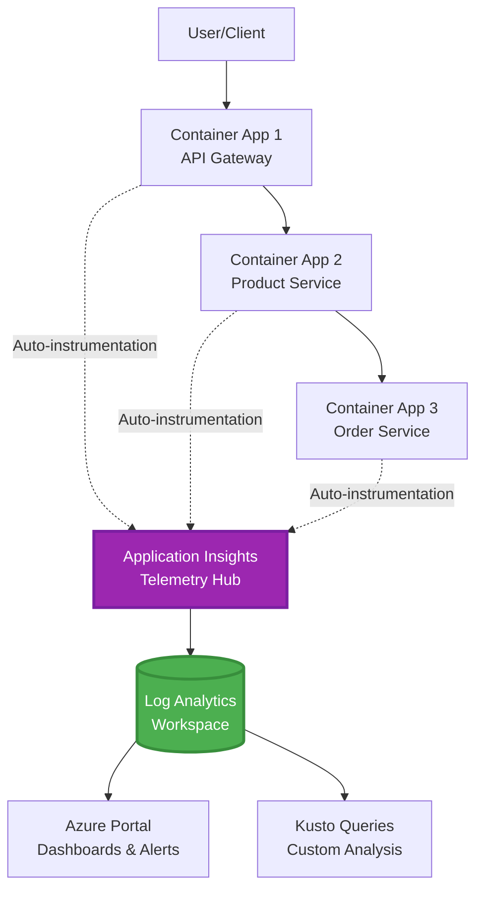
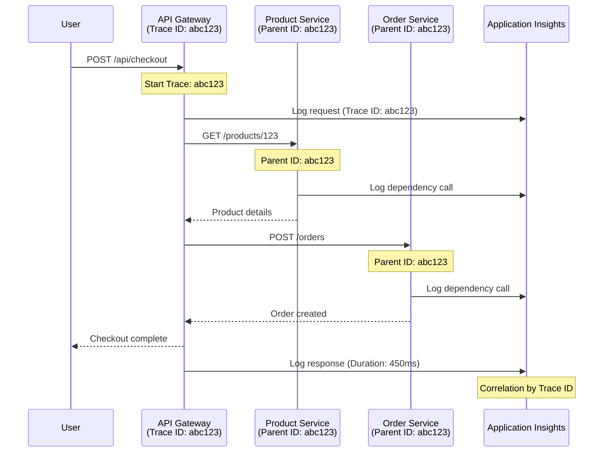

# การบูรณาการ Application Insights กับ AZD

⏱️ **เวลาที่ประเมิน**: 40-50 นาที | 💰 **ผลกระทบค่าใช้จ่าย**: ~$5-15/เดือน | ⭐ **ความซับซ้อน**: ระดับกลาง

**📚 เส้นทางการเรียนรู้:**
- ← ก่อนหน้า: [Preflight Checks](preflight-checks.md) - การตรวจสอบก่อนการเปิดใช้งาน
- 🎯 **คุณอยู่ที่นี่**: การบูรณาการ Application Insights (การติดตาม, เทเลเมทรี, การดีบัก)
- → ถัดไป: [Deployment Guide](../chapter-04-infrastructure/deployment-guide.md) - การเปิดใช้งานบน Azure
- 🏠 [หน้าแรกของคอร์ส](../../README.md)

---

## สิ่งที่คุณจะได้เรียนรู้

เมื่อจบบทเรียนนี้ คุณจะสามารถ:
- ประกาศ **Application Insights** ในโครงสร้างพื้นฐานของ AZD และกำหนดค่าเครื่องมือ SDK
- กำหนดค่า **การติดตามแบบกระจาย** สำหรับไมโครเซอร์วิส
- ใช้งาน **เทเลเมทรีแบบกำหนดเอง** (เมตริก, เหตุการณ์, การพึ่งพา)
- ตั้งค่า **เมตริกสด** สำหรับการตรวจสอบแบบเรียลไทม์
- สร้าง **การแจ้งเตือนและแดชบอร์ด** จากการเปิดใช้งาน AZD
- ดีบักปัญหาในโปรดักชันด้วย **คำค้นเทเลเมทรี**
- ปรับแต่ง **กลยุทธ์ค่าใช้จ่ายและการสุ่มตัวอย่าง**
- ตรวจสอบ **แอปพลิเคชัน AI/LLM** (โทเคน, ความล่าช้า, ค่าใช้จ่าย)

## ทำไม Application Insights กับ AZD ถึงสำคัญ

### ความท้าทาย: การสังเกตการณ์โปรดักชัน

**ถ้าไม่มี Application Insights:**
```
❌ No visibility into production behavior
❌ Manual log aggregation across services
❌ Reactive debugging (wait for customer complaints)
❌ No performance metrics
❌ Cannot trace requests across services
❌ Unknown failure rates and bottlenecks
```

**เมื่อติดตั้ง Application Insights + AZD:**
```
✅ Automatic telemetry collection
✅ Centralized logs from all services
✅ Proactive issue detection
✅ End-to-end request tracing
✅ Performance metrics and insights
✅ Real-time dashboards
✅ AZD provisions the monitoring declared in your templates
```

**การเปรียบเทียบ**: Application Insights เหมือนกับการมีเครื่องบันทึก "กล่องดำ" และแดชบอร์ดในห้องนักบินสำหรับแอปพลิเคชันของคุณ คุณจะเห็นทุกอย่างที่เกิดขึ้นแบบเรียลไทม์และสามารถเล่นซ้ำเหตุการณ์ใดก็ได้

---

## ภาพรวมสถาปัตยกรรม

### Application Insights ในสถาปัตยกรรม AZD



### สิ่งที่ถูกตรวจสอบโดยอัตโนมัติ

การจับอัตโนมัติที่รองรับจะเก็บข้อมูลคำขอ/การพึ่งพาสำหรับไลบรารีที่ติดตั้งเครื่องมือ เหตุการณ์และเมตริกที่กำหนดเองต้องการโค้ดแอปพลิเคชัน; การทดสอบความพร้อมใช้งานต้องตั้งค่าแยกต่างหาก ระบบจะไม่เก็บทุกแถวด้านล่างเพียงเพราะทรัพยากรมีอยู่

| ประเภทเทเลเมทรี | สิ่งที่จับได้ | การใช้งาน |
|----------------|------------------|----------|
| **คำขอ** | คำขอ HTTP, รหัสสถานะ, ระยะเวลา | การตรวจสอบประสิทธิภาพ API |
| **การพึ่งพา** | การเรียกภายนอก (DB, API, ที่เก็บข้อมูล) | การระบุจุดแออัด |
| **ข้อยกเว้น** | ข้อผิดพลาดที่ไม่ได้จัดการพร้อมสแต็กเทรซ | การดีบักข้อผิดพลาด |
| **เหตุการณ์กำหนดเอง** | เหตุการณ์ธุรกิจ (ลงชื่อสมัคร, ซื้อของ) | การวิเคราะห์และช่องทาง |
| **เมตริก** | เคาน์เตอร์ประสิทธิภาพ, เมตริกกำหนดเอง | การวางแผนความจุ |
| **เทรซ** | ข้อความล็อกพร้อมความรุนแรง | การดีบักและตรวจสอบ |
| **ความพร้อมใช้งาน** | การทดสอบเวลาใช้งานและเวลาตอบสนอง | การตรวจสอบ SLA |

---

## สิ่งที่ต้องมีล่วงหน้า

### เครื่องมือที่ต้องใช้

```bash
# Verify Azure Developer CLI
azd version
# Command reference baseline: azd 1.37.2

# Verify Azure CLI
az --version
# ✅ Expected: azure-cli 2.50.0 or higher
```

### ความต้องการของ Azure

- การสมัครใช้งาน Azure ที่เปิดใช้งานอยู่
- สิทธิ์ในการสร้าง:
  - ทรัพยากร Application Insights
  - พื้นที่ทำงาน Log Analytics
  - Container Apps
  - กลุ่มทรัพยากร

### ความรู้พื้นฐานที่ต้องมี

คุณควรได้ทำ:
- [AZD Basics](../chapter-01-foundation/azd-basics.md) - แนวคิดหลักของ AZD
- [Configuration](../chapter-03-configuration/configuration.md) - การตั้งค่าสภาพแวดล้อม
- [First Project](../chapter-01-foundation/first-project.md) - การเปิดใช้งานพื้นฐาน

---

## บทเรียน 1: Application Insights อัตโนมัติกับ AZD

### วิธีที่ AZD จัดเตรียม Application Insights

AZD จัดเตรียม Application Insights **เฉพาะเมื่อโครงสร้างพื้นฐานของโปรเจกต์ประกาศไว้** เท่านั้น `azure.yaml` เพียงอย่างเดียวไม่สร้างการตรวจสอบหรือฝังเครื่องมือในโค้ดแอปพลิเคชัน

> **ตัวอย่างขอบเขต:** บทเรียนนี้มีส่วนประกอบการบูรณาการ ไม่ใช่โปรเจกต์ `monitored-app` เต็มรูปแบบในที่เก็บนี้ ต้องเตรียมแม่แบบหลักและการแม็ปพารามิเตอร์, สภาพแวดล้อม Container Apps, การกำหนดค่าการลงทะเบียน/อิมเมจและตัวตน, Dockerfile และแท็กเซอร์วิสก่อนเปิดใช้งาน บทเรียนต่อไปแสดงชิ้นส่วนเสริม/ตัวเลือก ไม่ใช่ไฟล์ที่สามารถวางรวมกันได้แบบไม่แก้ไข เริ่มต้นด้วย [ตัวอย่างไมโครเซอร์วิส](../../../../examples/microservices) ที่ใช้งานได้ถ้าคุณต้องการพื้นฐานที่รันได้

### โครงสร้างโปรเจกต์

```
monitored-app/
├── azure.yaml                     # AZD configuration
├── infra/
│   ├── main.bicep                # Main infrastructure
│   ├── core/
│   │   └── monitoring.bicep      # Application Insights + Log Analytics
│   └── app/
│       └── api.bicep             # Container App with monitoring
└── src/
    ├── app.py                    # Application with telemetry
    ├── requirements.txt
    └── Dockerfile
```

---

### ขั้นตอนที่ 1: กำหนดค่า AZD (azure.yaml)

**ไฟล์: `azure.yaml`**

```yaml
name: monitored-app
metadata:
  template: monitored-app@1.0.0

services:
  api:
    project: ./src
    language: python
    host: containerapp

# Monitoring must be declared in infra/ and enabled in application code.
```

นี่คือการประกาศเซอร์วิสที่สามารถเปิดใช้งานได้ ไฟล์ Bicep และการกำหนดค่า SDK ด้านล่างเป็นการจัดเตรียมการตรวจสอบ; azd ไม่ได้เพิ่มให้โดยอัตโนมัติ

---

### ขั้นตอนที่ 2: โครงสร้างพื้นฐานการตรวจสอบ (Bicep)

**ไฟล์: `infra/core/monitoring.bicep`**

```bicep
param logAnalyticsName string
param applicationInsightsName string
param location string = resourceGroup().location
param tags object = {}

// Log Analytics Workspace (required for Application Insights)
resource logAnalytics 'Microsoft.OperationalInsights/workspaces@2022-10-01' = {
  name: logAnalyticsName
  location: location
  tags: tags
  properties: {
    sku: {
      name: 'PerGB2018'  // Pay-as-you-go pricing
    }
    retentionInDays: 30  // Keep logs for 30 days
    features: {
      enableLogAccessUsingOnlyResourcePermissions: true
    }
  }
}

// Application Insights
resource applicationInsights 'Microsoft.Insights/components@2020-02-02' = {
  name: applicationInsightsName
  location: location
  tags: tags
  kind: 'web'
  properties: {
    Application_Type: 'web'
    WorkspaceResourceId: logAnalytics.id
    IngestionMode: 'LogAnalytics'
    publicNetworkAccessForIngestion: 'Enabled'
    publicNetworkAccessForQuery: 'Enabled'
  }
}

// Outputs for Container Apps
output logAnalyticsWorkspaceId string = logAnalytics.id
output logAnalyticsWorkspaceName string = logAnalytics.name
output applicationInsightsConnectionString string = applicationInsights.properties.ConnectionString
output applicationInsightsInstrumentationKey string = applicationInsights.properties.InstrumentationKey
output applicationInsightsName string = applicationInsights.name
output applicationInsightsId string = applicationInsights.id
```

---

### ขั้นตอนที่ 3: เชื่อมต่อ Container App กับ Application Insights

**ไฟล์: `infra/app/api.bicep`**

```bicep
param name string
param location string
param tags object = {}
param containerAppsEnvironmentId string
param containerImage string
param applicationInsightsConnectionString string

resource containerApp 'Microsoft.App/containerApps@2023-05-01' = {
  name: name
  location: location
  tags: tags
  properties: {
    managedEnvironmentId: containerAppsEnvironmentId
    configuration: {
      ingress: {
        external: true
        targetPort: 8000
      }
      secrets: [
        {
          name: 'appinsights-connection-string'
          value: applicationInsightsConnectionString
        }
      ]
    }
    template: {
      containers: [
        {
          name: 'api'
          image: containerImage // Supply an accessible image and registry authentication
          resources: {
            cpu: json('0.5')
            memory: '1Gi'
          }
          env: [
            {
              name: 'APPLICATIONINSIGHTS_CONNECTION_STRING'
              secretRef: 'appinsights-connection-string'
            }
            {
              name: 'APPLICATIONINSIGHTS_ENABLED'
              value: 'true'
            }
          ]
        }
      ]
    }
  }
}

output uri string = 'https://${containerApp.properties.configuration.ingress.fqdn}'
```

---

### ขั้นตอนที่ 4: โค้ดแอปพลิเคชันพร้อมเทเลเมทรี

**ไฟล์: `src/app.py`**

```python
from flask import Flask, request, jsonify
from azure.monitor.opentelemetry import configure_azure_monitor
import logging
import os

app = Flask(__name__)

# Get Application Insights connection string
connection_string = os.environ.get('APPLICATIONINSIGHTS_CONNECTION_STRING')

if connection_string:
    # Azure Monitor OpenTelemetry instruments supported libraries, including Flask.
    configure_azure_monitor(
        connection_string=connection_string,
        logger_name=__name__,
        enable_live_metrics=True
    )
    logger = logging.getLogger(__name__)
    logger.setLevel(logging.INFO)
    
    print("✅ Application Insights enabled")
else:
    logger = logging.getLogger(__name__)
    logger.setLevel(logging.INFO)
    print("⚠️ Application Insights not configured")

@app.route('/health')
def health():
    logger.info('Health check endpoint called')
    return jsonify({'status': 'healthy', 'monitoring': 'enabled' if connection_string else 'disabled'})

@app.route('/api/products')
def get_products():
    logger.info('Fetching products')
    
    # In-memory fixture: this is not a database dependency call.
    products = [
        {'id': 1, 'name': 'Laptop', 'price': 999.99},
        {'id': 2, 'name': 'Mouse', 'price': 29.99},
        {'id': 3, 'name': 'Keyboard', 'price': 79.99}
    ]
    
    logger.info(f'Returned {len(products)} products')
    return jsonify(products)

@app.route('/api/error-test')
def error_test():
    """Test error tracking"""
    logger.error('Testing error tracking')
    try:
        raise ValueError('This is a test exception')
    except Exception as e:
        logger.exception('Exception occurred in error-test endpoint')
        return jsonify({'error': str(e)}), 500

@app.route('/api/slow')
def slow_endpoint():
    """Test performance tracking"""
    import time
    logger.info('Slow endpoint called')
    time.sleep(3)  # Simulate slow operation
    logger.warning('Endpoint took 3 seconds to respond')
    return jsonify({'message': 'Slow operation completed'})

if __name__ == '__main__':
    app.run(host='0.0.0.0', port=8000)
```

**ไฟล์: `src/requirements.txt`**

```txt
Flask
azure-monitor-opentelemetry
gunicorn
requests
openai
```

แก้ไขการพึ่งพาในโปรเจกต์ของคุณ ทดสอบร่วมกัน และล็อกเวอร์ชันที่ได้ โปรเจกต์ใหม่ควรใช้ Azure Monitor OpenTelemetry ไม่ใช่ผู้ส่งออก OpenCensus Python ที่เลิกใช้แล้ว

---

### ขั้นตอนที่ 5: เปิดใช้งานและตรวจสอบ

```bash
# Deploy only after completing and wiring the infrastructure fragments above
azd up

# Get app URL
APP_URL=$(azd env get-value API_URL) # Requires this output in main.bicep

# Generate telemetry
curl $APP_URL/health
curl $APP_URL/api/products
curl $APP_URL/api/error-test
curl $APP_URL/api/slow
```

**✅ ผลลัพธ์ที่คาดหวัง:**
```json
{
  "status": "healthy",
  "monitoring": "enabled"
}
```

---

### ขั้นตอนที่ 6: ดูเทเลเมทรีใน Azure Portal

```bash
# Get Application Insights details
azd env get-values | grep APPLICATIONINSIGHTS

# Open in Azure Portal
az monitor app-insights component show \
  --app $(azd env get-values | grep APPLICATIONINSIGHTS_NAME | cut -d '=' -f2 | tr -d '"') \
  --resource-group $(azd env get-values | grep AZURE_RESOURCE_GROUP | cut -d '=' -f2 | tr -d '"') \
  --query "appId" -o tsv
```

**ไปยัง Azure Portal → Application Insights → Transaction Search**

คุณควรเห็น:
- ✅ คำขอ HTTP พร้อมรหัสสถานะ
- ✅ ระยะเวลาคำขอ (3 วินาทีขึ้นไปสำหรับ `/api/slow`)
- ✅ รายละเอียดข้อยกเว้นจาก `/api/error-test`
- ✅ ข้อความล็อกแบบกำหนดเอง

---

## บทเรียน 2: เทเลเมทรีและเหตุการณ์แบบกำหนดเอง

### ติดตามเหตุการณ์ธุรกิจ

มาเพิ่มเทเลเมทรีแบบกำหนดเองสำหรับเหตุการณ์ที่สำคัญทางธุรกิจกันเถอะ

**ไฟล์: `src/telemetry.py`**

```python
from contextlib import contextmanager
from azure.monitor.opentelemetry import configure_azure_monitor
from opentelemetry import metrics, trace
from opentelemetry.trace import SpanKind
import logging
import os

class TelemetryClient:
    """Custom telemetry client for Application Insights"""
    
    def __init__(self, connection_string=None):
        self.connection_string = connection_string or os.environ.get('APPLICATIONINSIGHTS_CONNECTION_STRING')
        
        # Configure once per process. If app.py already calls this, keep only
        # one configure_azure_monitor call and use logger_name='telemetry'.
        if self.connection_string:
            configure_azure_monitor(
                connection_string=self.connection_string,
                logger_name=__name__,
                enable_live_metrics=True
            )
        self.logger = logging.getLogger(__name__)
        self.logger.setLevel(logging.INFO)
        self.tracer = trace.get_tracer(__name__)
        self.meter = metrics.get_meter(__name__)
        self.instruments = {}
    
    def track_event(self, event_name: str, properties: dict = None):
        """Track custom business event"""
        properties = properties or {}
        self.logger.info(
            f"CustomEvent: {event_name}",
            extra={
                # OTel log attributes become customDimensions in App Insights.
                    'event_name': event_name,
                    **properties
            }
        )
    
    def track_metric(self, metric_name: str, value: float, properties: dict = None):
        """Track custom metric"""
        properties = properties or {}
        if metric_name not in self.instruments:
            self.instruments[metric_name] = self.meter.create_histogram(metric_name)
        self.instruments[metric_name].record(value, attributes=properties)
    
    @contextmanager
    def track_dependency(self, name: str):
        """Time the real operation inside a client span; exceptions mark failure."""
        with self.tracer.start_as_current_span(name, kind=SpanKind.CLIENT) as span:
            yield span

# Global telemetry client
telemetry = TelemetryClient()
```

### อัปเดตแอปพลิเคชันด้วยเหตุการณ์กำหนดเอง

**ไฟล์: `src/app.py` (เวอร์ชันปรับปรุง)**

เพิ่มเส้นทางเหล่านี้ในแอป Flask ที่มีอยู่; รักษาเส้นทางสุขภาพ/ทดสอบเดิมไว้ บล็อกที่ย่อด้านล่างแสดงแอปแยกเพื่อความชัดเจน การเริ่มต้นเทเลเมทรีตอนนี้อยู่ใน `telemetry.py`—อย่าเริ่มต้นผู้ส่งออกสองครั้ง

```python
from flask import Flask, request, jsonify
from telemetry import telemetry
import time
import random
import os

app = Flask(__name__)

@app.route('/api/purchase', methods=['POST'])
def purchase():
    """Track purchase event with custom telemetry"""
    data = request.get_json(silent=True) or {}
    product_id = data.get('product_id')
    quantity = data.get('quantity', 1)
    price = data.get('price', 0)
    if not isinstance(quantity, int) or quantity < 1 or \
       not isinstance(price, (int, float)) or price < 0:
        return jsonify({'error': 'quantity and price must be non-negative numbers; quantity >= 1'}), 400
    
    # Track business event
    telemetry.track_event('Purchase', {
        'product_id': product_id,
        'quantity': quantity,
        'total_amount': price * quantity,
        'user_id': request.headers.get('X-User-Id', 'anonymous')
    })
    
    # Track revenue metric
    telemetry.track_metric('Revenue', price * quantity, {
        'product_id': product_id,
        'currency': 'USD'
    })
    
    return jsonify({
        'order_id': f'ORD-{random.randint(1000, 9999)}',
        'status': 'confirmed',
        'total': price * quantity
    })

@app.route('/api/search')
def search():
    """Track search queries"""
    query = request.args.get('q', '')
    
    start_time = time.time()
    
    # Simulate search (would be real database query)
    results = [{'id': 1, 'name': f'Result for {query}'}]
    
    duration = (time.time() - start_time) * 1000  # Convert to ms
    
    # Track search event
    telemetry.track_event('Search', {
        'query': query,
        'results_count': len(results),
        'duration_ms': duration
    })
    
    # Track search performance metric
    telemetry.track_metric('SearchDuration', duration, {
        'query_length': len(query)
    })
    
    return jsonify({'results': results, 'count': len(results)})

@app.route('/api/external-call')
def external_call():
    """Track external API dependency"""
    import requests
    
    try:
        # Set an actual test endpoint; api.example.com is not a working API.
        with telemetry.track_dependency('ExternalAPI'):
            response = requests.get(os.environ['EXTERNAL_API_URL'], timeout=5)
            response.raise_for_status()
            result = response.json()
    except Exception as e:
        return jsonify({'error': 'External dependency failed'}), 502
    
    return jsonify(result)

if __name__ == '__main__':
    app.run(host='0.0.0.0', port=8000)
```

### ทดสอบเทเลเมทรีแบบกำหนดเอง

```bash
# Track purchase event
curl -X POST $APP_URL/api/purchase \
  -H "Content-Type: application/json" \
  -H "X-User-Id: user123" \
  -d '{"product_id": 1, "quantity": 2, "price": 29.99}'

# Track search event
curl "$APP_URL/api/search?q=laptop"

# Track external dependency
curl $APP_URL/api/external-call
```

**ดูใน Azure Portal:**

ไปที่ Application Insights → Logs แล้วรัน:

```kusto
// View purchase events
traces
| where customDimensions.event_name == "Purchase"
| project 
    timestamp,
    product_id = tostring(customDimensions.product_id),
    total_amount = todouble(customDimensions.total_amount),
    user_id = tostring(customDimensions.user_id)
| order by timestamp desc

// Revenue recorded in Purchase events (not a billing ledger)
traces
| where customDimensions.event_name == "Purchase"
| summarize TotalRevenue = sum(todouble(customDimensions.total_amount)) by bin(timestamp, 1h)
| render timechart

// View search performance
traces
| where customDimensions.event_name == "Search"
| summarize 
    AvgDuration = avg(todouble(customDimensions.duration_ms)),
    SearchCount = count()
  by bin(timestamp, 5m)
| render timechart
```

---

## บทเรียน 3: การติดตามแบบกระจายสำหรับไมโครเซอร์วิส

### เปิดใช้งานการติดตามข้ามบริการ

ด้วยเครื่องมือที่เข้ากันได้และการส่งต่อ W3C trace-context, Application Insights เชื่อมโยงคำขอข้ามบริการ การแชร์ connection string เพียงอย่างเดียวไม่สร้างส่วน parent-child span ชิ้นส่วนสถาปัตยกรรมดังต่อไปนี้อ้างอิงโมดูลที่คุณต้องเป็นผู้ดำเนินการเอง

**ไฟล์: `infra/main.bicep`**

```bicep
targetScope = 'subscription'

param environmentName string
param location string = 'eastus'

var tags = { 'azd-env-name': environmentName }

resource rg 'Microsoft.Resources/resourceGroups@2021-04-01' = {
  name: 'rg-${environmentName}'
  location: location
  tags: tags
}

// Monitoring (shared by all services)
module monitoring './core/monitoring.bicep' = {
  name: 'monitoring'
  scope: rg
  params: {
    logAnalyticsName: 'log-${environmentName}'
    applicationInsightsName: 'appi-${environmentName}'
    location: location
    tags: tags
  }
}

// API Gateway
module apiGateway './app/api-gateway.bicep' = {
  name: 'api-gateway'
  scope: rg
  params: {
    name: 'ca-gateway-${environmentName}'
    location: location
    tags: union(tags, { 'azd-service-name': 'gateway' })
    applicationInsightsConnectionString: monitoring.outputs.applicationInsightsConnectionString
  }
}

// Product Service
module productService './app/product-service.bicep' = {
  name: 'product-service'
  scope: rg
  params: {
    name: 'ca-products-${environmentName}'
    location: location
    tags: union(tags, { 'azd-service-name': 'products' })
    applicationInsightsConnectionString: monitoring.outputs.applicationInsightsConnectionString
  }
}

// Order Service
module orderService './app/order-service.bicep' = {
  name: 'order-service'
  scope: rg
  params: {
    name: 'ca-orders-${environmentName}'
    location: location
    tags: union(tags, { 'azd-service-name': 'orders' })
    applicationInsightsConnectionString: monitoring.outputs.applicationInsightsConnectionString
  }
}

output APPLICATIONINSIGHTS_CONNECTION_STRING string = monitoring.outputs.applicationInsightsConnectionString
output GATEWAY_URL string = apiGateway.outputs.uri
```

### ดูธุรกรรมแบบ end-to-end



**คำค้นหา trace แบบ end-to-end:**

```kusto
// Find complete request flow
let traceId = "abc123...";  // Copy operation_Id from a request in Application Insights
dependencies
| union requests
| where operation_Id == traceId
| project 
    timestamp,
    type = itemType,
    name,
    duration,
    success,
    cloud_RoleName
| order by timestamp asc
```

---

## บทเรียน 4: เมตริกสดและการตรวจสอบแบบเรียลไทม์

### เปิดใช้งาน Live Metrics Stream

Live Metrics ให้เทเลเมทรีเกือบแบบเรียลไทม์เมื่อรองรับและเปิดใช้งานโดย SDK ไม่ใช่ SLA ความหน่วงเวลาตั้งค่าสำหรับ Python OpenTelemetry ด้านบนเลือกใช้ `enable_live_metrics=True`

**เข้าถึง Live Metrics:**

```bash
# Get Application Insights resource
APPI_NAME=$(azd env get-values | grep APPLICATIONINSIGHTS_NAME | cut -d '=' -f2 | tr -d '"')

# Get resource group
RG_NAME=$(azd env get-values | grep AZURE_RESOURCE_GROUP | cut -d '=' -f2 | tr -d '"')

echo "Navigate to: Azure Portal → Resource Groups → $RG_NAME → $APPI_NAME → Live Metrics"
```

**สิ่งที่คุณเห็นแบบเรียลไทม์:**
- ✅ อัตราคำขอเข้า (คำขอต่อวินาที)
- ✅ การเรียกพึ่งพาภายนอกออกไป
- ✅ จำนวนข้อยกเว้น
- ✅ การใช้ CPU และหน่วยความจำ
- ✅ จำนวนเซอร์เวอร์ที่ใช้งาน
- ✅ ตัวอย่างเทเลเมทรี

### สร้างโหลดเพื่อทดสอบ

```bash
# Generate load to see live metrics
for i in {1..100}; do
  curl --silent --max-time 10 "$APP_URL/api/products"
  curl --silent --max-time 10 "$APP_URL/api/search?q=test$i"
done

# Watch live metrics in Azure Portal
# You should see request rate spike
```

---

## แบบฝึกหัดปฏิบัติ

### แบบฝึกหัด 1: ตั้งค่าการแจ้งเตือน ⭐⭐ (ระดับกลาง)

**เป้าหมาย**: สร้างการแจ้งเตือนสำหรับอัตราความผิดพลาดสูงและการตอบสนองช้า

**ขั้นตอน:**

1. **สร้างการแจ้งเตือนสำหรับอัตราความผิดพลาด:**

```bash
# Get Application Insights resource ID
APPI_ID=$(az monitor app-insights component show \
  --app $APPI_NAME \
  --resource-group $RG_NAME \
  --query "id" -o tsv)

# Create metric alert for failed requests
az monitor metrics alert create \
  --name "High-Error-Rate" \
  --resource-group $RG_NAME \
  --scopes $APPI_ID \
  --condition "count requests/failed > 10" \
  --window-size 5m \
  --evaluation-frequency 1m \
  --description "Alert when failed request count exceeds 10 per 5 minutes"
```

2. **สร้างการแจ้งเตือนสำหรับการตอบสนองช้า:**

```bash
az monitor metrics alert create \
  --name "Slow-Responses" \
  --resource-group $RG_NAME \
  --scopes $APPI_ID \
  --condition "avg requests/duration > 3000" \
  --window-size 5m \
  --evaluation-frequency 1m \
  --description "Alert when average response time exceeds 3 seconds"
```

3. **สร้างการแจ้งเตือนผ่าน Bicep (แนะนำสำหรับ AZD):**

**ไฟล์: `infra/core/alerts.bicep`**

```bicep
param applicationInsightsId string
param actionGroupId string = ''
param location string = resourceGroup().location

// High error rate alert
resource errorRateAlert 'Microsoft.Insights/metricAlerts@2018-03-01' = {
  name: 'high-error-rate'
  location: 'global'
  properties: {
    description: 'Alert when error rate exceeds threshold'
    severity: 2
    enabled: true
    scopes: [
      applicationInsightsId
    ]
    evaluationFrequency: 'PT1M'
    windowSize: 'PT5M'
    criteria: {
      'odata.type': 'Microsoft.Azure.Monitor.SingleResourceMultipleMetricCriteria'
      allOf: [
        {
          name: 'Error rate'
          metricName: 'requests/failed'
          operator: 'GreaterThan'
          threshold: 10
          timeAggregation: 'Count'
        }
      ]
    }
    actions: actionGroupId != '' ? [
      {
        actionGroupId: actionGroupId
      }
    ] : []
  }
}

// Slow response alert
resource slowResponseAlert 'Microsoft.Insights/metricAlerts@2018-03-01' = {
  name: 'slow-responses'
  location: 'global'
  properties: {
    description: 'Alert when response time is too high'
    severity: 3
    enabled: true
    scopes: [
      applicationInsightsId
    ]
    evaluationFrequency: 'PT1M'
    windowSize: 'PT5M'
    criteria: {
      'odata.type': 'Microsoft.Azure.Monitor.SingleResourceMultipleMetricCriteria'
      allOf: [
        {
          name: 'Response duration'
          metricName: 'requests/duration'
          operator: 'GreaterThan'
          threshold: 3000
          timeAggregation: 'Average'
        }
      ]
    }
  }
}

output errorAlertId string = errorRateAlert.id
output slowResponseAlertId string = slowResponseAlert.id
```

4. **ทดสอบการแจ้งเตือน:**

```bash
# Generate errors
for i in {1..20}; do
  curl $APP_URL/api/error-test
done

# Generate slow responses
for i in {1..10}; do
  curl $APP_URL/api/slow
done

# Check rule configuration (not fired/resolved alert-instance history)
az monitor metrics alert list \
  --resource-group $RG_NAME \
  --query "[].{Name:name, Enabled:enabled}" \
  --output table
```

**✅ เกณฑ์ความสำเร็จ:**
- ✅ สร้างการแจ้งเตือนได้สำเร็จ
- ✅ การแจ้งเตือนทำงานเมื่อเกินเกณฑ์
- ✅ ดูประวัติการแจ้งเตือนใน Azure Portal ได้
- ✅ รวมเข้ากับการเปิดใช้งาน AZD

**เวลา**: 20-25 นาที

---

### แบบฝึกหัด 2: สร้างแดชบอร์ดแบบกำหนดเอง ⭐⭐ (ระดับกลาง)

**เป้าหมาย**: สร้างแดชบอร์ดแสดงเมตริกแอปพลิเคชันสำคัญ

**ขั้นตอน:**

1. **สร้างแดชบอร์ดผ่าน Azure Portal:**

ไปที่: Azure Portal → Dashboards → New Dashboard

2. **เพิ่มไทล์สำหรับเมตริกสำคัญ:**

- จำนวนคำขอ (ใน 24 ชั่วโมงที่ผ่านมา)
- เวลาเฉลี่ยการตอบสนอง
- อัตราความผิดพลาด
- 5 อันดับการดำเนินการช้าที่สุด
- การกระจายทางภูมิศาสตร์ของผู้ใช้

3. **สร้างแดชบอร์ดผ่าน Bicep:**

**ไฟล์: `infra/core/dashboard.bicep`**

```bicep
param dashboardName string
param applicationInsightsId string
param location string = resourceGroup().location

resource dashboard 'Microsoft.Portal/dashboards@2020-09-01-preview' = {
  name: dashboardName
  location: location
  properties: {
    lenses: [
      {
        order: 0
        parts: [
          // Request count
          {
            position: {
              x: 0
              y: 0
              rowSpan: 4
              colSpan: 6
            }
            metadata: {
              type: 'Extension/Microsoft_OperationsManagementSuite_Workspace/PartType/LogsDashboardPart'
              inputs: [
                {
                  name: 'resourceId'
                  value: applicationInsightsId
                }
                {
                  name: 'query'
                  value: '''
                    requests
                    | summarize RequestCount = count() by bin(timestamp, 1h)
                    | render timechart
                  '''
                }
              ]
            }
          }
          // Error rate
          {
            position: {
              x: 6
              y: 0
              rowSpan: 4
              colSpan: 6
            }
            metadata: {
              type: 'Extension/Microsoft_OperationsManagementSuite_Workspace/PartType/LogsDashboardPart'
              inputs: [
                {
                  name: 'resourceId'
                  value: applicationInsightsId
                }
                {
                  name: 'query'
                  value: '''
                    requests
                    | summarize 
                        Total = count(),
                        Failed = countif(success == false)
                    | extend ErrorRate = (Failed * 100.0) / Total
                    | project ErrorRate
                  '''
                }
              ]
            }
          }
        ]
      }
    ]
  }
}

output dashboardId string = dashboard.id
```

4. **เปิดใช้งานแดชบอร์ด:**

```bicep
// Add to a subscription-scoped main.bicep with rg and monitoring declared
module dashboard './core/dashboard.bicep' = {
  name: 'dashboard'
  scope: rg
  params: {
    dashboardName: 'dashboard-${environmentName}'
    applicationInsightsId: monitoring.outputs.applicationInsightsId
    location: location
  }
}
```

```bash
# Deploy
azd up
```

**✅ เกณฑ์ความสำเร็จ:**
- ✅ แดชบอร์ดแสดงเมตริกสำคัญ
- ✅ สามารถปักหมุดที่หน้าแรกของ Azure Portal ได้
- ✅ อัปเดตแบบเรียลไทม์
- ✅ เปิดใช้งานผ่าน AZD ได้

**เวลา**: 25-30 นาที

---

### แบบฝึกหัด 3: ตรวจสอบแอป AI/LLM ⭐⭐⭐ (ระดับสูง)

**เป้าหมาย**: ติดตามการใช้งาน Microsoft Foundry Models (โทเคน, ค่าใช้จ่าย, ความล่าช้า)

**ขั้นตอน:**

1. **สร้างห่อหุ้มสำหรับการตรวจสอบ AI:**

**ไฟล์: `src/ai_telemetry.py`**

```python
from telemetry import telemetry
from openai import AzureOpenAI
import time

class MonitoredAzureOpenAI:
    """Microsoft Foundry Models client with automatic telemetry"""
    
    def __init__(self, api_key, endpoint, input_usd_per_million,
                 output_usd_per_million, api_version="2024-10-21"):
        self.client = AzureOpenAI(
            api_key=api_key,
            api_version=api_version,
            azure_endpoint=endpoint
        )
        self.input_rate = input_usd_per_million
        self.output_rate = output_usd_per_million
    
    def chat_completion(self, model: str, messages: list, **kwargs):
        """Track chat completion with telemetry"""
        start_time = time.time()
        
        try:
            # Call Microsoft Foundry Models
            response = self.client.chat.completions.create(
                model=model,
                messages=messages,
                **kwargs
            )
            
            duration = (time.time() - start_time) * 1000  # ms
            
            # Extract usage
            usage = response.usage
            prompt_tokens = usage.prompt_tokens
            completion_tokens = usage.completion_tokens
            total_tokens = usage.total_tokens
            
            # Approximation: supply actual deployment/region/contract rates.
            # Cached input, batch, provisioned and other charges need separate accounting.
            prompt_cost = (prompt_tokens / 1_000_000) * self.input_rate
            completion_cost = (completion_tokens / 1_000_000) * self.output_rate
            total_cost = prompt_cost + completion_cost
            
            # Track custom event
            telemetry.track_event('OpenAI_Request', {
                'model': model,
                'prompt_tokens': prompt_tokens,
                'completion_tokens': completion_tokens,
                'total_tokens': total_tokens,
                'duration_ms': duration,
                'cost_usd': total_cost,
                'success': True
            })
            
            # Track metrics
            telemetry.track_metric('OpenAI_Tokens', total_tokens, {
                'model': model,
                'type': 'total'
            })
            
            telemetry.track_metric('OpenAI_Cost', total_cost, {
                'model': model,
                'currency': 'USD'
            })
            
            telemetry.track_metric('OpenAI_Duration', duration, {
                'model': model
            })
            
            return response
            
        except Exception as e:
            duration = (time.time() - start_time) * 1000
            
            telemetry.track_event('OpenAI_Request', {
                'model': model,
                'duration_ms': duration,
                'success': False,
                'error': str(e)
            })
            
            raise
```

2. **ใช้ไคลเอนต์ที่ถูกตรวจสอบ:**

```python
from flask import Flask, request, jsonify
from ai_telemetry import MonitoredAzureOpenAI
import os

app = Flask(__name__)

# Initialize monitored OpenAI client
openai_client = MonitoredAzureOpenAI(
    api_key=os.environ['AZURE_OPENAI_API_KEY'],
    endpoint=os.environ['AZURE_OPENAI_ENDPOINT'],
    input_usd_per_million=float(os.environ['INPUT_USD_PER_MILLION']),
    output_usd_per_million=float(os.environ['OUTPUT_USD_PER_MILLION'])
)

@app.route('/api/chat', methods=['POST'])
def chat():
    data = request.json
    user_message = data.get('message')
    
    # Call with automatic monitoring
    response = openai_client.chat_completion(
        model=os.environ['AZURE_OPENAI_DEPLOYMENT'], # Deployment name, not catalog ID
        messages=[
            {'role': 'user', 'content': user_message}
        ]
    )
    
    return jsonify({
        'response': response.choices[0].message.content,
        'tokens': response.usage.total_tokens
    })
```

3. **คำค้นหาเมตริก AI:**

```kusto
// Total AI spend over time
traces
| where customDimensions.event_name == "OpenAI_Request"
| where tobool(customDimensions.success) == true
| summarize TotalCost = sum(todouble(customDimensions.cost_usd)) by bin(timestamp, 1h)
| render timechart

// Token usage by model
traces
| where customDimensions.event_name == "OpenAI_Request"
| summarize 
    TotalTokens = sum(toint(customDimensions.total_tokens)),
    RequestCount = count()
  by Model = tostring(customDimensions.model)

// Average latency
traces
| where customDimensions.event_name == "OpenAI_Request"
| summarize AvgDuration = avg(todouble(customDimensions.duration_ms))
| project AvgDurationSeconds = AvgDuration / 1000

// Cost per request
traces
| where customDimensions.event_name == "OpenAI_Request"
| extend Cost = todouble(customDimensions.cost_usd)
| summarize 
    TotalCost = sum(Cost),
    RequestCount = count(),
    AvgCostPerRequest = avg(Cost)
```

**✅ เกณฑ์ความสำเร็จ:**
- ✅ การเรียก OpenAI ทุกครั้งถูกติดตามโดยอัตโนมัติ
- ✅ การใช้งานและค่าใช้จ่ายโทเคนแสดงให้เห็น
- ✅ ตรวจสอบความล่าช้า
- ✅ ตั้งค่าการแจ้งเตือนงบประมาณได้

**เวลา**: 35-45 นาที

---

## การปรับแต่งค่าใช้จ่าย

### กลยุทธ์การสุ่มตัวอย่าง

ควบคุมค่าใช้จ่ายด้วยการสุ่มตัวอย่างเทเลเมทรี:

```python
import os

# Configure before the one configure_azure_monitor() call in your process.
os.environ["OTEL_TRACES_SAMPLER"] = "microsoft.fixed_percentage"
os.environ["OTEL_TRACES_SAMPLER_ARG"] = "0.1" # 10% trace sampling
```

การสุ่มตัวอย่างเทรซไม่ได้ลดทุกประเภทเทเลเมทรีลง 90% เมตริกและล็อกที่ปล่อยแยกต่างหากต้องมีการควบคุมปริมาณของตัวเอง เลือกอัตราโดยใช้ความต้องการในการสังเกต ไม่ใช่การห้ามผลิตภัณฑ์ทั้งหมด

กำหนดการสุ่มตัวอย่างของ SDK อย่างชัดเจน; สมบัติ `SamplingPercentage` ของคอมโพเนนต์ไม่ใช่ตัวแทนการกำหนดค่าซัมเพลอร์ Python OpenTelemetry

### การเก็บรักษาข้อมูล

```bicep
resource logAnalytics 'Microsoft.OperationalInsights/workspaces@2022-10-01' = {
  name: logAnalyticsName
  properties: {
    retentionInDays: 30  // Minimum (cheapest)
    // Options: 30, 31, 60, 90, 120, 180, 270, 365, 550, 730
  }
}
```

### การประมาณค่ารายเดือน

| ปริมาณข้อมูล | การเก็บรักษา | ค่าใช้จ่ายรายเดือน |
|-------------|-----------|--------------|
| 1 GB/เดือน | 30 วัน | ~$2-5 |
| 5 GB/เดือน | 30 วัน | ~$10-15 |
| 10 GB/เดือน | 90 วัน | ~$25-40 |
| 50 GB/เดือน | 90 วัน | ~$100-150 |

ตัวเลขเหล่านี้เป็นแนวทาง ไม่ใช่ราคายืนยัน โปรดตรวจสอบราคา ingestion, การเก็บรักษา, การแจ้งเตือน และการทดสอบในภูมิภาคและข้อตกลงของคุณ; สิทธิ์ใช้งานฟรีจะแบ่งปัน/กำหนดขอบเขตตามราคาของ Azure Monitor ไม่ใช่ SKU ฟรีที่รับประกันต่อทรัพยากร Application Insights

---

## จุดตรวจสอบความรู้

### 1. การบูรณาการพื้นฐาน ✓

ทดสอบความเข้าใจของคุณ:

- [ ] **ถาม 1**: AZD จัดเตรียม Application Insights อย่างไร?
  - **ตอบ**: มันเปิดใช้งานทรัพยากรการตรวจสอบที่ประกาศอย่างชัดเจนโดยแม่แบบ Bicep/Terraform ของโปรเจกต์

- [ ] **ถาม 2**: ตัวแปรสภาพแวดล้อมใดที่เปิดใช้งาน Application Insights?
  - **ตอบ**: `APPLICATIONINSIGHTS_CONNECTION_STRING`

- [ ] **ถาม 3**: เทเลเมทรีหลักสามประเภทคืออะไร?
  - **ตอบ**: คำขอ (การเรียก HTTP), การพึ่งพา (การเรียกภายนอก), ข้อยกเว้น (ข้อผิดพลาด)

**การตรวจสอบด้วยตนเอง:**
```bash
# Check if Application Insights is configured
azd env get-values | grep APPLICATIONINSIGHTS

# Verify telemetry is flowing
az monitor app-insights metrics show \
  --app $APPI_NAME \
  --resource-group $RG_NAME \
  --metric "requests/count"
```

---

### 2. เทเลเมทรีแบบกำหนดเอง ✓

ทดสอบความเข้าใจของคุณ:

- [ ] **ถาม 1**: คุณติดตามเหตุการณ์ธุรกิจแบบกำหนดเองอย่างไร?
  - **ตอบ**: ห่อหุ้มในบทเรียนนี้เขียนล็อก OTel ที่มีโครงสร้างพร้อมแอตทริบิวต์ `event_name` ซึ่งสามารถค้นหาใน `traces`; เหล่านี้ไม่ใช่ `customEvents` อัตโนมัติ

- [ ] **ถาม 2**: ความแตกต่างระหว่างเหตุการณ์กับเมตริกคืออะไร?
  - **ตอบ**: เหตุการณ์เป็นเหตุการณ์เฉพาะ, เมตริกเป็นการวัดเชิงตัวเลข

- [ ] **ถาม 3**: คุณเชื่อมโยงเทเลเมทรีข้ามบริการอย่างไร?
  - **ตอบ**: Application Insights ใช้ `operation_Id` อัตโนมัติสำหรับการเชื่อมโยงข้อมูล

**การตรวจสอบด้วยตนเอง:**
```kusto
// Verify custom events
traces
| where customDimensions.event_name != ""
| summarize count() by tostring(customDimensions.event_name)
```

---

### 3. การตรวจสอบโปรดักชัน ✓

ทดสอบความเข้าใจของคุณ:

- [ ] **ถาม 1**: Sampling คืออะไรและทำไมต้องใช้?
  - **ตอบ**: Sampling ลดปริมาณข้อมูล (และต้นทุน) โดยจับข้อมูลเทเลเมทรีเพียงส่วนหนึ่งเท่านั้น

- [ ] **ถาม 2**: คุณตั้งค่าการแจ้งเตือนได้อย่างไร?
  - **ตอบ**: ใช้การแจ้งเตือนเมตริกใน Bicep หรือ Azure Portal บนเมตริกของ Application Insights

- [ ] **ถาม 3**: Log Analytics แตกต่างกับ Application Insights อย่างไร?
  - **ตอบ**: Application Insights เก็บข้อมูลในพื้นที่ทำงาน Log Analytics; App Insights ให้มุมมองเฉพาะแอปพลิเคชัน

**การตรวจสอบด้วยตนเอง:**
```bash
# Check the sampler configured for the running application, not only the ARM component.
az containerapp show --name "$APP_NAME" --resource-group "$RG_NAME" \
  --query "properties.template.containers[].env[?starts_with(name, 'OTEL_TRACES_SAMPLER')]"
```

---

## แนวทางปฏิบัติที่ดีที่สุด

### ✅ ควรทำ:

1. **ใช้รหัสการเชื่อมโยง (correlation IDs)**
   ```python
   logger.info('Processing order', extra={
           'order_id': order_id,
           'user_id': user_id
   })
   ```

2. **ตั้งค่าการแจ้งเตือนสำหรับเมตริกสำคัญ**
   ```bicep
   // Error rate, slow responses, availability
   ```

3. **ใช้การล็อกที่มีโครงสร้าง**
   ```python
   # ✅ GOOD: Structured
   logger.info('User signup', extra={'user_id': 'pseudonymous-id'})
   
   # ❌ BAD: Unstructured
   logger.info(f'User 123 signed up')
   ```

4. **ตรวจสอบการพึ่งพา**
   ```python
   # Automatically track database calls, HTTP requests, etc.
   ```

5. **ใช้ Live Metrics ขณะเปิดใช้งาน**

### ❌ ห้าม:

1. **อย่าบันทึกข้อมูลที่ละเอียดอ่อน**
   ```python
   # ❌ BAD
   logger.info(f'Login: {username}:{password}')
   
   # ✅ GOOD
   logger.info('Login attempt', extra={'result': 'failed'})
   ```

2. **อย่าเลือกการสุ่มตัวอย่างโดยไม่วัดปริมาณและความต้องการวินิจฉัย**
   ```python
   # ❌ Expensive
   # 100% traces may be appropriate for a small workload or investigation.
   
   # ✅ Cost-effective
   # A lower trace rate reduces visibility; validate coverage before enabling.
   ```

3. **อย่ามองข้ามคิวจดหมายตาย**

4. **อย่าลืมตั้งค่าข้อจำกัดการเก็บข้อมูล**

---

## การแก้ไขปัญหา

### ปัญหา: ไม่มีข้อมูลเทเลเมทรีแสดง

**การวินิจฉัย:**
```bash
# Check connection string is set
azd env get-values | grep APPLICATIONINSIGHTS

# Check application logs via Azure Monitor
azd monitor --logs

# Or use Azure CLI for Container Apps:
az containerapp logs show --name $APP_NAME --resource-group $RG_NAME --tail 50
```

**วิธีแก้ไข:**
```bash
# Verify connection string in Container App
az containerapp show \
  --name $APP_NAME \
  --resource-group $RG_NAME \
  --query "properties.template.containers[0].env" \
  | grep -i applicationinsights
```

---

### ปัญหา: ค่าใช้จ่ายสูง

**การวินิจฉัย:**
```bash
# Query ingestion volume in the linked Log Analytics workspace.
# WORKSPACE_ID is the workspace customer ID (GUID), not its ARM resource ID.
az monitor log-analytics query --workspace "$WORKSPACE_ID" \
  --analytics-query "Usage | where TimeGenerated > ago(30d) | where IsBillable == true | summarize IngestedMB=sum(Quantity) by DataType"
```

**วิธีแก้ไข:**
- ลดอัตราการสุ่มตัวอย่าง
- ลดระยะเวลาการเก็บข้อมูล
- ลบการบันทึกที่มากเกินไป

---

## เรียนรู้เพิ่มเติม

### เอกสารอย่างเป็นทางการ
- [ภาพรวม Application Insights](https://learn.microsoft.com/azure/azure-monitor/app/app-insights-overview)
- [การตั้งค่า Azure Monitor OpenTelemetry](https://learn.microsoft.com/azure/azure-monitor/app/opentelemetry-enable?tabs=python)
- [ภาษา Kusto Query Language](https://learn.microsoft.com/azure/data-explorer/kusto/query/)
- [การตรวจสอบ AZD Monitoring](https://learn.microsoft.com/azure/developer/azure-developer-cli/monitor-your-app)

### ขั้นตอนถัดไปในหลักสูตรนี้
- ← ก่อนหน้า: [ตรวจสอบก่อนบิน](preflight-checks.md)
- → ถัดไป: [คู่มือการปรับใช้งาน](../chapter-04-infrastructure/deployment-guide.md)
- 🏠 [หน้าหลักหลักสูตร](../../README.md)

### ตัวอย่างที่เกี่ยวข้อง
- [ตัวอย่าง Microsoft Foundry Models](../../../../examples/azure-openai-chat) - เทเลเมทรี AI
- [ตัวอย่าง Microservices](../../../../examples/microservices) - การติดตามแบบกระจาย

---

## สรุป

**คุณได้เรียนรู้:**
- ✅ การจัดเตรียม Application Insights อัตโนมัติด้วย AZD
- ✅ เทเลเมทรีที่กำหนดเอง (เหตุการณ์, เมตริก, การพึ่งพา)
- ✅ การติดตามแบบกระจายข้ามไมโครเซอร์วิส
- ✅ เมตริกสดและการตรวจสอบแบบเรียลไทม์
- ✅ การแจ้งเตือนและแผงควบคุม
- ✅ การตรวจสอบแอปพลิเคชัน AI/LLM
- ✅ กลยุทธ์การเพิ่มประสิทธิภาพค่าใช้จ่าย

**ข้อสรุปสำคัญ:**
1. **ประกาศการตรวจสอบอย่างชัดเจน** - AZD ปรับใช้งานแม่แบบของคุณ; การใส่ SDK ส่งเทเลเมทรี
2. **ใช้การบันทึกแบบมีโครงสร้าง** - ทำให้การสืบค้นง่ายขึ้น
3. **ติดตามเหตุการณ์ทางธุรกิจ** - ไม่ใช่แค่เมตริกทางเทคนิค
4. **ตรวจสอบค่าใช้จ่าย AI** - ติดตามโทเคนและการใช้จ่าย
5. **ตั้งค่าการแจ้งเตือน** - เป็นเชิงรุก ไม่ใช่ตอบโต้
6. **เพิ่มประสิทธิภาพค่าใช้จ่าย** - ใช้การสุ่มตัวอย่างและข้อจำกัดการเก็บรักษา

**ขั้นตอนถัดไป:**
1. ทำแบบฝึกหัดปฏิบัติให้เสร็จ
2. เพิ่ม Application Insights ไปยังโครงการ AZD ของคุณ
3. สร้างแผงควบคุมที่กำหนดเองสำหรับทีมของคุณ
4. เรียนรู้ [คู่มือการปรับใช้งาน](../chapter-04-infrastructure/deployment-guide.md)

---

<!-- CO-OP TRANSLATOR DISCLAIMER START -->
**ปฏิเสธความรับผิดชอบ**:
เอกสารนี้ได้รับการแปลโดยใช้บริการแปลภาษา AI [Co-op Translator](https://github.com/Azure/co-op-translator) ขณะที่เราพยายามให้ความถูกต้อง โปรดทราบว่าการแปลโดยอัตโนมัติอาจมีข้อผิดพลาดหรือความไม่ถูกต้อง เอกสารต้นฉบับในภาษาต้นทางควรถูกพิจารณาเป็นแหล่งข้อมูลที่เชื่อถือได้ สำหรับข้อมูลที่สำคัญ แนะนำให้ใช้การแปลโดยมนุษย์มืออาชีพ เราไม่รับผิดชอบต่อความเข้าใจผิดหรือการตีความที่ผิดพลาดที่เกิดขึ้นจากการใช้การแปลนี้
<!-- CO-OP TRANSLATOR DISCLAIMER END -->