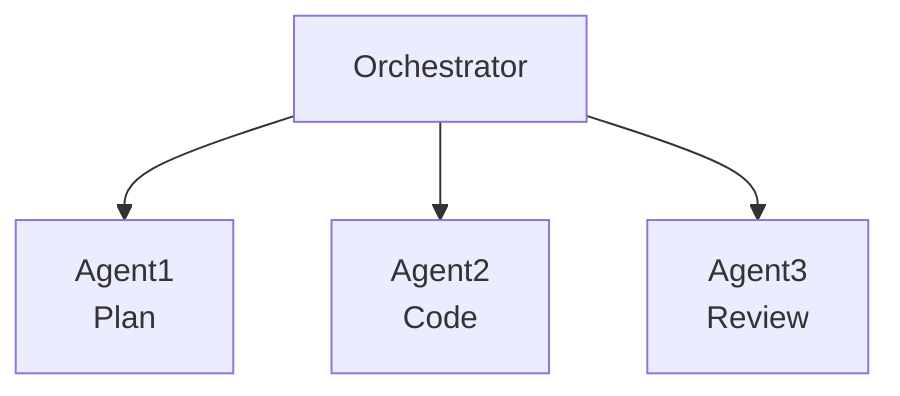
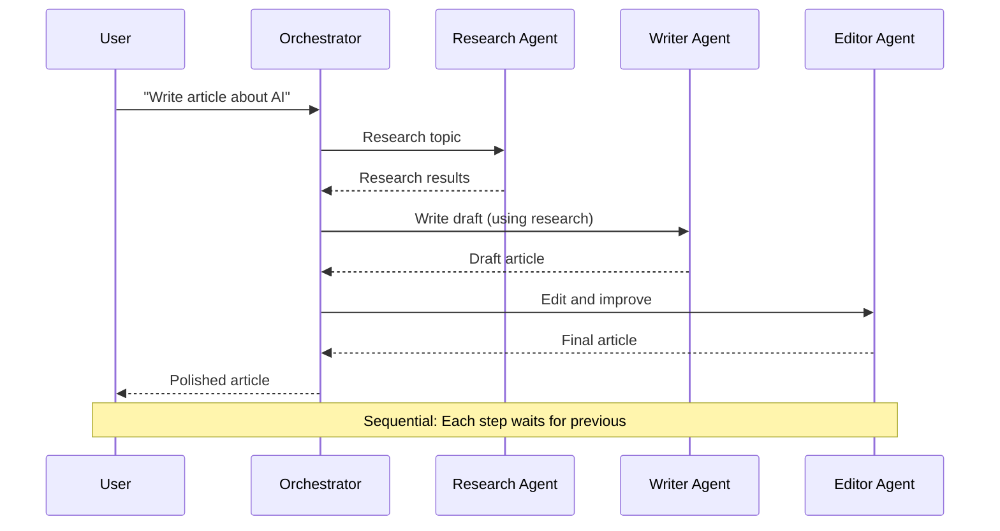
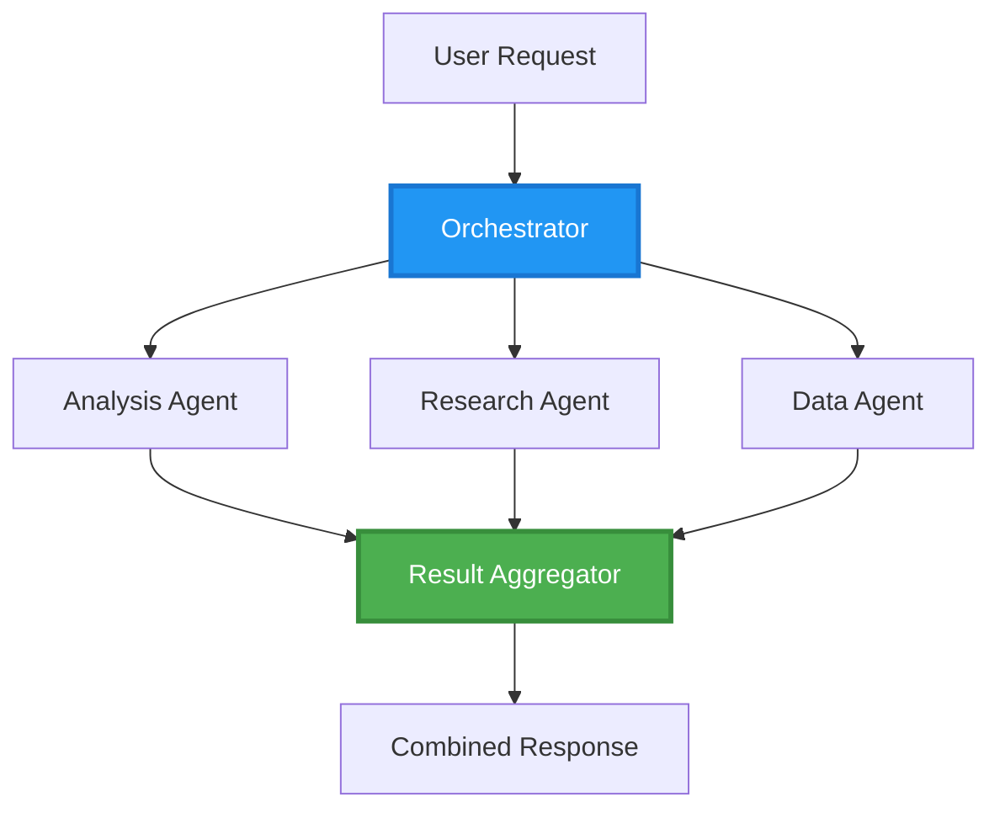
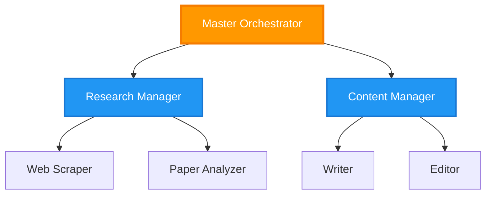
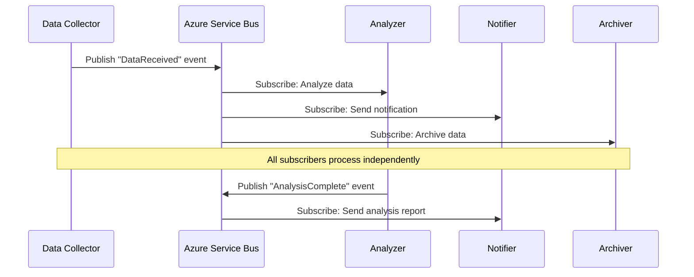
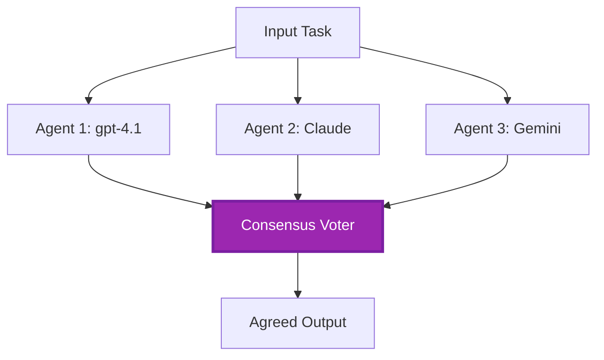
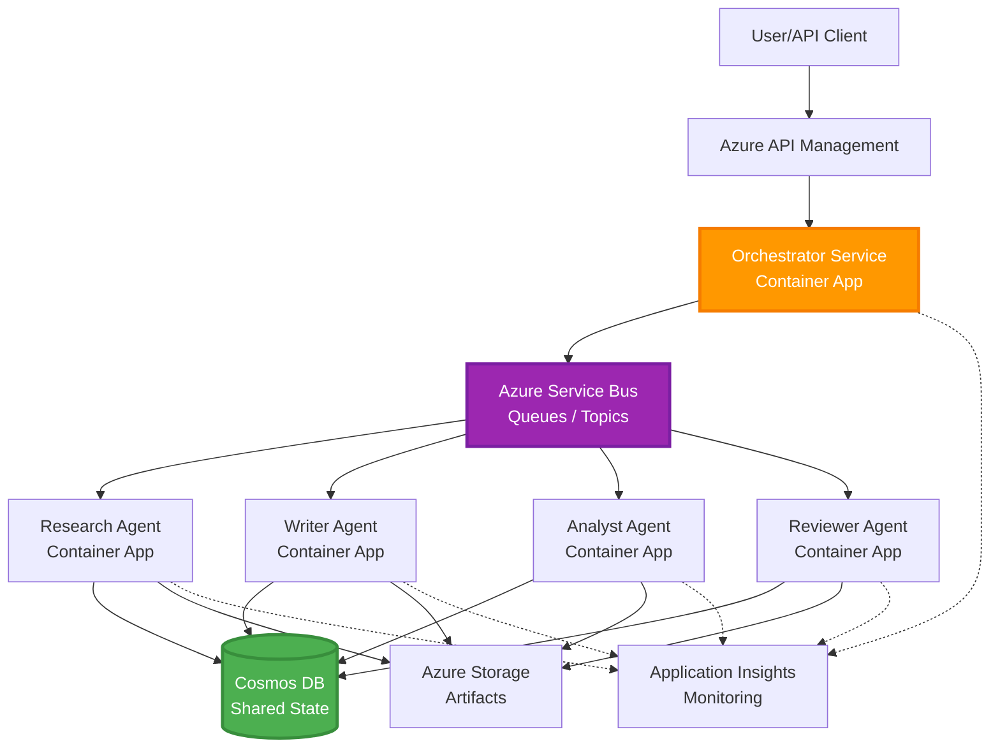

# รูปแบบการประสานงานหลายเอเจนต์

⏱️ **เวลาประมาณ**: อ่าน 60-75 นาที; ใช้เวลาหลายชั่วโมงสำหรับการใช้งาน | 💰 **ค่าใช้จ่ายโดยประมาณ**: ขึ้นอยู่กับภาระงาน | ⭐ **ความซับซ้อน**: ขั้นสูง

**📚 เส้นทางการเรียนรู้:**
- ← ก่อนหน้า: [การวางแผนความจุ](capacity-planning.md) - กลยุทธ์การกำหนดขนาดทรัพยากรและการปรับขนาด
- 🎯 **คุณอยู่ที่นี่**: รูปแบบการประสานงานหลายเอเจนต์ (การจัดการ, การสื่อสาร, การจัดการสถานะ)
- → ถัดไป: [การเลือก SKU](sku-selection.md) - การเลือกบริการ Azure ที่เหมาะสม
- 🏠 [หน้าหลักคอร์ส](../../README.md)

---

## สิ่งที่คุณจะได้เรียนรู้

เมื่อคุณเรียนบทนี้จบ คุณจะสามารถ:
- เข้าใจรูปแบบ **สถาปัตยกรรมหลายเอเจนต์** และเมื่อใดควรใช้
- นำรูปแบบ **การจัดการ** มาใช้ (แบบรวมศูนย์, แบบกระจาย, แบบลำดับชั้น)
- ออกแบบกลยุทธ์ **การสื่อสารระหว่างเอเจนต์** (แบบซิงโครนัส, แบบแอสิงโครนัส, แบบขับเคลื่อนด้วยเหตุการณ์)
- จัดการ **สถานะร่วม** ระหว่างเอเจนต์ที่แจกจ่าย
- ติดตั้ง **ระบบหลายเอเจนต์** บน Azure ด้วย AZD
- ใช้ **รูปแบบการประสานงาน** สำหรับสถานการณ์ AI จริง
- ตรวจสอบและแก้ไขข้อบกพร่องระบบเอเจนต์กระจาย

## ทำไมการประสานงานหลายเอเจนต์จึงสำคัญ

### วิวัฒนาการ: จากเอเจนต์เดียวสู่หลายเอเจนต์

**เอเจนต์เดียว (ง่าย):**
```
User → Agent → Response
```
- ✅ เข้าใจและใช้งานง่าย
- ✅ เร็วสำหรับงานง่าย ๆ
- ❌ จำกัดโดยความสามารถของโมเดลเดียว
- ❌ ทำงานพร้อมกันไม่ได้สำหรับงานซับซ้อน
- ❌ ไม่มีความเชี่ยวชาญเฉพาะทาง

**ระบบหลายเอเจนต์ (ขั้นสูง):**

- ✅ เอเจนต์ที่มีความเชี่ยวชาญเฉพาะงาน
- ✅ การทำงานพร้อมกันเพื่อความเร็ว
- ✅ โมดูลาร์และง่ายต่อการบำรุงรักษา
- ✅ ดีขึ้นสำหรับเวิร์กโฟลว์ที่ซับซ้อน
- ⚠️ ต้องใช้ตรรกะการประสานงาน

**อุปมา**: เอเจนต์เดียวดุจเหมือนคนคนเดียวทำทุกงาน ทีมหลายเอเจนต์เหมือนทีมที่แต่ละคนมีทักษะเฉพาะทาง (นักวิจัย, นักเขียนโค้ด, ผู้ตรวจทาน, ผู้เขียน) ทำงานร่วมกัน

---

## รูปแบบการประสานงานหลัก

### รูปแบบที่ 1: การประสานงานแบบลำดับ (โซ่ความรับผิดชอบ)

**เมื่อใดควรใช้**: งานต้องเสร็จตามลำดับเฉพาะ เอเจนต์แต่ละตัวสร้างจากผลลัพธ์ของตัวก่อนหน้า



**ประโยชน์:**
- ✅ การไหลของข้อมูลชัดเจน
- ✅ ง่ายต่อการแก้ปัญหา
- ✅ ลำดับการทำงานที่คาดเดาได้

**ข้อจำกัด:**
- ❌ ช้ากว่า (ไม่มีการทำงานพร้อมกัน)
- ❌ ข้อผิดพลาดเดียวขัดขวางทั้งโซ่
- ❌ จัดการงานที่ขึ้นต่อกันไม่ได้

**ตัวอย่างการใช้งาน:**
- สายงานสร้างเนื้อหา (วิจัย → เขียน → แก้ไข → เผยแพร่)
- การสร้างโค้ด (วางแผน → เขียน → ทดสอบ → ปล่อย)
- การสร้างรายงาน (รวบรวมข้อมูล → วิเคราะห์ → แสดงภาพ → สรุป)

---

### รูปแบบที่ 2: การประสานงานแบบขนาน (Fan-Out/Fan-In)

**เมื่อใดควรใช้**: งานที่เป็นอิสระสามารถทำงานพร้อมกันได้ ผลลัพธ์ถูกรวมกันในตอนท้าย



**ประโยชน์:**
- ✅ เร็ว (การทำงานพร้อมกัน)
- ✅ ทนต่อความผิดพลาด (ยอมรับผลลัพธ์บางส่วน)
- ✅ ปรับขนาดแนวนอนได้

**ข้อจำกัด:**
- ⚠️ ผลลัพธ์อาจมาถึงไม่เป็นลำดับ
- ⚠️ ต้องมีตรรกะการรวบรวม
- ⚠️ การจัดการสถานะซับซ้อน

**ตัวอย่างการใช้งาน:**
- การรวบรวมข้อมูลจากหลายแหล่ง (APIs + ฐานข้อมูล + การขูดเว็บ)
- การวิเคราะห์การแข่งขัน (โมเดลหลายตัวสร้างวิธีแก้ปัญหา, เลือกที่ดีที่สุด)
- บริการแปลภาษา (แปลหลายภาษาได้พร้อมกัน)

---

### รูปแบบที่ 3: การประสานงานแบบลำดับชั้น (ผู้จัดการ-ผู้ปฏิบัติงาน)

**เมื่อใดควรใช้**: เวิร์กโฟลว์ซับซ้อนที่มีงานย่อย ต้องการการมอบหมายงาน



**ประโยชน์:**
- ✅ จัดการเวิร์กโฟลว์ซับซ้อนได้
- ✅ โมดูลาร์และง่ายต่อการบำรุงรักษา
- ✅ ขอบเขตความรับผิดชอบชัดเจน

**ข้อจำกัด:**
- ⚠️ สถาปัตยกรรมซับซ้อนกว่า
- ⚠️ มีความหน่วงสูงกว่า (หลายชั้นการประสานงาน)
- ⚠️ ต้องการการจัดการขั้นสูง

**ตัวอย่างการใช้งาน:**
- การประมวลผลเอกสารองค์กร (จัดประเภท → ส่งต่อ → ประมวลผล → จัดเก็บ)
- สายงานข้อมูลหลายขั้นตอน (รับเข้า → ทำความสะอาด → แปลง → วิเคราะห์ → รายงาน)
- เวิร์กโฟลว์อัตโนมัติซับซ้อน (วางแผน → จัดสรรทรัพยากร → ดำเนินการ → ตรวจสอบ)

---

### รูปแบบที่ 4: การประสานงานแบบขับเคลื่อนด้วยเหตุการณ์ (เผยแพร่-สมัครสมาชิก)

**เมื่อใดควรใช้**: เอเจนต์ต้องตอบสนองต่อเหตุการณ์ ต้องการการเชื่อมโยงหลวม



**ประโยชน์:**
- ✅ การเชื่อมโยงหลวมระหว่างเอเจนต์
- ✅ เพิ่มเอเจนต์ใหม่ได้ง่าย (แค่สมัครสมาชิก)
- ✅ การประมวลผลแบบแอสิงโครนัส
- ✅ ทนทาน (ข้อความคงอยู่)

**ข้อจำกัด:**
- ⚠️ ความสอดคล้องในที่สุด
- ⚠️ การดีบักซับซ้อน
- ⚠️ ปัญหาการเรียงลำดับข้อความ

**ตัวอย่างการใช้งาน:**
- ระบบตรวจสอบเรียลไทม์ (แจ้งเตือน, แดชบอร์ด, บันทึก)
- การแจ้งเตือนหลายช่องทาง (อีเมล, SMS, การแจ้งเตือนแบบพุช, Slack)
- สายงานประมวลผลข้อมูล (ผู้บริโภคข้อมูลหลายราย)

---

### รูปแบบที่ 5: การประสานงานแบบมีฉันทามติ (การลงคะแนน/กลุ่มเสียงข้างมาก)

**เมื่อใดควรใช้**: ต้องการความเห็นชอบจากหลายเอเจนต์ก่อนดำเนินการต่อ



**ประโยชน์:**
- ✅ ความแม่นยำสูงขึ้น (หลายความคิดเห็น)
- ✅ ทนต่อความผิดพลาด (ยอมรับความล้มเหลวของส่วนน้อย)
- ✅ มีการประกันคุณภาพในตัว

**ข้อจำกัด:**
- ❌ ค่าใช้จ่ายสูง (เรียกโมเดลหลายครั้ง)
- ❌ ช้ากว่า (รอเอเจนต์ทั้งหมด)
- ⚠️ ต้องจัดการความขัดแย้ง

**ตัวอย่างการใช้งาน:**
- การตรวจสอบเนื้อหา (โมเดลหลายตัวตรวจสอบเนื้อหา)
- การตรวจสอบโค้ด (ลินเตอร์/เครื่องวิเคราะห์หลายตัว)
- การวินิจฉัยทางการแพทย์ (โมเดล AI หลายตัว, การยืนยันโดยผู้เชี่ยวชาญ)

---

## ภาพรวมสถาปัตยกรรม

### ระบบหลายเอเจนต์ครบถ้วนบน Azure



**ส่วนประกอบสำคัญ:**

| ส่วนประกอบ | จุดประสงค์ | บริการ Azure |
|-----------|---------|---------------|
| **API Gateway** | จุดเข้าใช้งาน, จำกัดอัตรา, การยืนยันตัวตน | API Management |
| **Orchestrator** | ประสานเวิร์กโฟลว์ของเอเจนต์ | Container Apps |
| **Message Queue** | การสื่อสารแบบแอสิงโครนัส | Service Bus / Event Hubs |
| **Agents** | เอเจนต์ AI เชี่ยวชาญงาน | Container Apps / Functions |
| **State Store** | สถานะร่วม, การติดตามงาน | Cosmos DB |
| **Artifact Storage** | เอกสาร, ผลลัพธ์, บันทึก | Blob Storage |
| **Monitoring** | การติดตามแบบกระจาย, บันทึก | Application Insights |

คิว/หัวข้อของ Service Bus และ Event Hubs เป็นบริการที่ต่างกันโดยมีรูปแบบการส่งมอบและการบริโภคที่แตกต่างกัน; Event Hubs ไม่ใช่การทดแทนแบบตรงสำหรับโค้ด Service Bus ด้านล่าง การทำงานพร้อมกัน, ข้อความที่คงอยู่ และการโหวตโมเดลไม่ได้รับประกันความทนทานหรือความแม่นยำสูงขึ้นโดยตัวเอง

---

## สิ่งที่ต้องมีล่วงหน้า

### เครื่องมือที่ต้องใช้

```bash
# Verify Azure Developer CLI
azd version
# Command reference baseline: azd 1.37.2

# Verify Azure CLI
az --version
# ✅ Expected: azure-cli 2.50.0 or higher

# Verify Docker (for local testing)
docker --version
# ✅ Expected: Docker version 20.10 or higher
```

### ข้อกำหนดของ Azure

- สมัครสมาชิก Azure ที่ใช้งานอยู่
- สิทธิ์สร้าง:
  - Container Apps
  - เนมสเปซของ Service Bus
  - บัญชี Cosmos DB
  - บัญชี Storage
  - Application Insights

### ความรู้พื้นฐานที่ต้องมี

คุณควรได้เรียนจบ:
- [การจัดการกำหนดค่า](../chapter-03-configuration/configuration.md)
- [การพิสูจน์ตัวตน & ความปลอดภัย](../chapter-03-configuration/authsecurity.md)
- [ตัวอย่างไมโครเซอร์วิส](../../../../examples/microservices)

---

## คู่มือการใช้งาน

> **ชิ้นส่วนออกแบบ ไม่ใช่ห้องปฏิบัติการใช้งานได้ทันที:** โครงสร้างโปรเจกต์และป้าย `File:` ด้านล่างอธิบายไฟล์ที่ต้องสร้างในโปรเจกต์ของคุณเอง; รีโพสนี้ไม่มีแอปพลิเคชัน `multi-agent-system` สมบูรณ์ ชิ้นส่วนที่ขาดรวมถึงแม่แบบหลัก/พารามิเตอร์, สภาพแวดล้อม/รีจิสทรี Container Apps, Dockerfile และล็อก dependencies, การตั้งค่าฐานข้อมูล/คอนเทนเนอร์ Cosmos, การปรับใช้งานโมเดล, การตั้งค่าเอกลักษณ์/บทบาท, กฎการปรับขนาด และเวิร์กเกอร์/คิวแบบขนาน อย่าคาดหวังให้ `azd init` สร้างไฟล์เหล่านี้หรือ `azd up` ปรับใช้โค้ดตัวอย่างโดยไม่เปลี่ยนแปลง สำหรับจุดเริ่มต้นที่ใช้งานได้ ให้ทำ [พื้นฐานหลายเอเจนต์](../chapter-05-multi-agent/multi-agent-basics.md) ให้เสร็จ

**สมมติฐานเวลารันไทม์:** Python 3.10+, `azure-servicebus`, `azure-cosmos`, `openai`, Flask, และ (สำหรับการตรวจสอบ) `azure-monitor-opentelemetry`; วาง `shared` ไว้ในเส้นทางนำเข้า Python ในแต่ละอิมเมจเซอร์วิส ตู้คอนเทนเนอร์ `agent-state/tasks` ของ Cosmos ต้องมีอยู่แล้วโดยมี partition key เป็น `/id` การเชื่อมต่อโดยใช้กุญแจทำให้ชิ้นส่วนเหล่านี้ง่ายขึ้น ไม่ใช่คำแนะนำสำหรับผลิตภัณฑ์: ควรใช้ managed identities พร้อมบทบาทข้อมูล Service Bus/Cosmos/OpenAI ที่จำกัดสิทธิ์ อย่าเปิดเผยกุญแจในผลลัพธ์หรือบันทึก

การส่งมอบ Service Bus เป็นแบบ **อย่างน้อยหนึ่งครั้ง** ให้เก็บ idempotency ต่อภารกิจ **และขั้นตอน** ใช้ concurrency แบบมองโลกในแง่ดี (ETags) สำหรับอ่าน/แก้ไข/เขียนสถานะ และต่ออายุล็อกข้อความในระหว่างกระบวนการที่ใช้เวลานาน ตัวจัดการสถานะง่าย ๆ ด้านล่างรองรับเฉพาะแบบลำดับและไม่ได้รับประกันเหล่านี้เหมือนการใช้งานจริง

### โครงสร้างโปรเจกต์

```
multi-agent-system/
├── azure.yaml                    # AZD configuration
├── infra/
│   ├── main.bicep               # Main infrastructure
│   ├── core/
│   │   ├── servicebus.bicep     # Message queue
│   │   ├── cosmos.bicep         # State store
│   │   ├── storage.bicep        # Artifact storage
│   │   └── monitoring.bicep     # Application Insights
│   └── app/
│       ├── orchestrator.bicep   # Orchestrator service
│       └── agent.bicep          # Agent template
└── src/
    ├── orchestrator/            # Orchestration logic
    │   ├── app.py
    │   ├── workflows.py
    │   └── Dockerfile
    ├── agents/
    │   ├── research/            # Research agent
    │   ├── writer/              # Writer agent
    │   ├── analyst/             # Analyst agent
    │   └── reviewer/            # Reviewer agent
    └── shared/
        ├── state_manager.py     # Shared state logic
        └── message_handler.py   # Message handling
```

---

## บทที่ 1: รูปแบบการประสานงานแบบลำดับ

### การใช้งาน: สายงานสร้างเนื้อหา

มาสร้างสายงานแบบลำดับ: วิจัย → เขียน → แก้ไข การเผยแพร่เป็นนอกตัวอย่างนี้

### 1. การตั้งค่า AZD

**ไฟล์: `azure.yaml`**

```yaml
name: content-pipeline
metadata:
  template: multi-agent-sequential@1.0.0

services:
  orchestrator:
    project: ./src/orchestrator
    language: python
    host: containerapp
  
  research-agent:
    project: ./src/agents/research
    language: python
    host: containerapp
  
  writer-agent:
    project: ./src/agents/writer
    language: python
    host: containerapp
  
  editor-agent:
    project: ./src/agents/editor
    language: python
    host: containerapp
```

### 2. โครงสร้างพื้นฐาน: Service Bus สำหรับการประสานงาน

**ไฟล์: `infra/core/servicebus.bicep`**

```bicep
param name string
param location string
param tags object = {}

resource serviceBusNamespace 'Microsoft.ServiceBus/namespaces@2022-10-01-preview' = {
  name: name
  location: location
  tags: tags
  sku: {
    name: 'Standard'
    tier: 'Standard'
  }
  properties: {
    minimumTlsVersion: '1.2'
  }
}

// Queue for orchestrator → research agent
resource researchQueue 'Microsoft.ServiceBus/namespaces/queues@2022-10-01-preview' = {
  parent: serviceBusNamespace
  name: 'research-tasks'
  properties: {
    maxDeliveryCount: 3
    lockDuration: 'PT5M'
    deadLetteringOnMessageExpiration: true
  }
}

// Queue for research agent → writer agent
resource writerQueue 'Microsoft.ServiceBus/namespaces/queues@2022-10-01-preview' = {
  parent: serviceBusNamespace
  name: 'writer-tasks'
  properties: {
    maxDeliveryCount: 3
    lockDuration: 'PT5M'
  }
}

// Queue for writer agent → editor agent
resource editorQueue 'Microsoft.ServiceBus/namespaces/queues@2022-10-01-preview' = {
  parent: serviceBusNamespace
  name: 'editor-tasks'
  properties: {
    maxDeliveryCount: 3
    lockDuration: 'PT5M'
  }
}

output namespace string = serviceBusNamespace.name
// Do not output RootManageSharedAccessKey. Resolve scoped credentials
// securely or use managed identity in the application and scale rules.
```

### 3. ตัวจัดการสถานะร่วม

**ไฟล์: `src/shared/state_manager.py`**

```python
from azure.cosmos import CosmosClient, PartitionKey
from datetime import datetime, timezone
import os

class StateManager:
    """Manages shared state across agents using Cosmos DB"""
    
    def __init__(self):
        endpoint = os.environ['COSMOS_ENDPOINT']
        key = os.environ['COSMOS_KEY']
        
        self.client = CosmosClient(endpoint, key)
        self.database = self.client.get_database_client('agent-state')
        self.container = self.database.get_container_client('tasks')
    
    def create_task(self, task_id: str, task_type: str, input_data: dict):
        """Create a new task"""
        task = {
            'id': task_id,
            'type': task_type,
            'status': 'pending',
            'input': input_data,
            'created_at': datetime.now(timezone.utc).isoformat(),
            'steps': []
        }
        self.container.create_item(task)
        return task
    
    def update_task_step(self, task_id: str, step_name: str, result: dict):
        """Update task with completed step"""
        task = self.container.read_item(task_id, partition_key=task_id)
        
        task['steps'].append({
            'name': step_name,
            'completed_at': datetime.now(timezone.utc).isoformat(),
            'result': result
        })
        
        self.container.replace_item(task_id, task)
        return task
    
    def complete_task(self, task_id: str, final_result: dict):
        """Mark task as complete"""
        task = self.container.read_item(task_id, partition_key=task_id)
        task['status'] = 'completed'
        task['result'] = final_result
        task['completed_at'] = datetime.now(timezone.utc).isoformat()
        self.container.replace_item(task_id, task)
        return task
    
    def get_task(self, task_id: str):
        """Retrieve task state"""
        return self.container.read_item(task_id, partition_key=task_id)
```

### 4. บริการ Orchestrator

**ไฟล์: `src/orchestrator/app.py`**

```python
from flask import Flask, request, jsonify
from azure.servicebus import ServiceBusClient, ServiceBusMessage
import json
import uuid
import os
from shared.state_manager import StateManager

app = Flask(__name__)
state_manager = StateManager()

# Service Bus connection
servicebus_connection_str = os.environ['SERVICEBUS_CONNECTION_STRING']
servicebus_client = ServiceBusClient.from_connection_string(servicebus_connection_str)

@app.route('/health', methods=['GET'])
def health():
    return jsonify({'status': 'healthy', 'service': 'orchestrator'})

@app.route('/create-content', methods=['POST'])
def create_content():
    """
    Sequential workflow: Research → Write → Edit (returns a draft; no publishing)
    """
    data = request.get_json(silent=True) or {}
    topic = data.get('topic')
    
    if not topic:
        return jsonify({'error': 'Topic required'}), 400
    
    # Create task in state store
    task_id = str(uuid.uuid4())
    task = state_manager.create_task(
        task_id=task_id,
        task_type='content_creation',
        input_data={'topic': topic}
    )
    
    # Send message to research agent (first step)
    sender = servicebus_client.get_queue_sender('research-tasks')
    message = ServiceBusMessage(
        body=json.dumps({
            'task_id': task_id,
            'topic': topic,
            'next_queue': 'writer-tasks'  # Where to send results
        }),
        content_type='application/json'
    )
    
    with sender:
        sender.send_messages(message)
    
    return jsonify({
        'task_id': task_id,
        'status': 'started',
        'workflow': 'sequential',
        'steps': ['research', 'write', 'edit'],
        'message': 'Content creation pipeline initiated'
    }), 202

@app.route('/task/<task_id>', methods=['GET'])
def get_task_status(task_id):
    """Check task status"""
    try:
        task = state_manager.get_task(task_id)
        return jsonify(task)
    except Exception as e:
        return jsonify({'error': str(e)}), 404

if __name__ == '__main__':
    app.run(host='0.0.0.0', port=8080)
```

### 5. เอเจนต์วิจัย

**ไฟล์: `src/agents/research/app.py`**

```python
from azure.servicebus import ServiceBusClient, ServiceBusMessage
from openai import AzureOpenAI
import json
import os
import time
from shared.state_manager import StateManager

# Initialize clients
state_manager = StateManager()
servicebus_client = ServiceBusClient.from_connection_string(
    os.environ['SERVICEBUS_CONNECTION_STRING']
)

openai_client = AzureOpenAI(
    api_key=os.environ['AZURE_OPENAI_API_KEY'],
    api_version="2024-10-21",
    azure_endpoint=os.environ['AZURE_OPENAI_ENDPOINT']
)

def process_research_task(message_data):
    """Process research request and pass to writer"""
    task_id = message_data['task_id']
    topic = message_data['topic']
    next_queue = message_data['next_queue']
    
    print(f"🔬 Researching: {topic}")
    
    # Call Microsoft Foundry Models for research
    response = openai_client.chat.completions.create(
        model=os.environ['AZURE_OPENAI_DEPLOYMENT'],
        messages=[
            {"role": "system", "content": "You are a research assistant. Provide comprehensive research on the given topic."},
            {"role": "user", "content": f"Research this topic thoroughly: {topic}"}
        ],
        max_tokens=1500
    )
    
    research_results = response.choices[0].message.content
    
    # Update state
    state_manager.update_task_step(
        task_id=task_id,
        step_name='research',
        result={'research': research_results}
    )
    
    # Send to next agent (writer)
    sender = servicebus_client.get_queue_sender(next_queue)
    message = ServiceBusMessage(
        body=json.dumps({
            'task_id': task_id,
            'topic': topic,
            'research': research_results,
            'next_queue': 'editor-tasks'
        }),
        content_type='application/json'
    )
    
    with sender:
        sender.send_messages(message)
    
    print(f"✅ Research complete for task {task_id}")

def main():
    """Listen to research queue"""
    receiver = servicebus_client.get_queue_receiver('research-tasks')
    
    print("🔬 Research Agent started, listening for tasks...")
    
    with receiver:
        while True:
            messages = receiver.receive_messages(max_wait_time=5)
            for message in messages:
                try:
                    message_data = json.loads(str(message))
                    process_research_task(message_data)
                    receiver.complete_message(message)
                except Exception as e:
                    print(f"❌ Error processing message: {e}")
                    receiver.abandon_message(message)

if __name__ == '__main__':
    main()
```

### 6. เอเจนต์นักเขียน

**ไฟล์: `src/agents/writer/app.py`**

```python
from azure.servicebus import ServiceBusClient, ServiceBusMessage
from openai import AzureOpenAI
import json
import os
from shared.state_manager import StateManager

state_manager = StateManager()
servicebus_client = ServiceBusClient.from_connection_string(
    os.environ['SERVICEBUS_CONNECTION_STRING']
)

openai_client = AzureOpenAI(
    api_key=os.environ['AZURE_OPENAI_API_KEY'],
    api_version="2024-10-21",
    azure_endpoint=os.environ['AZURE_OPENAI_ENDPOINT']
)

def process_writing_task(message_data):
    """Write article based on research"""
    task_id = message_data['task_id']
    topic = message_data['topic']
    research = message_data['research']
    next_queue = message_data['next_queue']
    
    print(f"✍️ Writing article: {topic}")
    
    # Call Microsoft Foundry Models to write article
    response = openai_client.chat.completions.create(
        model=os.environ['AZURE_OPENAI_DEPLOYMENT'],
        messages=[
            {"role": "system", "content": "You are a professional writer. Write engaging, well-structured articles."},
            {"role": "user", "content": f"Based on this research:\n\n{research}\n\nWrite a comprehensive article about: {topic}"}
        ],
        max_tokens=2000
    )
    
    article_draft = response.choices[0].message.content
    
    # Update state
    state_manager.update_task_step(
        task_id=task_id,
        step_name='writing',
        result={'draft': article_draft}
    )
    
    # Send to editor
    sender = servicebus_client.get_queue_sender(next_queue)
    message = ServiceBusMessage(
        body=json.dumps({
            'task_id': task_id,
            'topic': topic,
            'draft': article_draft
        }),
        content_type='application/json'
    )
    
    with sender:
        sender.send_messages(message)
    
    print(f"✅ Article draft complete for task {task_id}")

def main():
    """Listen to writer queue"""
    receiver = servicebus_client.get_queue_receiver('writer-tasks')
    
    print("✍️ Writer Agent started, listening for tasks...")
    
    with receiver:
        while True:
            messages = receiver.receive_messages(max_wait_time=5)
            for message in messages:
                try:
                    message_data = json.loads(str(message))
                    process_writing_task(message_data)
                    receiver.complete_message(message)
                except Exception as e:
                    print(f"❌ Error: {e}")
                    receiver.abandon_message(message)

if __name__ == '__main__':
    main()
```

### 7. เอเจนต์บรรณาธิการ

**ไฟล์: `src/agents/editor/app.py`**

```python
from azure.servicebus import ServiceBusClient
from openai import AzureOpenAI
import json
import os
from shared.state_manager import StateManager

state_manager = StateManager()
servicebus_client = ServiceBusClient.from_connection_string(
    os.environ['SERVICEBUS_CONNECTION_STRING']
)

openai_client = AzureOpenAI(
    api_key=os.environ['AZURE_OPENAI_API_KEY'],
    api_version="2024-10-21",
    azure_endpoint=os.environ['AZURE_OPENAI_ENDPOINT']
)

def process_editing_task(message_data):
    """Edit and finalize article"""
    task_id = message_data['task_id']
    topic = message_data['topic']
    draft = message_data['draft']
    
    print(f"📝 Editing article: {topic}")
    
    # Call Microsoft Foundry Models to edit
    response = openai_client.chat.completions.create(
        model=os.environ['AZURE_OPENAI_DEPLOYMENT'],
        messages=[
            {"role": "system", "content": "You are an expert editor. Improve grammar, clarity, and structure."},
            {"role": "user", "content": f"Edit and improve this article:\n\n{draft}"}
        ],
        max_tokens=2000
    )
    
    final_article = response.choices[0].message.content
    
    # Mark task as complete
    state_manager.complete_task(
        task_id=task_id,
        final_result={
            'topic': topic,
            'final_article': final_article,
            'word_count': len(final_article.split())
        }
    )
    
    print(f"✅ Article finalized for task {task_id}")

def main():
    """Listen to editor queue"""
    receiver = servicebus_client.get_queue_receiver('editor-tasks')
    
    print("📝 Editor Agent started, listening for tasks...")
    
    with receiver:
        while True:
            messages = receiver.receive_messages(max_wait_time=5)
            for message in messages:
                try:
                    message_data = json.loads(str(message))
                    process_editing_task(message_data)
                    receiver.complete_message(message)
                except Exception as e:
                    print(f"❌ Error: {e}")
                    receiver.abandon_message(message)

if __name__ == '__main__':
    main()
```

### 8. ปรับใช้และทดสอบ

คำสั่งเหล่านี้ใช้ได้ **หลังจากที่คุณสร้างไฟล์โปรเจกต์ที่ขาดหายไปแล้วเท่านั้น** การเริ่มต้นเอเจนต์ Foundry แบบโต้ตอบเป็นเวิร์กโฟลว์แยกต่างหาก; มันไม่ได้สร้างดีไซน์ Service Bus นี้

```bash
# In your completed custom project
azd up

# Alternative in a SEPARATE empty folder (agents beta.23 requires azd >= 1.37)
azd extension install azure.ai.agents
azd ai agent init
azd up
```

> ดู [คำสั่ง AZD AI CLI](../chapter-08-production/production-ai-practices.md#azd-ai-cli-commands-and-extensions) สำหรับ `azd ai` ทุกธงและตัวเลือก

```bash
# Get orchestrator URL
ORCHESTRATOR_URL=$(azd env get-values | grep ORCHESTRATOR_URL | cut -d '=' -f2 | tr -d '"')

# Create content
curl -X POST $ORCHESTRATOR_URL/create-content \
  -H "Content-Type: application/json" \
  -d '{"topic": "The Future of AI in Healthcare"}'
```

**✅ ผลลัพธ์ที่คาดหวัง:**
```json
{
  "task_id": "a1b2c3d4-e5f6-7890-abcd-ef1234567890",
  "status": "started",
  "workflow": "sequential",
  "steps": ["research", "write", "edit"],
  "message": "Content creation pipeline initiated"
}
```

**ตรวจสอบความคืบหน้าของงาน:**
```bash
TASK_ID="a1b2c3d4-e5f6-7890-abcd-ef1234567890"
curl $ORCHESTRATOR_URL/task/$TASK_ID
```

**✅ ผลลัพธ์ที่คาดหวัง (เมื่อเสร็จ):**
```json
{
  "id": "a1b2c3d4-e5f6-7890-abcd-ef1234567890",
  "type": "content_creation",
  "status": "completed",
  "steps": [
    {
      "name": "research",
      "completed_at": "2025-11-19T10:30:00Z",
      "result": {"research": "..."}
    },
    {
      "name": "writing",
      "completed_at": "2025-11-19T10:32:00Z",
      "result": {"draft": "..."}
    }
  ],
  "result": {
    "topic": "The Future of AI in Healthcare",
    "final_article": "...",
    "word_count": 1500
  }
}
```

---

## บทที่ 2: รูปแบบการประสานงานแบบขนาน

### การใช้งาน: ตัวรวบรวมข้อมูลจากหลายแหล่งพร้อมกัน

มาสร้างระบบแบบขนานที่รวบรวมข้อมูลจากแหล่งหลายแห่งพร้อมกัน

### Orchestrator แบบขนาน

**ไฟล์: `src/orchestrator/parallel_workflow.py`**

```python
from flask import Flask, request, jsonify
from azure.servicebus import ServiceBusClient, ServiceBusMessage
import json
import uuid
import os
from shared.state_manager import StateManager

app = Flask(__name__)
state_manager = StateManager()

servicebus_client = ServiceBusClient.from_connection_string(
    os.environ['SERVICEBUS_CONNECTION_STRING']
)

@app.route('/research-parallel', methods=['POST'])
def research_parallel():
    """
    Parallel workflow: Multiple agents work simultaneously
    """
    data = request.json
    query = data.get('query')
    
    task_id = str(uuid.uuid4())
    task = state_manager.create_task(
        task_id=task_id,
        task_type='parallel_research',
        input_data={
            'query': query,
            'agents': ['web', 'academic', 'news', 'social']
        }
    )
    
    # Fan-out: publish sequentially; workers may process concurrently.
    agents = [
        ('web-research-queue', 'web'),
        ('academic-research-queue', 'academic'),
        ('news-research-queue', 'news'),
        ('social-research-queue', 'social')
    ]
    
    for queue_name, agent_type in agents:
        sender = servicebus_client.get_queue_sender(queue_name)
        message = ServiceBusMessage(
            body=json.dumps({
                'task_id': task_id,
                'query': query,
                'agent_type': agent_type,
                'result_queue': 'aggregation-queue'
            }),
            content_type='application/json'
        )
        
        with sender:
            sender.send_messages(message)
    
    return jsonify({
        'task_id': task_id,
        'status': 'started',
        'workflow': 'parallel',
        'agents_dispatched': 4,
        'message': 'Parallel research initiated'
    }), 202

if __name__ == '__main__':
    app.run(host='0.0.0.0', port=8080)
```

### ตรรกะการรวบรวม

**ไฟล์: `src/agents/aggregator/app.py`**

```python
from azure.servicebus import ServiceBusClient
import json
import os
from collections import defaultdict
from shared.state_manager import StateManager

state_manager = StateManager()
servicebus_client = ServiceBusClient.from_connection_string(
    os.environ['SERVICEBUS_CONNECTION_STRING']
)

# Single-process demo only: not durable or shared across replicas.
# Production: use durable unique (task_id, agent_type) result records.
task_results = defaultdict(dict)
expected_agents = 4  # web, academic, news, social

def process_result(message_data):
    """Aggregate results from parallel agents"""
    task_id = message_data['task_id']
    agent_type = message_data['agent_type']
    result = message_data['result']
    
    # Store result
    task_results[task_id][agent_type] = {
        'agent': agent_type,
        'data': result
    }
    
    print(f"📊 Received result from {agent_type} agent ({len(task_results[task_id])}/{expected_agents})")
    
    # Check if all agents completed (fan-in)
    if len(task_results[task_id]) == expected_agents:
        print(f"✅ All agents completed for task {task_id}. Aggregating...")
        
        # Combine results
        aggregated = {
            'query': message_data['query'],
            'sources': list(task_results[task_id].values()),
            'summary': generate_summary(list(task_results[task_id].values()))
        }
        
        # Mark complete
        state_manager.complete_task(task_id, aggregated)
        
        # Clean up
        del task_results[task_id]
        
        print(f"✅ Aggregation complete for task {task_id}")

def generate_summary(results):
    """Generate summary from all sources"""
    summaries = [r['data'].get('summary', '') for r in results]
    return '\n\n'.join(summaries)

def main():
    """Listen to aggregation queue"""
    receiver = servicebus_client.get_queue_receiver('aggregation-queue')
    
    print("📊 Aggregator started, listening for results...")
    
    with receiver:
        while True:
            messages = receiver.receive_messages(max_wait_time=5)
            for message in messages:
                try:
                    message_data = json.loads(str(message))
                    process_result(message_data)
                    receiver.complete_message(message)
                except Exception as e:
                    print(f"❌ Error: {e}")
                    receiver.abandon_message(message)

if __name__ == '__main__':
    main()
```

**ประโยชน์ของรูปแบบขนาน:**
- ⚡ **ลดความหน่วงได้** (ถูกจำกัดโดยคนงานที่ช้าที่สุดบวกภาระการประสานงาน)
- 🔄 **รองรับผลลัพธ์บางส่วนได้** ด้วยกำหนดเวลาชัดเจนและนโยบายจัดการข้อผิดพลาด (ยังไม่ได้ทำในตัวรวบรวมพื้นฐาน)
- 📈 **ปรับขนาดได้** (เพิ่มเอเจนต์ได้ง่าย)

---

## แบบฝึกหัดปฏิบัติ

### แบบฝึกหัด 1: เพิ่มการจัดการหมดเวลารอ ⭐⭐ (กลาง)

**เป้าหมาย**: ใช้ตรรกะหมดเวลารอเพื่อให้ตัวรวบรวมไม่ต้องรอเอเจนต์ที่ช้าจนเกินไป

**จุดเริ่มต้น:** รันการจำลองกำหนดเวลาท้องถิ่นนี้ก่อนนำไปผนวกรวมเข้ากับเวิร์กเกอร์คิว การตรวจสอบหมดเวลาที่ทำเฉพาะเมื่อมีข้อความใหม่มาเท่านั้นจะไม่ทำงานถ้าเอเจนต์ที่ขาดหายไม่ส่งข้อความใด ๆ

**ขั้นตอน**:

1. **เพิ่มการติดตามหมดเวลารอในตัวรวบรวม:**

```python
import asyncio

async def simulated_agent(name, delay):
    await asyncio.sleep(delay)
    return {'agent': name, 'result': 'done'}

async def main():
    tasks = [asyncio.create_task(simulated_agent(name, delay))
             for name, delay in [('web', 0.1), ('academic', 0.2),
                                 ('news', 0.3), ('social', 3)]]
    done, pending = await asyncio.wait(tasks, timeout=1)
    results = [task.result() for task in done]
    for task in pending:
        task.cancel()
    await asyncio.gather(*pending, return_exceptions=True)
    print({'completed_agents': len(results), 'timed_out': bool(pending)})
    assert len(results) == 3 and pending

asyncio.run(main())
```

2. **ผลลัพธ์ที่คาดหวัง:**

```text
{'completed_agents': 3, 'timed_out': True}
```

3. **การผนวกรวมกับระบบคิว (งานออกแบบ):** เก็บกำหนดเวลาส่งงานและเอเจนต์ที่คาดหวังเมื่อสร้างงาน, รันการตรวจค้นกำหนดเวลาเป็นระยะโดยแยกจากผลลัพธ์ที่ได้รับ, สรุปผลลัพธ์บางส่วนอย่างอะตอมิก, และละเว้นข้อความซ้ำหรือล่าหลังสำหรับงานที่สรุปแล้ว การหมดเวลารอภายในระบบท้องถิ่นจะไม่ยกเลิกเอเจนต์ระยะไกล

สำหรับโปรเจกต์ที่คุณสร้างเท่านั้น:

```bash
azd deploy aggregator

# Submit task
curl -X POST $ORCHESTRATOR_URL/research-parallel \
  -H "Content-Type: application/json" \
  -d '{"query": "AI safety research"}'

# Check results after 30 seconds
curl $ORCHESTRATOR_URL/task/$TASK_ID
```

**✅ เกณฑ์ความสำเร็จ:**
- ✅ การทดสอบในพื้นที่คืนค่าหลังครบกำหนดเวลาหนึ่งวินาทีแม้เอเจนต์ยังไม่เสร็จ
- ✅ การตอบกลับระบุผลลัพธ์บางส่วน (`"timed_out": true`)
- ✅ ผลลัพธ์ที่มีอยู่ถูกส่งคืน (3 จาก 4 เอเจนต์)

**เวลา**: 20-25 นาที

---

### แบบฝึกหัด 2: ใช้ตรรกะลองใหม่ ⭐⭐⭐ (ขั้นสูง)

**เป้าหมาย**: ให้ลองทำงานที่ล้มเหลวของเอเจนต์ใหม่โดยอัตโนมัติก่อนยอมแพ้

**ขั้นตอน**:

1. **ใช้จำนวนการส่งมอบของ Service Bus แทนการใส่ตัวนับลองใหม่เอง:**

```python
import json
import time
# Integration fragment: use a live peek-lock ServiceBusReceiver.
# Set queue maxDeliveryCount to 4 for one attempt + up to three retries.
```

2. **เพิ่มตัวจัดการลองใหม่ให้เอเจนต์:**

```python
def process_with_retry(message, receiver, process_func):
    """Process message with automatic retry on failure"""
    try:
        message_data = json.loads(str(message))
        
        # Process the message
        process_func(message_data)
        
        # Success - complete
        receiver.complete_message(message)
        
    except Exception as e:
        if message.delivery_count < 4:
            # Bounded exponential delay: 5s, 10s, 20s.
            # Renew the lock if processing + waiting can exceed its duration.
            time.sleep(5 * 2 ** (message.delivery_count - 1))
            receiver.abandon_message(message)
        else:
            # Max retries exceeded - move to dead letter queue
            print(f"❌ Max attempts exceeded for message {message.message_id}")
            receiver.dead_letter_message(
                message,
                reason="MaxRetriesExceeded",
                error_description=str(e)
            )
```

3. **ตรวจสอบคิวจดหมายเสีย:**

```python
def monitor_dead_letters():
    """Check dead letter queue for failed messages"""
    receiver = servicebus_client.get_queue_receiver(
        'research-tasks',
        sub_queue='deadletter'
    )
    
    with receiver:
        messages = receiver.receive_messages(max_wait_time=5)
        for message in messages:
            print(f"☠️ Dead letter: {message.message_id}")
            print(f"Reason: {message.dead_letter_reason}")
            print(f"Description: {message.dead_letter_error_description}")
```

**✅ เกณฑ์ความสำเร็จ:**
- ✅ งานที่ล้มเหลวถูกลองใหม่อัตโนมัติ (สูงสุด 3 ครั้ง)
- ✅ การหน่วงเวลาที่เพิ่มขึ้นตามลำดับระหว่างลองใหม่ (5ว, 10ว, 20ว) พร้อมต่ออายุล็อกข้อความที่จำเป็น
- ✅ หลังจากลองสูงสุด ข้อความจะถูกส่งไปที่คิวจดหมายเสีย
- ✅ สามารถตรวจสอบข้อความจดหมายเสียได้; การเล่นซ้ำต้องมีเวิร์กโฟลว์กู้คืนที่ให้ผลเหมือนเดิมแยกต่างหาก

**เวลา**: 30-40 นาที

---

### แบบฝึกหัด 3: ใช้ Circuit Breaker ⭐⭐⭐ (ขั้นสูง)

**เป้าหมาย**: ป้องกันความล้มเหลวเป็นทอดโดยหยุดคำขอต่อเอเจนต์ที่ล้มเหลว

**ขั้นตอน**:

1. **สร้างคลาส circuit breaker:**

```python
from enum import Enum
from datetime import datetime, timedelta, timezone

class CircuitState(Enum):
    CLOSED = "closed"      # Normal operation
    OPEN = "open"          # Failing, reject requests
    HALF_OPEN = "half_open"  # Testing if recovered

class CircuitBreaker:
    def __init__(self, failure_threshold=5, timeout_seconds=60):
        self.failure_threshold = failure_threshold
        self.timeout_seconds = timeout_seconds
        self.failure_count = 0
        self.last_failure_time = None
        self.state = CircuitState.CLOSED
    
    def call(self, func):
        """Execute function with circuit breaker protection"""
        if self.state == CircuitState.OPEN:
            # Check if timeout expired
            if datetime.now(timezone.utc) - self.last_failure_time > timedelta(seconds=self.timeout_seconds):
                self.state = CircuitState.HALF_OPEN
                print("🔄 Circuit breaker: HALF_OPEN (testing)")
            else:
                raise Exception(f"Circuit breaker OPEN for agent. Try again in {self.timeout_seconds}s")
        
        try:
            result = func()
            
            # Success
            self.failure_count = 0 # Count consecutive failures only
            if self.state == CircuitState.HALF_OPEN:
                self.state = CircuitState.CLOSED
                self.failure_count = 0
                print("✅ Circuit breaker: CLOSED (recovered)")
            
            return result
            
        except Exception as e:
            self.failure_count += 1
            self.last_failure_time = datetime.now(timezone.utc)
            
            if self.failure_count >= self.failure_threshold:
                self.state = CircuitState.OPEN
                print(f"🔴 Circuit breaker: OPEN (too many failures)")
            
            raise
```

2. **ใช้กับการเรียกเอเจนต์:**

```python
# In orchestrator
agent_circuits = {
    'web': CircuitBreaker(failure_threshold=5, timeout_seconds=60),
    'academic': CircuitBreaker(failure_threshold=5, timeout_seconds=60),
    'news': CircuitBreaker(failure_threshold=5, timeout_seconds=60),
    'social': CircuitBreaker(failure_threshold=5, timeout_seconds=60)
}

def send_to_agent(agent_type, message_data):
    """Send with circuit breaker protection"""
    circuit = agent_circuits[agent_type]
    
    try:
        circuit.call(lambda: send_message(agent_type, message_data))
    except Exception as e:
        print(f"⚠️ Skipping {agent_type} agent: {e}")
        # Continue with other agents
```

วงจรนี้ปกป้อง **การส่งข้อมูล** ไม่ใช่การเสร็จสิ้นโดยคนทำงานระยะไกล: การนำข้อความเข้าคิวสำเร็จไม่ได้หมายความว่าเอเย่นต์ยังมีชีวิตอยู่ `send_message` คือฟังก์ชันตัวส่งของแอปพลิเคชันของคุณ สำหรับวงจรการทำงาน ให้ป้อนความล้มเหลว/หมดเวลาของงานที่สังเกตลงในตัวประสานงานที่ทนทาน คลาสในหน่วยความจำนี้เป็นตัวอย่างแบบเธรดเดียว ไม่ใช่วงจรเบรกเกอร์แบบกระจาย

3. **ทดสอบวงจรเบรกเกอร์ในเครื่อง:**

```python
# Run after the class definition; no Azure changes required.
circuit = CircuitBreaker(failure_threshold=5, timeout_seconds=0)
def fail():
    raise RuntimeError("simulated failure")
for _ in range(5):
    try:
        circuit.call(fail)
    except RuntimeError:
        pass
assert circuit.state == CircuitState.OPEN
assert circuit.call(lambda: "recovered") == "recovered"
assert circuit.state == CircuitState.CLOSED
print("Circuit breaker recovery verified")
```

**✅ เกณฑ์ความสำเร็จ:**
- ✅ หลังจากเกิดความล้มเหลว 5 ครั้ง วงจรเปิด (ปฏิเสธคำขอ)
- ✅ หลังจาก 60 วินาที วงจรจะเปิดครึ่งหนึ่ง (ทดสอบการกู้คืน)
- ✅ เอเย่นต์อื่น ๆ ยังคงทำงานตามปกติ
- ✅ วงจรจะปิดโดยอัตโนมัติเมื่อเอเย่นต์ฟื้นตัว

**เวลาที่ใช้**: 40-50 นาที

---

## การตรวจสอบและแก้ไขข้อผิดพลาด

### การติดตามแบบกระจายด้วย Application Insights

**ไฟล์: `src/shared/tracing.py`**

```python
from azure.monitor.opentelemetry import configure_azure_monitor
from opentelemetry import trace
from opentelemetry.trace import SpanKind
import logging
import os

connection_string = os.environ.get('APPLICATIONINSIGHTS_CONNECTION_STRING')

# Configure once per process. Message send/receive trace-context propagation
# and agent attributes on exceptions need explicit instrumentation.
if connection_string:
    configure_azure_monitor(connection_string=connection_string, logger_name=__name__)
tracer = trace.get_tracer(__name__)

# Configure logging
logger = logging.getLogger(__name__)
logger.setLevel(logging.INFO)

def trace_agent_call(agent_name, task_id, operation_name, operation):
    """Trace agent operations"""
    with tracer.start_as_current_span(f'agent.{agent_name}.{operation_name}', kind=SpanKind.CLIENT) as span:
        span.set_attribute('agent', agent_name)
        span.set_attribute('task_id', task_id)
        span.set_attribute('operation', operation_name)
        
        try:
            result = operation()
            span.set_attribute('status', 'success')
            logger.info('Agent operation completed', extra={
                'agent': agent_name, 'task_id': task_id, 'operation': operation_name
            })
            return result
        except Exception as e:
            span.set_attribute('status', 'error')
            logger.exception('Agent operation failed', extra={
                'agent': agent_name, 'task_id': task_id, 'operation': operation_name
            })
            raise
```

### คิวรี Application Insights

**ติดตามเวิร์กโฟลว์หลายเอเย่นต์:**

```kusto
// Trace complete workflow for a task
traces
| where customDimensions.task_id == "a1b2c3d4-..."
| project timestamp, message, customDimensions.agent, customDimensions.operation
| order by timestamp asc
```

**เปรียบเทียบประสิทธิภาพเอเย่นต์:**

```kusto
// Compare agent execution times
dependencies
| where name contains "agent"
| summarize 
    avg_duration = avg(duration),
    p95_duration = percentile(duration, 95),
    count = count()
  by agent = tostring(customDimensions.agent)
| order by avg_duration desc
```

**วิเคราะห์ความล้มเหลว:**

```kusto
// Find which agents fail most
exceptions
| where customDimensions.agent != ""
| summarize 
    failure_count = count(),
    unique_errors = dcount(outerMessage)
  by agent = tostring(customDimensions.agent)
| order by failure_count desc
```

---

## การวิเคราะห์ค่าใช้จ่าย

### ต้นทุนระบบหลายเอเย่นต์ (ประมาณรายเดือน)

ตัวเลขวางแผนเพื่อภาพประกอบเท่านั้น ไม่ใช่การเสนอราคา: ยอดรวมด้านล่างคือ **$240-565/เดือน** โปรดตรวจสอบอัตราในภูมิภาคปัจจุบัน ชั่วโมงสำเนาทำงาน/ว่าง การผสมผสานของโทเค็นนำเข้า/ส่งออก ที่จัดเก็บ และเทเลเมทรี Serverless ไม่มีขั้นต่ำสำหรับกำลังประมวลผลที่จัดสรร แต่ยังคิดค่าบริการสำหรับคำขอและที่จัดเก็บ

| องค์ประกอบ | การกำหนดค่า | ค่าใช้จ่าย |
|-----------|--------------|------|
| **Orchestrator** | 1 Container App (1 vCPU, 2GB) | $30-50 |
| **4 Agents** | 4 Container Apps (0.5 vCPU, 1GB แต่ละตัว) | $60-120 |
| **Service Bus** | ระดับมาตรฐาน, 10M ข้อความ | $10-20 |
| **Cosmos DB** | Serverless, ที่จัดเก็บ 5GB, 1M RUs | $25-50 |
| **Blob Storage** | ที่จัดเก็บ 10GB, 100K การดำเนินการ | $5-10 |
| **Application Insights** | การดูดซึม 5GB | $10-15 |
| **Microsoft Foundry Models** | gpt-4.1, 10M โทเค็น | $100-300 |
| **รวมทั้งหมด** | | **$240-565/เดือน** |

### กลยุทธ์การเพิ่มประสิทธิภาพค่าใช้จ่าย

1. **ใช้ serverless เมื่อเป็นไปได้:**
   ```bicep
   // Cosmos DB serverless (no minimum cost)
   properties: {
     databaseAccountOfferType: 'Standard'
     capabilities: [{ name: 'EnableServerless' }]
   }
   ```

2. **ปรับขนาดเอเย่นต์เป็นศูนย์เมื่อว่าง:**
   ```bicep
   scale: {
     minReplicas: 0  // Requires a Service Bus/KEDA scale rule to wake workers
     maxReplicas: 10
   }
   ```

3. **ใช้การประมวลผลแบบกลุ่มสำหรับ Service Bus:**
   ```python
   # Send messages in batches (cheaper)
   sender.send_messages([message1, message2, message3])
   ```

4. **แคชผลลัพธ์ที่ใช้งานบ่อย:**
   ```python
   # Use Azure Cache for Redis
   if cache.exists(query_hash):
       return cache.get(query_hash)
   ```

---

## แนวทางปฏิบัติที่ดีที่สุด

### ✅ ควรทำ:

1. **ใช้การดำเนินการที่ไม่เปลี่ยนแปลงผลลัพธ์ (idempotent)**
   ```python
   # Pseudocode: implement a durable, atomic per-step deduplication claim.
   def process_task(task_id):
       raise NotImplementedError("Claim (task_id, step) atomically, execute, persist outcome")
   ```

2. **ทำการบันทึกอย่างครบถ้วน**
   ```python
   logger.info(f"Agent: {agent_name}, Task: {task_id}, Action: {action}")
   ```

3. **ใช้หมายเลขประจำตัวการเชื่อมโยง (correlation IDs)**
   ```python
   # Pass task_id through entire workflow
   message_data = {
       'task_id': task_id,  # Correlation ID
       'timestamp': datetime.utcnow().isoformat()
   }
   ```

4. **ตั้งเวลาหมดอายุข้อความ (TTL)**
   ```bicep
   properties: {
     defaultMessageTimeToLive: 'PT1H'  // 1 hour max
   }
   ```

5. **ตรวจสอบคิวจดหมายตาย**
   ```python
   # Regular monitoring of failed messages
   monitor_dead_letters()
   ```

### ❌ ไม่ควรทำ:

1. **อย่าสร้างการพึ่งพาแบบวงกลม**
   ```python
   # ❌ BAD: Agent A → Agent B → Agent A (infinite loop)
   # ✅ GOOD: Define clear directed acyclic graph (DAG)
   ```

2. **อย่าบล็อกเธรดของเอเย่นต์**
   ```python
   # ❌ BAD: Synchronous wait
   while not task_complete:
       time.sleep(1)
   
   # ✅ GOOD: Use message queue callbacks
   ```

3. **อย่ามองข้ามความล้มเหลวบางส่วน**
   ```python
   # ❌ BAD: Fail entire workflow if one agent fails
   # ✅ GOOD: Return partial results with error indicators
   ```

4. **อย่าใช้การลองใหม่แบบไม่จำกัด**
   ```python
   # ❌ BAD: retry forever
   # ✅ GOOD: max_retries = 3, then dead letter
   ```

---

## คู่มือแก้ไขปัญหา

### ปัญหา: ข้อความติดอยู่ในคิว

**อาการ:**
- ข้อความสะสมในคิว
- เอเย่นต์ไม่ประมวลผล
- สถานะงานติดที่ "pending"

**การวินิจฉัย:**
```bash
# Check queue depth
az servicebus queue show \
  --resource-group "$RG_NAME" \
  --namespace-name mybus \
  --name research-tasks \
  --query "countDetails"

# Check agent logs using Azure CLI
az containerapp logs show --name research-agent --resource-group $RG_NAME --tail 50
```

**วิธีแก้ไข:**

1. **เพิ่มจำนวนสำเนาเอเย่นต์:**
   ```bash
   az containerapp update \
     --resource-group "$RG_NAME" \
     --name research-agent \
     --min-replicas 3 \
     --max-replicas 10
   ```

2. **ตรวจสอบคิวจดหมายตาย:**
   ```bash
   az servicebus queue show \
     --resource-group "$RG_NAME" \
     --namespace-name mybus \
     --name research-tasks \
     --query "countDetails.deadLetterMessageCount"
   ```

---

### ปัญหา: หมดเวลางาน/ไม่เสร็จสิ้น

**อาการ:**
- สถานะงานคงที่ "in_progress"
- เอเย่นต์บางตัวเสร็จ บางตัวไม่เสร็จ
- ไม่มีข้อความแสดงข้อผิดพลาด

**การวินิจฉัย:**
```bash
# Check task state
curl $ORCHESTRATOR_URL/task/$TASK_ID

# Check Application Insights
# Run query: traces | where customDimensions.task_id == "..."
```

**วิธีแก้ไข:**

1. **กำหนดเวลา timeout ในตัวรวบรวม (แบบฝึกหัด 1)**

2. **ตรวจสอบความล้มเหลวของเอเย่นต์โดยใช้ Azure Monitor:**
   ```bash
   # View logs via azd monitor
   azd monitor --logs
   
   # Or use Azure CLI to check specific container app logs
   az containerapp logs show --name <agent-name> --resource-group $RG_NAME --follow | grep "ERROR\|FAIL"
   ```

3. **ยืนยันว่าเอเย่นต์ทุกตัวกำลังทำงาน:**
   ```bash
   az containerapp list \
     --resource-group rg-agents \
     --query "[].{name:name, status:properties.runningStatus}"
   ```

---

## เรียนรู้เพิ่มเติม

### เอกสารอย่างเป็นทางการ
- [Azure Service Bus](https://learn.microsoft.com/azure/service-bus-messaging/service-bus-messaging-overview)
- [Cosmos DB](https://learn.microsoft.com/azure/cosmos-db/introduction)
- [Container Apps DAPR](https://learn.microsoft.com/azure/container-apps/dapr-overview)
- [AI Agent Orchestration Patterns](https://learn.microsoft.com/azure/architecture/ai-ml/guide/ai-agent-design-patterns)

### ขั้นตอนถัดไปในหลักสูตรนี้
- ← ก่อนหน้า: [การวางแผนความจุ](capacity-planning.md)
- → ถัดไป: [การเลือก SKU](sku-selection.md)
- 🏠 [หน้าหลักหลักสูตร](../../README.md)

### ตัวอย่างที่เกี่ยวข้อง
- [ตัวอย่างไมโครเซอร์วิส](../../../../examples/microservices) - รูปแบบการสื่อสารบริการ
- [ตัวอย่าง Microsoft Foundry Models](../../../../examples/azure-openai-chat) - การบูรณาการ AI

---

## สรุป

**คุณได้เรียนรู้:**
- ✅ รูปแบบการประสานงานห้ารูปแบบ (เรียงลำดับ, ขนาน, ลำดับชั้น, เหตุการณ์, ฉันทามติ)
- ✅ สถาปัตยกรรมหลายเอเย่นต์บน Azure (Service Bus, Cosmos DB, Container Apps)
- ✅ การจัดการสถานะระหว่างเอเย่นต์ที่กระจายกัน
- ✅ การจัดการเวลาหมดอายุ, การลองใหม่, วงจรเบรกเกอร์
- ✅ การตรวจสอบและแก้ไขข้อผิดพลาดในระบบกระจาย
- ✅ กลยุทธ์การเพิ่มประสิทธิภาพค่าใช้จ่าย

**ข้อคิดหลัก:**
1. **เลือกแบบที่เหมาะสม** - ใช้แบบเรียงลำดับสำหรับเวิร์กโฟลว์ที่มีลำดับ, ขนานสำหรับความเร็ว, เหตุการณ์สำหรับความยืดหยุ่น
2. **จัดการสถานะอย่างระมัดระวัง** - ใช้ Cosmos DB หรือสิ่งที่คล้ายกันสำหรับสถานะที่ใช้ร่วมกัน
3. **จัดการความล้มเหลวอย่างมีสติ** - เวลาหมดอายุ, การลองใหม่, วงจรเบรกเกอร์, คิวจดหมายตาย
4. **ตรวจสอบทุกอย่าง** - การติดตามแบบกระจายมีความสำคัญสำหรับการแก้ไขข้อผิดพลาด
5. **เพิ่มประสิทธิภาพค่าใช้จ่าย** - ปรับขนาดเป็นศูนย์, ใช้ serverless, นำแคชชิ่งไปใช้

**ขั้นตอนถัดไป:**
1. ทำแบบฝึกหัดปฏิบัติให้เสร็จ
2. สร้างระบบหลายเอเย่นต์สำหรับกรณีการใช้งานของคุณ
3. ศึกษา [การเลือก SKU](sku-selection.md) เพื่อเพิ่มประสิทธิภาพประสิทธิผลและค่าใช้จ่าย

---

<!-- CO-OP TRANSLATOR DISCLAIMER START -->
**ปฏิเสธความรับผิดชอบ**:
เอกสารนี้ได้รับการแปลโดยใช้บริการแปลภาษา AI [Co-op Translator](https://github.com/Azure/co-op-translator) ขณะที่เราพยายามให้ความถูกต้อง โปรดทราบว่าการแปลโดยอัตโนมัติอาจมีข้อผิดพลาดหรือความไม่ถูกต้อง เอกสารต้นฉบับในภาษาต้นทางควรถูกพิจารณาเป็นแหล่งข้อมูลที่เชื่อถือได้ สำหรับข้อมูลที่สำคัญ แนะนำให้ใช้การแปลโดยมนุษย์มืออาชีพ เราไม่รับผิดชอบต่อความเข้าใจผิดหรือการตีความที่ผิดพลาดที่เกิดขึ้นจากการใช้การแปลนี้
<!-- CO-OP TRANSLATOR DISCLAIMER END -->