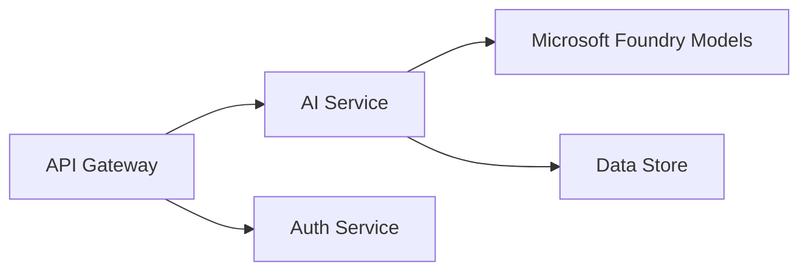
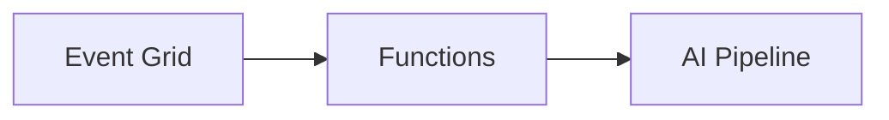

# บทที่ 8: รูปแบบการใช้งานในสภาพแวดล้อมผลิตและองค์กร

**📚 หลักสูตร**: [AZD สำหรับผู้เริ่มต้น](../../README.md) | **⏱️ ระยะเวลา**: 2-3 ชั่วโมง | **⭐ ความซับซ้อน**: ขั้นสูง

---

## ภาพรวม

บทนี้ครอบคลุมรูปแบบการปรับใช้ที่พร้อมใช้งานสำหรับองค์กร การรักษาความปลอดภัย การตรวจสอบ และการเพิ่มประสิทธิภาพต้นทุนสำหรับงาน AI ในสภาพแวดล้อมผลิต

นี่คือเอกสารอ้างอิงสถาปัตยกรรม ไม่ใช่แม่แบบการปรับใช้ผลิตภัณฑ์สมบูรณ์ ตัวอย่างตัดรายละเอียดการรวมระบบที่จำเป็นต้องเพิ่มและทดสอบในแอปพลิเคชันของคุณเอง การอ่านรายการตรวจสอบไม่ได้รับรองความพร้อมในการผลิต

> **อัปเดต Foundry GA (2026-11-09):** ใช้ `azd >= 1.37.0` และแพ็กเกจ `microsoft.foundry` 1.0 ที่พร้อมใช้งานทั่วไปสำหรับเวิร์กโฟลว์ Foundry; การประเมินติดตั้งแยกต่างหาก ดู [ขอบเขตการปล่อยและการย้ายข้อมูล](production-ai-practices.md#recent-release-changes-and-fixes) และ [ตัวอย่างท่อเก็บข้อมูลที่ตรวจสอบสิทธิ์แล้ว](production-ai-practices.md#cicd-pipeline-configuration) นี่เป็นการทบทวนเอกสาร ไม่ใช่การตรวจสอบการปรับใช้จริงหรือสถานะ GA ครอบคลุมสำหรับคุณลักษณะตัวอย่างที่เป็นทางเลือก

## วัตถุประสงค์การเรียนรู้

เมื่อคุณทำบทนี้เสร็จ คุณจะสามารถ:
- ปรับใช้แอปพลิเคชันที่ทนทานในหลายภูมิภาค
- นำรูปแบบความปลอดภัยในองค์กรมาใช้
- ตั้งค่าการตรวจสอบอย่างครอบคลุม
- เพิ่มประสิทธิภาพต้นทุนในปริมาณมาก
- ตั้งค่าท่อ CI/CD ด้วย AZD

---

## 📚 บทเรียน

| # | บทเรียน | คำอธิบาย | เวลา |
|---|--------|-------------|------|
| 1 | [แนวปฏิบัติ AI สำหรับผลิต](production-ai-practices.md) | รูปแบบการปรับใช้ในองค์กร | 90 นาที |

---

## 🚀 รายการตรวจสอบสำหรับผลิต

- [ ] ปรับใช้หลายภูมิภาคเพื่อความคงทน
- [ ] ใช้ Managed identity สำหรับการรับรองความถูกต้อง (ไม่ใช้คีย์)
- [ ] ใช้ Application Insights เพื่อตรวจสอบ
- [ ] ตั้งค่าบัญชีงบประมาณและแจ้งเตือน
- [ ] เปิดใช้การสแกนความปลอดภัย
- [ ] รวมกับท่อ CI/CD
- [ ] มีแผนการกู้คืนจากภัยพิบัติ

---

## 🏗️ รูปแบบสถาปัตยกรรม

### รูปแบบที่ 1: AI แบบไมโครเซอร์วิส



### รูปแบบที่ 2: AI ขับเคลื่อนด้วยเหตุการณ์



---

## 🔐 แนวปฏิบัติที่ดีที่สุดด้านความปลอดภัย

```bicep
// Illustrative properties from different resources, NOT a standalone Bicep file.
// Attach identity to the application host:
identity: {
  type: 'SystemAssigned'
}

// AI account properties (also require private endpoints, DNS and app connectivity):
properties: {
  publicNetworkAccess: 'Disabled'
  networkAcls: {
    defaultAction: 'Deny'
  }
}
```

---

## 💰 การเพิ่มประสิทธิภาพต้นทุน

| กลยุทธ์ | ข้อจำกัดหลัก |
|----------|---------|
| ปรับขนาดเป็นศูนย์ (Container Apps) | ต้องมีตัวกระตุ้นที่เหมาะสม; บริการอื่นยังคิดค่าใช้จ่าย |
| ใช้ระดับการใช้บริการสำหรับการพัฒนา | เปรียบเทียบราคาบริการที่เลือกและงานที่ทำ |
| การปรับขนาดตามตารางเวลา | ปรับขนาดผ่านโครงสร้างพื้นฐาน/ระบบอัตโนมัติที่รองรับ |
| การจอง/ความจุที่จัดเตรียมไว้ | เฉพาะเมื่อรองรับ; ข้อผูกมัดอาจเพิ่มต้นทุนที่ไม่มีการใช้งาน |

ใช้ [รูปแบบทรัพยากรงบประมาณครบถ้วน](production-ai-practices.md#2-cost-monitoring-and-budgets) พร้อมวันที่เริ่มต้นที่ถูกต้อง ขอบเขตการเรียกเก็บเงิน ผู้รับ และสิทธิ์ต่างๆ งบประมาณจะส่งการแจ้งเตือน; แต่จะไม่จำกัดการใช้จ่าย การประหยัดจะขึ้นอยู่กับการใช้จริงและไม่ได้รับประกันเป็นเปอร์เซ็นต์

---

## 📊 การตั้งค่าการตรวจสอบ

```bash
# Open the Application Insights logs view (requires configured monitoring)
azd monitor --logs

# Check Application Insights
azd monitor --overview

# View metrics
az monitor metrics list --resource <resource-id>
```

---

## 🔗 การนำทาง

| ทิศทาง | บทที่ |
|-----------|---------|
| **ก่อนหน้า** | [บทที่ 7: การแก้ไขปัญหา](../chapter-07-troubleshooting/README.md) |
| **จบหลักสูตร** | [หน้าหลักหลักสูตร](../../README.md) |

---

## 📖 ทรัพยากรที่เกี่ยวข้อง

- [คู่มือ AI Agents](../chapter-02-ai-development/agents.md)
- [Application Insights](../chapter-06-pre-deployment/application-insights.md)
- [โซลูชัน Multi-Agent](../chapter-05-multi-agent/README.md)
- [ตัวอย่างไมโครเซอร์วิส](../../examples/microservices/README.md)

---

<!-- CO-OP TRANSLATOR DISCLAIMER START -->
**ปฏิเสธความรับผิดชอบ**:
เอกสารนี้ได้รับการแปลโดยใช้บริการแปลภาษา AI [Co-op Translator](https://github.com/Azure/co-op-translator) ขณะที่เราพยายามให้ความถูกต้อง โปรดทราบว่าการแปลโดยอัตโนมัติอาจมีข้อผิดพลาดหรือความไม่ถูกต้อง เอกสารต้นฉบับในภาษาต้นทางควรถูกพิจารณาเป็นแหล่งข้อมูลที่เชื่อถือได้ สำหรับข้อมูลที่สำคัญ แนะนำให้ใช้การแปลโดยมนุษย์มืออาชีพ เราไม่รับผิดชอบต่อความเข้าใจผิดหรือการตีความที่ผิดพลาดที่เกิดขึ้นจากการใช้การแปลนี้
<!-- CO-OP TRANSLATOR DISCLAIMER END -->