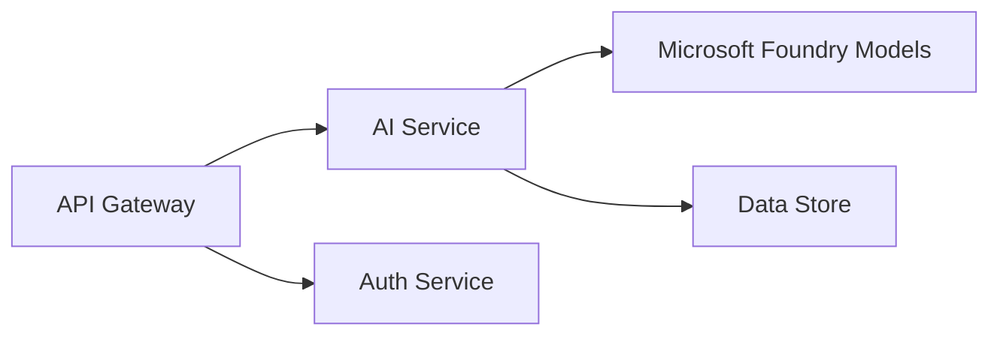
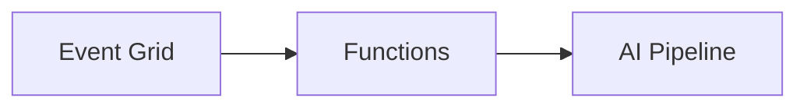

# บทที่ 8: รูปแบบสำหรับการผลิต & องค์กร

**📚 คอร์สเรียน**: [AZD สำหรับผู้เริ่มต้น](../../README.md) | **⏱️ เวลาเรียน**: 2-3 ชั่วโมง | **⭐ ความซับซ้อน**: ขั้นสูง

---

## ภาพรวม

บทนี้ครอบคลุมรูปแบบการปรับใช้ที่พร้อมใช้งานในองค์กร การเสริมความปลอดภัย การตรวจสอบ และการเพิ่มประสิทธิภาพด้านต้นทุนสำหรับงาน AI ในการผลิต

นี่คือเอกสารอ้างอิงทางสถาปัตยกรรม ไม่ใช่แม่แบบการปรับใช้แบบสมบูรณ์ที่พร้อมใช้งาน ตัวอย่างละเว้นรายละเอียดการผสานรวมที่ต้องมีการเพิ่มและทดสอบในแอปพลิเคชันของคุณเอง; การอ่านรายการตรวจสอบไม่ได้หมายความว่าผ่านเกณฑ์พร้อมใช้งานสำหรับการผลิต

> **การทบทวนเวอร์ชัน (2026-11-04):** คำแนะนำสำหรับ AI CLI ได้รับการตรวจสอบกับเอกสาร/ซอร์สของ `azd 1.37.2`, ตัวแทน `1.0.0-beta.23` และการประเมินผล `1.0.0-beta.2` ดู [การเปลี่ยนแปลงและการแก้ไขในเวอร์ชัน](production-ai-practices.md#recent-release-changes-and-fixes) สำหรับข้อกำหนดความเข้ากันได้และรายละเอียดการย้ายข้อมูล; นี่ไม่ใช่การตรวจสอบการปรับใช้แบบสด

## วัตถุประสงค์การเรียนรู้

เมื่อเรียนจบบทนี้ คุณจะสามารถ:
- ปรับใช้แอปพลิเคชันหลายภูมิภาคที่มีความทนทาน
- นำรูปแบบความปลอดภัยสำหรับองค์กรมาใช้
- กำหนดค่าการตรวจสอบอย่างครบถ้วน
- ปรับต้นทุนให้เหมาะสมในระดับใหญ่
- ตั้งค่า pipeline CI/CD ด้วย AZD

---

## 📚 บทเรียน

| # | บทเรียน | คำอธิบาย | เวลา |
|---|--------|-------------|------|
| 1 | [แนวทางปฏิบัติ AI สำหรับการผลิต](production-ai-practices.md) | รูปแบบการปรับใช้ในองค์กร | 90 นาที |

---

## 🚀 รายการตรวจสอบสำหรับการผลิต

- [ ] การปรับใช้หลายภูมิภาคเพื่อความทนทาน
- [ ] ใช้ managed identity สำหรับการตรวจสอบสิทธิ์ (ไม่มีคีย์)
- [ ] ใช้ Application Insights ในการตรวจสอบ
- [ ] ตั้งค่างบประมาณและการแจ้งเตือนค่าใช้จ่าย
- [ ] เปิดใช้งานการสแกนด้านความปลอดภัย
- [ ] การผสาน pipeline CI/CD
- [ ] แผนกู้คืนระบบเมื่อเกิดภัยพิบัติ

---

## 🏗️ รูปแบบสถาปัตยกรรม

### รูปแบบที่ 1: AI แบบไมโครเซอร์วิส



### รูปแบบที่ 2: AI แบบเน้นเหตุการณ์



---

## 🔐 แนวทางปฏิบัติที่ดีที่สุดด้านความปลอดภัย

```bicep
// Illustrative properties from different resources, NOT a standalone Bicep file.
// Attach identity to the application host:
identity: {
  type: 'SystemAssigned'
}

// AI account properties (also require private endpoints, DNS and app connectivity):
properties: {
  publicNetworkAccess: 'Disabled'
  networkAcls: {
    defaultAction: 'Deny'
  }
}
```

---

## 💰 การเพิ่มประสิทธิภาพต้นทุน

| กลยุทธ์ | ข้อจำกัดหลัก |
|----------|---------|
| ปรับขนาดเป็นศูนย์ (Container Apps) | ต้องมีตัวกระตุ้นที่เหมาะสม; บริการอื่นยังมีต้นทุนเกิดขึ้น |
| ใช้ consumption tiers สำหรับการพัฒนา | เปรียบเทียบราคาบริการและงานที่เลือก |
| การปรับขนาดตามตารางเวลา | ปรับขนาดผ่านโครงสร้างพื้นฐาน/ระบบอัตโนมัติที่รองรับ |
| การสำรอง/ความจุที่จัดสรร | เฉพาะเมื่อรองรับ; ข้อตกลงอาจเพิ่มต้นทุนเวลาว่าง |

ใช้ [รูปแบบทรัพยากรงบประมาณครบถ้วน](production-ai-practices.md#2-cost-monitoring-and-budgets) พร้อมวันที่เริ่มต้นที่ถูกต้อง ขอบเขตการออกบิล ผู้รับ และสิทธิ์ งบประมาณจะส่งแจ้งเตือน; แต่ไม่จำกัดการใช้จ่าย การประหยัดขึ้นอยู่กับการใช้งานที่วัดได้และไม่รับประกันเปอร์เซ็นต์ใด ๆ

---

## 📊 การตั้งค่าการตรวจสอบ

```bash
# Open the Application Insights logs view (requires configured monitoring)
azd monitor --logs

# Check Application Insights
azd monitor --overview

# View metrics
az monitor metrics list --resource <resource-id>
```

---

## 🔗 การนำทาง

| ทิศทาง | บทที่ |
|-----------|---------|
| **ก่อนหน้า** | [บทที่ 7: การแก้ไขปัญหา](../chapter-07-troubleshooting/README.md) |
| **จบคอร์ส** | [หน้าหลักคอร์ส](../../README.md) |

---

## 📖 แหล่งข้อมูลที่เกี่ยวข้อง

- [คู่มือ AI Agents](../chapter-02-ai-development/agents.md)
- [Application Insights](../chapter-06-pre-deployment/application-insights.md)
- [โซลูชัน Multi-Agent](../chapter-05-multi-agent/README.md)
- [ตัวอย่างไมโครเซอร์วิส](../../examples/microservices/README.md)

---

<!-- CO-OP TRANSLATOR DISCLAIMER START -->
**ปฏิเสธความรับผิดชอบ**:
เอกสารนี้ได้รับการแปลโดยใช้บริการแปลภาษา AI [Co-op Translator](https://github.com/Azure/co-op-translator) ขณะที่เราพยายามให้ความถูกต้อง โปรดทราบว่าการแปลโดยอัตโนมัติอาจมีข้อผิดพลาดหรือความไม่ถูกต้อง เอกสารต้นฉบับในภาษาต้นทางควรถูกพิจารณาเป็นแหล่งข้อมูลที่เชื่อถือได้ สำหรับข้อมูลที่สำคัญ แนะนำให้ใช้การแปลโดยมนุษย์มืออาชีพ เราไม่รับผิดชอบต่อความเข้าใจผิดหรือการตีความที่ผิดพลาดที่เกิดขึ้นจากการใช้การแปลนี้
<!-- CO-OP TRANSLATOR DISCLAIMER END -->