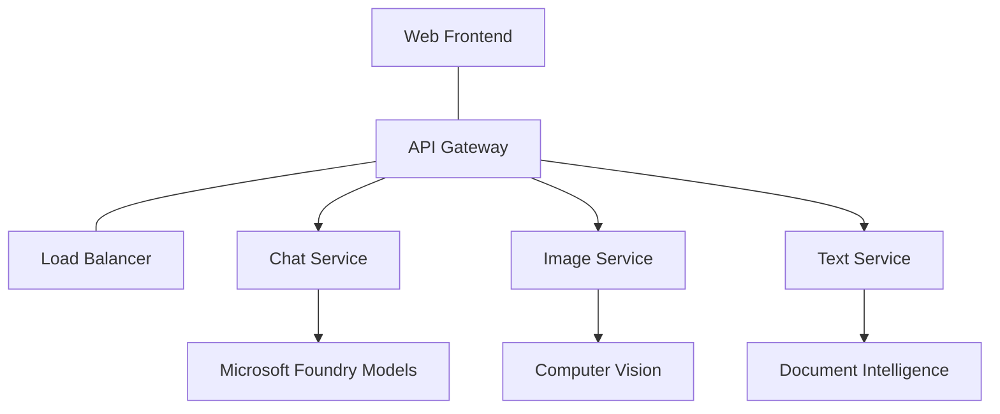

# แนวทางปฏิบัติที่ดีที่สุดสำหรับเวิร์กโหลด AI ในการผลิตด้วย AZD

**การนำทางบทเรียน:**
- **📚 หน้าแรกของหลักสูตร**: [AZD สำหรับผู้เริ่มต้น](../../README.md)
- **📖 บทปัจจุบัน**: บทที่ 8 - รูปแบบการผลิตและองค์กร
- **⬅️ บทก่อนหน้า**: [บทที่ 7: การแก้ไขปัญหา](../chapter-07-troubleshooting/debugging.md)
- **⬅️ ที่เกี่ยวข้องเพิ่มเติม**: [เวิร์กช็อป AI](../chapter-02-ai-development/ai-workshop-lab.md)
- **🎯 หลักสูตรเสร็จสมบูรณ์**: [AZD สำหรับผู้เริ่มต้น](../../README.md)

## ภาพรวม

คู่มือนี้อธิบายรูปแบบการออกแบบ AI สำหรับการผลิตโดยใช้ Azure Developer CLI (AZD) เป็นเอกสารอ้างอิงการออกแบบ ไม่ใช่แอปพลิเคชันที่พร้อมใช้งานหรือใบรับรองการผลิต

**ขอบเขตตัวอย่าง:** เว้นแต่จะระบุไว้อย่างชัดเจนว่าเป็นแบบสมบูรณ์ เศษส่วน Bicep จะสมมติพารามิเตอร์และทรัพยากรที่อ้างอิงจากแม่แบบที่ครอบอยู่ มันละเว้นภาพ/แผนของโฮสต์ เอกลักษณ์ การกำหนดบทบาท DNS ผลลัพธ์ และการผสานรวมที่ต้องการอื่น ๆ เส้นทางบริการ YAML และสคริปต์ฮุก/ทดสอบเป็นไฟล์ตัวอย่างที่คุณจะต้องสร้างใน **แอปของคุณเอง**; ไม่มีการจัดเตรียมโดยหลักสูตรนี้ ใช้ตัวอย่าง AZD ที่ทำงานได้เป็นฐาน รวบรวมโครงสร้างพื้นฐานทั้งหมด และทดสอบในสภาพแวดล้อมแยกก่อนนำไปสู่การผลิต

## ประเด็นหลักที่แก้ไข

ความกังวลทั่วไปในการผลิต ได้แก่ การปรับใช้หลายบริการ การจัดการเอกลักษณ์และความลับ การปรับขนาด การควบคุมค่าใช้จ่าย และการตรวจสอบ ไม่มีการอ้างอิงความแพร่หลายที่วัดได้ในที่นี้

## รูปแบบสถาปัตยกรรมสำหรับ AI ในการผลิต

### รูปแบบที่ 1: สถาปัตยกรรม AI แบบไมโครเซอร์วิส

**เมื่อใดควรใช้**: แอป AI ที่ซับซ้อนที่มีความสามารถหลายอย่าง



**การใช้งาน AZD**:

```yaml
# azure.yaml
name: enterprise-ai-platform
services:
  web:
    project: ./web
    host: staticwebapp
  api-gateway:
    project: ./api-gateway
    host: containerapp
  chat-service:
    project: ./services/chat
    host: containerapp
  vision-service:
    project: ./services/vision
    host: containerapp
  text-service:
    project: ./services/text
    host: containerapp
```

### รูปแบบที่ 2: การประมวลผล AI แบบขับเคลื่อนด้วยเหตุการณ์

**เมื่อใดควรใช้**: การประมวลผลเป็นชุด การวิเคราะห์เอกสาร กระบวนการทำงานแบบอะซิงโครนัส

```bicep
// Event Hub for AI processing pipeline
resource eventHub 'Microsoft.EventHub/namespaces@2024-01-01' = {
  name: eventHubNamespaceName
  location: location
  sku: {
    name: 'Standard'
    tier: 'Standard'
    capacity: 1
  }
}

// Service Bus for reliable message processing
resource serviceBus 'Microsoft.ServiceBus/namespaces@2024-01-01' = {
  name: serviceBusNamespaceName
  location: location
  sku: {
    name: 'Premium'
    tier: 'Premium'
    capacity: 1
  }
}

// Function App for processing
resource functionApp 'Microsoft.Web/sites@2023-01-01' = {
  name: functionAppName
  location: location
  kind: 'functionapp,linux'
  properties: {
    siteConfig: {
      appSettings: [
        {
          name: 'FUNCTIONS_EXTENSION_VERSION'
          value: '~4'
        }
        {
          name: 'AZURE_OPENAI_ENDPOINT'
          value: '@Microsoft.KeyVault(VaultName=${keyVault.name};SecretName=openai-endpoint)'
        }
      ]
    }
  }
}
```

สิ่งนี้สร้างเศษส่วนของ namespace ไม่ใช่ hubs, คิว, subscription หรือ Function triggers ฟังก์ชันที่ใช้งานได้จะต้องมีแผนโฮสต์ การกำหนดค่าสภาพแวดล้อมรันไทม์/ที่จัดเก็บ เอกลักษณ์ที่แนบมา RBAC และการเข้าถึงเครือข่าย การอ้างอิง Key Vault ต้องได้รับอนุญาตให้อ่านความลับ; URL endpoint เองไม่ใช่ข้อมูลรับรอง

## การพิจารณาสุขภาพของ AI Agent

เมื่อแอปเว็บแบบดั้งเดิมเสียหาย อาการก็คุ้นเคย เช่น หน้าเพจไม่โหลด API คืนค่าความผิดพลาด หรือการปรับใช้ล้มเหลว แอปที่ขับเคลื่อนด้วย AI ก็สามารถเสียหายในแบบเดียวกันได้—แต่ยังอาจแสดงอาการแบบละเอียดที่ไม่แสดงข้อความผิดพลาดชัดเจน

ส่วนนี้ช่วยสร้างแบบจำลองทางความคิดสำหรับการตรวจสอบเวิร์กโหลด AI เพื่อให้คุณรู้ว่าจะดูที่ไหนเมื่อสิ่งต่าง ๆ ดูไม่ถูกต้อง

### ความแตกต่างของสุขภาพเอเจนต์กับสุขภาพแอปแบบดั้งเดิม

แอปดั้งเดิมก็อาจมีความผิดพลาดที่ละเอียดเช่นกัน ตัวแทน AI เพิ่มคุณภาพการตอบสนองที่ไม่แน่นอนลงในเรื่องการมีอยู่และความถูกต้อง คิดถึงสุขภาพเอเจนต์ในสองชั้น:

| ชั้น | สิ่งที่ต้องสังเกต | ที่จะดู |
|-------|--------------|---------------|
| **สุขภาพโครงสร้างพื้นฐาน** | บริการยังทำงานอยู่หรือไม่? มีการจัดสรรทรัพยากรหรือไม่? สามารถเข้าถึง endpoint ได้หรือไม่? | `azd monitor`, สุขภาพทรัพยากรใน Azure Portal, บันทึกคอนเทนเนอร์/แอป |
| **สุขภาพพฤติกรรม** | ตัวแทนตอบสนองถูกต้องหรือไม่? ตอบสนองทันเวลาหรือเปล่า? เรียกโมเดลถูกต้องไหม? | ฉายรอย Application Insights, เมตริกความล่าช้าในการเรียกโมเดล, บันทึกคุณภาพการตอบสนอง |

สุขภาพโครงสร้างพื้นฐานคุ้นเคย—เป็นเช่นเดียวกันสำหรับแอป azd ใดๆ สุขภาพพฤติกรรมเป็นชั้นใหม่ที่เวิร์กโหลด AI นำมาเพิ่ม

### ที่ที่ควรดูเมื่แอป AI ทำงานไม่เป็นไปตามคาด

หากแอป AI ของคุณไม่ผลิตผลลัพธ์ที่คาดหวัง นี่คือรายการตรวจสอบเชิงแนวคิด:

1. **เริ่มจากพื้นฐาน** แอปกำลังทำงานอยู่หรือไม่? สามารถเข้าถึง dependency ได้หรือไม่? ตรวจสอบ `azd monitor` และสุขภาพทรัพยากร เช่นเดียวกับแอปทั่วไป
2. **ตรวจสอบการเชื่อมต่อโมเดล** แอปของคุณเรียกใช้งานโมเดล AI สำเร็จหรือไม่? การเรียกโมเดลที่ล้มเหลวหรือหมดเวลาเป็นสาเหตุที่พบบ่อยที่สุดของปัญหาแอป AI และจะแสดงในบันทึกแอปของคุณ
3. **ตรวจสอบอินพุตและพื้นฐานอย่างปลอดภัย** คำตอบผิดอาจเกิดจากการดึงข้อมูล คำสั่ง ข้อจำกัดของโมเดล หรือการทำงานของเครื่องมือ ใช้ข้อมูลวินิจฉัยที่ควบคุมการเข้าถึงและแก้ไขแล้ว; ไม่เปิดใช้งานการบันทึกคำกระตุ้น/คำตอบอย่างไม่เลือกในผลิตจริง
4. **ตรวจสอบเวลาตอบสนอง** การเรียกโมเดล AI ช้ากว่า API ตามปกติ หากแอปรู้สึกหน่วง ตรวจสอบเวลาในการตอบโมเดลที่เพิ่มขึ้น—อาจบ่งชี้ถึงการถูกจำกัด ความจุเต็ม หรือความหนาแน่นในระดับภูมิภาค
5. **สังเกตสัญญาณค่าใช้จ่าย** การใช้โทเคนหรือการเรียก API ที่เพิ่มขึ้นอย่างไม่คาดคิดอาจบ่งชี้ถึงลูป คำกระตุ้นกำหนดค่าไม่ถูกต้อง หรือการลองใหม่มากเกินไป

คุณไม่จำเป็นต้องเชี่ยวชาญเครื่องมือตรวจสอบในทันที หัวใจสำคัญคือแอป AI มีชั้นพฤติกรรมเพิ่มเติมให้ตรวจสอบ และการตรวจสอบในตัวของ azd (`azd monitor`) ให้จุดเริ่มต้นในการตรวจสอบทั้งสองชั้น

---

## แนวทางปฏิบัติด้านความปลอดภัยที่ดีที่สุด

### 1. โมเดลความปลอดภัยแบบ Zero-Trust

**กลยุทธ์การใช้งาน**:
- ไม่มีการสื่อสารระหว่างบริการโดยไม่มีการตรวจสอบสิทธิ์
- การเรียก API ทั้งหมดใช้เอกลักษณ์ที่จัดการ
- การแยกเครือข่ายด้วย private endpoints
- การควบคุมการเข้าถึงด้วยสิทธิ์น้อยที่สุด

```bicep
// Managed Identity for each service
resource chatServiceIdentity 'Microsoft.ManagedIdentity/userAssignedIdentities@2023-01-31' = {
  name: 'chat-service-identity'
  location: location
}

// Role assignments with minimal permissions
resource openAIUserRole 'Microsoft.Authorization/roleAssignments@2022-04-01' = {
  scope: openAIAccount
  name: guid(openAIAccount.id, chatServiceIdentity.id, '5e0bd9bd-7b93-4f28-af87-19fc36ad61bd')
  properties: {
    roleDefinitionId: subscriptionResourceId('Microsoft.Authorization/roleDefinitions', '5e0bd9bd-7b93-4f28-af87-19fc36ad61bd')
    principalId: chatServiceIdentity.properties.principalId
    principalType: 'ServicePrincipal'
  }
}
```

### 2. การจัดการความลับอย่างปลอดภัย

**รูปแบบการผสานรวม Key Vault**:

```bicep
// Key Vault with proper access policies
resource keyVault 'Microsoft.KeyVault/vaults@2023-02-01' = {
  name: keyVaultName
  location: location
  properties: {
    tenantId: tenant().tenantId
    sku: {
      family: 'A'
      name: 'standard' // Premium is needed for HSM-backed keys, not ordinary secrets
    }
    enableRbacAuthorization: true  // Use RBAC instead of access policies
    enablePurgeProtection: true    // Prevent accidental deletion
    enableSoftDelete: true
    softDeleteRetentionInDays: 90
  }
}

// Optional legacy key-auth alternative; omit when using Entra ID.
resource openAIKeySecret 'Microsoft.KeyVault/vaults/secrets@2023-02-01' = {
  parent: keyVault
  name: 'openai-api-key'
  properties: {
    value: openAIAccount.listKeys().key1
    attributes: {
      enabled: true
    }
  }
}
```

กำหนดเอกลักษณ์รันไทม์ `Key Vault Secrets User` ในขอบเขตที่เหมาะสมและแนบกับโฮสต์; `enableRbacAuthorization` เพียงอย่างเดียวไม่ให้สิทธิ์ เข้าระบบ OpenAI managed identity ด้วย `disableLocalAuth: true` เป็นทางเลือกที่ดีกว่า key secret ที่เลือกได้มีเหตุผลเฉพาะสำหรับบัญชีที่เปิดใช้งานคีย์ และเจ้าของ principal ที่สร้างทรัพยากรต้องมีสิทธิ์เขียนความลับด้วย

### 3. ความปลอดภัยเครือข่าย

**การกำหนดค่า Private Endpoint**:

```bicep
// Virtual Network for AI services
resource virtualNetwork 'Microsoft.Network/virtualNetworks@2023-04-01' = {
  name: vnetName
  location: location
  properties: {
    addressSpace: {
      addressPrefixes: ['10.0.0.0/16']
    }
    subnets: [
      {
        name: 'ai-services-subnet'
        properties: {
          addressPrefix: '10.0.1.0/24'
          privateEndpointNetworkPolicies: 'Disabled'
        }
      }
      {
        name: 'app-services-subnet'
        properties: {
          addressPrefix: '10.0.2.0/24'
          delegations: [
            {
              name: 'Microsoft.Web/serverFarms'
              properties: {
                serviceName: 'Microsoft.Web/serverFarms'
              }
            }
          ]
        }
      }
    ]
  }
}

// Private endpoints for all AI services
resource openAIPrivateEndpoint 'Microsoft.Network/privateEndpoints@2023-04-01' = {
  name: '${openAIAccountName}-pe'
  location: location
  properties: {
    subnet: {
      id: virtualNetwork.properties.subnets[0].id
    }
    privateLinkServiceConnections: [
      {
        name: 'openai-connection'
        properties: {
          privateLinkServiceId: openAIAccount.id
          groupIds: ['account']
        }
      }
    ]
  }
}
```

private endpoints ยังต้องมีกลุ่ม DNS โซนส่วนตัว / ลิงก์ VNet และการรวมแอป VNet พวกเขาไม่ได้บล็อกการเข้าถึงสาธารณะโดยอัตโนมัติ: ปิดการเข้าถึงเครือข่ายสาธารณะของบัญชี AI อย่างชัดเจนหลังจากตรวจสอบการเชื่อมต่อแบบส่วนตัวและการเข้าถึงการปรับใช้

## ประสิทธิภาพและการปรับขนาด

### 1. กลยุทธ์การปรับขนาดอัตโนมัติ

**การปรับขนาดอัตโนมัติของ Container Apps**:

```bicep
resource containerApp 'Microsoft.App/containerApps@2023-05-01' = {
  name: containerAppName
  location: location
  properties: {
    configuration: {
      ingress: {
        external: true
        targetPort: 8000
        transport: 'http'
      }
    }
    template: {
      scale: {
        minReplicas: 2  // Always have 2 instances minimum
        maxReplicas: 50 // Scale up to 50 for high load
        rules: [
          {
            name: 'http-scaling'
            http: {
              metadata: {
                concurrentRequests: '20'  // Scale when >20 concurrent requests
              }
            }
          }
          {
            name: 'cpu-scaling'
            custom: {
              type: 'cpu'
              metadata: {
                type: 'Utilization'
                value: '70'  // Scale when CPU >70%
              }
            }
          }
        ]
      }
    }
  }
}
```

### 2. กลยุทธ์การแคช

**Redis Cache สำหรับการตอบกลับ AI**:

```bicep
// Legacy Azure Cache for Redis example (not recommended for new deployments)
resource redisCache 'Microsoft.Cache/redis@2023-04-01' = {
  name: redisCacheName
  location: location
  properties: {
    sku: {
      name: 'Premium'
      family: 'P'
      capacity: 1
    }
    enableNonSslPort: false
    minimumTlsVersion: '1.2'
    redisConfiguration: {
      'maxmemory-policy': 'allkeys-lru'
    }
    // Sharding distributes data; replication/failover provides availability.
    shardCount: 2
  }
}

// Cache configuration in application
var cacheConnectionString = '${redisCache.properties.hostName}:6380,password=${redisCache.listKeys().primaryKey},ssl=True,abortConnect=False'
```

Azure Cache for Redis Basic/Standard/Premium กำลังเข้าสู่ [เส้นทางเกษียณ](https://learn.microsoft.com/azure/azure-cache-for-redis/retirement-faq) ใช้ Azure Managed Redis สำหรับการออกแบบใหม่พร้อมการกำหนด SKU เอกลักษณ์ และ TLS ที่บันทึกไว้ แทนที่จะคัดลอกทรัพยากรเก่านี้เข้าสู่ระบบการผลิตใหม่ สายการเชื่อมต่อเป็นเพียงที่ว่าง ไม่ใช่ข้อมูลรับรอง แบ่งคีย์แคชโดยการอนุญาต โมเดล/คำสั่ง และเวอร์ชันการดึงข้อมูล พร้อมกับวันหมดอายุ; แคชที่แชร์สำหรับการอ่านข้อมูลเพียงอย่างเดียวอาจเปิดเผยข้อมูลผู้ใช้อื่นได้

### 3. การจัดสมดุลโหลดและการจัดการทราฟิก

**Application Gateway พร้อม WAF**:

```bicep
// Application Gateway with Web Application Firewall
resource applicationGateway 'Microsoft.Network/applicationGateways@2023-04-01' = {
  name: appGatewayName
  location: location
  properties: {
    sku: {
      name: 'WAF_v2'
      tier: 'WAF_v2'
      capacity: 2
    }
    webApplicationFirewallConfiguration: {
      enabled: true
      firewallMode: 'Prevention'
      ruleSetType: 'OWASP'
      ruleSetVersion: '3.2'
    }
    // Backend pools for AI services
    backendAddressPools: [
      {
        name: 'ai-services-pool'
        properties: {
          backendAddresses: [
            {
              fqdn: '${containerApp.properties.configuration.ingress.fqdn}'
            }
          ]
        }
      }
    ]
  }
}
```

นี่เป็นทรัพยากรเกตเวย์บางส่วน: การปรับใช้จริงต้องการการกำหนด subnet/IP เกตเวย์, IP หน้าและพอร์ต, ตัวฟัง TLS/ใบรับรอง, การตั้งค่า HTTP แบ็คเอนด์/โพรบ, กฎและลำดับความสำคัญในการกำหนดเส้นทาง, และนโยบาย WAF ที่ผ่านการตรวจสอบ ชื่อโฮสต์ TLS/SNI และการตรวจสอบสิทธิ์ต้องตรงกับแบ็คเอนด์ Container App

## 💰 การเพิ่มประสิทธิภาพค่าใช้จ่าย

### 1. การปรับขนาดทรัพยากรให้เหมาะสม

**การกำหนดค่าสภาพแวดล้อมเฉพาะ**:

ชื่อเหล่านี้เป็น **อินพุตแม่แบบกำหนดเองเพื่อเป็นตัวอย่างเท่านั้น** ไม่ใช่การตั้งค่า AZD อัตโนมัติ นำแต่ละชื่อไปแมปใน `infra/main.parameters.json`/Bicep และการกำหนดค่าโฮสต์ก่อน เช่น ตัวอย่าง RAG ใช้ `AZURE_SEARCH_SERVICE_SKU` และ `AZURE_OPENAI_CHATGPT_DEPLOYMENT_CAPACITY` ไม่ใช่ชื่อทั่วไปด้านล่าง กำหนดหน่วยความจำ Container Apps ด้วยหน่วยที่รองรับ เช่น `1Gi` ในทรัพยากรจริง ใช้ `azd up` หรือ `azd provision` ในการใช้การเปลี่ยนแปลงโครงสร้างพื้นฐาน; `azd deploy` เพียงอย่างเดียวไม่สามารถใช้การเปลี่ยนแปลง Bicep ได้

```bash
# Development environment
azd env new development
azd env set AZURE_OPENAI_SKU "S0"
azd env set AZURE_OPENAI_CAPACITY 10
azd env set AZURE_SEARCH_SKU "basic"
azd env set CONTAINER_CPU 0.5
azd env set CONTAINER_MEMORY 1.0

# Production environment  
azd env new production
azd env set AZURE_OPENAI_SKU "S0"
azd env set AZURE_OPENAI_CAPACITY 100
azd env set AZURE_SEARCH_SKU "standard"
azd env set CONTAINER_CPU 2.0
azd env set CONTAINER_MEMORY 4.0
```

### 2. การตรวจสอบค่าใช้จ่ายและงบประมาณ

```bicep
// Supply the first day of the current UTC month, e.g. 2026-11-01T00:00:00Z.
param budgetStartDate string

// Cost management and budgets
resource budget 'Microsoft.Consumption/budgets@2024-08-01' = {
  name: 'ai-workload-budget'
  properties: {
    timePeriod: {
      startDate: budgetStartDate
    }
    timeGrain: 'Monthly'
    amount: 2000  // In the billing currency, not necessarily USD
    category: 'Cost'
    notifications: {
      warning: {
        enabled: true
        operator: 'GreaterThan'
        threshold: 80
        contactEmails: [
          'finance@company.com'
          'engineering@company.com'
        ]
        contactRoles: [
          'Owner'
          'Contributor'
        ]
      }
      critical: {
        enabled: true
        operator: 'GreaterThan'
        threshold: 95
        contactEmails: [
          'cto@company.com'
        ]
      }
    }
  }
}
```

แทนที่ผู้รับตัวอย่างและตรวจสอบขอบเขต/สิทธิ์ การแจ้งเตือนงบประมาณใช้ข้อมูลใบแจ้งหนี้ที่ล่าช้าและไม่บังคับใช้เพดานการใช้จ่าย

### 3. การเพิ่มประสิทธิภาพการใช้โทเคน

**การจัดการค่าใช้จ่าย OpenAI**:

สิ่งนี้เป็นเพียงแบบประมาณการโดยอิงตามจำนวนตัวอักษรสำหรับตัวอย่าง UI เท่านั้น **ไม่ใช่** ตัวตรวจสอบขีดจำกัดโทเคนของโมเดล โค้ดในผลิตจริงต้องใช้ตัวแยกโทเคนที่เหมาะกับโมเดลที่ปรับใช้ และต้องพิจารณาคำสั่งระบบ ชีมาของเครื่องมือ ประวัติ และงบประมาณผลลัพธ์ ปฏิเสธข้อความผู้ใช้ที่มีขนาดเกินแทนการตัดทอนโดยเงียบ

```typescript
// Application-level token optimization
class TokenOptimizer {
  private readonly maxTokens = 4000;
  private readonly reserveTokens = 500;
  
  optimizePrompt(userInput: string, context: string): string {
    const availableTokens = this.maxTokens - this.reserveTokens;
    if (this.estimateTokens(userInput) + 8 >= availableTokens) {
      throw new Error("User input exceeds the illustrative prompt budget");
    }
    const estimatedTokens = this.estimateTokens(userInput + context) + 8;
    
    if (estimatedTokens > availableTokens) {
      // Truncate context, not user input
      context = this.truncateContext(context, Math.max(0, availableTokens - this.estimateTokens(userInput) - 8));
    }
    
    return `${context}\n\nUser: ${userInput}`;
  }
  
  private estimateTokens(text: string): number {
    // Rough estimation: 1 token ≈ 4 characters
    return Math.ceil(text.length / 4);
  }

  private truncateContext(text: string, estimatedBudget: number): string {
    return text.slice(0, Math.max(0, estimatedBudget) * 4);
  }
}
```

## การตรวจสอบและสังเกตการณ์

### 1. Application Insights ที่ครอบคลุม

```bicep
// Application Insights with advanced features
resource applicationInsights 'Microsoft.Insights/components@2020-02-02' = {
  name: applicationInsightsName
  location: location
  kind: 'web'
  properties: {
    Application_Type: 'web'
    WorkspaceResourceId: logAnalyticsWorkspace.id
    SamplingPercentage: 100  // Ingestion setting; review cost and SDK sampling separately
    DisableIpMasking: false  // Retain IP masking
  }
}

// Custom metrics for AI operations
resource aiMetricAlerts 'Microsoft.Insights/metricAlerts@2018-03-01' = {
  name: 'ai-high-error-rate'
  location: 'global'
  properties: {
    description: 'Alert when failed request count exceeds 10 in five minutes'
    severity: 2
    enabled: true
    scopes: [
      applicationInsights.id
    ]
    evaluationFrequency: 'PT1M'
    windowSize: 'PT5M'
    criteria: {
      'odata.type': 'Microsoft.Azure.Monitor.SingleResourceMultipleMetricCriteria'
      allOf: [
        {
          name: 'high-error-rate'
          metricName: 'requests/failed'
          operator: 'GreaterThan'
          threshold: 10
          timeAggregation: 'Count'
        }
      ]
    }
  }
}
```

### 2. การตรวจสอบเฉพาะ AI

**แดชบอร์ดที่กำหนดเองสำหรับเมตริก AI**:

```json
{
  "dashboard": {
    "name": "AI Application Monitoring",
    "tiles": [
      {
        "name": "OpenAI Request Volume",
        "query": "dependencies | where target contains 'openai' | summarize count() by bin(timestamp, 5m)"
      },
      {
        "name": "AI Response Latency",
        "query": "dependencies | where target contains 'openai' | summarize avg(duration) by bin(timestamp, 5m)"
      },
      {
        "name": "Token Usage",
        "query": "customMetrics | where name == 'openai_tokens_used' | summarize sum(value) by bin(timestamp, 1h)"
      },
      {
        "name": "Cost per Hour",
        "query": "customMetrics | where name == 'openai_cost' | summarize sum(value) by bin(timestamp, 1h)"
      }
    ]
  }
}
```

JSON นี้เป็นโครงร่างที่กำหนดโดยแอปพลิเคชัน ไม่ใช่สคีมาแดชบอร์ดพอร์ทัล Azure ที่นำเข้าได้ การสอบถามโทเคน/ค่าใช้จ่ายต้องให้แอปของคุณส่งเมตริกเหล่านั้นโดยตรง; เมตริกเหล่านี้ไม่ได้สร้างโดย AZD ปรับตัวกรองความสัมพันธ์ตามชื่อ endpoint/span ของโมเดลจริงของคุณ

### 3. การตรวจสอบสุขภาพและการเฝ้าดูเวลาทำงาน

```bicep
// Application Insights availability tests
resource availabilityTest 'Microsoft.Insights/webtests@2022-06-15' = {
  name: 'ai-app-availability-test'
  location: location
  tags: {
    'hidden-link:${applicationInsights.id}': 'Resource'
  }
  properties: {
    SyntheticMonitorId: 'ai-app-availability-test'
    Name: 'AI Application Availability Test'
    Description: 'Tests AI application endpoints'
    Enabled: true
    Frequency: 300  // 5 minutes
    Timeout: 120    // 2 minutes
    Kind: 'standard'
    Locations: [
      {
        Id: 'us-east-2-azr'
      }
      {
        Id: 'us-west-2-azr'
      }
    ]
    Request: {
      RequestUrl: 'https://${webApp.properties.defaultHostName}/health'
      HttpVerb: 'GET'
      FollowRedirects: true
      ParseDependentRequests: false
    }
    ValidationRules: {
      ExpectedHttpStatusCode: 200
      SSLCheck: true
      SSLCertRemainingLifetimeCheck: 7
    }
  }
}
```

## การกู้คืนจากภัยพิบัติและความพร้อมใช้งานสูง

การทดสอบก่อนหน้านี้สมมติว่ามี App Service `webApp` และทรัพยากร Application Insights อยู่แล้ว การทดสอบความพร้อมใช้งานมาตรฐานเป็นการทดสอบที่ต้องเสียค่าใช้จ่ายและต้องมีจุดเชื่อมต่อที่เข้าถึงได้; แอปที่เป็นแบบส่วนตัวเท่านั้นจำเป็นต้องมีการออกแบบการตรวจสอบส่วนตัวที่เหมาะสม การทดสอบการ ping URL ถูกเลิกใช้แล้ว; ใช้ [การทดสอบความพร้อมใช้งานมาตรฐาน](https://learn.microsoft.com/azure/azure-monitor/app/availability) แทน

### 1. การปรับใช้แบบหลายภูมิภาค

```yaml
# azure.yaml - Multi-region configuration
name: ai-app-multiregion
services:
  api-primary:
    project: ./api
    host: containerapp
    env:
      AZURE_REGION: eastus
  api-secondary:
    project: ./api
    host: containerapp
    env:
      AZURE_REGION: westus2
```

```bicep
// Separate App Service topology, not the Container Apps declarations above
resource trafficManager 'Microsoft.Network/trafficManagerProfiles@2022-04-01' = {
  name: trafficManagerProfileName
  location: 'global'
  properties: {
    profileStatus: 'Enabled'
    trafficRoutingMethod: 'Priority'
    dnsConfig: {
      relativeName: trafficManagerProfileName
      ttl: 30
    }
    monitorConfig: {
      protocol: 'HTTPS'
      port: 443
      path: '/health'
      intervalInSeconds: 30
      toleratedNumberOfFailures: 3
      timeoutInSeconds: 10
    }
    endpoints: [
      {
        name: 'primary-endpoint'
        type: 'Microsoft.Network/trafficManagerProfiles/azureEndpoints'
        properties: {
          targetResourceId: primaryAppService.id
          endpointStatus: 'Enabled'
          priority: 1
        }
      }
      {
        name: 'secondary-endpoint'
        type: 'Microsoft.Network/trafficManagerProfiles/azureEndpoints'
        properties: {
          targetResourceId: secondaryAppService.id
          endpointStatus: 'Enabled'
          priority: 2
        }
      }
    ]
  }
}
```

ตัวแปรสภาพแวดล้อมไม่ได้เลือกตำแหน่งทรัพยากร IaC จะต้องจัดสรรโฮสต์ภูมิภาคที่แตกต่างกันและผูกแต่ละบริการด้วยแท็ก `resourceName` หรือ `azd-service-name` ตัวอย่าง Traffic Manager เป็น **โทโพโลยี App Service ที่แยกกัน** (`primaryAppService`/`secondaryAppService`) ไม่ใช่การกำหนดเส้นทางสำหรับประกาศ Container Apps Container Apps ต้องการจุดเชื่อมต่อภายนอก/ประตูหน้า กำหนดเส้นทาง TLS/โดเมนแบบกำหนดเอง และโปรบสุขภาพที่ตั้งค่าอย่างเหมาะสม

### 2. การสำรองข้อมูลและการกู้คืน

```bicep
// Backup configuration for critical data
resource backupVault 'Microsoft.DataProtection/backupVaults@2023-05-01' = {
  name: backupVaultName
  location: location
  identity: {
    type: 'SystemAssigned'
  }
  properties: {
    storageSettings: [
      {
        datastoreType: 'VaultStore'
        type: 'LocallyRedundant'
      }
    ]
  }
}

```

ตัวเก็บข้อมูลหน่วยเดียวไม่สำรองข้อมูลใดๆ กำหนด **นโยบายและอินสแตนซ์สำรองข้อมูลที่รองรับเฉพาะงาน**, สิทธิ์แหล่งที่มา, การเก็บรักษา และการทดสอบการกู้คืนโดยใช้ [Azure Backup support matrices](https://learn.microsoft.com/azure/backup/backup-support-matrix) ไม่มีนโยบายสำรองข้อมูล Azure Backup ทั่วไปสำหรับการปรับใช้โมเดล Azure OpenAI ที่โฮสต์ เก็บคำนิยามโครงสร้างพื้นฐาน/การปรับใช้โมเดลในการควบคุมแหล่งที่มา; ปกป้องเอกสารที่อัปโหลด, ข้อมูลแอปพลิเคชัน และวัตถุสำหรับการปรับแต่งแบบละเอียดโดยใช้ฟีเจอร์การสำรอง/ส่งออกที่รองรับของแต่ละบริการสำรอง กำหนดและทดสอบ RPO/RTO อย่างชัดเจน

## การผสานรวม DevOps และ CI/CD

### 1. GitHub Actions Workflow

```yaml
# .github/workflows/deploy-ai-app.yml
name: Deploy AI Application

on:
  push:
    branches: [main]
  pull_request:
    branches: [main]

jobs:
  test:
    runs-on: ubuntu-latest
    steps:
      - uses: actions/checkout@v4
      
      - name: Setup Python
        uses: actions/setup-python@v4
        with:
          python-version: '3.11'
          
      - name: Install dependencies
        run: |
          pip install -r requirements.txt
          pip install pytest
          
      - name: Run tests
        run: pytest tests/
        
      - name: AI Safety Tests
        run: |
          python scripts/test_ai_safety.py
          python scripts/validate_prompts.py

```

นี่คือ **ส่วนเฉพาะสำหรับการทดสอบ** ของเวิร์กโฟลว์และสมมติว่าคุณได้สร้าง `requirements.txt`, `tests/` และสคริปต์ความปลอดภัยสองตัวแล้ว เพิ่มงานการจัดเตรียม/การปรับใช้ OIDC ที่ผ่านการรับรองจาก [CI/CD Pipeline Configuration](#cicd-pipeline-configuration) พร้อมกับ `needs: test` การผลักดัน/ทริกเกอร์แบบแมนนวลที่เชื่อถือได้ และสภาพแวดล้อม GitHub ที่ได้รับการป้องกัน ห้ามปรับใช้โค้ดการดึงคำขอที่ไม่เชื่อถือพร้อมข้อมูลรับรองคลาวด์ ตัวเรียกใช้งานใหม่จะไม่มีสภาพแวดล้อม AZD บนเครื่องที่เลือกไว้; กรอกข้อมูลสภาพแวดล้อม/การสมัครใช้งาน/ตำแหน่งที่ตั้งและใช้ `azd auth login` ไม่ใช่แค่ `azure/login` เท่านั้น

### 2. การตรวจสอบโครงสร้างพื้นฐาน

```bash
# scripts/validate_infrastructure.sh
#!/bin/bash
set -euo pipefail

echo "Validating AI infrastructure deployment..."

# Requires Azure CLI login and the resource group selected explicitly.
: "${AZURE_RESOURCE_GROUP:?Set AZURE_RESOURCE_GROUP}"
: "${AZURE_OPENAI_NAME:?Set AZURE_OPENAI_NAME}"
: "${AZURE_OPENAI_CHAT_DEPLOYMENT:?Set the actual deployment name}"

# A successful empty list is not proof that resources exist.
types=("Microsoft.CognitiveServices/accounts" "Microsoft.Search/searchServices"
       "Microsoft.Storage/storageAccounts" "Microsoft.KeyVault/vaults")
for resource_type in "${types[@]}"; do
    count=$(az resource list --resource-group "$AZURE_RESOURCE_GROUP" \
        --resource-type "$resource_type" --query "length(@)" -o tsv)
    if [[ "$count" -lt 1 ]]; then
        echo "ERROR: No $resource_type found in $AZURE_RESOURCE_GROUP"
        exit 1
    fi
done

# Validate OpenAI model deployments
echo "Validating OpenAI model deployments..."
state=$(az cognitiveservices account deployment show \
  --name "$AZURE_OPENAI_NAME" --resource-group "$AZURE_RESOURCE_GROUP" \
  --deployment-name "$AZURE_OPENAI_CHAT_DEPLOYMENT" \
  --query "properties.provisioningState" -o tsv)
if [[ "$state" != "Succeeded" ]]; then
    echo "ERROR: Required model deployment is not provisioned successfully"
    exit 1
fi

echo "Infrastructure validation completed successfully!"
```

คาดหวัง: การออกด้วยศูนย์และข้อความเสร็จสิ้นเท่านั้นเมื่อมีประเภททั้งหมดที่คาดหวังและมีการจัดเตรียมการปรับใช้โมเดลที่ระบุไว้แล้ว สิ่งนี้ตรวจสอบสถานะสินค้าคงคลัง/การจัดเตรียมเป็นหลัก **ไม่ใช่** สุขภาพของทรัพยากร โทโพโลยีที่แม่นยำ RBAC การเข้าถึงเครือข่าย หรือพฤติกรรมของโมเดล ปรับประเภทที่คาดหวังให้เหมาะกับสถาปัตยกรรมของคุณ จากนั้นทำการทดสอบความพร้อมใช้งานของแอปพลิเคชันที่ได้รับการยืนยันแยกต่างหาก

## รายการตรวจสอบความพร้อมสำหรับการผลิต

### ความปลอดภัย ✅
- [ ] บริการทั้งหมดใช้ตัวตนที่จัดการ
- [ ] เก็บความลับใน Key Vault
- [ ] กำหนดจุดสิ้นสุดแบบส่วนตัว
- [ ] นำกลุ่มความปลอดภัยเครือข่ายไปใช้
- [ ] RBAC พร้อมสิทธิ์น้อยที่สุด
- [ ] เปิดใช้งาน WAF บนจุดสิ้นสุดสาธารณะ

### ประสิทธิภาพ ✅
- [ ] กำหนดค่าการปรับขนาดอัตโนมัติ
- [ ] ใช้แคช
- [ ] ตั้งค่าโหลดบาลานซ์
- [ ] CDN สำหรับเนื้อหาคงที่
- [ ] การจัดกลุ่มการเชื่อมต่อฐานข้อมูล
- [ ] การเพิ่มประสิทธิภาพการใช้โทเค็น

### การตรวจสอบ ✅
- [ ] ตั้งค่า Application Insights
- [ ] กำหนดเมตริกที่กำหนดเอง
- [ ] ตั้งค่ากฎแจ้งเตือน
- [ ] สร้างแดชบอร์ด
- [ ] นำการตรวจสอบสุขภาพไปใช้
- [ ] นโยบายการเก็บรักษาบันทึก

### ความน่าเชื่อถือ ✅
- [ ] การปรับใช้หลายภูมิภาค
- [ ] แผนการสำรองข้อมูลและกู้คืน
- [ ] นำสวิตช์วงจรไปใช้
- [ ] กำหนดค่านโยบายการลองทำซ้ำ
- [ ] การลดทอนอย่างนุ่มนวล
- [ ] จุดสิ้นสุดการตรวจสอบสุขภาพ

### การจัดการต้นทุน ✅
- [ ] กำหนดค่าการแจ้งเตือนงบประมาณ
- [ ] จัดการขนาดทรัพยากรอย่างเหมาะสม
- [ ] ใช้ส่วนลดสำหรับการพัฒนา/ทดสอบ
- [ ] ซื้ออินสแตนซ์ที่จองไว้
- [ ] แดชบอร์ดการตรวจสอบต้นทุน
- [ ] ตรวจสอบต้นทุนเป็นประจำ

### การปฏิบัติตาม ✅
- [ ] ปฏิบัติตามข้อกำหนดการอยู่อาศัยของข้อมูล
- [ ] เปิดใช้งานการบันทึกตรวจสอบ
- [ ] ใช้นโยบายการปฏิบัติตาม
- [ ] ดำเนินมาตรฐานความปลอดภัย
- [ ] ประเมินความปลอดภัยเป็นประจำ
- [ ] แผนตอบสนองเหตุการณ์

## เกณฑ์มาตรฐานประสิทธิภาพ

### เป้าหมายตัวอย่างสำหรับระบบผลิต

เหล่านี้คือตัวอย่าง SLO เพื่อเจรจาและทดสอบการโหลด ไม่ใช่เกณฑ์มาตรฐานที่วัดได้หรือการรับประกัน ความหน่วงการตอบสนองขึ้นอยู่กับโมเดล/ความยาวเอาต์พุต; การใช้จ่ายโทเค็นรายเดือนขึ้นอยู่กับปริมาณการใช้งานและราคา ไม่ใช่จำนวนโทเค็นเพียงอย่างเดียว

| เมตริก | เป้าหมาย | การตรวจสอบ |
|--------|--------|------------|
| **เวลาตอบสนอง** | < 2 วินาที | Application Insights |
| **ความพร้อมใช้งาน** | 99.9% | การตรวจสอบเวลาทำงาน |
| **อัตราข้อผิดพลาด** | < 0.1% | บันทึกแอปพลิเคชัน |
| **ค่าใช้จ่ายโมเดล** | < 500 ดอลลาร์/เดือน (งบตัวอย่าง) | การจัดการต้นทุน |
| **จำนวนผู้ใช้พร้อมกัน** | 1000+ | การทดสอบโหลด |
| **เวลาการกู้คืน** | < 1 ชั่วโมง | การทดสอบการกู้คืนจากภัยพิบัติ |

### การทดสอบโหลด

ด้านล่างเป็นแบบร่างอินเทอร์เฟซสำหรับสคริปต์ทดสอบโหลด **ที่คุณต้องดำเนินการเอง**; ที่เก็บนี้ไม่จัดหา `scripts/load_test.py` กำหนด payload ของคำขอ, การรับรองความถูกต้อง, งานที่เป็นตัวแทน, การยืนยันเปอร์เซ็นไทล์ latency/ข้อผิดพลาด และขีดจำกัดการใช้จ่ายในเครื่องมือทดสอบโหลดที่คุณเลือกก่อนที่จะรัน:

```bash
# Load testing script for AI applications
python scripts/load_test.py \
  --endpoint https://your-ai-app.azurewebsites.net \
  --concurrent-users 100 \
  --duration 300 \
  --ramp-up 60
```

## 🤝 แนวทางปฏิบัติที่ดีที่สุดของชุมชน

อ้างอิงจากข้อเสนอแนะจากชุมชน Microsoft Foundry Discord:

### คำแนะนำชั้นนำจากชุมชน:

1. **เริ่มต้นเล็ก ๆ ขยายทีละน้อย**: เริ่มด้วย SKU พื้นฐานและขยายตามการใช้งานจริง
2. **ตรวจสอบทุกอย่าง**: ตั้งค่าการตรวจสอบอย่างรอบด้านตั้งแต่วันแรก
3. **ทำให้ความปลอดภัยเป็นอัตโนมัติ**: ใช้โครงสร้างพื้นฐานเป็นโค้ดเพื่อความปลอดภัยที่สม่ำเสมอ
4. **ทดสอบอย่างละเอียด**: รวมการทดสอบเฉพาะ AI ใน pipeline ของคุณ
5. **วางแผนค่าใช้จ่าย**: ตรวจสอบการใช้โทเค็นและตั้งแจ้งเตือนงบประมาณตั้งแต่เนิ่น ๆ

### ข้อควรระวังที่ควรหลีกเลี่ยง:

- ❌ การฝังคีย์ API แบบตายตัวในโค้ด
- ❌ ไม่ตั้งค่าการตรวจสอบอย่างเหมาะสม
- ❌ มองข้ามการปรับค่าใช้จ่ายให้เหมาะสม
- ❌ ไม่ทดสอบสถานการณ์ล้มเหลว
- ❌ ปล่อยใช้งานโดยไม่มีการตรวจสุขภาพ

## คำสั่ง AZD AI CLI และส่วนขยาย

AZD ประกอบด้วยชุดคำสั่งและส่วนขยายเฉพาะ AI ที่เติบโตขึ้น ซึ่งช่วยให้การทำงาน AI ในสายการผลิตราบรื่น เครื่องมือเหล่านี้เชื่อมช่องว่างระหว่างการพัฒนาท้องถิ่นและการปล่อยใช้งานสำหรับงาน AI

> **บทวิจารณ์การเปิดตัว (2026-11-04):** คำแนะนำ CLI ด้านล่างได้รับการตรวจสอบกับรุ่นที่เผยแพร่ของ `azd` **1.37.2**, `azure.ai.agents` **1.0.0-beta.23** และ `azure.ai.evaluations` **1.0.0-beta.2** Agents beta.23 ต้องการ `azd >= 1.37.0`; evaluations beta.2 ต้องการ `azd >= 1.33.0` ใช้อย่างน้อย 1.37.0 สำหรับเวิร์กโฟลว์รวม นี่เป็นการตรวจสอบเอกสาร/ซอร์ส ไม่ใช่การตรวจสอบการปล่อยใช้งาน Azure จริง

### ส่วนขยาย AZD สำหรับ AI

AZD ใช้ระบบส่วนขยายเพื่อเพิ่มความสามารถเฉพาะ AI ติดตั้งและจัดการส่วนขยายด้วย:

```bash
# List all available extensions (including AI)
azd extension list

# Inspect installed extension details
azd version
azd extension show azure.ai.agents

# Install the Foundry agents extension
azd extension install azure.ai.agents

# Install the separate Foundry evaluations extension
azd extension install azure.ai.evaluations

# Install the fine-tuning extension
azd extension install azure.ai.finetune

# Install the custom models extension
azd extension install azure.ai.models

# Upgrade all installed extensions
azd extension upgrade --all
```

**ส่วนขยาย AI ที่ใช้ได้:**

| ส่วนขยาย | วัตถุประสงค์ | สถานะ |
|-----------|---------|--------|
| `azure.ai.agents` | การจัดการบริการ Foundry Agent | พรีวิว |
| `azure.ai.evaluations` | ชุดข้อมูลประเมิน, นักประเมิน, กลุ่มประเมิน และการรัน | พรีวิว |
| `azure.ai.skills` | ทักษะเอเย่นต์ที่นำกลับมาใช้ใหม่ | พรีวิว |
| `azure.ai.connections` | การเชื่อมต่อ Foundry (แหล่งข้อมูล, เครื่องมือ) | พรีวิว |
| `azure.ai.finetune` | การปรับจูนโมเดล Foundry | พรีวิว |
| `azure.ai.models` | โมเดลกำหนดเองของ Foundry | พรีวิว |
| `azure.coding-agent` | การกำหนดค่าเอเย่นต์เขียนโค้ด | ใช้งานได้ |

> รัน `azd extension list --installed` และ `azd extension show azure.ai.evaluations` เพื่อตรวจสอบเวอร์ชันที่ติดตั้ง อัปเกรด CLI แกนหลักก่อนโดยใช้ [คำแนะนำการติดตั้ง/อัปเดต](https://learn.microsoft.com/azure/developer/azure-developer-cli/install-azd) (สำหรับการติดตั้ง winget บน Windows: `winget upgrade Microsoft.Azd`) แล้วรัน `azd extension upgrade --all` ไม่มีคำสั่งแกน `azd upgrade` รีวิวการเปลี่ยนแปลงที่ทำให้ไม่เข้ากันก่อนอัปเกรดอัตโนมัติในสายการผลิต; อย่าสมมติว่าการอัปเกรดส่วนขยายจะรักษารูปแบบคำสั่งหรือการกำหนดค่าเก่าไว้

### การเปลี่ยนแปลงและแก้ไขในรุ่นล่าสุด

| รุ่น | การเปลี่ยนแปลงสำหรับหลักสูตรนี้ |
|---------|------------------------------|
| `azd 1.37.0` | เพิ่ม API การปล่อยใช้งานพรีวิวที่เสถียร และแก้ไขการแก้ไขส่วนขยายที่เขียนทับการตั้งค่า `azure.yaml` ไม่เกี่ยวข้อง |
| `azd 1.37.1` | แก้ไขการส่งต่อ Ctrl+C ข้ามส่วนขยายและแยกความแตกต่างระหว่างการยกเลิก/หมดเวลากับความล้มเหลวทั่วไป |
| `azd 1.37.2` | ปรับปรุงการตรวจสอบการจัดเตรียม: คำเตือนสำคัญตั้งค่าเริ่มต้นเป็น **ไม่** ล้มเหลวหากไม่มีการยืนยันในรันโดยไร้คนดูแล และการยกเลิกข้าม post-provision hooks พร้อมแก้ไขค่าสภาพแวดล้อมที่ยังไม่แก้ไขในรายการปฏิเสธ Deployment Stacks เมื่อเปิดใช้ฟีเจอร์ alpha นั้น |
| Agents `beta.22` | ย้ายการประเมินไปที่ `azd ai eval`, เปลี่ยนการปรับแต่งเป็น GA v1 API, ต้องใช้ `toolboxes` พหูพจน์, และแยก opt-in ของ managed-harness, voice, และ long-running preview แก้ไขการเลือกโมเดลตามสภาพแวดล้อมและการรับรองความถูกต้องของกล่องเครื่องมือ |
| Agents `beta.23` | เปิดเผย `init --harness`; แก้ไขผลลัพธ์คำตอบ A2A 0.3, เส้นทาง/โมดูล prompt-agent ที่ไม่ถูกต้องข้ามชั้นโครงสร้างพื้นฐาน, การวินิจฉัยหมดเวลาการเปิดใช้งาน และคำเตือน RBAC ของนักพัฒนาที่คงเหลือ |
| Evaluations `beta.2` | ต้องใช้การกำหนดค่าการประเมิน camelCase, เพิ่มการเขียนบทสนทนาคงที่/จำลองและแหล่งไฟล์ในเครื่องอย่างชัดเจน, แก้ไขการจัดการตัวตน/เวอร์ชันชุดข้อมูล, นับเกณฑ์คุณภาพ, และการวินิจฉัยการรันล้มเหลว |

การหมดเวลาการเปิดใช้งานเอเย่นต์ **ไม่** แสดงถึงความล้มเหลวของการปล่อยใช้งาน: ตรวจสอบเวอร์ชันที่พยายามใช้และสถานะก่อนลองใหม่ คำเตือน RBAC ของนักพัฒนาสามารถคงอยู่แม้ว่าการจัดเตรียมจะสำเร็จ; แก้ไขการเข้าถึงที่ขาดหายก่อนเรียกใช้ในฐานะนักพัฒนาคนนั้น

แหล่งที่มา: [AZD releases](https://github.com/Azure/azure-dev/releases), [agents beta.23 release](https://github.com/Azure/azure-dev/releases/tag/azd-ext-azure-ai-agents_1.0.0-beta.23), [agents beta.22 migration](https://github.com/Azure/azure-dev/releases/tag/azd-ext-azure-ai-agents_1.0.0-beta.22), และ [evaluations beta.2 release](https://github.com/Azure/azure-dev/releases/tag/azd-ext-azure-ai-evaluations_1.0.0-beta.2).

**`skills` และ `connections` ส่วนขยายใหม่คืออะไร?**

มีส่วนขยายตัวอย่างสองตัวที่ปรากฏขึ้นพร้อมกับเครื่องมือ agent และควรเข้าใจแม้เป็นผู้เริ่มต้น:

- **`azure.ai.skills`** — **skill** คือความสามารถที่นำกลับมาใช้ใหม่ได้ (เครื่องมือหรือพฤติกรรมที่บรรจุไว้) ที่คุณสามารถแนบไปยัง agent หลายตัวแทนที่จะเขียนใหม่ทุกครั้ง คิดว่ามันเป็นบล็อกส่วนกลาง: กำหนด “ค้นหาคู่มือ” หรือ “ตรวจสอบคำสั่งซื้อ” skill ครั้งเดียว แล้วนำไปใช้ซ้ำใน agent หลายตัว เพื่อให้ระบบหลาย agent (บทที่ 5) มีความสอดคล้องและหลีกเลี่ยงการคัดลอกวาง
- **`azure.ai.connections`** — **connection** คือการเชื่อมต่อที่จัดการจากโปรเจกต์ Foundry ของคุณไปยังแหล่งข้อมูลภายนอกที่ agent ของคุณต้องใช้ — แหล่งข้อมูล (เช่น Azure AI Search), จุดปลายเครื่องมือ หรือบริการอื่น ๆ Connections จะรวมศูนย์ *ที่ไหน* และ *อย่างไร* ที่ agent เข้าถึงข้อมูล เพื่อให้ข้อมูลประจำตัวและจุดปลายอยู่ในที่เดียวที่ควบคุมแทนที่จะกระจายอยู่ในโค้ด

คุณไม่จำเป็นต้องมีสิ่งเหล่านี้เพื่อเปิดใช้ agent ตัวแรก — คงใช้ `azure.ai.agents` ขณะเรียนรู้ เอื้อมมือใช้ `skills` เมื่อคุณพบว่าตัวเองทำซ้ำเครื่องมือเดียวกันในหลาย agent และ `connections` เมื่อหลาย agent ใช้แหล่งข้อมูลเดียวกัน

### เริ่มต้นโปรเจกต์ Agent ด้วย `azd ai agent init`

คำสั่ง `azd ai agent init` สร้างโครงร่างโปรเจกต์ Microsoft Foundry agent ใช้แม่แบบโปรเจกต์ `azure.yaml` ล่าสุด ไม่ใช่ manifest agent แบบเก่าแฝงอยู่:

```bash
# Initialize a new agent project from a local project template
azd ai agent init --template ./templates/support-agent/azure.yaml

# Initialize and target a specific Foundry project
azd ai agent init --template ./templates/support-agent/azure.yaml --project-id <foundry-project-id>

# Adopt the template into a different directory
azd ai agent init --template ./templates/support-agent/azure.yaml --src ./agents/my-agent
```

**แฟล็กสำคัญ:**

| แฟล็ก | คำอธิบาย |
|------|-------------|
| `-t, --template` | เส้นทางหรือ URI GitHub ที่รองรับสำหรับเอกสารโปรเจกต์ `azure.yaml` |
| `-p, --project-id` | รหัสโปรเจกต์ Microsoft Foundry ที่มีอยู่สำหรับสภาพแวดล้อม azd ของคุณ |
| `-s, --src` | โฟลเดอร์ต้นทางของ agent ที่สร้าง หรือโฟลเดอร์เป้าหมายเมื่อใช้โปรเจกต์ |
| `--kind` | เริ่มต้น agent `hosted`, `prompt` หรือ preview `prompt-voice` |
| `--harness` | ตัวจัดการการประมวลผลทางเลือกสำหรับ `--kind prompt`; ต้องเปิดใช้ preview ก่อน |
| `-e, --environment` | สภาพแวดล้อม azd ที่จะใช้ |

`--manifest`/`-m` เป็นชื่อเรียกที่เลิกใช้สำหรับ `--template`/`-t`; การเปลี่ยนชื่อแฟล็กไม่แปลง manifest เก่าเป็นเอกสารโปรเจกต์ปัจจุบัน `--host containerapp` ไม่ใช่แฟล็ก init agent ปัจจุบัน สำหรับแอป Container Apps ธรรมดา ให้ใช้ `azd init --template` กับแม่แบบที่ประกาศ `host: containerapp`

สำหรับโปรเจกต์ที่มีบริการ `azure.ai.project` เพียงหนึ่งตัวเท่านั้น, `azd ai agent add support-agent --file ./agents/support-agent.yaml` เพิ่มหรือปรับปรุงการกำหนด agent โดยตรงโดยไม่ต้องจัดเตรียมหรือเปิดใช้ คำสั่ง runtime ปฏิเสธการใช้ legacy ที่เป็น implicit `agent.yaml`/AgentManifest และการกำหนดบริการหลายชั้น nested service `config:`; ย้ายพวกมันไปยังบริการ `azure.ai.agent` ปัจจุบัน เมื่อ init พิมพ์ขั้นตอนต่อไป `cd` ให้รันขั้นตอนนั้นก่อน `azd up`: init ไม่เปลี่ยนไดเรกทอรี shell ของคุณ

**คำแนะนำสำหรับการใช้งานจริง**: ใช้ `--project-id` เพื่อเชื่อมต่อโดยตรงกับโปรเจกต์ Foundry ที่มีอยู่ เพื่อเก็บโค้ด agent และทรัพยากรคลาวด์เชื่อมโยงกันตั้งแต่ต้น

#### ฟีเจอร์ตัวอย่างทางเลือก

ตัวจัดการ, เสียง, และการเรียกใช้งานระยะยาวถูกปิดใช้งานโดยค่าเริ่มต้น แค่ตั้งสวิตช์สำหรับฟีเจอร์ที่ต้องการใน **สภาพแวดล้อมกระบวนการ shell/CI** ไม่ใช่ผ่าน `azd env set`:

| ฟีเจอร์ | ตัวแปรสภาพแวดล้อมกระบวนการ |
|---------|------------------------------|
| ตัวจัดการ (`init --kind prompt --harness ...`) | `AZD_ALPHA_ENABLE_AGENTS_MANAGED_HARNESS=true` |
| เสียง (`init --kind prompt-voice`) | `AZD_ALPHA_ENABLE_AGENTS_VOICE=true` |
| การเรียกใช้งานระยะยาว | `AZD_ALPHA_ENABLE_AGENTS_LONG_RUNNING=true` |

ยกตัวอย่าง ใช้ `export AZD_ALPHA_ENABLE_AGENTS_MANAGED_HARNESS=true` ใน Bash หรือ `$env:AZD_ALPHA_ENABLE_AGENTS_MANAGED_HARNESS = "true"` ใน PowerShell ก่อนรันคำสั่งที่เกี่ยวข้อง สวิตช์ตัวเดียวไม่เปิดใช้งานฟีเจอร์อื่น ดู [released agents README](https://github.com/Azure/azure-dev/blob/azd-ext-azure-ai-agents_1.0.0-beta.23/cli/azd/extensions/azure.ai.agents/README.md) สำหรับสวิตช์ตัวอย่างทั้งหมดและข้อจำกัด

### การจัดการวงจรชีวิต Agent

ใช้ `azure.ai.agents` เพื่อทดสอบ ตรวจสอบ ปรับปรุง และเลิกใช้งาน agent และส่วนขยาย `azure.ai.evaluations` แยกต่างหากสำหรับวัดคุณภาพ:

```bash
# Invoke a deployed agent and view server response timing
# (total latency and time to first byte)
azd ai agent invoke

# Show the live endpoint configuration before changing it
azd ai agent endpoint show

# Download the deployed source of a code-based hosted agent
# (with SHA-256 verification)
azd ai agent code download

# Delete a hosted agent and all of its versions
# (--force terminates active sessions)
azd ai agent delete --force
```

**วงจรชีวิตโดยรวม:**

| ขั้นตอน | คำสั่ง | การใช้งานจริง |
|-------|---------|----------------|
| ทดสอบ | `azd ai agent invoke` | ตรวจสอบการตอบสนองและวัดความล่าช้าก่อนปล่อย |
| ตรวจสอบ | `azd ai agent endpoint show` | ตรวจสอบการยืนยันตัวตน/การตั้งค่าของจุดปลาย; พบการเปลี่ยนแปลงที่ทำให้เสียการทำงานได้เร็ว |
| วัด | `azd ai eval init`, `generate`, `run start` | กำหนด เปิดใช้ และรันการประเมินซ้ำได้ |
| ปรับปรุง | `azd ai agent optimize --eval <evaluation-name> --optimize-model <optimizer-deployment>` | ใช้ซ้ำการประเมินที่เข้ากันได้เพื่อเพิ่มประสิทธิภาพ agent |
| กู้คืน | `azd ai agent code download` | ดึงซอร์สที่เปิดใช้ตรงตามจริงเพื่อการตรวจสอบ/ย้อนกลับ |
| เลิกใช้งาน | `azd ai agent delete --force` | รื้อ agent และเวอร์ชันของมันอย่างสะอาด |

> นี่คือคำสั่งตัวอย่างและอาจเปลี่ยนแปลงระหว่างการปล่อยส่วนขยาย รัน `azd ai agent --help` เพื่อดูคำสั่งย่อยที่มีในเวอร์ชันที่คุณติดตั้ง

`endpoint show` รองรับ hosted, prompt และ voice agents แต่การอัปเดตจุดปลายรองรับเฉพาะ hosted; workflow agents ยังไม่รองรับ การดาวน์โหลดโค้ดและตัวอย่างการเลิกใช้งาน hosted-agent ข้างต้นไม่ใช่การดำเนินการทั่วไปสำหรับทุกประเภท agent

#### การย้ายข้อมูลการประเมินและการตรวจสอบคุณภาพ

เริ่มต้นด้วย agents **1.0.0-beta.22 (2026-10-23)**, คำสั่ง `azd ai agent eval` รุ่นเก่าให้คำแนะนำเกี่ยวกับการย้ายข้อมูลแทนกระบวนการประเมินผลแบบเดิม อย่าคัดลอกตัวอย่าง `eval generate --dataset ...` เก่า: การประเมินผลตอนนี้อยู่ภายใต้ **`azd ai eval`**.

ในโปรเจกต์เอเจนต์ที่เริ่มต้นแล้ว ให้ทำการยืนยันตัวตนด้วย `azd auth login`, ยืนยันสภาพแวดล้อม/โปรเจกต์ Foundry ที่เลือก และติดตั้ง `azure.ai.evaluations` การปรับใช้แบบจำลองผู้ตัดสินจำเป็นสำหรับการให้คะแนนแบบใช้โมเดล; การสร้างและการจำลองบทสนทนาอาจต้องเลือกโมเดลของตัวเองและมีค่าใช้จ่ายเพิ่มเติม

```bash
# Scaffold evals/ and wire an azure.ai.eval service into azure.yaml
azd ai eval init

# Optionally synthesize a rubric and dataset from the agent
azd ai eval generate

# Review generated files, then register datasets, evaluators, and eval groups
azd up

# Start an evaluation and wait for its results
azd ai eval run start --wait

# Inspect runs and available test-case output
azd ai eval run list
azd ai eval run show <run-id>
azd ai eval run output list <run-id>
```

ทำตามการเลือกแบบโต้ตอบและขั้นตอนถัดไปที่พิมพ์ออกมาแทนการสันนิษฐานว่าสินทรัพย์ที่สร้างขึ้นถูกลงทะเบียนแล้ว การกำหนดค่าการประเมินผลมักจะอยู่ใน `evals/azure.eval.yaml` อ้างอิงโดยบริการ `azure.ai.eval` ใน `azure.yaml` คีย์เป็นแบบ **camelCase** (`evaluationLevel`, `maxSamples`, `initializationParameters`, `dataMapping`); คีย์กำหนดค่าแบบ snake_case เก่าจะถูกปฏิเสธ เส้นทางภายในไฟล์กำหนดค่าที่อ้างอิงจะถูกแก้ไขสัมพัทธ์กับไฟล์นั้น ไม่ใช่รากของที่เก็บข้อมูล

สำหรับการประเมินบทสนทนา ให้เลือก **static** เพื่อให้คะแนนบันทึกที่เสร็จสมบูรณ์โดยไม่ต้องเรียกเอเจนต์ หรือ **simulation** เพื่อสร้างบทสนทนาจากเมล็ดของสถานการณ์ การจำลองต้องการเป้าหมายเอเจนต์, โมเดลจำลอง, และการเลือกโมเดลผู้ตัดสินแยกต่างหาก สำหรับคำสั่งที่ไม่ต้องมีคนดูแล ให้จัดเตรียมอินพุตตามที่ระบุโดย `azd ai eval init --help` และ `azd ai eval generate --help`; อย่าสันนิษฐานว่าโมเดลการสร้างเป็นโมเดลผู้ตัดสินหรือจำลองด้วย

สำหรับ CI ให้กำหนดนโยบายคุณภาพอย่างชัดเจนโดยใช้ `azd ai eval run start --help` (`--fail-on`) และถือว่าการออกจากโฮสต์ที่ไม่เป็นศูนย์เป็นความล้มเหลว การรันที่เสร็จสมบูรณ์ไม่ได้หมายความว่าผ่านคุณภาพโดยอัตโนมัติ ตรวจสอบแถวที่ล้มเหลว/เกิดข้อผิดพลาดและการวินิจฉัย; การขาดหายหรือจำนวนผลลัพธ์ที่ไม่สอดคล้องกันไม่ใช่หลักฐานของความสำเร็จ ชุดข้อมูลที่ลงทะเบียนจะรักษาอัตลักษณ์/เวอร์ชันของบริการ; `--max-samples` ไม่สามารถแบ่งชุดข้อมูลที่ลงทะเบียนแล้วได้ ให้นำเสนอชุดข้อมูลขนาดเล็กลงโดยเจตนา หรือใช้แหล่งไฟล์ท้องถิ่นที่รองรับ

```bash
# Example CI policy: at least 90% of all test cases must pass
azd ai eval run start --wait --fail-on "pass-rate=0.9"
```

เกตผ่านอัตราการผ่านใช้กรณีทดสอบที่ผ่านแบ่งตามกรณีทดสอบทั้งหมด; แถวที่ล้มเหลว, เกิดข้อผิดพลาด, ข้าม และไม่ผ่านจะนับเป็นคะแนนติดลบ อย่ารวมเกตกับ `--no-wait` ซึ่งจะคืนค่าก่อนที่คำตัดสินจะพร้อมใช้งาน

#### การย้ายข้อมูลการกำหนดค่าการปรับแต่ง

การปรับแต่งตอนนี้ใช้ API GA v1 เพื่อใช้ซ้ำการประเมินแบบ **ระดับรอบ, รองรับชุดข้อมูล** ที่เข้ากันได้จากเวิร์กโฟลว์ใหม่:

```bash
# Replace placeholders with the evaluation name and optimizer model deployment
azd ai agent optimize --eval-config ./evals/azure.eval.yaml --eval <evaluation-name> --optimize-model <optimizer-deployment>
```

`--eval` เลือกการประเมินผล; `--eval-config` เลือกไฟล์การกำหนดค่าของมัน (รวมถึงการกำหนดค่าที่เป็นไฟล์). `--config` จะรับ **คำขอ API การเพิ่มประสิทธิภาพแบบสแตนด์อโลน** ในรูปแบบ YAML หรือ JSON แทน ไม่ต้องส่งเอเย่นต์เก่า `eval.yaml` หรือเอเย่นต์ใหม่ `azure.eval.yaml` ไปยัง `--config` และไม่ต้องรวม `--config` กับ `--eval`/`--eval-config` การประเมินผลที่มีบทสนทนา, มีแทรซซ์ หรือแบบจำลองไม่ได้สามารถสลับกันใช้กับทางลัดการเพิ่มประสิทธิภาพที่ใช้ชุดข้อมูลได้; ใช้รูปแบบคำขอเพิ่มประสิทธิภาพที่รองรับสำหรับกรณีเหล่านั้น ตรวจสอบผู้สมัครก่อนนำไปใช้หรือปรับใช้

ดู [การอ้างอิงการประเมินสำหรับการเปิดตัวที่ตรวจสอบแล้ว](https://github.com/Azure/azure-dev/blob/azd-ext-azure-ai-evaluations_1.0.0-beta.2/cli/azd/extensions/azure.ai.evaluations/README.md) และ [แหล่งที่มาคำสั่งเพิ่มประสิทธิภาพสำหรับการเปิดตัวที่ตรวจสอบแล้ว](https://github.com/Azure/azure-dev/blob/azd-ext-azure-ai-agents_1.0.0-beta.23/cli/azd/extensions/azure.ai.agents/internal/cmd/optimize.go) สำหรับตัวเลือกที่แม่นยำ

#### ตัวอย่างการปรับใช้เอเย่นต์โฮสต์แบบอ่านอย่างเดียว

สำหรับสภาพแวดล้อมที่ผูกพันกับ Foundry ที่มีบริการ `azure.ai.agent` รวมศูนย์เป็น `kind: hosted` ให้เปรียบเทียบการกำหนดค่าที่รองรับก่อนปรับใช้:

```bash
azd deploy <service-name> --preview --no-prompt
```

ตัวอย่างนี้จะไม่ปรับใช้เอเย่นต์ มันไม่ใช่ความแตกต่างโครงสร้างพื้นฐาน/ความปลอดภัยอย่างสมบูรณ์: เอเย่นต์ prompt/เสียง/เวิร์กโฟลว์, การวางโครงสร้างกำหนดค่าเก่า, และการตั้งค่าโฮสต์บางอย่างอยู่นอกขอบเขต ผลลัพธ์ `unknown` ไม่ใช่การอนุมัติให้ปรับใช้ ไม่มีคำสั่ง `azd ai agent deploy` หรือเอเย่นต์ `--dry-run` แบบสแตนด์อโลน; ให้ใช้เวิร์กโฟลว์การปรับใช้หลัก

### โปรโตคอลบริบทแบบจำลอง (MCP) กับ `azd mcp`

AZD มีการสนับสนุนเซิร์ฟเวอร์ MCP ในตัว (Alpha) ซึ่งช่วยให้เอเย่นต์ AI และเครื่องมือสื่อสารกับทรัพยากร Azure ของคุณผ่านโปรโตคอลมาตรฐาน:

```bash
# Start the MCP server for your project
azd mcp start

# Review current Copilot consent rules for tool execution
azd copilot consent list
```

เซิร์ฟเวอร์ MCP จะเปิดเผยบริบทของโปรเจกต์ azd ของคุณ—สภาพแวดล้อม, บริการ และทรัพยากร Azure—สู่เครื่องมือพัฒนาเต็มไปด้วยพลัง AI สิ่งนี้ทำให้:

- **การปรับใช้อัตโนมัติด้วย AI**: ให้เอเย่นต์โค้ดิ้งสอบถามสถานะโปรเจกต์ของคุณและทริกเกอร์การปรับใช้
- **การค้นพบทรัพยากร**: เครื่องมือ AI สามารถค้นหาว่าทรัพยากร Azure ใดที่โปรเจกต์ของคุณใช้
- **การจัดการสภาพแวดล้อม**: เอเย่นต์สามารถสลับระหว่าง dev/staging/production environments

### การสร้างโครงสร้างพื้นฐานด้วย `azd infra generate`

สำหรับงาน AI ที่ใช้งานจริง คุณสามารถสร้างและปรับแต่ง Infrastructure as Code แทนที่จะพึ่งพาการจัดเตรียมอัตโนมัติ:

```bash
# Generate supported infrastructure for this project type
azd infra generate
```

การสนับสนุนขึ้นอยู่กับโปรเจกต์/โฮสต์และผู้ให้บริการที่ติดตั้ง; นี่ไม่ใช่คำสั่งย้อนกลับทั่วไปสำหรับทรัพยากร Azure แบบสุ่ม หรือสัญญาว่าจะสร้างทั้ง Bicep และ Terraform ให้รัน `azd infra generate --help` และตรวจสอบรูปแบบที่สร้างขึ้น ในสถานที่ที่รองรับ การเขียน IaC ลงดิสก์ช่วยให้คุณ:
- ตรวจสอบและตรวจสอบโครงสร้างพื้นฐานก่อนปรับใช้
- เพิ่มนโยบายความปลอดภัยแบบกำหนดเอง (กฎเครือข่าย, private endpoints)
- ผสานรวมกับกระบวนการตรวจสอบ IaC ที่มีอยู่
- ควบคุมเวอร์ชันการเปลี่ยนแปลงโครงสร้างพื้นฐานแยกจากโค้ดแอปพลิเคชัน

### ฮุกวงจรชีวิตการผลิต

ฮุก AZD ช่วยให้คุณฉีดตรรกะแบบกำหนดเองในทุกขั้นตอนของวงจรชีวิตการปรับใช้—สำคัญสำหรับเวิร์กโฟลว์ AI ในการผลิต:

```yaml
# azure.yaml - Production hooks example
name: ai-production-app
hooks:
  preprovision:
    shell: sh
    run: scripts/validate-quotas.sh    # Check AI model quota before provisioning
  postprovision:
    shell: sh
    run: scripts/verify-networking.sh  # Verify IaC-provisioned private connectivity
  predeploy:
    shell: sh
    run: scripts/run-ai-safety-tests.sh  # Run prompt safety checks
  postdeploy:
    shell: sh
    run: scripts/smoke-test.sh           # Verify agent responses post-deploy
services:
  agent-api:
    project: ./src/agent
    host: containerapp
    hooks:
      predeploy:
        shell: sh
        run: scripts/validate-model-access.sh  # Per-service hook
```

```bash
# Run a specific hook manually during development
azd hooks run predeploy
```

**ฮุกที่แนะนำสำหรับงาน AI ในการผลิต:**

| ฮุก | กรณีใช้งาน |
|------|----------|
| `preprovision` | ตรวจสอบโควตาการสมัครสมาชิกสำหรับความจุของโมเดล AI |
| `postprovision` | ตรวจสอบการเชื่อมต่อส่วนตัวและผลลัพธ์ทรัพยากรที่ต้องการ |
| `predeploy` | ทดสอบความปลอดภัยของ AI, ตรวจสอบแม่แบบ prompt |
| `postdeploy` | ทดสอบการตอบสนองของเอเย่นต์เบื้องต้น, ตรวจสอบการเชื่อมต่อโมเดล |

### การกำหนดค่าท่อ CI/CD

ใช้ `azd pipeline config` เพื่อเชื่อมโปรเจกต์ของคุณกับ GitHub Actions หรือ Azure Pipelines ด้วยการยืนยันตัวตน Azure อย่างปลอดภัย:

```bash
# Configure CI/CD pipeline (interactive)
azd pipeline config

# Configure with a specific provider
azd pipeline config --provider github
```

คำสั่งนี้:
- สร้างหรือกำหนดตัวตนท่อประมวลผล; ตรวจสอบขอบเขต/สิทธิ์ของบทบาทที่สร้างขึ้นแทนการสมมติสิทธิ์น้อยที่สุด
- กำหนดข้อมูลรับรองแบบฟีเดอเรต (ไม่มีการจัดเก็บความลับ)
- สร้างหรืออัปเดตกำหนดไฟล์ท่อประมวลผลของคุณ
- ตั้งค่าตัวแปรสภาพแวดล้อมที่จำเป็นในระบบ CI/CD ของคุณ

#### ขั้นตอนทีละขั้น: ท่อ GitHub Actions แรกของคุณ

นี่คือการเดินทางเต็มรูปแบบจากโปรเจกต์ azd ที่ใช้งานได้จนถึงการปรับใช้อัตโนมัติทุกครั้งที่กด push

**1. ตรวจสอบว่าโปรเจกต์ของคุณอยู่บน GitHub**

```bash
git init
git add .
git commit -m "Initial azd project"
gh repo create my-ai-app --private --source=. --push
```

**2. รันการกำหนดค่าท่อ**

```bash
azd pipeline config --provider github
```

azd จะโต้ตอบ:
- ถามว่าจะใช้การสมัครสมาชิก Azure และสภาพแวดล้อมใดเป้าหมาย
- สร้างการลงทะเบียนแอป + ตัวแทนบริการ Entra สำหรับท่อประมวลผล
- ตั้งค่าข้อมูลรับรองฟีเดอเรต (OIDC)—เพื่อให้ GitHub ยืนยันตัวตนกับ Azure ด้วยโทเค็นระยะสั้นและ **ไม่จัดเก็บความลับใดๆ**
- ดัน **ตัวแปร** ที่จำเป็นไปยัง repo GitHub ของคุณ (`AZURE_CLIENT_ID`, `AZURE_TENANT_ID`, `AZURE_SUBSCRIPTION_ID`, `AZURE_ENV_NAME`, `AZURE_LOCATION`)

**3. ทำความเข้าใจกระบวนการทำงานที่สร้างขึ้น**

สำหรับเทมเพลตที่รองรับ ให้กำหนดค่าหรือทบทวน `.github/workflows/azure-dev.yml` ส่วนสำคัญดูเหมือนนี้ (เทมเพลตต้องจัดหาชุดเครื่องมือแอปและพารามิเตอร์สภาพแวดล้อม):

```yaml
# .github/workflows/azure-dev.yml
on:
  push:
    branches: [ main ]
  workflow_dispatch:        # lets you run it manually too

permissions:
  id-token: write           # required for OIDC federated login
  contents: read

jobs:
  build:
    runs-on: ubuntu-latest
    env:
      AZURE_CLIENT_ID: ${{ vars.AZURE_CLIENT_ID }}
      AZURE_TENANT_ID: ${{ vars.AZURE_TENANT_ID }}
      AZURE_SUBSCRIPTION_ID: ${{ vars.AZURE_SUBSCRIPTION_ID }}
      AZURE_ENV_NAME: ${{ vars.AZURE_ENV_NAME }}
      AZURE_LOCATION: ${{ vars.AZURE_LOCATION }}
    steps:
      - uses: actions/checkout@v4
      - name: Install azd
        uses: Azure/setup-azd@v2
      - name: Log in with OIDC
        run: azd auth login --client-id "$AZURE_CLIENT_ID" --federated-credential-provider "github" --tenant-id "$AZURE_TENANT_ID"
      - name: Provision infrastructure
        run: azd provision --no-prompt
      - name: Deploy application
        run: azd deploy --no-prompt
```

**4. ตรวจสอบว่าทำงาน**

```bash
# Push a change to trigger the pipeline
git commit -am "Trigger pipeline" --allow-empty
git push
```

เปิดแท็บ **Actions** ใน repo GitHub ของคุณแล้วดูการทำงานของเวิร์กโฟลว์ `azd provision` และ `azd deploy` ทำงานโดยอัตโนมัติ

> **เหตุใดข้อมูลรับรองฟีเดอเรตจึงสำคัญ:** pipeline รุ่นเก่าจะเก็บความลับของไคลเอนต์ไว้ใน GitHub ข้อมูลรับรองฟีเดอเรต OIDC จะลบความลับนั้นออกอย่างสมบูรณ์—GitHub จะร้องขอโทเค็นที่มีอายุสั้นในเวลารันไทม์ ซึ่งทั้งปลอดภัยกว่าและไม่ต้องหมุนเวียนหรือรั่วไหล นี่คือค่าตั้งต้นที่ `azd pipeline config` ตั้งค่าไว้

> **ความลับกับตัวแปร:** ตัวระบุที่ไม่ละเอียดอ่อน (`AZURE_CLIENT_ID` เป็นต้น) ให้เก็บไว้ใน **ตัวแปร** ของรีโป หากแอปของคุณต้องการความลับในช่วงเวลาการสร้างจริงๆ ให้เพิ่มเป็น **ความลับ** ของ GitHub และอ้างอิงด้วย `${{ secrets.NAME }}`—แต่ควรใช้ Key Vault + managed identity ในเวลารันไทม์แทน (ดู [บทที่ 3](../chapter-03-configuration/authsecurity.md)).

**เวิร์กโฟลว์การผลิตด้วยการกำหนดค่าพายไลน์:**

```bash
# 1. Set up production environment
azd env new production
azd env set AZURE_OPENAI_CAPACITY 100

# 2. Configure the pipeline
azd pipeline config --provider github

# 3. Review the generated trigger, provisioning/deployment steps, and approvals
```

#### ขั้นตอนทีละขั้น: Azure DevOps Pipelines

ชอบใช้ Azure DevOps มากกว่า GitHub Actions ไหม? azd รองรับโดยตรงผ่านตัวให้บริการ `azdo` กระบวนการแทบจะเหมือนกัน—azd สร้างไฟล์ pipeline, สร้างการเชื่อมต่อบริการ และตั้งค่าการยืนยันตัวตน

**1. ตรวจสอบให้แน่ใจว่าคุณมีโปรเจกต์ Azure DevOps**

คุณต้องมีองค์กรและโปรเจกต์ที่ `https://dev.azure.com/<your-org>` สร้าง Personal Access Token (PAT) ที่มีขอบเขต **Build (อ่านและรัน)**, **Code (อ่านและเขียน)**, และ **Service Connections (อ่าน, สืบค้น และจัดการ)** — azd จะถามคุณเพื่อรับข้อมูลนี้

**2. กำหนดค่าพายไลน์**

```bash
azd pipeline config --provider azdo
```

azd จะ:
- ถามหาองค์กรและโปรเจกต์ Azure DevOps ของคุณ
- สร้าง (หรือนำกลับมาใช้) **service connection** ไปยัง Azure โดยใช้ service principal
- กำหนดค่า **workload identity federation (OIDC)** เพื่อไม่ให้บันทึกรหัสลับของไคลเอนต์
- กำหนดค่าคำนิยามพายไลน์ (โดยปกติคือ `.azdo/pipelines/azure-dev.yml`) จากแม่แบบพายไลน์ของโปรเจกต์

**3. ตรวจสอบพายไลน์ที่สร้างขึ้น**

ใช้ pipeline ที่สร้างโดยโครงการ รวมถึง **การเชื่อมต่อบริการ Azure และขั้นตอนการยืนยันตัวตน AZD** ไกด์อย่างเป็นทางการ [Azure Pipelines setup guide](https://learn.microsoft.com/azure/developer/azure-developer-cli/pipeline-azure-pipelines) แสดงชิ้นส่วนการติดตั้งด้านล่าง; นี่เป็นเพียง **การติดตั้งเท่านั้น** ไม่ใช่โฟลว์เวิร์กการปรับใช้ที่มีการยืนยันตัวตนและพร้อมใช้งาน:

```yaml
# .azdo/pipelines/azure-dev.yml (installer fragment only)
trigger:
  - main

pool:
  vmImage: ubuntu-latest

steps:
  - task: setup-azd@0
    displayName: Install azd
```

ติดตั้งส่วนขยาย AZD Azure DevOps หากงานนั้นยังไม่พร้อมใช้งานในองค์กรของคุณ หลีกเลี่ยงการคัดลอกขั้นตอนเชลล์ `azd provision`/`azd deploy` แบบเปล่าๆ โดยไม่มีการยืนยันตัวตน: การมีการตั้งค่าการเชื่อมต่อบริการไม่ได้หมายความว่าจะเข้าสู่ระบบใน AZD ทุกกระบวนการโดยอัตโนมัติ โปรดปฏิบัติตามการเข้าสู่ระบบ OIDC ที่สร้างโดยแม่แบบและบริบทของงานที่ได้รับอนุญาต พร้อมทั้งระบุสภาพแวดล้อม/การสมัครใช้งาน/ตำแหน่งที่ตั้งที่เลือก

**4. ตัวแปรมาจากที่ไหน**

azd เก็บค่าของ environment (`AZURE_ENV_NAME`, `AZURE_LOCATION`, `AZURE_SUBSCRIPTION_ID`) เป็น **กลุ่มตัวแปร** ใน Azure DevOps เพื่อให้ pipeline สามารถอ่านค่าเหล่านี้ได้ คุณสามารถดูและแก้ไขได้ที่ **Pipelines → Library**.

> **ข้อดีของ OIDC เหมือนกับ GitHub:** ผู้ให้บริการ `azdo` ยังตั้งค่าการ federation ของ workload identity โดยอัตโนมัติ ดังนั้นจึงไม่มีการเก็บ client secret ในการเชื่อมต่อบริการ—Azure DevOps จะแลกเปลี่ยน token ชั่วคราวในระหว่างรันไทม์ ส่ง `--auth-type client-credentials` เฉพาะเมื่อองค์กรของคุณยังไม่สามารถใช้ OIDC ได้เท่านั้น.

**5. รันมัน**

```bash
git commit -am "Add Azure DevOps pipeline" --allow-empty
git push
```

เปิด **Pipelines** ใน Azure DevOps เพื่อติดตามการทำงานของ `azd provision` และ `azd deploy`

### การเพิ่ม Components ด้วย `azd add`

เพิ่มบริการ Azure ในโปรเจกต์ที่มีอยู่แบบทีละขั้นตอน:

```bash
# Add a new service component interactively
azd add
```

สิ่งนี้มีประโยชน์โดยเฉพาะอย่างยิ่งสำหรับการขยายแอปพลิเคชัน AI ในการผลิต — ตัวอย่างเช่น การเพิ่มบริการค้นหาแบบเวกเตอร์ จุดเชื่อมต่อเอเจนต์ใหม่ หรือคอมโพเนนต์การตรวจสอบในระบบใช้งานที่มีอยู่

## แหล่งข้อมูลเพิ่มเติม

- **กรอบแนวคิด Azure Well-Architected Framework**: [คำแนะนำสำหรับงาน AI](https://learn.microsoft.com/azure/well-architected/ai/)
- **เอกสาร Microsoft Foundry**: [เอกสารอย่างเป็นทางการ](https://learn.microsoft.com/azure/ai-studio/)
- **เทมเพลตชุมชน**: [ตัวอย่าง Azure](https://github.com/Azure-Samples)
- **ชุมชน Discord**: [ช่อง #Azure](https://discord.gg/microsoft-azure)
- **ทักษะเอเจนต์สำหรับ Azure**: [microsoft/github-copilot-for-azure บน skills.sh](https://skills.sh/microsoft/github-copilot-for-azure) - ทักษะเอเจนต์ที่นำกลับมาใช้ใหม่ได้สำหรับ Azure AI, Foundry, การปรับใช้, การเพิ่มประสิทธิภาพต้นทุน และการวินิจฉัย ติดตั้งในตัวแก้ไขของคุณ:
  ```bash
  npx skills add microsoft/github-copilot-for-azure
  ```

---

**การนำทางบท:**
- **📚 หน้าแรกของหลักสูตร**: [AZD สำหรับผู้เริ่มต้น](../../README.md)
- **📖 บทปัจจุบัน**: บทที่ 8 - รูปแบบการผลิต & องค์กร
- **⬅️ บทก่อนหน้า**: [บทที่ 7: การแก้ไขปัญหา](../chapter-07-troubleshooting/debugging.md)
- **⬅️ ที่เกี่ยวข้องเพิ่มเติม**: [ห้องปฏิบัติการ AI Workshop](../chapter-02-ai-development/ai-workshop-lab.md)
- **🎯 หลักสูตรเสร็จสมบูรณ์**: [AZD สำหรับผู้เริ่มต้น](../../README.md)

**โปรดจำไว้**: งาน AI ในการผลิตต้องการการวางแผนอย่างระมัดระวัง การตรวจสอบ และการปรับปรุงอย่างต่อเนื่อง เริ่มต้นด้วยรูปแบบเหล่านี้และปรับให้เข้ากับข้อกำหนดเฉพาะของคุณ

---

<!-- CO-OP TRANSLATOR DISCLAIMER START -->
**ปฏิเสธความรับผิดชอบ**:
เอกสารนี้ได้รับการแปลโดยใช้บริการแปลภาษา AI [Co-op Translator](https://github.com/Azure/co-op-translator) ขณะที่เราพยายามให้ความถูกต้อง โปรดทราบว่าการแปลโดยอัตโนมัติอาจมีข้อผิดพลาดหรือความไม่ถูกต้อง เอกสารต้นฉบับในภาษาต้นทางควรถูกพิจารณาเป็นแหล่งข้อมูลที่เชื่อถือได้ สำหรับข้อมูลที่สำคัญ แนะนำให้ใช้การแปลโดยมนุษย์มืออาชีพ เราไม่รับผิดชอบต่อความเข้าใจผิดหรือการตีความที่ผิดพลาดที่เกิดขึ้นจากการใช้การแปลนี้
<!-- CO-OP TRANSLATOR DISCLAIMER END -->