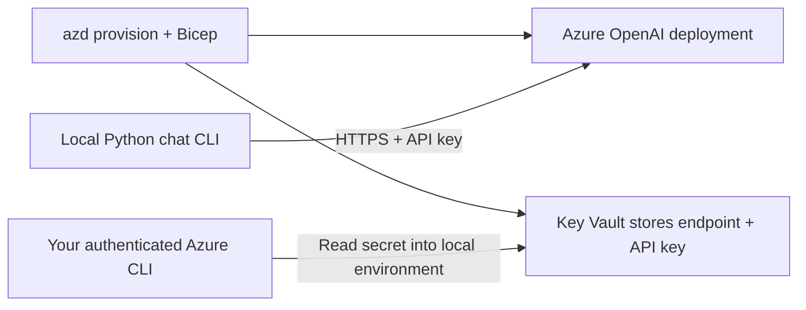

# Azure OpenAI Chat — CLI ท้องถิ่นและโครงสร้างพื้นฐาน AZD

**ระดับ:** ปานกลาง · **เวลา:** 35–60 นาที รวมการตั้งค่า

ตัวอย่างนี้จะจัดเตรียม **ทรัพยากร Azure OpenAI และ Key Vault** จากนั้นเรียกใช้
CLI แชท Python แบบโต้ตอบ **บนเครื่องของคุณ** มันไม่โฮสต์แอปเว็บ
หรือ Container App โมเดลเริ่มต้นคือ `gpt-4.1` รุ่น `2025-04-14` พร้อมด้วย
ความจุการปรับใช้ `GlobalStandard` ที่ 20 ตรวจสอบความพร้อมใช้งานและโควตาปัจจุบันใน
ภูมิภาคที่เลือกก่อนการจัดเตรียม; วันที่วงจรชีวิตของโมเดลอาจมีการเปลี่ยนแปลง

## วัตถุประสงค์การเรียนรู้

- จัดเตรียมโครงสร้างพื้นฐานโมเดลด้วย Bicep และ azd
- ดึงคีย์ API จาก Key Vault โดยไม่ต้องใส่ในผลลัพธ์การปรับใช้
- ส่งคำขอ Chat Completions และรักษาประวัติการสนทนา
- ตีความจำนวนโทเค็นและข้อจำกัดของการประเมินต้นทุน



ไม่มีการผสานรวม runtime managed-identity, failover หลายภูมิภาค, ตัวจำกัดอัตราการส่งแบบกำหนดเอง, โหมดสตรีมมิง หรือคอมพิวต์ที่โฮสต์ในตัวอย่างนี้ SDK ของ OpenAI
จะทำการลองใหม่สูงสุดสองครั้งสำหรับความล้มเหลวที่ลองใหม่ได้; CLI จะรายงานข้อผิดพลาดที่เหลืออยู่


## ข้อกำหนดเบื้องต้น

- เวอร์ชันล่าสุดที่เสถียรของ [azd](https://learn.microsoft.com/azure/developer/azure-developer-cli/install-azd)
  (เวอร์ชันเผยแพร่ ณ เวลาตรวจสอบ: 1.37.2).
- [Azure CLI](https://learn.microsoft.com/cli/azure/install-azure-cli).
- Python **3.10+** (แนะนำ 3.11) และสภาพแวดล้อมเสมือน.
- การสมัครใช้งาน Azure ที่มีสิทธิ์ในการสร้างบริการ Cognitive Services และ Key Vault
  ทรัพยากร, ติดตั้งแบบจำลอง, และอ่านความลับของ vault
- ความพร้อมใช้งานในภูมิภาคและโควต้า `GlobalStandard` สำหรับ `gpt-4.1` ข้อกำหนดการเข้าถึง
  ขึ้นอยู่กับการสมัครใช้งานและคุณสมบัติ; ไม่มีระยะเวลาการอนุมัติที่รับประกัน

```bash
azd version
az version
python --version
azd auth login
az login
```

เหล่านี้เป็นเซสชันการตรวจสอบสิทธิ์แยกต่างหาก ให้เลือกการสมัครสมาชิกเดียวกันทั้งในสอง
เครื่องมือก่อนที่จะรันคำสั่งด้านล่าง

## เริ่มต้นอย่างรวดเร็ว (Bash)

รันจากรูทของรีโพสิโทรี:

```bash
cd examples/azure-openai-chat
azd env new myopenai
azd provision
```

เลือกภูมิภาคที่รองรับ การจัดเตรียมจะสร้างกลุ่มทรัพยากร บัญชี OpenAI,
การปรับใช้โมเดล Key Vault และความลับ `openai-endpoint`/`openai-api-key`
ไม่มี **บริการใดๆ ที่จะต้องปรับใช้** ใน `azure.yaml`

โหลดผลลัพธ์ที่ไม่ใช่ความลับและรับความลับเข้าสู่เชลล์ปัจจุบันของคุณ:

```bash
export AZURE_OPENAI_ENDPOINT="$(azd env get-value AZURE_OPENAI_ENDPOINT)"
export AZURE_OPENAI_MODEL="$(azd env get-value AZURE_OPENAI_MODEL)"
KV_NAME="$(azd env get-value AZURE_KEY_VAULT_NAME)"
export AZURE_OPENAI_API_KEY="$(az keyvault secret show \
  --vault-name "$KV_NAME" --name openai-api-key --query value --output tsv)"

python -m venv .venv
source .venv/bin/activate
python -m pip install -r src/requirements.txt
python src/chat.py
```

ใน PowerShell ให้เปิดใช้งานด้วย `.\.venv\Scripts\Activate.ps1` และกำหนดตัวแปรสภาพแวดล้อม
ด้วย `$env:AZURE_OPENAI_ENDPOINT = azd env get-value AZURE_OPENAI_ENDPOINT`
(และทำเช่นเดียวกันสำหรับโมเดล) ดึงคีย์ API ด้วย
`$env:AZURE_OPENAI_API_KEY = az keyvault secret show --vault-name $KV_NAME --name openai-api-key --query value -o tsv`.
ตั้งค่า `$KV_NAME = azd env get-value AZURE_KEY_VAULT_NAME` ก่อน.

อย่าพิมพ์ ส่งมอบ หรือวางคีย์ API ลงในรายงานปัญหา CLI อ่านตัวแปรสภาพแวดล้อมของกระบวนการ;
มัน **ไม่** ดึงความลับจาก Key Vault หรือโหลดไฟล์ `.env`
`config.py` ตรวจสอบความถูกต้องของ endpoint, ขีดจำกัดโทเค็น, และอุณหภูมิเมื่อเริ่มต้น

ผลลัพธ์ที่คาดหวัง (เนื้อหาและการใช้งานแตกต่างกัน):

```text
Azure OpenAI Chat Application
Model: gpt-4.1
...
You: Say hello in one sentence.
Assistant: Hello! How can I help you today?
[Tokens: ... | Cost: $...]
```

คำสั่ง: `stats` แสดงยอดรวม, `clear` ล้างประวัติการสนทนา, และ
`quit`/`exit` สิ้นสุดเซสชัน ไม่มีคำสั่ง `--stream`, `--show-tokens`, `tokens`,
หรือ `cost`

## ตรวจสอบการปรับใช้

หลังจากโหลดตัวแปร shell ข้างต้น:

```bash
curl --fail-with-body \
  "${AZURE_OPENAI_ENDPOINT%/}/openai/deployments/${AZURE_OPENAI_MODEL}/chat/completions?api-version=2024-10-21" \
  -H "Content-Type: application/json" \
  -H "api-key: $AZURE_OPENAI_API_KEY" \
  -d '{"messages":[{"role":"user","content":"Say hello!"}],"max_tokens":50}'

az keyvault secret list --vault-name "$KV_NAME" --query "[].name" -o table
```

สำเร็จ: API ส่งกลับ HTTP 200 พร้อม `choices[0].message.content` และ `usage`;
vault รายการ `openai-api-key` และ `openai-endpoint` การปรับใช้ ARM ที่สำเร็จ
เพียงอย่างเดียวไม่ยืนยันการอนุมาน

## ไฟล์และการกำหนดค่า

```text
azure.yaml                         # Infrastructure-only AZD project
infra/main.bicep                   # Subscription deployment
infra/main.parameters.json         # Environment, location, principal ID
infra/resources/openai.bicep       # Account + model
infra/resources/keyvault.bicep     # Vault + deploying user's secret access policy
infra/resources/secrets.bicep      # Writes secrets, no key output
src/chat.py                        # Interactive CLI
src/config.py                      # Environment validation
src/requirements.txt               # Python packages
```

เพื่อเปลี่ยนโมเดล/เวอร์ชัน/ความจุที่จัดสรร ให้แก้ไขค่าเริ่มต้นใน
`infra/main.bicep` และรัน `azd provision` การตั้งค่า `AZURE_OPENAI_MODEL` ใน
shell ของคุณเลือกเพียงชื่อการปรับใช้ **ที่มีอยู่แล้ว**; ไม่ได้ปรับใช้โมเดลอื่น

| ตัวแปรเวลารัน | ค่าเริ่มต้น / แหล่งที่มา |
|---|---|
| `AZURE_OPENAI_ENDPOINT` | จำเป็น; azd non-secret output |
| `AZURE_OPENAI_API_KEY` | จำเป็น; ดึงข้อมูลจาก Key Vault |
| `AZURE_OPENAI_MODEL` | `gpt-4.1`; ชื่อการปรับใช้ Azure |
| `AZURE_OPENAI_MAX_TOKENS` | 800 (ช่วงตรวจสอบความถูกต้อง 1–4096) |
| `AZURE_OPENAI_TEMPERATURE` | 0.7 (ช่วง 0–2) |
| `AZURE_OPENAI_INPUT_PRICE_PER_1K` | 0.002 USD; อัตราอินพุตที่ไม่มีการแคชเพื่อสาธิต |
| `AZURE_OPENAI_OUTPUT_PRICE_PER_1K` | 0.008 USD; อัตราเอาท์พุตเพื่อสาธิต |

## ค่าใช้จ่ายและข้อจำกัดด้านความปลอดภัย

การแสดงค่าใช้จ่ายเป็น **การประมาณการณ์** ไม่ใช่การเรียกเก็บเงินจาก Azure โดยคูณการใช้โทเค็น API
กับอัตราที่ตั้งไว้และไม่รวมส่วนลดอินพุตที่แคชไว้,
ความแตกต่างตามภูมิภาค/SKU, ภาษี, การเปลี่ยนแปลงราคา หรือการเรียกใช้ที่ล้มเหลว/ลองใหม่
ต้องแทนอัตรา **ทั้งสอง** เมื่อใช้โมเดลหรือ SKU อื่น และตรวจสอบ
[ราคา Azure OpenAI](https://azure.microsoft.com/pricing/details/cognitive-services/openai-service/) ปัจจุบัน

ในตัวอย่าง สมมติ 100 คำขอที่ใช้โทเค็นอินพุตที่ไม่มีการแคช 500 ตัว และโทเค็นเอาท์พุต 200 ตัวต่อคำขอ
ที่อัตราปกติจะมีค่าใช้จ่าย `100 × (500/1000 × .002 + 200/1000 × .008) = $0.26`
การทำงาน/พื้นที่เก็บข้อมูล Key Vault มีค่าธรรมเนียมแยกต่างหาก ไม่มีค่าบริการเดือนละ $50
สำหรับ CLI ท้องถิ่นนี้ และไม่มีการโฮสต์การประมวลผลในเทมเพลตนี้

ตัวเก็บข้อมูลใช้การเข้าถึงนโยบายสำหรับผู้ใช้งานที่ทำการดีพลอย; ไม่ใช่ตัวอย่างแอปพลิเคชัน RBAC หรือ
managed-identity ใช้จุดเชื่อมต่อสาธารณะและการตรวจสอบด้วยคีย์ API
สำหรับการสอน จำกัดสิทธิ์ และเพิ่มการควบคุมตัวตน/เครือข่ายที่เหมาะสม
ก่อนนำไปใช้ในสภาพแวดล้อมการผลิต

## แบบฝึกหัดปฏิบัติ

### 1. ยืนยันบริบทและรีเซ็ตมัน

**เริ่มต้น:** รัน CLI. **เป้าหมาย:** สังเกตประวัติ
พูดว่า “จำคำว่า cedar” แล้วถามว่า “คำที่ฉันขอให้คุณจำคือคำว่าอะไร?”
รัน `stats`; สองรอบที่สำเร็จควรนับเป็นสองข้อความที่แลกเปลี่ยนกัน
รัน `clear` และ `stats`; ข้อความที่แลกเปลี่ยนควรเป็นศูนย์ (ผลรวมโทเค็นยังคงอยู่).
การใช้คำโดยตรงของโมเดลไม่ใช่แบบกำหนดตายตัว.

### 2. เปลี่ยนขีดจำกัดการตอบกลับ

**เริ่มต้น:** ออกจาก CLI โดยยังคงใช้เชลล์เดิมอยู่
รัน `export AZURE_OPENAI_MAX_TOKENS=100`, เริ่มต้นใหม่ `python src/chat.py`, และถามหาคำ
อธิบายสั้น ๆ ของ azd ตรวจสอบว่าแบนเนอร์แสดง 100
คืนค่าด้วย `unset AZURE_OPENAI_MAX_TOKENS` ขีดจำกัดการตอบกลับที่เล็กกว่าไม่
ลดจำนวนโทเค็นประวัติที่ส่งไปแล้ว

### ปัญหาที่พบบ่อย

- **ตัวแปรสภาพแวดล้อมหายไป:** การจัดเตรียมไม่ได้ส่งออกค่าของเชลล์;
  ทำขั้นตอนการส่งออกซ้ำอีกครั้ง เทอร์มินัลใหม่ต้องใช้ค่าพวกนี้อีกครั้ง
- **403 การอ่าน Key Vault:** ตรวจสอบการสมัครใช้งาน/การเข้าสู่ระบบ Azure CLI และเจ้าของหลัก
  ในนโยบายการเข้าถึง vault การเปลี่ยนแปลงนโยบายอาจใช้เวลากระจาย
- **404 การอนุมาน:** ตรวจสอบชื่อการปรับใช้, จุดสิ้นสุด, และสถานะการปรับใช้
- **429 การอนุมาน:** รอให้ข้อจำกัดอัตราการใช้งานรีเซ็ต; ตรวจสอบโควต้าโมเดลตามภูมิภาค
  CLI จะลบการหมุนเวียนที่ล้มเหลวออกจากประวัติ จึงไม่ทำให้ซ้ำซ้อนเมื่อทำซ้ำ
- **ความยาวบริบท:** ตัวอย่างไม่ได้ตัดบทสนทนายาว; ใช้ `clear`
- **โมเดลไม่พร้อมใช้งาน/เลิกใช้:** ตรวจสอบความพร้อมใช้งานโมเดลปัจจุบันและอัปเดต
  โมเดล/เวอร์ชัน/SKU พร้อมกัน; เวอร์ชัน API และเวอร์ชันโมเดลเป็นการตั้งค่าที่แตกต่างกัน

## การทำความสะอาดและขั้นตอนถัดไป

```bash
azd down
unset AZURE_OPENAI_API_KEY
```

การเก็บรักษาการลบแบบซอฟต์ใน Key Vault คือเจ็ดวัน; การลบถาวรต้องการสิทธิ์แยกต่างหาก
ไม่มีชุดทดสอบที่ยืนยัน; อย่ารันคำสั่ง `pytest tests/` ที่ไม่มีอยู่จริง
เพิ่มการทดสอบ API ที่จำลองขึ้นก่อนขยายโค้ด

[ตัวอย่าง Container](../../../../examples/container-app) · [แบบแผนสถาปัตยกรรมค้าปลีก](../retail-scenario.md) ·
[หน้าแรกหลักสูตร](../../README.md) · [รายงานปัญหา](https://github.com/microsoft/AZD-for-beginners/issues)

---

<!-- CO-OP TRANSLATOR DISCLAIMER START -->
**ปฏิเสธความรับผิดชอบ**:
เอกสารนี้ได้รับการแปลโดยใช้บริการแปลภาษา AI [Co-op Translator](https://github.com/Azure/co-op-translator) ขณะที่เราพยายามให้ความถูกต้อง โปรดทราบว่าการแปลโดยอัตโนมัติอาจมีข้อผิดพลาดหรือความไม่ถูกต้อง เอกสารต้นฉบับในภาษาต้นทางควรถูกพิจารณาเป็นแหล่งข้อมูลที่เชื่อถือได้ สำหรับข้อมูลที่สำคัญ แนะนำให้ใช้การแปลโดยมนุษย์มืออาชีพ เราไม่รับผิดชอบต่อความเข้าใจผิดหรือการตีความที่ผิดพลาดที่เกิดขึ้นจากการใช้การแปลนี้
<!-- CO-OP TRANSLATOR DISCLAIMER END -->