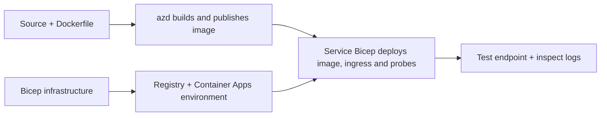

# ตัวอย่างการปรับใช้ Container App ด้วย AZD

โฟลเดอร์นี้ประกอบด้วยตัวอย่างการเรียนรู้สองตัวกับซอร์สโค้ด, Dockerfiles,
โครงสร้างพื้นฐาน Bicep, และ `azure.yaml` ซึ่งไม่มีตัวไหนที่เหมาะสำหรับการใช้งานจริง

## เลือกตัวอย่าง

| ตัวอย่าง | สิ่งที่ถูกนำไปใช้ | เงื่อนไขเบื้องต้น |
|---|---|---|
| [Simple Flask API](../../../../examples/container-app/simple-flask-api) | API CRUD Python ตัวเดียว, รายการในหน่วยความจำ, การตรวจสอบสุขภาพ, การปรับขนาด HTTP | ความรู้พื้นฐาน CLI และ HTTP |
| [Two-service microservices](../../../../examples/container-app/microservices) | เกตเวย์ Node.js, บริการผลิตภัณฑ์ Python สำหรับอ่านอย่างเดียวภายใน, เทเลเมทรีและการปรับขนาด | ทำตัวอย่างบริการเดียวให้เสร็จก่อน |

ใช้เวลาประมาณ 30–60 นาทีรวมการตั้งค่าและการตรวจสอบ Azure ใช้เวลาจัดสรรต่างกัน

## เงื่อนไขเบื้องต้น

- [Azure Developer CLI](https://learn.microsoft.com/azure/developer/azure-developer-cli/install-azd)
- [Azure CLI](https://learn.microsoft.com/cli/azure/install-azure-cli) สำหรับคำสั่งตรวจสอบ
- Docker และ daemon ที่กำลังทำงาน สำหรับการสร้างภาพคอนเทนเนอร์เหล่านี้
- การสมัครสมาชิก Azure ที่มีสิทธิ์สร้างทรัพยากรและโควต้าภูมิภาคเพียงพอ
- Bash สำหรับตัวอย่าง shell หรือคำสั่ง PowerShell ที่เทียบเท่า

```bash
azd version
az version
docker info
azd auth login
az login
```

เครื่องมือทั้งสองมีเซสชันล็อกอินแยกกัน ใช้ azd เวอร์ชันปัจจุบันที่เสถียร; เวอร์ชันล่าสุดที่
เผยแพร่ขณะที่ตรวจสอบคือ 1.37.2 การระบุเวอร์ชันขั้นต่ำรุ่นเก่าไม่ใช่
ข้อรับประกันความเข้ากันได้

## เริ่มต้นอย่างรวดเร็ว

จากรากที่เก็บ:

```bash
cd examples/container-app/simple-flask-api
azd env new flask-demo
azd up
API_URL=$(azd env get-value API_ENDPOINT)
curl --fail-with-body "${API_URL}/health"
```

คาดหวัง: HTTP 200 พร้อมกับ `"status": "healthy"` โปรดทำตามตัวอย่าง README เพื่อสร้าง,
อ่าน, อัปเดต และลบรายการ และเพื่อตรวจสอบบันทึก



การจัดเตรียมครั้งแรกใช้ภาพ hello-world สาธารณะที่พอร์ต 80 บริการเฉพาะ
ไฟล์พารามิเตอร์ Bicep ช่วยให้ `azd deploy` แทนที่ด้วยภาพแอปพลิเคชันที่สร้างแล้ว
และพอร์ตแอป/โปรบที่ถูกต้อง (8000 สำหรับ Flask/สินค้า, 8080 สำหรับเกตเวย์)
เก็บไฟล์เหล่านี้พร้อมกับการตั้งค่า `azure.yaml` `module`

## การกำหนดค่า: สิ่งที่เปลี่ยนแปลงอะไร

`azure.yaml` เลือกไดเรกทอรีต้นทาง ภาษา โฮสต์ และโมดูลการปรับใช้
CPU/หน่วยความจำของคอนเทนเนอร์, ingress, โปรบ, จำนวนเรพลิกา และกฎการปรับขนาด ถูกกำหนด
ใน **Bicep** ไม่ใช่คุณสมบัติบริการ `resources`, `scale` หรือ `regions` แบบสุ่ม

`azd env set SOME_VALUE ...` เก็บค่าท้องถิ่น มันเปลี่ยนแปลงเฉพาะในการปรับใช้
แหล่งข้อมูลเมื่อพารามิเตอร์ การแมปสภาพแวดล้อม หรือฮุกดำเนินการใช้ค่านั้นอย่างชัดเจน
ตัวอย่างเหล่านี้จะไม่ใช้ `MAX_REPLICAS`, `SCALE_TO_ZERO_TIMEOUT`,
`CONTAINER_APP_REPLICA_TYPE` หรือการตั้งค่า canary แบบกำหนดเองจากค่าของสภาพแวดล้อม azd
แก้ไข Bicep ที่เกี่ยวข้องและรัน `azd up` เพื่อปรับปรุงและปรับใช้ใหม่

อย่าวางซอร์สแอปพลิเคชันไว้ใต้ `infra/` `project` ต้องชี้ไปยังไดเรกทอรีซอร์ส
ที่บรรจุไฟล์ Dockerfile และรายงานการพึ่งพา

## การตรวจสอบและค่าใช้จ่าย

- `azd monitor --logs` เปิดมุมมองพอร์ทัล; มันไม่ใช่สตรีมบันทึกเทอร์มินัล
  ใช้ `az containerapp logs show --follow` กับชื่อทรัพยากรจริง
- API ง่ายๆเขียนบันทึก stdout ที่รวบรวมผ่าน Container Apps/Log Analytics
  ทรัพยากร Application Insights ที่จัดเตรียมไว้นั้นไม่ได้รับการติดตั้งอุปกรณ์อัตโนมัติ
- เกตเวย์ไมโครเซอร์วิสใช้ Node.js Application Insights SDK; บริการ Python
  ส่งออกการติดตามล็อกแอปพลิเคชัน การติดตามคำขอ/การพึ่งพาแบบสมบูรณ์ของ Python
  ยังไม่ได้ตั้งค่า
- การสเกลเป็นศูนย์สามารถลดค่าใช้จ่ายคอมพิวต์ได้ แต่การลงทะเบียนและการบริโภค/การจัดเก็บล็อก
  ยังคงมีค่าใช้จ่าย ค่าเริ่มต้นของไมโครเซอร์วิสจะรักษาสำเนาให้ทำงานอยู่
  ประเมินภูมิภาคและการใช้งานของคุณใน
  [Azure pricing calculator](https://azure.microsoft.com/pricing/calculator/).

## รูปแบบขั้นสูง — การใช้งานที่ไม่ได้รวมอยู่

สิ่งเหล่านี้เป็นทิศทางการออกแบบ ไม่ใช่โครงการในพื้นที่เพิ่มเติมหรือโค้ดตัวอย่างที่คัดลอกและรันได้เลย:

- **ข้อมูลถาวรและการพิสูจน์ตัวตน:** แทนที่ที่เก็บข้อมูลในหน่วยความจำชั่วคราวและเพิ่ม
  การพิสูจน์ตัวตน/การอนุญาต Microsoft Entra ID ก่อนการผลิต
- **Blue-green/canary:** ใช้โหมดหลายรีวิชันของ Container Apps, ป้ายชื่อรีวิชัน,
  น้ำหนักการจราจร, การตรวจสอบสุขภาพ และขั้นตอนการย้อนกลับ
  ไม่มีการกำหนดค่า `deploymentStrategy: canary` azd ในตัวอย่างเหล่านี้
  ดูที่ [การจัดการเวอร์ชัน](https://learn.microsoft.com/azure/container-apps/revisions).
- **หลายภูมิภาค:** สร้างสภาพแวดล้อมและแอปแยกต่างหากใน Bicep และออกแบบ
  การกำหนดเส้นทางทั่วโลกและความสอดคล้องของข้อมูล รายการบริการ `regions` ไม่ใช่ azd
  กลไกการปรับใช้
- **งานคิวเวิร์กเกอร์:** เพิ่มแหล่งที่มาของเวิร์กเกอร์, การพึ่งพา, ทรัพยากรคิว, ตัวจัดการ
  ตัวตนที่มีบทบาทข้อมูลเครื่องบิน และกฎการปรับขนาดที่ผ่านการตรวจสอบสิทธิ์ อย่าคัดลอก
  เส้นทาง `src/worker` ที่ว่างเปล่าและคาดหวังโครงการที่สามารถรันได้
- **Dapr:** จัดเตรียมคอมโพเนนต์ กำหนดค่าซายด์การ์ และติดตั้ง SDK ที่ตรงกัน,
  และใช้งานการจัดการข้อผิดพลาดของสถานะ/pub-sub
- **Secrets:** ใช้ managed identity และการมอบหมายบทบาทเมื่อเป็นไปได้ แค่การ
  สร้าง Key Vault ไม่ได้ให้สิทธิ์แอปพลิเคชันในการเข้าถึงหรือโหลดความลับ

## การล้างข้อมูล

จากไดเรกทอรีตัวอย่าง:

```bash
azd down
```

ตรวจสอบคำสั่งลบและยืนยันว่ากลุ่มทรัพยากรเฉพาะถูกลบแล้ว
อย่าใช้ตัวอย่างเหล่านี้เป็นฐานสำหรับการผลิตโดยไม่ทำการออกแบบและทดสอบเพิ่มเติม

[ดัชนีตัวอย่าง](../README.md) · [หน้าหลักของหลักสูตร](../../README.md) ·
[เอกสาร Container Apps](https://learn.microsoft.com/azure/container-apps/) ·
[รายงานปัญหา](https://github.com/microsoft/AZD-for-beginners/issues)

---

<!-- CO-OP TRANSLATOR DISCLAIMER START -->
**ปฏิเสธความรับผิดชอบ**:
เอกสารนี้ได้รับการแปลโดยใช้บริการแปลภาษา AI [Co-op Translator](https://github.com/Azure/co-op-translator) ขณะที่เราพยายามให้ความถูกต้อง โปรดทราบว่าการแปลโดยอัตโนมัติอาจมีข้อผิดพลาดหรือความไม่ถูกต้อง เอกสารต้นฉบับในภาษาต้นทางควรถูกพิจารณาเป็นแหล่งข้อมูลที่เชื่อถือได้ สำหรับข้อมูลที่สำคัญ แนะนำให้ใช้การแปลโดยมนุษย์มืออาชีพ เราไม่รับผิดชอบต่อความเข้าใจผิดหรือการตีความที่ผิดพลาดที่เกิดขึ้นจากการใช้การแปลนี้
<!-- CO-OP TRANSLATOR DISCLAIMER END -->