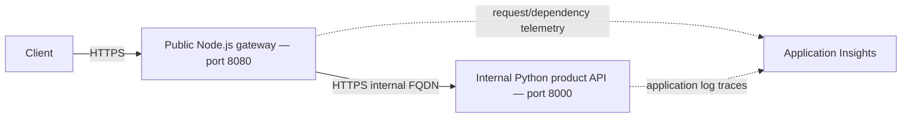

# ไมโครเซอร์วิสสองบริการ — Azure Container Apps

**ระดับ:** ปานกลาง · **เวลา:** 45–60 นาทีรวมการตั้งค่า

ตัวอย่างการเรียนรู้นี้ทำการใช้งาน **Node.js API Gateway** และ **บริการผลิตภัณฑ์ Python แบบอ่านอย่างเดียว**  
รวมทั้งโค้ดต้นทาง, ไฟล์ Docker, Bicep, และการตั้งค่า azd
ระบบนี้ไม่ใช่ระบบที่พร้อมใช้งานในสภาพแวดล้อมการผลิต

## สิ่งที่คุณจะได้เรียนรู้

- การปรับใช้สองบริการอย่างอิสระ
- ใช้ FQDN ภายในสำหรับแบ็คเอนด์ผ่าน HTTPS
- ตรวจสอบผลลัพธ์สำเร็จ, ไม่พบ, และบริการไม่พร้อมใช้งาน
- เข้าใจการรายงานข้อมูลประวัติและขอบเขตการปรับขนาดแยกกัน



แคตตาล็อกผลิตภัณฑ์ประกอบด้วยผลิตภัณฑ์คงที่ห้ารายการในหน่วยความจำ ไม่มี **ตัวจัดการ POST,  
PUT, หรือ DELETE**, ไม่มีฐานข้อมูล, Service Bus, บริการคำสั่งซื้อ/ผู้ใช้/การแจ้งเตือน,  
โค้ด C# หรือ Go นั่นเป็นแนวคิดพัฒนาต่อไปในอนาคต ไม่ใช่ฟีเจอร์ที่รวมอยู่ในนี้  
เกตเวย์ไม่ได้ทำการตรวจสอบผู้ใช้; การเข้าถึงภายในไม่ใช่ตัวแทนของการอนุญาตการใช้งานแอปพลิเคชัน  


## สิ่งที่ต้องมี

ทำ [single Flask API](../../../../../examples/container-app/simple-flask-api) ให้เสร็จก่อน  
ติดตั้ง azd ที่เสถียรเวอร์ชันล่าสุด (เวอร์ชันที่เผยแพร่ในเวลาทบทวน: 1.37.2), Azure CLI,  
และ Docker พร้อม daemon ที่กำลังทำงาน คุณต้องมีบัญชี Azure, สิทธิ์สร้างทรัพยากร,  
และโควต้าภูมิภาคสำหรับ Container Apps  

```bash
azd version
az version
docker info
azd auth login
az login
```

ใช้ subscription เดียวกันในเครื่องมือ CLI ทั้งสอง คำสั่งด้านล่างใช้ Bash  

## ปรับใช้และตรวจสอบ

จากโฟลเดอร์รากของ repository:

```bash
cd examples/container-app/microservices
azd env new microservices-demo
azd up
GATEWAY_URL=$(azd env get-value API_GATEWAY_URL)
RG_NAME=$(azd env get-value AZURE_RESOURCE_GROUP)
GATEWAY_NAME=$(azd env get-value API_GATEWAY_NAME)
PRODUCT_NAME=$(azd env get-value PRODUCT_SERVICE_NAME)

curl --fail-with-body "${GATEWAY_URL}/health"
curl --fail-with-body "${GATEWAY_URL}/api/products"
curl --fail-with-body "${GATEWAY_URL}/api/products/1"
curl -i "${GATEWAY_URL}/api/products/999"
```

**สำเร็จ:** health 200; list 200 พร้อมผลิตภัณฑ์ **ห้า** รายการ; ผลิตภัณฑ์ 1 เป็น Laptop  
ราคา 999.99 และสต็อก 50; ผลิตภัณฑ์ที่ไม่รู้จักส่งกลับ 404  
คำอธิบายรวมอยู่ในคำตอบ; เวลาประทับต่างกัน  

การจัดเตรียมเริ่มแรกใช้ภาพ hello-world สาธารณะบนพอร์ต 80 เพื่อไม่ให้พยายาม  
ดึงภาพที่ไม่มีอยู่จากรีจิสทรีว่างเปล่า โมดูล Bicep เฉพาะบริการ  
และไฟล์พารามิเตอร์จะถูกแทนที่ด้วยภาพที่สร้างขึ้นและพอร์ต/โพรบของแอปในระหว่าง
`azd deploy` พารามิเตอร์หลักจะเก็บรักษาชื่อภาพที่เผยแพร่ไว้สำหรับการจัดเตรียมในภายหลัง

## บริการและเครือข่าย

| บริการ | จุดสิ้นสุดที่เปิดเผย | ทรัพยากรเริ่มต้น |
|---|---|---|
| Gateway | GET `/`, `/health`, `/api/products`, `/api/products/:id` | 1 vCPU, 2 GiB, 2–20 ตัวทำซ้ำ |
| Product | GET `/`, `/health`, `/products`, `/products/<id>` | 0.5 vCPU, 1 GiB, 1–10 ตัวทำซ้ำ |

Product ingress มี `external: false` และ `allowInsecure: false` Bicep ฝัง
`PRODUCT_SERVICE_URL=https://<actual-internal-fqdn>` ลงใน gateway HTTP จะ
เปลี่ยนเส้นทาง; HTTPS ตรงกับ ingress ที่กำหนดไว้ ชื่อ DNS สั้นต้องตรงกับ
**ชื่อแอป Container App จริง** ไม่ใช่คีย์บริการเชิงตรรกะ `product-service`
อย่าพยายามเรียก URL ภายในโดยตรงจากแล็ปท็อปของคุณ

Gateway มีการหมดเวลาห้าวินาทีสำหรับการเรียก product ID ที่ขาดหายจะ
ส่งต่อเป็น 404; ขัดข้องในการขนส่ง/ข้อผิดพลาดแบ็คเอนด์อื่นๆ ส่งคืน 503 Gateway
`/health` ตรวจสอบเฉพาะ gateway ไม่ใช่ความพร้อมใช้งานของแบ็คเอนด์

## ไฟล์และการกำหนดค่า

```text
azure.yaml
infra/main.bicep
infra/main.parameters.json
infra/abbreviations.json
infra/core/container-apps-environment.bicep
infra/core/monitor.bicep
infra/app/api-gateway.bicep
infra/app/api-gateway.parameters.json
infra/app/product-service.bicep
infra/app/product-service.parameters.json
src/api-gateway/{app.js,package.json,Dockerfile}
src/product-service/{main.py,requirements.txt,Dockerfile}
```

การปรับขนาด CPU/หน่วยความจำ พอร์ต และโพรบถูกตั้งค่าใน `infra/app/*.bicep` เปลี่ยนไฟล์เหล่านั้น
และเรียก `azd up` เพื่อใช้โครงสร้างพื้นฐานและปรับใช้ใหม่ ไม่มี
พารามิเตอร์ตัวแปรสภาพแวดล้อม `GATEWAY_MAX_REPLICAS` ในตัวอย่างนี้

สำหรับการเปลี่ยนแปลงเฉพาะโค้ด:

```bash
azd deploy product-service
azd deploy api-gateway
```

รูปภาพ Node ใช้ Node 22; รูปภาพ Python ใช้ Python 3.11 ทั้งสองเชื่อมต่อกับ
`0.0.0.0` Ingress/โพรบใช้พอร์ต 8080 (gateway) และ 8000 (product) ตามลำดับ

## การพัฒนาในเครื่องด้วย Docker

รันจากไดเรกทอรีตัวอย่างนี้ ใช้เครือข่ายที่กำหนดเองโดยผู้ใช้ **ไม่ใช่ `localhost`
จากคอนเทนเนอร์หนึ่งไปยังอีกคอนเทนเนอร์หนึ่ง**

```bash
docker network create azd-microservices-demo
docker build -t local-product ./src/product-service
docker build -t local-gateway ./src/api-gateway
docker run -d --name azd-product --network azd-microservices-demo local-product
docker run -d --name azd-gateway --network azd-microservices-demo \
  -p 8080:8080 -e PRODUCT_SERVICE_URL=http://azd-product:8000 local-gateway
curl --fail-with-body http://localhost:8080/api/products
```

ที่คาดหวัง: ผลิตภัณฑ์ห้ารายการ HTTP ใช้เฉพาะสำหรับเครือข่าย Docker ในเครื่องนี้เท่านั้น

```bash
docker stop azd-product azd-gateway
docker rm azd-product azd-gateway
docker network rm azd-microservices-demo
```

## การตรวจสอบ

```bash
az containerapp logs show --name "$GATEWAY_NAME" --resource-group "$RG_NAME" --follow
# In a separate terminal:
az containerapp logs show --name "$PRODUCT_NAME" --resource-group "$RG_NAME" --tail 100
```

`azd monitor --logs` เปิดมุมมองพอร์ทัล; ไม่สตรีมบันทึกเทอร์มินัล
SDK Node รวบรวมคำขอ/การพึ่งพาของ gateway Python `AzureLogHandler`
ส่งออก **ร่องรอยบันทึก** ไม่ใช่คำขอ Flask อัตโนมัติ การพึ่งพา SQL หรือร่องรอย
แบบกระจายเต็มรูปแบบ OpenCensus เป็น SDK เก่า; ควรใช้ Azure Monitor OpenTelemetry
เมื่อขยายตัวอย่างนี้

ใน Application Insights Logs สร้างคำขอและตรวจสอบ:

```kusto
requests
| where timestamp > ago(1h)
| where name contains "products"
| summarize RequestCount=count(), AvgDuration=avg(duration) by bin(timestamp, 5m)
```

สำหรับข้อความแอปพลิเคชัน Python:

```kusto
traces
| where timestamp > ago(1h)
| where message contains "products"
| project timestamp, message, severityLevel
```

อนุญาตความล่าช้าในการนำเข้าและการสุ่มตัวอย่าง อย่าคาดหวังจำนวนคำขอที่แน่นอนหรือ
ความหน่วงที่รับประกัน ไม่มีการตั้งค่าแจ้งเตือนหรือแดชบอร์ดที่กำหนดเอง

## แบบฝึกหัดใช้งานจริง

### แบบฝึกหัด 1: แก้ไขแคตตาล็อก

**จุดเริ่มต้น:** `src/product-service/main.py`.
**เป้าหมาย:** ตรวจสอบการปรับใช้บริการอย่างอิสระ.
เปลี่ยนสต็อกของ Laptop จาก 50 เป็น 49 ในรายการ `products` ที่กำหนดไว้, รัน
`azd deploy product-service`, แล้วร้องขอ `${GATEWAY_URL}/api/products/1`.

**เกณฑ์ความสำเร็จ / วิธีแก้ไข:** HTTP 200 พร้อม `"stock":49`. กู้คืน 50 และปรับใช้ซ้ำ
**ปัญหาทั่วไป:** แก้ไขเกตเวย์แทนบริการที่เป็นเจ้าของแค็ตตาล็อก
สิ่งนี้เปลี่ยนแปลงข้อมูลต้นทาง ไม่ใช่ฐานข้อมูลสินค้าคงคลังถาวร

### แบบฝึกหัด 2: ตรวจสอบการกำหนดค่าสำเนา

**จุดเริ่มต้น:** `infra/app/product-service.bicep`.
**เป้าหมาย:** สังเกตการเปลี่ยนแปลงของโครงสร้างพื้นฐานโดยไม่ต้องเดาเรื่องการปรับขนาดอัตโนมัติ
เปลี่ยน `minReplicas: 1` เป็น `minReplicas: 2`, รัน `azd up`, จากนั้น:

```bash
az containerapp show --name "$PRODUCT_NAME" --resource-group "$RG_NAME" \
  --query properties.template.scale -o json
```

**เกณฑ์ความสำเร็จ:** กำหนดค่าน้อยสุดเป็น 2 และค่าสูงสุดยังคงเป็น 10
คืนค่าน้อยสุดเป็น 1 และรัน `azd up`
**ปัญหาทั่วไป:** `azd deploy` เพียงอย่างเดียวไม่ทำการเปลี่ยนแปลงโครงสร้างพื้นฐานที่ใช้ร่วมกันซึ่งไม่ได้เกี่ยวข้อง
หลีกเลี่ยงการตั้งค่า `maxReplicas` เป็นศูนย์เพื่อจำลองความล้มเหลว
สิ่งนี้เป็นการตรวจสอบการกำหนดค่า ไม่ใช่การทดสอบโหลดหรือการรับประกันจำนวนสำเนาที่รวดเร็วในทันที

### แบบฝึกหัดที่ 3: ทดสอบการจัดการบริการที่ไม่พร้อมใช้ในเครื่องท้องถิ่น

**จุดเริ่มต้น:** คอนเทนเนอร์ Docker ทั้งสองด้านบนกำลังทำงานอยู่
**เป้าหมาย:** แยกแยะความล้มเหลวของแบ็คเอนด์จากสินค้าที่หายไป
หยุดเพียงคอนเทนเนอร์ผลิตภัณฑ์เท่านั้น:

```bash
docker stop azd-product
curl -i http://localhost:8080/api/products
docker start azd-product
curl --fail-with-body http://localhost:8080/api/products
```

**เกณฑ์ความสำเร็จ:** ขณะที่หยุดใช้งาน gateway จะส่งกลับ 503 พร้อมกับ
`"error":"Product service unavailable"`; หลังจากรีสตาร์ท รายการจะส่งกลับ 200
ลองใหม่หลังจากหน่วงเวลาการเริ่มต้นเล็กน้อยถ้าจำเป็น
**ปัญหาทั่วไป:** หยุด gateway จะทดสอบความล้มเหลวที่แตกต่างออกไป (ไม่มีการตอบกลับ HTTP)

## ค่าใช้จ่ายและช่องว่างในผลิตภัณฑ์

ค่าเริ่มต้นของจำนวนสำเนาขั้นต่ำจะทำให้คอมพิวต์ทำงานอยู่ Registry และการตรวจสอบยังมีค่าใช้จ่าย
ไม่มีการยืนยันค่าคงที่รวม $50/เดือน: ประมาณ CPU/หน่วยความจำตามภูมิภาค,
ชั่วโมงสำเนา, การร้องขอ, registry และการเก็บรักษาบันทึกใน
[เครื่องคำนวณราคา Azure](https://azure.microsoft.com/pricing/calculator/).
ลบทรัพยากรการเรียนรู้ทันที

งานในสภาพแวดล้อมการผลิตรวมถึงการพิสูจน์ตัวตน/การอนุญาต, ตัวตนที่มีการจัดการแบบกำหนดขอบเขต,
ข้อมูลถาวร, การตรวจสอบข้อมูลนำเข้า/ตอบกลับ, เครื่องมือสังเกตการณ์ที่รองรับ,
การทดสอบภาระ/ข้อผิดพลาด, CI/CD, การแจ้งเตือน และกระบวนการกู้คืน เพิ่มบริการคำสั่งซื้อ,
คิว หรือฐานข้อมูลเป็นงานดำเนินการแยกต่างหาก ไม่ใช่แบบฝึกหัดที่เสร็จสมบูรณ์หรือฟีเจอร์ที่มีอยู่แล้วที่นี่


## การแก้ไขปัญหาและการล้างข้อมูล

- **ไม่พบภาพในระหว่างการจัดเตรียมครั้งแรก:** bootstrap ควรใช้ภาพสาธารณะ;
  ตรวจสอบค่าพารามิเตอร์ภาพหลักเริ่มต้นและการแมปโมดูลการติดตั้ง
- **ผลิตภัณฑ์ 503:** ตรวจสอบบันทึกผลิตภัณฑ์, การแก้ไขภาพ และ URL HTTPS ภายในที่ถูกฉีดเข้ามา
- **เส้นทาง 404 ไม่คาดคิด:** API ผลิตภัณฑ์เป็นแบบอ่านอย่างเดียว; ตรวจสอบเส้นทาง ไม่ใช่ตัวจัดการ CRUD ที่ไม่มีอยู่
- **ไม่มีข้อมูลโทรเลข:** ตรวจสอบสายการเชื่อมต่อ runtime โดยไม่เปิดเผยและ
  อนุญาตให้มีความล่าช้าในการบันทึก ตารางคำขอ Python ไม่ถูกเติมข้อมูลโดยตัวจัดการบันทึกของมัน

จากไดเรกทอรีตัวอย่างนี้:

```bash
azd down
```

ตรวจสอบคำขอลบและยืนยันว่ากลุ่มทรัพยากรที่จัดสรรมาถูกลบแล้ว

[ก่อนหน้า: Flask API](../../../../../examples/container-app/simple-flask-api) · [ถัดไป: แอปฐานข้อมูล](../../../../../examples/database-app) ·
[การพัฒนา AI](../../../docs/chapter-02-ai-development/README.md) ·
[หน้าหลักของหลักสูตร](../../../README.md) · [รายงานปัญหา](https://github.com/microsoft/AZD-for-beginners/issues)

---

<!-- CO-OP TRANSLATOR DISCLAIMER START -->
**ปฏิเสธความรับผิดชอบ**:
เอกสารนี้ได้รับการแปลโดยใช้บริการแปลภาษา AI [Co-op Translator](https://github.com/Azure/co-op-translator) ขณะที่เราพยายามให้ความถูกต้อง โปรดทราบว่าการแปลโดยอัตโนมัติอาจมีข้อผิดพลาดหรือความไม่ถูกต้อง เอกสารต้นฉบับในภาษาต้นทางควรถูกพิจารณาเป็นแหล่งข้อมูลที่เชื่อถือได้ สำหรับข้อมูลที่สำคัญ แนะนำให้ใช้การแปลโดยมนุษย์มืออาชีพ เราไม่รับผิดชอบต่อความเข้าใจผิดหรือการตีความที่ผิดพลาดที่เกิดขึ้นจากการใช้การแปลนี้
<!-- CO-OP TRANSLATOR DISCLAIMER END -->