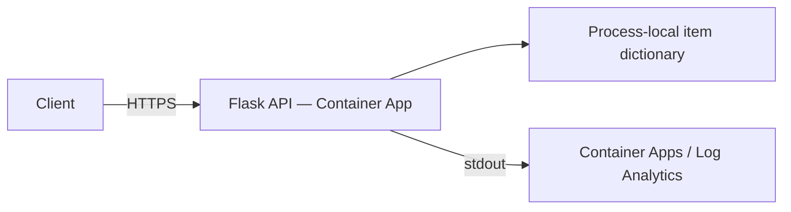

# Simple Flask API — Azure Container Apps

**ระดับ:** ผู้เริ่มต้น · **เวลา:** 30–45 นาที รวมการตั้งค่า

ปรับใช้ Python Flask CRUD API ด้วย Azure Developer CLI (azd) มีโค้ดต้นทาง, Dockerfile,
Bicep, และพารามิเตอร์การปรับใช้รวมอยู่ นี่เป็น **ตัวอย่างการเรียนรู้** ไม่ใช่
API พร้อมใช้งานในสภาพแวดล้อมจริง

## สิ่งที่คุณจะได้เรียนรู้

- สร้างและเผยแพร่คอนเทนเนอร์ผ่าน azd
- กำหนดค่า ingress และ liveness/readiness probes
- ตรวจสอบการตอบสนอง CRUD และตรวจสอบบันทึกของแอปพลิเคชัน
- เข้าใจว่าทำไมข้อมูลในหน่วยความจำจึงไม่เหมาะสมสำหรับแอปพลิเคชันที่ต้องการความทนทาน



**สำคัญ:** รายการถูกเก็บไว้ในกระบวนการเดียว ค่าเริ่มต้นคือ **worker Gunicorn หนึ่งตัว,
0–1 ตัวจำลอง** โดยตั้งใจหลีกเลี่ยงข้อมูลที่ไม่สอดคล้องกันระหว่าง worker/replica
รายการจะสูญหายเมื่อรีสตาร์ท เปลี่ยนเวอร์ชัน หรือ scale-to-zero การเพิ่มจำนวนตัวจำลอง
ต้องการการเก็บถาวรร่วมกัน API นี้ไม่มีการตรวจสอบสิทธิ์หรืออนุญาต

## ความต้องการล่วงหน้า

- [azd ที่เสถียรปัจจุบัน](https://learn.microsoft.com/azure/developer/azure-developer-cli/install-azd)
  (เวอร์ชันที่เผยแพร่ในเวลาตรวจสอบ: 1.37.2)
- [Azure CLI](https://learn.microsoft.com/cli/azure/install-azure-cli) สำหรับตรวจสอบ
- Docker พร้อม daemon ที่กำลังทำงาน; จำเป็นสำหรับการสร้างอิมเมจในเครื่องโดยค่าเริ่มต้น
- บัญชีผู้ใช้ Azure สิทธิ์ในการสร้างทรัพยากร และโควต้าระดับภูมิภาค Container Apps
- Bash สำหรับคำสั่งด้านล่าง (หรือ PowerShell ที่เทียบเท่า)
- Python 3.11 สำหรับการพัฒนาในเครื่องแบบเลือกใช้

```bash
azd version
az version
docker info
azd auth login
az login
```

เครื่องมือ CLI มีเซสชันการเข้าสู่ระบบแยกกัน ใช้บัญชีผู้ใช้เดียวกันในทั้งสองที่

## เริ่มต้นอย่างรวดเร็ว

จากโฟลเดอร์รากของรีโป:

```bash
cd examples/container-app/simple-flask-api
azd env new flask-demo
azd up
API_URL=$(azd env get-value API_ENDPOINT)
RG_NAME=$(azd env get-value AZURE_RESOURCE_GROUP)
API_NAME=$(azd env get-value API_NAME)
curl --fail-with-body "${API_URL}/health"
```

คาดว่าจะได้รับ: HTTP 200 และ JSON ที่มี `"status":"healthy"`,
`"service":"simple-flask-api"` และเวลาปัจจุบันในรูปแบบ UTC timestamp
การจัดเตรียมและการสร้างอิมเมจโดยทั่วไปใช้เวลาหลายวินาที; เวลาแตกต่างกันได้

การจัดเตรียมเริ่มต้นใช้ภาพ hello-world สาธารณะที่ฟังบนพอร์ต 80
`azure.yaml` เลือก `infra/app/api.bicep` และไฟล์พารามิเตอร์ที่ตรงกันสำหรับ
การปรับใช้บริการ ซึ่งเปลี่ยนอิมเมจ, ingress, และ probe ไปยังพอร์ต 8000
กรุณาอย่าลบพารามิเตอร์การปรับใช้นั้น

## ตรวจสอบ CRUD

รันคำสั่งต่อไปนี้ตามลำดับขณะตัวจำลองเดียวกันยังทำงานอยู่:

```bash
# Create: HTTP 201; note the returned id (1 for a fresh process).
curl -i -X POST "${API_URL}/api/items" \
  -H "Content-Type: application/json" \
  -d '{"name":"Test Item","description":"My first item"}'

# Read list: HTTP 200, total 1 in a fresh process.
curl --fail-with-body "${API_URL}/api/items"

# Replace 1 if your create response returned another id.
curl --fail-with-body "${API_URL}/api/items/1"
curl -i -X PUT "${API_URL}/api/items/1" \
  -H "Content-Type: application/json" -d '{"name":"Updated Item"}'
curl -i -X DELETE "${API_URL}/api/items/1"
curl -i "${API_URL}/api/items/1"
```

สำเร็จ: POST 201, อ่าน/PUT 200, DELETE 204 ไม่มีเนื้อหา, จากนั้นรายการหาย 404
JSON ที่ผิดรูปแบบ/ไม่ใช่วัตถุหรือชื่อว่างคืนค่า 400
หากรายการหายไประหว่างคำขอ ให้ตรวจสอบการรีสตาร์ทหรือ scale-to-zero;
นี่คือข้อจำกัดที่ตั้งใจของหน่วยความจำ ไม่ใช่การเก็บถาวร

| Endpoint | วิธีการ |
|---|---|
| `/` | GET — ข้อมูลบริการ |
| `/health` | GET — liveness/readiness |
| `/api/items` | GET, POST |
| `/api/items/{id}` | GET, PUT, DELETE |

## บันทึกและการตั้งค่า

```bash
az containerapp logs show --name "$API_NAME" --resource-group "$RG_NAME" --follow
```

คาดว่าจะได้รับ: การเริ่มต้น Gunicorn, บันทึกการเข้าถึงคำขอ, และข้อความแอปพลิเคชัน
`azd monitor --logs` เปิดมุมมองพอร์ทัล; ไม่ได้สตรีมไปยังเทอร์มินัล
Application Insights ถูกจัดเตรียมไว้แต่ **ไม่ได้ถูกติดตั้งด้วยโค้ด Flask นี้**;
ใช้ Container Apps/Log Analytics สำหรับบันทึก stdout

แก้ไข `infra/app/api.bicep` สำหรับ CPU/หน่วยความจำ, ขีดจำกัดตัวจำลอง, หรือกฎการสเกล จากนั้น
รัน `azd up` ค่าเริ่มต้นคือ 0.5 vCPU, 1 GiB, ขีดจำกัดตัวจำลองต่ำสุด 0 / สูงสุด 1,
และเกณฑ์ HTTP ของ 50 คำขอพร้อมกัน การสเกลไปศูนย์อาจเพิ่มความล่าช้าตอนเริ่มเย็น

Arbitrary `azd env set MAX_REPLICAS`, `API_KEY`, `LOG_LEVEL`, หรือ
ค่า `SCALE_TO_ZERO_TIMEOUT` **ไม่ได้เชื่อมโยงกับเทมเพลตหรือแอปนี้**.
การตั้งค่าหนึ่งค่าไม่ได้ทำให้มันเป็นตัวแปรสภาพแวดล้อมในเวลารันโดยอัตโนมัติ.
อิมเมจผูกพอร์ต 8000 อย่างชัดเจน; อัปเดต Dockerfile, Bicep ingress และ probes
พร้อมกันหากเปลี่ยนพอร์ต.

## ไฟล์

```text
azure.yaml
infra/main.bicep
infra/main.parameters.json
infra/app/container-apps.bicep       # Environment, registry, monitoring
infra/app/api.bicep                  # App, ingress, probes, scale settings
infra/app/api.parameters.json        # Image and resource values for azd deploy
src/app.py
src/Dockerfile
src/requirements.txt
```

## การพัฒนาท้องถิ่น

จากไดเรกทอรีตัวอย่างนี้:

```bash
python -m venv .venv
source .venv/bin/activate  # PowerShell: .\.venv\Scripts\Activate.ps1
python -m pip install -r src/requirements.txt
python src/app.py
```

ในเทอร์มินัลอีกอัน ทดสอบ `http://localhost:8000/health` และจุดสิ้นสุด CRUD.
หรือสร้างและรันอิมเมจจริง:

```bash
docker build -t flask-api:local ./src
docker run --rm -p 8000:8000 flask-api:local
```

สำหรับการเปลี่ยนแปลงเฉพาะโค้ดหลังการปรับใช้ครั้งแรก ให้รัน `azd deploy api`.
สำหรับการเปลี่ยนแปลง Bicep ให้รัน `azd up` เพื่อจัดเตรียมและปรับใช้ใหม่.

## แบบฝึกหัดปฏิบัติ

### 1. ตรวจสอบการปฏิเสธข้อมูลนำเข้า

**จุดเริ่มต้น:** มีการดีพลอย API เรียบร้อยแล้ว, `API_URL` ข้างต้น
**เป้าหมาย:** ตรวจสอบว่า API ปฏิเสธโครงสร้าง JSON ที่ไม่ถูกต้องและชื่อที่ขาดหาย

```bash
curl -i -X POST "${API_URL}/api/items" \
  -H "Content-Type: application/json" -d '[]'
curl -i -X POST "${API_URL}/api/items" \
  -H "Content-Type: application/json" -d '{"name":""}'
```

**เกณฑ์ความสำเร็จ / วิธีแก้:** ทั้งสองกรณีส่งกลับ 400 พร้อมข้อความข้อผิดพลาดใน JSON ไม่ใช่ 500
**ปัญหาทั่วไป:** ละเว้นการระบุ header ประเภทเนื้อหา JSON

### 2. เพิ่ม endpoint รุ่นอ่านอย่างเดียว

**จุดเริ่มต้น:** `src/app.py`. **เป้าหมาย:** ขยายและดีพลอย API ใหม่
เพิ่มสิ่งนี้ก่อนบล็อก `if __name__ == '__main__':`:

```python
@app.route('/version', methods=['GET'])
def version():
    return jsonify({'version': '1.0.0'})
```

รัน `azd deploy api`, แล้วจึง `curl --fail-with-body "${API_URL}/version"`.
**เกณฑ์ความสำเร็จ:** HTTP 200 และ `{"version":"1.0.0"}`.
**ปัญหาทั่วไป:** วางเส้นทางหลังจากการเรียก `app.run()` ที่บล็อกเมื่อ
ทดสอบกับ `python src/app.py`.

### จุดตรวจสอบความรู้

ทำไมคนงานเพียงคนเดียวจึงไม่เพียงพอสำหรับข้อมูลที่ทนทาน? เพราะแม้แต่กระบวนการเดียวก็สูญเสีย
พจนานุกรมของมันเมื่อเริ่มต้นใหม่ รุ่นการผลิตต้องการพื้นที่จัดเก็บที่ใช้ร่วมกันถาวร,
การพิสูจน์ตัวตน, การอนุญาต, การย้ายข้อมูล, การทดสอบ และการเฝ้าติดตามการทำงาน

## ค่าใช้จ่ายและการแก้ไขปัญหา

นี่ไม่ใช่การปรับใช้ที่รับประกัน $0: การลงทะเบียนพื้นฐานและการจัดเก็บ/การรับบันทึก
อาจเกิดค่าใช้จ่ายแม้เมื่อการประมวลผลของแอปเป็นศูนย์ ใช้
[เครื่องคิดเลขราคาค่าบริการ](https://azure.microsoft.com/pricing/calculator/) สำหรับภูมิภาคของคุณ

- **การสร้าง Docker ล้มเหลว:** ยืนยัน `docker info`, การเข้าถึงเครือข่าย และการพึ่งพา
- **แอปไม่ทำงาน:** ตรวจสอบบันทึกคอนโซล/ระบบและยืนยันพอร์ตของอิมเมจ, ingress,
  และ probes สอดคล้องกัน ต้องไม่มีการ probe ตัว placeholder บนพอร์ต Flask
- **403/สิทธิ์:** ยืนยันการสมัครใช้งานและสิทธิ์การสร้างทรัพยากร
- **ไอเท็มหาย:** สถานะในหน่วยความจำจะรีเซ็ตเมื่อรีสตาร์ท/สเกลเป็นศูนย์; เพิ่มฐานข้อมูล
  เพื่อพฤติกรรมที่ทนทาน

## การล้างข้อมูลและขั้นตอนถัดไป

```bash
azd down
```

ตรวจสอบพร้อมท์การลบและยืนยันว่ากลุ่มทรัพยากรที่จัดสรรไว้ถูกลบแล้ว
อย่าใช้การล้างข้อมูลแบบทำลายกับกลุ่มทรัพยากรที่มีข้อมูลที่ไม่เกี่ยวข้อง

[ถัดไป: แอปฐานข้อมูล](../../../../../examples/database-app) · [ไมโครเซอร์วิส](../../../../../examples/container-app/microservices) ·
[ภาพรวมคอนเทนเนอร์](../README.md) · [หน้าหลักคอร์ส](../../../README.md) ·
[รายงานปัญหา](https://github.com/microsoft/AZD-for-beginners/issues)

---

<!-- CO-OP TRANSLATOR DISCLAIMER START -->
**ปฏิเสธความรับผิดชอบ**:
เอกสารนี้ได้รับการแปลโดยใช้บริการแปลภาษา AI [Co-op Translator](https://github.com/Azure/co-op-translator) ขณะที่เราพยายามให้ความถูกต้อง โปรดทราบว่าการแปลโดยอัตโนมัติอาจมีข้อผิดพลาดหรือความไม่ถูกต้อง เอกสารต้นฉบับในภาษาต้นทางควรถูกพิจารณาเป็นแหล่งข้อมูลที่เชื่อถือได้ สำหรับข้อมูลที่สำคัญ แนะนำให้ใช้การแปลโดยมนุษย์มืออาชีพ เราไม่รับผิดชอบต่อความเข้าใจผิดหรือการตีความที่ผิดพลาดที่เกิดขึ้นจากการใช้การแปลนี้
<!-- CO-OP TRANSLATOR DISCLAIMER END -->