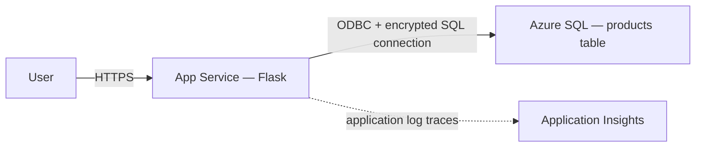

# Flask และ Azure SQL บน App Service

**ระดับ:** ปานกลาง · **เวลา:** 30–60 นาที รวมเวลาการเตรียมความพร้อม

ตัวอย่างนี้จะปรับใช้ API อ่านข้อมูล Python Flask ไปยัง **Linux App Service** และ
ฐานข้อมูล Azure SQL แบบ Basic ขนาด 2 GB ที่เกี่ยวข้อง รวมถึงซอร์สโค้ด, Bicep และการกำหนดค่า azd
เป็นแอปพลิเคชันเพื่อการเรียนรู้ ไม่ใช่สถาปัตยกรรมฐานข้อมูลสำหรับใช้งานในสภาพแวดล้อมจริง

## สิ่งที่คุณจะได้เรียนรู้

- การจัดเตรียม App Service, SQL และทรัพยากรการตรวจสอบด้วย Bicep
- การกำหนดค่าการเชื่อมต่อ SQL ที่เข้ารหัสโดยไม่ต้องบันทึกข้อมูลรับรอง
- การเริ่มต้นสคีมาก่อนเริ่ม Gunicorn workers
- การตรวจสอบข้อมูลเริ่มต้น, การตอบกลับเมื่อไม่พบข้อมูล และสุขภาพของฐานข้อมูล



ทรัพยากร: กลุ่มทรัพยากรเฉพาะ, แผน Linux App Service B1, เว็บแอป Python 3.11,
เซิร์ฟเวอร์ SQL พร้อมฐานข้อมูล Basic 2-GB, Application Insights และ Log Analytics
เว็บแอปใช้ **การปรับใช้ซอร์ส/ZIP และการติดตั้งไลบรารีด้วย Oryx**
`azd deploy` จะไม่ทำการ build หรือ deploy Dockerfile ออปชัน

## สิ่งที่ต้องมีล่วงหน้า

- ปัจจุบันเวอร์ชันเสถียร [azd](https://learn.microsoft.com/azure/developer/azure-developer-cli/install-azd)
  (รุ่นที่เผยแพร่ ณ เวลาทบทวน: 1.37.2)
- [Azure CLI](https://learn.microsoft.com/cli/azure/install-azure-cli) สำหรับการยืนยัน
- การสมัครสมาชิก Azure, สิทธิ์ในการสร้างทรัพยากรที่ระบุ และโควต้าระดับภูมิภาค
- Python **3.11** สำหรับการพัฒนาท้องถิ่น; ตัว `pyodbc==5.0.1` ที่ผูกมัดอาจต้องการ
  เครื่องมือการสร้างเนทีฟในเวอร์ชัน Python ที่ใหม่กว่า
- Microsoft ODBC Driver 18 (หรือ 17) สำหรับ SQL Server บนเครื่องท้องถิ่น `pip install
  pyodbc` จะไม่ติดตั้งไดรเวอร์ระบบ ดู
  [การติดตั้ง ODBC](https://learn.microsoft.com/sql/connect/odbc/download-odbc-driver-for-sql-server).
- Docker ใช้เฉพาะถ้าทดสอบคอนเทนเนอร์ตัวเลือกในเครื่องเท่านั้น

```bash
azd version
az version
azd auth login
az login
```

ใช้การสมัครสมาชิกเดียวกันในทั้งสองเครื่องมือ คำสั่งด้านล่างใช้ Bash

## การปรับใช้

จากโฟลเดอร์รากของที่เก็บ:

```bash
cd examples/database-app
azd env new sql-demo
azd provision
azd deploy
WEB_URL=$(azd env get-value WEB_APP_URI)
WEB_NAME=$(azd env get-value WEB_APP_NAME)
RG_NAME=$(azd env get-value AZURE_RESOURCE_GROUP)
```

เลือกภูมิภาคที่รองรับ `sqlAdminLogin` เริ่มต้นที่ `sqladmin`; ตัวแปร
`sqlAdminPassword` ที่ต้องการเป็นพารามิเตอร์ที่ปลอดภัย กรอกพาสเวิร์ดที่แข็งแรงเมื่อมีการร้องขอ
เก็บข้อมูลประจำตัวการปรับใช้ออกจาก Git และรายงานปัญหา สตริงการเชื่อมต่อปัจจุบัน
ใช้การแทรกสตริงโดยคาดหวังพาสเวิร์ดที่ไม่มีตัวคั่นของสตริงการเชื่อมต่อเช่น
`;` ปรับการหนีสตริงก่อนใช้ค่าดังกล่าว

Bicep กำหนดคำสั่งเริ่มต้นที่รัน `init_database()` **ก่อน** Gunicorn
worker เริ่มทำงาน นี่เป็นสิ่งจำเป็นเพราะการนำเข้า `app:app` ไม่ได้รัน
บล็อก `if __name__ == '__main__'` ของ Python บนฐานข้อมูลใหม่ การเริ่มต้น
สร้าง `products` และแทรกห้าบรรทัด มันเป็นเมล็ดสอนง่ายๆ ไม่ใช่
กรอบงานการย้ายข้อมูลแบบพร้อมกัน; ใช้การย้ายข้อมูลที่เหมาะสมก่อนเพิ่มจำนวนอินสแตนซ์

แอปเลือก Microsoft ODBC Driver 18 ที่ติดตั้งแล้ว จากนั้น 17 หากสตริงการเชื่อมต่อ
ไม่ได้ระบุชื่อไดรเวอร์อย่างชัดเจน หากไม่มีทั้งสองเวอร์ชัน การเริ่มต้นระบบจะล้มเหลวพร้อม 
ข้อผิดพลาดในการติดตั้งที่สามารถแก้ไขได้ ตรวจสอบความพร้อมใช้งานของไดรเวอร์ใน
App Service runtime ที่คุณเลือกแทนการสมมติ

## การตรวจสอบ

```bash
curl --fail-with-body "${WEB_URL}/"
curl --fail-with-body "${WEB_URL}/health"
curl --fail-with-body "${WEB_URL}/products"
curl --fail-with-body "${WEB_URL}/products/1"
curl -i "${WEB_URL}/products/999"
```

สิ่งที่คาดหวัง:

- `/` ส่งคืนข้อมูลปลายทาง
- `/health` ส่งคืน 200 พร้อม `{"status":"healthy","database":"connected"}`
- `/products` ส่งคืนสินค้าห้าอย่างที่ใส่ไว้ในฐานข้อมูลใหม่
- `/products/1` ส่งคืน Laptop ที่มีราคา 1299.99
- สินค้าที่ไม่มีอยู่ส่งคืน 404 พร้อม `{"error":"Product not found"}`

API นี้เป็นแบบอ่านอย่างเดียว ไม่มีเส้นทาง POST/PUT/DELETE หรือ UI เบราว์เซอร์
การเชื่อมต่อฐานข้อมูลล้มเหลวส่งคืน 503 จาก `/health`; ไม่ได้สำเร็จ

## ไฟล์และการตั้งค่า

```text
azure.yaml                         # Python App Service source deployment
infra/main.bicep
infra/main.parameters.json
infra/abbreviations.json
infra/resources/sql-server.bicep
infra/resources/sql-database.bicep
infra/resources/app-service-plan.bicep
infra/resources/web-app.bicep       # Settings + initialization/startup command
infra/resources/app-insights.bicep
src/web/app.py
src/web/requirements.txt
src/web/Dockerfile                 # Optional local container, not the azd target
.env.sample
```

`SQL_CONNECTION_STRING` ถูกส่งผ่านเป็นพารามิเตอร์ Bicep ที่ปลอดภัยไปยังโมดูล Web App
และเก็บไว้ในการตั้งค่า App Service ไม่ใช่ในผลลัพธ์การปรับใช้
`APPLICATIONINSIGHTS_CONNECTION_STRING` กำหนดค่าการส่งออกบันทึก
`SCM_DO_BUILD_DURING_DEPLOYMENT=true` เปิดใช้งานการติดตั้งการพึ่งพาฝั่งเซิร์ฟเวอร์
การตั้งค่า `azd env` แบบสุ่มไม่ได้เปลี่ยนแปลงการตั้งค่าแอปโดยอัตโนมัติ

กฎไฟร์วอลล์ SQL `0.0.0.0` อนุญาตการเชื่อมต่อจาก **บริการ Azure,
รวมถึงการสมัครสมาชิกของลูกค้ารายอื่น ๆ** โดยขึ้นอยู่กับการรับรองความถูกต้องของ SQL
ไม่จำกัดเฉพาะแอปหรือการสมัครสมาชิกนี้ เปิดใช้งานการเข้าถึงเครือข่ายสาธารณะ SQL
ใช้เน็ตเวิร์กที่มีขอบเขตและตัวตนแอปที่ไม่ใช่แอดมินก่อนเข้าสู่การผลิต

## การพัฒนาท้องถิ่น

ใช้ Python 3.11 และไดรเวอร์ Microsoft SQL ODBC ที่ติดตั้งแล้ว:

```bash
python -m venv .venv
source .venv/bin/activate  # PowerShell: .\.venv\Scripts\Activate.ps1
python -m pip install -r src/web/requirements.txt
export SQL_CONNECTION_STRING='Server=tcp:YOUR_SERVER.database.windows.net,1433;Database=YOUR_DATABASE;UID=YOUR_USER;PWD=YOUR_PASSWORD;Encrypt=yes;TrustServerCertificate=no;Connection Timeout=30;'
python src/web/app.py
```

แทนที่ตัวแทนที่อย่างปลอดภัย ไฟล์ `.env` ที่คัดลอกมา **จะไม่ถูกโหลดโดยอัตโนมัติ**
โดยแอปพลิเคชันนี้ ให้ส่งออกตัวแปรในเชลล์ที่ใช้งานอยู่แทน
สำหรับ Azure SQL จากแล็ปท็อป ชั่วคราวอนุญาตเฉพาะที่อยู่ IP สาธารณะของคุณเองเท่านั้น:

```bash
SQL_SERVER=$(azd env get-value SQL_SERVER_NAME)
MY_IP=YOUR_PUBLIC_IP
az sql server firewall-rule create -g "$RG_NAME" -s "$SQL_SERVER" \
  -n AllowMyLearningIP --start-ip-address "$MY_IP" --end-ip-address "$MY_IP"
```

ลบกฎหลังการทดสอบ:

```bash
az sql server firewall-rule delete -g "$RG_NAME" -s "$SQL_SERVER" -n AllowMyLearningIP
```

ทดสอบคอนเทนเนอร์เป็นทางเลือกจากไดเรกทอรีตัวอย่างนี้:

```bash
docker build -t sql-flask:local src/web
docker run --rm -p 8000:8000 -e SQL_CONNECTION_STRING sql-flask:local
```

อิมเมจนี้ติดตั้ง Driver 18 โดยใช้ Debian 12 package repository ที่ตรงกับฐาน Bookworm,
เริ่มต้นฐานข้อมูลครั้งเดียว จากนั้นเริ่ม Gunicorn

## การตรวจสอบและแก้ไขปัญหา

เปิดใช้งาน/ติดตามไฟล์ล็อกแอปพลิเคชัน App Service เมื่อวิเคราะห์การเริ่มต้น:

```bash
az webapp log config --name "$WEB_NAME" --resource-group "$RG_NAME" \
  --application-logging filesystem --level information
az webapp log tail --name "$WEB_NAME" --resource-group "$RG_NAME"
```

โค้ดนี้ส่งออก **ร่องรอยล็อก** แอปพลิเคชันผ่าน handler OpenCensus แบบเก่า
มันไม่ได้กำหนดค่าการติดตามคำขอ/การพึ่งพา Flask อัตโนมัติ, Live Metrics,
การตรวจสอบ SQL, การตั้งค่าการวินิจฉัย หรือการแจ้งเตือน ซึ่งต้องตั้งค่าแยกต่างหาก
สำหรับการเก็บข้อมูลใหม่ แนะนำให้ใช้ Azure Monitor OpenTelemetry

ใน Application Insights Logs หลังทำ API requests:

```kusto
traces
| where timestamp > ago(1h)
| where message contains "products" or message contains "Health check"
| project timestamp, message, severityLevel
```

ให้เวลาการยอมรับข้อมูลล่าช้า กิจกรรมตารางคำขอหรือ Live Metrics ไม่ใช่เกณฑ์
สำหรับการเก็บข้อมูลล็อกนี้อย่างเดียว

- **ไม่มีไดรเวอร์:** ตรวจสอบ `pyodbc.drivers()` ใน runtime และติดตั้ง
ไดรเวอร์ Microsoft ODBC ที่รองรับ แค่แพ็กเกจ Python อย่างเดียวไม่พอ
- **เชื่อมต่อล้มเหลว:** ตรวจสอบการตั้งค่า SQL, ข้อมูลรับรอง, ไฟร์วอลล์ และการสมัครสมาชิกที่เลือก
อย่าปิดการเข้ารหัสเพื่อหลีกเลี่ยงข้อผิดพลาด
- **ขาดตารางผลิตภัณฑ์:** ยืนยันว่าคำสั่งเริ่มต้น Bicep ถูกปรับใช้;
การเริ่ม `gunicorn app:app` อย่างเดียวข้ามการเริ่มต้นระบบ
- **แพ็กเกจสร้างล้มเหลว:** ใช้ Python 3.11 หรือเตรียมความพร้อมสำหรับการสร้างแบบเนทีฟ
- **ข้อมูลราคาศูนย์:** ศูนย์คือราคาทศนิยมที่ถูกต้อง ต้อง serialize เป็น 0.0,
ไม่ใช่ `null`

## แบบฝึกหัดปฏิบัติ

### แบบฝึกหัด 1: ตรวจสอบพฤติกรรมสินค้าหายไป

**จุดเริ่มต้น:** API ที่ปรับใช้และ `WEB_URL` ข้างต้น
**เป้าหมาย:** แยกความแตกต่างระหว่างแถวขาดหายกับฐานข้อมูลเสียหาย
ขอ `/health` และ `/products/999` ด้วยคำสั่งด้านบน
**เกณฑ์ความสำเร็จ / คำตอบ:** สุขภาพ 200, สินค้าไม่มี 404 (ไม่ใช่ 500 หรือ 503)
**ปัญหาทั่วไป:** สมมติว่าการตอบกลับไม่พบแสดงว่าเชื่อมต่อ SQL เสีย

### แบบฝึกหัด 2: เปลี่ยนค่าที่ป้อนข้อมูล

**จุดเริ่มต้น:** ตัวแก้ไขคิวรี Azure SQL เชื่อมต่อกับฐานข้อมูลตัวอย่าง
**เป้าหมาย:** แสดงว่า API เก็บข้อมูลใน SQL ไม่ใช่หน่วยความจำโปรเซส

```sql
UPDATE products SET price = 0 WHERE id = 1;
SELECT id, name, price FROM products WHERE id = 1;
```

ขอ `${WEB_URL}/products/1` **เกณฑ์ความสำเร็จ:** ราคาเป็น `0.0` ไม่ใช่ `null`
คืนค่ากลับ:

```sql
UPDATE products SET price = 1299.99 WHERE id = 1;
```

**ปัญหาทั่วไป:** แก้ไขรายการ seed ใน Python ไม่ได้อัปเดตแถวที่มีอยู่ใน SQL แล้ว
อย่าทำแบบฝึกหัดสคีมา/ข้อมูลกับฐานข้อมูลในโปรดักชัน

### แบบฝึกหัด 3: เพิ่ม endpoints นับแบบอ่านอย่างเดียว

**จุดเริ่มต้น:** `src/web/app.py`.
**เป้าหมาย:** ขยาย API โดยใช้การสอบถามรวบรวมข้อมูลแบบไม่มีพารามิเตอร์
เพิ่มสิ่งนี้ก่อนบล็อก `if __name__ == '__main__':`:

```python
@app.route('/product-count')
def product_count():
    from contextlib import closing
    with closing(get_db_connection()) as conn, closing(conn.cursor()) as cursor:
        cursor.execute("SELECT COUNT(*) FROM products")
        return jsonify({'count': cursor.fetchone()[0]})
```

รัน `azd deploy web` จากนั้นขอ `${WEB_URL}/product-count`
**เกณฑ์ความสำเร็จ:** 200 พร้อม `{"count":5}` บนฐานข้อมูลที่ถูกปลูกให้เต็มโดยไม่ถูกแตะต้อง
**ปัญหาทั่วไป:** เปลี่ยนเส้นทางแต่ลืมปรับใช้ใหม่
สำหรับการใช้งานจริง ให้เพิ่มการจัดการข้อผิดพลาด/การทดสอบ; แบบฝึกหัดสั้นนี้เน้นเรื่องการสืบค้น

## ค่าใช้จ่าย ช่องว่างในการผลิต และการทำความสะอาด

บริการแอป B1 และฐานข้อมูล Basic จะคิดค่าบริการขณะจัดเตรียมอยู่ การหยุด
เว็บแอปจะ **ไม่** หยุดการคิดค่าบริการแผน App Service บันทึกและการจัดเก็บข้อมูลอาจเพิ่มค่าใช้จ่าย
ใช้ [เครื่องคำนวณราคา Azure](https://azure.microsoft.com/pricing/calculator/)
สำหรับราคาภูมิภาคปัจจุบัน การเปลี่ยนเป็น F1 ยังต้องปิดใช้งาน `alwaysOn`;
ไม่ใช่แค่การแทนที่แบบบรรทัดเดียว SQL serverless ไม่ได้ฟรีโดยอัตโนมัติ

งานสำหรับการผลิตรวมถึงตัวตนแอปที่มีสิทธิ์ต่ำสุด (ไม่ใช่ผู้ดูแล SQL),
การตรวจสอบสิทธิ์/การอนุญาต, เครือข่ายส่วนตัว, การโยกย้ายที่ปลอดภัย, การตรวจทาน
การเชื่อมต่อแบบกลุ่ม/วงจรชีวิต, เทเลเมทรี, การตรวจสอบ, การแจ้งเตือน, การทดสอบ, และวิธีการกู้คืน
การแคช Redis และตารางเพิ่มเติมเป็นแนวคิดการพัฒนา ไม่ใช่แบบฝึกหัดที่ทำจริง

จากไดเรกทอรีตัวอย่างนี้:

```bash
azd down
```

ตรวจสอบข้อความยืนยันการลบและตรวจสอบให้แน่ใจว่ากลุ่มทรัพยากรเฉพาะถูกลบออกแล้ว
อย่าลบกลุ่มที่มีข้อมูลที่ไม่เกี่ยวข้อง

[ตัวอย่างคอนเทนเนอร์](../../../../examples/container-app) ·
[การพัฒนา AI](../../docs/chapter-02-ai-development/README.md) ·
[หน้าแรกหลักสูตร](../../README.md) · [รายงานปัญหา](https://github.com/microsoft/AZD-for-beginners/issues)

---

<!-- CO-OP TRANSLATOR DISCLAIMER START -->
**ปฏิเสธความรับผิดชอบ**:
เอกสารนี้ได้รับการแปลโดยใช้บริการแปลภาษา AI [Co-op Translator](https://github.com/Azure/co-op-translator) ขณะที่เราพยายามให้ความถูกต้อง โปรดทราบว่าการแปลโดยอัตโนมัติอาจมีข้อผิดพลาดหรือความไม่ถูกต้อง เอกสารต้นฉบับในภาษาต้นทางควรถูกพิจารณาเป็นแหล่งข้อมูลที่เชื่อถือได้ สำหรับข้อมูลที่สำคัญ แนะนำให้ใช้การแปลโดยมนุษย์มืออาชีพ เราไม่รับผิดชอบต่อความเข้าใจผิดหรือการตีความที่ผิดพลาดที่เกิดขึ้นจากการใช้การแปลนี้
<!-- CO-OP TRANSLATOR DISCLAIMER END -->