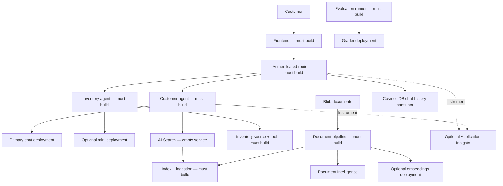

# สถาปัตยกรรมการสนับสนุนลูกค้าหลายตัวแทน — แผนผังสถาปัตยกรรมค้าปลีก  

**บทที่ 5: โซลูชัน AI หลายตัวแทน**  

- [หน้าหลักของคอร์ส](../README.md)  
- [บทที่ 5](../docs/chapter-05-multi-agent/README.md)  
- [ข้อกำหนดเบื้องต้น: การผสานรวม AI](../docs/chapter-02-ai-development/microsoft-foundry-integration.md)  
- [ถัดไป: การวางแผนความจุ](../docs/chapter-06-pre-deployment/capacity-planning.md)  
- [โครงสร้างพื้นฐาน ARM](retail-multiagent-arm-template/README.md)  

> **คู่มือสถาปัตยกรรม ไม่ใช่แอปพลิเคชันที่ใช้งานได้จริง.** ไฟล์การใช้งานค้าปลีก  
> ที่มีอยู่คือ `azuredeploy.json`, `azuredeploy.parameters.json` และ `deploy.sh` ใน  
> `retail-multiagent-arm-template/` คอนเทนเนอร์ตัวกลาง/ส่วนหน้าเป็นเพียง  
> ตัวแทนจำลอง hello-world เท่านั้น ไม่มีตัวแทนค้าปลีก, UI, ท่อการดึงข้อมูล, ตัวประเมิน, ตัวสแกน  
> หรือชุดทดสอบแอปพลิเคชันใดๆ ที่มีอยู่ภายในเครื่อง.  

## ภาพรวม  

**เป้าหมาย:** ออกแบบระบบสนับสนุนลูกค้าด้วยตัวแทนลูกค้าและตัวแทนสินค้าคงคลัง,  
กำหนดสิ่งที่โครงสร้างพื้นฐานจัดหาให้ และวางแผนสัญญาแอปพลิเคชันและการตรวจสอบที่ขาดหายไป  
 

**ผู้ชม:** นักพัฒนาที่ได้ทำตัวอย่าง
[แชท](../../../examples/azure-openai-chat) และ [ตัวอย่างคอนเทนเนอร์สองบริการ](../../../examples/container-app/microservices) เสร็จแล้ว
ให้เวลาประมาณ 2–3 ชั่วโมงสำหรับศึกษาสถาปัตยกรรม การสร้างแอปพลิเคชันเป็นโครงการแยกต่างหาก: 
80–120 ชั่วโมงในการพัฒนาเป็นการประมาณการวางแผนเชิงภาพสำหรับ
นักพัฒนาที่มีประสบการณ์, **ไม่ใช่สัญญาการส่งมอบ**; การปรับปรุงเพื่อใช้งานจริง, การทดสอบ,
การตรวจสอบความปลอดภัย และการดำเนินงานยังต้องใช้การทำงานเพิ่มเติม

### ผลลัพธ์การเรียนรู้

- อธิบายการกำหนดเส้นทาง, การยืนยัน, สิทธิ์เครื่องมือ, และความเป็นเจ้าของการสนทนา
- แยกแยะรหัสโมเดล, ชื่อการปรับใช้, เวอร์ชัน API และเวอร์ชัน ARM
- ออกแบบการนำเข้าและดึงเอกสารด้วยขนาดเวกเตอร์ที่สอดคล้องกัน
- กำหนดข้อกำหนดการทำงาน, การประเมิน และการกู้คืนจากความล้มเหลวที่ตรวจสอบได้
- แยกเป้าหมายสถาปัตยกรรมที่เป็นทางเลือกออกจากทรัพยากรที่จัดเตรียมจริง

## สถาปัตยกรรมโซลูชัน



นี่เป็น **สถาปัตยกรรมแอปพลิเคชันเป้าหมาย** ไม่ใช่แผนภาพของบริการตัวแทนที่ทำงานอยู่
โครงร่าง ARM สร้างบริการพื้นฐานและคอนเทนเนอร์ตัวแทนสองตัวเท่านั้น
Front Door, registry, managed identities, การกำหนดบทบาท,
จุดเชื่อมต่อส่วนตัว, การสลับสำรอง, การวัดแอปพลิเคชัน, และการแจ้งเตือนไม่ได้รวมอยู่

### ความรับผิดชอบและสัญญา

| ส่วนประกอบ | พฤติกรรมที่ต้องการ | หลักฐานก่อนการเรียกว่าสมบูรณ์ |
|---|---|---|
| ส่วนหน้า | รับรองตัวผู้ใช้, แสดงแชท, อัปโหลดเอกสารอย่างปลอดภัย | การทดสอบ UI และการอัปโหลด, ข้อผิดพลาดที่เข้าถึงได้ |
| ตัวกำหนดเส้นทาง | อนุญาตคำขอ, เลือกตัวแทน, จำกัดการเรียก/หมดเวลาของเครื่องมือ | การทดสอบการกำหนดเส้นทาง, การตรวจสอบสิทธิ์, การทดสอบความล้มเหลว |
| ตัวแทนลูกค้า | ตีกรอบนโยบาย/คำตอบผลิตภัณฑ์ในแหล่งที่ได้รับอนุญาต | การอ้างอิงที่ถูกต้อง, งดเว้นเมื่ิอข้อมูลขาดหาย |
| เครื่องมือสินค้าคงคลัง | อ่านสินค้าคงคลังที่น่าเชื่อถือด้วยสิทธิ์ที่จำกัด | การทดสอบสินค้าคงคลังแบบกำหนดผล; ไม่มีการสร้างความพร้อมใช้งานขึ้นเอง |
| ท่อส่งเอกสาร | สกัด, แบ่งชิ้น, ฝัง, ทำดัชนี, อัปเดต/ลบ | ตัวอย่างที่ทำดัชนีและพฤติกรรมการลองใหม่/ตายซ้ำ |
| การจัดเก็บบทสนทนา | แยกผู้ใช้, บังคับใช้การเก็บรักษา | การทดสอบการอนุญาตข้ามผู้ใช้และ TTL |
| ตัวรันการประเมิน | เปรียบเทียบผลลัพธ์กับความเป็นจริงและเกณฑ์ | ความครอบคลุม, จำนวนความล้มเหลว, รายงานที่ทำซ้ำได้ |

คิดว่าตัวเราต์เตอร์เป็นโต๊ะต้อนรับและเครื่องมือต่าง ๆ เป็นระบบภายในที่จำกัด:
การเลือกผู้เชี่ยวชาญไม่ได้หมายถึงการได้รับอนุญาตเข้าถึงข้อมูลของลูกค้าทุกคน
บังคับใช้ตัวตนและสิทธิ์ในโค้ดแอปพลิเคชันและบริการข้อมูล ไม่ใช่ในพรอมต์

## โครงสร้างพื้นฐาน vs. แอปพลิเคชัน

อ่าน [scaffold README](retail-multiagent-arm-template/README.md) ก่อน
การจัดเตรียม มันจะแสดงรายการทรัพยากร โหมด ค่าใช้จ่าย และข้อจำกัดที่ชัดเจน

| การใช้งานตามตรรกะ | ชื่อการปรับใช้ ARM | รุ่น / เวอร์ชัน | ภูมิภาคเริ่มต้น |
|---|---|---|---|
| การสนทนาลูกค้า | `gpt-4.1-chat` | `gpt-4.1` / `2025-04-14` | `eastus2` |
| สต็อกสินค้า | `gpt-4.1-mini-inventory` | `gpt-4.1-mini` / `2025-04-14` | `westus2`, เป็นทางเลือก |
| การฝัง | `text-embedding-ada-002` | `text-embedding-ada-002` / `2` | `francecentral`, เป็นทางเลือก |
| การประเมินผล | `gpt-4.1-grader` | `gpt-4.1` / `2025-04-14` | ภูมิภาคหลักโดยค่าเริ่มต้น |

ตรวจสอบความพร้อมของรุ่น/เวอร์ชัน/SKU และโควต้าใน **แต่ละภูมิภาค** Chat/mini/grader
ใช้ `GlobalStandard`; embeddings ใช้ `Standard`. การแมปหน่วยความจุเป็น TPM คือ
เฉพาะโมเดล ห้ามเพิ่มหน่วยความจุที่แตกต่างกันเป็นการรับประกันโควต้าทั่วไป

อาร์กิวเมนต์ `model` ของคำขอ Azure OpenAI คือ **ชื่อการปรับใช้** ไม่ใช่
ไม่จำเป็นต้องเป็นตัวระบุรุ่นของแคตตาล็อก API ระดับด้านข้อมูลรุ่น `2024-10-21`
แตกต่างจากรุ่นโมเดล `2025-04-14` และทรัพยากร ARM `apiVersion`
ไม่สามารถแก้ไขโมเดลที่ไม่พร้อมใช้งานได้โดยการเปลี่ยนแปลงเฉพาะรุ่น API ระดับด้านข้อมูลเท่านั้น

`--no-multi-region` ข้ามบัญชีรองและบัญชีฝัง หลักของการแชทและบัญชีเกรดเดอร์อิสระยังคงอยู่ บัญชีโมเดลแยกต่างหากไม่ให้การสำรองข้อมูลอัตโนมัติ ซึ่งต้องใช้การกำหนดเส้นทางแอปพลิเคชัน การปรับใช้ที่เข้ากันได้ การตรวจสอบสุขภาพ ขีดจำกัดการลองใหม่ และการตรวจสอบที่ตั้งข้อมูล


## แผนงานการดำเนินการ

### 1. เริ่มต้นด้วยการโต้ตอบที่ทดสอบแล้วหนึ่งครั้ง

ก่อนจัดเตรียมโครงสร้างขนาดใหญ่ ให้ใช้ตัวอย่างแชทในเครื่องเพื่อตั้งค่าการเชื่อมต่ออนุมาน กำหนดคำถามของลูกค้าตัวแทนหนึ่งข้อ แหล่งข้อมูลตอบกลับที่ได้รับอนุมัติ การอ้างอิงที่คาดหวัง และพฤติกรรมเมื่อเกิดข้อผิดพลาดเมื่อแหล่งข้อมูลนั้นขาดหายไป


### 2. กำหนดขอบเขตการกำหนดเส้นทางและเครื่องมือ

สร้างแหล่งที่มาของเราเตอร์ของคุณเอง ไฟล์แมนนิแฟสต์ของการพึ่งพา Dockerfile และการทดสอบ
สัญญาตัวอย่างอาจเป็น `POST /chat` กับ `{"message":"...","conversation_id":"..."}`
**Endpoint นั้นเป็นข้อเสนอการออกแบบ; ไม่มีการดำเนินการโดย ARM template**

ตรวจสอบประเภท/ขีดจำกัดของเนื้อหาใน body สืบทอดตัวตนผู้ใช้จากการรับรองความถูกต้อง บังคับใช้ความเป็นเจ้าของบทสนทนา ใช้เวลาหมดอายุการร้องขอ และส่งรหัสข้อผิดพลาดที่มีความหมายกลับไป

อย่าปฏิบัติต่อความล้มเหลว HTTP หรือการตอบกลับที่ว่างเปล่าเป็นผลลัพธ์ตัวแทนที่สำเร็จ

### 3. ดำเนินการ grounding และ ingestion

เทมเพลต ARM นี้จะไม่สร้างดรรชนีการค้นหา นี่เป็น **แฟรกเมนต์ JSON อ้างอิง
เพื่อปรับใช้ในคำนิยามดรรชนีของคุณเอง** ไม่ใช่ไฟล์ที่มีอยู่ในรีโพแล้ว:

```json
{
  "name": "retail-product-index",
  "fields": [
    {"name": "id", "type": "Edm.String", "key": true},
    {"name": "title", "type": "Edm.String", "searchable": true},
    {"name": "content", "type": "Edm.String", "searchable": true},
    {"name": "category", "type": "Edm.String", "filterable": true},
    {
      "name": "content_vector",
      "type": "Collection(Edm.Single)",
      "searchable": true,
      "dimensions": 1536,
      "vectorSearchProfile": "retail-profile"
    }
  ],
  "vectorSearch": {
    "algorithms": [{"name": "retail-hnsw", "kind": "hnsw"}],
    "profiles": [{"name": "retail-profile", "algorithm": "retail-hnsw"}]
  }
}
```

โปรไฟล์นี้ลิงก์ฟิลด์เวกเตอร์กับอัลกอริทึมของมัน มิติที่ใช้ต้องตรงกับ
เอาต์พุตการฝังตัวจริง (1536 สำหรับการปรับใช้ `ada-002` นี้) สำหรับการค้นคืนใน Python,
ใช้ `azure.search.documents.models.VectorizedQuery` แทนพจนานุกรมที่ไม่สมบูรณ์
ซึ่งขาดประเภทการสืบค้นเวกเตอร์:

```python
# Reference function only: supply an authenticated async SearchClient and an embedding.
from azure.search.documents.models import VectorizedQuery

async def retrieve(search_client, embedding):
    results = await search_client.search(
        search_text=None,
        vector_queries=[VectorizedQuery(
            vector=embedding,
            k_nearest_neighbors=5,
            fields="content_vector"
        )],
        select=["id", "title", "content"]
    )
    return [document async for document in results]
```

สร้างการดำเนินการดูดซึมแยกต่างหากที่:

1. อนุญาตให้เข้าถึงการอัปโหลดและตรวจสอบประเภทเนื้อหาและขนาด
2. อ่านบลอบส่วนตัวโดยใช้การเรียก SDK ที่มีการรับรองความถูกต้อง URL บลอบส่วนตัวเพียงอย่างเดียว
   ไม่ใช่การป้อนข้อมูล Document Intelligence ที่อ่านได้; ส่งไบต์ที่ดาวน์โหลดมาด้วย
   `AnalyzeDocumentRequest(bytes_source=...)` หรือใช้ SAS ช่วงสั้นที่มีขอบเขตที่เหมาะสม
   หลังจากตรวจสอบข้อกำหนดการเข้าถึงแล้ว
3. ดึงข้อความ แบ่งเป็นชิ้นเพื่อให้เข้ากับขีดจำกัดการฝังข้อมูล และสร้างการฝังข้อมูล
4. สร้างคีย์เอกสารที่ถูกต้องและมั่นคง และอัปโหลดชิ้นที่ตรงกับเวกเตอร์
5. ตรวจสอบผลลัพธ์การสร้างดัชนีต่อเอกสาร จัดการการลองใหม่ และอัปเดต/ลบข้อมูลเก่า

อย่าแทรกคีย์/ค่าผู้ใช้โดยพลการเข้าไปในตัวกรอง OData จำกัดรายการฟิลด์ที่อนุญาต
ตรวจสอบประเภทค่าที่รับ และหนีเครื่องหมายคำพูดในสตริง ตัวกรองบูลีนและตัวกรองตัวเลข
จำเป็นต้องใช้ลิเทอรัลแบบพิมพ์ประเภท ไม่ใช่สตริงที่มีเครื่องหมายคำพูด

### 4. การเชื่อมโยงเว็บ

**Bing Search v7 ได้ถูกยกเลิกเมื่อวันที่ 11 สิงหาคม 2025** ทรัพยากร `Microsoft.Bing/accounts` เก่า
และตัวอย่าง `api.bing.microsoft.com/v7.0/search` ไม่ใช่เส้นทางการใช้งานที่รองรับ
ประเมินการผนวกการเชื่อมโยงที่รองรับปัจจุบันใน
Microsoft Foundry และ SDK, สิทธิ์, การเรียกเก็บเงิน และข้อกำหนดการอ้างอิง;
ไม่มีการใช้งานที่นี่ มันไม่ใช่ตัวแทนที่ตรงสำหรับจุดสิ้นสุดที่ถูกยกเลิก

### 5. เพิ่มข้อมูลโทรเลmetry และการประเมินผล

การสร้าง Application Insights ไม่ได้เพิ่มโค้ดวัดผล ใช้ Azure Monitor ที่รองรับ
การติดตั้ง OpenTelemetry เมื่อสร้างแอปพลิเคชันใหม่ การส่งต่อบริบทการติดตามระหว่างบริการ และหลีกเลี่ยงการบันทึกคำสั่งของลูกค้า เอกสาร หรือความลับ

การตัดทอนคำค้นหา **ไม่ได้** ทำให้นิรนาม

วัดระยะเวลาคำขอ ความล้มเหลวของการจัดเส้นทาง/เครื่องมือ ความเกี่ยวข้องของการดึงข้อมูล ความถูกต้องของการอ้างอิง การใช้โทเค็น และการงดเว้น เก็บข้อเท็จจริงของสินค้าคงคลัง/นโยบายที่เป็นข้อเท็จจริงควบคู่ไปกับกรณีการประเมิน: ผู้ตรวจสอบไม่สามารถระบุความถูกต้องตามข้อเท็จจริงได้อย่างน่าเชื่อถือจากเพียงคำถามและคำตอบเท่านั้น


การใช้งานระบบตรวจสอบไม่ได้หมายถึงผู้รันการประเมิน ให้ดำเนินการใช้รูบริกที่มีเวอร์ชัน การตรวจสอบเอาต์พุตตามโครงสร้าง/สคีมา การตรวจสอบช่วงคะแนน การนับความล้มเหลวในการขนส่ง และกรณีที่ผ่านการตรวจสอบโดยมนุษย์ รายงานกรณีที่ไม่สมบูรณ์/ผิดพลาดแยกต่างหาก; อย่าเปลี่ยนเป็นเกรดที่ประสบความสำเร็จหรือนำเข้าระบบเงียบๆ เป็นการตอบสนองของโมเดลคุณภาพต่ำ


เช่นเดียวกัน, การตรวจสอบคำสำคัญไม่กี่ครั้งไม่ใช่การรับรองความปลอดภัย คำขอ HTTP ที่ล้มเหลว กลยุทธ์ทดสอบที่หายไป หรือการตอบสนองว่างต้องทำให้การทดสอบ **ไม่สรุปผลหรือไม่ผ่าน** ไม่ใช่ให้คะแนน “ปลอดภัย 100%” ทำการทดสอบที่ได้รับอนุญาตด้วยเครื่องมือที่เหมาะสมและการตรวจสอบโดยมนุษย์ก่อนการอ้างสิทธิ์ความพร้อมสำหรับการผลิตใดๆ


### 6. ปล่อยใช้งานแอปพลิเคชันของคุณ

สร้างไดเรกทอรีต้นทางของคุณเอง, ไฟล์แมนนิแฟสต์, การทดสอบ, รีจิสทรี และสิทธิ์การดึงภาพ แทนที่ตัวแปรที่เป็นที่ว่างไว้ด้วยภาพที่สร้างแล้วและอัปเดต ingress/probes ให้ตรงกับพอร์ตที่แต่ละแอปฟังอยู่ กำหนดค่าตัวแปรสภาพแวดล้อมรันไทม์ใน Bicep หรือแผนที่สภาพแวดล้อม azd ที่สนับสนุนอย่างชัดเจน


ไม่มี `config` พจนานุกรมทั่วไปภายใต้บริการ azd ที่สร้างตัวแปรสภาพแวดล้อมรันไทม์โดยอัตโนมัติ
`azd env set` จะเปลี่ยนเฉพาะทรัพยากรที่
ใช้งานค่าพวกนั้นอย่างชัดเจนเท่านั้น ไม่มีแคนารี, รายการเขตภูมิศาสตร์, หรือฮุกปรับแต่งแบบละเอียดใด ๆ
ที่นำไปใช้ในโครงร่างนี้

## แบบฝึกหัดออกแบบที่ใช้ได้จริง

เหล่านี้คือ **แบบฝึกหัดสถาปัตยกรรม** ไม่ใช่โค้ดเริ่มต้นขายปลีกที่สามารถรันได้

### แบบฝึกหัดที่ 1: ตรวจสอบขอบเขต

**จุดเริ่มต้น:** ไฟล์สามไฟล์ใน `retail-multiagent-arm-template/`
**เป้าหมาย:** แยกความแตกต่างระหว่างการจัดเตรียมกับฟังก์ชันของแอปพลิเคชัน
เปิด `azuredeploy.json` ค้นหาภาพคอนเทนเนอร์และค่าของ `targetPort`,
จากนั้นจดรายชื่อส่วนประกอบแอปพลิเคชันที่ขาดในรีโพสิทอรี

**เกณฑ์ความสำเร็จ / คำตอบ:** ภาพทั้งสองเป็นตัวแทน hello-world ฟังบนพอร์ต 80; ไม่มีเอเจนต์, UI แชท, ตัวจัดการเราท์เตอร์, ดัชนี/การนำเข้า, ผู้ประเมิน และสแกนเนอร์

คำขอรูทที่ใช้ตัวแทนประสบความสำเร็จจะไม่ตรวจสอบ `/chat`
**ปัญหาพบบ่อย:** การตีความชื่อทรัพยากรเช่น `retail-router` ว่าเป็นโค้ดที่ทำงานได้

### แบบฝึกหัดที่ 2: ติดตามการกำหนดค่าของเวกเตอร์

**จุดเริ่มต้น:** ดัชนี JSON ข้างบน
**เป้าหมาย:** เข้าใจความสัมพันธ์ระหว่างฟิลด์ → โปรไฟล์ → อัลกอริทึม
ระบุว่าค่าตัวใดต้องเปลี่ยนเมื่อสลับไปใช้โมเดลฝังที่มี
มิติผลลัพธ์แตกต่างกัน จากนั้นตรวจสอบฟังก์ชัน `retrieve`

**เกณฑ์ความสำเร็จ / คำตอบ:** เปลี่ยนฟิลด์ `dimensions` เป็นความยาวเวกเตอร์จริง;
รักษา `vectorSearchProfile` ให้สอดคล้องกับโปรไฟล์ที่ประกาศและอัลกอริทึมนั้น;
คำสืบค้นของ `fields` ต้องระบุชื่อฟิลด์เวกเตอร์ สร้างเวกเตอร์เอกสารใหม่
เมื่อโมเดลฝังเปลี่ยน
**ปัญหาพบบ่อย:** เปลี่ยนแค่ชื่อโมเดลแต่เก็บเวกเตอร์ที่ไม่เข้ากันไว้

### แบบฝึกหัดที่ 3: กำหนดการทดสอบความล้มเหลว

**จุดเริ่มต้น:** ตารางความรับผิดชอบ
**เป้าหมาย:** ป้องกันความสำเร็จที่เป็นเท็จ
เขียนพฤติกรรมที่คาดหวังสำหรับ API สินค้าคงคลังที่ไม่พร้อมใช้งาน, ดัชนีการค้นหาที่ไม่มีเอกสารตรงกัน, และคำขอประเมินที่คืนค่า HTTP 503


**เกณฑ์ความสำเร็จ / คำตอบ:** ไม่มีค่าคลังสินค้าที่คิดขึ้นมาใหม่; การงดเว้นอย่างชัดเจนหรือ  
การเพิ่มระดับเมื่อไม่มีบริบท; รายงานการประเมินผลล้มเหลวในการขนส่งแทนที่จะผ่านการตรวจสอบคุณภาพหรือความปลอดภัย  
เพิ่มการทดสอบที่สามารถรันได้เมื่อคุณสร้างแอปพลิเคชัน  
**ปัญหาทั่วไป:** การจับข้อยกเว้นทั้งหมดและดำเนินการต่อด้วยคำตอบว่างเปล่า  

## ค่าใช้จ่าย, การแก้ไขปัญหา, และการทำความสะอาด  

- โครงสร้างพื้นฐานมีค่าใช้จ่ายต่อเนื่องแม้ว่าจะมีดัชนีการค้นหาว่างเปล่าและแอปพลิเคชันตัวแทน  
  ใช้ราคาภูมิภาคปัจจุบัน; ไม่มีคำว่า “ขั้นต่ำ” หรือหลายภูมิภาคแปลว่าฟรี  
- ต้นทุนโทเค็นขึ้นอยู่กับรุ่น, ข้อมูลนำเข้าแคช/ไม่แคช, ข้อมูลส่งออก, และ SKU การปรับใช้  
  การกำหนดเส้นทางสามารถประหยัดเงินได้ก็ต่อเมื่อปริมาณงานที่วัดได้และผลลัพธ์คุณภาพสามารถสนับสนุนได้;
  การประหยัดที่แน่นอน 60–80% ไม่ได้รับประกัน
- ตรวจสอบความพร้อมใช้งานของโมเดลและโควตาก่อนการจัดสรร; แยกแยะข้อผิดพลาดเรื่องสิทธิ์,
  ชื่อการปรับใช้, ภูมิภาค, เวอร์ชันโมเดล และเวอร์ชัน API
- ห้ามเรียกใช้ `setup-data.sh` evaluator CLI หรือคำสั่ง `pytest tests/` ที่ขาดหายไป
  การดำเนินการของพวกมันเป็นส่วนหนึ่งของงานพัฒนาของคุณ
- โครงร่างเป็น ARM-only: ปฏิบัติตาม
  [คำแนะนำการตรวจสอบและทำความสะอาด](retail-multiagent-arm-template/README.md).
  `azd down` ไม่ได้จัดการกับทรัพยากรเหล่านั้น

## ทรัพยากรที่เกี่ยวข้อง

- [ตัวอย่างแชทภายในเครื่องที่ใช้งานได้](../../../examples/azure-openai-chat)
- [ตัวอย่างคอนเทนเนอร์บริการสองรายการที่ใช้งานได้](../../../examples/container-app/microservices)
- [ดัชนีเวกเตอร์ค้นหา AI](https://learn.microsoft.com/azure/search/vector-search-how-to-create-index)
- [เอกสารแอปคอนเทนเนอร์](https://learn.microsoft.com/azure/container-apps/)
- [แก้ไขปัญหา](../docs/chapter-07-troubleshooting/common-issues.md)
- [รายงานปัญหา](https://github.com/microsoft/AZD-for-beginners/issues)

---

<!-- CO-OP TRANSLATOR DISCLAIMER START -->
**ปฏิเสธความรับผิดชอบ**:
เอกสารนี้ได้รับการแปลโดยใช้บริการแปลภาษา AI [Co-op Translator](https://github.com/Azure/co-op-translator) ขณะที่เราพยายามให้ความถูกต้อง โปรดทราบว่าการแปลโดยอัตโนมัติอาจมีข้อผิดพลาดหรือความไม่ถูกต้อง เอกสารต้นฉบับในภาษาต้นทางควรถูกพิจารณาเป็นแหล่งข้อมูลที่เชื่อถือได้ สำหรับข้อมูลที่สำคัญ แนะนำให้ใช้การแปลโดยมนุษย์มืออาชีพ เราไม่รับผิดชอบต่อความเข้าใจผิดหรือการตีความที่ผิดพลาดที่เกิดขึ้นจากการใช้การแปลนี้
<!-- CO-OP TRANSLATOR DISCLAIMER END -->