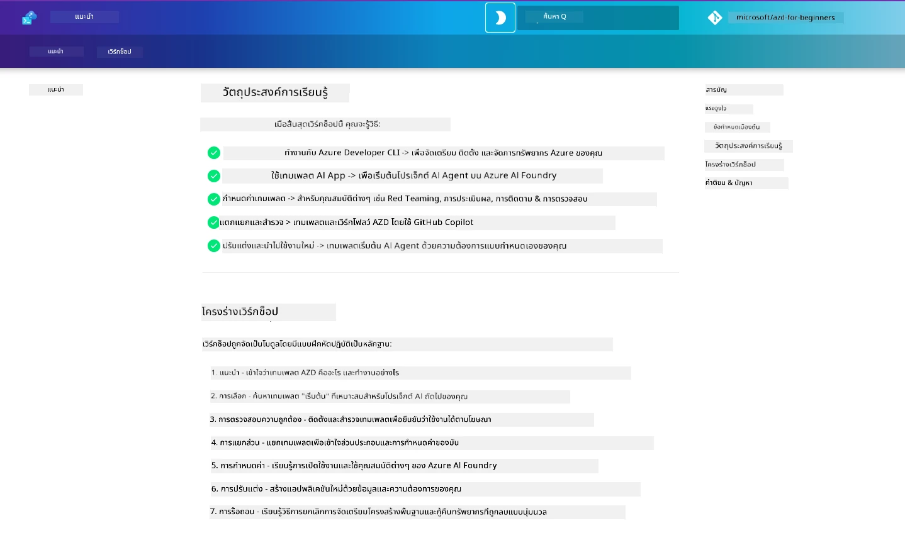

<div align="center">
  <div style="background: linear-gradient(135deg, #0078d4, #106ebe); border-radius: 10px; padding: 20px; margin: 20px 0; box-shadow: 0 4px 15px rgba(0, 120, 212, 0.3); border: 2px solid #005a9e;">
    <h2 style="color: white; margin: 0; font-size: 24px; text-shadow: 1px 1px 2px rgba(0,0,0,0.3);">
      🎯 เวิร์กช็อป AZD สำหรับนักพัฒนา AI
    </h2>
    <p style="color: white; margin: 10px 0 0 0; font-size: 16px; text-shadow: 1px 1px 2px rgba(0,0,0,0.3);">
      <strong>เวิร์กช็อปปฏิบัติการเพื่อสร้างแอป AI ด้วย Azure Developer CLI.</strong><br>
      ทำโมดูลครบ 7 โมดูลเพื่อชำนาญเทมเพลต AZD และกระบวนการปรับใช้งาน AI
    </p>
    <div style="margin-top: 15px;">
      <span style="background: rgba(255,255,255,0.2); padding: 5px 10px; border-radius: 15px; color: white; font-size: 14px;">
        📅 แหล่งข้อมูลได้รับการตรวจสอบ: พฤศจิกายน 2026
      </span>
    </div>
  </div>
</div>

# เวิร์กช็อป AZD สำหรับนักพัฒนา AI

ยินดีต้อนรับสู่เวิร์กช็อปปฏิบัติการเพื่อเรียนรู้ Azure Developer CLI (AZD) โดยเน้นการปรับใช้แอป AI งานนี้ช่วยให้คุณเข้าใจการใช้เทมเพลต AZD ใน 3 ขั้นตอน:

1. **ค้นหา** - หาหลักสูตรที่เหมาะกับคุณ
1. **ปรับใช้** - ปรับใช้และยืนยันว่าใช้งานได้
1. **ปรับแต่ง** - แก้ไขและปรับให้เป็นของคุณ!

ตลอดเวิร์กช็อปนี้ คุณจะได้รับการแนะนำเครื่องมือและกระบวนการหลักสำหรับนักพัฒนา เพื่อช่วยคุณพัฒนาได้อย่างราบรื่นตั้งแต่ต้นจนจบ

<br/>

## คู่มือผ่านเบราว์เซอร์

บทเรียนเวิร์กช็อปเป็น Markdown คุณสามารถเรียกดูโดยตรงใน GitHub หรือเปิดดูตัวอย่างผ่านเบราว์เซอร์ตามภาพหน้าจอข้างล่าง



ใช้ตัวเลือกนี้โดยการ fork ที่เก็บไปยังโปรไฟล์ของคุณ แล้วเปิด GitHub Codespaces เมื่อเทอร์มินัล VS Code พร้อมใช้งาน ให้พิมพ์คำสั่งนี้:

การดูตัวอย่างในเบราว์เซอร์นี้ทำงานได้ใน GitHub Codespaces, dev containers หรือโคลนท้องถิ่นที่ติดตั้ง Python และ MkDocs

```bash title="" linenums="0"
python -m pip install -r requirements-dev.txt
python -m mkdocs serve --config-file workshop/mkdocs.yml
```

รันคำสั่งเหล่านี้จาก **โฟลเดอร์รากของรีโปชุดการเรียน** ไม่ใช่ตัวอย่าง AI ที่ตั้งค่าแยกต่างหาก ให้เก็บตัวอย่างนี้ไว้ด้านหน้าจอเพื่อดูข้อผิดพลาด หยุดด้วย Ctrl+C เพื่อตรวจสอบไซต์โดยไม่ต้องให้บริการ รัน `python -m mkdocs build --strict --config-file workshop/mkdocs.yml`

ในไม่กี่วินาที คุณจะเห็นกล่องโต้ตอบแบบป๊อปอัพ เลือกตัวเลือก `Open in browser` คู่มือเว็บจะเปิดในแท็บเบราว์เซอร์ใหม่ ข้อดีของตัวอย่างนี้มีดังนี้:

1. **ค้นหาในตัว** - ค้นหาคีย์เวิร์ดหรือบทเรียนได้อย่างรวดเร็ว
1. **ไอค่อนคัดลอก** - เอาเมาส์วางบนบล็อกโค้ดเพื่อดูตัวเลือกนี้
1. **สลับธีม** - สลับระหว่างธีมมืดและสว่าง
1. **ขอความช่วยเหลือ** - คลิกไอค่อน Discord ที่ส่วนท้ายเพื่อเข้าร่วม!

<br/>

## ภาพรวมเวิร์กช็อป

**ระยะเวลา:** 3-4 ชั่วโมง  
**ระดับ:** ผู้เริ่มต้นจนถึงระดับกลาง  
**ความรู้พื้นฐาน:** คุ้นเคยกับ Azure, แนวคิด AI, VS Code และเครื่องมือคอมมานด์ไลน์  

นี่คือเวิร์กช็อปปฏิบัติการที่คุณเรียนรู้ด้วยการลงมือทำ เมื่อคุณทำแบบฝึกหัดเสร็จแล้ว เราแนะนำให้ทบทวนหลักสูตร AZD For Beginners เพื่อเรียนรู้ต่อไปเกี่ยวกับแนวทางปฏิบัติด้านความมั่นคงและประสิทธิผล

| เวลา| โมดูล  | วัตถุประสงค์ |
|:---|:---|:---|
| 15 นาที | [บทนำ](docs/instructions/0-Introduction.md) | วางกรอบ, เข้าใจเป้าหมาย |
| 30 นาที | [เลือกเทมเพลต AI](docs/instructions/1-Select-AI-Template.md) | สำรวจตัวเลือกและเลือกโปรเจกต์เริ่มต้น | 
| 30 นาที | [ยืนยันเทมเพลต AI](docs/instructions/2-Validate-AI-Template.md) | ปรับใช้โซลูชันเริ่มต้นบน Azure |
| 30 นาที | [แยกส่วนเทมเพลต AI](docs/instructions/3-Deconstruct-AI-Template.md) | สำรวจโครงสร้างและการตั้งค่า |
| 30 นาที | [ตั้งค่าเทมเพลต AI](docs/instructions/4-Configure-AI-Template.md) | เปิดใช้และทดลองฟีเจอร์ที่มี |
| 30 นาที | [ปรับแต่งเทมเพลต AI](docs/instructions/5-Customize-AI-Template.md) | ปรับแต่งเทมเพลตให้เหมาะกับคุณ |
| 30 นาที | [รื้อถอนโครงสร้างพื้นฐาน](docs/instructions/6-Teardown-Infrastructure.md) | ล้างและปล่อยทรัพยากร |
| 15 นาที | [สรุปและขั้นตอนถัดไป](docs/instructions/7-Wrap-up.md) | แหล่งเรียนรู้, ความท้าทายในเวิร์กช็อป |

<br/>

## สิ่งที่จะได้เรียนรู้

คิดว่าเทมเพลต AZD เป็นสนามทดลองเรียนรู้เพื่อสำรวจความสามารถและเครื่องมือต่าง ๆ สำหรับการพัฒนา end-to-end บน Microsoft Foundry เมื่อจบเวิร์กช็อปนี้ คุณจะได้ความเข้าใจในเครื่องมือและแนวคิดต่าง ๆ ในบริบทนี้

| แนวคิด  | วัตถุประสงค์ |
|:---|:---|
| **Azure Developer CLI** | เข้าใจคำสั่งเครื่องมือและกระบวนการทำงาน|
| **เทมเพลต AZD**| เข้าใจโครงสร้างโปรเจกต์และการตั้งค่า|
| **Azure AI Agent**| จัดเตรียมและปรับใช้โปรเจกต์ Microsoft Foundry |
| **Azure AI Search**| เปิดใช้การสร้างบริบทด้วยเอเจนต์ |
| **Observability**| สำรวจการติดตาม, การตรวจสอบ และการประเมินผล |
| **Red Teaming**| สำรวจการทดสอบจำลองสถานการณ์โจมตีและการป้องกัน |

<br/>

## โครงสร้างเวิร์กช็อป

เวิร์กช็อปนี้จัดขึ้นเพื่อพาคุณเดินทางตั้งแต่การค้นหาเทมเพลต ไปสู่การปรับใช้ การแยกส่วน และการปรับแต่ง โดยใช้เทมเพลตเริ่มต้นอย่างเป็นทางการ [Getting Started with AI Agents](https://github.com/Azure-Samples/get-started-with-ai-agents) เป็นฐาน

### [โมดูล 1: เลือกเทมเพลต AI](docs/instructions/1-Select-AI-Template.md) (30 นาที)

- เทมเพลต AI คืออะไร?
- หาเทมเพลต AI ได้ที่ไหน?
- จะเริ่มสร้าง AI Agents ได้อย่างไร?
- **ห้องปฏิบัติการ**: เริ่มต้นเร็วใน Codespaces หรือ dev container

### [โมดูล 2: ยืนยันเทมเพลต AI](docs/instructions/2-Validate-AI-Template.md) (30 นาที)

- สถาปัตยกรรมเทมเพลต AI คืออะไร?
- กระบวนการพัฒนา AZD คืออะไร?
- จะขอความช่วยเหลือกับ AZD Development ได้อย่างไร?
- **ห้องปฏิบัติการ**: ปรับใช้และยืนยันเทมเพลต AI Agents

### [โมดูล 3: แยกส่วนเทมเพลต AI](docs/instructions/3-Deconstruct-AI-Template.md) (30 นาที)

- สำรวจสภาพแวดล้อมของคุณใน `.azure/` 
- สำรวจการจัดสรรทรัพยากรของคุณใน `infra/` 
- สำรวจการตั้งค่า AZD ของคุณใน `azure.yaml`s
- **ห้องปฏิบัติการ**: แก้ไข Environment Variables และปรับใช้ใหม่

### [โมดูล 4: ตั้งค่าเทมเพลต AI](docs/instructions/4-Configure-AI-Template.md) (30 นาที)
- สำรวจ: การสร้างเนื้อหาเสริมจากการเรียกคืน
- สำรวจ: การประเมิน Agent & การทำ Red Teaming
- สำรวจ: การติดตามและตรวจสอบ
- **ห้องปฏิบัติการ**: สำรวจ AI Agent + Observability 

### [โมดูล 5: ปรับแต่งเทมเพลต AI](docs/instructions/5-Customize-AI-Template.md) (30 นาที)
- กำหนด: PRD ด้วยข้อกำหนดสถานการณ์
- ตั้งค่า: Environment Variables สำหรับ AZD
- นำไปใช้: Lifecycle Hooks สำหรับงานเพิ่มเติม
- **ห้องปฏิบัติการ**: ปรับแต่งเทมเพลตสำหรับสถานการณ์ของฉัน

### [โมดูล 6: รื้อถอนโครงสร้างพื้นฐาน](docs/instructions/6-Teardown-Infrastructure.md) (30 นาที)
- ทบทวน: เทมเพลต AZD คืออะไร?
- ทบทวน: ทำไมต้องใช้ Azure Developer CLI?
- ขั้นตอนถัดไป: ลองเทมเพลตอื่น!
- **ห้องปฏิบัติการ**: ยกเลิกการจัดสรรโครงสร้างพื้นฐานและทำความสะอาด

<br/>

## ความท้าทายในเวิร์กช็อป

ต้องการท้าทายตัวเองให้ทำมากกว่านี้ไหม? นี่คือข้อเสนอโปรเจกต์ หรือแบ่งปันความคิดของคุณกับเรา!!

| โครงการ | คำอธิบาย |
|:---|:---|
|1. **แยกส่วนเทมเพลต AI ที่ซับซ้อน** | ใช้กระบวนการและเครื่องมือที่เราอธิบาย และดูว่าคุณสามารถปรับใช้ ยืนยัน และปรับแต่งเทมเพลต AI โซลูชันอื่นได้ไหม _คุณได้เรียนรู้อะไร?_|
|2. **ปรับแต่งตามสถานการณ์ของคุณ**  | ลองเขียน PRD (เอกสารข้อกำหนดผลิตภัณฑ์) สำหรับสถานการณ์ที่แตกต่าง จากนั้นใช้ GitHub Copilot ในรีโปเทมเพลตของคุณใน Agent Model – และขอให้สร้างเวิร์กโฟลว์การปรับแต่งให้คุณ _คุณได้เรียนรู้อะไร? คุณจะปรับปรุงคำแนะนำเหล่านี้อย่างไร?_|
| | |

## มีข้อเสนอแนะไหม?

1. โพสต์ปัญหาในรีโปนี้ – ติดแท็ก `Workshop` เพื่อความสะดวก
1. เข้าร่วม Microsoft Foundry Discord – เชื่อมต่อกับเพื่อนร่วมงาน!


| | | 
|:---|:---|
| **📚 หน้าโฮมคอร์ส**| [AZD For Beginners](../README.md)|
| **📖 เอกสารประกอบ** | [เริ่มต้นกับเทมเพลต AI](https://learn.microsoft.com/en-us/azure/ai-foundry/how-to/develop/ai-template-get-started)|
| **🛠️ เทมเพลต AI** | [Microsoft Foundry Templates](https://ai.azure.com/templates) |
|**🚀 ขั้นตอนต่อไป** | [เริ่มเวิร์กช็อป](#workshop-overview) |
| | |

<br/>

---

**การนำทาง:** [หลักสูตรหลัก](../README.md) | [บทนำ](docs/instructions/0-Introduction.md) | [โมดูล 1: เลือกเทมเพลต](docs/instructions/1-Select-AI-Template.md)

**พร้อมเริ่มสร้างแอป AI ด้วย AZD แล้วหรือยัง?**

[เริ่มเวิร์กช็อป: บทนำ →](docs/instructions/0-Introduction.md)

---

<!-- CO-OP TRANSLATOR DISCLAIMER START -->
**ปฏิเสธความรับผิดชอบ**:
เอกสารนี้ได้รับการแปลโดยใช้บริการแปลภาษา AI [Co-op Translator](https://github.com/Azure/co-op-translator) ขณะที่เราพยายามให้ความถูกต้อง โปรดทราบว่าการแปลโดยอัตโนมัติอาจมีข้อผิดพลาดหรือความไม่ถูกต้อง เอกสารต้นฉบับในภาษาต้นทางควรถูกพิจารณาเป็นแหล่งข้อมูลที่เชื่อถือได้ สำหรับข้อมูลที่สำคัญ แนะนำให้ใช้การแปลโดยมนุษย์มืออาชีพ เราไม่รับผิดชอบต่อความเข้าใจผิดหรือการตีความที่ผิดพลาดที่เกิดขึ้นจากการใช้การแปลนี้
<!-- CO-OP TRANSLATOR DISCLAIMER END -->